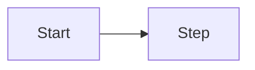

# Visual language: shared standard v0.1

## Purpose
Make complex things seen rather than read, but give every chart a job. In areas where the CEO is not an expert (front end, architecture flow, deploy) the visual is the primary form of explanation. The same visual language holds in every output: stamp = CEO gate, green = autonomous, dashed = planned.

## Inputs
- The content to explain and the target reader (CEO, customer, developer).
- The company's semantic palette and the intro page (`site/index.html`) are the reference.
- Target medium: in-repo markdown (GitHub renders mermaid), an HTML page/artifact, a presentation.

## Method
1. **When a diagram is mandatory.** A flow of three or more steps; the relationship of three or more components; a state transition; a data model with three or more entities; a deployment topology; a dependency/critical path. In a spec: §4 screen flow, §6 component diagram, §7 ER, §10 deployment; in a status report: dependency/critical path; in a product decision: the competitor positioning matrix.
2. **A diagram answers one question.** Let its title be that question. At most 9 nodes; if more, split. Labels are short, not full sentences.
3. **Color carries meaning, not decoration.** Green: autonomous/ready. Red: a CEO gate or risk. Gray/dashed: planned/neutral. Do not use more than three colors. **Color alone never carries information:** shape, line type or a label gives the same information too.
4. **It lives as text in the repo.** A diagram is written as code (mermaid or SVG text); binary images, screenshots and exported PNGs do not enter the repo (evidence policy). Exception: brand assets the CEO approved.
5. **Accessibility.** Every diagram has a title and a one-sentence description; next to it a text equivalent (a table or list). In HTML every meaningful `<svg>` carries `role="img"` and `aria-label`; every `` carries `alt`; no text smaller than 11 pixels.
6. **HTML pages (CEO page, artifact).** Colors are defined as tokens; light and dark theme; no horizontal scroll at phone width (375 px); a wide SVG that would shrink too small to read on a phone has a vertical variant; an interactive demo is labelled "simulation"; every number is tied to a source (the test count from the `check` output, no invented numbers); the page file is in the repo under `site/`, the published copy is secondary.
7. **See the page by eye.** Before publishing look at it with screenshots at desktop and phone width; measure overflow and overlap. Do not say "it works" without seeing it.
8. **Copyright.** Images and media only if open/licensed; source and license recorded (Quality office approval).
9. **Mermaid limit.** If a complex drawing is needed write SVG instead of mermaid; color and layout control in mermaid is limited.

## Output template
````
### <The question the diagram answers>

Description: <one sentence>. Text equivalent: <a table or list>.
````

## Checklist
- [ ] A diagram exists where it is mandatory, and each one's title is a question.
- [ ] The node count is 9 or fewer and labels are short.
- [ ] Color carries meaning, never carries information alone, at most three colors.
- [ ] The diagram is in the repo as text; there is no binary image.
- [ ] A description and a text equivalent exist; in HTML `role="img"`, `aria-label`, `alt` are complete.
- [ ] HTML: two themes, no horizontal scroll at 375 px, seen by eye.
- [ ] Every number is tied to a source.

## Prohibitions
- A diagram for decoration; icons and drawings that give no information.
- Meaning that rests on color alone (a color-blind reader misses it).
- Putting a PNG, screenshot or exported image into the repo.
- An invented number, a fake metric, an unsourced chart; presenting a simulation as real behavior.
- Using a copyrighted image.
- Declaring a visual output "done" without seeing it.

## Tools and permissions
Text-writing tools (`Write`, `Edit`) only under `docs/`, `specs/`, `site/`. For local preview a temporary local web server and the browser pane on the host machine; the server is shut down when the job ends. Screenshots are not put in the repo.

## Stop and escalate
- If the content cannot be explained with a visual (it is unclear), go back to the BA first: what cannot be visualized is often what is undefined.
- If an image's license is unclear, stop and ask the Quality office.
- If a page has a claim that cannot be measured (for example "it works"), measure it or remove the claim.

## Examples
- Good: "### What happens when an order is deleted? (a mermaid flow, 6 nodes, green: automatic, red: user decision) + one sentence below and a step table."
- Bad: a 14-node diagram, each node a different color, with no description, and a `diyagram.png` added to the repo.
- Good number: "29 checks green (`./harness/bin/check` output)". Bad: "about 30 tests".
