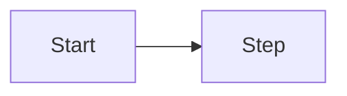

# Visual language: shared standard v0.2

## Purpose
Make complex things seen, not read, and give every chart a job. Same language everywhere: stamp = CEO gate, green = autonomous, dashed = planned.

## Inputs
The content and its reader (CEO, customer, developer); the semantic palette in `site/index.html`; the medium (repo markdown, HTML page, presentation).

## Method
1. **Mandatory** for: a flow of 3+ steps, 3+ related components, a state transition, a data model of 3+ entities, deployment topology, dependency/critical path (spec §4, §6, §7, §10; status report critical path; product positioning matrix).
2. **One diagram, one question**, as its title. At most 9 nodes; short labels.
3. **Color means something:** green autonomous/ready, red CEO gate or risk, gray/dashed planned. At most three colors; never color alone (add shape, line type or label).
4. **Text in the repo:** mermaid or SVG source; no PNG, screenshot or export (brand assets the CEO approved excepted).
5. **Accessible:** title + one-sentence description + text equivalent (table or list). HTML: meaningful `<svg>` has `role="img"` and `aria-label`, every `` has `alt`, no text under 11 px.
6. **HTML pages:** color tokens, light and dark theme, no horizontal scroll at 375 px, a vertical variant for wide SVGs, demos labelled "simulation", every number from a source, page file under `site/`.
7. **Look by eye** at desktop and phone width before publishing.
8. **Copyright:** only licensed media, source recorded. Complex drawing: SVG instead of mermaid.

## Output template
````
### <The question the diagram answers>

Description: <one sentence>. Text equivalent: <table or list>.
````

## Checklist
- [ ] Diagram where mandatory; title is a question.
- [ ] ≤ 9 nodes, short labels.
- [ ] Color has meaning, never alone, ≤ 3 colors.
- [ ] Text in the repo; no binary image.
- [ ] Description and text equivalent; HTML `role="img"`, `aria-label`, `alt`.
- [ ] HTML: two themes, no scroll at 375 px, seen by eye.
- [ ] Every number sourced.

## Prohibitions
Decorative diagrams · meaning by color alone · binary images in the repo · invented numbers or a simulation shown as real · copyrighted images · calling a visual done without seeing it.

## Tools and permissions
`Write`/`Edit` under `docs/`, `specs/`, `site/`. Local preview server and browser on the host, shut down after; screenshots never enter the repo.

## Stop and escalate
Cannot be drawn → it is probably undefined: back to the BA. Unclear image license → ask the Quality office. Unmeasurable claim on a page → measure it or remove it.

## Examples
- Good: "### What happens when an order is deleted? (6-node mermaid flow, green automatic, red user decision) + one sentence + step table."
- Bad: 14 nodes in 14 colors, no description, `diagram.png` in the repo.
