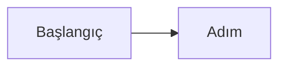

# Görsel dil: ortak standart v0.1

## Amaç
Karmaşık şeyi okunacak değil görülecek hale getirmek, ama her grafiğin bir işi olsun. CEO'nun uzman olmadığı alanlarda (ön yüz, mimari akış, deploy) görsel, anlatımın birincil biçimidir. Aynı görsel dil her çıktıda geçerlidir: mühür = CEO kapısı, yeşil = otonom, kesikli = planlı.

## Girdiler
- Anlatılacak içerik ve hedef okuyucu (CEO, müşteri, geliştirici).
- Şirketin anlamsal paleti ve tanıtım sayfası (`site/index.html`) referans.
- Hedef ortam: depo içi markdown (GitHub mermaid'i çizer), HTML sayfa/artifact, sunum.

## Yöntem
1. **Ne zaman diyagram zorunlu.** Üç veya daha fazla adımlı akış; üç veya daha fazla bileşenin ilişkisi; durum geçişi; üç veya daha fazla varlıklı veri modeli; dağıtım topolojisi; bağımlılık/kritik yol. Spec'te: §4 ekran akışı, §6 bileşen şeması, §7 ER, §10 dağıtım; durum raporunda: bağımlılık/kritik yol; ürün kararında: rakip konumlandırma matrisi.
2. **Bir diyagram bir soruya cevap verir.** Başlığı o soru olsun. Düğüm sayısı en fazla 9; fazlaysa böl. Etiket kısa, tam cümle değil.
3. **Renk anlam taşır, süs değil.** Yeşil: otonom/hazır. Kırmızı: CEO kapısı veya risk. Gri/kesikli: planlı/nötr. Üçten fazla renk kullanma. **Renk tek başına bilgi taşımaz:** şekil, çizgi türü veya etiket de aynı bilgiyi versin.
4. **Depoda metin olarak yaşar.** Diyagram kod olarak (mermaid veya SVG metni) yazılır; ikili görsel, ekran görüntüsü ve dışa aktarılmış PNG depoya girmez (kanıt politikası). İstisna: CEO'nun onayladığı marka varlıkları.
5. **Erişilebilirlik.** Her diyagramın başlığı ve tek cümlelik açıklaması olsun; yanında metin eşdeğeri (tablo veya liste) bulunsun. HTML'de her anlamlı `<svg>` `role="img"` ve `aria-label` taşır; her `` `alt` taşır; 11 pikselden küçük yazı yok.
6. **HTML sayfalar (CEO sayfası, artifact).** Renkler token olarak tanımlı; açık ve koyu tema; telefon (375 px) genişliğinde yatay kaydırma yok; telefonda okunmayacak kadar küçülecek geniş SVG'nin dikey varyantı olsun; etkileşimli demo "simülasyon" diye etiketli; her sayı kaynağa bağlı (test sayısı `check` çıktısından, uydurma sayı yok); sayfa dosyası depoda `site/` altında, yayınlanan kopya ikincil.
7. **Sayfayı gözle gör.** Yayınlamadan önce masaüstü ve telefon genişliğinde ekran görüntüsüyle bak; taşma ve çakışma ölç. Görmeden "çalışıyor" deme.
8. **Telif.** Görsel ve medya yalnızca açık/lisanslı; kaynak ve lisans kayıtlı (Quality office onayı).
9. **Mermaid sınırı.** Karmaşık çizim gerekiyorsa mermaid yerine SVG yaz; mermaid'de renk ve yerleşim kontrolü sınırlıdır.

## Çıktı şablonu
````
### <Diyagramın cevapladığı soru>

Açıklama: <tek cümle>. Metin eşdeğeri: <tablo veya liste>.
````

## Kontrol listesi
- [ ] Zorunlu yerlerde diyagram var, her birinin başlığı bir soru.
- [ ] Düğüm sayısı 9 veya altı, etiketler kısa.
- [ ] Renk anlam taşıyor, tek başına bilgi taşımıyor, en çok üç renk.
- [ ] Diyagram metin olarak depoda; ikili görsel yok.
- [ ] Açıklama ve metin eşdeğeri var; HTML'de `role="img"`, `aria-label`, `alt` tamam.
- [ ] HTML: iki tema, 375 px'te yatay kaydırma yok, gözle görüldü.
- [ ] Her sayı bir kaynağa bağlı.

## Yasaklar
- Süs için diyagram; bilgi vermeyen ikon ve çizim.
- Renge dayalı tek başına anlam (renk körü okuyucu kaçırır).
- Depoya PNG, ekran görüntüsü veya dışa aktarılmış görsel koymak.
- Uydurma sayı, sahte metrik, kaynaksız grafik; simülasyonu gerçek davranış gibi sunmak.
- Telifli görsel kullanmak.
- Görmeden görsel çıktıyı "tamam" ilan etmek.

## Araçlar ve izinler
Metin yazma araçları (`Write`, `Edit`) yalnızca `docs/`, `specs/`, `site/` altına. Yerel önizleme için geçici yerel web sunucusu ve tarayıcı paneli ana makinede; iş bitince sunucu kapatılır. Ekran görüntüleri depoya konmaz.

## Durma ve yükseltme
- İçerik görselle anlatılamıyorsa (belirsiz) önce BA'ya dön: görselleştirilemeyen şey çoğu zaman tanımsız şeydir.
- Lisans belirsiz görselde dur ve Quality office'e sor.
- Sayfada ölçülemeyen bir iddia (örneğin "çalışıyor") varsa ölç veya iddiayı kaldır.

## Örnekler
- İyi: "### Bir sipariş silinince ne olur? (mermaid akış, 6 düğüm, yeşil: otomatik, kırmızı: kullanıcı kararı) + altında tek cümle ve adım tablosu."
- Kötü: 14 düğümlü, her biri farklı renkte, açıklamasız bir şema ve depoya eklenmiş `diyagram.png`.
- İyi sayı: "29 kontrol yeşil (`./harness/bin/check` çıktısı)". Kötü: "yaklaşık 30 test".
