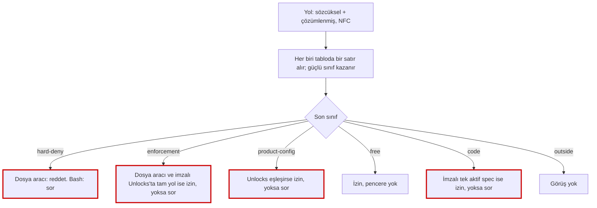
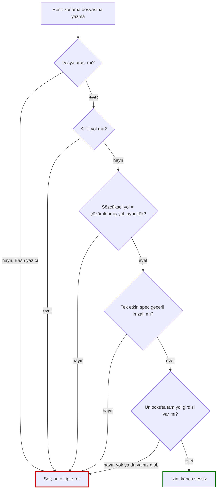

# ADR 0001 — Yol sınıfı taksonomisi (zorlama katmanının ortak sözleşmesi)

- Status: Proposed (2026-11-22 değişikliği spec 0004'ün yeniden imzasını bekliyor. Önceki metin 2026-11-21 imzalarıyla kabul edilmişti; o imzalar bu metni kapsamaz.)
- Date: 2026-11-21; son güncelleme 2026-11-22 (REQ-37 eşitlemesi ve "tam yol girdisi zorlama dosyası açar, glob açmaz" değişikliği; ayrıntı aşağıda "Değişiklik kaydı")
- Decider: CEO (spec 0004 imzası bu ADR'yi kabul sayar); öneren: Architecture board
- Spec: `specs/active/0004-harness-enforcement-gaps.md` (§3 REQ-2..4, REQ-8, REQ-17..REQ-20, REQ-22, REQ-25..REQ-29, REQ-33..REQ-37; §5 AC-16, AC-17; §6 Ruling R-14, R-16..R-28; §7.1-§7.5, §7.7, §7.8; §8 G-1..G-22; §14 "Delta 2026-11-22 (always-auto)"; varsayımlar A-10..A-15; imza ön koşulu T-0). Spec bu ADR'den üstündür; ikisi ayrışırsa spec geçerlidir.
- Kaynaklar: spec 0004 (son kuralların kaynağı; board K1-K9 uygulanmış, spec-critic ve appsec üçüncü tur bulguları işlenmiş; 2026-11-21 REQ-37 farkı ve 2026-11-22 "always-auto" farkı dahil), tasarım `docs/architecture/tasarim/0004-host-enforcement.md`, görüşler `docs/architecture/gorus-0004-host-enforcement-2026-11-21.md` ve `docs/architecture/gorus-0004-delta-2026-11-22.md`, `docs/KARARLAR.md` rev. 48 (2026-11-22 kayıtları dahil: "oturumlar her zaman `auto` kipinde çalışır"), T-1 kaydı `docs/kanit/0004-t1.md` (bulgu B-1).
- Kapsam dışı: imza biçimi (v1 değişmiyor, ADR gerekmez); birim yazma alanları ve `stop.js` kanıt kuralı (spec 0006, bu taksonomiyi tüketir); aynı proje içinde bitmiş spec'in imza kaydının emekliye ayrılması (spec 0005, G-21).

## Context (Bağlam)

Ana makinede (host) imza kapısı yok: `gate.js` yalnız konteynerde bağlı (`harness/container-settings.json:26-31`), host'ta yalnız `guard.js` bağlı ve dosya aracı dalı sabit bir zorlama regex'ine bakıyor (`guard.js:50`). İmzasız kod düzenlemesi host'ta sessiz geçiyor. `gate.js:32` ile `guard.js:50` neyin korunduğu konusunda ayrışıyor: gate `.claude/` tamamını engelliyor, guard yalnız ayarları ve birkaç betiği soruyor. Birim tanımları, playbook'lar, doğrulama araçları ve şablonlar host'ta CEO'suz değişebiliyor.

Sorun ayrı bir hata değil, sözleşme dağınıklığı: "bu yol ne işe yarar ve kim onaylar?" sorusunun cevabı iki yerde, iki farklı biçimde duruyor. Çözüm ne kadar yazılırsa yazılsın, bu cevap tek yerde olmazsa gate, guard, lint, README, şablonlar ve sonraki işler (0006: birim alanları, kanıt kuralı; 0005) yine ayrışır. Bu sözleşme çok bileşene dağıldığı için geri dönüşü pahalıdır (ADR zorunlu: playbook adım 4).

Eşik (CEO, KARARLAR rev. 48): CEO anahtarı parolasız kalır; host kontrolleri **kazayı ve dürüst hatayı durdurur, Bash'i olan ve dolanmaya çalışan bir ajanı durdurmaz**. İmza host'ta kanıt değil, niyet kaydıdır. Konteyner yolu etkilenmez (anahtar bağlanmaz, bağlama kipini işletim sistemi zorlar: `company-run.sh:32-36`). Bu ADR'deki hiçbir cümle mutlak iddia değildir; bilinen açıklar spec §8 G-1..G-22'dir.

Çalışma kipi (CEO, 2026-11-22, KARARLAR son kayıt): oturumlar her zaman `auto` kipinde çalışır, CEO kip değiştirmez. T-1 bu kipte kancanın "sor" kararının pencere açmadığını gösterdi (B-1), izin-kipi kuralı da bu kipte her "sor"u redde çevirir. Sonuç: düzenleme başına pencere fiilen yoktur, tek insan eylemi CEO'nun kendi terminalinde attığı imzadır. İmzalı metin zorlama dosyalarında her düzenlemede soruyordu; `auto` kipte bu "hiçbir zorlama dosyası oturumdan düzenlenemez" demekti ve işin kendi görevleri (T-8a, T-8b, T-9) yapılamazdı. Bu yüzden satır 2'nin "hiçbir şey açamaz" kuralı aşağıdaki dar biçimde gevşetildi. Ana oturumun itirazı (frenin kendisi tek imzayla açılır) KARARLAR'da kayıtlı; CEO bilerek karar verdi.

## Decision (Karar)

Tüm yazma denetimleri (dosya aracı ve tanınan Bash yazıcısı; host ve konteyner) **tek bir modülle** (`harness/policy.js`) kararlaştırılır. Modül her yolu **iki kez** sınıflar ve güçlü sınıfı seçer (spec §7.1.1, "sözcüksel ve çözümlenmiş yolu birlikte sınıfla, güçlü sınıf kazanır"):

- **Sözcüksel yol:** `path.resolve` sonrası mutlak yol, sembolik bağ izlenmeden, NFC; sözcüksel kök `path.resolve(R)` karşısında sınıflanır.
- **Çözümlenmiş yol:** var olan en yakın atanın `realpath`'ı + kalan segmentler, NFC; `realpath(R)` karşısında sınıflanır. "Yok" dışındaki bir çözümleme hatası → reddet (REQ-4), sözcüksel sınıf ne olursa olsun.
- İkisi de aşağıdaki yedi satırlı tablodan **bir** satır alır (ilk eşleşen kazanır; satır 3 iç köke yeniden köklenir ve asla son sınıf olmaz).
- **Sınıf güç sırası:** hard-deny > enforcement > product-config > code > outside > free (Ruling R-17). Son sınıf ikisinden güçlü olandır; eşitlikte çözümlenmiş yolun kökü ve göreli yolu raporlanır.
- **Ana-kök kuralı (yalnız host, REQ-35, Ruling R-18):** R bağlı bir worktree ise (ana worktree kökü R-4 ile bulunur ve R'den farklıdır), iki sınıflamanın her biri önce yolun ana kökün altında olup R'nin altında olmadığına bakar (sözcüksel yol `path.resolve(anaKök)`, çözümlenmiş yol `realpath(anaKök)` altında); öyleyse yol ana kök kendi köküymüş gibi sınıflanır (ana ağacın `specs/active/`'i, `specs/` kuralı ve `approvals/`'ı) ve satır 7'ye düşmez. Böylece bağlı worktree'deki bir oturumun ana ağaca imzasız kod yazımı "dışarıda" sayılıp sessiz geçmez. Kullanılan kök `classify().root`, `lexical.root` ve `resolved.root` alanlarında raporlanır. Kural, kayıtlar için zaten bulunan ana kökü kullanır (ek git çağrısı yok) ve yalnız o aramanın çalıştığı yerde işler (R'de `specs/` var, REQ-11). Konteyner git araması yapmaz (R-13), kural orada yoktur.
- **Büyük/küçük harf (Ruling R-14):** satır 1, 2 ve 4 her platformda duyarsız eşleşir; **istisna** (satır 2'den çıkan tam-harf kısımlar): satır 3 ve satır 4'ün `.claude/` üyeleri (`agents`, `skills`, `rules`) **tam harfle** eşleşir. Gerekçe: katlansalardı linux'ta `.claude/Worktrees/w1/src/a.cs` koda yeniden köklenirdi ve `.claude/AGENTS/x.md` ürün-yapılandırmaya düşerdi; ikisi de katlanmamış satır 2'den zayıf. Tam-harf istisnasıyla bu yollar satır 2'de kalır. Katlama bu sayede bir yolu yalnız daha güçlü sınıfa taşır; konteyner büyük/küçük harf duyarsız bir macOS bağlamasında linux çalıştırır, `.CLAUDE/settings.json` `.claude/settings.json` ile aynı dosyadır. Satır 5 ve `Unlocks:` glob'ları yalnız darwin ve win32'de duyarsız (linux'ta `DOCS/x` kod kalır; katlama gevşetirdi). NFC her yerde.

Konteyner, host ile aynı tablodur; yalnız "sor" yerine "reddet" gelir. Hook'lar kapanır: host gate, host guard ve konteyner gate komutu `|| exit 2` ile sarılır. `Unlocks:` üst bilgisi ürün-yapılandırma sınıfını açar; zorlama sınıfındaki bir dosyayı yalnız **tam yoluyla yazılmış** bir girdi ve yalnız dosya araçları için açar, glob hiçbir zaman açmaz; imza dizini, anahtarlar ve git üst verisi hiçbir üst bilgiyle açılmaz (2026-11-22 değişikliği; aşağıda "Tam yol girdisi zorlama dosyası açar, glob açmaz"). Bir Bash komutundaki tüm kurallar değerlendirilir, yalnız en güçlü karar çıkar. **Hiçbir hook `permissionDecision: "allow"` yazmaz** (bir allow uygulamanın kendi izin kurallarını atlatırdı; yalnız `"ask"` yazılır; AC-10 kaynak metinde ve çıktıda sınar).

### Sınıflar ve anlamları

`<cfg>` (ev yapılandırma dizinleri): `<home>/.claude` ve, kancanın çalıştığı ortamda `CLAUDE_CONFIG_DIR` doluysa o dizin; ikisi aynı anda sayılır (`context().cfgDirs`).

| # | Sınıf | Üyeler (kısa; kesin liste spec §7.1) | Dosya aracı (host) | Bash yazıcı hedefi (host) | Konteyner |
|---|---|---|---|---|---|
| 1 | hard-deny | kök-göreli `approvals/**`, `.git`, `.git/**` | reddet (exit 2) | sor | reddet |
| 2 | enforcement | bugünkü `ENFORCEMENT` ifadesinin (`guard.js:50`) eşleştiği her yol (büyük/küçük harf duyarsız; sağ taraf çapalı değil: `harness/gate.js.bak`, `.claude/settings.json.orig` eşleşir) **ve** her derinlikte ve mutlak yolda `**/CLAUDE.md`, `**/approvals/**`, `**/harness/keys/**`, `**/.github/workflows/**`, `**/harness/{approval,gate,guard,loop,notify,policy,stop}.js`, `**/harness/container-settings.json`, `**/harness/bin/{approve,ceo-keygen,company-run,install-project,install-global}.sh`, `**/.claude/settings.json`, `**/.claude/settings.local.json`, `<cfg>/settings*.json`, `<cfg>/{agents,skills,rules,commands,hooks,plugins}/**` (her oturum bunları yükler; `install-global.sh` birimleri oraya bağlar), `<home>/.claude.json`, `<cfg>/.claude.json`, `<home>/.company/**`; kök-göreli `harness/*.js`, `.mcp.json`, `.claude/**` (satır 3 ve 4 hariç, bunlar tam harf) | imzalı tek etkin spec'in `Unlocks:` değeri yolu **tam yoluyla** adlandırıyorsa izin (beş koşul, aşağıda; REQ-8); yoksa sor. Hiç açılmaz: glob ile; kilitli üyeler `**/approvals/**` ve `**/harness/keys/**`; her kökün dışındaki yol | sor; hiçbir şey açamaz (REQ-22) | reddet |
| 3 | nested root | kök-göreli `.claude/worktrees/<ad>/**`, tam harf | kalan yolu o dizin kökünde sınıfla (kendi `specs/active/`, ana worktree'nin `approvals/`) | aynı | reddet (`.claude/` tamamı) |
| 4 | product-config | `.claude/agents/**`, `.claude/skills/**`, `.claude/rules/**` (bu üçü tam harf), satır 2 dışındaki `harness/**` (`harness/bin/check`, `lint.js`, `test/**`, `docker/**`, `README.md`), `evals/**`, `templates/**` | imzalı aktif spec'in `Unlocks:` değeri eşleşirse izin, yoksa sor | aynı | `.claude/` kısmı reddet; kalanı yalnız imzalı `Unlocks:` eşleşirse izin, yoksa reddet |
| 5 | free | `specs/**`, `docs/**`, `plans/**`, `STATE.md` | izin | görüş yok | izin |
| 6 | code | kök altındaki diğer her şey | tam bir aktif spec var ve geçerli imzalıysa izin, yoksa sor | aynı | imzalıysa izin, yoksa reddet |
| 7 | outside | kök dışı, ana-kök kuralı işliyorsa ana kök dışı, ve satır 2 dışı | görüş yok | görüş yok | reddet |

Karar değerleri: `allow` (exit 0, çıktı yok; kancanın görüşü yoktur, uygulamanın kendi izin kuralları ve `auto` kipin sınıflandırıcısı yine uygulanır), `ask` (exit 0, `permissionDecision: "ask"` JSON), `deny` (exit 2, stderr), `none` (görüş yok, exit 0, çıktı yok). Yalnız host'ta: kökte (R, iç kök ya da ana kök) `specs/` yoksa satır 4 ve 6 "none" verir ve git araması yapılmaz.

**Bir Bash komutunda birden çok kural (REQ-33, Ruling R-16).** Guard zarf kurallarını, imza kurallarını ve her yazıcı hedefini değerlendirir; yalnız en güçlü karar çıkar (deny > ask > allow/none) ve o düzeydeki her kuralın gerekçesi ` · ` ile gerekçede sayılır. Bu **karar gücü**, yukarıdaki **sınıf güç sırasından** ayrıdır. Bugünkü anlık `ask()` çıkışı kaldırılır: ilk kural sonrakini gizliyordu (kanıtlanmamış kipte bir zarf ask'ı politika reddini önlerdi).

**Gerekçe metni (spec §7.8).** Olaydan ya da spec dosya adından gelen her yol, glob ve komut metni gerekçede bir JSON dizgi sabiti olarak (`JSON.stringify`: tırnak, satır sonu ve denetim karakterleri kaçışlı) ve 200 karakterde `…` ile kesilerek yer alır; ajanın seçtiği bir ad pencereye satır ekleyemez ya da sahte metin koyamaz.

**İzin-kipi kuralı (spec §7.7, REQ-28, CEO kararı rev. 48).** Kapsam: (a) politikanın ask'ı; (b) guard'ın imza-ve-anahtar örüntüsünün her ask'ı (`approve.sh` `--expect`'li ya da `--expect`'siz, `approval.js sign|keygen`, anahtar ve `~/.company` erişimi, `ceo-keygen.sh`); (c) kurucu betik ask'ı (`install-global.sh`, `install-project.sh`); (d) `policy.js` yüklenemediğinde guard'ın onarım ask'ı. Guard (b)-(d)'yi politika modülü olmadan satır içi uygular, böylece `policy.js` bozukken de geçerlidir. Kural: `permission_mode` yoksa sor; `ASK_MODES`'ta (`default`, `plan`, T-1'in kanıtladığı kipler) sor; başka her değerde, kipi ve çıkış yolunu adlandıran bir mesajla reddet. Kapsam dışı (bugünkü gibi her kipte çıkar, G-9): mevcut zarf ask'ları (git, `gh`, uzak, yayın, HTTP, `rm -r`; genişletilmiş git yapılandırma ve ortam ask'ları dahil) ve ham görünümdeki zorlama-regex'i ask'ları (`guard.js:98-99`). Neden imza ve anahtar ask'ları da kapsamda: ask'ı sessizce kabul eden bir kipte, ya da bağlı olmayan imza yolu (`approval.js sign`, `--expect`'siz) bağlı olandan gevşek kalırsa, bunlar CEO kararı üretmez; reddetmek görünür, genişletmesi ucuzdur. T-1 sonucu ve 2026-11-22 değişikliği: gözlemle kanıtlanan kipler `default` ve `acceptEdits`; koddaki küme `default`, `plan`, `acceptEdits` (`harness/policy.js:19`; `plan` spec hükmüyle, gözlenmedi); `auto` pencere açmıyor (B-1) ve kümeye giremez. Oturumlar `auto` kipinde çalıştığından bu kapsamdaki her ask rettir: CEO imzayı kendi terminalinde atar (önizleme, sonra `--expect`; orada kanca çalışmaz), imzasız kod düzenlemesi imzalı spec'i bekler (A-12). Kip mantığı değişmedi; pencere yolu kanıtlanmış kipte açılan bir oturum için kodda ve testlerde durur (A-15). Yol içeren ret metninin yalnız parantezi değişti (R-26): zorlama için "Unlocks: tam yolu adlandıran imzalı spec, yalnız dosya araçları"; imzalar, anahtarlar ve `.git` için "hiçbir spec kapsamaz".

Açıklama: bir yol iki kez sınıflanır ve tek son sınıfa düşer; kırmızı çerçeveli kutular CEO penceresine ya da reddedilmeye gidebilen sonuçlardır (renk tek başına anlam taşımaz: kutu metni sonucu söyler). Yuvalanmış kök (satır 3) iç köke, ana-kök kuralı ana köke yeniden köklenir; ikisi de son sınıf olmaz, bu yüzden şemada yoktur. Her host "ask" yukarıdaki izin-kipi kuralından geçer (yalnız kural metnindeki kapsam için); oturumların çalıştığı `auto` kipte her "sor" rettir. Zorlama kutusu 2026-11-22'de değişti: önce "her düzenlemede sor, açılamaz" idi. Metin eşdeğeri: yukarıdaki tablo ve güç sırası.

### Host ve konteyner: tek kural

**Konteyner = host politikası, `ask` yerine `deny`, birim alanı yok, açık anahtar ve spec ortamdan çözülür.** Ayrıntı:

1. Konteynerde pencereyi yanıtlayacak insan yok: her `ask` reddedilir (gate'in verdiği karar aynı, sonuç `deny`).
2. Birim yazma alanı yok (0006 alanları host'a özgü; bu spec'te `agent_type` kararı etkilemez, yalnız geçirilir).
3. Açık anahtar, spec ve harness dizini ortam değişkenlerinden çözülür (`COMPANY_PUBKEY`, `COMPANY_SPEC`, `COMPANY_HARNESS_DIR`, kök = `cwd`; `container-settings.json:29`); git araması yoktur (R-13). Host bu üç değişkeni **yok sayar** (REQ-15) ve açık anahtarı ana worktree'nin `harness/keys/ceo.pub.pem` dosyasından okur (aksi halde bir ajan kendi anahtarını koyardı).

Bu kuraldan türeyen sonuçlar (spec REQ-17, REQ-18): "görüş yok" sonuçları da konteynerde işlenir, çünkü geri dönecek bir uygulama izni yok. Kök dışı yol → reddet; `specs/` dizini kuralı (REQ-11) konteynerde yok sayılır. Tek dürüst istisna: konteynerde `.claude/**` bütünüyle reddedilir, çünkü `container-settings.json:16` bunu bugün zaten yasaklıyor; bu "ask→deny" değil, devralınan bir sınırdır. Bash yazıcı denetimi (guard) yalnız host için tanımlıdır; konteynerde guard bağlı değil (`container-settings.json:19-33`), sınırı bağlama kipi çizer.

**Bugünkü kararlara göre konteyner farkları tam olarak şunlardır** (spec §7.1 "Container deltas versus today"; her biri için yeni bir `run.sh` ya da `policy.sh` vakası, AC-1/AC-5; bunlar dışında fark yoktur, REQ-18):
1. Satır 2 üyeleri (`harness/*.js`, `harness/keys/**`, beş `harness/bin` betiği, `.mcp.json`, `.github/workflows/**`, her derinlikte `CLAUDE.md`, iç içe `approvals/` ve **bu adı taşıyan bir ürün klasörü** dahil, A-10 ve G-22) artık reddedilir (önce "code" idi; daha sıkı). Örnek: imzalı spec varken `src/features/approvals/x.ts` reddedilir.
2. Satır 4'ün `.claude/` dışı üyeleri (`harness/**` kalanı, `evals/**`, `templates/**`) imzalı `Unlocks:` ister (daha sıkı).
3. `plans/**` ve `STATE.md` imzasız izinlidir (daha gevşek, yalnız gate'te; PLAN kipinde salt-okunur bağlama yine engeller, `company-run.sh:35`).
4. Sözcüksel olarak kod ya da free olan bir yol, çözümlenmiş hali daha güçlü bir sınıftaysa o sınıfı alır, örneğin `src/link.cs` → `harness/gate.js` sembolik bağı (daha sıkı).
5. Çözümlenmiş hali kök dışına düşen free yol reddedilir (daha sıkı).
6. Satır 1, 2 ve 4 büyük/küçük harf katlanmış eşleşir, tam-harf istisnalarıyla (satır 3 ve satır 4'ün `.claude/` üyeleri): `.CLAUDE/settings.json` reddedilir (daha sıkı).
7. "Yok" dışındaki çözümleme hatası reddedilir (daha sıkı).

Değişmeyenler: `.claude/**`, `approvals/**`, `.git/**`, sözcüksel kök dışı, `specs/**`, `docs/**`, ve kök dışına sembolik bağla giden kod yolu (code, bugünkü gibi).

### Host: kök, kimlik ve git hatası sırası

Kök R: host'ta `CLAUDE_PROJECT_DIR` doluysa o, yoksa `event.cwd`; konteynerde `event.cwd`. İmza kayıtları ana worktree'den, açık anahtar harness'in ana worktree'sinden okunur, bağlı worktree kopyasından asla (REQ-13). Sıra (REQ-11, REQ-14): (1) kökte `specs/` yoksa satır 4 ve 6 için **git araması yapılmadan** "görüş yok", satır 1 ve 2 yine uygulanır; (2) `specs/` varken ve kökte git üst verisi varken git araması başarısızsa kod ve ürün-yapılandırma yazımı "git lookup failed (fail closed)" ile reddedilir, free yazım serbest kalır; (3) harness dizininde git üst verisi varken ana worktree aranamıyorsa kod ve ürün-yapılandırma "harness key lookup failed (fail closed)" ile reddedilir; git üst verisi olmayan harness dizini anahtarı kendi `keys/` klasöründen okur. Ana-kök kuralı (REQ-35) (1)-(2)'nin bulduğu ana kökü kullanır: arama başarısızsa R altındaki kod zaten reddedilir ve ana ağaç yolları satır 7'de kalır (G-15).

### Bash: yazıcı hedefleri, git seçenekleri, yapılandırma ve refspec (spec §7.4)

Yazıcı tanıma `guard.js`'in mevcut `strip`/`segments`/`tokens` yapısı üzerine kuruludur (board K4); `cd`, `$TMPDIR`, `-t`, `git checkout` yok. İki görünüm: **strip görünümü** (satır 4 ve 6 için; tırnak içi `>` yönlendirme sayılmaz) ve **ham görünüm** (yalnız satır 1-2 için; bugünkü `ENFORCEMENT` sınaması her işlenende kalır). `sed -i` için `-i`/`--in-place`'in hemen ardındaki boş sözcük BSD yedek soneki sayılır ve hedef değildir (`sed -i '' 's/a/b/' f`); ayrı, boş olmayan bir sonek (`sed -i .bak ...`) tanınmaz, betik sanılır ve hedefler bir sözcük kayar (en fazla bir fazladan ask, kaçırılan hedef değil; Ruling R-19). `install-global.sh` ve `install-project.sh` çalıştıran bir segment sorar (REQ-22; betik içinden `<cfg>` bağları ya da başka bir projenin `.claude/settings.json`'ı yazılır; izin-kipi kuralının kapsamındadır); betiği okumak (`cat`, `grep`) görüş vermez.

**Git genel seçenekleri (REQ-34).** Guard'ın mevcut zarf kuralları (`guard.js:112-133`) git alt komutunu `git`'ten hemen sonraki sözcük sanıyordu (`guard.js:114`): `git -C <dir> push origin main` hiçbir kural tetiklemiyordu. Yeni kural: alt komuttan önceki genel seçenekler atlanır (değer alanlar `-C`, `-c`, `--git-dir`, `--work-tree`, `--namespace`, `--exec-path`, `--super-prefix`, `--config-env`; bayraklar `--no-pager`, `-p`, `--paginate`, `-P`, `--bare` ve spec §7.4'teki diğerleri; listede olmayan `-` ile başlayan sözcük bayrak sayılıp atlanır), mevcut zarf kuralları o alt komuta uygulanır. Geçerli dal **yalnız** `-C`, `--git-dir`, `--work-tree` ile aynı dizinde aranır (birden çok `-C` git'in birleştirdiği gibi birleşir: her biri öncekine göreli, ilki `event.cwd`'ye göreli); `-c`, `--config-env`, `--exec-path` ve diğer seçenekler aramaya asla geçirilmez. Böylece `git -C <ana repo> commit` ana dalda commit gibi sorar.

**Git yapılandırma ve ortam ask'ları (REQ-34).** Her `-c <anahtar>=<değer>` ve `--config-env[=]<anahtar>=<değişken>` anahtarı ile `git config` argümanları, bugünkü `hooksPath|core\.editor|credential` ifadesinin `^alias\.` ile genişletilmiş haliyle (büyük/küçük harf duyarsız) sınanır; eşleşirse sor (`git -c core.hooksPath=/dev/null commit` kancaları atlardı, `git -c alias.x=push x ...` ve `git config alias.p push` zarf kuralını gizlerdi). Bir segmentte `git` sözcüğünden (ya da `env`'den) önce `GIT_DIR=`, `GIT_WORK_TREE=`, `GIT_EXEC_PATH=` ya da `GIT_CONFIG_*=` atama sözcüğü varsa sor (dal araması yazılandan başka bir depoyu yargılardı). Bunlar zarf kurallarıdır: izin-kipi kuralının kapsamı dışında, her kipte çıkar (G-9).

**Refspec ve özyinelemeli silme (REQ-36).** Bugünkü `isProtected` (`guard.js:13`) yalnız baştaki `refs/heads/`'i atıp son `:`'ye kadar her şeyi kesiyordu: `HEAD:refs/heads/main` ve `+main` korunan dal görünmüyordu. Yeni sıra: refspec başına baştaki bir `+` at, son `:`'den sonraki kısmı al, baştaki `refs/heads/`'i at, sonra korunan listeyle karşılaştır. Özyinelemeli silme kuralı (`guard.js:154`) `--recursive` sözcüğünü de eşler. Her mevcut vaka kararını korur.

**Komut sözcüğü, bayrak kümeleri ve tüm-ref push'ları (REQ-37; imza sonrası fark, 2026-11-21).** Zarf kuralları komut sözcüğünü tam `git`, `gh`, `rm` olarak arıyordu; yol önekli ya da sarmalayıcılı biçimler hiçbir kurala takılmıyordu. Yeni kurallar (hepsi zarf kuralıdır, izin-kipi kuralının kapsamı dışında, her kipte çıkar):
- **`git` ve `gh` sözcüğü:** kurallar, segmentte `-` ile başlamayan ve taban adı `git` ya da `gh` olan her sözcükte denenir (`/usr/bin/git push origin main`, `/opt/homebrew/bin/gh pr merge 12`). Aynı sözcükte yazılmış seçenek değeri (`--exec-path=/usr/lib/git`) git sözcüğü değildir; ayrı sözcük olarak yazılmış bir değer denenir ve fazladan sorabilir (güvenli taraf).
- **`rm`:** özyinelemeli silme kuralı, segmentin komutu `baseCmd`'in okuduğu biçimde (sarmalayıcılar atlanır, taban ad) `rm` ise uygulanır (`/bin/rm -rf x`, `sudo rm -rf x`); `sudo rm x.txt` bu kuraldan görüş almaz.
- **Kısa bayrak kümeleri:** `git push` argümanlarında `^-[A-Za-z]{2,}$` biçiminde ve küçük `f` ya da `d` içeren sözcük `-f` ya da `-d` sayılır (`-uf`, `-fu`, `-df` sorar; `-u`, `-uv` değişmez).
- **`--all`, `--branches`, `--tags`, `--follow-tags`:** `git push` bunlardan birini taşıyorsa her dalda sorar (korumalı dal da güncellenebilir; etiket yayını sürüm sayılır).
- **`HEAD`, `@` ve `:x` refspec'leri:** iki nokta içermeyen `HEAD` ya da `@` geçerli dala göre yargılanır (yalın push gibi); kaynağı boş refspec (`:x`) `--delete` sayılır.
- **Aramalar:** dal ve PR aramaları her zaman PATH'teki `git` ve `gh` ile yapılır, komutta yazılan sözcükle asla.

Kalan açıklar (G-8): listede olmayan, değeri ayrı sözcük olan bir git seçeneği değeri alt komut gibi okutabilir; dosyada tanımlı bir takma ad genişletilmez; diğer komut çalıştıran anahtarlar (`core.fsmonitor`, `core.sshCommand`, `core.pager`, `include.path`) ve önceki segmentteki bir `export` tanınmaz. REQ-37'den kalanlar: tırnaklı komut sözcüğü (`"git" push origin main`), önünde ters bölü (`\rm -rf x`), ayrı değer alan sarmalayıcı seçeneği (`sudo -u root rm -rf x`, `nice -n 10 rm -rf x`; uzak araçta `sudo -u deploy ssh host`), ve yalnız `rm` için sarmalayıcı kümesi dışındaki sarmalayıcılar (`doas`, `timeout 5`, `xargs rm -rf`) ile `bash -c "rm -rf x"`.

### `Unlocks:` üst bilgisi, dilbilgisi (spec §7.3)

- Üst bilgi, ilk `## ` ile başlayan satırdan önceki her satırdır. Alan satırı tam olarak `^- Unlocks: (.*)$`; en fazla bir kez (iki kez geçerse **tüm üst bilgi** geçersiz).
- Değer: virgülle ayrılmış glob listesi; her biri isteğe bağlı olarak geri tırnakla sarılı, kırpılmış; boş öğe geçersiz. Glob sayısı sınırı yok (R-15).
- Glob: POSIX göreli yol; `/` ile bölünür; `**` yalnız tam segment (sıfır ya da daha çok segment); `*` segment içinde herhangi bir dizi; `?` segment içinde tek karakter; geri kalan her karakter harfi harfine. Geçersiz: süslü ve köşeli parantez, `!`, `.` veya `..` segmenti, başta `/`, `~`, `$`, segment içinde `**`, boş segment.
- Tek geçersiz glob alanın tamamını yok saydırır (açma yok); aktif spec'te lint FAIL verir (taslakta WARN, R-10).
- İki girdi türü: `*` ya da `?` içeren girdi **glob**, içermeyen girdi **tam yol girdisi**dir (sözdizimi değişmedi, ayrım yalnız bu iki karaktere bakar). Glob hiçbir zaman satır 2 yolu için yetki değildir; gate bu yol için yok sayar. Tam yol girdisi, aşağıdaki beş koşulla, satır 2 yolu için yetki olabilir (2026-11-22; önce hiçbir girdi olamazdı).
- Lint (`unlocks-row2`; aktif spec'te FAIL, taslakta WARN, R-10): bir glob `policy.classify`'ın satır 2'ye koyduğu herhangi bir yolla (depodaki her dosya + sabit örnek listesi) eşleşiyorsa; bir tam yol girdisi kilitli bir yolu adlandırıyorsa; ya da bir tam yol girdisi listedeki bir satır 2 yoluna harf farkı dışında eşitse (`HARNESS/GATE.JS`, R-27). Zorlama yolunu tam harfiyle adlandıran ya da henüz listede olmayan yeni bir zorlama dosyasını adlandıran tam yol girdisi geçerlidir.
- Eşleşme (glob ve ürün-yapılandırma): darwin ve win32'de büyük/küçük harf duyarsız, kök-göreli yola karşı (iç kökte iç köke göreli); çift yol kuralıyla ürün-yapılandırma yazımı yalnız glob **son sınıfın** göreli yoluyla eşleşirse açılır. Gate üst bilgiyi **doğruladığı aynı baytlardan** okur (`verifyBuffer`): imzadan sonra yalnız `Unlocks:` satırı değişirse imza geçersizdir, açma olmaz.

#### Tam yol girdisi zorlama dosyası açar, glob açmaz (spec §7.3 "Literal enforcement entries", REQ-8; 2026-11-22)

Kural adı (README ve lint bu adı kullanır): "an exact path may open an enforcement file, a glob never does". Host'ta, dosya aracıyla, son sınıfı zorlama olan bir yola yazma **yalnız beş koşulun hepsi** sağlanırsa penceresiz geçer (`allow`: exit 0, çıktı yok, her izin kipinde, imzalı kod yazımı gibi). Biri eksikse karar değişmemiş "sor"dur ve izin-kipi kuralından geçer (R-22: yeni ret metni yok, `specs/` yoksa git araması yok).

| # | Koşul | Neyi önler |
|---|---|---|
| 1 | **Kök.** Sözcüksel ve çözümlenmiş sınıflamanın ikisi de satır 2'dir ve aynı köke karşıdır; kök R, iç kök ya da ana köktür | Kök dışındaki satır 2 yolu (ev yapılandırması, `<home>/.company/**`, başka depo) hiç açılmaz |
| 2 | **Arada sembolik bağ yok.** Sözcüksel sınıflamanın kök-göreli yolu çözümlenmişinkine eşittir (`lexical.rel` = `resolved.rel`, NFC) | Bağ, adı yazılı dosyanın yetkisini ödünç alamaz; adı yazılı yol başka bir zorlama dosyasına yönlendirilemez (R-20) |
| 3 | **Kilitli değil.** İki yol da hiçbir derinlikte `approvals/` ya da `harness/keys/` altında değildir (satır 1 zaten bu kurala gelmeden reddedilir) | İmza dizini, anahtarlar ve git üst verisi hiçbir üst bilgiyle açılmaz (R-21) |
| 4 | **İmza.** O kökün tek etkin spec'i geçerli imzalıdır; kayıt ana worktree'nin `approvals/`'ından, anahtar harness'in ana worktree'sinden (REQ-13), test değişkenleri yok sayılır (REQ-15) | `specs/` yoksa, etkin spec sayısı 1 değilse, kayıt eksik ya da geçersizse, git ya da anahtar araması başarısızsa yetki yok |
| 5 | **Girdi.** Doğrulanmış baytlardan okunan `Unlocks:` listesinde, `*` ve `?` içermeyen ve o kök-göreli yola NFC sonrası baytı baytına, **her platformda tam harfle** eşit bir girdi vardır | Glob ve harf farkı açmaz (glob katlamasından sıkı; sonuç `realpath`'ın disk harfini döndürüp döndürmemesine bağlı değil, R-20) |

Board okuması (koşul 1, Tür 2 ayrıntı; spec "aynı kök" der): sözcüksel kök `path.resolve` biçiminde, çözümlenmiş kök `realpath` biçiminde raporlanır (`harness/policy.js:148-149`), bu yüzden karşılaştırma dizgi eşitliği değil "sözcüksel kökün çözümlenmişi çözümlenmiş köke eşit" olmalıdır; aksi halde kökü sembolik bağ ardında olan her çalışma alanı (macOS'ta geçici dizinler) yanlışlıkla "sor" alır (kapalı tarafta hata, AC-16 yakalar).

Bu kuralla **açılmayanlar:** Bash yazıcı hedefi (REQ-22: guard üst bilgi ne derse desin sorar, `auto` kipte reddedilir) ve konteynerdeki her yazma (REQ-17: reddet). Sonucu: zorlama dosyasını silme, yeniden adlandırma ve kip değiştirme (`rm`, `mv`, `chmod`) oturum içinde tanınan bir yolla yapılamaz; CEO'nun terminali gerekir.

**Kilitli yollar (R-21):** satır 1 (`approvals/**`, `.git`, `.git/**`), satır 2 üyeleri `**/approvals/**` ve `**/harness/keys/**`, ve her kökün dışındaki satır 2 yolları. Kök altındaki diğer her satır 2 dosyası tam yoluyla adlandırılabilir; imza betikleri (`approve.sh`, `approval.js`), `ceo-keygen.sh` ve kanca dosyaları dahil (A-14). CEO daha fazlasını kilitli isterse kilitli küme bir farkla büyür (daraltma, ucuz). Board notu: ev yapılandırması ve `<home>/.company/**` bu kümede **konumla** (kök dışı) kilitlidir, üyelikle değil; 2026-11-22 görüşünün koşulu DK-1 bunu üyeliğe bağlamayı ister, spec alırsa bu paragraf güncellenir.

**Girdi türleri, tek kaynak (`policy.unlockKinds`, spec §7.2, R-23).** Glob her zaman `other`. Tam yol girdisi E, `<kök>/E` olarak sınıflanır: son sınıfı satır 1 ise ya da sözcüksel ya da çözümlenmiş yolu `approvals/` ya da `harness/keys/` altındaysa `locked`; değilse sözcüksel ya da çözümlenmiş sınıflaması satır 2 ise `enforcement`; değilse `other`. Gate (`decide`), önizleme, guard'ın imza penceresi ve lint türleri bu tek işlevden alır. İşlev fazla listeleyebilir (gate'in açmayacağı bir girdiyi, örneğin bağlı bir yolu, `enforcement` gösterir); spec'e göre eksik listelemez, çünkü bir yolun sözcüksel sınıfı diske bağlı değildir. Board çekincesi: ev yapılandırması üyelerinin sınıfı diske değil ama ortama (`HOME`, `CLAUDE_CONFIG_DIR`) bağlıdır; bu dizinlerden biri bir kökün içindeyse CEO'nun terminali ile oturum farklı tür görebilir (2026-11-22 görüşü DK-1; üyelikle kilitleme bunu kapatır).

**İmzadan önce görünürlük (spec §7.5, REQ-25..REQ-27).** Üst bilgide `enforcement` türünde girdi varsa `approve.sh --preview` bunları `Unlocks:` satırından çıkarır ve `Unlocks:` ile `Header lint:` satırları arasına tam şu başlıkla, girdi başına iki boşluk girintili bir satırla yazar: `ENFORCEMENT FILES THIS SIGNATURE OPENS (file-tool edits pass without a dialog while this spec is signed):`. Böyle girdi yoksa çıktı önceki beş satırdır, baytı baytına. Guard'ın imza penceresi aynı koşulda ` · Zorlama dosyalarını açar: <liste>` parçasını ekler. `locked` türünde girdi hiçbir yerde listelenmez, `Header lint:` bulgusu olur ve `--expect` imzayı reddeder (exit 2); guard da reddeder.

**Bir zorlama dosyası düzenlemesi ne zaman penceresiz geçer?**

Açıklama: bir zorlama dosyası düzenlemesi ancak beş sorunun hepsinden geçerse penceresiz yapılır; kalın kırmızı çerçeve CEO penceresi ya da ret, yeşil çerçeve kancanın sessiz kaldığı sonuçtur (renk tek başına anlam taşımaz, kutu metni sonucu söyler). Kök satır 1 yolları (`approvals/**`, `.git`) bu akışa girmeden reddedilir. Metin eşdeğeri: yukarıdaki beş koşul tablosu ve "açılmayanlar" paragrafı.

**Dilbilgisi değişiklik kuralı ve bu değişikliğin yeri.** Dilbilgisi sonradan yalnız daraltılabilir; her gevşetme (yeni joker biçimi, yetkiyi genişleten yeni alan, bugün geçersiz bir glob'un kabulü, bir girdi türüne yeni yetki) ADR kaydı ve her etkin spec'in yeniden imzasını ister, çünkü imzalı baytlar anlamını ancak onları okuyan dilbilgisi genişlemediği sürece korur. 2026-11-22 değişikliği bu kuralın altındadır: sözdizimi aynı, ama tam yol girdisi satır 2 üzerinde yetki kazandı. Yetki kazanan başka imzalı bayt yok: `specs/done/` altında `- Unlocks:` satırı taşıyan spec yok (board 2026-11-22'de aradı), tek etkin spec 0004'tür ve yeniden imzalanır; taslakların imzası olmadığından yetkisi de yoktur (taslak 0009 `CLAUDE.md`'yi tam yoluyla adlandırıyor, kendi imzasında ayrı listelenecek).

Ruling (board): bu gevşetme ayrı bir ADR 0002 yerine ADR 0001'in tarihli değişikliği olarak kaydedildi — sözleşme henüz canlı değil (host gate T-9'da bağlanır, dal `main`'e girmedi) ve bağlı tek imzalı spec zaten yeniden imzalanıyor — yanlışsa bedeli: değişiklik öncesi kuralın metni yalnız git geçmişinde kalır. Sözleşme canlıya girdikten sonraki her gevşetme yeni, bu ADR'yi aşan bir ADR ister.

### Hook'lar kapanır (fail closed)

- Komutlar: host gate `node "$CLAUDE_PROJECT_DIR/harness/gate.js" --host || exit 2`, host guard `node "$CLAUDE_PROJECT_DIR/harness/guard.js" || exit 2` (başka projeler: mutlak harness yolu), **konteyner gate** `COMPANY_PUBKEY=/harness/keys/ceo.pub.pem node /harness/gate.js || exit 2` (`container-settings.json:29` artı sarmalayıcı; T-2'de eklenir, o dosyada başka bir şey değişmez). Gerekçe: giriş dosyası çalışamıyorsa (söz dizimi hatası, dosya yok, boş `$CLAUDE_PROJECT_DIR`) `node` exit 1 verir ve uygulama bunu bloklamayan hata sayar (belgeye göre, **gözlenmedi**); sarmalayıcı bunu 2'ye çevirir. Mevcut hiçbir denetim konteyner komutunun metnini okumaz (`lint.js:82`, `site-data.js:176` yalnız betik adına bakar).
- Sarmalayıcının exit-1/exit-2 davranışı host'ta T-1'de elle kanıtlanır; konteynerin Claude Code sürümü (`harness/docker/Dockerfile`'da sabit) **gözlenmedi** (A-11, G-2). Konteyner komutu AC-11'de host'ta `sh -c` ile (`/harness/gate.js` yokluğu doğrulanarak) exit 2 için sınanır.
- `gate.js` ve `guard.js` içinde `uncaughtException` işleyicisi her `require`'dan **önce** kurulur (zaten böyle: `gate.js:8`, `guard.js:9`); `policy.sh` kaynak sırasını sınar (AC-11). Çalışma zamanı hatası ve bozuk modül böylece zaten exit 2'dir; sarmalayıcı yalnız giriş dosyası kümesini kapatır.
- `policy.js` yüklenemezse: gate exit 2; guard her Bash çağrısında sorar (CEO tek bir onarım komutuna izin verebilir); bu onarım ask'ı izin-kipi kuralından geçer (guard satır içi uygular), yani kanıtlanmamış kipte reddedilir ve onarım oturum dışında yapılır (REQ-29, AC-11).
- `stop`, `loop`, `notify` bilerek açık kalır (fail open), sarılmaz (REQ-30). Lint (`hook-wrapper`) host ayarlarındaki ve konteyner ayarındaki gate/guard komutunda `|| exit 2` yoksa, ya da stop komutunda varsa FAIL verir.
- Giriş dosyasındaki söz dizimi hatası oturum içinde onarılamaz; kurtarma yolu R: CEO kendi terminalinde `git checkout -- harness/ .claude/settings.json` ya da `git revert` (yeniden başlatma gerekmez, kancalar her çağrıda diskten yüklenir). README'ye yazılır.
- Sarmalayıcı ve çıkış kodu semantiği T-1'de elle kanıtlanır (kabul: AC-13).

### Sözleşmeyi kullananlar

`gate.js`, `guard.js` (tek sınıflandırma kaynağı `policy.js`; spec §7.2 API'si `context` (`mainRoot`, `cfgDirs` dahil), `classify` (`lexical`/`resolved` başına `root`), `parseHeader`, `matchGlob`, `decide`, `unlockKinds`), `approval.js` ve `approve.sh` (önizleme, işaretli zorlama bloğu ve `--expect`, spec §7.5), `lint.js` (üst bilgi ve satır-2 kuralları: glob örtüşmesi, kilitli ve yanlış harfli tam yol girdisi; kablolama, tek-sahip kuralı, sarmalayıcı kuralı, README metin denetimleri), `harness/README.md` (yedi sınıf, güç sırası ve çift yol kuralı bölümü, "tam yol açar, glob açmaz" kuralı, izin kipi ve CEO'nun nerede imzaladığı bölümleri, Bilinen boşluklar G-1..G-22), şablonlar (`- Unlocks:` satırı ve yorumu), `CLAUDE.md` kural 1 ile `.claude/rules/routing.md` (spec §7.6 metinleri), sıradaki taslaklar 0005, 0006, 0007, 0009 (kendi zorlama dosyalarını kendi `Unlocks:` satırlarında tam yoluyla adlandırır), spec 0006 (`stop.js` kanıt kuralı ve birim alanları sınıfa bakar), spec 0005 (G-21 emeklilik adımı), `install-project.sh`.

## Consequences (Sonuçlar)

Kazanımlar
- Sınıflandırma tek kaynakta; gate/guard ayrışması yapısal olarak biter. AC-1 gate ile guard'ın aynı yol matrisinde tutarlı karar verdiğini sınar (sembolik bağ, ters sembolik bağ, harf katlama ve tam-harf istisnaları, NFD vakalarıyla); AC-2 satır 2'nin bugünkü guard regex'inin (`guard.js:50`) hiçbir zaman dar olmadığını her derinlikte, mutlak yolda, sonek adlarında ve `CLAUDE_CONFIG_DIR` altında sınar.
- Çift yol kuralı iki kaybı birden önler: yalnız çözümlenmiş yol bugünkü sözcüksel kapsamı (`guard.js:75`) kaybederdi, yalnız sözcüksel yol sembolik bağ hilesini kaçırırdı.
- Ana-kök kuralı, bağlı worktree'de çalışan bir oturumun ana ağaca yazımını "kök dışı" diye sessiz geçirmez (AC-4, AC-9).
- Host'ta imzasız kod ve ürün-yapılandırma düzenlemesi kancalarca sessizce izinli değildir; zorlama dosyası düzenlemesi de değildir, tek istisna imzalı spec'in tam yoluyla adlandırdığı dosyadır (2026-11-22; önce her seferinde sorulurdu). CEO imzalayacağı baytları (yol, sha12, `Unlocks:`) ve imzanın açacağı zorlama dosyalarını ayrı, işaretli bir listede imzadan önce görür.
- Tam yol kuralı, CEO kararını ("her zaman `auto`", kip değiştirme yok) karşılayan en dar biçimdir: glob yok, yalnız dosya araçları, sembolik bağ yok, tam harf, kilitli küme, imzalı baytlardan okuma, tek tür kaynağı. `auto` kipte bir harness işi artık oturum içinde bitirilebilir; kip değiştirme ya da tıklama gerekmez.
- Konteyner, ayrı bir tablo değil host'un türevidir: iki tablonun zamanla ayrışma riski yok, fark listesi yedi madde ve her maddeye bir test düşüyor.
- Bir kancanın `allow` yazmaması (kaynak metinde sınanır) uygulamanın kendi izin kurallarının atlanmasını önler; gerekçe metni JSON dizgi sabiti olduğundan ajanın seçtiği bir ad pencereye sahte metin ekleyemez.
- Yeni bağımlılık yok (Node yerleşikleri, POSIX sh, zaten kullanılan `git`). STACK.md bu ADR için değişmez.

Maliyetler ve kalan riskler
- **Fren tek imzayla açılır (2026-11-22).** Bir imza, üst bilgisinin tam yoluyla adlandırdığı zorlama dosyalarını (spec 0004'te dokuz dosya: kancalar, politika, imza betikleri, ayarlar, anayasa) spec etkin ve imzalı kaldığı sürece her oturuma ve her alt ajana açar; süre sınırı yoktur, pencere spec `specs/done/`'a taşınınca kapanır. Açılan bir kanca dosyasındaki düzenleme sonraki çağrıda, arada insan olmadan etkili olur (G-1); düzenleme ile etkisi arasındaki tek insan adımı commit öncesi fark gösterimi ve `main`'e birleştirme onayıdır, ikisi de etkiden sonra gelir ve ilki yalnız talimattır. Parolasız anahtarla birlikte koruma "kazayı önler" düzeyinde kalır; Bash'i olan ve dolanmaya çalışan bir ajan zaten her üst bilgiyi imzalayabilir (G-4, G-10). CEO bu düzeyi kabul etti (rev. 48 ve 2026-11-22).
- **Önizlemeyi üreten dosyalar da açılabilir.** İşaretli liste `approve.sh`, `approval.js` ve `policy.js` (`unlockKinds`) tarafından çalışma ağacından üretilir; üçü de tam yoluyla adlandırılabilir (A-14) ve spec 0004 üçünü de adlandırır. Yani CEO'nun okuduğu liste, en son incelenmiş farkın doğruluğu kadar güvenilirdir. Koruma: AC-17 testleri ve mutasyon denemesi (`check`), satır 2 farklarının incelemesi. Spec §8 bunu G-1 altında ayrıca yazmıyor (2026-11-22 görüşü DÖ-2).
- **İmza kaydı tekrarının bedeli arttı (G-21).** Bitmiş bir spec baytı baytına `specs/active/`'e geri taşınırsa artık adlandırdığı zorlama dosyaları da yeniden açılır. Emeklilik adımı spec 0005'tedir; o zamana kadar yalnız talimat.
- **`allow` bir izin değil, görüş yokluğudur.** Kanca sessiz kalır; `auto` kipin sınıflandırıcısı ve uygulamanın kendi korumaları yine karar verir. Dokuz dosyanın her biri için `auto` kipte gerçekten penceresiz geçtiği gözlenmedi; AC-15 (d) birini (`harness/bin/install-project.sh`) gözler, kalanı T-8a..T-9'un kendi düzenlemelerinde görülür.
- **Zorlama dosyalarında Bash yazıcısı için oturum içi yol yok.** `auto` kipte silme, yeniden adlandırma ve kip değiştirme reddedilir; CEO'nun terminali gerekir (R-24 bunu yalnız deneme dosyası için söyler). Tanınmayan biçimler (`git rm`, `git mv`, G-17) açık kalır; kural ajanı bu biçimlere itmemelidir.
- **Bir yolun sınıfı değişirse imzalı girdinin anlamı değişir.** Girdi türü imza anında değil okuma anında sınıflayıcıdan türetilir. Bugün ürün-yapılandırma olan ve imzalı bir spec'te tam yoluyla yazılı bir yol sonradan satır 2'ye alınırsa açık kalır, ama imzada işaretli listede görünmemiştir. Satır 2 üyesi ekleyen değişiklik, etkin imzalı spec'in önizlemesini yeniden okutmalıdır.
- Çok dosyalı bir istisna, kanıtlanmış kipte çalışan bir oturumda çok tıklamadır; tıklamalar oturum dökümü dışında kayıt bırakmaz (G-13). CEO kararı (rev. 48): şimdilik kabul. `auto` kipte tıklama yoktur; istisna yolu imzalı spec'tir.
- Metin tabanlı Bash tespiti yalnız bir çıta yükseltir: `node -e`, `python -c`, `appr*.sh .`, `approval.js sign` (önizlemesiz), dolaylı hedefler, `cd`, `$TMPDIR`, `mkdir`, tanınmayan git seçenekleri ve komut çalıştıran yapılandırma anahtarları açıktır (G-3, G-4, G-8). Kancalar çalışma ağacından yüklenir: bir kanca düzenlemesi sonraki çağrıda etkili olur (G-1).
- Çift yol kuralının kalıntıları: imzalı spec varken kök içi bir sembolik bağ üzerinden yapılan yazım kök dışına inebilir ve pencere açmaz (G-8, güç sırasında "code" "outside"dan güçlüdür); sert bağlar `realpath` ile görünmez (G-8); sınıflama ile yazma arasında bağ değiştirilirse yeniden denetlenmez (G-20). Ana-kök kuralı yalnız ana ağacı kapsar: kardeş bağlı worktree'ler, R ana worktree iken ana ağaç dışındaki bağlı worktree'ler ve git aramasının çalışmadığı ya da başarısız olduğu durumda ana ağaç yolları satır 7'de kalır (G-15).
- **Aynı projede imza tekrarı (G-21):** imza kayıtları `approvals/`'ta yol ve özetle kalır, `specs/**` serbesttir; bitmiş bir spec baytı baytına `specs/active/`'e geri taşınırsa kod ve `Unlocks:` bir sonraki çağrıda sessizce yeniden yetkilenir. İmza biçimi v1 kalır (REQ-16). Hafifletme spec 0005'in "shipped" adımına aittir (CEO'nun emekliye ayırma adımı); o adım gelene kadar ana oturum kod işinden önce `specs/active/` ile `specs/done/`'ı karşılaştırır (yalnız talimat). Proje arası tekrar ayrı bir boşluktur (G-19).
- **`approvals` adlı ürün klasörü (G-22, A-10):** satır 2 `**/approvals/**` içerdiğinden `src/features/approvals/` gibi bir modül host'ta her düzenlemede sorar, konteynerde imzalı spec varken bile reddedilir ve hiçbir `Unlocks:` onu açmaz. Üye daraltılmadı (görünür ve geri alması pahalı). Tetikleyici: bir ürün `approvals` modülü isterse CEO kararı (üyeyi daralt ya da modülü yeniden adlandır); daraltma bu ADR'nin satır 2 listesini değiştirir.
- `Unlocks:` metni imzalı baytların içinde ama **dilbilgisi imzalı baytların dışında** (kodda) yaşar. Dilbilgisi sonradan gevşetilirse, eski imzalı bir spec'in etkisi imza bozulmadan değişir. Kural: dilbilgisi değişikliği yalnız daraltabilir; gevşetme ADR kaydı ve her etkin spec'in yeniden imzasını ister (spec §7.3). Kural ilk kez 2026-11-22'de işledi (tam yol girdisi satır 2 yetkisi kazandı); kayıt ve gerekçe yukarıda "Dilbilgisi değişiklik kuralı ve bu değişikliğin yeri".
- Satır 2 üye listesi çok bileşenli bir sözleşmedir; bir üyeyi eklemek ya da çıkarmak gate, guard, lint örnek listesi, `policy.sh` matrisi ve README'yi birlikte etkiler. Satır 2 artık `ENFORCEMENT` regex'ini ve `<cfg>` üyelerini de taşıdığından regex ya da `CLAUDE_CONFIG_DIR` kuralı değişikliği de bu listeye dahildir. `<cfg>` altındaki bağların arkasındaki depo kopyaları satır 4'tür: oradaki bir düzenleme bir `Unlocks:` ya da bir tıkla her projeye ulaşır.
- Satır 2 sağ taraf çapasız olduğundan `approvals/`, `.github/workflows/` ya da `harness/keys/` içeren bir üst dizin altındaki her çalışma alanı her düzenlemede sorar (spec A-9; bugünkü guard da aynı davranır).
- İzin kipleri: kanıtlanmamış kipte politika ask'ları, her imza ve anahtar ask'ı (`--expect`'li ya da değil), kurucu betik ask'ı ve onarım ask'ı reddedilir (G-9). T-1 `default` ve `acceptEdits`'i kanıtladı, `auto`'nun pencere açmadığını buldu (B-1); `bypassPermissions` kanıtlanmadı. Oturumlar `auto` kipinde çalıştığından (CEO, 2026-11-22) bu ask'ların hiçbiri CEO'ya pencere olarak ulaşmaz: imza CEO'nun terminalinde atılır, imzasız kod ve ürün-yapılandırma düzenlemesi sorulmaz, reddedilir (A-12: lane 0 kod düzeltmesi de geçerli imzalı tek etkin spec ister). Zarf ask'ları ve ham görünüm regex ask'ları her kipte çıkar; ask'ı sessizce kabul eden bir kipte (`auto` böyledir) bunlar CEO kararı üretmez.
- Bash tokenizer yüzeyi büyüdü (yazıcılar, iki görünüm, git genel seçenekleri, yapılandırma ve ortam ask'ları, refspec, kurucu betikler, komut sözcüğü ve bayrak kümeleri: REQ-37): yanlış pozitif oranı izlenir (reopening tetikleyicisi). Board K4 kapsam sınırı korunuyor: `cd`, `$TMPDIR`, `-t`, `git checkout` yok; `touch` ve `unlink` yazıcı sayılır (R-6).
- Gözlenmemiş girdiler (T-1'de kayıt altına alınır): çıkış kodu 1'in bloklamaması, `permission_mode`/`agent_type` alanları, worktree'de `CLAUDE_PROJECT_DIR` (ana-kök kuralının ne sıklıkla işleyeceğini belirler), host git sürümü, mevcut bir sembolik bağa Write/Edit'in bağı değiştirip değiştirmediği ya da hedefe yazıp yazmadığı (kural ikisini de kapsar, kayıt hangisinin olduğunu söyler); konteynerin Claude Code sürümünün exit 1 / exit 2 davranışı (A-11, T-1 kapsamı dışı). Bunlardan biri beklenenden farklı çıkarsa spec için delta planı yazılır (T-1 durdurma koşulları).
- Başlangıç boşluğu: spec 0004 önizlemesiz imzalanır ve T-6 ile T-9 öncesi `policy.js`, `approve.sh`, `install-project.sh` düzenlemeleri host'ta sorulmaz (G-11); inceleme (T-11) kapatır. 2026-11-22 farkının yeniden imzası işaretli blok (T-8b) var olmadan atılır: bugünkü `approve.sh` dokuz zorlama girdisini düz `Unlocks:` satırında gösterir ve yalnız ayrıştırma hatasında imzayı reddeder (`harness/bin/approve.sh:45-54`, kaynaktan okundu, çalıştırılmadı); ana oturum dokuzunu CEO'ya önceden sayar (A-13). Aynı farkın commit'inden T-8a'ya kadar `check` tasarım gereği kırmızıdır: bugünkü lint tam yol girdilerini de `unlocks-row2` ile düşürür (`harness/bin/lint.js:284-289`; R-25).

## Alternatives considered (Reddedilen seçenekler)

| Seçenek | Neden bırakıldı |
|---|---|
| **Yalnız çözümlenmiş yolu sınıfla (`realpath` tek başına; bu ADR'nin ilk metni)** | Bugünkü sözcüksel kapsamı kaybeder (`guard.js:75` çözülmemiş yolu sınar): sembolik bağ ile gizlenen yol daha zayıf bir sınıfa düşerdi. Spec ikinci tur bulguları (C-2, N-1) bunu gösterdi. Çift yol, bir I/O eklemeden (`realpath` zaten gerekli) ikisini de korur. |
| **Yalnız sözcüksel yolu sınıfla** | Sembolik bağ hilesini (`src/out.cs` → `.claude/settings.json`) kaçırır. |
| Büyük/küçük harf katlamayı her satırda yalnız darwin/win32'de yap | Linux konteyner, büyük/küçük harf duyarsız macOS bağlamasında çalışır: `.CLAUDE/settings.json` gerçekte aynı dosyadır. Satır 1, 2 ve `.claude/` dışı satır 4 için katlama yalnız güçlendirir, bu yüzden her platformda açık (R-14). Satır 5 için katlama gevşetirdi, orada platforma bağlı kalır. |
| **Katlamayı satır 3 ve satır 4'ün `.claude/` üyeleri dahil her satıra uygula** (bu ADR'nin önceki metni) | Katlama burada gevşetirdi: linux'ta `.claude/Worktrees/w1/src/a.cs` koda yeniden köklenir, `.claude/AGENTS/x.md` ürün-yapılandırmaya düşerdi; ikisi de katlanmamış satır 2'den zayıf (spec üçüncü tur C-5). Tam-harf istisnasıyla bu yollar satır 2'de kalır. Bedel: büyük harfli bir ürün-yapılandırma yolu konteynerde tam harfli bir `Unlocks:` glob'u ister, yoksa reddedilir (fail closed). |
| Bağlı worktree'deki oturumda ana ağaç yollarını "dışarıda" say (görüş yok) | Ana ağaca imzasız kod yazımı sessiz geçerdi (spec üçüncü tur H-1). Ana-kök kuralı ek git çağrısı olmadan (kayıtlar için zaten bulunan kök) bunu kapatır; kalan açık G-15'te yazılı. |
| Bash'te ilk eşleşen kuralda hemen çık (mevcut anlık `ask()`) | İlk kural sonrakini gizler; zarf ask'ı politika reddini önlerdi (R-16, REQ-33). Toplayıcı: tümü değerlendirilir, yalnız en güçlüsü çıkar. |
| Git alt komutunu `git`'ten sonraki sözcük olarak bırak | `git -C <dir> push origin main` hiçbir zarf kuralını tetiklemez (`guard.js:114`); spec 0007 de bunu gözlemledi. Genel seçenekleri atlamak küçük ve sınırlı bir ek (REQ-34). |
| Git `-c`/`--config-env` anahtarlarını, takma adları ve `GIT_DIR=` önekini yok say | `git -c core.hooksPath=/dev/null commit` kancaları atlar, `-c alias.x=push` ve `GIT_DIR=<ana repo>/.git git commit` zarf kuralını ve dal aramasını gizler (spec üçüncü tur C-3, N4-4). Bugünkü `git config` ifadesini `^alias\.` ile genişletmek ve ortam atamasını sormak küçük bir ek; kalan anahtarlar G-8'de. |
| Komut sözcüğünü tam `git`, `gh`, `rm` olarak ara; bayrakları tam sözcük say; `--all`/`--tags`'i yalın push gibi yargıla | `/usr/bin/git push origin main`, `sudo rm -rf x`, `git push -uf`, `git push --all` ve `git push origin HEAD` (main'de) hiçbir zarf kuralına takılmazdı (spec §7.4'ün aktardığı T-6 öncesi satırlar: `guard.js:112`, `:116`, `:117-123`, `:154`; board bu turda `guard.js`'i yeniden okumadı). Taban ada ve bayrak kümesine bakmak küçük bir ek, her mevcut vaka kararını korur (REQ-37, CEO farkı 2026-11-21); kalan biçimler G-8'de. |
| Refspec'i olduğu gibi karşılaştır, `--recursive`'i tanıma | `+main` ve `HEAD:refs/heads/main` korunan dal sayılmaz, `rm --recursive` özyinelemeli silme sayılmaz (`guard.js:13`, `guard.js:154`): zarf kuralı yanlış anlamlı bir sözdizimiyle atlanır. Normalleştirme (`+`, son `:`, `refs/heads/`) küçük ve her mevcut vakayı korur (REQ-36). |
| **İmza biçimi v2 + `projectId` (+ `issuedAt`)** (tasarım) | Gerekçe yetersiz: v1 mesajı zaten yol (`rel`) + hash bağlıyor. `projectId` yol türevli olduğundan konteynerde (`/work`) doğrulanamaz, host'ta BUILD görünüp konteynerde her kod yazımı reddedilirdi; `run.sh` bunu yakalamazdı (board B1). T-3'te v2 olursa T-4'e kadar `check` kırmızı kalır (B2). Taşıma ya da yeniden klonlama imzaları geçersiz kılar. Çapraz-proje imza tekrarı bir kaza durumu değil (G-19); aynı proje içi tekrar spec 0005'te emeklilik adımıyla hafifler (G-21). Bedel karşılığı yok. v1 aynen kalır (CEO, rev. 48); `approval.js sign --expect` isteğe bağlı, `approve.sh` yolunda zorunlu. |
| **İmzasız feragat (waiver, B)** | `approvals/` içine tek bir Bash yazımıyla sahtelenir; git'te yok sayıldığı için PR izi bırakmaz. |
| **İmzalı feragat, ayrı biçim `company-waiver-v1` (C)** | Anahtar parolasız (rev. 48): dosyayı yazan Bash anahtarı da okuyabilir, imza bir sınır değil bir adım ekler. İkinci kripto biçimi, kanonik JSON, `waive.sh`, `waiver.js`, kullanım günlüğü (yarışılabilir, ajan yazabilir), ~10 kabul ölçütü. Kabul edilen risk düzeyinde sınır eklemiyor. |
| **İmzalı istisna notu (E, `specs/exceptions/`)** (tasarımın önerisi) | Tek biçim ve PR'da görünür olması artı, ama: ikinci başlık dilbilgisi (`Expires:`, `Exception:`), süre alanları (24 saat sınırı, `issuedAt` eğrilik kuralı), lint, şablon ve imzalı not yaşam döngüsü getiriyor; kazayı önlemeye katkısı olay-başına diyalogdan (A) fazla değil (board D-1). CEO kararı Q-1 = A (rev. 48): istisna şimdilik yalnız onay penceresiyle; bütün bir iş için hızlı spec + tek tık imza. Tıklama yükü kanıtlanırsa ayrı küçük işle E eklenir (bu ADR'nin açılış tetikleyicilerinden biri). |
| İmza betiğini çözümlenmiş yol + sha256 ile tespit (D-4b) | Gerekçe `appr*.sh` atlatması, yani kötü niyet senaryosu; rev. 48 eşiğinde sınır değil, uzatma. Kod ve yanlış pozitif maliyeti yüksek. Metin regex'i kalır, açık G-4'te yazılı. |
| Gate ve guard'da ayrı iki sınıflandırma kopyası | Çözülmek istenen sorunun kendisi (`gate.js:32` / `guard.js:50`). |
| Konteyner için ayrı karar tablosu | İki tablo ayrışır; delta tablosu sonuç farkı olmalı, özel durum olmamalı. |
| Konteyner gate komutunu sarma (yalnız host kancalarını sar) | Konteynerde giriş dosyası çalışamazsa exit 1 bloklamaz (belgeye göre) ve imza kapısı sessizce açılırdı; komut yalnız bir `|| exit 2` ekler, başka bir şey değişmez (spec üçüncü tur C-6). Konteynerin Claude Code davranışı gözlenmedi (A-11). |
| Dosya aracı kararı hem gate'te hem guard'da | Bir düzenleme iki pencere üretir, öncelik yazılı değil (B3). Tek sahip: host gate (REQ-31); lint tek-sahip kuralını denetler. |
| Her kipte `ask` | `acceptEdits`/`auto`/`bypassPermissions`'ta bir hook "ask"ının sessizce kabul edilmediği kanıtlanmadı; kontrol var görünür ama yok olurdu. Reddetmek görünür ve genişletmesi ucuz (CEO kararı). |
| İzin-kipi kuralını yalnız politika ask'ına uygula, imza ve anahtar ask'ları her kipte çıksın (bu ADR'nin önceki metni) | `--expect`'li imza ask'ı, `approval.js sign` ve anahtar erişimi ask'ı sessizce kabul eden bir kipte CEO kararı üretmez: CEO görmediği bir pencerede imza atmış olurdu; bağlı olmayan yol bağlı olandan gevşek kalırdı (spec üçüncü tur N4-2). Zarf ve ham görünüm ask'ları bugünkü gibi kalır. |
| **Satır 2 hiç açılmasın, zorlama dosyası için CEO kipi `default` ya da `acceptEdits`'e alsın** (bu ADR'nin 2026-11-21 metni) | CEO kararı 2026-11-22: kip değiştirme istenmez, oturumlar her zaman `auto`. `auto` kipte "her düzenlemede sor" "her düzenlemeyi reddet" olur; T-9 host gate'i bağladıktan sonra hiçbir harness dosyası oturumdan düzenlenemez, işin kendi görevleri de. |
| Satır 2 hiç açılmasın, zorlama düzenlemelerini CEO kendi terminalinde uygulasın (ajan yamayı serbest sınıfta hazırlar) | İş başına elle adım; CEO'nun "iş kendi kendine gelişir" kararıyla çelişir. Ayrıca `git apply` oturum içinde sınıflanmaz (G-5): ajan yamayı kendisi uygulayabilir, kontrol görünürde kalır. |
| Zorlama dosyalarını glob ile de aç | Genişlik imzada görünmez olur (`harness/**` kancaların tamamını açar); lint ve gate'in "glob satır 2'ye ulaşmaz" kuralı ve mevcut testleri (AC-3, AC-6) düşerdi. Tam yol, CEO'nun dosya dosya okuduğu bir listedir. |
| Zorlama için ayrı üst bilgi alanı (örneğin ikinci bir `Unlocks` satırı) | Yetki sözdiziminde görünür olurdu, ama yeni alan da dilbilgisini genişletir; ayrıştırıcı, şablon ve lint ikinci alanı taşır; türün yine sınıflayıcıdan doğrulanması gerekir (alan yanlış yazılabilir). Aynı görünürlük tek tür kaynağı (`unlockKinds`) ve önizlemedeki işaretli blokla sağlanıyor. Tür türetmesi karışıklık üretirse yeniden bakılır (tetikleyici). |
| Açmayı Bash yazıcılarına da uygula | Bash tespiti metin tabanlıdır (G-3, G-8); hedefi yanlış okunan bir komut adı yazılı dosyanın yetkisini kullanırdı. Dosya aracında hedef tek ve kesindir. Bedel: silme ve yeniden adlandırma oturum içinde yapılamaz. |
| Süreli ya da görev başına açma (son kullanma alanı) | Süre alanı imza biçimine ya da üst bilgiye zaman kuralı getirir; ikisi de daha önce reddedildi (v2, istisna notu E). Pencere spec'in etkin kaldığı süredir. |
| Kancaları sabitlenmiş kopyadan yükle, açılan dosya CEO kurana kadar etkisiz kalsın (D-5b, yeniden değerlendirme) | Pencere kalkınca düzenleme ile etkisi arasına insan adımını geri koyan tek seçenek budur; yine de bu farkın kapsamı dışında bırakıldı: her harness değişikliğinde kurulum sürtünmesi, ajan Bash'i kopyayı da ezebilir, CEO eşiği "kaza önler". Yeniden açma tetikleyicilerinde. |
| Kök altındaki her satır 2 dosyasını kilitle, yalnız birkaçını açılabilir say (izin listesi) | Açılabilir liste kodda yaşardı ve her yeni kanca dosyasında fark isterdi; spec tersini seçti: kilitli küme küçük ve sabit (imza dizini, anahtarlar, git üst verisi, kök dışı), gerisi imzada adıyla görünür (R-21, A-14). Kilitli kümeyi büyütmek daraltmadır, ucuzdur. |
| Kip alanı yoksa reddet (tasarım) | Alt ajan olaylarında alan yoksa tüm düzenlemeler reddedilirdi; spec: yoksa sor (board K7). |
| Kancaları sabitlenmiş kopyadan yükle (D-5b) | Her harness değişikliğinde güncelleme sürtünmesi; ajan Bash'i kopyayı da ezebilir. Eşik yükselirse bakılır. |
| Satır 2'deki `**/approvals/**` üyesini daralt (ürün klasörleri için) | Görünür ve geri alması pahalı bir karar (Tür 1); ana oturum daraltmamaya karar verdi (A-10). Tetikleyici G-22'de: bir ürün `approvals` modülü isterse CEO karar verir. |
| Hiçbir şey ekleme (mevcut durum) | Host'ta imzasız kod düzenlemesi sessiz kalır; `routing.md` son satırı yanlış kalır. Spec 0004'ün gerekçesi. |

## Spec ile tasarım arasındaki farklar (spec geçerli, bu ADR spec'i izler)

1. İmza: tasarım v2 + `projectId` + `issuedAt` + migrasyon; spec v1 (board K1).
2. Üst bilgi alanları: tasarım `Unlocks|Expires|Exception`, en çok 20 glob, ilk segment sabit, `**` ve `*/**` geçersiz; spec yalnız `Unlocks:` ve genişlik sınırı yok (R-15). Genişlik glob için fiilen satır 4 üyeleriyle sınırlı (glob satır 2'yi hiç açmaz; 2026-11-22'den beri satır 2'yi yalnız tam yol girdisi açar ve önizleme bunları ayrı listeler), ama "ilk segment sabit" koruması kalktı.
3. Satır 2 üyeleri: tasarım `CLAUDE.md`, `approvals/**`, `harness/keys/**`, `.github/workflows/**` için yalnız kök-göreli ve `harness/write-areas.json` içerir; spec bunları her derinlikte ve mutlak yolda sayar (board K8), `ENFORCEMENT` regex'inin kendisini de üye yapar (sağ taraf çapasız, sonek adları dahil), beş `harness/bin` imza ve kurulum betiğini her derinlikte, `<home>/.claude.json` dosyasını ve `<cfg>` altındaki `settings*.json` ile `{agents,skills,rules,commands,hooks,plugins}/**` yollarını (`CLAUDE_CONFIG_DIR` dahil) ekler; `harness/write-areas.json` yok (birim alanları 0006'da, sabit tablo).
4. Karar sırası: tasarımda birim alanı ilk adım; spec'te birim alanı yok.
5. Bash tespiti: tasarım `cd` takibi, `$TMPDIR`, `-t`, `git checkout/restore`, `mkdir`/`rmdir`, çözümlenemeyen hedefte "sor", D-4b; spec hiçbirini içermez, çözümlenemeyen hedef "görüş yok" (board K4, G-8); `touch` ve `unlink` yazıcı sayılır (R-6); iki görünüm (tırnak içi `>` yönlendirme sayılmaz); BSD `sed -i ''` (R-19); tüm kurallar toplanır, yalnız en güçlüsü çıkar (REQ-33); git genel seçenekleri atlanır (REQ-34); git yapılandırma ve ortam ask'ları, kurucu betik ask'ı (REQ-22), refspec normalleştirme ve `--recursive` (REQ-36); yol önekli `git`/`gh`/`rm`, sarmalayıcı sonrası `rm`, kısa bayrak kümeleri, `--all`/`--branches`/`--tags`/`--follow-tags`, `HEAD`/`@`/`:x` refspec'leri (REQ-37).
6. İzin kipi alanı yoksa: tasarım reddet, spec sor (board K7). İzin-kipi kuralının kapsamı: tasarım politika ask'ı; spec ayrıca her imza, anahtar, kurucu ve onarım ask'ı (N4-2).
7. Çapraz kontrol (`cwd` ile proje dizini aynı git ortak dizinini paylaşmalı): tasarımda var, spec R-12 ile düşürdü. Ana worktree bulma: tasarım `--path-format=absolute`, spec R-4 `--git-common-dir` + kökle çözümleme (git < 2.31). Ana-kök kuralı (REQ-35, R-18) spec üçüncü tur bulgusu H-1 ile eklendi.
8. İstisna notu, `specs/exceptions/`, kullanım günlüğü: tasarım Q-1 = E önerir; spec A.
9. Güncelleme notu: bu ADR'nin ilk metni yalnız `realpath` kuralını, her platformda aynı olmayan harf katlamasını ve kısa bir konteyner fark listesini anlatıyordu; ikinci güncelleme çift yol kuralına, satır 1-4 için her platformda katlamaya ve yedi maddelik farka geçti; bu güncelleme spec'in son metnine uyar: tam-harf istisnaları (satır 3, satır 4'ün `.claude/` üyeleri), `<cfg>` üyeleri, ana-kök kuralı, konteyner gate sarmalayıcısı, genişletilmiş izin-kipi kapsamı, git yapılandırma/ortam/refspec/kurucu ask'ları, G-21/G-22, "hiçbir hook allow yazmaz" ve gerekçe metni kaçışı. Q-2 artık açık değil: CEO cevapladı (KARARLAR rev. 48) ve spec §14 bunu kapalı gösteriyor.
10. Zorlama sınıfı: tasarım ve bu ADR'nin 2026-11-21 metni "her düzenlemede sor, hiçbir şey açamaz" der (Q-1 = A, istisna yalnız pencereyle); spec 2026-11-22 farkıyla tam yol girdisine dosya araçları için yetki verir (REQ-8). Q-1'in pencere yolu kodda durur ama `auto` kipte kullanılmaz (A-15).

## Değişiklik kaydı

| Tarih | Değişiklik | Kaynak |
|---|---|---|
| 2026-11-21 | İlk metin, aynı gün iki güncelleme (çift yol kuralı; spec'in son metni: REQ-35/36, R-18/19, G-21/22, A-10/11). Spec 0004'ün iki imzasıyla kabul edildi. | Yukarıdaki madde 9; KARARLAR "Spec 0004 imzalandı", "yeniden imzalandı" |
| 2026-11-22 | **REQ-37 eşitlemesi** (2026-11-21 imza sonrası farkı; ADR'de açık kalmıştı): üst bilgi, Bash bölümü, G-8 kalanları, reddedilen seçenek satırı, tasarım farkı madde 5. Sözleşmenin sınıf kısmı değişmedi; zarf kuralları genişledi. | Spec §3 REQ-37, §7.4 son madde |
| 2026-11-22 | **Tam yol girdisi zorlama dosyası açar** (gevşetme; dilbilgisi değişiklik kuralı altında): karar cümlesi, satır 2 hücreleri, iki şema, beş koşul, kilitli küme, girdi türleri, önizleme bloğu, lint kuralı, izin-kipi notları (`auto`), sonuçlar, sekiz yeni reddedilen seçenek, tetikleyiciler. Durum yeniden imzaya kadar Proposed. | Spec §14 "Delta 2026-11-22 (always-auto)"; KARARLAR 2026-11-22 "her zaman `auto`"; görüş `docs/architecture/gorus-0004-delta-2026-11-22.md` (CONDITIONAL APPROVE, koşullar DK-1 ve DK-2; önceki görüşün K1-K9'u ile karışmasın) |

## Reopening triggers (yeniden açma tetikleyicileri)

- **Tam yol kuralı (2026-11-22) için:** (a) `check`'in ya da incelemenin yakalamadığı bir kanca ya da imza aracı düzenlemesi canlıya (host'ta sonraki çağrıya) ulaşırsa: sabitlenmiş kanca kopyası (D-5b) ya da daha geniş kilitli küme yeniden değerlendirilir. (b) CEO işaretli listede beklemediği bir dosya görürse ya da listeyi okumadan imzaladığı anlaşılırsa: kilitli küme büyütülür (fark, daraltma). (c) Bitmiş bir spec `specs/active/`'e geri taşınırsa ya da 0005'in emeklilik adımı gecikirse: zorlama girdili kayıtlar elle emekliye ayrılır. (d) Bir çalışma alanı kökü ev dizinini ya da bir `<cfg>` dizinini içerirse (2026-11-22 görüşü DK-1). (e) CEO `auto` dışında bir kipe dönerse: pencere yolu yeniden asıl yol olur, bu kuralın gerekçesi (kip değiştirme yok) zayıflar. (f) Açmanın Bash yazıcılarına, glob'a ya da konteynere genişletilmesi istenirse: yeni ADR ve her etkin spec'in yeniden imzası.

- T-1 şunlardan birini gösterirse: exit 2 bloklamıyor; `default` kipi pencere göstermiyor; `permission_mode` hiç gelmiyor; worktree'de çalışan alt ajanın yolları hem kökün hem `.claude/worktrees/` dışında kalıyor. (Delta planı + bu ADR'nin gözden geçirilmesi.)
- Konteynerin Claude Code sürümü exit 1'i bloklamıyor ve sarmalayıcı onu 2'ye çevirmiyorsa ya da bloklayan davranış farklıysa (A-11): konteyner sarmalayıcı kararı gözden geçirilir.
- Tehdit düzeyi yükselirse (anahtara parola, sabitlenmiş kanca kopyası, imzalı notlar ya da v2 imza biçimi): satır 2 üyeleri, imza kuralı ve yeni ADR gerekir. (CEO'nun kendi terminalinde imza 2026-11-22'den beri olağan yoldur, tetikleyici değil.)
- Tıklama yükü ölçülür ve lane-0 işi aksatırsa: istisna notu (E) ayrı bir iş olarak; bu ADR'ye ikinci bir başlık alanı ve süre kuralı eklenir (dilbilgisi değişir, imzalı spec'lerin yeniden değerlendirilmesi gerekir).
- Bir ürün `approvals` adlı bir klasör ister (G-22): CEO kararı; satır 2 üyesi daraltılırsa bu ADR ve spec güncellenir.
- Spec 0005'in "shipped" adımı (imza kaydı emekliliği, G-21) teslim edilmezse ya da bitmiş bir spec'in `specs/active/`'e geri taşınması görülürse: imza biçimi ve aynı-proje tekrarı yeniden tartışılır.
- Konteynerde guard bağlanırsa ya da konteynerde Bash yazıcı denetimi gerekirse (şu an bağlama kipi sınır).
- Çok kullanıcı, çok makine ya da imza dosyalarının proje dışına taşınması (o zaman `projectId` ve v2 yeniden tartışılır; board B1/B2 önce çözülür).
- Birim alanları (0006) ya da mobil mühendis birimleri bir sınıf anlamını değiştirmek zorunda bırakırsa; ya da bir sınıf güç sırası kuralını (R-17) ya da ana-kök kuralını (R-18) değiştirmek gerekirse.
- Claude Code kanca sözleşmesi (çıkış kodu, `permissionDecision`, yük alanları, `CLAUDE_CONFIG_DIR`) ya da git'in genel seçenek kümesi değişirse.
- AC-2'nin (satır 2 ≥ bugünkü regex) ya da gate/guard tutarlılık testinin düzenli olarak kırılması, sözleşmenin yeniden tasarım gerektirdiğinin işaretidir.
- Yanlış pozitif oranı Bash `ask`'larını gürültüye çevirirse (R-6, K4'ün daraltılması gözden geçirilir).
- AC-15 gecikme ölçümü (p95 ≥ 150 ms) hook başına iki git aramasının sürdürülemez olduğunu gösterirse (sınıflama modeli değil, arama sayısı gözden geçirilir).
