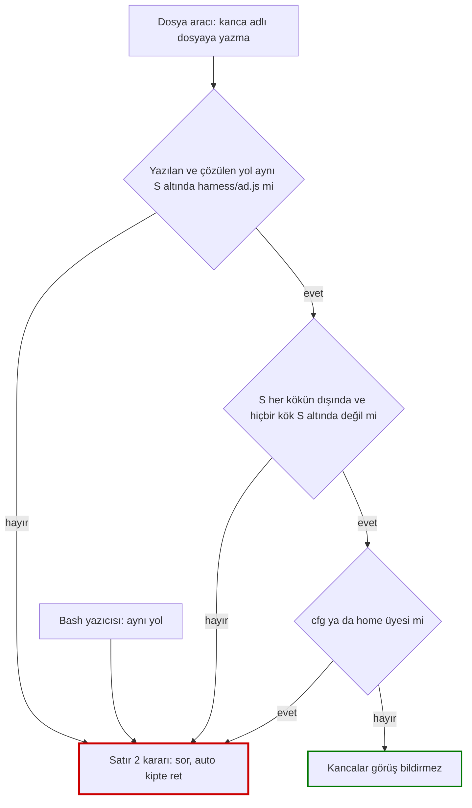

# ADR 0002 — Kanca geçici kopyası, onarım biçimi ve mağaza/imzalama komutlarında kip kuralı

- Status: Proposed (spec 0010'un imzasını bekliyor. Kurul görüşü koşulludur: GK-1..GK-6, `docs/architecture/gorus-0010-guard-hardening-2026-11-26.md`. GK-2'de seçenek (a) kabul edilirse Karar 1 bu ADR'den çıkar ve "Reddedilen seçenekler"e taşınır.)
- Date: 2026-11-26
- Decider: CEO (spec 0010 imzası bu ADR'yi kabul sayar); öneren: Architecture board
- Spec: `specs/draft/0010-guard-hardening.md` (REQ-4, REQ-8, REQ-9; §6 R-2, R-3; §7 "Scratch exemption", "Repair shape", ret metni; §8 gevşetme 1 ve 2, G-26, G-27; §10; §12 kural 3). Spec bu ADR'den üstündür; ikisi ayrışırsa spec geçerlidir.
- Genişlettiği: ADR 0001 (`0001-path-class-taxonomy.md`): satır 2'nin "her yerde" üyeleri, izin-kipi kuralının kapsamı, "Hook'lar kapanır" bölümünün `policy.js` yüklenemezse maddesi. ADR 0001 kuralı: sözleşme canlıya girdikten sonraki her gevşetme yeni bir ADR ister; bu o ADR'dir.
- Kaynaklar: tasarım `docs/architecture/tasarim/0010-guard-hardening.md` (D-2, D-6, D-7); `harness/guard.js`, `harness/policy.js`, `.claude/settings.json`, `harness/test/host-gate.sh:318-326`, `harness/test/policy-driver.js:76-83, 200-202, 448-449`; `docs/kanit/0004-t1.md` (B-1). Kurulun Bash aracı yok: hiçbir şey çalıştırılmadı, her kod iddiası kaynaktan okundu.
- Kapsam dışı: D2 kurallarının sözcük düzeyi (S kümesi, K kümesi, R-1 adımları), sır adı kalıbının yeri (R-5), dosya adı taraması. Bunlar geri alması ucuz kararlardır; görüşte değerlendirildi, ADR gerektirmez.

## Context (Bağlam)

Üç olgu bir araya geldi:

1. **Kanca kaynağı kopyada düzenlenemiyor.** Satır 2'nin "her yerde" üyeleri (`policy.js:24`, `:26`) kök dışındaki `harness/{approval,gate,guard,loop,notify,policy,stop}.js` adlarını da zorlama sayar ve kök dışındaki satır 2 yolunu hiçbir `Unlocks:` açmaz (`policy.js:437`). Geçici dizine alınmış bir kopyada dosya aracıyla kanca düzenlemek bu yüzden `auto` kipte reddedilir. Spec 0004'te mühendis bunu betikle dolandı; yarım yazılan canlı `policy.js` de oturumu kilitledi.
2. **Kilit oturum içinden açılamıyor.** `policy.js` yüklenemezse kapı kapanır (`gate.js:11`) ve guard her Bash çağrısı için onarım sorusu kaydeder; `auto` kipte bu soru rettir (`guard.js:197-203`). Tek yol CEO'nun terminalidir (kurtarma yolu R).
3. **Mağaza ve imzalama komutları CEO kararı üretmiyor.** Zarf soruları izin-kipi kuralının dışındadır (ADR 0001, G-9; `guard.js:192`); `auto` kipte kancanın "sor"u pencere açmaz, kararı uygulama verir (B-1). Spec 0008'in mobil birimi bu durumda teslim edilemez.

Eşik değişmedi (ADR 0001): ana makine denetimleri kazayı, dürüst hatayı ve düz yazılmış enjeksiyonu durdurur; Bash'i olan ve dolanmaya çalışan bir ajanı durdurmaz. Bu ADR'deki hiçbir cümle mutlak iddia değildir.

## Decision (Karar)

### Karar 1: geçici kopya istisnası (gevşetme; GK-2'ye bağlı)

Ana makinede, **dosya aracıyla** yapılan bir yazma, aşağıdaki dört koşulun hepsi sağlanıyorsa kancalardan görüş almaz; biri eksikse yol bugünkü kararını alır (satır 2: sor, `auto` kipte ret).

| # | Koşul (spec §7) | Neyi önler |
|---|---|---|
| 1 | Yazılan yol ve çözülmüş hâli, ikisi de aynı geçici kök S altında `harness/<ad>.js` biçimindedir (`<ad>`: `[A-Za-z0-9_-]+`). S, `/tmp`, `/private/tmp` ya da `os.tmpdir()` dizininin **doğrudan** altında, adı `company-hook-scratch-<harf ve rakam>` olan bir dizindir | Sembolik bağla depodaki canlı kancaya ulaşmayı; `gate.js.bak` gibi sonek adlarını; `CLAUDE.md`, `.claude/settings.json`, `harness/keys/**`, `harness/bin/*.sh` kopyalarını; adı uymayan her geçici dizini (mevcut `policy-driver.js` vakaları değişmez) |
| 2 | S hiçbir çalışma kökünün, iç kökün ya da ana kökün altında değildir ve hiçbiri S'nin altında değildir | Kökü geçici dizinde olan çalışma alanlarında (testler) kök kurallarının delinmesini |
| 3 | Yol bir `<cfg>` ya da `<home>` üyesi değildir | `CLAUDE_CONFIG_DIR` ya da `HOME` S'yi gösterdiğinde oturum yapılandırmasının açılmasını |
| 4 | Yazma bir dosya aracından gelir | Bash yazıcılarının (metin tabanlı hedef okuma) bu açıklığı kullanmasını |

Kurulun hükümleri (spec ile ayrışan yerde spec geçerlidir; ayrışma GK-3'te bildirildi):

- **Sınıf değişmez, karar değişir.** Yolun sınıfı satır 2 (zorlama) kalır; değişen yalnız dosya aracı yazmasının kararıdır ("görüş yok"). 2026-11-22 kuralı ("tam yol açar, glob açmaz") da böyle kurulmuştu: sınıf aynı, altı koşulda karar farklı. Gerekçe: `classify()` yalnız yola bakar, araç türünü bilmez (`policy.js:223`); "aynı yol dosya aracında dışarı, Bash'te zorlama" bir sınıf tanımı olamaz. Sonuç: `classify()`, `unlockKinds`, lint örnek listesi ve guard'ın ham görünümü (`guard.js:259-264`, `:283-284`) değişmez; hiçbir sınıflama vakası çevrilemez.
- **"Aynı kök S"** ADR 0001 koşul 1'deki tanımla okunur: çözülmüş S, yazılan S'nin `realpath`'ına eşittir ve iki biçimin S-göreli yolu aynıdır (macOS'ta `/tmp` bir bağdır; tanım olmadan her yazma ya hep geçer ya hiç geçmez).
- **Tam harf.** `harness/` ve `<ad>.js` tam harfle karşılaştırılır; harf katlamasıyla ya da diskteki yazımdan ayrılarak ulaşılan yol (`plain` yanlış) sınıf 2 kararını alır. Katlama burada gevşetirdi.
- **İmza ve çağıran koşulu yoktur.** İstisna etkin spec'e, `Unlocks:` değerine ve `agent_type`'a bakmaz. Dizin adı bir köken kanıtı değildir: `hook-scratch.sh` dışında herkes bu adı taşıyan bir dizin açabilir. İstisna yetki vermez, yalnız ad korumasını bu tek biçimde kaldırır.

### Kanca adlı bir dosyaya geçici kopyada yazma ne zaman görüş almaz?

Açıklama: yalnız dosya aracı, yalnız adı uyan geçici kökte, yalnız `harness/<ad>.js` için kancalar susar; her sapma bugünkü satır 2 kararına döner. Kalın kırmızı çerçeve CEO'ya kalan ya da reddedilen sonuç, yeşil çerçeve kancanın sustuğu sonuçtur (renk tek başına anlam taşımaz: kutu metni sonucu söyler). Metin eşdeğeri: yukarıdaki dört koşul tablosu. Şema metin olarak yazıldı, çizilmiş hâli gözle denetlenmedi (kurulun önizleme aracı yok).

### Karar 2: onarım biçimi (dar gevşetme)

Bash komutunun **tamamı** şu ifadeye uyuyorsa guard, başka hiçbir kurala bakmadan, her izin kipinde ve her çağıran için görüş bildirmez; politika modülü yüklenemese de:

`^git restore --source=HEAD -- harness/[A-Za-z0-9_-]+\.js( harness/[A-Za-z0-9_-]+\.js)*$`

Değişen tek durum: `policy.js` yüklenemezken. Sağlam politikada bu komut bugün de görüş almaz (`git restore` sınıflanmaz, G-5; `guard.js:325-348` içinde kuralı yok). ADR 0001'in "`policy.js` yüklenemezse guard her Bash çağrısında sorar, kanıtlanmamış kipte reddedilir, onarım oturum dışında yapılır" cümlesi bu tek komut için geçersiz olur; diğer her komut o durumda bugünkü reddini alır.

| Bozuk dosya | Bash | Dosya araçları | Oturum içi onarım |
|---|---|---|---|
| `policy.js` | yalnız onarım biçimi | kapalı | onarım biçimi |
| `gate.js` | açık | kapalı | `git restore` (bugün de görüş almaz) |
| `guard.js` | kapalı | açık (`.claude/settings.json:20-35`: guard yalnız Bash'e bağlı) | HEAD içeriği dosya aracıyla geri yazılır; düzenlenmemiş bir HEAD kopyası önceden durmalıdır (GK-5) |
| iki kanca dosyası birden | kapalı | kapalı | yok: kurtarma yolu R (CEO terminali) |

Ön koşul (GK-1): onarım biçimi, canlı `policy.js`'e yapılan ilk yazmadan **önce** canlıda olmalıdır; değilse o yazma bugünkü gibi yalnız CEO terminalinden onarılır.

### Karar 3: mağaza, imzalama ve imza malzemesi komutları izin-kipi kuralına girer (sıkılaştırma)

İzin-kipi kuralının kapsamına (ADR 0001: (a) politika sorusu, (b) imza ve anahtar, (c) kurucu betik, (d) onarım sorusu) bir kalem eklenir: **(e) D2 ailesi**, yani spec 0010 REQ-1..REQ-3'ün eşleştiği her komut. Kural aynıdır: kip bildirilmemişse ya da kip kanıtlıysa (`ASK_MODES`) sor; diğer her kipte (`auto` dahil) reddet. Hiçbir imza, hiçbir `Unlocks:` girdisi ve hiçbir çağıran bu kararı değiştirmez; yeni üst bilgi alanı yoktur.

- Kesin ret değil, CEO kararıdır: kanıtlı kipte gösterilen pencere CEO'nun tek tek verdiği onaydır (anayasa kural 4). Kip alanı olmayan mevcut vakalar (`guard.sh:88-89`) "sor" kalır.
- Ret metni D2 ailesine özgüdür (spec §7): kuralın adını, kipi ve tek yolu (CEO kendi terminalinde çalıştırır) söyler; `<tool>` ve `<pattern>` yalnız sabit kümelerden gelir, olay metni girmez.
- **Kapsam dışı kalır (G-9, bilinçli asimetri):** `main`'e push ve birleştirme, `gh release`, paket ve imaj yayını, uzak erişim, dışa yazan HTTP, `rm -r` ve diğer mevcut zarf soruları. Bunlar `auto` kipte bugünkü gibi "sor" kaydeder ve kararı uygulama verir. Spec 0010 varsayım A-1 bunu imzada gösterir; hepsini kurala almak spec 0011'in konusudur.

## Consequences (Sonuçlar)

Kazanımlar
- Kanca kaynağı dolanma olmadan, dosya araçlarıyla bir kopyada geliştirilip sınanabilir; canlı dosyaya tek yazmayla geçer.
- Bozuk bir `policy.js` `auto` kipte CEO olmadan geri alınabilir; geri gelen yalnız commit edilmiş içeriktir.
- Mağaza yükleme, sürüm imzalama ve anahtar deposu komutları `auto` kipte görünür bir ret alır; "zarf kancası sorar" cümlesi bu aile için gerçek olur.
- `Unlocks:` dilbilgisi ve imza biçimi değişmez: hiçbir imzalı bayt yeni yetki kazanmaz, başka spec'in yeniden imzası gerekmez. Yeni bağımlılık yok; STACK.md değişmez.

Maliyetler ve kalan riskler
- **Geçici kökteki kanca kopyaları korunmaz (G-26).** Kök dışında `harness/<ad>.js` zaten yalnız yedi ad için satır 2'dir (`approval`, `gate`, `guard`, `loop`, `notify`, `policy`, `stop`); istisna yedisini de kapsar, iş ikisini kullanır. Bir ayar dosyası kancayı oradan yüklerse koruma kalkar: lint bu deponun ayarında kanca yolu geçici küme altındaysa FAIL verir; başka bir projenin ayarı satır 2'dir ve kurucu betik `auto` kipte reddedilir (`guard.js:253-256`). Yeni yetenek eklenmez: bugün de `/tmp/x/harness/policy2.js` adlı bir dosya görüş almadan yazılabilir; kalkan şey ad korumasıdır.
- **Onarım biçimi commit edilmemiş kanca düzenlemesini her çağıran için siler (G-27);** HEAD başka bir dala alınmışsa o dalın sürümü gelir. İkisi de bugün G-5 altında zaten mümkündür.
- **Zarf iki katmanlı kalır.** `fastlane deliver` `auto` kipte reddedilirken `npm publish` ya da `gh release create` uygulamanın sınıflandırıcısına kalır. Kural 4 bu ikinci aile için talimat düzeyindedir.
- **Kanıtlı kipte açılmış bir oturumda** mağaza komutu tek tıkla geçer (R-3'ün yazılı bedeli).
- **ADR 0001'in üç yeri artık tek başına okunamaz:** satır 2 "her yerde" hücresi (Karar 1), izin-kipi kapsamı (Karar 3), "`policy.js` yüklenemezse" maddesi (Karar 2). ADR 0001'e bir satırlık gönderme eklendi.
- `policy.js` dışa aktarımları büyür (geçici küme, sır adı kalıbı): ADR 0001 "Sözleşmeyi kullananlar" listesine `secret-names.js` eklenir (spec 0010 R-5).

## Alternatives considered (Reddedilen seçenekler)

| Seçenek | Neden bırakıldı |
|---|---|
| **Geçici kümenin altındaki her kök dışı yol istisna olsun** (tasarım M-8) | Mevcut vakaları zorlamadan dışarıya çevirir (`policy-driver.js:76-82`, `:200-201`, `:448-449`; 0004 REQ-3); `CLAUDE.md`, ayar ve anahtar kopyalarını da açar. Spec R-2 daralttı |
| **İstisna sınıfı değiştirsin ("dışarı")** (spec §7 cümlesi) | Sınıf yalnız yolun işlevidir; koşul 4 araç türüne bakar. Sınıf değişirse `classify()` tüketicileri (lint, `unlockKinds`, guard) de etkilenir. Karar düzeyinde istisna aynı sonucu daha az yüzeyle verir |
| **Yalnız talimat: "kopyada düzenleme, canlıda dikkatli ol"** | 0004'te işlemedi: mühendis betikle dolandı, canlı `policy.js` yarım kaldı |
| **Kopyayı betikle ya da yorumlayıcıyla yaz** | Dolanmadır (G-3); spec §12 kural 2 yasaklar |
| **Kancaları bağlı çalışma ağacında geliştir, canlı kancalar birleşmeye kadar değişmesin** (tasarım L-8) | B29'un açık sorularına bağlı (`docs/ACIK-ISLER.md:51`); spec 0011 sonrası |
| **Onarım: yalnız kurtarma yolu R** | CEO başında olmalı; "en az onay" hedefiyle çelişir. Yedek olarak kalır |
| **Onarım: kapı, bozuk politikada HEAD sürümünü yükler** (tasarım D-7c) | Kapı içinde `git show` ve modül derleme: yeni hata yüzeyi |
| **Onarım biçimi daha geniş** (`harness/bin/**`, `.claude/settings.json`, başka `--source`) | Kilidi açan en dar biçim yeter; `--source=HEAD~1` eski bir kanca sürümünü geri getirirdi. Ayar dosyası bozuksa kancalar zaten yüklenmez |
| **D2: her kipte kesin ret** | Mevcut "sor" vakalarını çevirir (`guard.sh:88-89`); kanıtlı kipte pencere zaten CEO kararıdır |
| **D2: bugünkü gibi her kipte "sor"** | `auto` kipte pencere açılmaz (B-1): CEO kararı üretmez |
| **Zarfı imzalı spec açsın (`Envelope:` üst bilgi alanı)** (tasarım D-3b) | Yetkiyi genişleten yeni alan: dilbilgisi gevşetmesi, her etkin spec'in yeniden imzası; geri alınamaz eylemi tek imzaya bağlar |
| **Bütün zarf kuralları kip kuralına** (tasarım D-2c) | CEO'nun günlük `main` akışını değiştirir ve önce GitHub kural seti ister; kapsam kesildi (spec §13), A-1 |

**Açık, reddedilmedi (GK-2):** geçici kopya olarak **iç kök** (`.claude/worktrees/<ad>`, ayrık HEAD'li bağlı çalışma ağacı). ADR 0001 "İç kökte kopya (D-8)" gereği, aynı imzalı spec'in baytı baytına kopyasını taşıyan iç kökte, `Unlocks:` içinde tam yoluyla yazılı zorlama dosyası dosya araçlarına zaten açıktır (`policy.js:191-193, 441-453`; test `host-gate.sh:318-326`; `.claude/worktrees/` git'te yok sayılır). Bu yol gevşetme istemez, imza ve çağıran koşulu altında kalır ve `policy.js`'in ilk canlı yazmadan önce kopyada sınanmasını sağlar. Tasarımın L-8 seçeneği değildir: canlı kancalar yine çalışma ağacından yüklenir, yalnız kopyanın yeri değişir. Spec bu yolu tartmamıştır; kaynaktan okundu, çalıştırılmadı. Kabul edilirse Karar 1 düşer; reddedilirse gerekçesi bu tabloya girer.

## Reopening triggers (yeniden açma tetikleyicileri)

- Bir ayar dosyasının kancayı geçici kümeden yüklediği, ya da geçici kökteki bir kanca kopyasının çalıştırılarak denetimin atlandığı görülürse: Karar 1 geri alınır (daraltma, bir koşul bloğu).
- İstisnanın `harness/<ad>.js` dışına (`harness/bin/**`, `CLAUDE.md`, ayar dosyaları), Bash yazıcılarına ya da adı uymayan dizinlere genişletilmesi istenirse: yeni ADR.
- Onarım biçimi başka bir yola, başka bir `--source` değerine ya da ikinci bir komuta genişletilmek istenirse: yeni ADR. `git restore` yazıcı sayıldığında (spec 0011, B34 g) biçim tek onaylı istisna olarak yeniden yazılır.
- Spec 0011 genel ön geçişi (`harness/shell.js`) getirdiğinde: D2 kuralları o görünüme taşınır; iki ayrı sözcük normalleştiricisi kalmaz.
- Zarfın kalanı kip kuralına alınırsa (spec 0011) Karar 3'ün "kapsam dışı" maddesi ve G-9 yeniden yazılır.
- CEO `auto` dışında bir kipe dönerse: D2 için pencere yolu asıl yol olur; "tek tık" bedeli yeniden tartılır.
- Kanca kopyası iç köke taşınırsa (GK-2 ya da B29): Karar 1 kaldırılır.
- Claude Code kanca sözleşmesi (`permission_mode` değerleri, çıkış kodu, `os.tmpdir()` kaynağı olan `TMPDIR`) değişirse.
