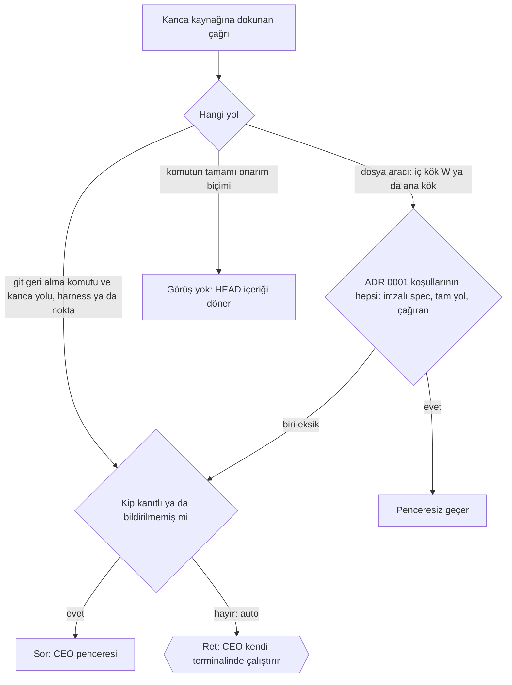

# ADR 0002 — Kanca kaynağı iç kökte geliştirilir; onarım biçimi; mağaza/imzalama komutları ve kanca kaynağı geri alması kip kuralında

Dosya adı ilk turdan kalmadır: "hook-scratch" (geçici kopya istisnası) reddedildi. Ad, ADR 0001'deki gönderme bozulmasın diye değiştirilmedi.

- Status: Proposed (spec 0010'un imzasını bekliyor). Spec'in 2. tur metniyle eşitlendi: sha12 `84d549b1416c` (görev tanımından alındı; kurul hesaplayamaz), commit `c68867f`. Kurul kararı: APPROVE; GK-1..GK-6 karşılandı (`docs/architecture/gorus-0010-guard-hardening-2026-11-26.md`, "Kapanış").
- Date: 2026-11-26 (ilk yazım ve eşitleme aynı gün)
- Decider: CEO (spec 0010 imzası bu ADR'yi kabul sayar); öneren: Architecture board
- Spec: `specs/draft/0010-guard-hardening.md` (REQ-4, REQ-7, REQ-8; §6 R-3, R-4, R-6; §7 "Hook-source word", "Repair shape", ret metni; §8 tablo, G-26, G-27; §10; §12 kural 3; A-1, A-4). Spec bu ADR'den üstündür; ikisi ayrışırsa spec geçerlidir.
- Genişlettiği: ADR 0001 (`0001-path-class-taxonomy.md`): izin-kipi kuralının kapsamı ve "Hook'lar kapanır" bölümünün "`policy.js` yüklenemezse" maddesi. ADR 0001 kuralı: sözleşme canlıya girdikten sonraki her gevşetme yeni bir ADR ister; bu o ADR'dir (tek gevşetme: Karar 2).
- Değiştirmeden kullandığı: ADR 0001 "İç kökte kopya (D-8)". Satır 2'nin "her yerde" üyelerine ve yol sınıflarına bu ADR dokunmaz.
- Kaynaklar: tasarım `docs/architecture/tasarim/0010-guard-hardening.md`; kapı kararları `docs/kanit/0010-kapi-tur1.md`; `harness/guard.js:51, 186-203, 297, 304-349`, `harness/policy.js:20-26, 184-209, 308-321, 330-337, 428-454, 479-500`, `harness/test/host-gate.sh:318-326`, `harness/test/guard.sh:35, 88-89`, `.gitignore:16`; `docs/kanit/0004-t1.md` (B-1). Kurulun Bash aracı yok: hiçbir şey çalıştırılmadı, her kod iddiası kaynaktan okundu.
- Kapsam dışı: D2 kurallarının sözcük düzeyi (S kümesi, K kümesi, R-1 adımları, D2 opaklığı), sır adı işlevlerinin yeri (R-5), dosya adı taraması. Geri alması ucuz kararlardır; görüşte değerlendirildi, ADR gerektirmez.

Değişiklik kaydı (tur 1 → tur 2): Karar 1 (geçici kopya istisnası) geri çekildi ve "Reddedilen seçenekler"e taşındı; yerine sözleşmeyi değiştirmeyen iç kök usulü geçti. Karar 3'ün kapsamına kanca kaynağı geri alma kuralı (REQ-7) girdi. Boşluk numaraları değişti: G-26 artık onarım biçimi ile geri alma kuralının boşluğu, G-27 Bash ile dizin kopyası.

## Context (Bağlam)

Dört olgu bir araya geldi:

1. **Kanca kaynağı kök dışı bir kopyada düzenlenemiyor.** Satır 2'nin "her yerde" üyeleri (`policy.js:24`, `:26`) kök dışındaki `harness/{approval,gate,guard,loop,notify,policy,stop}.js` adlarını da zorlama sayar ve kök dışındaki satır 2 yolunu hiçbir `Unlocks:` açmaz (`policy.js:437`). Spec 0004'te mühendis bunu betikle dolandı; yarım yazılan canlı `policy.js` de oturumu kilitledi. Bu koruma yerinde kalır; aranan şey onu delmeden çalışan bir geliştirme yeridir.
2. **Kilit oturum içinden açılamıyor.** `policy.js` yüklenemezse kapı kapanır ve guard her Bash çağrısı için onarım sorusu kaydeder; `auto` kipte bu soru rettir (`guard.js:197-203`). Tek yol CEO'nun terminalidir (kurtarma yolu R).
3. **Mağaza ve imzalama komutları CEO kararı üretmiyor.** Zarf soruları izin-kipi kuralının dışındadır (ADR 0001, G-9; `guard.js:192`); `auto` kipte kancanın "sor"u pencere açmaz, kararı uygulama verir (B-1). appsec taban ölçümü: 41 D2 biçiminden 0'ı reddediliyor (`docs/kanit/0010-kapi-tur1.md:29`). Spec 0008'in mobil birimi bu durumda teslim edilemez.
4. **Commit edilmiş kanca kaynağı düz bir git komutuyla başka sürüme çevrilebiliyor.** `git restore --source=HEAD~5 -- harness/guard.js`, `git checkout <sha> -- harness/`, `git checkout -- .` bugün görüş almaz: guard'ın git kurallarında `restore`, `checkout`, `stash` yoktur (`guard.js:325-348`). Onarım biçimini `--source=HEAD` ile dar tutmanın anlamı, yanındaki geniş biçimler sessiz geçerken kalmaz (appsec S-05).

Eşik değişmedi (ADR 0001): ana makine denetimleri kazayı, dürüst hatayı ve düz yazılmış enjeksiyonu durdurur; Bash'i olan ve dolanmaya çalışan bir ajanı durdurmaz. Bu ADR'deki hiçbir cümle mutlak iddia değildir.

## Decision (Karar)

Karar numaraları ilk turdaki gibi tutuldu; spec ve görüş bu numaralara gönderme yapar.

### Karar 1: kanca kaynağı ayrık HEAD'li iç kökte geliştirilir (gevşetme yok; ilk turdaki istisna geri çekildi)

Yol politikası **değişmez**. Kanca kaynağı, ana kökün altında `.claude/worktrees/<ad>` yolunda duran, `git worktree add --detach … HEAD` ile açılmış bir bağlı çalışma ağacında (W) dosya araçlarıyla düzenlenir ve sınanır; canlı dosyaya ana kökte tek bir tam `Write` ile geçer. Bu, ADR 0001 "İç kökte kopya (D-8)" maddesinin kullanımıdır, yeni bir kural değildir.

W içindeki `harness/<x>.js` yazması ancak şu koşulların hepsiyle penceresiz geçer (kaynaktan okundu):

| # | Koşul | Kaynak |
|---|---|---|
| 1 | Yol iç köke yeniden köklenir (tam harfle `.claude/worktrees/<ad>`), sınıfı satır 2 kalır | `policy.js:191-193, 206-209` |
| 2 | Yazma bir dosya aracından gelir; çağıran ana oturum ya da `polyglot-engineer`, `dotnet-engineer`, `react-engineer`, `devops-sre` | `policy.js:429-431`, `:379` |
| 3 | Yol kilitli değildir, diskteki yazımıyla yazılmıştır, sembolik bağ üzerinden ulaşılmaz | `policy.js:434-439` |
| 4 | İç kökte `specs/` vardır ve `specs/active/` tam bir `.md` taşır: aynı göreli yoldaki imzalı spec'in baytı baytına kopyası | `policy.js:441`, `:382-398` |
| 5 | İmza kaydı ana kökün `approvals/` dizininde aranır (iç kök bir git bağlı çalışma ağacıdır) | `policy.js:330-337, 446-447` |
| 6 | O spec'in `Unlocks:` satırı yolu tam hâliyle adlandırır (glob açmaz) | `policy.js:453`, `:308-321` |

Usulün ADR'ye giren kuralları (spec §10, §12 kural 3):
- W ve düzenlenmeyen HEAD kopyası P (`.claude/worktrees/0010-head`) imzalı spec commit edildikten sonra açılır; P her commit'ten sonra yeniden kurulur. Yardımcı betik yoktur: iki git komutu yeter.
- Canlı kancalar ana kökten yüklenmeye devam eder (`.claude/settings.json` değişmez): W içindeki bozuk bir dosya hiçbir şeyi kilitlemez. Tasarımın L-8 kalemi (canlı kancalar yalnız birleşmiş sürümden yüklenir) bu değildir; o kapsam dışıdır.
- Ana köke geçiş: `node --check` ve W'nin test takımları yeşilken, adı yazılı dosyaya **tek** tam `Write`; aynı anda tek kanca dosyası. Tam yol ve çağıran denetimi böylece her dosyaya uygulanır. Bash ile dizin kopyası, arşiv, `patch`, `git apply` görev kuralıyla yasaktır ve dosya dosya sınıflanmadığı için bilinen boşluktur (G-27; G-5, G-17).
- İmzadan sonra spec'in tek baytı değişmez; değişirse koşul 4 düşer ve W yazmaları `auto` kipte reddedilir (kapalı yönde bozulur).

Doğrulanmayan: kanca adlı bir dosya için bu yol canlıda gözlenmedi (mevcut test `CLAUDE.md` üzerindedir, `host-gate.sh:318-326`). Spec §10 adım 1'deki ilk yazma kanıtlar; reddedilirse iş durur, hiçbir şey kilitlenmez (R-6). `auto` kipte kancalardan sonra uygulamanın kendi sınıflandırıcısı ikinci karar vericidir (A-6).

### Kanca kaynağına dokunan bir çağrı bu ADR'den sonra hangi kararı alır?

Açıklama: kanca kaynağı ya imzalı spec'in açtığı dosya aracı yazmasıyla, ya da yalnız HEAD içeriğine dönen onarım biçimiyle sessizce değişir; yol adı taşıyan diğer git geri alma komutları CEO kararıdır. Altıgen CEO adımıdır (anlamı biçim ve etiket taşır, renk kullanılmadı). Metin eşdeğeri: (1) dosya aracı yazması, W'de ya da ana kökte, Karar 1 tablosundaki koşulların hepsiyle geçer, biri eksikse kip kuralına gider; (2) komutun tamamı onarım biçimiyse guard görüş bildirmez (Karar 2); (3) `git restore|checkout|reset|stash|apply|am|read-tree|checkout-index` ve kanca yolu, `harness` ya da `.` sözcüğü kip kuralına gider (Karar 3 f); (4) kip kuralı: kanıtlı ya da bildirilmemiş kipte pencere, diğer her kipte ret. Yol sözcüğü taşımayan git biçimleri şemada yoktur: sessiz geçer (G-26). Şema metin olarak yazıldı, çizilmiş hâli gözle denetlenmedi (kurulun önizleme aracı yok).

### Karar 2: onarım biçimi (bu işin tek gevşetmesi)

Bash komutunun **tamamı** şu ifadeye uyuyorsa guard, başka hiçbir kurala bakmadan, her izin kipinde ve her çağıran için görüş bildirmez; politika modülü yüklenemese de (REQ-8):

`^git restore --source=HEAD -- harness/[A-Za-z0-9_-]+\.js( harness/[A-Za-z0-9_-]+\.js)*$`

Değişen tek durum: `policy.js` yüklenemezken. Sağlam politikada bu komut bugün de görüş almaz (`guard.js:325-348` içinde `restore` kuralı yok). ADR 0001'in "`policy.js` yüklenemezse guard her Bash çağrısında sorar, kanıtlanmamış kipte reddedilir, onarım oturum dışında yapılır" cümlesi bu tek komut için geçersiz olur; diğer her komut o durumda bugünkü reddini alır. Karar 3 (f) geldikten sonra biçim, kanca kaynağına yol adıyla dokunan git geri alma komutları içinde sessiz kalan **tek** biçimdir. Biçim bir denetim değildir, bir gevşetmedir (spec §8 böyle yazar).

| Bozuk dosya | Bash | Dosya araçları | Oturum içi onarım |
|---|---|---|---|
| `policy.js` | yalnız onarım biçimi | kapalı | onarım biçimi |
| `gate.js` | açık | kapalı | onarım biçimi (bu iş `gate.js`'i açmaz ve düzenlemez) |
| `guard.js` | kapalı | açık (guard yalnız Bash'e bağlı) | `Read` `
/harness/guard.js`, ana köke `Write` (P düzenlenmemiş HEAD kopyasıdır) |
| iki kanca dosyası birden | kapalı | kapalı | yok: kurtarma yolu R (CEO terminali) |

Sıra kuralı (spec T-2; ilk turun GK-1 koşulu): onarım biçimi ilk uygulama görevinde, tek başına canlıya girer; canlı `policy.js`'e ilk yazma ondan sonradır (T-3). İlk canlı yazma bozulursa kapanan Bash'tir, dosya araçları açık kalır ve P'den geri yazılır.

### Karar 3: mağaza, imzalama ve imza malzemesi komutları ile kanca kaynağı geri alması izin-kipi kuralına girer (sıkılaştırma)

İzin-kipi kuralının kapsamına (ADR 0001: (a) politika sorusu, (b) imza ve anahtar, (c) kurucu betik, (d) onarım sorusu) iki kalem eklenir:

- **(e) D2 ailesi:** spec 0010 REQ-1..REQ-3'ün eşleştiği her komut (mağaza yükleme ve sürüm imzalama araçları, `xcodebuild` bayrakları, Gradle yayın görevleri, mağaza API adresleri; `security`, `codesign`, `keytool`, `apksigner`, `jarsigner`; sır dosyası adı taşıyan sözcük).
- **(f) Kanca kaynağı geri alması (REQ-7):** `git` komutunun alt komutu `restore`, `checkout`, `reset`, `stash`, `apply`, `am`, `read-tree` ya da `checkout-index` ise ve sonraki bir sözcük bir kanca kaynağını adlandırıyorsa: baştaki `./` ve sondaki `/` atıldıktan sonra sözcük `.` ise, `harness` ise ya da `/harness` ile bitiyorsa, ya da son iki parçası `harness/<x>.js` ise (`<x>` glob karakteri taşıyabilir). Tek istisna komutun tamamının onarım biçimi olmasıdır; K kümesi bu kurala uygulanmaz.

Kural ikisi için aynıdır (REQ-4): kip bildirilmemişse ya da kip kanıtlıysa (`ASK_MODES`, `policy.js:20`) sor; diğer her kipte (`auto` dahil) reddet. Hiçbir imza, hiçbir `Unlocks:` girdisi ve hiçbir çağıran bu kararı değiştirmez; yeni üst bilgi alanı yoktur.

- Kesin ret değil, CEO kararıdır: kanıtlı kipte gösterilen pencere CEO'nun tek tek verdiği onaydır (anayasa kural 4). Kip alanı olmayan mevcut vakalar (`guard.sh:88-89`) "sor" kalır (R-3).
- Ret metni kuralın adını, kipi ve tek yolu (CEO kendi terminalinde çalıştırır) söyler; `<rule>` dört sabit değerden biridir (`store upload or release signing`, `signing material`, `secret file name`, `hook source rollback (git <subcommand>)`); yer tutucular sabit kümelerden gelir, ham olay metni girmez. Geri alma kuralının ipucu açık kalan tek biçimi adlandırır.
- (f) komut metnini okur, çalışma ağacını değil: `harness/` dizini olmayan bir projede de `git checkout -- .` ve `git restore .` `auto` kipte reddedilir; yalnız dizine dokunan biçimler de (`git restore --staged harness/guard.js`) reddedilir. Çıkış: yolları adıyla yazmak ya da CEO terminali.
- (f) yol sözcüğü ister: `git stash`, `git reset --soft HEAD~5`, `git checkout <commit>`, `git apply x.patch` sessiz kalır; `git reset --hard` bugünkü zarf sorusunu korur (`guard.js:343`, `guard.sh:35`); `HEAD` başka bir commit'e alınmışsa onarım biçimi o commit'in içeriğini getirir. Hepsi G-26'dır (A-4).
- **Kapsam dışı kalır (G-9, bilinçli asimetri):** `main`'e push ve birleştirme, `gh release`, paket ve imaj yayını, uzak erişim, dışa yazan HTTP, `rm -r` ve diğer mevcut zarf soruları. Bunlar `auto` kipte bugünkü gibi "sor" kaydeder ve kararı uygulama verir. Spec 0010 varsayım A-1 bunu imzada gösterir; hepsini kurala almak spec 0011'in konusudur.

## Consequences (Sonuçlar)

Kazanımlar
- Kanca kaynağı dolanma olmadan, dosya araçlarıyla bir kopyada geliştirilip sınanır; yol sözleşmesinin hiçbir satırı gevşemez, yetki imza ve çağıran koşulu altında kalır, her aday canlıya girmeden önce sınanır.
- Bozuk bir `policy.js` `auto` kipte CEO olmadan geri alınabilir; geri gelen yalnız `HEAD` içeriğidir.
- Mağaza yükleme, sürüm imzalama ve anahtar deposu komutları `auto` kipte görünür bir ret alır; "zarf kancası sorar" cümlesi bu aile için gerçek olur.
- Commit edilmiş bir kanca kaynağını yol adıyla başka sürüme çeviren git komutu artık sessiz geçmez.
- `Unlocks:` dilbilgisi, imza biçimi ve yol sınıfları değişmez: hiçbir imzalı bayt yeni yetki kazanmaz, başka spec'in yeniden imzası gerekmez. Yeni bağımlılık ve yeni zorlama dosyası yok; STACK.md değişmez.

Maliyetler ve kalan riskler
- **Onarım biçimi commit edilmemiş kanca düzenlemesini her çağıran için siler (G-26).** Sağlam politikada bugün de mümkündür; yeni olan, bozuk politikada da mümkün olmasıdır.
- **Geri alma kuralı ad tabanlıdır.** Yol sözcüğü taşımayan biçimler ve taşınmış `HEAD` görülmez (G-26); `harness/` olmayan projelerde `.` biçimi yanlış ret üretir. Git yazıcılarının hedefe göre sınıflanması spec 0011'dedir (B34 g'nin kalanı).
- **İç köke geçiş bir usuldür, zorlama değil.** Tek `Write` kuralını guard dayatmaz; Bash ile dizin kopyası dosya dosya sınıflanmaz (G-27). Mühendis talimata uymazsa 0004'teki yarım yazma yine mümkündür; fark, artık oturum içi onarımın ve düzenlenmemiş kopyanın önceden durmasıdır.
- **W'deki kanca kopyaları spec imzalıyken açıktır,** ana kökteki dosyalar gibi; fazladan yetki değildir (aynı koşullar), ama açık duran ikinci bir yerdir. İş sonunda W kaldırılır (spec §10 adım 8).
- **Zarf iki katmanlı kalır.** `fastlane deliver` `auto` kipte reddedilirken `npm publish` ya da `gh release create` uygulamanın sınıflandırıcısına kalır. Kural 4 bu ikinci aile için talimat düzeyindedir.
- **Kanıtlı kipte açılmış bir oturumda** mağaza komutu ve kanca geri alması tek tıkla geçer (R-3'ün yazılı bedeli).
- **ADR 0001'in iki yeri artık tek başına okunamaz:** izin-kipi kapsamı (Karar 3) ve "`policy.js` yüklenemezse" maddesi (Karar 2). ADR 0001'deki gönderme satırı (`0001-path-class-taxonomy.md:8`) hâlâ ilk tur metnini söyler ("geçici kopya istisnası"); düzeltilmelidir (bu turda kurulun yazma izni iki dosyayla sınırlıydı).
- `policy.js` dışa aktarımları iki saf işlevle büyür (sır ve tarama adları, izinli konum); ADR 0001 "Sözleşmeyi kullananlar" listesine `secret-names.js` eklenir (spec 0010 R-5).

## Alternatives considered (Reddedilen seçenekler)

| Seçenek | Neden bırakıldı |
|---|---|
| **Geçici kopya istisnası: adı `company-hook-scratch-…` olan geçici kökte `harness/<ad>.js` dosya aracı yazması görüş almaz** (ilk turun Karar 1'i; spec tur 1 R-2, REQ-8) | Gevşetmedir: satır 2 ad koruması bir biçimde kalkar, imzaya ve çağırana bakmaz, dizin adı köken kanıtı değildir. Kendi ilk canlı yazması (`policy.js`, bootstrap) kopyada sınanamıyordu: 0004'ün kilidi aynı adımda yeniden mümkündü. İç kök aynı işi sözleşmeye dokunmadan görür. Ana oturum GK-2 (a)'yı seçti (`docs/kanit/0010-kapi-tur1.md:22`); onunla birlikte geçici ad kuralı, bootstrap istisnası, geçici küme lint kuralı ve `harness/bin/hook-scratch.sh` düştü |
| **Geçici kümenin altındaki her kök dışı yol istisna olsun** (tasarım M-8) | Mevcut vakaları zorlamadan dışarıya çevirir (`policy-driver.js:76-82`, `:200-201`, `:448-449`; 0004 REQ-3); `CLAUDE.md`, ayar ve anahtar kopyalarını da açar |
| **İstisna sınıfı değiştirsin ("dışarı")** (spec tur 1 §7 cümlesi) | Sınıf yalnız yolun işlevidir (`policy.js:223`), araç türünü bilmez. İstisnayla birlikte konu kapandı |
| **Yalnız talimat: "kopyada düzenleme, canlıda dikkatli ol"** | 0004'te işlemedi: mühendis betikle dolandı, canlı `policy.js` yarım kaldı |
| **Kopyayı betikle ya da yorumlayıcıyla yaz** | Dolanmadır (G-3); spec §12 kural 2 yasaklar |
| **W'deki commit'i birleştirerek ana köke al** (kapı kararı ikisine de izin vermişti) | Git ile gelen dosya dosya sınıflanmaz (G-5); tek `Write` tam yol ve çağıran denetiminden geçer ve hemen kanarya ile sınanır |
| **İç kök için yardımcı betik** (`hook-scratch.sh` küçültülmüş hâli) | İki belgelenmiş git komutu yeter; bir dosya ve bir `Unlocks:` girdisi eksilir |
| **Canlı kancalar yalnız birleşmiş sürümden yüklensin** (tasarım L-8) | Kancaların yüklenme yerini değiştirir; B29'un açık sorularına bağlı (`docs/ACIK-ISLER.md:51`); spec 0011 sonrası. Karar 1 bu değildir |
| **Onarım: yalnız kurtarma yolu R** | CEO başında olmalı; "en az onay" hedefiyle çelişir. Yedek olarak kalır |
| **Onarım: kapı, bozuk politikada HEAD sürümünü yükler** (tasarım D-7c) | Kapı içinde `git show` ve modül derleme: yeni hata yüzeyi; `gate.js` açılmak zorunda kalır (R-4) |
| **Onarım biçimi daha geniş** (`harness/bin/**`, `.claude/settings.json`, başka `--source`) | Kilidi açan en dar biçim yeter; `--source=HEAD~1` eski bir kanca sürümünü geri getirirdi. Ayar dosyası bozuksa kancalar zaten yüklenmez |
| **Geri alma: spec 0011'e kadar sessiz kalsın** (B34 g bütün olarak sonra) | Onarım biçiminin darlığı, yanındaki `--source=HEAD~5` sessizken anlamsızdır; bu iş kanca kaynaklarını canlıda değiştirir (appsec S-05) |
| **Geri alma: yol sözcüğü olmayan biçimler de reddedilsin** (`git stash`, `git reset --soft`) | Gündelik stash ve reset `auto` kipte reddedilirdi (A-4); hedefe göre sınıflama spec 0011'in işidir |
| **Geri alma ve D2: her kipte kesin ret** | Mevcut "sor" vakalarını çevirir (`guard.sh:88-89`); kanıtlı kipte pencere zaten CEO kararıdır |
| **D2: bugünkü gibi her kipte "sor"** | `auto` kipte pencere açılmaz (B-1): CEO kararı üretmez |
| **Zarfı imzalı spec açsın (`Envelope:` üst bilgi alanı)** (tasarım D-3b) | Yetkiyi genişleten yeni alan: dilbilgisi gevşetmesi, her etkin spec'in yeniden imzası; geri alınamaz eylemi tek imzaya bağlar |
| **Bütün zarf kuralları kip kuralına** (tasarım D-2c) | CEO'nun günlük `main` akışını değiştirir ve önce GitHub kural seti ister (C-2); kapsam kesildi (spec §13), A-1 |

## Reopening triggers (yeniden açma tetikleyicileri)

- Spec §10 adım 1'deki ilk yazma reddedilirse (iç kök yolu kanca adı için çalışmıyor): iş durur, Karar 1 yeniden tartılır. Geçici kopya istisnası kendiliğinden geri gelmez; yeni ADR ister.
- İç kök koşullarından birinin (aynı imzalı bayt, tam yol, çağıran listesi, yalnız dosya aracı) gevşetilmesi ya da Bash yazıcılarına açılması istenirse: yeni ADR.
- Bir Bash dizin kopyasıyla sınanmamış bir kanca dosyasının canlıya girdiği görülürse: G-27 kapatılır (spec 0011, hedefe göre sınıflama) ya da tasarım L-8 öne alınır.
- Onarım biçimi başka bir yola, başka bir `--source` değerine ya da ikinci bir komuta genişletilmek istenirse: yeni ADR. `git restore` yazıcı sayıldığında (spec 0011, B34 g) biçim tek onaylı istisna olarak yeniden yazılır ve Karar 3 (f) o genel kurala katılır.
- Geri alma kuralının `.` biçimi `harness/` olmayan projelerde günlük işi tıkarsa: kural hedefe göre sınıflamaya taşınır (spec 0011); o güne kadar daraltma yeni ADR ister, çünkü daraltma burada gevşetmedir.
- Spec 0011 genel ön geçişi (`harness/shell.js`) getirdiğinde: D2 ve geri alma kuralları o görünüme taşınır; iki ayrı sözcük normalleştiricisi kalmaz.
- Zarfın kalanı kip kuralına alınırsa (spec 0011) Karar 3'ün "kapsam dışı" maddesi ve G-9 yeniden yazılır.
- CEO `auto` dışında bir kipe dönerse: D2 ve geri alma için pencere yolu asıl yol olur; "tek tık" bedeli yeniden tartılır.
- Claude Code kanca sözleşmesi (`permission_mode` değerleri, çıkış kodu, iç kök yolu `.claude/worktrees/`) değişirse.
