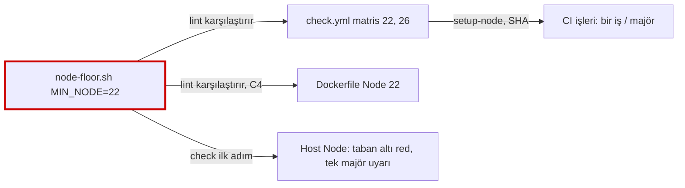

# Mimari görüş: spec 0007, yeni CI bağımlılığı `actions/setup-node` ve Node sürüm aralığı | Tarih: 2026-11-21 | Karar: CONDITIONAL APPROVE

Kapsam: yalnız spec 0007 öneri 6 (Node sürümünü CI'da sabitlemek; `specs/draft/0007-agency-config-update.md` §6 karar "6 Node pin", "6 Supported range", Ruling R-7, §7.6, REQ-16..18, AC-11, AC-12, T-8). Spec'in diğer altı önerisi (ask kuralları, model tablosu, preload, `paths:` kuralları, worktree, CEO komutları) bu görüşün konusu değil; bunlar yeni bağımlılık getirmiyor, burada incelenmedi. Spec değiştirilmedi, `STACK.md` değiştirilmedi. Web ve Bash erişimim yok: aşağıda "doğrulanmadı" yazan her şey T-8 (V-5) ya da Scout için bırakıldı. Bu bir görüştür; yeni bağımlılık olduğundan CEO'ya gösterilir.

## Karar özeti
`actions/setup-node` kabul, koşullarla (aşağıda C1-C6). Gerekçenin taşıyıcısı **taban** değil **matris**: taban `harness/bin/check` içindeki bir sürüm kontrolüyle bağımlılıksız da korunabilir; ama "hem 22 hem 26'da yeşil" iddiası ancak CI'ın Node'u seçebilmesiyle kanıtlanır. Destek aralığı: **taban 22; CI matrisi `["22", "26"]`; `check` 22'nin altını reddeder, tek majörleri (ör. 25) uyarıyla kabul eder.** Spec'in R-7 kararına katılıyorum; gerekçe metni düzeltilmeli (C5).

## Kod tabanından kanıt
| Bulgu | Kaynak |
|---|---|
| CI Node'u seçmiyor, yalnız basıyor | `.github/workflows/check.yml:26-27` (`node --version && git --version`) |
| Lint zaten bu eki karşılar: eylem 40 onaltılık commit'e sabit, üst düzey `permissions`, yazma izni yok, `secrets.` yok | `harness/bin/lint.js:184-189` (regex `@[0-9a-f]{40}$`; `uses:` satırı yorum içerse bile `\S+` yalnız ilk sözcüğü alır) |
| Ajan imajı Node 22 | `harness/docker/Dockerfile:3` (`FROM node:22-bookworm-slim`); `docs/KARARLAR.md:101` |
| Showcase Node 22 ister | `showcase/agency-tower/.nvmrc` = `22`, `package.json` `engines.node` `>=22`, `.npmrc` `engine-strict=true` |
| Host ile CI/imaj ayrışması gerçek | `docs/KARARLAR.md:253` (testler Node 25.9.0'da koştu, `.nvmrc` 22, "QA Node 22'de yeniden koşmalı"); `KARARLAR.md:283` (Node 22 bu makinede yok); `docs/qa/0001-agency-tower-final.md` (22.23.5 ile ayrı koşu) |
| Harness'te yeni Node API bağımlılığı bulunamadı | `harness/**/*.js` içinde kısa bir yeni-API listesi (`fs.globSync`, `parseArgs`, `node:test`, `Object.groupBy`, `toSorted`, `Promise.withResolvers` vb.) için arama: sıfır eşleşme. Kısa liste, kapsamlı değil; kanıt yerine ipucu |

Not (kapsam dışı, bilgi): showcase `README.md:7` "Node 23/25 kurulumu reddeder" diyor, `package.json` `>=22` ve `KARARLAR.md:253` 25'te koşu kaydediyor; README eskimiş görünüyor. `check` showcase'i çalıştırmıyor.

## Gerekçe tablosu: `actions/setup-node`
| Boyut | Değerlendirme |
|---|---|
| İhtiyaç | AC-11 ve REQ-16: CI'ın Node majörünü seçmesi ve taban + güncel LTS'yi paralel koşması. Kanıt: yukarıdaki host/CI/imaj ayrışması (22, 25, 26 farklı ortamlarda). Standart yığınla (yalnız runner imajı) yapılamayan: imajın Node'u biz commit atmadan imaj güncellemesiyle değişir, CI sonucu koddan bağımsız oynar ve taban majör CI'da hiç koşulmayabilir (imajın hangi Node'u taşıdığı doğrulanmadı). |
| Alternatifler | (1) Hiçbir şey ekleme: reddedildi, ayrışma kanıtlı. (2) Runner imajının Node'u + `harness/bin/check` içinde sürüm kontrolü: taban korunur, Node seçilemez, matris olamaz; `node-floor.sh` bu yüzden zaten her durumda kalır (REQ-17). (3) `container:` ile sabitlenmiş Node imajı: bkz. aşağıdaki tablo. (4) Sürüm dosyası (`.nvmrc`, `.node-version`, `node-version-file`): bir seçici değil, bir girdi kaynağı; yine bir kurulum eylemi gerekir, tek sürüm verir, matris vermez, üçüncü bir doğruluk kaynağı ekler. (5) Betikle ikili indirme + sağlama toplamı: özel kod, bakım yükü. |
| Bakım | GitHub'ın kendi eylemi (`actions/` kuruluşu), `actions/checkout` ile aynı sahip ve aynı sabitleme kuralı. Son sürüm, etiket, tarih ve bakımcı sayısı **doğrulanmadı**; T-8 `gh api` ile çözer (AC-12). 12 aydan eski son sürüm bulunursa risk işareti. |
| Lisans | Spec §11 MIT diyor; **doğrulanmadı** (board kaynak taraması: T-8). Ticari kullanım ve bulaşma riski MIT ise yok. Hukuki yorum vermem. |
| Güvenlik geçmişi | Advisory taraması **yapılmadı** (OSV/GitHub Advisory erişimim yok). Yüzey: eylem yalnız Node ikilisini indirir ve PATH'e koyar; sır ve yazma izni yok (üst düzey `permissions: contents: read`, `lint.js:185-189`). Önbellek özellikleri kapalı tutulmazsa PR'dan önbellek yazımı yüzeyi doğar (C2). |
| Çıkış maliyeti | Çok düşük: tek adım ve bir matris satırı; geri alma = adımı silmek, `node-floor.sh` bağımsız kalır. Kilitlenme yok. |
| Operasyon | Docker ya da ek servis gerekmez; hosted runner. Ek ağ: Node dağıtımını GitHub'ın kendi sürüm manifestinden indirir (aynı güven alanı; Node 26'nın `ubuntu-24.04` manifestinde bulunduğu doğrulanmadı). Maliyet: iki iş (zaman aşımı 10 dk/iş); depo herkese açık (spec 0004 §11), dakika sınırı sorun görünmüyor, A-5'e uygun. |

### Seçenek karşılaştırması (spec §6 "6 Node pin" için)
| Seçenek | Sonuç | Neden |
|---|---|---|
| Runner imajı + sürüm kontrolü | Tamamlayıcı olarak kalır | Seçemez; matris kuramaz; imaj güncellemesi CI'ı koddan bağımsız değiştirir |
| `container: node:<v>` (digest ile sabit) | Reddet | Docker Hub çekmesi ve ek güven; `check` `git` ve `sh` ister (`-slim` imajda `git` bulunduğu doğrulanmadı); digest elle güncellenir; sabitleme gücü commit SHA'dan fazla değil; hareketli parça artar |
| Sürüm dosyası | Reddet (ek kaynak olarak) | Tek başına Node kurmaz; matrise uymaz; `MIN_NODE` + lint zaten tek kaynak |
| İkili indirme betiği | Reddet | Zorlama katmanına bitişik CI'da özel kod; bakım ve güvenlik yükü |
| `actions/setup-node` (SHA) | **Kabul, koşullu** | Tek satır, aynı sahip, lint kuralları değişmeden geçer |

## Sürüm aralığı: ne desteklenmeli
Aşağıdaki Node takvimi bilgileri **genel bilgiden, doğrulanmadı** (T-8 V-5 Node sürüm takvimine karşı doğrular).
| Majör | Durum (Kasım 2026, beklenen) | Karar |
|---|---|---|
| 20 | ömrü bitmiş (Nisan 2026) | desteklenmez; `check` reddeder |
| 22 | bakım LTS, ömür sonu Nisan 2027 civarı | **taban**; ajan imajı ve showcase `.nvmrc` zaten 22; matriste |
| 24 | LTS | test edilmez, kabul edilir (iki ucun arasında); bu depoda 24 ile koşu kaydı yok |
| 25 | çift olmayan, kısa ömürlü | `check` kabul eder + `WARN`; CI'da yok (host 25.9.0 koşusu kayıtlı: `KARARLAR.md:253`) |
| 26 | çift majör; 2026 Ekim'de LTS'ye yükselmesi beklenir | **matriste**, "güncel LTS" ucu |
- Destek ifadesi şöyle yazılmalı: "Test edilen: 22 ve 26. Kabul edilen: ≥ 22 (tek majörler uyarıyla). Reddedilen: < 22." "Desteklenen" kelimesi yalnız matristeki iki majöre uygulanmaz; README'de bu ayrım yazılsın.
- İki uç (taban + güncel LTS) arada kalan majörü sınırlar; üçüncü iş (24) kanıt olmadan CI dakikası harcar.
- Majör ayrıntısı yeterli: `22` en son 22.x'i verir, küçük sürüm kaymasını kabul ediyoruz (R-7); taban küçük sürümde sınanmaz. Spec'in `v22.11.0 → exit 0` testi taban küçük sürümünü sabitlemediğini gösterir; bu bilinçli olmalı ve README'ye yazılmalı.

Açıklama: taban tek yerde (`MIN_NODE`) yaşar, diğer üç yer ondan türer ve lint sapmayı yakalar; kırmızı çerçeve tek doğruluk kaynağını işaretler. Metin eşdeğeri: `node-floor.sh` ↔ `check.yml` matrisi (spec REQ-18), `node-floor.sh` ↔ `Dockerfile` (öneri C4), `node-floor.sh` host'ta `check`'in ilk adımı.

## Kararlar ve değerlendirme
| # | Karar | Gerekçe var mı? | Alternatif | Risk | Sonuç |
|---|---|---|---|---|---|
| D-1 | `actions/setup-node`, SHA'ya sabit | Var (matris ihtiyacı kanıtlı; alternatifler ≥ 4 yazılı) | Hiçbir şey / runner Node'u / container / ikili indirme | Düşük; bakım, lisans, advisory doğrulanmadı | CONDITIONAL APPROVE (C1-C3) |
| D-2 | Matris `["22","26"]`, taban 22 | Var; R-7 gerekçesinde bir eksik (C5) | tek sürüm / yalnız taban | CI süresi iki katı; 26'da önceden var olan bir hata | APPROVE (C3, C6) |
| D-3 | `harness/bin/node-floor.sh` (taban altı red, tek majör uyarı) | Var (REQ-17, AC-11 beş vaka) | `check` içinde satır içi `node -p` | Yok | APPROVE |
| D-4 | `lint.js`: matrisin en düşük majörü = `MIN_NODE` | Var | Yok (kaymayı başka türlü yakalayan yok) | Yok | APPROVE; C4 ile genişlet |

## Gereksiz bulundu (kriter yok)
Yok. Üçüncü bir sürüm dosyası (`.nvmrc`, `.node-version`) ve ek `container:` işi önerilmediği sürece katman eklenmiyor. Tek hafif not: tek majör için `WARN` (REQ-17) 25 kullanan hostta her `check`'te çıkacak; bilinçli ve zararsız, kaldırılması gerekmez.

## Geri dönüşü pahalı kararlar
Yok (tek bir iş adımı, geri alma ucuz). ADR: **hayır**.

## Koşullar
- **C1 Sabitleme.** `uses: actions/setup-node@<40 onaltılık commit SHA>`; etiket nesnesi değil, çözülmüş commit (spec §7.6 zaten bunu söylüyor); yalnız `actions/` kuruluşundan; etiket adı yorumda; SHA, etiket, tarih `docs/kanit/0007-ci.md` içinde. `lint.js:184` bunu zaten sınar.
- **C2 Girdiler asgari.** Yalnız `node-version: ${{ matrix.node }}`. `cache`, `cache-dependency-path`, `registry-url`, `token`, `always-auth` verilmez (kökte `package.json` yok, kurulacak bağımlılık yok; önbellek yalnız zehirlenme yüzeyidir). Sabitlenen sürümün `package.json`/`packageManager` varlığında kendiliğinden önbellek açıp açmadığı **doğrulanmadı**: açıyorsa ilgili girdi (`package-manager-cache: false` ya da eşdeğeri) kapatılsın. Kontrol: T-8 `lint.js`, yasak girdi adlarını `check.yml`'de arasın (spec'e ek, ucuz).
- **C3 Matris davranışı.** `fail-fast: false` (bir majörün kırmızısı ötekini gizlemesin); `continue-on-error` yok; `Versions` adımı `node --version` basmaya devam eder (REQ-16, AC-11). Matris iş adını `check (22)`, `check (26)` yapar: `main` için zorunlu durum denetimi tanımlıysa eski `check` adı artık rapor edilmez. GitHub dal koruma ayarını görme olanağım yok (**doğrulanmadı**): birleştirmeden önce CEO ayarı kontrol eder ve zorunlu denetim adlarını yeni adlara çevirir (CEO işi, `Beklenenler`).
- **C4 Tek taban, üç kopya.** Taban şu an üç yerde 22: `Dockerfile:3`, `showcase/agency-tower/.nvmrc` (+ `engines`), ve yeni `node-floor.sh`. Lint (REQ-18) yalnız `check.yml` ↔ `node-floor.sh` karşılaştırıyor. Öneri: lint `Dockerfile`'daki `node:<majör>` ile `MIN_NODE`'u da karşılaştırsın (ajan konteyneri doğrulamanın ana yolu); showcase'i `README`'de "tabanla aynı" diye anmak yeterli, otomatik denetim şart değil. Spec sahibi karar verir; bu bir tavsiye, C4'ün zorunlu kısmı yalnız `Dockerfile` karşılaştırmasıdır.
- **C5 Gerekçe düzeltmesi (spec metni, ben değiştirmem).** R-7 "taban 22 = CEO hostlarında kullanılan en eski majör" diyor; `KARARLAR.md:283` Node 22'nin ana makinede **yok** olduğunu kaydediyor. Doğru gerekçe: ajan imajı Node 22 (`Dockerfile:3`), showcase `.nvmrc` 22 ve 22.23.5 ile kayıtlı koşular (`docs/qa/0001-agency-tower-final.md`). Spec sahibi R-7'yi bu üç kanıta dayandırsın.
- **C6 Ömür sonu tetikleyicisi.** 22'nin ömür sonu (Nisan 2027 civarı, doğrulanmadı) yaklaşınca taban 24'e (ya da LTS'deki en eski majöre) çıkarılır: `MIN_NODE`, matris, `Dockerfile` (C4) ve showcase birlikte değişir, tek işte. Bu tarih `docs/ACIK-ISLER.md`'ye gözden geçirme işi olarak yazılsın (main session'ın kararı). 26 matriste önceden var olan bir hatayla kırılırsa spec'in R-7 geri dönüşü (yalnız `["22"]`, raporla) geçerli; kırmızıyı maskelemek (`continue-on-error`) kabul değil.

## STACK.md değişikliği (öneri; ben değiştirmedim)
Sütunlar: `Teknoloji | Durum | Gerekçe | Tarih | ADR`. Kayıt dışı teknoloji "değerlendir" olarak girer; spec imzalanıp birleştirilince ve `docs/kanit/0007-ci.md` her majör için yeşil iş gösterince "benimse".

| Teknoloji | Durum | Gerekçe | Tarih | ADR |
|---|---|---|---|---|
| `actions/setup-node` (GitHub Actions, commit SHA ile sabit) | değerlendir | `check.yml`'de Node majörünü seçer (matris 22 ve 26, taban 22). GitHub sahipli, `actions/checkout` ile aynı sabitleme (`lint.js:184`); yalnız `node-version` girdisi, önbellek, kayıt ve jeton yok. Board koşullu onay (`docs/architecture/gorus-0007-setup-node-2026-11-21.md`, C1-C6); lisans, son sürüm, SHA ve advisory doğrulanmadı (T-8); CEO bilgisi bekliyor | 2026-11-21 | - |
| Node.js (harness çalışma zamanı, CI ve ajan imajı) | benimse | Zaten kullanılıyor, kayıtta yoktu. Taban 22 (`harness/bin/node-floor.sh`, spec 0007), test edilen 22 ve 26, ajan imajı 22. Tek kaynak `MIN_NODE`; tek majör (25) uyarıyla kabul | 2026-11-21 | - |

## Cevapsız sorular
`actions/setup-node` son sürüm, SHA, bakım durumu, lisans, advisory geçmişi (Scout/T-8). Sabitlenen sürümün kendiliğinden önbellek açıp açmadığı. `ubuntu-24.04` imajının taşıdığı Node ve Node 26 manifest erişimi. Node 22/24/26 yaşam döngüsü tarihleri (genel bilgi). `main` dal korumasındaki zorunlu denetim adları (CEO). `check`'in iki Node'da 10 dakikalık sınır içinde bitip bitmediği.
