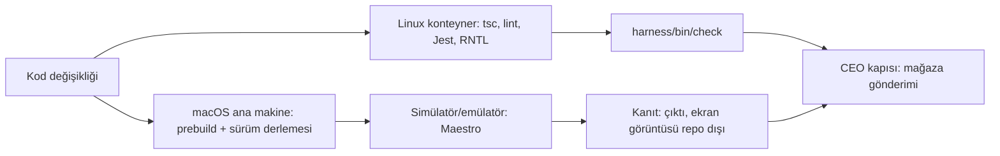

# Mimari görüş: mobil yığın, React Native + Expo | Tarih: 2026-11-21 | Karar: CONDITIONAL APPROVE (yalnız deneme için; "benimse" değil)

Kapsam: `docs/scout/0002-mobile-stack-rn-expo.md` (Scout, 2026-11-21), `docs/architecture/STACK.md`. Spec yok: bu görüş bir spec'e değil, bir yığın önerisine verilir. Web erişimim yok; Scout'un rakamlarını kendim doğrulamadım, "Scout'a göre" diye işaretledim. Spec ve STACK.md değiştirilmedi; STACK.md satırı aşağıda öneridir, CEO kararından sonra eklenir.

## 1. Gerekçe tablosu (kurul şablonu)

| Boyut | Durum | Not |
|---|---|---|
| İhtiyaç | **Eksik** | Hiçbir kabul kriteri mobil uygulama istemiyor. `mobile-engineer` birimi henüz iş yokken öneriliyor. "Hiçbir şey ekleme" (duyarlı web / PWA) seçeneği değerlendirilmedi. |
| Alternatifler | **Yetersiz** | Flutter ve native satırları Scout'ta büyük oranda "bulunamadı/doğrulanmadı". Hiç bakılmayanlar: PWA, Capacitor (mevcut React web'i sarmak), .NET MAUI (CEO'nun .NET yığınıyla örtüşen tek mobil aday). |
| Bakım | Kısmen | Güncel SDK 58 (15 Eki 2026), RN 0.88. Aktif. Ama SDK ömrü "yaklaşık 1 yıl" ve resmi sona erme tablosu bulunamadı. Scout "yılda ~3 SDK" diyor; kendi tarihleri 56 (21 May), 57 (30 Haz), 58 (15 Eki 2026) ve SDK 54 (Eyl 2025) → 58: 13 ayda 4 SDK. Gerçek ritim 3-4, deneme ölçmeli. |
| Lisans | Tamam (üst düzey) | RN, Expo, Hermes MIT; Maestro Apache-2.0; RNTL, Detox, openapi-typescript MIT. Jest/jest-expo lisansı okunmadı. **Geçişli bağımlılık ağacı lisansı hiç bakılmadı** (Expo projeleri binlerce paket çeker). |
| Güvenlik geçmişi | **Eksik** | Scout advisory (OSV/GHSA) taraması yapmamış; ağaç boyutu ölçülmemiş. |
| Çıkış maliyeti | Düşük-orta | MIT, `prebuild` düz RN projesi üretir, EAS zorunlu değil. İlk uygulama mağazaya çıkınca (bundle ID, imzalama anahtarı, kullanıcı verisi) çıkış pahalılaşır; bugün ucuz. |
| Operasyon | **Docker'a sığmıyor** | iOS derlemesi yalnız macOS ana makinede (Xcode 26.4+). "Yerel geliştirme Docker'da" kuralının istisnası. Linux konteynerde yalnız tsc/lint/Jest/RNTL koşar. |

**"Kriter yok" bulgusu (A-01):** Mobil yığını iş gelmeden "standart" yapmak spekülatif. Öneri: STACK.md'ye "dene" olarak gir, birimi ancak ilk mobil spec ya da başarılı deneme sonrası aç.

## 2. Scout'un zayıf/eksik noktaları (not edildi)
- **"bulunamadı":** SDK sona erme tarihi tablosu; Apple Developer ve Google Play kayıt ücretleri; doğrudan `xcodebuild` akışı; `expo run:*` hesap gereksinimi (yokluk kanıt değil); Apple/Google'ın RN OTA'sına resmi onay metni; Android API 37 tarihi; RN min iOS/Android; Jest lisansı; .NET OpenAPI üretimi; Flutter ve native için başsız test, ajan dostu, bakım, risk satırları.
- **Zayıf kaynak:** Maestro/Detox sürümleri 3. taraf özet; Maestro iOS için idb gereği tek öğretici; Expo Go giriş zorunluluğu yalnız başlık düzeyi; Apple kuralları sayfasının son 14k karakteri okunmadı; WebFetch özetleri model özeti (Scout da kritik rakamların resmi sayfadan yeniden okunmasını istiyor).
- **Flutter/native karşılaştırması karar için yetersiz (Soru 6).** Bu yalnız deneme izni için sorun değil; "benimse" için engel.

## 3. Cevaplar

**(1) Kayıt ve durum.** Şimdi "dene" (STACK.md tanımı: küçük denemede) olarak kaydedilebilir, **ancak** deneme CEO onayı ve hızlı spec ile başladıktan sonra; onaydan önce satır "değerlendir". "Benimse" yalnız §3.5 kontrol listesi geçer, Scout uzatması (§3.6) alternatifleri eler ve ADR yazılırsa. Sebep: gerekçe tablosunda ihtiyaç ve alternatifler eksik (§1), ve en önemli iddialar (hesapsız yerel derleme, başsız Maestro iOS, SDK yükseltme yükü) hiç denenmedi.

**(2) Standart derleme yolu: tamamen yerel.** Standart: `expo prebuild` (CNG; `ios/` ve `android/` üretilir, elle düzenlenmez) + `expo run:ios|android` (geliştirme) + sürüm çıktısı için Gradle (`assembleRelease`/`bundleRelease`) ve `xcodebuild archive`. Doğrudan `xcodebuild` akışı Scout'ta kaynaksız: deneme kanıtlamalı.
- EAS **standart değil**. Gerekçe: `eas build --local` bile Expo hesabı ve token ister (Scout); token sırdır; bulut derleme kaynak kodu 3. tarafa gönderir (harici); ücretsiz katman 15+15 derleme/ay, düşük öncelik, 45 dk; aşım iOS $2-4 (Scout, pricing sayfası); para harcama zarfta.
- EAS ancak bir spec adlandırırsa, iş başına, Ücretsiz katmanda ve CEO onayıyla. Ücretli plan, GitHub macOS runner dakikası dahil her harcama ayrı onay. EAS Update ve EAS Submit standart değil.
- İmzalama: keystore/sertifika/provisioning repoda, sohbette, logda yok; ana makine anahtar zincirinde veya repo dışı kasada. Mağaza gönderimi (Transporter / Play Console) CEO elinde. Apple ve Google kayıt ücretleri doğrulanmadı; ilk mağaza işinde CEO onayı.
- Ön koşul riski: Xcode lisans kabulü (`sudo`) ve Apple ID ile Xcode indirme ajanın yapabileceği işler olmayabilir; CEO'ya tek seferlik B-n olarak yazılır. Ajan çalışma yeri/izin sınırları spec 0004 (host enforcement) ile örtüşür; derleme konteyner dışında ana makinede koşacağı için o spec'in korumalarına bağlanmalı (bu bağlantıyı ayrıntılı doğrulamadım).

**(3) Standart test yığını ve "kanıt".**
- Birim: Jest + jest-expo (SDK 58 için Jest 30). Bileşen: React Native Testing Library (erişilebilirlik sorguları: `getByRole`/`getByLabelText`). E2E: **Maestro** (CLI, iOS simülatör + Android emülatör, Apache-2.0). Detox standart değil: resmi destek RN 0.77-0.84, 0.88 doğrulanmadı. Statik: `tsc` strict (SDK 58 varsayılanı), lint, Expo'nun sürüm uyumu denetimi (`expo install --check`/`expo-doctor`; Scout'ta yok, deneme doğrulasın).
- Kanıt bölünür: Linux konteyner `harness/bin/check` içine yalnız tsc + lint + Jest + RNTL alır. Derleme + Maestro yalnız macOS ana makinede, ayrı komutla; GitHub macOS runner varsayılan değil (para).
- Mobil işte "bitti" = (a) tsc/lint/Jest/RNTL çıktısı; (b) **sürüm yapılandırmasında** iki platform derleme çıktısı (debug tek başına kanıt değil; R8/Hermes farkı), çıktı kimliği (dosya, boyut, hash); (c) Maestro akışı adlandırılmış cihaz + OS sürümüyle, çıkış kodu, ham çıktı; (d) gözle bakış: küçük ve büyük ekran, açık/koyu tema, ekran görüntüleri repo dışında (anayasa kural 9, visual-standards); (e) .NET API sözleşme testi. Kanıt **değildir**: Expo Go, "Metro derledi", yalnız debug yeşili.
- Başsız kanıtlanamayanlar (gerçek cihaz: push, kamera, biyometri, mağaza imzası) her işte "kalan risk" olarak yazılır, CEO elle yapar.

Açıklama: hangi kanıt nerede üretilir. Metin karşılığı: konteyner kanıtı CI'dadır; derleme ve E2E kanıtı yalnız macOS ana makinededir; ikisi birleşmeden mağaza gönderimi (CEO onayı) yoktur.

**(4) Yıllık SDK yükseltmesi ve OTA kuralları.**
- SDK: tam sürüm sabit (lockfile + `engines`/Node). Yükseltme ayrı bir lane-2 işidir (delta spec, değişiklik günlüğü okunur, aynı kanıt listesi). Aynı anda tek SDK adımı. En geç 12 ayda bir yükselt (Expo ömrü ~1 yıl, Scout); Apple (Xcode eşiği, Nisan 2026'da Xcode 26) ve Google (targetSdk, 31 Ağu 2026'da API 36) tarihleri ayrı hareket eder, üç ayda bir mağaza gereklilikleri sayfaları yeniden okunur. Ritim 3-4 SDK/yıl olduğundan, bir SDK geride kalmak normal, iki geride kalmak ihlal.
- Bağımlılık: yalnız SDK ile gelen `expo-*` paketleri serbest; her yeni yerel (native) 3. taraf kütüphane kurul ön kontrolünden geçer (Yeni Mimari uyumu: Scout, react-native-maps ve Stripe örnekleri). `ios/` ve `android/` elle düzenlenmez; gerekirse config plugin; elle düzenleme ADR ister (SDK 58 SceneDelegate göçü kanıt).
- Gizli bilgi: `EXPO_PUBLIC_*` değişkenleri pakete gömülür (Expo davranışı, Scout'ta yok, doğrulansın); uygulama paketinde sır yok; token Keychain/SecureStore.
- **OTA: varsayılan kapalı** (`expo-updates` eklenmez). Gerekçe: kriter yok; Apple 2.5.2 yorum riski, resmi onay metni bulunamadı. Açılırsa spec + ADR: yalnız hata düzeltmesi, özellik değişikliği mağazadan; `runtimeVersion` ikili sürüme sabit; yayın = harici yayın, CEO onayı her seferinde; geri alma planı; kod imzalama. Özel güncelleme sunucusu ek servistir, ADR.

**(5) "Benimse" öncesi deneme kontrol listesi** (yeni boş proje, repo dışı geçici dizin, `create-expo-app` SDK 58; deneme kodu repoya girmez; önce CEO imzalı hızlı spec: ana makineye Xcode/Android SDK/JDK kurulumu sistem değişikliğidir; yapan mühendis, doğrulayan `qa-engineer`):
1. **Ön koşul başsız mı:** Xcode ≥ 26.4, lisans, Android SDK/NDK (`sdkmanager`), AVD ve simülatör CLI ile açılıyor (`simctl`, `emulator -no-window`). GUI veya sudo gereken her adım listelenir, CEO'nun tek seferlik işi olarak yazılır. GUI'siz olamıyorsa: başarısız.
2. **Hesapsız yerel derleme:** Expo'ya giriş yapılmamış, `EXPO_TOKEN` yok; `expo run:ios` ve `run:android` tek komutla derliyor ve açıyor. Expo'ya giden ağ trafiği/telemetri notu.
3. **Sürüm derlemesi:** Gradle `assembleRelease` (geçici yerel keystore) ve `xcodebuild` (simülatör hedefi, imzasız arşiv). Cihaz imzalama bu denemede kanıtlanamaz (Apple hesabı); bilinen boşluk olarak yazılır.
4. **Başsız test:** 1 Jest + 1 RNTL + 1 Maestro akışı, iki platformda, agent tarafından, sıfırdan iki kez; çıkış kodu, süre, kararlılık.
5. **Tedarik zinciri:** `npm ci` ile `ignore-scripts=true` çalışıyor mu (çalışmıyorsa hangi paketler script ister, listele); paket sayısı; `npm audit`; **geçişli lisans taraması** (GPL/AGPL yok); lockfile kaynak ve bütünlük kontrolü (görüş 0001 ile aynı sertlik).
6. **Sözleşme:** .NET API'den OpenAPI → TS tip üretimi (Scout'ta hiç bakılmadı) + uygulamanın yerel .NET API'yi çağırması (Android emülatör 10.0.2.2, iOS localhost) + kardeş dizindeki ortak saf TS paketini Metro'nun çözmesi.
7. **Yükseltme provası:** SDK 57 projesi oluştur, SDK 58'e resmi kılavuzla yükselt; süre, kırılan yerler, kaç elle düzeltme. Bu, "yılda 3-4 yükseltme" maliyetinin tek gerçek ölçümüdür.
8. **Ölçüm:** diskte yer, temiz sürüm derleme süresi, bu Mac'te kaynak kullanımı.
9. **Yapılmayacaklar:** `eas` komutu, Expo hesabı açma, mağaza hesabı, para. EAS yolu "benimse" ölçütü değil.
Karar kuralı: 1-7 geçerse Scout uzatması ve ADR ile "benimse" önerilir; 1-3'ten biri geçmezse yığın "değerlendir"e döner ve Flutter/Capacitor/MAUI keşfi açılır.

**(6) Karşılaştırma yeterli mi: hayır, karar için değil; deneme için yeterli.** Deneme tek oturum ve ucuz, çıkış maliyeti sıfıra yakın. Scout paralel olarak kısa bir uzatma yapsın (aynı 6 ölçüt, kaynaklı): Flutter, Capacitor/PWA, .NET MAUI, native Swift+Kotlin; ve Scout'un "bulunamadı" listesi (SDK ömrü, kayıt ücretleri, .NET OpenAPI, RN OTA). "Hiçbir şey ekleme" seçeneğinin (duyarlı web) açıkça yazılması şart.

## 4. Pahalı geri döndürülen kararlar
Çapraz platform çerçeve seçimi (bugün ucuz, ilk uygulama çıkınca pahalı); bundle ID/imzalama anahtarı sahipliği (uygulama başına geri dönüşsüz); OTA politikası. **ADR gerekli: evet**, "benimse" aşamasında (çerçeve, derleme yolu, imzalama anahtarı saklama, OTA kapalı politikası). Şimdi ADR gerekmiyor.

## 5. Koşullar
- C1 Deneme CEO onayı ve imzalı hızlı spec olmadan hiçbir kurulum yok.
- C2 §3.5 kontrol listesi kanıtla (çıktı) kapanmadan "benimse" yok; `mobile-engineer` birimi o zamana kadar açılmaz (ya da ilk mobil spec ile birlikte).
- C3 Scout uzatması (§3.6) "benimse" önce tamam.
- C4 EAS, OTA, ücretli plan, mağaza hesabı: iş başına spec + CEO onayı; standart dışı.
- C5 İlk mobil spec'te `appsec` zorunlu (sır, token saklama, yerel depolama, ağ, gizlilik manifesti).

## 6. STACK.md değişiklik önerisi (CEO kararına kadar eklenmedi)
| Teknoloji | Durum | Gerekçe | Tarih | ADR |
|---|---|---|---|---|
| React Native + Expo (TypeScript), yerel derleme (`prebuild`, `run:*`, Gradle, xcodebuild) | dene (CEO deneme onayına kadar: değerlendir) | Mobil aday: TS/React örtüşmesi, MIT. Gerekçe eksik: ihtiyaç ve alternatifler (Flutter, Capacitor/PWA, MAUI, native) doğrulanmadı; deneme kontrol listesi ve Scout uzatması bekliyor. EAS ve OTA standart değil. Görüş: `docs/architecture/gorus-mobil-rn-expo-2026-11-21.md`; Scout: `docs/scout/0002-mobile-stack-rn-expo.md` | 2026-11-21 | - (benimse'de ADR zorunlu) |
| Jest + jest-expo, React Native Testing Library, Maestro (mobil test) | dene | Mobil birim/bileşen/E2E adayı; Maestro Apache-2.0, diğerleri MIT (Jest lisansı doğrulanmadı). Detox kayda alınmaz (RN 0.88 desteği doğrulanmadı) | 2026-11-21 | - |

## 7. Cevapsız sorular
- CEO: mobil için somut bir iş/uygulama var mı? Yoksa deneme neden şimdi (öneri: deneme yine de ucuz, ama birim açma).
- CEO: Xcode kurulumu ve lisans kabulü için tek seferlik elle adım kabulü.
- Scout: §3.6 listesi. AppSec: mobil güven sınırı ilk spec'te.
