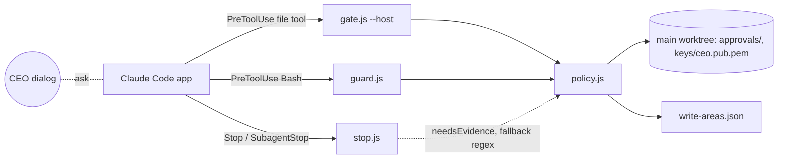
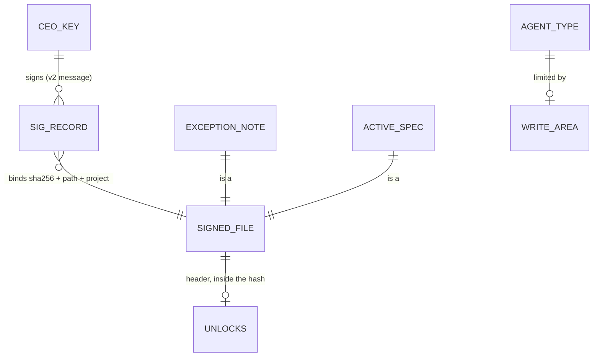

Architecture design: host enforcement (spec 0004 rework) | Date: 2026-11-21 | Prepared by: software-architect | Status: ready for review

Input: `specs/draft/0004-harness-enforcement-gaps.md` (round 1, rejected), round-1 findings S-02..S-08, C2..C7, K1..K15, `docs/KARARLAR.md` rev. 48. This design is input for the business analyst; it does not edit the spec and does not approve itself.

## Threat level (read first)

The CEO accepted the risk on 2026-11-21 (KARARLAR rev. 48): the CEO key at `~/.company/keys/ceo.key.pem` stays passphrase-less. Consequence for every claim in this design and in the spec built from it:

- On the host the gate, the guard and the exception mechanism **stop accidents and honest mistakes** (an agent that forgets the pipeline, a prompt-injected instruction that uses the obvious tools, a subagent that strays outside its area). They **do not stop an agent with Bash that tries to get around them**. Two proofs: `harness/bin/appr*.sh .` signs without the guard regex seeing `approve.sh`; `node -e` / `python -c` can read the key and write any file.
- A signature on the host is a **record of intent**, not proof of presence. The container path is not affected: the key is never mounted and the mount mode is chosen by the OS (`company-run.sh:32-36`).
- Wording rule for the spec: no absolute words ("never silent", "cannot", "impossible") about host controls. Use "is not allowed silently by the hooks", "raises the bar", and point to "Known gaps".
- Hardening in this design is labelled **raises the bar** when it only makes the bypass longer; nothing here is labelled "closes" unless the file-tool path is fully covered.

## Problem and constraints

- Today `gate.js` runs only in the container (`container-settings.json:27-30`); on the host only `guard.js` is wired (`.claude/settings.json:19-36`), and its file-tool branch asks only for the enforcement regex (`guard.js:50,73-77`). An unsigned code edit on the host is silent. `routing.md` (last line) says the gate is enforced where `install-project.sh` ran; `install-project.sh:15` does not wire `gate.js`. The text is untrue.
- `guard.js:50` and `gate.js:32` disagree: the gate blocks all of `.claude/`, the guard protects only settings; neither protects `.claude/agents|skills|rules`, `harness/bin`, `harness/test`, `evals`, `templates` on the host.
- `stop.js` runs for the main session only; `NON_CODE` (`stop.js:10`) makes every `.md` non-code, so playbook edits never need evidence; `EVIDENCE` (`stop.js:11`) misses vitest, pnpm/yarn, flutter, xcodebuild, gradle, swift.
- Rule 3 says reviewers have no write tool; `qa-engineer` has `Write, Edit, Bash` (`.claude/agents/qa-engineer.md:4`).
- Constraint: mobile engineers (iOS) must work on the host. Every host control must allow a signed, in-scope edit with no dialog, and must not depend on the container.
- Constraint: no new dependency (Node built-ins, POSIX sh). Hooks are loaded from the working tree on every call.
- Scale: one CEO, one machine, 1..5 parallel sessions (assumption), hook latency budget per call below.

## Quality attributes

| Attribute | Criterion | How measured (where) | Source/assumption |
|---|---|---|---|
| Correctness of classes | gate and guard return the same class for every path of a fixed matrix (>= 2 paths per row of the class table, incl. symlink, case variant, worktree, new file under symlinked dir) | `harness/test/policy.sh`, host, in `check` | K8, C5 |
| No silent unsigned edit by file tool | every row-2/4/6 path without authority yields `ask` or deny, in all 4 caller kinds (main, subagent, linked worktree, nested worktree) | `harness/test/host-gate.sh` | REQ-1 |
| Container unchanged except listed deltas | all existing `run.sh` cases pass unchanged; one new case per delta row | `check` | S-05 |
| Hook latency | p95 < 150 ms per PreToolUse call on the CEO's Mac, incl. one `git rev-parse` | 200 calls in `host-gate.sh --bench`, host, relative | assumption, 3 hooks per call today |
| Fail mode | gate/guard: unreadable input or internal error -> deny (or ask, see D-7); stop: fail open | negative tests with a broken `policy.js` copy in a temp tree | existing behaviour |
| Host workability | a signed, in-scope edit by any engineer unit on the host gets no dialog and no deny | `host-gate.sh` with `agent_type` from the captured fixture | mobile constraint |
| Honesty | every gap in "Known gaps" appears in `harness/README.md` "Bilinen boşluklar" | lint grep | rev. 48 |

## Component view

### Which parts decide a write on the host?

Description: both PreToolUse hooks call one policy module; the policy reads signatures and the public key from the main worktree; dialogs come from the app. Text equivalent:

| Component | Responsibility (one sentence) | Class |
|---|---|---|
| `policy.js` (new) | Resolve root and identity, classify a path, decide allow/ask/deny for (caller, class, authority). Pure functions plus an injectable context `{now, mainRoot, pubkey, fs}`. | enforcement |
| `gate.js` | Parse a file-tool event, call `policy.decide`, print the hook output; `--host` selects host mode. | enforcement |
| `guard.js` | Envelope rules (unchanged) plus: Bash writer extraction, signing-script detection by resolved path, call `policy.decide` per detected target. | enforcement |
| `approval.js` | Sign/verify with the v2 message; `preview` prints path, sha12, header fields. | enforcement |
| `stop.js` | Evidence rule for Stop and SubagentStop; uses `policy.needsEvidence` when it loads, else its own regex (fail open). | enforcement |
| `write-areas.json` (new) | Per-`agent_type` globs; `readOnly` list. | enforcement |
| `approve.sh` | Sign the active spec or one exception note, only with `--expect <sha12>`. | enforcement |

Dependency direction: hooks -> `policy.js` -> `approval.js` (verify only). `policy.js` never spawns anything except `git rev-parse` (timeout 2 s).

## Path classes and decisions

Paths are classified relative to the workspace root R (see "Root and identity") after realpath and case folding. First match wins, top to bottom.

| # | Class | Members (glob grammar in "API and identity") | File tools, host | Bash detected writer, host | File tools, container | Container delta vs today |
|---|---|---|---|---|---|---|
| 1 | hard-deny | `approvals/**`, `.git/**` (also a `.git` file in a linked worktree) | deny (exit 2) | ask | deny | none |
| 2 | enforcement | `harness/*.js`, `harness/write-areas.json`, `harness/keys/**`, `harness/container-settings.json`, `harness/bin/{approve,ceo-keygen,company-run,install-project,install-global}.sh`, `.claude/**` except rows 3 and 4, `.mcp.json`, `CLAUDE.md`, `.github/workflows/**`; anywhere on disk: `~/.claude/settings*.json`, `~/.claude/CLAUDE.md`, `~/.company/**`, any `*/harness/{gate,guard,stop,approval,policy,loop,notify}.js`, any `*/.claude/settings*.json` | ask, every edit; never unlocked by `Unlocks:` or an exception | ask | deny | `harness/*.js`, `harness/keys/**`, `.github/workflows/**`: today "code" (allowed with signature) -> deny. Tighter. |
| 3 | nested root | `.claude/worktrees/<name>/**` | classify the remainder against `<name>` as its own root | same | deny (permission deny `.claude/**` unchanged) | none |
| 4 | product-config | `.claude/agents/**`, `.claude/skills/**`, `.claude/rules/**`, `harness/bin/**` (rest), `harness/test/**`, `harness/docker/**`, `harness/README.md`, `evals/**`, `templates/**` | allow if signed active spec `Unlocks:` or a valid exception note matches; else ask | same rule | `.claude/` part: deny (unchanged); other members: allow only if signed `Unlocks:` matches, else deny | `harness/bin|test|docker`, `evals/`, `templates/`: today "code" (allowed with any signature) -> need `Unlocks:`. Tighter. |
| 5 | free | `specs/**`, `docs/**`, `plans/**`, `STATE.md` | allow (subject to unit write area) | no opinion | allow | `plans/**`, `STATE.md`: today "code" -> allow without signature. Looser in the gate only; in PLAN mode the read-only mount still blocks them (OS). |
| 6 | code | everything else inside R | allow if the single active spec is validly signed or a valid exception note matches; else ask | same rule | allow if single active spec signed; else deny | none |
| 7 | outside | not under R and not matched by row 2 | no opinion | no opinion | deny (unchanged) | none |

Notes on the table:
- Row 2 keeps every control that exists today: `guard.js:50` matches `.claude/settings(.local)?.json` and `harness/(gate|guard|...).js` anywhere in an absolute path, which covers `~/.claude/settings.json` and `.claude/worktrees/*/harness/gate.js`; the new patterns are a superset (S-05/K3). Row 2 is never in an `Unlocks:` list or an exception; a header glob that matches a row-2 path is ignored for that path, and lint FAILs the header (S-02/C2).
- `harness/bin/check` and `harness/bin/lint.js` are verification tooling: row 4 (signed `Unlocks:` needed), not row 2, so a job that adds a test can list them. An exception note cannot unlock `harness/**` (rule in "API and identity"), so the quiet path for verification tooling is always a signed spec.
- Classification input: `real = realpath(nearest existing ancestor) + remaining segments` (a new file under a symlinked directory is classified by the directory's target, K8). Matching is case-folded and NFC-normalized on darwin and win32 (`claude.md`, `.CLAUDE/settings.json` hit row 2). If realpath fails for a reason other than ENOENT -> deny on host and container (fail closed).
- A path classified row 6 inside a nested root (row 3) uses the nested root's `specs/active/` and the main worktree's `approvals/`.
- Decision order for one file-tool call: unit area (if `agent_type` present) -> row 1 -> row 2 -> row 3 recursion -> row 5 -> row 4 -> row 6 -> row 7. Any "ask" is then subject to the permission-mode rule (D-7).

## Per-unit write areas

Keyed on `agent_type` from the PreToolUse input (documented; absent for the main session). Areas are an extra limit applied before the class table: inside the area the class rules still apply. Outside -> deny (exit 2) with the area in the message. Unknown `agent_type` (for example a plugin or built-in `Explore`) -> no area limit, class rules only. Main session -> no area limit.

| `agent_type` | File tools may write | Bash detected writers may target | Enforced by |
|---|---|---|---|
| `spec-critic` | none (no write tool) | none (no Bash) | lint (tools line) |
| `appsec`, `internal-auditor` | none (no write tool) | only temp (`/tmp`, `/private/tmp`, `/var/folders/**`, `/private/var/folders/**`, `$TMPDIR` resolved by the hook from its own env) and `/dev/null` | hook + lint |
| `qa-engineer` | new files only (path not in `git ls-files` of HEAD) matching a test glob, or any file under `**/repro/**` inside a test glob; never an existing tracked test outside `repro/` | temp, `/dev/null`, same as file tools | hook + lint; Bash interpreter writes instruction-only |
| `quality-office` | `docs/kalite/**`, `docs/uyum/**` | temp, `/dev/null` | hook |
| `marketing` | `docs/marka/**` | n/a (no Bash) | hook |
| `tech-comms` | `docs/dis/**` | n/a | hook |
| `talent-capacity` | `docs/talent/**` | n/a | hook |
| `product-manager` | `docs/product/**` | n/a | hook |
| `scout` | `docs/scout/**` | n/a | hook |
| `software-architect` | `docs/architecture/tasarim/**` | n/a | hook |
| `architecture-board` | `docs/architecture/**` | n/a | hook |
| `business-analyst` | `specs/**`, `docs/**` | n/a | hook |
| `delivery-manager` | `plans/**`, `STATE.md`, `docs/**` | `plans/**`, `STATE.md`, `docs/**`, temp | hook |
| `dotnet-engineer`, `react-engineer`, `polyglot-engineer`, `devops-sre`, future mobile units | `**` (class rules decide) | `**` (class rules decide) | class rules only |

Test globs (K11): `**/test/**`, `**/tests/**`, `**/__tests__/**`, `**/*.test.*`, `**/*.spec.*`, `**/*Tests/**`, `**/*Test.*`. Excluded from the QA area even when they match: `harness/test/**` unless the signed spec's `Unlocks:` lists it (row 4 still applies), and every row-2 path. "New file" is checked with `git ls-files --error-unmatch` (timeout 2 s; failure -> treat as existing -> deny), so QA cannot rewrite a maker's committed test; it can still edit a test the maker created but did not commit: listed gap G-9.

Done evidence for the QA rule: `harness/bin/test-removals <base>` (new, row 4) prints every removed or changed line in test-glob files between `git merge-base <base> HEAD` and HEAD; QA attaches the output, empty or explained. CI runs it with `origin/main`; `check` runs it only when `COMPANY_BASE` is set.

Area lookup fails (file missing or malformed) -> deny for every subagent with a known `readOnly` entry hard-coded in `policy.js` (`spec-critic`, `appsec`, `internal-auditor`), and ask for others (fail closed, not fail silent).

## Data model

### Which records exist, who writes them, which one is authoritative?

Description: one signed-record format covers specs and exception notes; the header (Unlocks, Expires) is inside the hash. Text equivalent:

| Record | Location | Written by | Git | Authoritative? | Retention |
|---|---|---|---|---|---|
| Signature record v2 | main worktree `approvals/<rel with __>.sig.json` | `approval.js sign` via `approve.sh` (CEO dialog) | ignored (`*.sig.json`, unchanged) | yes | until the CEO deletes it; an edited file voids it |
| Active spec | `specs/active/<n>.md` | business-analyst | tracked | yes, with its signature | moves to `specs/done/` |
| Exception note (new, if Q-1 = E) | `specs/exceptions/<yyyymmdd>-<slug>.md` | any writer of `specs/` drafts it; only a signature makes it count | tracked: the PR diff shows it to the CEO | yes, with its signature and while not expired | moved to `specs/done/exceptions/` or deleted after expiry; lint WARNs on expired notes still in place |
| Write areas | `harness/write-areas.json` (row 2) | CEO-dialog edit | tracked | yes | n/a |
| Use log | none | - | - | **dropped** (K6): an agent-writable log in `docs/KARARLAR.md` can be pre-written or raced and adds nothing the signed note and `git log` do not show | - |

Signature record v2: `{ "version": 2, "project": "<projectId>", "spec": "<rel>", "sha256": "<hex>", "issuedAt": "<ISO UTC>", "signature": "<base64>" }`. Signed message, exact bytes: `company-approval-v2\n<projectId>\n<rel>\n<sha256>\n<issuedAt>\n`. `rel` is POSIX, relative to the root that holds the file (R0 or a nested root), NFC, original case. No personal data in any record (projectId is a path hash, see below).

Migration v1 -> v2: verify accepts only v2 and returns "signature format v1: re-sign with approve.sh" for v1. On this machine `approvals/` is empty (rev. 48), so nothing is lost here. Other projects that ran `install-project.sh` use host hooks only (no gate today), so they had nothing that verified v1 except `company-run.sh` BUILD mode: their next container run falls back to PLAN mode until the CEO re-signs. Backward migration: none needed; reverting the merge restores v1 verify and v2 records are then ignored ("signature malformed") -> re-sign. Cost: one `approve.sh` per project with an active spec.

## API and identity

Root and identity (S-06, K8), host mode:
1. `R0 = realpath(CLAUDE_PROJECT_DIR)`; if unset, `realpath(event.cwd)`. Paths are classified against R0 (or a nested root, row 3).
2. `git -C R0 rev-parse --path-format=absolute --git-common-dir` (timeout 2 s). Main worktree `M = dirname(commonDir)` when it ends in `/.git`. The command must also succeed for `event.cwd` and give the same `commonDir`, else deny ("workspace and project disagree").
3. Git fails and `R0/.git` exists (file or dir) -> deny all row 4/6 writes with "git lookup failed (fail closed)"; row 5 still allowed so STATE.md can be written. No `.git` at all -> non-git project, `M = R0`.
4. `pubkey = M/harness/keys/ceo.pub.pem` for this repo; for other projects the harness is referenced by absolute path, so `pubkey = mainWorktreeOf(dirname(policy.js))/harness/keys/ceo.pub.pem`. Never the working-tree copy of a linked worktree.
5. `projectId = sha256(realpath.native(M)).slice(0,16)`. Ruling: path-derived id, no new file — the gate computes `M` anyway and an agent cannot change it without moving the repo — cost if wrong: moving or re-cloning the repo voids signatures (re-sign).
6. Host mode ignores `COMPANY_PUBKEY`, `COMPANY_HARNESS_DIR`, `COMPANY_SPEC`, `COMPANY_NOW`. Tests call `policy.decide(event, ctx)` directly with an injected `ctx` from `harness/test/*.js` drivers. Container mode (no `--host`) keeps reading `COMPANY_PUBKEY` because `container-settings.json:29` sets it and `run.sh` must pass unchanged.
7. Verify rules: v2 only; `project == projectId`; `issuedAt <= now + 5 min`; for exception notes also `now < Expires` and `Expires - issuedAt <= 24 h`.

Header grammar (K9). The header is every line before the first line that starts with `## `. Fields are lines matching exactly `^- (Unlocks|Expires|Exception): (.*)$`; each at most once (twice -> whole header invalid). `Unlocks:` value = comma-separated globs, each optionally wrapped in backticks, trimmed. Glob grammar: POSIX relative path; segments split on `/`; `**` only as a whole segment (zero or more segments); `*` any run of characters within a segment; `?` one character within a segment; every other character literal; no braces, classes, negation, `.`/`..` segments, leading `/`, `~`, or `$`. Breadth cap: at most 20 globs; the first segment must be literal (no `*`, `?`, `**`); `**` alone or `*/**` invalid. One invalid glob -> the whole `Unlocks:` field is ignored and lint FAILs. Matching is case-folded on darwin. Exception notes additionally may not list anything under `harness/` or row 2; `Expires:` is ISO-8601 UTC with `Z`.

Signing with preview (S-03/K1):
- `approve.sh <ws> --preview [<file>]` (no key read; guard: no opinion) prints path, sha12, `Unlocks`, `Expires`, `Exception`, and lint findings for the header.
- `approve.sh <ws> [<file>] --expect <sha12>`: guard recognises it (by resolved path, D-5), recomputes the same preview itself and puts it in the dialog text: "İmzalanacak: `<rel>` · sha `<sha12>` · Unlocks: `<list>` · Expires: `<t>`". Missing `--expect`, a variable or glob in `<ws>`/`<file>`, or sha mismatch at dialog time -> deny with the preview command to run. `approval.js sign` reads the file once, compares the buffer's sha prefix with `--expect`, signs that buffer. An edit between click and signing makes the hashes differ -> refused. Without `<file>` the single active spec is signed (today's behaviour); `<file>` must be under `specs/exceptions/`.

Bash writer detection (S-04/K2/K10), raises the bar only:
- A quote-aware tokenizer (not `strip()` + whitespace split, `guard.js:41-47`) splits segments on `&&`, `||`, `;`, `|`, `&`, newline; heredoc bodies are data, but the heredoc's own redirect (`cat <<EOF > f`) is a target.
- Redirect targets: the word after `>`, `>>`, `>|`, `&>`, `&>>`, `N>`, `N>>`. Not targets: `N>&M`, `>&N`, `2>&1`, any `<` form. Ignored targets: `/dev/null`, `/dev/stdout`, `/dev/stderr`, `/dev/tty`, `/dev/fd/*`.
- Writer targets: `cp`, `mv`, `install`, `ln` -> destination only (last operand, or the value of `-t`/`--target-directory`); `rm`, `rmdir`, `unlink`, `touch`, `mkdir`, `truncate`, `tee` -> every operand; `chmod`, `chown` -> operands after the mode/owner; `dd` -> `of=`; `sed -i`, `perl -i` -> operands after the script; `git checkout -- 
`, `git restore 
` with literal paths -> those paths. Read operands (`cp src/a /tmp/b`: `src/a`) are never targets.
- Relative targets resolve against `event.cwd` after literal `cd` segments in order; a non-literal `cd` makes later relative targets "unknown".
- Non-literal target (`$`, backtick, `*`, `?`, `[`, `{`, `~user`): take the literal prefix; if the prefix lies inside temp or a row-5 directory -> classify by the prefix; otherwise "unknown under R" -> ask (host) unless every class it could reach is authorized.
- Temp = `/tmp`, `/private/tmp`, `/var/folders/**`, `/private/var/folders/**`, `realpath(os.tmpdir())`; a literal `$TMPDIR` token is mapped to `os.tmpdir()`.
- Each target goes through `policy.decide(kind: "bash")`; the strongest result wins (deny > ask > none).

Hook outputs are unchanged: deny = exit 2 + stderr; ask = exit 0 + `permissionDecision: "ask"` JSON; no opinion = exit 0, empty. Dialog text in Turkish, deny text to the agent in English (existing convention).

## Deployment

No server. Host: hooks run from the working tree (`$CLAUDE_PROJECT_DIR/harness/*.js`, `.claude/settings.json:15-53`); other projects reference this repo's harness by absolute path (`install-project.sh:12-16`). Container: `/harness` mounted read-only (`company-run.sh:54`), so a workspace edit cannot change the container's gate. Delivery: branch -> `check` green -> reviews -> CEO merges (envelope) -> `git pull`. New wiring in `.claude/settings.json` and `install-project.sh`: `gate.js --host` for `Write|Edit|MultiEdit|NotebookEdit` (in addition to the existing guard entry), `stop.js` also for `SubagentStop`. Existing projects: `install-project.sh` refuses to overwrite (`:9`); it prints the two new entries to merge by hand.

Consequence the spec must state: **a local edit to `gate.js`, `guard.js` or `policy.js` changes the next hook call at once** (no build, no restart). The guard asking on that edit is the only control before it takes effect (G-1).

Rollback: `git revert` the merge; v2 records become unreadable to v1 code -> re-sign (see Data model). Recovery when a broken `policy.js` makes the hooks fail closed: see "Task order", step R.

## Options and trade-offs

| Decision | Option | Pro | Con | Cost of backing out | Recommendation |
|---|---|---|---|---|---|
| D-1 exception (Q-1) | A. Per-edit dialog only | Nothing new; already the lane-0 path | 20-file exception = 20+ clicks; no record beyond the transcript | none | fallback inside E |
| | B. Unsigned waiver JSON from `waive.sh` after a guard dialog, in `approvals/waivers/` | Quiet batch path; ~1/2 the code of C | Forged by one Bash write into `approvals/` (guard regex is the only bar); git-ignored, so no PR trail | low | no |
| | C. Signed waiver, own format `company-waiver-v1` (round 1) | Integrity against file edits that do not read the key | Under rev. 48 the key is readable by the same Bash that writes the file, so signing adds one step, not a boundary; 2nd format, canonical JSON, `waive.sh`, `waiver.js`, use log (K6), ~10 AC; git-ignored | medium (format to retire) | no: complexity not earned at this threat level |
| | E. Signed **exception note**: a short tracked file in `specs/exceptions/` with `Exception:`, `Unlocks:`, `Expires:`; signed by the existing `approve.sh` path (v2) | One signing format; CEO sees the text in the preview dialog; tracked in git so the PR diff shows it; revocation = edit, move or delete (any edit voids it); no use log needed | Still forgeable at the rev.-48 level, same as a spec signature; needs a header parser (shared with `Unlocks:`) | low (delete the directory rule) | **yes** |
| D-2 preview (S-03) | a. Print `Unlocks:` after the click (round 1) | trivial | CEO sees it after the decision | none | no |
| | b. Guard dialog carries path, sha12, header; `--expect` binds the click to the bytes | Closes click-to-sign gap for accidents | Guard reads the spec (small cost) | low | **yes** |
| | c. CEO signs only in his own terminal; guard denies `approve.sh` from sessions | Strong presence for honest flow | Friction; does not stop `appr*.sh` (regex) | low | no (rev. 48 kept the dialog flow) |
| D-3 Bash writes to code paths, unsigned (S-04) | a. Ask, same as file tools | One rule for both tools; lane 0 stays possible by click | Some noise in lane 0; false positives limited by K10 rules | low | **yes** |
| | b. No opinion, listed gap | No noise | `sed -i src/x` bypasses rule 1 by accident | none | no |
| D-4 signing-script detection | a. Text regex (today, `guard.js:90`) | simple | misses `appr*.sh`, symlinks, copies | none | keep as first pass |
| | b. Also resolve each command word and script argument of `sh`/`bash`/`node` (glob-expanded against cwd, realpath) and compare with the row-2 scripts and `approval.js`; also compare sha256 of the resolved file with those scripts (catches copies) | Catches `appr*.sh`, `./x` symlink, a renamed copy | More code; still misses interpreter-built paths | low | **yes**, labelled raises the bar |
| D-5 hooks from the working tree | a. Status quo, gap G-1, CI step flags any PR touching row 2 in the job summary | free | gap stays | none | **yes** |
| | b. CEO installs a pinned copy to `~/.company/harness/<sha>/`; settings point there | Edit in repo no longer acts at once | Update friction on every harness change; agent Bash can still overwrite it | medium | later, if the threat level is raised |
| D-6 per-unit areas | a. One hook keyed on `agent_type` + `write-areas.json` (row 2) | One table, lint cross-check, unit cannot edit its own limit | Depends on the documented field (T-1 confirms) | low | **yes** |
| | b. Frontmatter `hooks` in each agent file | Colocated | Agent files are row 4: editing the unit removes its limit; 20 copies | low | no |
| D-7 `ask` under unproven modes | a. Emit ask in every mode | No blocking | `bypassPermissions`/`acceptEdits`/`auto` may allow silently (undocumented) | none | no |
| | b. Ask only when `permission_mode` is `default` or `plan`; other or missing values -> deny with "switch to default mode, sign, or use an exception note" | Fails closed where unproven | Lane-0 edits blocked in acceptEdits until verified | low (widen the list) | **yes**, widened per mode after T-1 manual proof (Q-2) |
| D-8 rule 3 vs lane-1 QA (K11) | a. QA: new test files and `**/repro/**` only, hook-enforced; `test-removals` evidence; rule 3 reworded | Keeps repro tests; QA cannot rewrite committed maker tests via file tools | Bash interpreter gap stays | low | **yes** |
| | b. QA read-only; lane-1 review by `internal-auditor`; engineer writes repro | Rule 3 literally true | Lane 1 loses failing repro tests; heavier | medium | no |
| | c. Reword rule 3 only ("QA may write tests") | free | QA can rewrite the tests it judges | none | no |
| D-9 subagent evidence | a. Settings `SubagentStop` -> `stop.js` with `agent_transcript_path` | One wiring point, row 2 | Block text goes to the subagent; loop guard via `stop_hook_active` | low | **yes** |
| | b. Frontmatter Stop hook per engineer | per-unit | row-4 files, easy to drop | low | no |

Evidence rule (K12), one function `policy.needsEvidence(rel)` used by `stop.js` (with its current regex as fail-open fallback): true for rows 2, 4 and 6; false for row 5, `approvals/`, and for `*.md`/`*.txt` in row 6 (`README.md`) and `harness/README.md`. Precedence: the row decides first, the extension rule only inside row 6 and for `harness/README.md`; so `.claude/agents|skills|rules/**/*.md`, `evals/**`, `templates/**`, `CLAUDE.md` need evidence. Evidence commands added: `vitest`, `jest`, `playwright test`, `pnpm|yarn|bun (test|build|lint|run (test|build|lint))`, `flutter (test|analyze)`, `xcodebuild (test|build|build-for-testing)`, `gradle|gradlew|./gradlew (test|build|check|assemble)`, `swift (test|build)`, `mvn (test|verify)`, `deno test`. SubagentStop reads `agent_transcript_path`; the whole subagent transcript is one turn.

## Decisions expensive to reverse

- Signed-record v2 (message bytes, `projectId` derivation, header grammar): every signature depends on it. **ADR draft: yes** (title "Signed record v2 and header grammar"; context, options D-1/D-2, decision, consequences as in this file; the board files it from here).
- Path-class taxonomy as the shared contract between gate, guard, stop and lint. **ADR draft: yes** (same ADR or a second one; the board decides).
- Exception note location `specs/exceptions/`: cheap to move. ADR: no. Write-area file format: ADR no.

## Task order (bootstrap)

### In which order can the enforcement layer be rebuilt while `check` stays green?

```mermaid
flowchart LR
  T0[T0 CEO signs 0004 v1, T1 payload capture] --> T2[T2 policy.js + tests, not loaded]
  T2 --> T3[T3 approval.js v2, CEO re-signs v2]
  T3 --> T4[T4 gate.js --host, not wired]
  T4 --> T5[T5 guard.js uses policy: live at once]
  T5 --> T6[T6 stop.js, lint.js, test-removals]
  T6 --> T7[T7 texts: README, templates, routing, CLAUDE.md, write-areas]
  T7 --> T8[T8 wiring: host gate live]
  T8 --> T9[T9 verification chain]
```

Description: everything is built and tested before it is loaded; the only steps that can block live calls are T5 (guard is already wired) and T8 (stop in T6 fails open). Text equivalent and rules:

| Step | Content | Live effect | Green gate |
|---|---|---|---|
| T0 | CEO moves the revised 0004 to `specs/active/`, signs with today's v1 `approve.sh` | none | `check` |
| T1 | Capture PreToolUse (main + subagent), SubagentStop, `permission_mode` values; one manual test per mode (`default`, `acceptEdits`, `auto`, `bypassPermissions`) with a throwaway always-ask hook given by `claude --settings <scratch file>`; sanitize; commit `harness/test/fixtures/*.json` | none | `check` |
| T2 | `policy.js` + `harness/test/policy.sh` + JS driver; add to `check` lists | none (no hook requires it) | `check` + new tests |
| T3 | `approval.js` v2, `preview`, `--expect`; `approve.sh`; new `run.sh` cases (additions only); then the CEO previews and re-signs 0004 in v2 (`--expect`), before T5 makes the guard consult signatures | v1 record of 0004 stops verifying; re-sign restores it | `check`; `approval.js verify` prints APPROVED |
| T4 | `gate.js --host` via policy; container branch keeps today's decisions plus the listed deltas; `host-gate.sh` | none (not wired on host) | `check`, `run.sh` unchanged |
| T5 | `guard.js` requires `policy.js` inside try; tokenizer, writer targets, resolved-path signing detection, preview dialog; `guard.sh` additions | **live at the next Bash call** | `check`; then one manual Bash call in session |
| T6 | `stop.js` (SubagentStop, `needsEvidence`, EVIDENCE), `lint.js` (`COMPANY_LINT_ROOT`, wiring, areas, rule-3 text, header lint), `harness/bin/test-removals`, `lint-rules.sh` | stop: live, fails open | `check` |
| T7 | `write-areas.json`, `harness/README.md` (classes, Bilinen boşluklar), templates `Unlocks:`/exception template, `routing.md`, `qa-engineer.md`, `CLAUDE.md` rules 1 and 3 (dialog) | text only | `check` |
| T8 | (re-sign only if the spec changed since T3) `.claude/settings.json` (gate `--host` + `|| exit 2` wrappers, SubagentStop) and `install-project.sh` | **host gate live** | `check`; first-run: lane-0 scratch edit asks, signed in-scope edit silent |
| T9 | `qa-engineer` (with mutation probes), `appsec`, `internal-auditor`, `quality-office` | none | fresh `check` output |

Recovery path R (broken policy or entry file makes the hooks fail closed): the CEO, in his own terminal outside any session, runs `git -C <repo> checkout -- harness/` (or `git revert <commit>`), then restarts the session. Inside the session, a policy load failure caught by the guard emits ask (D-7 modes) so the CEO can allow one repair command; an entry-file syntax error or missing file is turned into exit 2 by the `|| exit 2` wrapper and can only be repaired outside the session. Row-2 edits before T8 are asked only for files today's regex knows (`guard.js:50`); `policy.js`, `write-areas.json`, `approve.sh`, `install-project.sh` are silent until T5/T8: listed as a bootstrap gap, covered by review in T9.

This job's own `Unlocks:` (C2, narrowed to real row-4 edits): `harness/bin/lint.js`, `harness/bin/check`, `harness/bin/test-removals`, `harness/test/policy.sh`, `harness/test/host-gate.sh`, `harness/test/areas.sh`, `harness/test/lint-rules.sh`, `harness/test/run.sh`, `harness/test/guard.sh`, `harness/test/stop.sh`, `harness/test/fixtures/*.json`, `harness/test/*.js`, `harness/README.md`, `templates/spec-tam.md`, `templates/spec-hizli.md`, `templates/exception.md`, `.claude/rules/routing.md`, `.claude/agents/qa-engineer.md`. Row-2 files (dialog per edit, not listed): `harness/{gate,guard,stop,approval,policy}.js`, `harness/write-areas.json`, `harness/bin/approve.sh`, `harness/bin/install-project.sh`, `.claude/settings.json`, `CLAUDE.md`. `.gitignore` is row 6 (signature covers it).

## Known gaps

Each gap goes verbatim (in Turkish) into `harness/README.md` "Bilinen boşluklar". Threat level: accident-stopping only (rev. 48).

| # | Gap | Status after this job |
|---|---|---|
| G-1 | Hooks load from the working tree: an edit to `gate.js`/`guard.js`/`policy.js`/`stop.js` acts at the next call; a linked worktree runs its own copy | open; guard asks on row-2 edits it detects; CI summary flags row-2 diffs (D-5a) |
| G-2 | An entry file with a syntax error or missing on disk makes `node` exit 1, which Claude Code treats as a non-blocking error (call proceeds) | closed for accidents by the `\|\| exit 2` wrapper in the hook command; deleting the settings line is a row-2 edit |
| G-3 | Inline interpreter writes: `node -e`, `python -c`, `perl -e`, `ruby -e`, `awk` with an inner redirect, `osascript`, scripts run from temp | open |
| G-4 | Key read and signing through an interpreter; `appr*.sh`, symlinked or copied signing scripts | open; D-4b raises the bar for globs, symlinks and byte-identical copies |
| G-5 | Working-tree git operations: `git apply`, `patch`, `git am`, `git cherry-pick`, `git merge` off main, `git switch`/`checkout <branch>`, `git stash pop`, `git restore --source` with pathspec globs, `git worktree add` (new nested root) | open; literal `git checkout -- 
` / `git restore 
` are classified |
| G-6 | Writes into `.git/` by git itself (hooks dir via templates, config) | `core.hooksPath` already asks (`guard.js:131`); redirects into `.git/` ask; the rest open |
| G-7 | Build and package tools writing as a side effect (`npm install` scripts, generators, `make`) | open by design: engineers need them on the host |
| G-8 | Non-literal Bash targets built by `eval`, `xargs`, command substitution | partly: ambiguous targets under R ask; names built at runtime are invisible |
| G-9 | QA can edit a test the maker created but did not commit; QA Bash interpreter writes | open; `test-removals` evidence is detective |
| G-10 | Unknown `agent_type` values (plugins, built-in agents) and the main session have no area limit | by design; class rules still apply |
| G-11 | Whether a hook `ask` is honoured under `acceptEdits`, `auto`, `bypassPermissions` | unproven; D-7b denies there until T1 proves it |
| G-12 | Evidence rule matches the command text, not its result (`echo harness/bin/check` counts) | open; reviewers check output |
| G-13 | Expiry and `issuedAt` use the system clock | open (accepted) |
| G-14 | Bootstrap: `policy.js`, `write-areas.json`, `approve.sh`, `install-project.sh` edits before T5/T8 are not asked | open for this job only; T9 review |

## Unknowns and assumptions

- U-1 Payload fields `agent_type`, `agent_id`, `permission_mode`, `agent_transcript_path`, `stop_hook_active` are documented, not observed here. T1 captures them; if a field is absent, stop and write a delta (areas fall back to instruction-only and lint; subagent evidence dropped).
- U-2 Hook behaviour inside subagents launched with worktree isolation (which `CLAUDE_PROJECT_DIR`, which hook copy) is unknown: T1 records it.
- U-3 Which permission mode the CEO normally runs the main session in is unknown: decides how visible D-7b is (Q-2).
- U-4 Number of other projects holding v1 signatures: unknown; assumption: none with an active spec in BUILD use.
- A-1 Root `README.md` stays row 6 (needs a signature or a click, as in the container today). Type 3.
- A-2 Exception notes may not unlock anything under `harness/`; verification tooling changes always need a signed spec. Type 3.
- A-3 Latency budget p95 < 150 ms is an assumption, measured relatively on the CEO's Mac in T4/T5.
- External content: none used. The docs facts in the brief are taken as given and re-checked by T1.

## CEO questions (Type 1)

- **Q-1 Exception mechanism.** Options A per-edit dialog only, B unsigned waiver, C signed waiver (round 1), E signed exception note. **Recommendation: E with A as the always-present fallback** — one signing format, the CEO reads the note in the dialog before signing, the note is in git and visible in the PR, and at the accepted risk level a separate signed-waiver format (C) adds a second crypto format without adding a boundary.
- **Q-2 Unproven permission modes.** When an edit needs a dialog and `permission_mode` is `acceptEdits`, `auto` or `bypassPermissions`, should the hook deny (with "switch to default mode, sign, or use an exception note") until T1 proves the dialog appears in that mode? **Recommendation: yes, deny (D-7b)**; widen per mode by a signed change after proof. Cost: lane-0 edits in those modes need a mode switch.
- **Q-3 Rule 3 and lane-1 QA.** **Recommendation: D-8a** — QA may add new test files and edit only under `repro/`, hook-enforced for file tools, with `test-removals` output as evidence; rule 3 says reviewers "cannot change the work under review", names QA's limit, and names the Bash gap. Alternative D-8b makes lane 1 heavier and loses repro tests.

## Input for the BA

Carry into the revised spec (do not copy prose; write EARS and AC):
1. Threat-level statement at the top of §8 and the wording rule (no absolute claims about host controls).
2. Replace REQ-13 with the class table (7 rows), decision order, realpath/case-fold/NFC rules, nested-root rule, fail-closed on non-ENOENT realpath errors and on git lookup failure when `.git` exists.
3. Container deltas as explicit REQs, each with one new `run.sh` case: row 2 additions now deny, row 4 needs `Unlocks:`, `plans/**`/`STATE.md` allowed; `.claude/**` and `approvals/` unchanged.
4. Identity and signing: v2 message bytes, `projectId`, `issuedAt <= now + 5 min`, host ignores the four env vars, tests inject through `policy.decide(event, ctx)`, pubkey from the main worktree, v1 -> "re-sign" message.
5. Preview and `--expect` flow; guard dialog text fields; deny on missing `--expect`, variables or globs in arguments.
6. If Q-1 = E: exception note REQs (location, header fields, 24 h cap, breadth cap, no row 2, no `harness/**`, precedence: allow if any valid note matches, invalid notes never block and are named in the dialog text, revocation by edit/move/delete); drop round-1 REQ-8..11, AC-5..7, `waive.sh`, `waiver.js`, the KARARLAR use log.
7. Header and glob grammar exactly as in "API and identity"; lint FAILs on invalid headers and on row-2 globs.
8. Bash writer detection rules including K10 negatives (`2>&1`, read operand of `cp`, `/dev/null`, `/private/tmp`, `/var/folders`, `$TMPDIR`) as AC rows; D-3a ask for code paths; D-4b resolved-path signing detection labelled "raises the bar".
9. Per-unit area table keyed on `agent_type`; QA new-file rule via `git ls-files`; `test-removals`; area lookup failure behaviour.
10. Hook command wrappers `|| exit 2` for gate and guard (not stop); D-7 permission-mode rule; recovery path R in §10.
11. `needsEvidence` precedence and the EVIDENCE list; SubagentStop on `agent_transcript_path`.
12. Task order T0-T9 with "green after every task", the narrowed `Unlocks:` list and the row-2 file list from "Task order".
13. Known gaps G-1..G-14 as the content of "Bilinen boşluklar"; rule 1/3 and `routing.md` texts rewritten to match D-1, D-7, D-8.
14. AC count will exceed 15: consider splitting into 0004a (policy, gate, signing, exception) and 0004b (areas, stop, rule 3); both share `policy.js`, so 0004b depends on 0004a.
15. Open for the Architecture board: D-1..D-9, both ADR drafts. This design is not self-approved.
