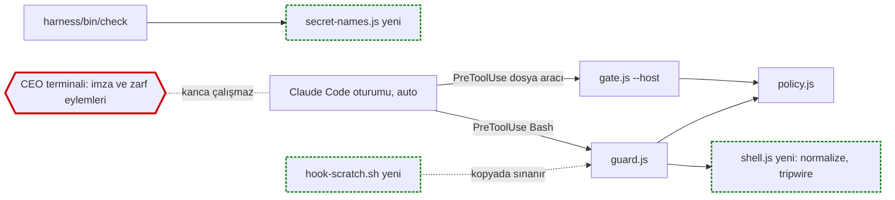
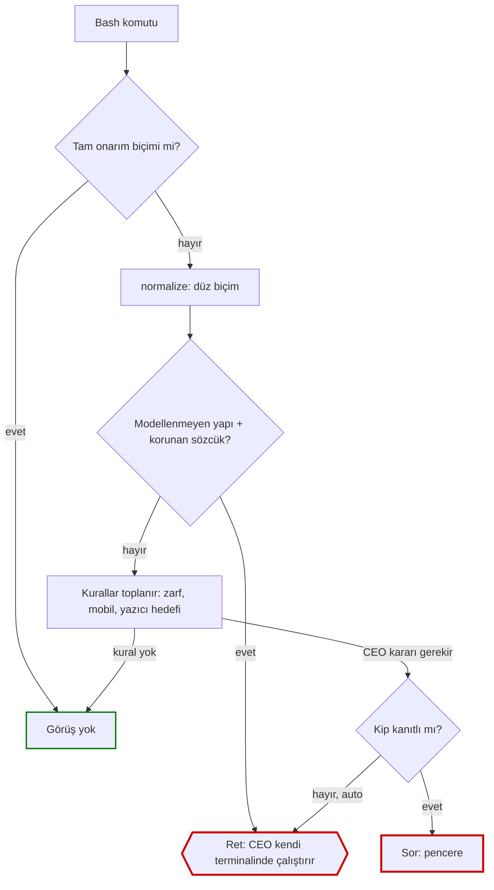
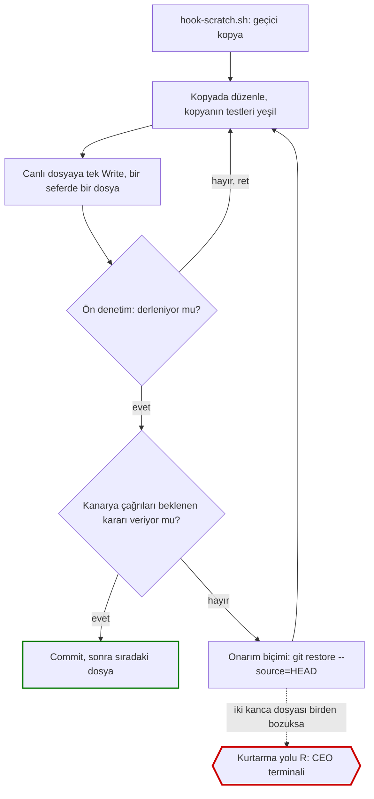

Architecture design: guard hardening (spec 0010: mobile envelope, shell forms, known gaps) | Date: 2026-11-26 | Prepared by: software-architect | Status: ready for review

Girdi: `docs/ACIK-ISLER.md` B32, B33, B34 (a)-(k); `harness/guard.js`, `harness/policy.js`, `harness/gate.js`, `harness/bin/check`, `harness/bin/lint.js` (kanca kuralları), `harness/test/lint-rules.sh`, `harness/test/guard.sh`, `harness/README.md` ("Bilinen boşluklar"), `specs/active/0004-harness-enforcement-gaps.md` §7.1-§7.4 ve §7.7, `docs/architecture/adr/0001-path-class-taxonomy.md`, `docs/kanit/0004-t1.md`, `docs/kanit/0009-kapi-tur1.md`, `docs/KARARLAR.md` Revizyon 48 (son kayıtlar), spec 0008 §6.7 ve §8. Bu belge iş analistinin girdisidir; spec'i yazmaz, kendini onaylamaz, Mimari kurul inceler.

Okuma notu: Bash aracım yok, `git show origin/spec/0008-team-expansion:…` çalıştırılamadı. Spec 0008, aynı dalın çalışma ağacından okundu (`.claude/worktrees/team-expansion/specs/draft/0008-team-expansion.md`; yerel dal ve `origin` ref'i aynı commit'i gösteriyor: `62f4a1f`). Çalışma ağacında commit edilmemiş bir fark varsa bu belge onu da okumuş olur. Bu belgedeki hiçbir komut çalıştırılmadı; "kaynaktan okundu" dışındaki her davranış iddiası mühendisin ilk görevinde sınanır.

## Threat level (read first)

Bu tasarımın verebildiği ve veremediği güvence, her cümlesinin önünde durur.

- Guard kabuk **metnini** okur, komutu çalıştırmaz. Politika yol **metnini** karşılaştırır, dosya kimliğini bilmez. İkisi de kazayı, dürüst hatayı ve "sıradan yazımla" gelen talimat enjeksiyonunu durdurur. Bash'i olan ve dolanmaya çalışan bir ajanı durdurmaz (CEO kararı, Revizyon 48: anahtar parolasız, eşik "kaza önler").
- Görülemeyenler bu işten sonra da görülemez: yorumlayıcı içinden yapılan iş (`node -e`, `python -c`), bir betiğin **içeriği** (Fastfile şeridi, npm betiği, Gradle eklentisi, CocoaPods kancası), kabuk takma adı ve işlevi, `PATH` gölgelemesi, çalışma anında kurulan komut sözcüğü, sabit bağ, denetim ile yazma arasındaki yarış.
- Bu yüzden mobil birim için asıl sınır kancada değildir: mağaza kimlik bilgisi ve yükleme anahtarı bu kullanıcının erişebildiği yerde durmamalıdır (spec 0008 §8 artık risk 3, R-13), `main` dalını GitHub tarafında kural seti korumalıdır (B32 önerisi). Kanca bu sınırların önündeki tabeladır.
- Yazım kuralı (0004'ten devralındı): spec'te ana makine denetimleri için mutlak söz yok ("asla", "imkânsız"). "Kancalar sessizce geçirmez", "çıtayı yükseltir" denir ve "Bilinen boşluklar" gösterilir.
- Bu işin kattığı tek yapısal fark: guard'ın modellemediği bir kabuk yapısı ile korunan bir sözcük aynı komutta görünürse karar **rettir**. Yani yeni bir kabuk biçimi artık sessiz bir açık değil, görünür bir ret üretir. Korunan sözcük görünmüyorsa (çalışma anında kuruluyorsa) bu da işlemez.

### Girdiyle ayrışan bulgu: zarf soruları bugün `auto` kipte ret değil

Görev tanımı "`auto` kipte her 'sor' rettir" diyor. Kaynakta bu yalnız kip kuralının kapsamındaki sorular için doğru (yol soruları, imza, anahtar, kurulum, onarım: `guard.js:197-201`, `policy.js:419-425`). Zarf kuralları kapsam dışıdır: `guard.js:192` (`envelope` her kipte "ask" kaydeder), `guard.js:399` ("ask" JSON'u yazılır), `harness/README.md` G-9, spec 0004 §7.7 "Not in scope". T-1 bulgusu B-1 (`docs/kanit/0004-t1.md:24-33`): `auto` kipte kancanın "sor" kararı pencere açmadı ve zararsız iki komut çalıştı; karar uygulamanın `auto` sınıflandırıcısına kaldı, riskli komutta ne yaptığı sınanmadı.

Sonuç: bugün `git push origin main`, `gh pr merge`, `fastlane deliver`, `ssh` gibi her zarf kuralı `auto` kipte CEO kararı üretmiyor. Spec 0008'in D2 listesi "zarf kancası sorar" diye yazılmış; `auto` kipte "sormak" koruma değildir. Bu tasarım zarf kurallarını kip kuralının altına alır (aşağıda "Envelope in always-auto"). Bu, CEO'nun `main` birleştirme alışkanlığını değiştirir; Tip 1 soru Q-1.

## Problem and constraints

- Spec 0008, Bash'li mobil birim `rn-engineer`'ı D2 birleşmeden teslim edemez (REQ-20, AC-24, AC-31, T-32). D2'nin asgari listesi 0008 §6.7'dedir. CEO mobil mühendisi en az onayla istiyor: D2, açık guard bulgularıyla **tek spec, tek imza** olur.
- Açık bulgular: B32 (zarf boşlukları), B33 (denetçinin Bash'i, `check` için kalıcı izin), B34 (a)-(k). 2026-11-26'dan beri CI kırmızı olmasın diye imzasız spec 0004 `specs/active/` içinde duruyor (B34 k).
- Kısıt 1, her zaman `auto`: CEO kip değiştirmez, kendi terminalinde imzalar (KARARLAR 2026-11-22). Her kural "ret" ya da "görüş yok" olarak tasarlanır; "sor" yalnız kanıtlı kipte açılmış bir oturum için kodda kalır (0004 A-15).
- Kısıt 2, yeni bağımlılık yok: Node yerleşikleri (`fs`, `path`, `os`, `child_process`, `vm`), POSIX sh, zaten kullanılan `git`.
- Kısıt 3, tek iş, tek mühendis, önce test: çözümleyici baştan yazılmaz; mevcut kuralların önüne bir ön geçiş konur.
- Kısıt 4, 0004 dersleri: yarım kaydedilen `policy.js` bütün düzenlemeleri kilitledi; mühendis geçici kopyaya betikle yazmak zorunda kaldı; testler gerçek deponun etkin spec'ine bağlıydı; zorlama dosyalarını yalnız tam yol girdisi açar, çağıran ana oturum ya da dört mühendis birimidir (`policy.js:379`).
- Ölçek: tek CEO, tek Mac, 1-5 eşzamanlı oturum (varsayım, 0004 ile aynı).

## Scope: MUST and LATER

MUST ölçütü: 0008 faz 1b'yi engelliyor, ya da tek bir sıradan komutla ulaşılan bir güvenlik açığı, ya da kısıt 4'teki bir ders.

| # | MUST | Kaynak | Neden MUST |
|---|---|---|---|
| M-1 | D2 asgari listesi: mağaza yükleme ve imzalama komutları, sarmalayıcılar, `security`, `codesign`, `keytool`, anahtar deposu okuma, dosya adına göre sır taraması | 0008 §6.7 | 1b'yi engeller |
| M-2 | Zarf kuralları kip kuralının altına: `auto` kipte ret (Q-1) | B-1, G-9 | Bugün zarfın tamamı tek komutla sınıflandırıcıya kalıyor; M-1 bu olmadan boş |
| M-3 | B32 (a) tırnaklı `"main"`, (b) here-doc satırının kalanı, (c) `word=` belirteçleri, (d) git durumu yönlendirmesi (yalnız `@{push}` okuması) | B32 | Tek komut, `main`'e push |
| M-4 | B34 (b) kabuk biçimleri: ters bölü + satır sonu, `>&dosya`, `( … )`, `{ …; }`, `if/then/fi`, tek `&`; ek: değişmez `cd` ve aynı komutta `git checkout <dal>` izleme | B34 b, c; G-8 | Tek komut; `cd harness && rm guard.js` bugün imzalı işte "kod" sayılır |
| M-5 | B34 (c) zarf boşlukları: `git commit -n`, `+dal` refspec, `checkout main && merge && push`, etiket push'u | B34 c | Tek komut |
| M-6 | B34 (g) `git restore` / `git checkout -- <dosya>` zorlama dosyasında yazma sayılır; tek onaylı onarım biçimi dışında | B34 g | Tek komut, kanca sürümü geri alınır |
| M-7 | B34 (a) `CLAUDE.local.md` zorlama sınıfına ve kilitli kümeye | B34 a | Tek Write ile oturum talimatı |
| M-8 | B34 (h) kanca kaynaklarını sınamak için onaylı yol: geçici kopya + politika istisnası + güvenli düzenleme usulü + `auto`'da çalışan kilit açma yolu | B34 h, ders | 0004'te iki kez dolanmaya itti |
| M-9 | B34 (k) lint fikstürü kendi spec'ini üretir; `specs/active/` boş olabilir | B34 k | CI ve spec yaşam döngüsü buna takılı |
| M-10 | B33: denetçi birimlerin Bash yazıcıları reddedilir; metinler düzeltilir; `settings.local.json` girdisi (CEO eylemi) | B33 | Güvenlik, aynı spec'e söz verildi |
| M-11 | B34 (e) etkin spec okunurken düzenli dosya ve boyut denetimi | B34 e | Karar: MUST. 5 satır; asılı kalan kancanın zaman aşımı açık tarafa düşebilir (doğrulanmadı) |
| M-12 | B34 (f) ret metinleri: kilitli küme doğru adlandırılır; zarf için üçüncü metin | B34 f | Karar: MUST. Metinler M-2 ve M-7 yüzünden zaten değişiyor; yanlış yol tarifi CEO'ya yanlış soru getirir |

| # | LATER | Neden |
|---|---|---|
| L-1 | B34 (d) kökte `package.json` `"type": "module"` | Kapalı tarafa düşer (kanca çalışmaz, her çağrı engellenir), açık üretmez; bu depoda kök `package.json` yok (Glob ile bakıldı); başka projeler harness'i mutlak yolla çağırır, kendi `package.json` dosyaları etkilemez. Kurtarma yolu R yeter. Doğrulanmadı |
| L-2 | B34 (i) P3-1 noktasız ı kök katlaması | Düşük; önceden kurulmuş benzer adlı kardeş dizin ister, tek komutla ulaşılmaz. Tetikleyici: kök yolunda i/I olan proje (mobil deneme deposunun adında var). L-4 ile aynı işe ait: kök karşılaştırması metin yerine aygıt + inode |
| L-3 | B34 (i) P3-2 yeniden harflenmiş `.claude/WORKTREES` | `auto` kipte iki sonuç da ret; fark yalnız kanıtlı kipte |
| L-4 | Sabit bağlar, HFS+/exFAT/SMB, katlama tablolarının yeniden taranması | Yapısal: metin karşılaştırması dosya kimliği değildir. Ayrı "dosya kimliği" işi |
| L-5 | B34 (j) AC-13 eksikleri (`pretooluse-main.json`, `plan`/`bypassPermissions` gözlemi) | Bu işin hiçbir kuralı ana oturum yükünün gözlenmemiş bir alanına dayanmıyor |
| L-6 | B32 (d) kalanı: `pushurl`, `url.*.pushInsteadOf`, iç içe klon | Yalnız varlığına bakıp reddetmek olağan ssh/https yeniden yazımını da keser; hedef depo değişir, dal değil. Savunma: GitHub kural seti (CEO eylemi) |
| L-7 | Mobil birimler için komut biçimi izin listesi (seçenek C) | Aşağıda "Bash side" |
| L-8 | Kancaların bağlı çalışma ağacında geliştirilmesi (canlı kancalar `main`'deki sürüm kalır) | B29'un açık sorularına bağlı; düzenleme ile etkisi arasına insan adımını geri koyan tek seçenek |
| L-9 | `REMOTE_BIN`'in kalanının (ssh, aws, kubectl…) "her konumda" kuralına taşınması; sarmalayıcı seçenek değerleri (`sudo -u`, `timeout 5`) | Mağaza kümesi M-1'de taşınıyor; kalanı mevcut vakaları çevirme riski taşır |
| L-10 | `debug.keystore` izin girdisinin SHA-256 ile sabitlenmesi | Özet ölçülmedi; `rn-engineer` ilk işinde ölçer |
| L-11 | Kabuk betikleri için ön denetim (`sh -n`), `ceo-merge.sh` yardımcı betiği | Değeri düşük; kural seti aynı işi sunucu tarafında yapar |

## Quality attributes

| Attribute | Criterion | How measured (where) | Source/assumption |
|---|---|---|---|
| Karar korunumu | `guard.sh`, `policy.sh`, `host-gate.sh`, `run.sh`, `lint-rules.sh` içindeki her mevcut vaka beklenen değerini korur; istisna yalnız spec'te satır satır sayılan metin değişiklikleridir | `harness/bin/check`, ana makine | Anayasa kural 7 |
| Fark denetimi | Eski guard (HEAD kopyası) ile yeni guard sabit bir komut külliyatında koşturulur; her karar farkı spec'teki "sıkılaştırma" listesindedir, listede olmayan fark = dur ve raporla | `harness/test/shell.sh`, geçici kopya | R-1 riski |
| D2 kapsaması | 0008 §6.7 listesinin her kalemi için `auto` kipte en az bir ret vakası ve en az bir "görüş yok" komşusu (meşru komut) | `guard.sh` yeni bölüm; ayrıca 0008 AC-31 `appsec` sondası | 0008 AC-24 |
| Yanlış ret | Sıradan komut külliyatı (RN deneme komutları + olağan oturum komutları, en az 60 satır: varsayım) imzalı çalışma alanında, `auto` kipte 0 ret alır | `harness/test/fixtures/commands-ordinary.txt` + `shell.sh` | Ders (h) |
| Kapalı düşme | `shell.js` yüklenemezse guard, onarım biçimi dışındaki her Bash çağrısını reddeder | bozuk kopyayla geçici ağaçta test | 0004 REQ-29 |
| Kilit açma | `gate.js`, `guard.js`, `policy.js`, `shell.js` dosyalarından biri bozukken `auto` kipte, CEO olmadan onarım yolu çalışır | dört vaka, geçici ağaç | Ders, M-8 |
| Test bağımsızlığı | `specs/active/` boş bir depo kopyasında `check` yeşildir | `hook-scratch.sh` kopyası | B34 k |
| Gecikme | Bash çağrısı başına guard p95 < 150 ms (dal ve `@{push}` aramaları dahil) | `guard.sh --bench`, 200 çağrı, CEO'nun Mac'i, göreli | 0004 hedefi; kapı ölçümü 24,8 ms (`docs/kanit/0004-t1.md:76`) |
| Dürüstlük | Bu belgedeki her yeni boşluk `harness/README.md` "Bilinen boşluklar" tablosunda numarasıyla durur | lint metin kuralı | Revizyon 48 |

## Component view

### Bir Bash komutuna ve bir dosya yazmasına hangi parçalar karar verir?

Açıklama: guard önce yeni kabuk modülünden geçer, sonra kendi kurallarını ve ortak politikayı uygular; zarf eylemleri oturumun dışında, CEO'nun terminalinde yapılır. Kırmızı kalın çerçeve ve altıgen CEO adımıdır, yeşil kesik çerçeve bu işle gelen parçadır (renk tek başına anlam taşımaz: etikette "yeni" ve "CEO" yazar). Metin karşılığı:

| Bileşen | Sorumluluk (tek cümle) | Sınıf | Değişiklik |
|---|---|---|---|
| `harness/shell.js` (yeni) | Komut metnini düz biçime indirger (`normalize`) ve modellenmeyen yapıları ile korunan sözcük ailelerini bildirir (`tripwire`); saf işlevler, çıktı yazmaz, süreç başlatmaz | zorlama (2) | yeni |
| `harness/guard.js` | Onarım biçimini tanır, `shell.js` çıktısı üzerinde zarf, mobil ve yazıcı kurallarını toplar, en güçlü kararı kip kuralından geçirir | zorlama (2) | büyük |
| `harness/policy.js` | Yol sınıfı: `CLAUDE.local.md` üyesi, geçici kopya istisnası, spec dosyası denetimi; `READ_ONLY_CALLERS` sabiti | zorlama (2) | küçük |
| `harness/gate.js` | Kanca kaynağına yazmada sonuç metninin derlendiğini denetler (ön denetim) | zorlama (2) | küçük |
| `harness/bin/secret-names.js` (yeni) | Verilen kökte adı sır dosyası kalıbına uyan izlenen ya da yok sayılmayan dosyaları listeler, bulursa 1 ile çıkar | ürün ayarı (4) | yeni |
| `harness/bin/hook-scratch.sh` (yeni) | İzlenen ağacı geçici bir dizine kopyalar ve yolunu yazdırır | ürün ayarı (4) | yeni |
| `harness/bin/check`, `lint.js` | Sır adı taraması adımı, yeni test betikleri, `local-allow` uyarısı, README boşluk numaraları | ürün ayarı (4) | küçük |
| `harness/test/*.sh` | Yeni vakalar; `lint-rules.sh` fikstürü kendi spec'ini yazar | ürün ayarı (4) | ek |

Bağımlılık yönü: `guard.js` → `shell.js`, `policy.js`; `gate.js` → `policy.js`. `shell.js` hiçbir modüle bağlı değildir. Döngü yok.

### Bir Bash komutu hangi sırayla karara bağlanır?

Açıklama: komut ya görüş almaz ya da CEO'ya kalır; `auto` kipte CEO'ya kalan her şey rettir. Kırmızı çerçeve CEO adımı, yeşil çerçeve kancanın sessiz kaldığı sonuçtur. Metin karşılığı: (1) komutun tamamı onarım biçimine uyuyorsa başka hiçbir denetim yapılmadan görüş yok; (2) düz biçime indirgeme; (3) modellenmeyen yapı ve korunan sözcük birlikteyse ret; (4) kurallar toplanır, en güçlü karar çıkar (kesin ret > CEO kararı > yok; kesin ret kuralları, örneğin `--no-verify`, her kipte reddeder ve şemada "Ret" kutusuna dahildir); (5) CEO kararı kanıtlı kipte pencere, diğer her kipte rettir.

## Bash side: what the parser can promise, and three options

Guard bugün düzenli ifadelerle böler (`guard.js:49-55`): tırnakları boşaltır, `&&`, `||`, `;`, `|`, satır sonu ile ayırır, her `word=` belirtecini atar. B32 ve B34 (b) bulgularının hepsi bu üç satırın modellemediği sıradan kabuk yazımlarıdır. 0004 yeni yazıcı denetimlerini aynı bölücünün üstüne kurduğu için açığı devraldı.

| Seçenek | Ne yapar | Artı | Eksi | Geri dönüş bedeli |
|---|---|---|---|---|
| A. Bölücüyü biçim biçim genişlet | Her bulgu için bir düzenli ifade daha | En az yanlış ret; en küçük fark | Aynı döngü sürer (0004 → B32 → B34): bilinmeyen her biçim sessiz açıktır; kaç biçim kaldığı bilinmez | yok |
| **B. Düz biçime indir + tetik teli** (öneri) | Sonlu bir listeyi düz biçime çevirir; çeviremediği yapıyı "modellenmeyen" diye işaretler; modellenmeyen yapı ile korunan sözcük aynı komuttaysa reddeder | Bilinmeyen biçim sessiz açık yerine görünür ret olur; düz komutlarda davranış değişmez (ön geçiş düz komutta özdeşliktir, sınanabilir); mevcut kural kodu yerinde kalır | Yanlış ret olasılığı (örnek: `diff <(git show HEAD:harness/guard.js) harness/guard.js > x`); korunan sözcük listesi bakım ister | düşük: `tripwire` çağrısı kaldırılır, ön geçiş kalır |
| C. Mobil birimler için komut biçimi izin listesi | `agent_type` mobil birimse her komut sözcüğü listede olmalı | Yapısı gereği kapalı düşer | Listedeki `node`, `npx`, `./gradlew`, `pod` zaten keyfi kod çalıştırır: sınır görüntüsü verir, sınır vermez; her yeni araç zorlama dosyası değişikliği ve imza ister; günlük işi keser ve dolanmaya iter (ders h); ana oturum kapsam dışı kalır | orta |

Öneri: **B**. Gerekçe: kısıt 3'ün sorusuna dürüst cevap "metin çözümleyici hiçbir zaman tam olmaz"dır; B bu eksikliğin yönünü çevirir (bilinmeyen + korunan = ret). A tek başına bugünkü bulguları kapatır ama bir sonrakini üretir. C, yanındaki anahtar zincirine karşı gerçek sınır olmadığı halde en yüksek sürtünmeyi getirir; gerçek sınır ayrı macOS kullanıcısıdır (0008 R-13). Uygulama biçimi: çözümleyici yeniden yazılmaz; `shell.js` karakter karakter, tırnak durumunu izleyen tek bir tarayıcıdır (tahmin: 150-200 satır) ve **metin** döndürür; mevcut `strip` / `segments` / kural kodu bu metni tüketir.

Düz biçim listesi (`normalize`; her madde en az bir önce-kırmızı test):

| # | Biçim | Düz karşılığı |
|---|---|---|
| N-1 | ters bölü + satır sonu | satırlar birleşir |
| N-2 | here-doc | gövde veridir; ayraç satırının kalanı her görünümde komut metni kalır (`git push origin feat/x <<E +w:main --force`); kapanmayan here-doc modellenmeyen yapıdır |
| N-3 | tek `&`, `\|&` | parça ayırıcı (`&&`, `&>`, `>&`, `2>&1` içindeki `&` ayırıcı değildir) |
| N-4 | `( … )`, `{ …; }`, `!`, `if`, `then`, `elif`, `else`, `fi`, `while`, `until`, `do`, `done`, `time` | parça başı ve sonundan düşer, içerik olağan parça olur |
| N-5 | `>&dosya`, `&>dosya`, `&>>dosya`, `>\|dosya` | sözcük sayı ya da `-` değilse yönlendirme hedefidir |
| N-6 | tırnaklı ve kaçışlı sözcük: `"main"`, `'main'`, `ma"in"`, `ma\in`, `"git"`, `\rm` | içerik değişmez (boşluksuz, `$` ve ters tırnaksız) ise tırnaksız yazılır; boşluklu tırnaklı dize bugünkü gibi opak kalır (commit iletisi) |
| N-7 | `AD=değer` | yalnız komut sözcüğünden önce atamadır; sonra gelen bağımsız değişkendir (`git push origin feat/x a=b:main`) |
| N-8 | değişmez `cd <dizin>`, `pushd <dizin>` | aynı gruptaki sonraki parçaların etkin `cwd` değeri olur (göreli yazıcı hedefleri ve dal araması buna göre); değişmez olmayan `cd` → `cwd` bilinmiyor |
| N-9 | `git checkout <dal>`, `git switch <dal>`, `-b`/`-c` | sonraki parçalar için varsayılan dal olur; değişmez değilse dal bilinmiyor (birleştirme, commit, hedefsiz push kapalı tarafa düşer) |
| N-10 | ileti bağımsız değişkeni | `git commit/tag/merge -m`, `--message`, `gh … --title/--body/--notes` değerleri ve `"$(cat <<'X' … X)"` kalıbı veridir, tek opak sözcük olur |

Modellenmeyen yapılar (U listesi, `shell.js` içinde sabit): `$(…)` ve ters tırnak (N-10 kalıbı hariç), `<(…)`, `>(…)`, `<<<`, `eval`, `source` ve `.`, `sh|bash|zsh|dash|ksh -c`, kabuğa boru (`| sh`), `xargs`, `find … -exec/-execdir/-ok/-delete`, `for`, `case`, `select`, işlev tanımı, `alias`, `$'…'`, süslü parantez açılımı, değişmez olmayan komut sözcüğü, kapanmayan tırnak, `env -S`.

Tetik teli kuralı: komutta U listesinden bir yapı **ve** aşağıdaki ailelerden birinin sözcüğü varsa (here-doc gövdeleri ve N-10 değerleri çıkarıldıktan, tırnak ve parantez işaretleri silindikten sonraki düz sözcük listesinde) karar CEO kararıdır (`auto`: ret). Yapı var ama aile yoksa bugünkü gibi görüş yok (G-8). Yapı yoksa kurallar düz biçim üzerinde karar verir. Mevcut "opak komutta ham metni de tara" dalı (`guard.js:297-301`) bu kuralın özel hâlidir ve onunla değiştirilir; `bash -c "git push origin main"` vakası kararını korur.

| Aile | Sözcükler |
|---|---|
| P-1 git/gh dışa dönük | taban adı `git` olan sözcük + `push`, `merge`, `rebase`, `reset`, `clean`, `tag`, `update-ref`; `gh` + `merge`, `release`, `repo`, `secret`, `auth`, `api`, `workflow` |
| P-2 zorlama yolu | satır 1-2 ad kalıbına uyan sözcük (`ENFORCEMENT`, `ANYWHERE`, `CLAUDE.local.md`) + bir yazıcı fiili, `>` yönlendirmesi ya da `git` + `restore`, `checkout`, `apply`, `stash`, `rm`, `mv` |
| P-3 imza ve anahtar | bugünkü `SIGNING` ifadesi (`guard.js:174`) |
| P-4 mağaza ve imzalama | aşağıdaki S kümesi, `xcodebuild` bayrakları, Gradle `publish*`/`promote*` görev sözcüğü, `security`, `codesign`, `keytool`, `bundletool` |
| P-5 sır dosyası adı | `*.jks`, `*.keystore`, `*.p12`, `*.p8`, `*.mobileprovision`, `key.properties` |
| P-6 uzak ve yayın | `REMOTE_BIN`, `PUBLISH` çiftleri, yazma bayraklı `curl`/`wget` |

## Envelope in always-auto: refuse or no opinion

Tek karar yardımcısı: bir kural "CEO kararı" kaydeder; kanıtlı kipte (`ASK_MODES`) ya da kip alanı yokken sorulur, diğer her kipte reddedilir. Kip alanı olmayan mevcut `guard.sh` vakaları bu yüzden "ask" kalır; yeni vakalar `permission_mode: "auto"` ile "deny" bekler.

| Aile | Bugün, `auto` | Öneri, `auto` | CEO ne yapar |
|---|---|---|---|
| E-1 `main`'e push, birleştirme, doğrudan commit; zorla/silme/ayna push; `--all`, `--tags`; etiket push'u; `main`'e giden `gh pr merge` | sor → sınıflandırıcı | **ret** | Kendi terminalinde çalıştırır. Hiçbir spec açmaz |
| E-2 sürüm, yayın, mağaza, imzalama (`gh release`, `npm publish`, `docker push`, S kümesi, `xcodebuild` dışa aktarma bayrakları, Gradle `publish*`/`promote*`, `bundletool`, adhoc olmayan `codesign`, `security`, `keytool`, sır dosyası) | çoğu sessiz | **ret** | Yalnız CEO, kendi terminalinde. Hiçbir spec açmaz (0008 REQ-8) |
| E-3 uzak erişim ve dağıtım (`ssh`, `scp`, uzak `rsync`, `aws`, `kubectl`, `terraform`…) | sor → sınıflandırıcı | **ret** | Kendi terminali |
| E-4 dışarıya yazan çağrı (`curl -X POST` yerel olmayan adrese, `gh api` yazma, `gh workflow run`, `gh repo`, `gh secret/auth`), `curl \| sh` | sor → sınıflandırıcı | **ret** | Kendi terminali |
| E-5 git yapılandırma ve ortam (`core.hooksPath`, `alias.*`, `GIT_DIR=`) | sor → sınıflandırıcı | **ret** | Kendi terminali |
| E-6 yerel geçmiş işlemleri: `rebase`, `reset --hard`, `branch -D`, yerel `tag` | sor → sınıflandırıcı | korumalı ya da bilinmeyen dalda **ret**; özellik dalında **görüş yok** (Q-2) | Gerekmez |
| E-7 `git clean -f`, `update-ref` | sor → sınıflandırıcı | **ret** | Kendi terminali |
| E-8 özyinelemeli silme `rm -r` | sor → sınıflandırıcı | **hedefe göre**: her hedef değişmez ve geçici dizinde ya da politikanın izin verdiği yolda (imzalı işte kod yolu) ise görüş yok; kök, kökün üstü, ev dizini, değişmez olmayan hedef, satır 1-2 → ret (Q-2) | Yalnız ret hâlinde |
| E-9 imza, anahtar, kurulum betikleri, onarım sorusu | ret | değişmez | Kendi terminali |
| E-10 `--no-verify`, `git commit -n`, kırmızı CI ile birleştirme | kesin ret | kesin ret, her kip | Yol yok |

"İmzalı spec açsın mı?" seçeneği: zarf eylemini spec başlığındaki yeni bir alanla (`Envelope:`) açmak mümkündür ama ADR 0001'in değişiklik kuralına göre yetkiyi genişleten yeni alan = yeni ADR + her etkin spec'in yeniden imzası; parolasız anahtarla birlikte geri alınamaz eylemleri tek imzaya bağlar. Öneri: E-1..E-5 ve E-7 için **yalnız CEO terminali**; imzalı spec yalnız zaten yol politikasının kapsadığı yerde konuşur (E-8'de kod yolu). Mağaza ve imzalama komutları için başka seçenek sunulmuyor.

CEO terminalinde `main` birleştirmesi kancanın "CI yeşil değilse birleştirme" kuralından geçmez (`guard.js:351-361` orada çalışmaz). Karşılığı spec dışı CEO eylemidir: GitHub kural seti (PR zorunlu, zorla push ve silme yasak, `check` durumu zorunlu).

## Mobile rules (D2 minimum list)

Ortak mekanizma, "her konumda dene": mağaza ve imzalama araçlarının kuralı, parçadaki taban adı (sondaki `@sürüm` atılarak) araç adına eşit olan **her sözcükte** denenir; `git` ve `gh` kuralları bugün böyle çalışır (`guard.js:386-390`). Böylece `bundle exec`, `npm exec … --`, `pnpm dlx`, `yarn dlx`, `bunx`, `xcrun`, `doas`, `timeout 600`, `mise exec --` gibi sarmalayıcılar tek tek sayılmadan kapanır. İstisna, "etkisiz bağlam": parçanın komut sözcüğü K kümesindeyse (`cd`, `ls`, `cat`, `head`, `tail`, `grep`, `rg`, `find`, `which`, `type`, `man`, `echo`, `printf`, `mkdir`, `rm`, `cp`, `mv`, `touch`, `chmod`, `wc`, `diff`, `stat`, `test`, `[`, exec içermeyen `git` alt komutları, `brew info/list/search`, `gem list`, `npm ls/view`) araç adı bir yol ya da metin sayılır. K dışındaki her komut (tanınmayan sarmalayıcı dahil) kuralı tetikler. S kümesi: `fastlane`, `eas`, `eas-cli`, `altool`, `notarytool`, `iTMSTransporter`, `transporter`, `appcenter`, `bundletool`, `bundletool*.jar`.

| D2 kalemi | Kural (`auto`: ret) | Görüş almayan komşu (testte yer alır) |
|---|---|---|
| `xcodebuild -exportArchive` | `xcodebuild` sözcüğü + `-exportArchive` | `xcodebuild … build`, `test`, `-showBuildSettings` |
| `-allowProvisioningUpdates`, `-authenticationKey*` | `xcodebuild` + `-allowProvisioningUpdates`, `-allowProvisioningDeviceRegistration`, `-authenticationKey` önekli her bayrak | aynı |
| `xcrun iTMSTransporter` (ve `altool`, `notarytool`) | S kümesi | `xcrun simctl list` |
| `eas-cli`, `npx eas-cli submit`, `npm exec eas-cli -- submit`, `pnpm dlx eas-cli …` | S kümesi; `eas` ve `eas-cli` her alt komutta | `npx expo prebuild`, `npx expo run:android` |
| `bundle exec fastlane pilot upload` | S kümesi | `bundle exec pod install` |
| `./gradlew publish*`, `promote*` | taban adı `gradlew` ya da `gradle` + görev sözcüğü `(:proje:)*(publish\|promote)…`; `publishToMavenLocal` hariç. Ek (asgari listede yok): `--scan` | `./gradlew assembleRelease`, `bundleRelease`, `test` |
| `bundletool` | S kümesi (her çağrı) | yok |
| Play yayıncı API betikleri | komut metninde `androidpublisher.googleapis.com` ya da `api.appstoreconnect.apple.com`; betiğin **içeriği** görülmez (boşluk) | yok |
| `security` okuma ve dışa aktarma | `security` + alt komut izin listesi dışındaysa: izinli yalnız `find-identity`, `help` | `security find-identity -v -p codesigning` |
| adhoc olmayan `codesign -s` | `codesign` + `-s` / `--sign` değeri `-` değilse | `codesign -s - X.app`, `codesign -dv`, `--verify` |
| `keytool -list`, dışa aktarma | `keytool` + alt komut izin listesi dışındaysa: izinli yalnız `-genkeypair`, `-genkey`, `-help`; `-keystore` değeri sır dosyası kuralından geçer | `keytool -genkeypair -keystore /tmp/k/x.jks …` |
| `base64` / `cat` ile anahtar deposu okuma | Sır dosyası kuralı: parçadaki bir sözcük (atama ve `-Pkey=değer` değerleri dahil) P-5 adına uyuyorsa ret; istisna: yol değişmez ve çözülmüş hâli `<R>/android/app/debug.keystore` ya da geçici dizin altındaysa, ya da komut sözcüğü `ls`, `stat`, `test`, `[` ise | `ls android/app`, `ORG_GRADLE_PROJECT_android.injected.signing.store.file=/tmp/k/x.jks ./gradlew assembleRelease` |
| Dosya adına göre sır taraması | `harness/bin/secret-names.js <kök>`: `git ls-files -co --exclude-standard` (git yoksa dizin gezisi) adlarında `*.jks`, `*.keystore`, `*.p12`, `*.p8`, `*.mobileprovision`, `key.properties`; tam yolu `android/app/debug.keystore` olan tek dosya izinli. `check` bu depo için çağırır; uygulama depoları ve 0008'in ön-commit parçası aynı betiği kendi kökleriyle çağırır | `android/app/debug.keystore` |

Sonuç, 0008 kılavuzuna not: atılabilir imza anahtarı geçici dizinde üretilir ve oradan kullanılır (`/tmp/…` ya da oturumun karalama dizini, değişmez yol); depo içindeki başka adlı bir anahtar deposu reddedilir.

## Path-class and gate changes

| Kalem | Değişiklik | Yön |
|---|---|---|
| M-7 `CLAUDE.local.md` | Satır 2 "her yerde" üyesi (`**/CLAUDE.local.md`, harf duyarsız) ve kilitli kümede (`.claude/settings.local.json` gibi: hiçbir `Unlocks:` açmaz; makineye özel dosya, CEO kendi terminalinde düzenler). Konteynerde: bugün "kod", olur "ret" (bir `run.sh` vakası) | sıkılaştırma |
| M-8 geçici kopya istisnası | Yolun sözcük hâli **ve** çözülmüş hâli geçici kümenin altındaysa (`/tmp`, `/private/tmp`, `/var/folders`, `/private/var/folders`, `realpath(os.tmpdir())`), hiçbir kökün (R, iç kök, ana kök) altında değilse ve bir `<cfg>` ya da `<home>` üyesi değilse, satır 2'nin "her yerde" üyeleri uygulanmaz: sınıf "dışarı", karar "görüş yok". Kök geçici dizindeyse (testler) kök kuralları aynen sürer | **gevşetme** (ADR) |
| M-6 `git restore` / `git checkout` | `git restore [seçenekler] [--] <yollar>`, `git checkout [<ağaç>] -- <yollar>` ve `--` içermeyen ama var olan dosya adlandıran `git checkout <yol>`: her yol Bash yazıcı hedefidir (politikaya gider); `.`, dizin ya da glob gibi satır 1-2'yi kapsayabilecek yol belirtimi satır 2 hedefi sayılır | sıkılaştırma |
| Onarım biçimi | Komutun **tamamı** şu düzenli ifadeye uyuyorsa guard başka hiçbir şeye bakmadan görüş vermez (politika ya da `shell.js` yüklenemese de): `^git restore --source=HEAD -- harness/[A-Za-z0-9_-]+\.js( harness/[A-Za-z0-9_-]+\.js)*$` | dar, bilinçli açıklık |
| M-11 spec dosyası | `authority()` (`policy.js:382-399`) ve guard'ın imza penceresi okuması (`guard.js:227-229`) okumadan önce `lstat`: düzenli dosya değilse ya da 1 MiB'den büyükse "spec not readable" (yetki yok) | sıkılaştırma |
| Ön denetim | Ana makinede dosya aracıyla R-göreli `harness/*.js` yazmasında kapı sonuç metnini kurar (`Write`: `content`; `Edit`/`MultiEdit`: eski metne değişiklik uygulanır) ve `vm.Script` ile yalnız derler (çalıştırmaz); derlenmiyorsa ret. `.claude/settings.json` ve `harness/container-settings.json` için `JSON.parse`. Sonuç metni kurulamıyorsa (eski dize bulunamadı) görüş değişmez | sıkılaştırma |
| M-10 denetçi birimler | `READ_ONLY_CALLERS = ["internal-auditor", "appsec"]` (`policy.js` içinde sabit): bu çağıranlardan gelen Bash komutunda geçici dizin ve aygıt yolları dışındaki her tanınan yazıcı hedefi ve yönlendirme hedefi kesin rettir (imza ve `Unlocks:` ne derse desin) | sıkılaştırma |

## Safe edit procedure and unlock path

### Canlı bir kanca dosyası kilitlenmeden nasıl değiştirilir?

Açıklama: kanca kaynağı geçici kopyada geliştirilir, canlıya dosya başına tek yazmayla geçer ve her geçişten sonra sınanır; tek dosya bozulursa oturum içinden, iki dosya birden bozulursa CEO'nun terminalinden onarılır. Metin karşılığı:

1. `sh harness/bin/hook-scratch.sh` izlenen ağacı geçici dizine kopyalar, yolunu yazdırır. Guard betiğin içini okumaz; kopyalama için `cp harness/policy.js /tmp/…` yazılmaz (kaynak işlenen satır 2 olduğu için reddedilir, bu kural gevşetilmez).
2. Kopyadaki dosyalar dosya araçlarıyla düzenlenir (geçici kopya istisnası) ve kopyanın kendi testleri koşturulur (`sh <kopya>/harness/test/guard.sh`: testler `$HERE` ile kopyayı sınar).
3. Canlıya geçiş yalnız dosya aracıyladır: kopyadaki bitmiş dosyanın tamamı tek `Write` ile yazılır. Bir seferde tek kanca dosyası; ardışık `Edit` zinciriyle canlı dosyada ara durum bırakılmaz (talimat; kanca yalnız derlenmeyen sonucu reddeder).
4. Kanarya: her geçişten sonra üç sabit çağrı (görüş almaması gereken bir okuma komutu, reddedilmesi gereken bir zarf komutu sahte girdiyle, serbest sınıfa bir `Write`). Beklenenden farklıysa 5'e.
5. Kilit açma, `auto` kipte, CEO olmadan: `git restore --source=HEAD -- harness/<dosya>.js` (onarım biçimi). Guard'ın kendisi bozuksa Bash kapalıdır; o zaman kopyada duran HEAD sürümü `Read` ile okunup `Write` ile geri yazılır (kapı ve politika sağlamsa). İki yol da kapalıysa kurtarma yolu R: CEO kendi terminalinde `git -C <repo> checkout -- harness/ .claude/settings.json` (`harness/README.md:156-164`).

| Bozuk dosya | Bash | Dosya araçları | Oturum içi onarım |
|---|---|---|---|
| `policy.js` ya da `shell.js` | yalnız onarım biçimi geçer | kapalı (`policy.js`) / açık (`shell.js`) | onarım biçimi |
| `gate.js` | açık | kapalı | onarım biçimi |
| `guard.js` | kapalı | açık | `Write` ile HEAD sürümü |
| ikisi birden | kapalı | kapalı | yok: kurtarma yolu R |

## Data model

Kalıcı kayıt eklenmez; imza biçimi (v1), `Unlocks:` dilbilgisi ve `approvals/` değişmez. Kişisel veri yok. Yeni "veri" yalnız kod içi sabitlerdir ve sahibi olan dosyada yaşar:

| Sabit | Dosya | Yazan | Not |
|---|---|---|---|
| U listesi, P aileleri, K kümesi | `shell.js` | imzalı iş (tam yol girdisi) | tek kaynak; guard kopyalamaz |
| S kümesi, alt komut izin listeleri, Gradle görev ifadesi, sır adı kalıbı | `guard.js` (sır adı kalıbı `shell.js`'ten alınır; `secret-names.js` aynı kalıbı `require` eder) | imzalı iş | iki kopya olmaz |
| `READ_ONLY_CALLERS`, geçici küme, `LOCKED` | `policy.js` | imzalı iş | 0006 taslağı `READ_ONLY` listesini buradan almalı |
| Sıradan komut külliyatı | `harness/test/fixtures/commands-ordinary.txt` | mühendis; QA ekler | depo herkese açık: yol ve ad arındırılır |

## API and identity

- Karar değerleri değişmez: `deny` (çıkış 2 + stderr), `ask` (çıkış 0 + JSON), görüş yok (çıkış 0, boş). Hiçbir kanca `allow` yazmaz (ADR 0001).
- `shell.js` (CommonJS, yüklemede yan etki yok): `normalize(cmd) → { text, unknown: string[], cwdUnknown: boolean }`; `tripwire(cmd) → { unknown: string[], families: string[] }`; `SECRET_NAME` (RegExp). Testler `harness/test/shell-driver.js` üzerinden çağırır.
- `secret-names.js <kök>`: çıkış 0 temiz, 1 bulgu (satır başına bir yol), 2 kullanım hatası. İçerik okumaz.
- Kimlik: `event.agent_type` (alt ajanlarda gelir, ana oturumda yoktur: `docs/kanit/0004-t1.md:16`). Kullanımı: `UNLOCK_CALLERS` değişmez (ana oturum + `polyglot-engineer`, `dotnet-engineer`, `react-engineer`, `devops-sre`); mobil birimler listeye **girmez**. `READ_ONLY_CALLERS` yeni. Alan gelmezse çağıran ana oturum sayılır (denetçi kuralı o zaman işlemez; boşluk olarak yazılır).
- Ret metinleri (ajana, İngilizce; kesin metni iş analisti yazar):
  1. Yol metni: bugünkü metin, yalnız parantezin sonu değişir: "signatures, keys, .git, local settings and instructions (settings.local.json, CLAUDE.local.md), the key generator: no spec covers them". `guard.sh:361` ve spec 0004 §7.7'nin andığı `host-gate.sh` tam metin vakası bu metne çevrilir (önceden onaylı iki satır; sıkılık aynı).
  2. Yolsuz metin (imza, anahtar, kurulum, onarım): değişmez.
  3. Zarf metni (yeni): kuralın kısa İngilizce adını, kipi ve tek yolu söyler: CEO komutu kendi terminalinde çalıştırır; "komutu başka biçimde yazarak dolanma" cümlesi yer alır. Tetik teli reddi ayrıca modellenmeyen yapının adını ve "düz komut olarak yaz" yönergesini taşır.
- Dal ve hedef aramaları her zaman `PATH`'teki `git` ile yapılır (0004 REQ-37). Yeni aramalar: `git rev-parse --abbrev-ref <kaynak>@{push}` (hedefi açık yazılmamış push için: sonuç korumalı dalsa E-1) ve `git rev-parse -q --verify refs/tags/<ad>` (refspec bir etiket adıysa: etiket push'u). İkisi de yereldir, ağa çıkmaz; zaman aşımı 2 sn; arama başarısızsa bugünkü kural geçerlidir.

## Deployment

Sunucu yok. Kancalar çalışma ağacından yüklenir (`.claude/settings.json:24,33`); `shell.js` `guard.js` tarafından `require` edilir, ayar dosyası değişmez. Başka projeler harness'i mutlak yolla çağırdığı için (`install-project.sh`) mobil uygulama depoları yeni kuralları `git pull` ile alır; yeniden kurulum gerekmez. Konteyner: guard orada bağlı değildir; tek fark `CLAUDE.local.md` ret olur. Teslim: dal → `check` yeşil → incelemeler → CEO `main`'e kendi terminalinde birleştirir (bu işten sonra oturum içinden birleştirme reddedilir). Geri alma: `git revert`; geri alınan sürümde zarf yine sınıflandırıcıya kalır. Canlıya geçiş anı: `guard.js` canlı dosyaya yazıldığı çağrıdan sonraki ilk Bash komutu; bu yüzden görev sırası aşağıdaki gibidir.

## Options and trade-offs

| Decision | Option | Pro | Con | Cost of backing out | Recommendation |
|---|---|---|---|---|---|
| D-1 Bash tarafı | A genişlet / B düz biçim + tetik teli / C izin listesi | yukarıdaki tablo | yukarıdaki tablo | A yok, B düşük, C orta | **B** |
| D-2 `auto`'da zarf | a. Bugünkü gibi sor (sınıflandırıcı karar verir) | CEO sohbette "evet" der, oturum birleştirir | CEO kararı değil; riskli komutta davranış sınanmadı; D2 boş kalır | yok | hayır |
| | b. Hepsi kip kuralının altına, ayrım yok | tek kural | `rm -rf node_modules` ve özellik dalında `rebase` de CEO terminali ister; mobil iş durur | düşük | hayır |
| | c. Aile tablosu: dışa dönük ve geri alınamaz olan ret, yerel olan hedefe ya da dala göre | Kural 4 gerçek olur; günlük iş durmaz | CEO `main` birleştirmesini kendi yazar; tablo bakım ister | düşük (aile başına bir satır) | **evet** (Q-1, Q-2) |
| D-3 Zarfı spec açsın mı | a. Yalnız CEO terminali | yeni dilbilgisi yok | her eylemde CEO | yok | **evet** |
| | b. `Envelope:` başlık alanı | CEO'suz dağıtım | yeni yetki alanı: ADR + yeniden imza; geri alınamaz eylem tek imzaya bağlanır | orta | hayır |
| D-4 Kabuk kodu nerede | a. `guard.js` içinde | dosya sayısı artmaz | yaklaşık 415 satırlık dosya büyür; ayrı sınanamaz | düşük | hayır |
| | b. Yeni saf modül `harness/shell.js` | sürücüyle ayrı sınanır; düz komutta özdeşlik özelliği ölçülür | bir zorlama dosyası daha; yüklenemezse guard kapalı düşer | düşük | **evet** |
| D-5 Sarmalayıcılar | a. `WRAPPERS` kümesine ekle | küçük | her yeni sarmalayıcı yeni açık | yok | hayır |
| | b. Mağaza kümesini her konumda dene + etkisiz bağlam K | tanınmayan sarmalayıcı kapalı düşer | `node scripts/eas` gibi adlarda yanlış ret | düşük | **evet** |
| D-6 Sınama yolu (h) | a. Geçici kopya + politika istisnası + `hook-scratch.sh` | küçük; `appsec` sondaları da kullanır | sınıf taksonomisinde gevşetme (ADR) | düşük | **evet** |
| | b. Bağlı çalışma ağacında geliştirme | gevşetme yok; canlı kancalar birleşmeye kadar değişmez | B29'un açık sorularına bağlı; canlı gözlem ayrı oturum ister | orta | sonra (L-8) |
| | c. Yalnız talimat | kod yok | 0004'te işlemedi | yok | hayır |
| D-7 Kilit açma | a. Yalnız kurtarma yolu R (CEO terminali) | açıklık yok | CEO başında olmalı; (g) kapanınca oturum içi yol kalmaz | yok | yedek |
| | b. Dar onarım biçimi (HEAD'e dönüş) her kipte görüş almaz | `auto`'da çalışır; yalnız commit edilmiş içeriğe döner | commit edilmemiş kanca düzenlemesini siler; her çağıran kullanabilir | düşük | **evet** |
| | c. Kapı, bozuk politikada HEAD sürümünü yükler | kilit hiç oluşmaz | kapı içinde `git show` + modül derleme: karmaşık, yeni hata yüzeyi | orta | hayır |
| D-8 Anahtar deposu okuma | a. Okuyucu komut listesi (`cat`, `base64`…) | D2 metnine birebir | sayma yaklaşımı: `xxd`, `openssl`, `cp`, `<` kaçar | yok | hayır |
| | b. Sır dosyası adı korunan sözcük; izinli konum ve dört komut dışında ret | okuyucu saymaz | atılabilir anahtar geçici dizinde olmalı | düşük | **evet** |
| D-9 Denetçinin Bash'i (B33) | a. Bash'i kaldır | "yazma aracı yok" sözü tam doğru olur | denetçi `check` koşamaz; kural 2 kanıtı başkasına kalır; 0006 taslağı Bash'i koruyor | düşük | hayır |
| | b. Bash kalır, tanınan yazıcılar kesin ret, metin düzelir | kanıtı kendi üretir | yorumlayıcı yazması açık kalır (G-3) | düşük | **evet** |
| D-10 `settings.local.json` | a. CEO iki girdiyi kendi terminalinde siler + lint `local-allow` uyarısı | dosya kilitli kalır | `auto`'da sınıflandırıcı `check`'i yine geçirebilir: kazanç küçük, dürüstçe yazılır | yok | **evet** |
| | b. Dosyayı bir işe aç | ajan düzeltir | kilitli kümeyi deler | orta | hayır |

## Decisions expensive to reverse

- Sınıf taksonomisi değişir: `CLAUDE.local.md` üyesi ve kilidi (daraltma), geçici kopya istisnası (**gevşetme**). **ADR draft: yes.** Öneri: ADR 0001'in tarihli değişikliği değil, onu genişleten yeni ADR 0002 ("Geçici kopya istisnası ve zarfın kip kuralı"); sözleşme artık canlı. Kurul karar verir ve dosyalar.
- Kip kuralının kapsamı zarfı da alır (0004 §7.7 "Not in scope" cümlesi tersine döner). Aynı ADR taslağına girer.
- Onarım biçimi ve `READ_ONLY_CALLERS`: geri alması ucuz (bir satır). ADR: hayır, ama ADR 0002'de "sonuçlar" altında anılır.
- `Unlocks:` dilbilgisi ve imza biçimi değişmez: yeniden imza gerektiren başka imzalı bayt yok (`approvals/` içinde 0004 kaydı silindi, KARARLAR 2026-11-25).

## Migration design (if any)

Göç yok. Görünür davranış değişiklikleri (spec'te "sıkılaştırma listesi" olarak sayılır): (1) `auto` kipte E-1..E-5, E-7 ret olur; (2) tetik teli redleri; (3) `git restore`/`checkout -- <zorlama dosyası>` ret; (4) `CLAUDE.local.md` ret; (5) sır dosyası adlandıran komutlar ret; (6) denetçi birimlerin tanınan Bash yazıcıları ret. Gevşeyenler: (7) geçici dizindeki kanca adlı dosyalar görüş almaz; (8) onarım biçimi görüş almaz; (9) Q-2 kabul edilirse özellik dalındaki E-6 ve hedefi uygun `rm -r`, `auto` kipte sınıflandırıcı yerine "görüş yok" alır.

## Proposed REQ outline (rough; the BA writes EARS)

| Grup | Taslak gereksinim |
|---|---|
| Kabuk | R-1 `normalize` N-1..N-10'u uygular ve düz komutta metni değiştirmez. R-2 `tripwire` U listesini ve P ailelerini bildirir; ikisi birlikteyse guard CEO kararı kaydeder. R-3 `shell.js` yüklenemezse guard onarım biçimi dışındaki her Bash çağrısını reddeder |
| Zarf | R-4 E tablosundaki her aile kip kuralından geçer (kip yok ya da kanıtlı: sor; diğer: ret, zarf metni). R-5 B32 a-c ve `@{push}` okuması. R-6 `git commit -n` kesin ret; `+dal` zorla push; etiket push'u; aynı komutta dal ve dizin değişimi (N-8, N-9). R-7 E-6 ve E-8 Q-2'ye göre |
| Mobil | R-8 D2 tablosunun her satırı; her konumda deneme ve K kümesi. R-9 sır dosyası kuralı ve izinli iki konum. R-10 `secret-names.js` ve `check` adımı |
| Yol sınıfı | R-11 `CLAUDE.local.md` satır 2 ve kilitli (ana makine, konteyner). R-12 geçici kopya istisnası (üç koşul). R-13 `git restore`/`checkout` yazıcıdır. R-14 onarım biçimi. R-15 spec dosyası denetimi. R-16 kapı ön denetimi |
| Birimler | R-17 `READ_ONLY_CALLERS` yazıcı reddi. R-18 `internal-auditor.md` metni; lint `local-allow` uyarısı |
| Testler ve metinler | R-19 lint fikstürü kendi spec'ini yazar; `specs/active/` boşken `check` yeşil. R-20 ret metinleri (üç metin). R-21 `harness/README.md`: yeni boşluklar, güvenli düzenleme usulü, "zarf eylemini CEO nerede yapar" bölümü. R-22 mevcut her vaka kararını korur; değişen satırlar spec'te sayılır |

Kabul ölçütü taslağı (yaklaşık 16): düz komutta özdeşlik ve fark denetimi; N-1..N-10 vakaları; tetik teli olumlu ve olumsuz vakaları; B32 dört vaka; B34 (c) dört vaka; E tablosu aile başına `auto` ret + kip yok sor; D2 satır başına ret + komşu; sır adı taraması (izinli tam yol, ikili dosya, `key.properties`); `CLAUDE.local.md` (ana makine, konteyner, kilitli girdi lint'i); geçici kopya istisnası (kök dışı geçici: yok; kök geçici dizinde: satır 2; bağ ile depoya giden: satır 2; `<cfg>` geçici dizinde: satır 2); onarım biçimi (tam eşleşme geçer, ek parça ya da başka yol geçmez, bozuk politikada geçer); FIFO ve büyük dosya (1 sn içinde karar); ön denetim (derlenmeyen `Write` ve `Edit`); denetçi yazıcıları; lint fikstürü boş `specs/active/`; ret metinleri tam metin; gecikme ölçümü; canlı ilk çalıştırma gözlemi (`auto`, aile başına bir ret ve bir geçiş, sahte girdi).

## Task outline and order

### Hangi sırayla yapılırsa `check` yeşil ve oturum açık kalır?

Açıklama: önce testin gerçek spec'e bağımlılığı kalkar, sonra her şey kopyada yazılıp sınanır; canlıya geçen üç adım (T-4, T-5, T-6) ayrı ayrı ve kanaryayla yapılır. Kırmızı altıgen CEO adımıdır. Metin karşılığı:

| Görev | İçerik | Canlı etkisi | Yeşil kapı |
|---|---|---|---|
| T-0 | CEO: 0004 `specs/done/`'a taşınır, 0010 etkinleşir, kendi terminalinde `--preview` sonra `--expect` (tek imza). Aynı oturumda CEO eylemleri: `settings.local.json` iki girdi, GitHub kural seti | yok | `check` |
| T-1 | `lint-rules.sh` fikstürü: taban kopyadan `specs/active/` boşaltılır, fikstür `Unlocks:` satırlı kendi spec'ini yazar; `hook-scratch.sh`; boş `specs/active/` kopyasında `check` | yok | `check` + kopyada `check` |
| T-2 | Sıradan komut külliyatı; `shell.sh` fark denetimi iskeleti (eski guard HEAD kopyası ile); N, U, P, B32, B34 için kırmızı testler (kopyada) | yok | `check` (yeni betikler henüz listede değil) |
| T-3 | `shell.js` + `shell-driver.js`; kopyada yeşil; `check` listelerine eklenir | yok (kimse yüklemez) | `check` |
| T-4 | `policy.js`: `CLAUDE.local.md`, geçici kopya istisnası, spec dosyası denetimi, `READ_ONLY_CALLERS`; `gate.js` ön denetimi; `policy.sh`, `host-gate.sh`, `run.sh` ekleri | **dosya araçları, hemen** | `check` + kanarya |
| T-5 | `guard.js` 1: onarım biçimi, `normalize`, N-7, N-8, N-9, B32, B34 (c), (g), tetik teli | **Bash, hemen** | `check` + kanarya + fark denetimi |
| T-6 | `guard.js` 2: zarf aileleri kip kuralında, zarf metni, yol metni (iki önceden onaylı satır), E-6 ve E-8 | **Bash: oturum artık `main`'e birleştiremez** | `check` + kanarya |
| T-7 | `guard.js` 3: D2 kuralları, sır dosyası kuralı, denetçi yazıcıları | Bash | `check` + D2 vakaları |
| T-8 | `secret-names.js` ve `check` adımı; `lint.js` (`local-allow`, boşluk numaraları, metin kuralları); `harness/README.md`; `internal-auditor.md`; kurul ADR 0002'yi dosyalar | metin | `check` |
| T-9 | `qa-engineer` (mutasyon denemeleri, külliyat), `appsec` (D2 listesinin her kalemini kurulu kancaya karşı sahte girdiyle: 0008 AC-31'in girdisi), `internal-auditor`, `quality-office`; `auto` kipte ilk çalıştırma gözlemi | yok | taze `check` çıktısı |

Tek imza, PR sayısı: imza spec'e bağlıdır, PR'a değil. Öneri tek PR; inceleme hacmi büyürse T-1..T-6 ve T-7..T-8 iki PR olur (0008 "tek imza, ayrı PR" örneği). D2, T-7'yi içeren PR `main`'e girince karşılanmış sayılır.

### `Unlocks:` list this spec needs (exact literal paths, no glob)

- Zorlama dosyaları (önizlemede işaretli blokta görünür; çağıran: ana oturum ya da dört mühendis birimi): `harness/guard.js`, `harness/policy.js`, `harness/gate.js`, `harness/shell.js` (yeni).
- Ürün ayarı: `harness/bin/check`, `harness/bin/lint.js`, `harness/bin/secret-names.js` (yeni), `harness/bin/hook-scratch.sh` (yeni), `harness/test/guard.sh`, `harness/test/policy.sh`, `harness/test/policy-driver.js`, `harness/test/host-gate.sh`, `harness/test/run.sh`, `harness/test/lint-rules.sh`, `harness/test/shell.sh` (yeni), `harness/test/shell-driver.js` (yeni), `harness/test/secret-names.sh` (yeni), `harness/test/fixtures/commands-ordinary.txt` (yeni), `harness/README.md`, `.claude/agents/internal-auditor.md`.
- Bilerek listede olmayanlar (kapalı kalır): `.claude/settings.json` (bağlantı değişmiyor), `CLAUDE.md`, `.claude/rules/routing.md`, `harness/approval.js`, `harness/bin/approve.sh`, `harness/container-settings.json`, kurulum betikleri, `stop.js`, `loop.js`, `notify.js`. Kilitli olduğu için hiçbir başlıkla açılamayanlar: `.claude/settings.local.json`, `CLAUDE.local.md`.
- Serbest sınıf (imza gerekmez): `docs/**` (ADR, `ACIK-ISLER.md`, `KARARLAR.md`), `specs/**`.

İş analisti listeyi görev başına doğrular: `shell.js`, `ANYWHERE` ifadesine (`policy.js:26`) ve lint örnek listesine eklenir.

## Known gaps after this job (go to `harness/README.md`, numbered after G-22)

| # | Boşluk | Durum |
|---|---|---|
| G-23 | Tetik teli yalnız sayılan ailelerin **görünen** sözcüklerinde işler; çalışma anında kurulan sözcük (`$CMD`, birleştirme) görülmez | açık |
| G-24 | Betik içeriği: Fastfile şeridi, npm betiği, Gradle eklentisi ya da görevi, mağaza API'sini çağıran betik; adı S kümesinde olmayan araç | açık; kimlik bilgisi bu kullanıcıda durmamalı (0008) |
| G-25 | Sır dosyası yalnız adından tanınır; başka uzantılı ya da uzantısız anahtar deposu, yeniden adlandırılmış gerçek anahtar (`debug.keystore` adıyla) görülmez | açık; L-10 |
| G-26 | Geçici dizindeki kanca kopyaları korunmaz; bir ayar dosyası kancayı geçici dizinden yüklerse koruma kalkar | lint: kanca komut yolu geçici küme altındaysa FAIL (öneri) |
| G-27 | Onarım biçimi commit edilmemiş kanca düzenlemesini her çağıran için geri alır; HEAD başka dala alınmışsa o dalın sürümüne döner (G-5) | bilinçli |
| G-28 | `pushurl`, `url.*.pushInsteadOf`, iç içe klon, önceden tanımlı takma ad; `@{push}` çözülemeyen yapılandırmalar | açık; GitHub kural seti |
| G-29 | N-8 ve N-9 yalnız değişmez `cd`, `pushd`, `git checkout`, `git switch` izler; `git worktree`, `popd`, alt kabuk dışına taşan durum izlenmez | kısmi |
| G-30 | `agent_type` gelmezse denetçi kuralı işlemez; denetçinin yorumlayıcı yazması (G-3) açık | açık |
| G-31 | CEO terminalinde yapılan birleştirme kancanın CI kuralından geçmez | GitHub kural seti (CEO eylemi) |

G-8 ve G-17 satırları daralır (ters bölü, tırnaklı komut sözcüğü, `>|`, `cd`, `git restore` oradan çıkar); G-9 yeniden yazılır (zarf artık kapsamda).

## Risks

| # | Risk | Önlem |
|---|---|---|
| RK-1 | Ön geçiş mevcut bir vakanın kararını çevirir | Düz komutta özdeşlik testi; eski-yeni fark denetimi; çevrilen vaka = dur ve raporla |
| RK-2 | Yanlış retler ajanı dolanmaya iter (ders h) | Külliyatta 0 ret hedefi; ret metni düz yazımı tarif eder; "ret gelirse dolanma" kuralı metinde |
| RK-3 | Yeni guard canlıya girince işin kendi oturumunu kilitler | Güvenli düzenleme usulü, ön denetim, kanarya, onarım biçimi |
| RK-4 | T-6'dan sonra oturum `main`'e birleştiremez; CEO kural setini kurmazsa terminal birleştirmesi CI denetimsizdir | Q-1'de açıkça söylenir; B-n CEO eylemi |
| RK-5 | `@{push}` ve `vm.Script` (shebang satırı) davranışı bu belgede sınanmadı | T-2'de fikstürle sınanır; `@{push}` çözülmezse bugünkü kural; shebang derlenmezse ilk satır atılarak derlenir |
| RK-6 | Geçici kopya istisnası ve onarım biçimi gevşetmedir | `appsec` ve kurul kapıda ayrıca bakar; ADR 0002; üç koşul ve tam eşleşme testleri |
| RK-7 | İş hacmi: yaklaşık 22 gereksinim, 16 ölçüt, tek mühendis | T-5/T-6/T-7 bağımsız dilimler; iki PR seçeneği; M-11 ve M-12 küçük |
| RK-8 | Taslak 0006 (REQ-4, REQ-5: `READ_ONLY` Bash sınırı) ve taslak 0009 (metinler) ile örtüşme | 0006'ya fark notu: Bash yarısı 0010 ile gelir, sabit `policy.js`'ten okunur; 0010 `CLAUDE.md`'ye dokunmaz |
| RK-9 | Hook zaman aşımının açık tarafa düşüp düşmediği (M-11 gerekçesi) gözlenmedi | Düzeltme her iki durumda da doğru; gözlem isteğe bağlı |

## Unknowns and assumptions

Verdiğim kararlar (Tip 2):
- Ruling: çözümleyici yeniden yazılmaz, metin döndüren ön geçiş eklenir — `guard.sh` içindeki mevcut vakalar (288 `t` satırı; döngüler yüzünden koşan sayı daha fazladır, sayılmadı) düz komutta aynı yoldan geçer — yanlışsa bedeli: iki katmanlı kod, ileride gerçek bir sözcük çözümleyiciye taşıma.
- Ruling: tüm yeni retler kip kuralından geçen "CEO kararı"dır, kesin ret değil (`git commit -n` ve denetçi yazıcıları hariç) — kip alanı olmayan mevcut vakalar "ask" kalır, kanıtlı kipte pencere yolu korunur — yanlışsa bedeli: kanıtlı kipte açılan oturumda mağaza komutu pencereyle geçebilir.
- Ruling: `CLAUDE.local.md` kilitli kümeye girer — hiçbir işin düzenlemesi gerekmiyor, `settings.local.json` ile aynı tür — yanlışsa bedeli: CEO dosyayı kendi terminalinde düzenler.
- Ruling: onarım biçimi yalnız `harness/<ad>.js` ve yalnız `--source=HEAD` — kilidi açan en dar biçim — yanlışsa bedeli: `.claude/settings.json` bozulursa oturum içi onarım yok (o durumda kancalar zaten yüklenmez).
- Ruling: `CLAUDE.md` ve `routing.md` bu işte düzenlenmez — kural 4'ün metni değişmiyor, mekanizması değişiyor; kural 3 metni 0006'nın — yanlışsa bedeli: "CEO terminalinde" bilgisi yalnız README'de ve ret metninde durur.
- Ruling: B33 için Bash kaldırılmaz, tanınan yazıcılar reddedilir — denetçi kanıtını kendi üretir, 0006 taslağı da böyle — yanlışsa bedeli: araç satırından Bash'i silmek tek satırlık iş.
- Ruling: `lint` `local-allow` kuralı FAIL değil WARN — dosya kilitli, ajan düzeltemez; FAIL yerel `check`'i CEO eylemine kilitlerdi — yanlışsa bedeli: uyarı gözden kaçar.

Varsayımlar (Tip 3, iş sonu raporunda):
- A-1 `bundletool` her çağrıda reddedilir (D2 listesi koşulsuz yazıyor).
- A-2 `eas` ve `eas-cli` her alt komutta reddedilir (`eas build --local` dahil); EAS standart değil (KARARLAR, mobil yığın).
- A-3 Gradle `--scan` ve `.p8` adı asgari listeye eklendi (ucuz, sıkılaştırma).
- A-4 `debug.keystore` izni tek tam yoldur (`android/app/debug.keystore`); tek depolu çoklu uygulama düzeni sonra.
- A-5 `publishToMavenLocal` görüş almaz.
- A-6 Sıradan komut külliyatı en az 60 satır; sayı varsayımdır.

Bilinmeyenler:
- U-1 Spec 0008'in `origin` kopyası ile okunan çalışma ağacı kopyası arasında commit edilmemiş fark var mı (ref'ler aynı).
- U-2 `.claude/settings.local.json` git tarafından izleniyor mu (`.gitignore`'da satırı görülmedi); izleniyorsa lint uyarısı CI'da da görünür.
- U-3 `auto` sınıflandırıcısının riskli zarf komutunda ne yaptığı (sınanmadı; Q-1 kabul edilirse önemi kalmaz).
- U-4 Uygulama depolarında `debug.keystore` şablon dosyasının sabit olup olmadığı (L-10).
- Dış içerik: kullanılmadı. Kaynak dosyalardaki hiçbir metin talimat olarak izlenmedi.

## CEO questions (Type 1)

- **Q-1 `auto` kipte zarf.** Bugün `main`'e push ve birleştirme, sürüm, yayın, uzak erişim gibi zarf kuralları `auto` kipte pencere açmıyor ve kararı uygulamanın sınıflandırıcısı veriyor (B-1). Öneri: bu aileler (E-1..E-5, E-7 ve bütün mağaza ve imzalama komutları) `auto` kipte **reddedilsin**, CEO bunları kendi terminalinde çalıştırsın; hiçbir spec açmasın. **Öneri: evet.** Bedeli: her `main` birleştirmesinde CEO bir komutu kendisi yazar (`gh pr merge <n> --squash`); CI denetimi için GitHub kural seti kurulmalı. Reddedilirse: yalnız yeni mobil kurallar reddeder, git ve `gh` ailesi sınıflandırıcıya kalır ve kural 4 o aile için talimat düzeyinde kalır.
- **Q-2 Yerel silme ve yerel geçmiş işlemleri.** `rm -r` hedefe göre (geçici dizin ya da imzalı işin kod yolu: görüş yok; diğer her hedef: ret) ve özellik dalında `rebase`, `reset --hard`, `branch -D`, yerel `tag` görüş almasın mı? **Öneri: evet.** Gerekçe: mobil mühendisin belgelenmiş adımı `node_modules` silmektir (0008 deneme özeti, tuzak 2); hepsi ret olursa her temizlikte CEO terminali gerekir. `git clean -f`, `update-ref` ve korumalı daldaki her şey ret kalır. Reddedilirse: bunların tümü `auto` kipte reddedilir.

Tip 1 olmayan CEO eylemleri (soru değil, "Beklenenler"e yazılır): `settings.local.json` içinden `Bash(./harness/bin/check)` ve eski `approval.js verify …0004…` girdisinin silinmesi; GitHub'da `main` kural seti.

## Input for the BA

1. §8'in başına tehdit düzeyi ve "Girdiyle ayrışan bulgu" paragrafı; mutlak söz yok.
2. Kapsam tabloları M-1..M-12 ve L-1..L-11 (LATER kalemleri `docs/ACIK-ISLER.md`'de izlenir; B32-B34'ün kapanan alt maddeleri orada işaretlenir).
3. `shell.js` sözleşmesi: N-1..N-10, U listesi, P aileleri, tetik teli kuralı; her madde önce-kırmızı test satırı olarak.
4. E tablosu (Q-1 ve Q-2 cevaplarına göre) ve üç ret metninin kesin hâli; değişen iki tam metin test satırı spec'te satır numarasıyla sayılır, başka hiçbir mevcut vaka değişmez.
5. D2 tablosu satır satır gereksinim ve ölçüt olarak; her satır 0008 §6.7 kalemine izlenir (0008 AC-24).
6. Yol sınıfı değişiklikleri ve konteyner farkı (`CLAUDE.local.md`); geçici kopya istisnasının üç koşulu; onarım biçiminin düzenli ifadesi harfiyen.
7. Güvenli düzenleme usulü §10'a ve görev kurallarına; kanarya çağrıları sabit metin olarak.
8. Görev sırası T-0..T-9, "her görevden sonra `check` yeşil", canlıya geçen üç adımın ayrı commit'i.
9. `Unlocks:` listesi yukarıdaki gibi, tam yollarla; zorlama girdileri dört dosya.
10. Yeni boşluklar G-23..G-31 ve G-8, G-9, G-17 düzeltmeleri README metni olarak.
11. Taslak 0006 ve 0009 için fark notu (RK-8); ADR 0001'e atıf, ADR 0002 taslağı kurulun işi.
12. Mimari kurula açık: D-1..D-10, özellikle D-6 ve D-7 (iki gevşetme) ve D-2 (kip kuralı kapsamı). `appsec`'e açık: onarım biçimi, geçici kopya istisnası, K kümesi, sır dosyası kuralının izinli konumları. Bu tasarım kendini onaylamaz.
