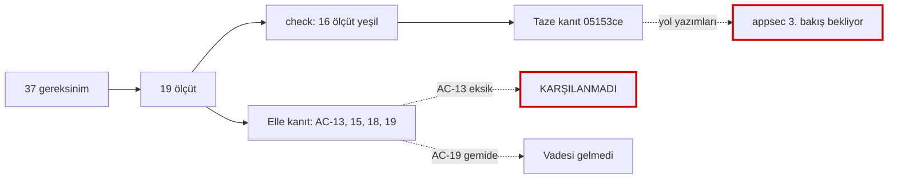

# Spec 0004: izlenebilirlik kaydı ve uyum kontrol listesi

- İş: `specs/active/0004-harness-enforcement-gaps.md` (sha12 `bd8e0c01ddf8`, imzalı; bu kayıt spec'e dokunmaz).
- Dal `harness/0004-host-enforcement`, taban commit `05153ce`. Tarih: 2026-11-24. Yapan: `quality-office` (T-11'in son adımı).
- **Sonuç: AÇIK KALEMLER (5).** İzlenebilirlik: 37 gereksinimin 33'ü kanıtlı, 4'ü kısmen, 0'ı kapsamsız. Ölçütler: AC-13 KARŞILANMADI, AC-19 vadesi gelmedi, `appsec` üçüncü bakışı bekliyor.
- Hukuki not: bu belge hukuki görüş değildir. "AVUKAT GEREKLİ" yazan kalem avukata gider.
- Kaynak ayrımı: ölçüt-kanıt haritası ve mutasyon denemeleri QA'nındır (`docs/kanit/0004-t11-qa.md`, `cedb834` üzerinde). Bu kayıt o tabloyu yinelemez; gereksinim → ölçüt bağını kurar ve zincirin koptuğu yerleri yazar. Kalite ofisinin kendi ürettiği kanıt yalnız "Taze kanıt" bölümündekilerdir.
- Dosya yeri: görev `docs/kanit/0004-izlenebilirlik.md` istedi; kalite ofisinin yazma alanı `docs/kalite/` ve `docs/uyum/` ile sınırlı olduğu için kayıt buraya yazıldı. Taşıma ana oturumun işidir.

## Taze kanıt (kalite ofisi, 2026-11-24, `05153ce`)

`./harness/bin/check` → çıkış 0, `CHECK GREEN (full)`. Başarısız satır sayısı 0.

| Paket | Sonuç @ `05153ce` | QA @ `cedb834` |
|---|---|---|
| lint | 63 ok, 0 failed; 1 WARN (`fixture-sanitized`: `pretooluse-main.json` yok) | 63 ok, 1 WARN |
| lint-rules.sh | 471 passed | 446 |
| run.sh | 177 passed | 177 |
| host-gate.sh | 682 passed | 289 |
| guard.sh | 856 passed | 434 |
| policy.sh | 1366 passed | 690 |
| stop / tools / loop | 11 / 26 / 16 passed | 11 / 26 / 16 |
| gizli anahtar taraması | `ok    no token or private key patterns` | (QA raporunda yok) |

Sayı farkı QA'dan sonraki iki düzeltme commit'inin testleridir (`8617067`, `05153ce`); taze çıktıda `alias` etiketli 108, `fold` etiketli 194 satır var. Kalan artışın satır satır dökümü yapılmadı.

Diğer komutlar:
- AC-18 (QA'nın eşdeğer yol kalıplarıyla): `git status --short -- <8 dosya>` boş. `git log --oneline 8183bea..HEAD -- <8 dosya>`: `9f6b1f4` (T-8a), `ea09b82` (T-8b), `4212b94` (T-9), `8617067`, `05153ce`. Son ikisi düzeltme commit'idir; `8617067` `STATE.md` ve `docs/KARARLAR.md` (2026-11-23) kaydında, `05153ce` `docs/KARARLAR.md` (2026-11-24) kaydında anlatılıyor.
- QA'nın iki hata yeniden üretimi: `node harness/test/qa-0004-owner-duplicate.js` → `GREEN: 4 passed, 0 failed`; `node harness/test/qa-0004-reason-separator.js` → `GREEN: 4 passed, 0 failed`. İkisi de `check` listesinde değil.
- Kaldırılan test satırı, `git diff -U0 cedb834 -- harness/test/ harness/bin/lint.js harness/bin/check | grep '^-[^-]'`: 1 satır (`lint-rules.sh`, "the host gate command twice for one tool is no second owner" iddiası tersine çevrildi; QA D-1).

## Zincir nerede kopuyor?

Açıklama: otomatik kol `05153ce` üzerinde taze ve yeşil; kopukluklar elle kanıt kolunda ve henüz bitmemiş güvenlik bakışında. Metin karşılığı:

| Halka | Durum |
|---|---|
| Gereksinim → ölçüt | 37 gereksinimin hepsinin en az bir ölçütü var |
| Ölçüt → otomatik test | AC-1..AC-12, AC-14, AC-16, AC-17 ve AC-13'ün lint kısmı `check` içinde, yeşil |
| Ölçüt → elle kanıt | AC-15 kayıtlı (`4212b94`); AC-18 taze; AC-13 eksik (kalın kesikli çizgi: risk); AC-19 T-12'den sonra |
| Kanıt → bağımsız doğrulama | QA haritası `cedb834`'te; sonraki iki düzeltme için `appsec` bakışı sürüyor |

## İzlenebilirlik matrisi

Durum etiketleri: KANITLI (taze `check` çıktısı ve QA haritası), KISMEN (otomatik kanıt var, zincirin bir halkası eksik ya da bekliyor), KANITSIZ. "check" sütunundaki her satırın komutu `./harness/bin/check` @ `05153ce`; ölçüt başına durum için QA tablosuna bakılır.

| Gereksinim | Ölçüt | Test | Kanıt | Durum |
|---|---|---|---|---|
| REQ-1 ortak politika modülü | AC-1 | `policy.sh` tutarlılık döngüsü | check: policy 1366 | KANITLI |
| REQ-2 yol sınıfları, iki-yol kuralı, harf katlama | AC-1, AC-16 | `policy.sh` matrisi, `host-gate.sh` | check yeşil; `alias` 108, `fold` 194 satır. İki `appsec` yüksek bulgusu bu gereksinimdeydi, `8617067` ve `05153ce` ile düzeltildi; üçüncü bakış bekliyor; QA bu iki commit'i görmedi | KISMEN |
| REQ-3 bugünkü guard kalıbının üst kümesi | AC-2 | `policy.sh` üst küme | check yeşil. QA G-1: dört "her yerde" üyesinin kök dışı testi yok (4 mutasyon sağ kaldı); `policy.sh` ve `policy-driver.js` içinde bu yollar hâlâ geçmiyor. Yol yazımları için `appsec` bekliyor | KISMEN |
| REQ-4 çözümleme hatasında ret | AC-1, AC-5 | `policy.sh`, `run.sh` | check | KANITLI |
| REQ-5 imzasız kod yazımı sorulur | AC-3, AC-10, AC-15 (a) | `host-gate.sh` | check: AC-3 60 satır; T-10 (a) | KANITLI |
| REQ-6 imzalı kod yazımı penceresiz | AC-3, AC-15 (b) | `host-gate.sh` | check; T-10 (b) | KANITLI |
| REQ-7 ürün yapılandırması `Unlocks:` ile | AC-3 | `host-gate.sh` | check | KANITLI |
| REQ-8 zorlama dosyası, tam yol girdisi, çağıran koşulu | AC-16, AC-15 (c)(d)(e) | `host-gate.sh`, `policy.sh` | check: AC-16 113 satır; T-10 (c)-(e). (e)'de `agent_type` yükten yakalanmadı (QA notu) | KANITLI |
| REQ-9 imza dizini ve git üstverisi reddedilir | AC-3, AC-5, AC-16 | `host-gate.sh`, `run.sh` | check | KANITLI |
| REQ-10 serbest sınıf imzasız | AC-3, AC-5 | `host-gate.sh`, `run.sh` | check | KANITLI |
| REQ-11 `specs/` yoksa görüş yok | AC-3, AC-4, AC-9 | `host-gate.sh`, `guard.sh` | check | KANITLI |
| REQ-12 çalışma alanı dışı yol | AC-1, AC-3 | `policy.sh`, `host-gate.sh` | check | KANITLI |
| REQ-13 kök ve kayıtların ana çalışma ağacından okunması | AC-4 | `host-gate.sh` | check: AC-4 34 satır | KANITLI |
| REQ-14 git sorgusu başarısızsa kapalı kal | AC-4, AC-16 | `host-gate.sh` | check | KANITLI |
| REQ-15 test değişkenleri host'ta yok sayılır | AC-4, AC-9 | `host-gate.sh`, `guard.sh` | check | KANITLI |
| REQ-16 imza biçimi v1 değişmez | AC-5, AC-7 | `run.sh` mevcut satırlar | check: run 177 (QA ile aynı sayı) | KANITLI |
| REQ-17 konteyner: sor yerine ret | AC-5, AC-16 | `run.sh` | check | KANITLI |
| REQ-18 konteyner farkları | AC-5 | `run.sh` | check: AC-5 18 satır | KANITLI |
| REQ-19 `Unlocks:` doğrulanan baytlardan | AC-6 | `policy.sh`, `lint-rules.sh` | check: AC-6 78 satır | KANITLI |
| REQ-20 glob zorlama yolunu açmaz, kilitli yol | AC-6, AC-16, AC-17 | `lint-rules.sh`, `host-gate.sh`, `policy.sh` | check | KANITLI |
| REQ-21 Bash yazıcısı, kod ve ürün yapılandırması | AC-9 | `guard.sh` | check: AC-9 61 satır | KANITLI |
| REQ-22 Bash yazıcısı, zorlama yolu, kurulum betikleri | AC-9, AC-10, AC-16 | `guard.sh` | check | KANITLI |
| REQ-23 görüş verilmeyen hedefler | AC-9 | `guard.sh` | check | KANITLI |
| REQ-24 mevcut zarf kuralları korunur | AC-8, AC-9 | `guard.sh` mevcut satırlar | check: guard 856, 0 başarısız | KANITLI |
| REQ-25 imza önizlemesi | AC-7, AC-17 | `run.sh` | check: AC-7 39, AC-17 215 satır | KANITLI |
| REQ-26 imza penceresi metni, sha12 | AC-8, AC-17 | `guard.sh` | check: AC-8 20 satır | KANITLI |
| REQ-27 imza betiği retleri | AC-7, AC-17 | `run.sh` | check | KANITLI |
| REQ-28 izin kipi kuralı | AC-10, AC-13 (elle) | `host-gate.sh`, `guard.sh` | check: AC-10 228 satır. Elle taban eksik: `plan` ve `bypassPermissions` gözlenmedi (`0004-t1.md` satır 44, 52). QA N-1: AC-10'un `acceptEdits` → ret cümleleri R-11 ile çelişiyor (spec metni) | KISMEN |
| REQ-29 kapalı kal | AC-11, AC-13 (elle) | `policy.sh`, `lint-rules.sh`, `host-gate.sh` | check: AC-11 51 satır. Elle taban eksik: sarmalayıcının host'ta engellediği (sözdizimi hatası, eksik girdi) ve boş `CLAUDE_PROJECT_DIR` gözlenmedi; yalnız `sh -c` testleri var | KISMEN |
| REQ-30 stop ve bildirim kancaları açık kalır | AC-11, AC-12 | `stop.sh`, `lint-rules.sh` (`hook-wrapper`) | check: stop 11; lint `hook-wrapper` ok | KANITLI |
| REQ-31 dosya araçlarının tek sahibi | AC-12, AC-15 (a)(c)(e) | `lint-rules.sh`, `host-gate.sh` | check: AC-12 137 satır; QA D-1 `8617067` ile düzeltildi, yeniden üretim 4/4 yeşil | KANITLI |
| REQ-32 bilinen boşluklar ve metinler | AC-14 | `lint.js` `texts-0004` | check: AC-14 148 satır. README mermaid şeması gözle görülmedi (QA; anayasa kural 9, ölçüt değil) | KANITLI |
| REQ-33 birden çok kural, tek karar | AC-9 | `guard.sh` | check: REQ-33 5 satır; QA D-2 (ayırıcı) `8617067` ile düzeltildi, yeniden üretim 4/4 yeşil | KANITLI |
| REQ-34 git genel seçenekleri | AC-9 | `guard.sh` | check: REQ-34 18 satır | KANITLI |
| REQ-35 ana kök kuralı | AC-4, AC-9, AC-16 | `host-gate.sh`, `guard.sh`, `policy.sh` | check | KANITLI |
| REQ-36 refspec ve `--recursive` | AC-9 | `guard.sh` | check: REQ-36 6 satır | KANITLI |
| REQ-37 komut sözcüğü, bayrak kümeleri | AC-9 | `guard.sh` | check: REQ-37 20 satır | KANITLI |

Özet: KANITLI 33, KISMEN 4 (REQ-2, REQ-3, REQ-28, REQ-29), KANITSIZ 0.

Gereksinim → ölçüt bağı spec'te tablo olarak yok; kalite ofisi §3, §4 ve §5 metninden çıkardı (§12 görev tablosundaki ölçüt sütunu ile tutarlı).

## Ölçüt durumu (QA tablosuna ek)

| Ölçüt | QA @ `cedb834` | Bugün @ `05153ce` |
|---|---|---|
| AC-1..AC-11, AC-14, AC-16, AC-17 | PASSED | check yeşil; yeniden mutasyon denemesi yok |
| AC-12 | PASSED, hata D-1 | D-1 düzeltildi (`8617067`); yeniden üretim yeşil |
| AC-13 | FAILED | **KARŞILANMADI**, değişmedi: `pretooluse-main.json` yok (lint yalnız uyarıyor), T-1 gözlemleri eksik, kayıt 53. ve 56. satırda çelişiyor |
| AC-15 | PASSED (kayıt üzerinden) | Kayıt `4212b94`'e ait; sonrasında `harness/policy.js` iki kez değişti: kanıt eski |
| AC-18 | PASSED | Taze: durum boş; günlükte beklenen üç commit ve iki düzeltme commit'i |
| AC-19 | vadesi gelmedi | **KANITSIZ (vadesi gelmedi)**: T-12 gemide; `specs/active/` hâlâ bu spec'i tutuyor |

## Kopukluklar

- **Testi olmayan gereksinim:** yok. Testi eksik parça: REQ-3 (QA G-1, kapanmadı).
- **Gereksinimi olmayan ölçüt:** AC-13 (dayanağı T-1 ve §11; REQ-28 ve REQ-29'un elle tabanı), AC-15'in hız hedefi (varsayım A-3), AC-18 (S-02), AC-19 (S-03). Bunlar süreç ölçütüdür; bir REQ numarasına bağlı değiller.
- **Yetim test:** `harness/test/qa-0004-owner-duplicate.js`, `harness/test/qa-0004-reason-separator.js` depoda izleniyor ama `harness/bin/check` çalıştırmıyor. `alias` ve `fold` etiketli 302 satır ölçüt numarası taşımıyor (REQ-2, REQ-3 kapsamında).
- **Eski kanıt:** (1) QA haritası ve 19 mutasyon denemesi `cedb834`'te; sonrasında `harness/policy.js`, `harness/guard.js`, `harness/bin/lint.js` ve beş test dosyası değişti. (2) AC-15 gözlemleri ve hız ölçümü `4212b94`'te. (3) `0004-t1.md` AC-13 kısmı 2026-11-21.
- **Bekleyen bağımsız doğrulama:** `appsec` yol yazımları üçüncü bakışı sürüyor; sonuç bu kayıtta tahmin edilmedi. Depoda 0004 T-11 için ayrı bir `appsec` rapor dosyası yok; bulgular `docs/KARARLAR.md` (2026-11-23, 2026-11-24) ve `docs/ACIK-ISLER.md` B34'te.
- **Süreç sapmaları (kayıtlı, `docs/KARARLAR.md` son iki "Kayıt"):** önceden onaylı dört satır dışında iki test satırı değişti, ikisi de sıkılaştırma (QA P-1 ve D-1); bir mühendis geçici kopyaya node betiğiyle, bir diğeri üç test dosyasını Bash'ten python betiğiyle yazdı (dosya-aracı kapısından geçmedi); canlı `policy.js` bir kez `git restore` ile geri alındı. Zayıflatılan, silinen ya da atlanan test kaydı yok; kaldırılan-satır komutu bugün bunu doğruluyor (1 satır, tersine çevrilen iddia).
- **0004 kapsamı dışında bırakılanlar:** `docs/ACIK-ISLER.md` B32 (guard açıkları a-d), B33 (`internal-auditor` ve `check` izinleri), B34 (a-h). Üçü de açık, spec ve imza bekliyor; bu işin gereksinimlerine bağlı değiller.

## Uyum kontrol listesi

Durum: KARŞILANDI (kanıt) | KARŞILANMADI | AVUKAT GEREKLİ | UYGULANMAZ (neden).

### 1. Kişisel veri

| Kalem | Bulgu | Durum |
|---|---|---|
| Ürünün işlediği kişisel veri | Spec §11: kişisel veri işlenmiyor; veri tablosu yok, kullanıcı verisi yok | UYGULANMAZ (spec §11) |
| Test verileri arındırılmış mı | lint `fixture-sanitized`: 2 dosya, ev yolu ve UUID yok. Üçüncü dosya (`pretooluse-main.json`) yok | KARŞILANDI (var olan 2 dosya için) |
| Commit üstverisi | Dalın 23 commit'inin hepsinde yazar ve commit'leyen e-postası `<yerel kullanıcı adı>@<makine adı>.local` biçiminde (iki makine adı). `main`'in 304 commit'inde bu biçim yok. Dal bir uzak izleme dalında görünüyor (yerel bilgi; ağ sorgusu yapılmadı). Depo herkese açık (spec §11) | KARŞILANMADI |
| Belgelerde yerel yol | `docs/scout/2026-11-02-konteynerde-gorsel-dogrulama.md:115` yerel kullanıcı adını taşıyan ev yolu içeriyor; `main`'de de var, bu işten gelmiyor | KARŞILANMADI (bu iş dışı, kayıt için) |
| Aydınlatma metni | Kullanıcı verisi yok | UYGULANMAZ |
| Özel alan (kimlik, sağlık, ödeme, konum, çocuk) | Yok | UYGULANMAZ |

Commit üstverisindeki ad ve makine adının kişisel veri sayılıp sayılmadığı hukuki değerlendirmedir; kalite ofisi yalnız görünürlüğü işaretler.

### 2. Bağımlılık lisansları

| Kalem | Bulgu | Durum |
|---|---|---|
| Yeni bağımlılık | Depoda `package.json` yok; `main..HEAD` farkında bağımlılık dosyası, Dockerfile ya da CI dosyası değişmedi; `harness/**/*.js` yalnız Node yerleşik modüllerini ve kendi dosyalarını çağırıyor (`fs`, `path`, `os`, `crypto`, `child_process`, `readline`) | KARŞILANDI |
| Riskli lisans (GPL/AGPL/SSPL) | Yeni paket yok | UYGULANMAZ |
| Deponun kendi lisansı | `LICENSE` dosyası var; spec §11 MIT diyor. İçeriği bu kayıtta değerlendirilmedi | KARŞILANDI (dosya var) |

### 3. Mağaza ve platform kuralları

UYGULANMAZ (mobil ya da mağaza işi yok).

### 4. Gizli bilgi, erişilebilirlik ve güvenlik dayanağı

| Kontrol | Kanıt | Durum |
|---|---|---|
| Depoda gizli bilgi yok | `check` son adımı: `ok    no token or private key patterns`; lint: `harness/keys: only public keys`; izlenen tek anahtar dosyası `harness/keys/ceo.pub.pem`; imza kayıtları git tarafından yok sayılıyor. İmza kaydı ve anahtar klasörü kalite ofisince açılmadı | KARŞILANDI |
| T-1 kaydında gizli bilgi yok | `docs/kanit/0004-t1.md` okundu: oturum kimliği, belirteç ya da ev yolu yok | KARŞILANDI |
| AppSec PASS | İki yüksek bulgu düzeltildi; üçüncü bakış sürüyor, sonuç yok | KARŞILANMADI (bekliyor) |
| axe / iki tema | Arayüz işi yok. `site/index.html` yalnız üretilen veriyle değişti; lint `site/index.html: visual standards` ok | UYGULANMAZ |

## Açık kalemler (CEO'ya)

| # | Kalem | Neden açık | Öneri |
|---|---|---|---|
| 1 | AC-13 karşılanmadı | Ana oturum yük dosyası yok; `plan`, `bypassPermissions`, sarmalayıcı, boş proje dizini ve worktree gözlemleri eksik; kayıtta çelişki | Eksik gözlemleri tamamla ya da ölçütü delta ile daralt (imza düşer); karar CEO'nun |
| 2 | `appsec` üçüncü bakış | Sürüyor | Sonuç gelmeden birleştirme onayı isteme; gelince bu kaydın REQ-2 ve REQ-3 satırları güncellenir |
| 3 | Commit e-postasında yerel kullanıcı ve makine adı | 23 commit, dal uzakta görünüyor | Birleştirmeden önce karar: geçmişi yeniden yaz (zorla push, zarf eylemi) ya da olduğu gibi kabul et; ileriye dönük olarak git e-postasını `noreply` adresine çevir. Hukuki yanı varsa avukat |
| 4 | Eski kanıt | QA haritası, mutasyonlar ve AC-15 gözlemleri son iki düzeltmeden önce | `appsec` bittikten sonra QA'dan `05153ce` (ya da son commit) üzerinde kısa yeniden doğrulama; en azından REQ-2 ve REQ-3 için mutasyon ve T-10 (a)-(e) tekrarı |
| 5 | AC-19 / T-12 | Gemide yapılır | Birleştirme onayından sonra CEO kaydı kendi terminalinde siler; ana oturum `ls approvals/` çıktısını aktarır |

Kayıt için (bu işi durdurmaz): QA G-1 test boşluğu; iki QA yeniden üretim betiği `check` dışında; `docs/scout` dosyasındaki yerel yol; B32, B33, B34.

## Kontrol listesi (kalite ofisi)

- [x] Her gereksinim matriste; kanıtsız olan yok, kısmen olanlar gerekçesiyle yazıldı.
- [x] Yetim test ve testi olmayan gereksinim kontrolü yapıldı.
- [x] Kişisel veri bölümü spec §11'e dayanıyor; özel alan yok.
- [x] Lisans: yeni bağımlılık yok; paket kayıt defteri çıktısı gerekmiyor (bildirim dosyası yok).
- [x] Her uyum kaleminin durum etiketi ve kanıtı var.
- [x] Hukuki hüküm cümlesi yok.
- [x] Yalnız bu dosya yazıldı; koda, teste, spec'e ve imza dizinine dokunulmadı.
