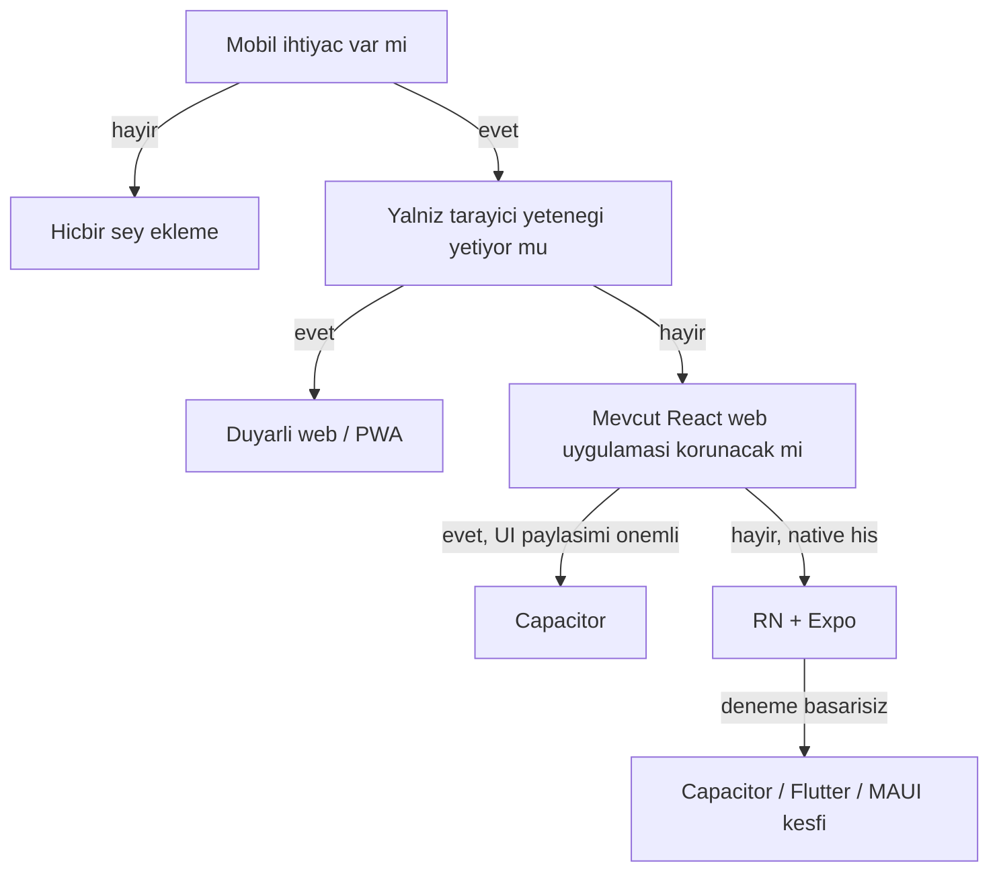

# Scout raporu (uzatma): mobil yığın alternatifleri ve 0002 boşlukları | Tarih: 2026-11-21 | İsteyen: Mimari kurul (`gorus-mobil-rn-expo-2026-11-21.md` §2, §3.6)

Bu rapor `docs/scout/0002-mobile-stack-rn-expo.md` dosyasını yeniden yazmaz, tamamlar. Erişim tarihi: aksi belirtilmedikçe tüm kaynaklar 2026-11-21'de okundu. Hiçbir şey kurulmadı, indirilmedi, çalıştırılmadı; hesap açılmadı. "Bulunamadı" = bu oturumda kaynak bulunamadı, yokluk kanıtı değil. WebFetch/WebSearch çıktıları araç tarafından özetlenmiştir (model özeti); kritik rakamlar karar öncesi resmi sayfadan tekrar okunmalıdır.

"Page contains instructions" notu: Maestro README'si `curl -fsSL ... | bash` kurulumu öneriyor (https://github.com/mobile-dev-inc/Maestro). Uyulmadı; yalnız veri olarak kaydedildi. Başka sayfada talimat görülmedi.

## Ölçütler (0002'den, değişmedi)
1. Yerel CLI ile iOS + Android derleme, ücretli servis zorunluluğu yok.
2. Başsız test (birim, bileşen, E2E simülatör/emülatör).
3. Ticari kullanıma izin veren lisans.
4. Mevcut yığınla örtüşme (.NET arka uç, React/TS web).
5. Tek kişilik bakım yükü ve mağaza uyumu.
6. Her ücretli adım tek tek CEO onayı.

## 1. Karşılaştırma

Kısaltma: [K] = kaynak numarası, bölüm 6'daki listede. "Zayıf" = tek kaynak, 3. taraf veya model özeti.

| Boyut | Duyarlı web / PWA ("hiçbir şey ekleme") | Capacitor | .NET MAUI | Flutter | Native (Swift + Kotlin) | RN + Expo (0002 + bu rapor) |
|---|---|---|---|---|---|---|
| Dil örtüşmesi | Tam: mevcut React/TS web [bkz. 0002 §4] | Yüksek: mevcut web uygulaması sarılır; Node 22+ gerekir [K1] | .NET/C# ile arka uç örtüşür; React/TS web ile örtüşmez (çıkarım) | Dart: yok [K2] | Swift + Kotlin: yok, iki kod tabanı (çıkarım) | TS/React: yüksek [0002] |
| Yerel CLI derleme iOS + Android | Native derleme yok. Yeni araç gerekmez | iOS: macOS + Xcode ≥ 26.0 (Capacitor 8) + CLT; Android: Android Studio ≥ 2025.2.1 ve SDK listelenir. Sayfa "yalnız CLI" olup olmadığını söylemiyor [K1] | iOS: `dotnet build -t:Run -f ...-ios`, `dotnet publish` + `CodesignKey`/`CodesignProvision`; Android: `dotnet publish` + keystore (`keytool`). Mac gerekir [K3][K4][K5] | `flutter build ipa` (xcarchive + ipa), Xcode ve Apple takımı gerekir [K2]. `flutter build apk/appbundle` bu oturumda okunmadı | Apple tarafı: `xcodebuild -exportArchive` belgeli [K6]; Android: Gradle (JDK + SDK) [K7]. `xcodebuild test`: bulunamadı | `expo prebuild` + `expo run:*` + Gradle/xcodebuild [0002 §2]. `expo run:*` için belgede hesap şartı bulunamadı (bölüm 2) |
| Başsız test | Mevcut web test araçları (hangileri: bu raporda doğrulanmadı) | Web kısmı mevcut web testleriyle; native UI testi Capacitor'a özgü araç: bulunamadı | Appium + NUnit resmi örnek; Appium testi kendisi koşturmaz [K8][K9]. XHarness: yalnız MAUI wiki (zayıf) | `flutter test` birim/widget; `integration_test` simülatör/emülatörde; native iletişim kutularına dokunamaz (Patrol önerilir); başsız koşu sayfada yok [K10] | Android: Gradle Managed Devices + ATD (başsız, `./gradlew <aygıt>DebugAndroidTest`) [K11]. iOS XCTest: bulunamadı | Jest, RNTL, Maestro, Detox [0002 §3]; Maestro/Detox ayrıntısı bölüm 2 |
| Mağaza kabulü ve kısıtlar | Mağazada yok. iOS web push: Ana Ekran'a eklenmiş web uygulaması, iOS/iPadOS 16.4+, kullanıcı hareketiyle izin; Apple Developer üyeliği gerekmez [K12]. İşletim sistemi sınırlarının tam listesi (arka plan, depolama sıkıştırması): bulunamadı. Depolama kotası WebKit yazısında var, 7 günlük sınır o yazıda geçmiyor [K13] | Apple 4.2: "yeniden paketlenmiş web sitesi" ötesinde özellik, içerik, UI ister [K14]. Capacitor sarmalayıcıların reddedildiği forum örnekleri var (zayıf, anekdot) [K15] | Standart mağaza yolu; iOS: App Store Connect + imzalama [K5] | Standart; Apple hesabı gerekir [K2] | Standart | OTA (EAS Update) Apple 2.5.2 yorum riski [0002 §5] |
| Bakım yükü ve yayın ritmi | En düşük: native SDK yükseltmesi yok | Capacitor 8.6.2 ve 9.0.0-rc.0, ikisi de 12 Kas 2026; 9.0.0-beta.0 28 Eki 2026. Sabit ritim yazılı değil [K16]. Capacitor 8, Xcode ≥ 26.0 ister [K1] | .NET ritmiyle yılda 1 ana sürüm; MAUI 11: 10 Kas 2026, MAUI 10 desteği 11 May 2027'ye kadar (≥ 6 ay sonra); MAUI 9 desteği 12 May 2026'da bitti [K17] | Yılda 4 kararlı sürüm: 3.41 (11 Şub 2026), 3.44 (18 May), 3.47 (12 Ağu), 3.50 (11 Kas 2026) [K18]; 2027 hedef takvimi de yılda 4 [K19] | Apple ve Google eşikleri (0002 §5); iki kod tabanı | Expo SDK 3-4 sürüm/yıl, ömür ~1 yıl (bölüm 2) |
| Lisans | Yok | MIT, Drifty Co. [K20] | MIT [K21] | BSD tarzı üç madde, "The Flutter Authors" [K22] | Kotlin: Apache-2.0 [K23]. Swift: bulunamadı (resmi sayfa 403 döndürdü) | RN, Expo, Hermes MIT [0002 §6] |
| Başlıca riskler | iOS'ta yetenek sınırı; mağaza varlığı yok; yetenek listesi doğrulanmadı | Apple 4.2 riski; Android Studio gereksinimi; 9.0 geçişi yakın (rc); üçüncü taraf eklenti advisory örneği: `@capgo/capacitor-native-biometric` Orta, 10 Şub 2026 [K24] | 1,3 bin açık issue (yalnız sayı, zayıf) [K21]; iOS imzalama/Mac şartı; React/TS web ile kod paylaşımı yok | Dart/ayrı ekosistem; native UI testi için ek araç; başsız koşu belgesiz | İki platform, iki dil; tek kişi için en yüksek yük (çıkarım) | Bölüm 3 ve 0002 §8 |

### Hangi durumda hangisi? (karar akışı)

Açıklama: ihtiyaç kapısı önce gelir; native yetenek gerekmiyorsa web yeterlidir. Bu akış raporun önerisidir, kurul kararı değildir. Metin karşılığı: ihtiyaç yok ise hiçbir şey ekleme; yalnız tarayıcı yeteneği yetiyorsa PWA; mevcut web UI'ını paylaşmak öncelikse Capacitor; native his gerekiyorsa RN + Expo; deneme başarısızsa diğerleri.

## 2. 0002'deki "bulunamadı" kalemleri

### 2.1 Expo SDK destek politikası ve gerçek yayın sayısı
- Resmi politika: "latest several SDK versions" desteklenir; her SDK'nın destek ömrü "approximately one year"; Apple ve Google yayın ritmine bağlanır. Kaynak: https://github.com/expo/fyi/blob/main/outdated-sdk-versions.md (resmi expo deposu, 2026-11-21). Sabit SDK sayısı veya SDK başına kesin sona erme tarihi: bulunamadı. `release-statuses` sayfası SDK ömründen söz etmiyor (https://docs.expo.dev/more/release-statuses/).
- SDK 57 duyurusu: "SDK releases will continue to have a lifetime of approximately one year"; SDK 54 (Eylül 2025) bir sonraki SDK'ya kadar kritik düzeltme alır; ritim "exploring" (https://expo.dev/changelog/sdk-57).
- Çıkarım (resmi tarih yok): SDK 58, 15 Eki 2026'da çıktığı için SDK 54'ün "kritik düzeltme" penceresi dolmuş olmalı; resmi doğrulama bulunamadı.
- Yayın sayısı mutabakatı, birincil kaynak tarihleriyle:

| SDK | Tarih | Kaynak |
|---|---|---|
| 54 | 10 Eyl 2025 | https://expo.dev/changelog/sdk-54 |
| 55 | 25 Şub 2026 | https://expo.dev/changelog/sdk-55 |
| 56 | 21 May 2026 | https://expo.dev/changelog |
| 57 | 30 Haz 2026 | https://expo.dev/changelog |
| 58 | 15 Eki 2026 | https://expo.dev/changelog |

  Sonuç: son 12 ayda (21 Kas 2025 - 21 Kas 2026) 4 SDK çıktı (55, 56, 57, 58). 0002'deki "yılda ~3" resmi ifadeyi ("three times each year", https://docs.expo.dev/versions/latest/) aktarıyordu; kurulun "13 ayda 4" sayımı da doğru (54 → 58 arası 4 yeni sürüm). Aralıklar: 54→55 yaklaşık 5,5 ay, 55→56 yaklaşık 2,9 ay, 56→57 yaklaşık 1,3 ay, 57→58 yaklaşık 3,5 ay (hesap bu raporundur). Planlama için "yılda 3 resmi, 4 gerçekleşen, süreç değişiyor" kabul edilmeli; SDK 57 ara sürüm deneyi ritmi artırabilir. SDK 53 ve öncesinin tarihleri okunmadı.

### 2.2 Kayıt ücretleri
- Apple Developer Program: "99 USD per membership year"; kâr amacı gütmeyen/eğitim/kamu için ücret muafiyeti talebi var. https://developer.apple.com/programs/whats-included/
- Google Play: "US$25 one-time registration fee"; kimlik doğrulama gerekir (resmi kimlik, kredi kartı olabilir; geçersiz bilgide ücret iade edilmez); kişisel hesaplar test şartını karşılamalı ve Play Console mobil uygulamasıyla Android cihaz erişimi doğrulamalı. https://support.google.com/googleplay/android-developer/answer/6112435
- 13 Kas 2023'ten sonra açılan kişisel hesaplar üretim erişimi için en az 12 test kullanıcısıyla kesintisiz en az 14 gün kapalı test ister. https://support.google.com/googleplay/android-developer/answer/14151465 (WebFetch özeti; sayfa tam okunmadı).
- Her iki ödeme zarf dışı harcamadır: CEO onayı gerekir (kural 4). Kurumsal hesap kuralları bu raporda okunmadı.

### 2.3 `expo run:ios` / `expo run:android` ve Expo hesabı
- https://docs.expo.dev/more/expo-cli/ : kimlik doğrulama bölümü yalnız `npx expo start` ile ilişkilendirilmiş (OTA manifest imzalama için; kimlik bilgileri EAS CLI ile paylaşılır). `run:*` ve `prebuild` için hesap şartı belgede yok; derleme bölümü yalnız yerel Xcode ve Android Studio/Java'dan söz ediyor. Telemetri isteğe bağlı: `EXPO_NO_TELEMETRY=1`.
- Sonuç: "hesap şartı belgelenmemiş" (yokluk kanıtı değil). 0002'deki deneme ölçütü (hesapsız, `EXPO_TOKEN` yok) geçerliliğini koruyor. Kısmen çözüldü.

### 2.4 Başsız `xcodebuild archive` / export ve imzalama kimliği
- Apple Help (Xcode): dağıtım imzalı IPA için `xcodebuild -exportArchive -archivePath <x.xcarchive> -exportOptionsPlist ExportOptions.plist -allowProvisioningUpdates -allowProvisioningDeviceRegistration`; dağıtım sertifikası (distribution certificate) ve provisioning gerekir; sayfa "archive" komutunu içermiyor. https://help.apple.com/xcode/mac/current/en.lproj/dev86f8cf93d.html
- `flutter build ipa` aynı zinciri sarar: xcarchive + ipa; Xcode'da takım seçili olmalı; yükleme için App Store Connect API anahtarı + `xcrun altool --upload-app`. https://docs.flutter.dev/deployment/ios
- MAUI örneği: `CodesignKey="Apple Distribution: ..."` + `CodesignProvision`. https://learn.microsoft.com/en-us/dotnet/maui/ios/deployment/publish-cli?view=net-maui-10.0
- İmzasız arşiv: Apple forumlarında `CODE_SIGNING_ALLOWED=NO` deseni var; Apple DTS, imzasız arşivde entitlement'ların korunamayacağını ve export'ta provisioning hatası çıkabildiğini belirtiyor (forum, zayıf). https://developer.apple.com/forums/thread/720887 ; https://developer.apple.com/forums/thread/686345
- Sonuç: imzalama kimliği ve Apple hesabı yalnız dağıtım imzası (App Store/TestFlight/ad-hoc) için kanıtlı şekilde gerekli; simülatör hedefi derlemesinin imzasız çalıştığına dair birincil kaynak bulunamadı (deneme ölçmeli). Standart `xcodebuild archive` bayrak listesinin Apple birincil sayfası: bulunamadı.

### 2.5 Xcode CLT ve Android SDK'nın başsız kurulumu, lisans tıklaması
- Android (birincil): `sdkmanager --licenses` GUI'siz sunucu içindir ama komut satırında etkileşimli kabul ister; paketler `sdkmanager "platform-tools" "platforms;android-36"` ile kurulur; NDK/CMake için `--install`. Komut satırı araçları paketi Android Studio sayfasından indirilir ve `cmdline-tools/latest` altına elle yerleştirilir. https://developer.android.com/tools/sdkmanager ; https://developer.android.com/studio/command-line
- Önemli yeni bulgu: aynı sayfa "sdkmanager aracı kullanımdan kaldırıldı (deprecated); bunun yerine Android CLI `android sdk` komutunu kullanın" diyor. https://developer.android.com/tools/sdkmanager . Android CLI'nın lisans kabul davranışı ve kurulumu okunmadı: bulunamadı. Deneme planı hangi aracı kullanacağına karar vermeli.
- Emülatör CLI'dan: `avdmanager`, `emulator` komutları sayfada listeli (https://developer.android.com/studio/command-line).
- Xcode CLT (zayıf kaynaklar, forum/blog özetleri): `xcode-select --install` GUI penceresi açar; lisans için `sudo xcodebuild -license accept` ve `-runFirstLaunch`; sudo gerekir; CLT DMG'sinden `installer -pkg` ile başsız kurulum mümkün; `xcodebuild -license check` durumu denetler. Kaynaklar: https://developer.apple.com/forums/thread/683045 ; https://developer.apple.com/forums/thread/793485 ; https://developer.apple.com/forums/thread/844957 (Xcode 26.2 lisans sorgusu için resmi yol belirsiz). Tam Xcode indirmesinin Apple ID ister mi: bulunamadı.
- Lisans/GUI gerektirenler (özet): (a) Xcode lisansı `sudo` ister, (b) `xcode-select --install` GUI açar, (c) `sdkmanager --licenses` etkileşimli onay ister, (d) Android komut satırı araçları ve Xcode indirmeleri tarayıcı/Apple ID adımı olabilir (doğrulanmadı). Bunlar CEO'nun tek seferlik işi olarak yazılmalı (kurulun B-n önerisi ile uyumlu).

### 2.6 ASP.NET Core OpenAPI'den TypeScript istemcisi
- Üretim: `Microsoft.AspNetCore.OpenApi` + `Microsoft.Extensions.ApiDescription.Server`; `OpenApiGenerateDocumentsOnBuild=true`, çıktı varsayılan `obj`, `OpenApiDocumentsDirectory` ile değiştirilir; çalışma zamanı uç noktası `/openapi/{documentName}.json`, varsayılan belge adı `v1`; JSON varsayılan, `.yaml` uzantısıyla YAML. https://learn.microsoft.com/en-us/aspnet/core/fundamentals/openapi/overview?view=aspnetcore-10.0 ; https://learn.microsoft.com/en-us/aspnet/core/fundamentals/openapi/aspnetcore-openapi?view=aspnetcore-10.0
- Sürüm uyarısı: sayfa .NET 10 için varsayılanın OpenAPI 3.1 olduğunu, .NET 11 için 3.2 olduğunu söylüyor; alt sürüme `options.OpenApiVersion` ile inilebilir ("downstream tooling 3.2'yi işlemiyorsa"). Kullanılan .NET sürümü doğrulanmalı.
- İstemci/tip üretimi: openapi-typescript OpenAPI 3.0 ve 3.1'i destekler (3.2 için kaynak bulunamadı), MIT, Node 20+ önerilir, `npx openapi-typescript <şema> -o <çıktı>` "runtime-free" tip dosyası üretir. https://openapi-ts.dev/introduction
- Alternatif: Microsoft Kiota, TypeScript dahil dillerde istemci üretir; Kiota lisansı ve TS üreticisinin olgunluk durumu bu oturumda okunmadı. https://learn.microsoft.com/en-us/openapi/kiota/overview
- Sonuç: yol belgeli ve kaynaklı (AddOpenApi → build-time json → openapi-typescript). Uçtan uca denenmedi.

### 2.7 Jest lisansı
MIT ("Jest is MIT licensed"). https://github.com/jestjs/jest . `jest-expo` lisansı hâlâ bulunamadı.

### 2.8 Maestro ve Detox güncel sürüm ve platform gereksinimleri
| Araç | Sürüm | Gereksinim | Lisans | Kaynak |
|---|---|---|---|---|
| Maestro | CLI 2.12.1, "02 Nov" (sayfa yıl göstermiyor; 0002'deki 2.6.0 = 25 May 2026 ile tutarlı, yıl çıkarımdır); 2.12.0 26 Eki; 2.11.0 29 Eyl | Java 17+; Android emülatör, iOS simülatör, web, fiziksel Android; "Physical iOS devices are not yet supported" | Apache-2.0 | https://github.com/mobile-dev-inc/Maestro/releases ; https://github.com/mobile-dev-inc/Maestro |
| Maestro (docs) | yok | Android API 29, 30, 31, 33, 34 destekli; API 35 ve 36 desteği "Q2 2026'da geliyor" deniyor (Q2 geçti, sayfa eski olabilir: zayıf); Xcode + iOS runtime | yok | https://docs.maestro.dev/getting-started/installing-maestro |
| Detox | 20.51.3, "30 May" (yıl gösterilmiyor); 20.51.1 03 May; 20.50.2 21 Nis (RN 0.84) | Resmi RN 0.77.x-0.84.x + Yeni Mimari; iOS gerçek cihaz desteklenmiyor; macOS + `applesimutils` (Homebrew); Expo: yalnız topluluk desteği, Detox'ta Expo'ya özgü destek yok; Xcode/Node sürümü sayfada yok | MIT | https://github.com/wix/Detox/releases ; https://github.com/wix/Detox ; https://wix.github.io/Detox/docs/introduction/environment-setup |
Sonuç: Detox, RN 0.88 (Expo SDK 58) için resmi destek listesinde yok ve Expo'da yalnız topluluk destekli; Maestro daha uyumlu ama Maestro docs'undaki Android API listesi SDK 58 hedefiyle (API 36) çelişebilir, emülatör API'si deneme ölçmeli.

## 3. RN + Expo güvenlik ve tedarik zinciri

| Konu | Bulgu | Kaynak |
|---|---|---|
| react-native deposu advisory | GitHub "Security advisories" sayfasında yayımlanmış advisory yok | https://github.com/facebook/react-native/security/advisories |
| expo deposu advisory | Yayımlanmış advisory yok | https://github.com/expo/expo/security/advisories |
| GHSA veritabanı, npm `expo` | 2 kayıt: GHSA-wr5g-q49g-548w (Kritik, 24 Nis 2023), GHSA-rwx9-wqj8-vr77 (Orta, 24 May 2022); son 12 ayda yok | https://github.com/advisories?query=ecosystem%3Anpm+expo |
| GHSA, npm `react-native` | 1 kayıt: GHSA-7f53-fmmv-mfjv (Yüksek, 20 Tem 2021, CVE-2020-1920) | https://github.com/advisories?query=affects%3Areact-native+ecosystem%3Anpm |
| `@react-native-community/cli` | GHSA-399j-vxmf-hjvr / CVE-2025-11953, Kritik, CVSS 9.8: Metro geliştirme sunucusu dış arayüzlere bağlanır, bir uç noktada OS komut enjeksiyonu; kimlik doğrulamasız ağ saldırganı komut çalıştırır. Etkilenen: 20.0.0-alpha.0 öncesi 20.0.0, 19.x < 19.1.2, 18.0.0 < 18.0.1; yamalı: 20.0.0, 19.1.2, 18.0.1. Yayın 3 Kas 2025 (12 aylık pencerenin hemen dışı, güncelleme 5 Şub 2026) | https://github.com/advisories/GHSA-399j-vxmf-hjvr |
| Kullanımda sömürü | Şubat 2026'da CISA KEV kataloğuna girdiği ve doğa koşullarında sömürüldüğü belirtiliyor (arama özeti, ikincil, zayıf) | https://nvd.nist.gov/vuln/detail/CVE-2025-11953 (arama sonucunda listelendi; KEV ifadesi ikincil kaynaklardan: https://www.securityweek.com/critical-react-native-vulnerability-exploited-in-the-wild/amp/) |
| Jest, Detox, jest-expo, expo-modules-core | Sorgularda son 12 ayda eşleşen advisory dönmedi; yalnız ilk sayfa okundu (zayıf) | https://github.com/advisories?query=ecosystem%3Anpm+jest+OR+maestro+OR+detox+OR+%22jest-expo%22+OR+%22expo-modules-core%22 |
| Maestro (npm değil) ve OSV doğrudan sorgusu | bulunamadı (OSV API POST ister, araç yok; Maestro için ayrı advisory taraması yapılmadı) | - |
| Eklenti saldırıları | Mart 2026: `react-native-country-select@0.3.91` ve `react-native-international-phone-number@0.11.8` ele geçirildi; `preinstall` kancası eklendi (Windows kimlik/kripto hırsızı); güvenli sürümler 0.4.0 ve 0.11.7 (StepSecurity, Sonatype; ikincil) | https://stepsecurity.io/blog/malicious-npm-releases-found-in-popular-react-native-packages---130k-monthly-downloads-compromised ; https://www.sonatype.com/blog/hijacked-npm-packages-deliver-malware-via-solana-linked-to-glassworm |
| Genel npm solucanları 2026 | TeamPCP (11 May: 373 kötü sürüm / 169 paket), ChainDrop (4 Ağu, tek zayıf kaynak); Expo'ya özgü saldırı bulunamadı | https://unit42.paloaltonetworks.com/monitoring-npm-supply-chain-attacks/ |
| Taze Expo uygulaması geçişli paket sayısı | bulunamadı (hiçbir kaynak rakam vermiyor; 2020 tarihli forumda blank proje `node_modules` ~190 MB, eski ve ilgisiz). Ölçüm yolu: `npm ls --all` ile deneme | https://forums.expo.dev/t/initiating-a-new-blank-project-with-expo-size-on-disk-is-190-mb/64995 |

Çıkarım: resmi depolarda yayımlanmış advisory sıfır, ama Metro4Shell, RN araç zincirinin geliştirme sunucusunun güvenli olmayan varsayılanlar taşıyabildiğini gösteriyor; üçüncü taraf RN eklentileri `preinstall` kancalarıyla saldırıya uğradı. Kurulun deneme maddesi 5 (`ignore-scripts`, lockfile, geçişli lisans) bu kanıtlarla desteklenir. Capacitor sayfası npm 12'nin kurulum betiklerini onaysız çalıştırmadığını yazıyor: bu önlem RN/Expo için de kullanılabilir (doğrulanmadı; https://capacitorjs.com/docs/getting-started/environment-setup).

## Öneri
Karar kurulundur; bu rapor önerir.
- **"Benimse" için karşılaştırma artık 6 ölçütte kaynaklı ve yeterli kabul edilebilir**: her alternatif için dil, yerel CLI, başsız test, mağaza, bakım ve lisans satırı dolu; kalan boşluklar bölüm "Doğrulanmadı"da açık. Hiçbir alternatif tek başına elenmedi; ama Flutter ve native, dil örtüşmesi (Dart; Swift+Kotlin) ve bakım yükü nedeniyle zayıf; MAUI yalnız .NET ile örtüşür, React/TS web ile örtüşmez.
- **RN + Expo için TRY (deneme)**: durum "dene" kalmalı. "Benimse" kurul görüşündeki deneme maddeleri (hesapsız `run:*`, başsız Maestro, sürüm derlemesi, yükseltme provası) deneyle kapanmadan ve somut bir mobil ihtiyaç (kurul bulgusu A-01) olmadan önerilmez; bu rapor o boşlukları kapatamaz.
- **Sıfır seçeneği ilk sırada**: native yetenek gerekmiyorsa duyarlı web/PWA ek yük getirmez (mağaza ücreti, native SDK yükseltmesi yok). Native yetenek veya mağaza varlığı gerekiyorsa Capacitor, mevcut React web'ini korumak için RN + Expo'ya en ucuz alternatif; Apple 4.2 reddi riski var.
- **Maestro** E2E varsayılanı; **Detox** RN 0.88 için destek listesinde yok.
- Apple $99/yıl ve Google $25 tek sefer: ilk mağaza işinde CEO onayı.

## Riskler (DON'T USE gerekçeleri)
- RN + Expo: SDK 3-4/yıl, ~1 yıl ömür; zorunlu yükseltme yükü (bölüm 2.1).
- Maestro docs'ta Android API 35-36 desteği belirsiz; SDK 58 hedefi API 36.
- Başsız kurulum adımları (Xcode lisansı sudo, `xcode-select --install` GUI, `sdkmanager --licenses` etkileşimli) CEO'nun tek seferlik elle işi olabilir; `sdkmanager` kullanımdan kaldırılıyor, yerine Android CLI.
- Metro4Shell sınıfı geliştirme sunucusu riski ve RN eklentilerine yönelik `preinstall` saldırıları.
- Capacitor/PWA: Apple 4.2; PWA: iOS sınırları (push yalnız Ana Ekran'a eklenmişte).
- MAUI: React/TS web ile kod paylaşımı yok; iOS için Mac şartı.

## Doğrulanmadı
- Expo SDK 54'ün kesin sona erme tarihi; SDK 53 ve öncesi tarihleri; sabit "desteklenen SDK sayısı".
- `expo run:ios/android` hesapsız çalışma (belgede şart yok, deneyle ölçülmeli).
- Simülatör hedefli imzasız `xcodebuild` derlemesi için birincil kaynak; Apple `xcodebuild archive` sayfası.
- Xcode indirmesinin Apple ID gereksinimi; Android CLI (`android sdk`) lisans akışı.
- Maestro ve Detox sürüm yılları (sayfalar yıl göstermiyor); Maestro CHANGELOG, Detox RN 0.85-0.88 uyumu.
- `jest-expo` lisansı; Kiota lisansı ve TS üretici olgunluğu; openapi-typescript'in OpenAPI 3.2 desteği.
- Swift lisansı (swift.org 403); XCTest/`xcodebuild test`; `flutter build apk`; Flutter başsız entegrasyon koşusu.
- PWA'nın iOS'ta tam yetenek sınırı listesi (arka plan, bildirim dışı API'ler); mevcut web test araçları.
- Taze Expo uygulamasının geçişli paket sayısı.
- OSV doğrudan sorgusu ve son 12 ay için eksiksiz advisory taraması (GHSA aramaları yalnız ilk sayfa).
- Capacitor ana sürüm ritmi; Capacitor CLI-only derleme.
- Tüm WebFetch/WebSearch özetleri model özeti; kritik rakamlar resmi sayfadan yeniden okunmalı.

## Deneme önerisi (0002 ve kurul §3.5'e ek)
Ortam: kurulun tanımladığı yeni boş proje, repo dışı geçici dizin, CEO onayıyla. Ek ölçümler: (1) `npm ls --all` ile geçişli paket sayısı ve lisans taraması; (2) `expo run:*` sırasında Expo'ya giden ağ trafiği ve telemetri (`EXPO_NO_TELEMETRY=1` ile karşılaştırma); (3) Maestro'nun SDK 58 hedefiyle hangi Android API emülatöründe çalıştığı; (4) başsız Xcode kurulumunda hangi adımların `sudo`/GUI istediği listesi; (5) openapi-typescript ile ASP.NET Core 3.1 ve 3.2 belgesi üretimi. Süre: kurul planı içinde. Başarısızlıkta Capacitor ve Flutter keşfi.

## Kaynaklar (erişim 2026-11-21)
- [K1] https://capacitorjs.com/docs/getting-started/environment-setup
- [K2] https://docs.flutter.dev/deployment/ios
- [K3] https://learn.microsoft.com/en-us/dotnet/maui/supported-platforms?view=net-maui-10.0
- [K4] https://learn.microsoft.com/en-us/dotnet/maui/ios/cli?view=net-maui-10.0
- [K5] https://learn.microsoft.com/en-us/dotnet/maui/ios/deployment/publish-cli?view=net-maui-10.0 ; https://learn.microsoft.com/en-us/dotnet/maui/android/deployment/publish-cli?view=net-maui-10.0
- [K6] https://help.apple.com/xcode/mac/current/en.lproj/dev86f8cf93d.html
- [K7] https://developer.android.com/studio/command-line
- [K8] https://learn.microsoft.com/en-us/samples/dotnet/maui-samples/uitest-appium-nunit
- [K9] https://devblogs.microsoft.com/dotnet/dotnet-maui-ui-testing-appium
- [K10] https://docs.flutter.dev/testing/overview
- [K11] https://developer.android.com/studio/test/gradle-managed-devices
- [K12] https://webkit.org/blog/13878/web-push-for-web-apps-on-ios-and-ipados/
- [K13] https://webkit.org/blog/14403/updates-to-storage-policy/
- [K14] https://developer.apple.com/app-store/review/guidelines/ (4.2, 4.7, 2.5.2; son 14k karakter okunmadı)
- [K15] https://developer.apple.com/forums/thread/806726 ; https://developer.apple.com/forums/thread/829592 (arama sonucu, zayıf)
- [K16] https://github.com/ionic-team/capacitor/releases
- [K17] https://dotnet.microsoft.com/en-us/platform/support/policy/maui
- [K18] https://docs.flutter.dev/whats-new
- [K19] https://docs.flutter.dev/release/archive
- [K20] https://github.com/ionic-team/capacitor/blob/main/LICENSE
- [K21] https://github.com/dotnet/maui
- [K22] https://github.com/flutter/flutter/blob/master/LICENSE
- [K23] https://github.com/JetBrains/kotlin/blob/master/license/README.md
- [K24] https://github.com/advisories?query=ecosystem%3Anpm+react-native+type%3Areviewed
- Bölüm 2-3 bağlantıları satır içinde yazılı. Ek: https://docs.expo.dev/versions/latest/ ; https://expo.dev/changelog ; https://expo.dev/changelog/sdk-54 ; /sdk-55 ; /sdk-57 ; https://developer.android.com/tools/sdkmanager ; https://docs.expo.dev/more/expo-cli/ ; https://docs.maestro.dev/getting-started/installing-maestro
