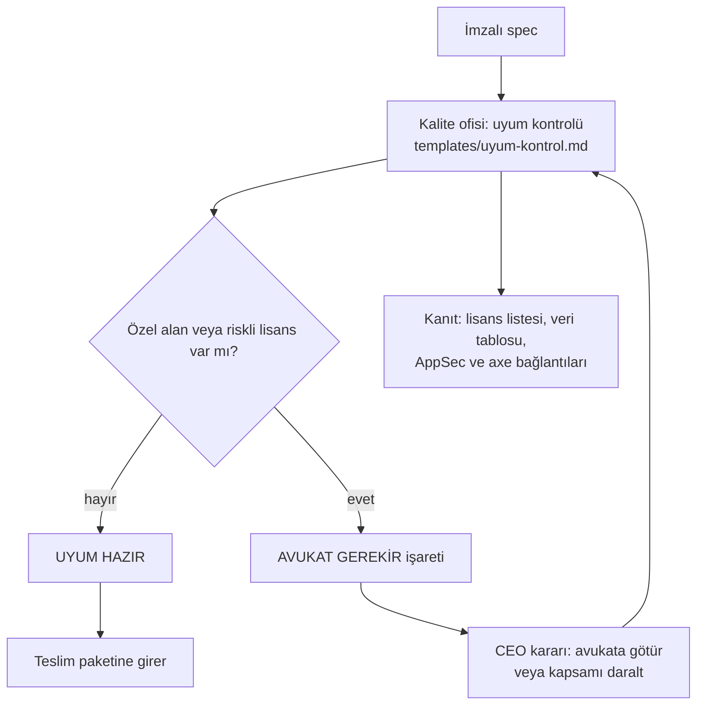

# Hukuk ve uyum süreci (B14, CMP-01, CMP-02)

**Sahibi:** Kalite ofisi (`quality-compliance` kılavuzu). **Sınır:** şirket hukuki görüş vermez; avukat gerektiren durumu işaretler ve CEO'ya götürür.

## Akış

Okuma: kontrol listesi her işte çıkar; riskli bir madde varsa iş "uyum hazır" olmaz, CEO karar verir. Renk kullanılmadı, anlamı metin taşır.

## Ne zaman çalışır
| Tetikleyici | Eylem |
|---|---|
| Spec imzaya giderken | Spec'in veri tablosundan ilk uyum taslağı (bölüm 11) |
| İş "bitti" denmeden | Tam kontrol: kod, bağımlılık listesi, gerçek veri akışı |
| Yeni bağımlılık | Lisans satırı (Architecture board ile birlikte) |
| Kullanıcı talebi: silme, erişim, şikayet | `templates/destek-triyaj.md` sınıf "Hukuki/KVKK": Kalite ofisi + CEO |
| Mobil yayın hazırlığı | Mağaza kuralları bölümü (kaynak + tarih, yoksa "doğrulanamadı") |

## Kurallar
- **Hüküm cümlesi yok:** "KVKK'ya uygundur", "ihlal etmez" yazılmaz. Yazılan: ne toplanıyor, hangi amaçla, ne kadar tutuluyor, silme yolu var mı.
- **Özel alan** (kimlik, sağlık, ödeme, konum, çocuk verisi) çıktığı anda "AVUKAT GEREKİR".
- **Lisans** paket kaydından okunur; okunamıyorsa "doğrulanamadı". GPL/AGPL/SSPL veya "kaynak aç" yükümlülüğü işaretlenir.
- Bilinen açık iş: `axe-core` MPL-2.0 lisansının ticari kullanım yorumu avukata sorulacak (B15 notu).

## Kanıt seviyesi (AUD-05)
Documented + Validated (kontrol listesi dolu mu: Internal audit denetler). Enforced değil: uyum kapısı araçla zorlanmıyor.
