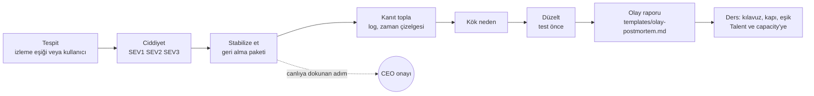
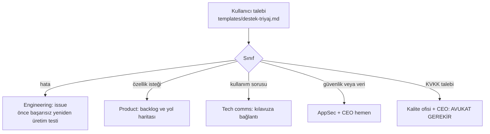

# Operasyon ve destek süreci (B14, OPS-01, OPS-02, ENG-11)

**Sahipleri:** olay akışında DevOps/SRE (`devops-sre`), destek triyajında Product + ana oturum. Canlı sistemlere dokunan her adım CEO onayıyla (anayasa kural 4); birimlerin canlıya erişim aracı yoktur.

## Olay akışı

Okuma: soldan sağa beş adım ve her olay raporla kapanır. Kesikli ok, canlıya dokunan adımın CEO onayına bağlı olduğunu gösterir.

## Ciddiyet
| Seviye | Tanım | İlk cevap |
|---|---|---|
| SEV1 | Hizmet kapalı veya veri kaybı/sızıntı şüphesi | CEO'ya hemen bildirim (masaüstü bildirimi + durum raporu), AppSec devrede |
| SEV2 | Kısmi bozulma, geçici çözüm var | Aynı gün düzeltme planı |
| SEV3 | Küçük, kullanıcıyı engellemiyor | Backlog |

## Destek triyajı

Okuma: her talep tek sınıfa girer ve bir birime gider. Kullanıcıya giden cevap taslaktır, gönderim CEO onayıyla (dış mesaj, kural 4). Aynı sorun 3 talepte tekrarlanırsa Product'a eğilim olarak bildirilir.

## İzleme (ilk sürüm)
- Eşikler her uygulamanın deploy paketinde yazılır (`devops-sre` kılavuzu): hata oranı, yanıt süresi, disk, sertifika bitiş tarihi.
- Eşik aşımı → olay akışı başlar. Otomatik izleme aracının kurulumu uygulamaya özeldir; ilk gerçek yayında seçilir (Scout → Architecture board → CEO).
- **Bilinen sınır:** izleme ve uyarı aracı henüz yok; yalnızca süreç ve şablonlar hazır. Gerçek olayda denenmedi.

## Kanıt seviyesi (AUD-05)
Documented (süreç ve şablon). Validated: şablonların varlığı `lint.js` denetler. Enforced değil.
