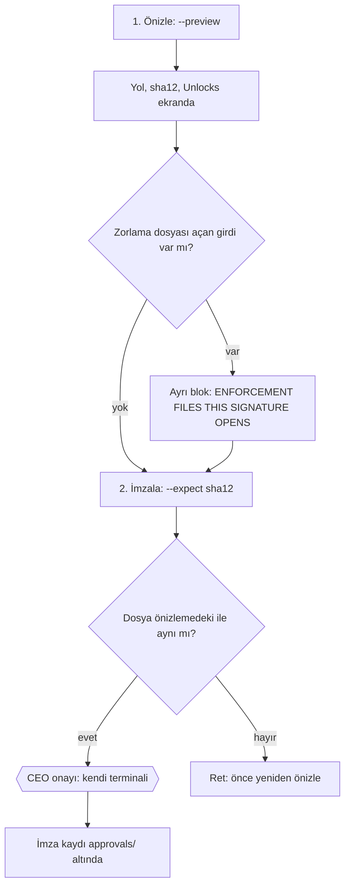

# harness/

Şirketin zorlama katmanı. Kurallar burada araçla zorlanır.

| Dosya | Görev |
|---|---|
| `approval.js` | `keygen`, `sign`, `verify`: ed25519 imza, spec içeriğinin SHA-256 özetine bağlı. Bağımlılıksız Node. |
| `gate.js` | `PreToolUse` kapısı: imzasız kod yazımını, korumalı yolları (`approvals/`, `.claude/`, `.git/`) ve çalışma alanı dışını engeller. Kapalı-başarısızdır (bozuk girdi veya hata = engel). |
| `policy.js` | Yol sınıfları ve karar kuralı (spec 0004). Kapı ve guard aynı modülü kullanır; kendi başına hiçbir şeyi engellemez. |
| `guard.js` | Ana makinede `Bash` komutlarına bakan `PreToolUse` hook'u: zarf eylemleri (push, yayın, uzak erişim, silme), imza ve anahtar erişimi, yazan komutların hedef yolları. |
| `container-settings.json` | Konteynerde `--settings` ile verilen izinler (Q11 listesi) ve kapı hook'u. |
| `docker/` | Ajan imajı ve çıkış vekili. |
| `bin/` | `check`, `lint.js`, anahtar üretimi, imzalama, vekil, imaj, çalıştırma. |
| `test/run.sh` | Onay aracı ve kapı için davranış testleri. |
| `keys/` | **Yalnızca genel anahtar** (`ceo.pub.pem`). Özel anahtar `~/.company/keys/` altındadır ve hiçbir konteynere bağlanmaz. |

## Ajan belirteci (konteynerdeki Claude için)

1. Kendi terminalinde `claude setup-token` çalıştır. Belirteç bir yıl geçerlidir, ayrı bir kimlik değil abonelik hesabına bağlıdır ve yalnızca model isteği atabilir.
2. `~/.company/agent.env` dosyasına `CLAUDE_CODE_OAUTH_TOKEN=<belirteç>` yaz, mod 600.
3. Belirteç **sohbete, repoya, loga girmez.** İş bitince `rm ~/.company/agent.env`.

Belirteci terminal çıktısından ayıklarken sonuna fazladan karakter yapışabilir: geçerli bir belirteç `sk-ant-oat01-` ile başlar ve 108 karakterdir (bu makinede doğrulandı); yanlışsa API "401 OAuth access token is invalid" döner.

## Yol sınıfları

Bir yazma isteğinin hedef yolu tek bir sınıfa düşer ve karar o sınıfa göre verilir. Kaynak: `specs/active/0004-harness-enforcement-gaps.md` §7.1; kod: `policy.js`.

Kök (R), ana makinede `CLAUDE_PROJECT_DIR` değeridir, boşsa çağrının `cwd` değeridir. Konteynerde her zaman `cwd` değeridir.

| # | Sınıf | Üyeler (özet) | Dosya araçları, ana makine | `Bash` yazma hedefi, ana makine | Dosya araçları, konteyner |
|---|---|---|---|---|---|
| 1 | hard-deny (kesin ret) | `approvals/**`, `.git`, `.git/**` | reddeder | sorar | reddeder |
| 2 | enforcement (zorlama) | `CLAUDE.md` (her derinlikte), `harness/*.js`, `harness/keys/**`, `harness/container-settings.json`, beş `harness/bin` betiği (`approve`, `ceo-keygen`, `company-run`, `install-project`, `install-global`), `.claude/settings*.json`, `.mcp.json`, `.github/workflows/**`, her derinlikte `approvals/**`, ev dizinindeki Claude ayarları ve `~/.company/**`, 3. ve 4. satır dışındaki `.claude/**` | imzalı aktif spec'in `Unlocks:` satırı dosyayı tam yoluyla adlandırıyorsa hook'lar görüş vermez; yoksa her düzenlemede sorar. Glob açmaz, kilitli yolları hiçbir başlık açmaz (aşağıda) | her zaman sorar; `Unlocks:` bir `Bash` yazmasını açmaz | reddeder |
| 3 | nested root (iç kök) | `.claude/worktrees/<ad>/**` | kalan yol o klasör kök sayılarak yeniden sınıflanır; son sınıf olmaz | aynı | reddeder |
| 4 | product-config (ürün ayarı) | `.claude/agents/**`, `.claude/skills/**`, `.claude/rules/**`, 2. satır dışındaki `harness/**` (`bin/check`, `bin/lint.js`, `test/**`, `docker/**`, bu dosya), `evals/**`, `templates/**` | imzalı aktif spec'in `Unlocks:` satırı yolu adlandırıyorsa izin verir, yoksa sorar | aynı | `.claude/` kısmını reddeder; kalanı yalnız imzalı `Unlocks:` ile açar |
| 5 | free (serbest) | `specs/**`, `docs/**`, `plans/**`, `STATE.md` | izin verir | görüş vermez | izin verir |
| 6 | code (kod) | R altındaki diğer her şey | tam bir aktif spec varsa ve imzası geçerliyse izin verir, yoksa sorar | aynı | imzalıysa izin verir, yoksa reddeder |
| 7 | outside (dışarı) | R dışında ve 2. satırda olmayan yollar | görüş vermez | görüş vermez | reddeder |

"Dosya araçları, ana makine" sütunu kapının ana makine kipini anlatır. Bu kip spec 0004'ün T-9 göreviyle bağlanır; o göreve kadar ana makinede dosya araçlarına yalnız `guard.js` bakar ve yalnız zorlama dosyalarını sorar. `Bash` sütunu ile konteyner sütunu bugün çalışan davranıştır.

Ana makinede 4. ve 6. satırlar yalnız kökte `specs/` klasörü varsa uygulanır. Klasör yoksa hook'lar bu iki sınıf için görüş vermez (G-12).

### İki yol kuralı

Spec'teki adı: "classify both the lexical and the resolved path, stronger class wins" (§7.1.1). Türkçesi: her hedef iki kez sınıflanır ve güçlü olan sınıf geçerli olur.

- Sözcük yolu: `.` ve `..` çözülmüş, sembolik bağ izlenmemiş mutlak yol.
- Çözülmüş yol: var olan en yakın üst klasörün gerçek yolu ile kalan parçalar. "Yok" dışındaki bir çözme hatası ret demektir.
- Güç sırası, en güçlüden zayıfa: **hard-deny > enforcement > product-config > code > outside > free**.
- Örnek: `src/link.cs` bir sembolik bağsa ve `harness/gate.js` dosyasını gösteriyorsa sözcük yolu "code", çözülmüş yol "enforcement" olur; karar "enforcement" sınıfına göre verilir.
- Büyük-küçük harf: 1, 2 ve 4. satırlar her işletim sisteminde harf ayrımı yapmadan eşleşir (`.CLAUDE/settings.json` de zorlama dosyasıdır). 5. satır ve `Unlocks:` kalıpları yalnız macOS ve Windows'ta harf ayrımı yapmaz.
- Kural ana makinede ve konteynerde, dosya araçlarında ve `Bash` yazma hedeflerinde aynıdır.

### Zorlama dosyasını ne açar?

Spec'teki adı: "an exact path may open an enforcement file, a glob never does" (§7.3). Türkçesi: zorlama dosyasını yalnız tam yol açabilir, glob hiçbir zaman açmaz.

2. satırdaki bir dosyaya ana makinede dosya aracıyla (`Write`, `Edit`, `MultiEdit`, `NotebookEdit`) yapılan yazma için hook'lar yalnız şu altı koşulun hepsi sağlanıyorsa görüş vermez:

1. Kök: sözcük yolu da çözülmüş yol da aynı köke göre 2. satırdadır (R, bir iç kök ya da ana kök). Kök dışındaki zorlama yolları (ev dizinindeki ayarlar, başka bir depo) hiç açılmaz.
2. Arada sembolik bağ yoktur: iki sınıflamanın köke göre yolu aynıdır. Bağ üzerinden ulaşılan ya da kendisi bağ olan zorlama dosyası açılmaz.
3. Yol kilitli değildir (aşağıdaki liste).
4. O kökün tek aktif spec'i geçerli imzalıdır. `specs/` klasörü yoksa, aktif spec sayısı 1 değilse, kayıt eksik ya da geçersizse, git ya da anahtar sorgusu başarısızsa yetki yoktur.
5. İmzası doğrulanan baytlardaki `Unlocks:` listesinde `*` ve `?` içermeyen, köke göre yola bayt bayt eşit bir girdi vardır. Harf büyüklüğü her işletim sisteminde tam eşleşmelidir (`claude.md`, `CLAUDE.md` dosyasını açmaz).
6. Çağıran ana oturumdur ya da şu birimlerden biridir: `polyglot-engineer`, `dotnet-engineer`, `react-engineer`, `devops-sre`. Başka bir birim için karar yine "sor" olur.

Koşullardan biri sağlanmazsa karar değişmez: sorar, pencerenin kanıtlanmadığı kipte reddeder. Hook'lar görüş vermediğinde düzenleme hemen geçmiş sayılmaz: `auto` kipinde son sözü uygulamanın kendi izin denetimi söyler. Uygulama reddederse görev durur ve rapor eder; `Bash` ya da yorumlayıcı ile dolanılmaz.

Kilitli yollar (hiçbir `Unlocks:` girdisi açmaz, glob da tam yol da):

- imza klasörü ve git verisi: `approvals/**`, `.git`, `.git/**` (1. satır: dosya araçlarına zaten reddedilir);
- her derinlikte `approvals/` ve `harness/keys/` altı;
- `.claude/settings.local.json` ve `harness/bin/ceo-keygen.sh`;
- ev dizinindeki Claude ayarları ve `~/.company/**`; kök ev dizininin kendisi olsa ya da `CLAUDE_CONFIG_DIR` kökün altında dursa bile.

Bu kuralın açmadıkları:

- `Bash` ile yazma: guard zorlama dosyasına giden her yazan komutu, başlık ne derse desin sorar; `auto` kipinde bu ret demektir.
- Konteyner: zorlama dosyaları orada her zaman reddedilir.
- Glob: `harness/**` ya da `CLAUDE.m?` gibi bir girdi 2. satırdaki hiçbir yolu açmaz ve `lint.js` (`unlocks-row2` kuralı) böyle bir aktif spec'i kırmızıya düşürür. Aynı kural kilitli bir yolu adlandıran girdiyi ve bilinen bir zorlama yolunu başka harf büyüklüğüyle yazan girdiyi de reddeder.

Girdinin türünü (zorlama, kilitli, diğer) tek bir işlev belirler: `policy.js` içindeki `unlockKinds`. Kapı, imza önizlemesi, guard'ın imza penceresi ve lint aynı işlevi kullanır.

## İzin kipi ve onay penceresi

Hook'un "sor" kararı, yalnız uygulama o kipte pencereyi gerçekten açıyorsa CEO'ya ulaşır. Bu yüzden hook her çağrıda `permission_mode` alanını okur ve pencerenin açıldığı kanıtlanmamış kipte sormak yerine reddeder.

Oturumlar `auto` kipinde çalışır (CEO kararı, 2026-11-22). Bu kipte kip kuralının kapsadığı her "sor" kararı ret olur ve hiçbir pencere açılmaz. İlerlemenin yolu kip değiştirmek değil, imzalı spec'tir: kod için geçerli imzalı tek aktif spec, ürün ayarı için o spec'in `Unlocks:` satırında yolu karşılayan girdi, zorlama dosyası için aynı satırda dosyanın tam yolu (bkz. "Zorlama dosyasını ne açar?"). İmza, anahtar ve kurulum komutlarını CEO kendi terminalinde çalıştırır.

| Kip (`permission_mode`) | Hook'un davranışı | Dayanak |
|---|---|---|
| `default` (arayüzde "Manual") | sorar | T-1'de gözlendi: CEO pencereyi gördü |
| `acceptEdits` | sorar | T-1'de gözlendi: CEO pencereyi gördü |
| `plan` | sorar | spec bu kipi adıyla sayar (Ruling R-11); T-1'de gözlenmedi |
| `auto` | reddeder | T-1 bulgusu B-1: "sor" kararı pencere açmadı, komut çalıştı |
| `bypassPermissions` ve diğer değerler | reddeder | gözlenmedi |
| alan hiç gelmezse | sorar | spec §7.7 |

Kanıt kaydı: `docs/kanit/0004-t1.md`. Kip kümesi `policy.js` içindeki `ASK_MODES` sabitidir.

Kip kuralının kapsadığı sorular: yol sınıfından doğan sorular, imza ve anahtar erişimi, kurulum betikleri (`install-project.sh`, `install-global.sh`) ve `policy.js` yüklenemediğinde guard'ın onarım sorusu. Kapsamadıkları için G-9'a bak.

Ret iletisi kipin adını ve iki çıkış yolunu söyler. Yol sorularında bunlar `default` kipine geçmek ya da yolu kapsayan bir spec imzalamaktır; imza, anahtar, kurulum ve onarım sorularında `default` kipine geçmek ya da komutu kendi terminalinde çalıştırmaktır. Oturumlar `auto` kipinde çalıştığı için kullanılan yol her iki iletide de ikincisidir: imzalı spec ya da CEO'nun kendi terminali. Yukarıdaki tablo, bir oturum başka bir kipte başlatılırsa ne olacağını gösterir.

## CEO nerede ve nasıl imzalar

CEO kendi terminalinde, oturumun dışında imzalar. Orada hook çalışmaz; iki komutu CEO yazar. Oturumlar `auto` kipinde çalıştığı için oturum içinden imza reddedilir.

İmza iki adımdır. Önce önizleme alınır ve okunur, sonra önizlemedeki özetle imzalanır.

### İmza hangi adımlardan geçer?



Açıklama: imza, CEO'nun önizlemede gördüğü baytlara bağlanır; dosya arada değiştiyse imza atılmaz. Zorlama dosyası açan girdiler önizlemede ayrı bir blokta durur. Onay düğümü CEO'nun kendi terminalidir. Metin karşılığı:

1. `harness/bin/approve.sh <çalışma alanı> --preview` anahtarı okumaz. Spec'in yolunu, SHA-256 özetinin ilk 12 hanesini (sha12), `Unlocks:` listesini ve başlık lint bulgularını yazdırır.
2. Çıktıyı oku. Başlıkta zorlama dosyasını tam yoluyla adlandıran girdi varsa bunlar `Unlocks:` satırında durmaz; o satırın altında, şu başlığın altında, her biri iki boşluk içeriden ayrı satırda listelenir:

   ```
   ENFORCEMENT FILES THIS SIGNATURE OPENS (file-tool edits pass without a dialog while this spec is signed):
     CLAUDE.md
     harness/gate.js
   ```

   Bu blok imzanın açtığı zorlama dosyalarının tam listesidir: spec imzalı kaldıkça listedeki dosyalar dosya araçlarıyla pencere açılmadan düzenlenebilir. Blokta beklemediğin bir dosya varsa imzalama. Blok yoksa imza hiçbir zorlama dosyasını açmaz.
3. `harness/bin/approve.sh <çalışma alanı> --expect <sha12>` imzalar. Dosyanın o anki sha12 değeri verilenle aynı değilse imzalamaz (çıkış 5) ve yeniden önizleme ister. `--expect` olmadan `approve.sh` imzalamaz (çıkış 2). `Unlocks:` satırı geçersiz olan ya da kilitli bir yolu adlandıran spec de imzalanmaz (çıkış 2).
4. İmza kaydı ana çalışma ağacının `approvals/` klasörüne yazılır.

Önizlemede dikkat edilecekler:

- Kilitli yolu (imza klasörü, anahtarlar, git verisi ve "Yol sınıfları" bölümündeki diğer kilitli yollar) adlandıran girdi ne `Unlocks:` satırında ne blokta görünür. `Header lint:` satırı onu `"<girdi>" names a locked path (signatures, keys, git metadata): no header opens it` diye bildirir ve `--expect` reddeder.
- Yalnız zorlama girdisi olan başlıkta `Unlocks:` satırı `(none)` yazar, blok onun altındadır.
- Bir girdideki yazdırılabilir ASCII dışı her karakter `\uXXXX` biçiminde yazılır; benzer görünen harfle kandırma olmaz. Denetim, biçim ve yön karakterleri başlığı geçersiz kılar (`Unlocks: INVALID: ...`).
- Blok, kapının açacağından fazlasını gösterebilir (örneğin yolu sembolik bağ olan bir girdi); azını göstermez.

Nerede:

- **Kendi terminalinde:** her zaman olur ve olağan yol budur. Sıra: `--preview`, çıktıyı ve varsa `ENFORCEMENT FILES THIS SIGNATURE OPENS` bloğunu oku, sonra `--expect <sha12>`.
- **Oturum içinde:** `auto` kipinde reddedilir. Yalnız "İzin kipi ve onay penceresi" bölümündeki tabloda "sorar" yazan bir kipte başlatılmış oturumda guard pencereyi açar: pencerede yol, sha12 değeri ve `Unlocks:` listesi durur, zorlama dosyası açan girdiler `Zorlama dosyalarını açar:` sözünün ardında ayrıca sayılır; o penceredeki onay imzanın kendisidir. Kilitli yol adlandıran başlık için pencere açılmaz, komut reddedilir.
- Spec 0004'ün ilk iki imzası kip kuralı yokken `auto` kipinde, pencere açılmadan atılmıştı (T-1, B-1). 2026-11-22 tarihli delta imzası bu blok henüz yokken, düz `Unlocks:` satırıyla atıldı (G-11).

## Hook'lar kilitlenirse (kurtarma yolu R)

Bozuk bir `policy.js` ya da bozuk bir giriş dosyası (`gate.js`, `guard.js`) hook'ların her çağrıyı engellemesine yol açabilir. Hook komutları `|| exit 2` ile biter; çöken ya da bulunamayan giriş dosyası bu yüzden engeller.

1. Oturumun dışında, kendi terminalinde çalıştır: `git -C <repo> checkout -- harness/ .claude/settings.json`. Bozan değişiklik commit edildiyse `git revert <commit>` kullan.
2. Oturumu yeniden başlatmak gerekmez: hook'lar her çağrıda diskten okunur.
3. Hiç commit edilmemiş bir `policy.js` bu komutla silinmez. Geri gelen `gate.js` ve `guard.js` ya ona ihtiyaç duymaz ya da commit edilmiş `policy.js` onlarla birlikte geri gelir.

Oturum içinden onarım yalnız bir durumda olur: `policy.js` yüklenemiyorsa guard her `Bash` çağrısında sorar ve sen tek bir onarım komutuna izin verebilirsin. Pencerenin kanıtlanmadığı kipte bu soru da reddedilir; o zaman onarım oturum dışında yapılır. Oturumlar `auto` kipinde çalışır ve bu kip kanıtlanmamış kiptir: oturum içi onarım sorusu orada her zaman reddedilir, "tek bir onarım komutuna izin ver" yolu yalnız kanıtlı bir kipte başlatılmış oturumda vardır. Uygulamada onarım oturumun dışında, yukarıdaki kurtarma yolu R ile yapılır. Giriş dosyasındaki sözdizimi hatası aracın tamamını engeller ve yalnız oturum dışından onarılır.

## Bilinen sınırlar

- Hook yalnızca `Write`, `Edit`, `MultiEdit`, `NotebookEdit` üstündedir. `Bash` ile yazma yolunu kapatan şey Docker bağlama modudur (imzasızken çalışma alanı salt-okunur). İkisi birlikte gerekir.
- Çalışma alanındaki `.git/config` yazılabilir; doğrulayıcı betikler çalışma alanının dışında olduğu için etkilenmez.
- Konteynerdeki ajan, ortam değişkeninden belirteci teorik olarak okuyabilir (bkz. SEC-10).
- Vekil yalnızca ana ad ve portu görür, TLS içeriğini görmez.
- Başsız (`-p`) çalışmada onay verecek kimse yoktur: izin listesi dışındaki veya bileşik `Bash` komutları ajanı durdurur.

## Bilinen boşluklar

Ana makinedeki hook'lar kazayı ve dürüst hatayı durdurur; kararlı bir ajanı durdurmaz. CEO anahtarı parolasızdır ve bu bilinçli bir karardır (`docs/KARARLAR.md` Revizyon 48). Aşağıdaki liste spec 0004 §8 ile aynı numaraları taşır; `lint.js` (`texts-0004` kuralı) G-1..G-22 numaralarının burada durduğunu denetler. Ana makine kapısından söz eden maddeler, kapı T-9 ile bağlandıktan sonraki durumu anlatır.

| No | Boşluk | Bugünkü önlem |
|---|---|---|
| G-1 | Hook'lar çalışma ağacından yüklenir. `gate.js`, `guard.js`, `policy.js` ya da `stop.js` üzerindeki bir değişiklik bir sonraki çağrıda etkili olur; bağlı bir çalışma ağacı (worktree) kendi kopyasını çalıştırır. | 2. satır algıladığı düzenlemede sorar; imzalı spec'in `Unlocks:` satırı dosyayı tam yoluyla adlandırıyorsa sormaz: o düzenleme geçer ve arada insan olmadan bir sonraki çağrıda etkili olur. İnceleyen birim 2. satır farklarına bakar. Ana oturum her zorlama dosyası farkını commit öncesinde CEO'ya gösterir (yalnız talimat); fark, düzenleme çoktan yürürlükteyken gösterilir, yani çalışanı değil commit edileni sınırlar. Her görev sonunda AC-18'in iki git komutu, adı geçen zorlama dosyalarının görev commit'leri dışında değişmediğini denetler. |
| G-2 | Sözdizimi hatalı ya da diskte bulunmayan bir hook giriş dosyası 1 koduyla çıkar; uygulama bunu engel saymaz. | Kapı ve guard komutlarında `\|\| exit 2` eki (ana makinede T-1'de gözlendi; konteynerdeki Claude Code sürümünde gözlenmedi). `stop`, `loop` ve `notify` bilerek sarılmaz. Ayar satırını silmek 2. satır düzenlemesidir. |
| G-3 | Satır içi yorumlayıcı yazmaları tanınmaz: `node -e`, `python -c`, `perl -e`, `ruby -e`, iç yönlendirmeli `awk`, `osascript`, geçici dizinden çalıştırılan betikler, `bash -c "<yazan komut>"`. | Yok. |
| G-4 | İmza ve anahtar erişimi şu yollarla görülmez: bir yorumlayıcı, `appr*.sh` kalıbı, imza betiğinin kopyası ya da sembolik bağı. `approval.js sign` komutu `--expect` olmadan önizlemeye bağlı değildir. | Yok. |
| G-5 | Çalışma ağacını değiştiren git işlemleri sınıflanmaz: `git apply`, `patch`, `git am`, `git cherry-pick`, `main` dışı `git merge`, `git switch` ve `git checkout <dal>`, `git checkout -- <yol>`, `git restore`, `git stash pop`, `git worktree add`. | Yok. |
| G-6 | Git'in kendi yaptığı `.git/` yazmaları (şablonla gelen hook'lar, yapılandırma) görülmez. | `core.hooksPath` ayarı ve `.git/` içine yönlendirme sorulur. |
| G-7 | Yan etki olarak dosya yazan derleme ve paket araçları denetlenmez: `npm install` betikleri, üreteçler, `make`, `dotnet`, `xcodebuild`. | Yok; mühendisler bu araçlara ana makinede ihtiyaç duyar. |
| G-8 | Guard'ın düz metin olarak göremediği `Bash` hedefleri. Ayrıntı tablonun altında. | Kısmi; ayrıntıda. |
| G-9 | Uygulamanın her kipte hook'un "sor" kararını pencereye çevirdiği kanıtlı değildir. T-1'de `default` ve `acceptEdits` kanıtlandı; `auto` kipinde pencere açılmadı; `plan` ve `bypassPermissions` gözlenmedi. Guard'ın eski zarf soruları (git, `gh`, uzak erişim, yayın, HTTP, `rm -r`, git yapılandırma ve ortam soruları) ve ham metin üzerindeki zorlama dosyası soruları kip kuralının dışındadır: her kipte "sor" olarak çıkar ve uygulamanın soruyu sessizce geçtiği kipte CEO kararı üretmez. | Yol soruları, imza ve anahtar soruları (`approve.sh`, `--expect` ile ya da onsuz; `approval.js sign` ve `keygen`; anahtar ve `~/.company` erişimi; `ceo-keygen.sh`), kurulum ve onarım soruları kanıtlanmamış kipte reddedilir. Oturumlar `auto` kipinde çalışır (CEO kararı, 2026-11-22): CEO kendi terminalinde imzalar ve bu soruların hiçbiri ona pencere olarak ulaşmaz. |
| G-10 | CEO anahtarı parolasızdır: imza bir niyet kaydıdır, kimlik kanıtı değildir. | Bilinçli karar (Revizyon 48). |
| G-11 | Önyükleme: T-6 ve T-9 öncesinde `policy.js`, `approve.sh` ve `install-project.sh` düzenlemeleri ana makinede sorulmadı (o günkü guard kalıbı bu dosyaları tanımıyordu). Spec 0004'ün kendisi önizleme olmadan imzalandı, çünkü önizleme henüz yoktu. 2026-11-22 tarihli deltanın yeniden imzası T-8b'den önce atıldı: o önizleme sekiz zorlama girdisini ayrı başlık altında değil, düz `Unlocks:` satırının içinde gösterdi. | T-11 incelemesi kapsar. Yeniden imzadan önce ana oturum sekiz girdiyi, commit edilmiş `policy.js` ile hesaplayıp CEO'ya yazdırdı; CEO listeyi başlıkla karşılaştırdı (spec §12 imza öncesi adım; kayıt: `docs/kanit/0004-delta-kapi.md`). |
| G-12 | `specs/` klasörü olmayan çalışma alanında kod ve ürün ayarı için görüş verilmez. `specs/` klasörünü silmek ya da yeniden adlandırmak bu satırları kapatır. | `rm -rf` yine sorulur; `mv specs x` komutu `x` hedefi için sorulur. |
| G-13 | Penceredeki tıklama, oturum dökümü dışında kayıt bırakmaz. | Yok. |
| G-14 | Bağlı bir çalışma ağacında çalıştırılan `company-run.sh` o ağacın `approvals/` klasörünü okur ve PLAN kipine düşer. | Yok. |
| G-15 | R dışına yazma, 2. satırda değilse ana makinede görüş almaz: başka bir depoya ya da çalışma alanına giden mutlak yol, `--add-dir` ile eklenen klasörler ve `CLAUDE_PROJECT_DIR` boşken çağrının `cwd` değeri dışındaki her şey. Ana kök kuralı yalnız ana ağacı kapsar: ana ağacın dışındaki kardeş çalışma ağacı, R ana ağaçken onun dışındaki bağlı çalışma ağacı ve git sorgusunun çalışmadığı (R'de `specs/` yok) ya da başarısız olduğu durumda ana ağaç yolları dışarıda kalır. | Sorgu başarısızsa R altındaki kod reddedilir. |
| G-16 | `Write`, `Edit`, `MultiEdit`, `NotebookEdit` ve `Bash` dışındaki yazabilen araçlara (MCP sunucu araçları, eklenti araçları) hiçbir hook bakmaz. | Yok. |
| G-17 | Yazdığı halde yazan komut sayılmayan `Bash` komutları: `git rm`, `git mv`, `git pull`, `git revert`, `git stash apply`, `curl -o` ve `--output`, `wget -O`, `tar -x`, `unzip`, `find -delete`, `sort -o` ve `>\|` yönlendirmesi. | Yok. |
| G-18 | `install-project.sh` ile spec 0004'ten önce kurulmuş projeler `git pull` sonrasında da eski bağlantıyı korur, çünkü ayar dosyaları yeniden yazılmaz. Oralarda ana makine kapısı yoktur. | Yeni `install-project.sh` betiğinin yazdırdığı girdiler elle birleştirilir (betik T-9 ile güncellenir). |
| G-19 | Projeler arası imza tekrarı: v1 kaydı spec'in göreli yolunu ve özetini bağlar, projeyi bağlamaz. Aynı CEO anahtarıyla, aynı yolda bayt bayt aynı spec'i olan başka bir projeye kopyalanan kayıt orada da geçerli sayılır. | Yok; kaza senaryosu sayılmadı (board-K1). |
| G-20 | Denetim ile yazma arasındaki yarış: hook yolu çağrı anında sınıflar. Sonradan (paralel bir `Bash` çağrısı ya da başka bir oturum tarafından) değiştirilen sembolik bağ yazma anında yeniden denetlenmez. | Yok. |
| G-21 | Aynı proje içinde imza tekrarı: kayıtlar `approvals/` altında kalır, göreli yol ve özetle eşleşir, `specs/**` ise serbesttir. Biten bir spec bayt bayt aynı haliyle `specs/active/` klasörüne geri taşınırsa (kazayla ya da bilerek) kod yetkisi ve `Unlocks:` listesi bir sonraki çağrıda sessizce geri gelir. Böyle geri gelen başlık, tam yoluyla adlandırdığı zorlama dosyalarını da yeniden açar (spec 0004 sekiz dosya adlandırır). Kayıt git tarafından yok sayılır (`*.sig.json`), yani silinene kadar diskte durur. | Kalıcı çözüm spec 0005'tedir (CEO'nun çalıştırdığı kayıt emekliye ayırma adımı). O adıma kadar ana oturum kod işinden önce `specs/active/` ile `specs/done/` klasörlerini karşılaştırır; bu yalnız talimattır, hook yoktur. Spec 0004 için emeklilik 0005'i beklemez: spec `specs/done/` klasörüne taşınırken CEO kendi terminalinde o spec'in kaydını `approvals/` klasöründen siler (T-12, AC-19; kalıcı silme zarf eylemidir). |
| G-22 | `approvals` adlı ürün klasörleri: 2. satır `**/approvals/**` kalıbını içerir. `src/features/approvals/` gibi bir ürün modülü zorlama sınıfına düşer: ana makinede her düzenleme sorulur, konteynerde imzalı spec olsa da her düzenleme reddedilir ve hiçbir `Unlocks:` onu açmaz. | Bir ürün böyle bir modüle ihtiyaç duyarsa CEO karar verir: kalıp daraltılır ya da modül yeniden adlandırılır. |

### G-8 ayrıntısı

Guard komut metnini okur, komutu çalıştırmaz. Bu yüzden şunları göremez:

- Hedefi değişken, joker, komut ikamesi, `eval` ya da `xargs` ile kurulan yazmalar. `$TMPDIR` da buna girer.
- `cd` izlenmez: göreli hedefler çağrının `cwd` değerine göre çözülür.
- `cp -t` ve `--target-directory`; `mkdir` ve `rmdir`.
- R içindeki bir sembolik bağ R dışını gösteriyorsa yol R içindeki sınıfıyla değerlendirilir. İmzalı spec varken bu bağ üzerinden yapılan yazma pencere açılmadan R dışına düşer.
- Sabit bağlar (hard link): gerçek yol çözümü bunları ortaya çıkarmaz. 1. ya da 2. satırdaki bir dosyaya önceden, oturum dışında ya da bir yorumlayıcıyla kurulmuş sabit bağ, bağın kendi yoluyla sınıflanır. `ln` ile yenisini kurmak sorulur.
- Git tarafı: guard'ın listesinde olmayan ve ayrı değer alan bir genel seçenek, değerin alt komut sanılmasına yol açabilir. Yapılandırma dosyasında önceden tanımlı bir git takma adı açılmaz. Komut çalıştıran yapılandırma anahtarlarından yalnız spec §7.4'te sayılanlar tanınır; `core.fsmonitor`, `core.sshCommand`, `core.pager` ve `include.path` tanınmaz. Önceki bir komut parçasında dışa aktarılmış `GIT_DIR` tanınmaz.
- Sarmalayıcılar: ayrı değer alan bir sarmalayıcı seçeneği (`sudo -u <kullanıcı>`, `nice -n <sayı>`) arkasındaki `rm` komutunu özyinelemeli silme kuralından, uzak erişim aracını da uzak erişim kuralından saklar.
- Komut sözcüğü biçimleri: tırnak içine alınmış komut sözcüğü ve başına ters bölü konmuş komut sözcüğü zarf kurallarına görünmez. Yalnız `rm` için: sarmalayıcı kümesinde olmayan sarmalayıcılar (`doas`, `timeout 5`, `xargs`) ve `bash -c` içindeki `rm`.

### Bu listenin dışında kalan açık kalemler

- `harness/test/fixtures/pretooluse-main.json` yakalanmadı: T-1'de ana oturuma kayıt hook'u bağlanamadı. `lint.js` bunu `WARN  fixture-sanitized` satırıyla hatırlatır. Ana oturumun hook girdisi bu yüzden kayıtla değil, alt ajan kaydıyla ve spec metniyle bilinir.
- Guard'ın zarf kurallarında spec 0004 kapsamı dışında kalan açıklar `docs/ACIK-ISLER.md` B32 maddesinde izlenir. Ayrı bir düzeltme spec'i bekler.
- Yalnız talimatla korunanlar (hook yoktur):
  - birimin kendi kılavuzuna uyması;
  - CEO'nun önizlemede `Unlocks:` satırını ve zorlama girdilerinin ayrı listesini (`ENFORCEMENT FILES THIS SIGNATURE OPENS` bloğu) okuması;
  - ana oturumun her zorlama dosyası farkını commit öncesinde CEO'ya göstermesi (`docs/KARARLAR.md`, 2026-11-22; fark, düzenleme yürürlüğe girdikten sonra gösterilir, G-1);
  - biten spec'in `specs/active/` klasörüne geri taşınmaması (G-21; 0005'in emeklilik adımına kadar; spec 0004'ün kendi kaydı T-12'de silinir);
  - CEO'nun, yeniden imzadan önce imza öncesi adımın listesini başlıkla karşılaştırması (spec §12);
  - uygulamanın reddettiği bir düzenlemede görevin durup rapor etmesi, `Bash` ya da yorumlayıcı ile dolanmaması (spec §12 kural 4).
