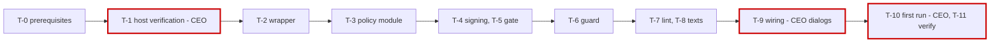

# Plan 0004 — Host enforcement: shared path policy, host gate, Bash write checks, signing preview, fail-closed hooks

- Spec: `specs/active/0004-harness-enforcement-gaps.md` (sha256 `9f1371e1ae39…` after the REQ-37 delta, re-signed 2026-11-21; first signature `a686d6dc68c3…`; lane 3)
- Status: Awaiting approval
- Prepared by: delivery-manager (delivery plan from spec §12; the implementing unit adds its own step notes per task under "Ordered steps" before it codes)
- Signature: `node harness/approval.js verify specs/active/0004-harness-enforcement-gaps.md approvals harness/keys/ceo.pub.pem` → `APPROVED` (run 2026-11-21 on `harness/0004-host-enforcement` @ `6951d7b`)
- Baseline: `./harness/bin/check` → `CHECK GREEN (full)` @ `6951d7b` (run 2026-11-21)
- The spec file is never edited. Any edit voids the signature; every task starts by re-running the verify command above.

## Who implements
**`polyglot-engineer`**, model `sonnet` (lane 3 rule for engineers), one invocation per task, run in the foreground of a `default`-mode session.

Why:
- The work is Node (CommonJS, built-ins only) and POSIX `sh` under `harness/`. `dotnet-engineer` and `react-engineer` carry stack playbooks that do not apply; there is no .NET and no React here.
- The signed spec names `polyglot-engineer` as the owning unit of T-2..T-9 (§12). Another unit would be a deviation from signed text.
- `devops-sre` was considered (it owns Docker, CI, shell): rejected, because the job is hook logic and tests, not release or server work, and it would need the same dialogs.
- Caveat: the unit's description speaks of porting other stacks. The brief must therefore carry the spec path, the task id, the file list of this plan and the global rules, not rely on the playbook. `.claude/agents/**` is not in the spec's `Unlocks:`, so the unit file is not edited in this job.
- Escalation: `opus` only if the engineer is stuck after 2 attempts on a task (T-6 is the likely one); 3 failed attempts → stop and report.

## Files (impact area)
No graph exists (`graphify-out/` absent); the impact area is taken from spec §12 "File ownership" and checked against the source. Going outside this list is a plan deviation.

Class 2 = enforcement (CEO dialog per edit, never unlocked). Class 4 = product-config (covered by the spec's `Unlocks:`). Free and code need no dialog under the signed spec.

| Path | Class | Tasks (sequential owner) |
|---|---|---|
| `.claude/settings.json` | 2 | T-2, then T-9 |
| `harness/container-settings.json` | 2 | T-2 only |
| `harness/policy.js` (new) | 2 | T-3 (fixes later allowed, named in the task report) |
| `harness/approval.js` | 2 | T-4 |
| `harness/bin/approve.sh` | 2 | T-4 |
| `harness/gate.js` | 2 | T-5 |
| `harness/guard.js` | 2 | T-6 |
| `harness/bin/install-project.sh` | 2 | T-9 |
| `CLAUDE.md` | 2 | T-9 |
| `harness/bin/check` | 4 | T-3, T-5, T-7 |
| `harness/bin/lint.js` | 4 | T-7, T-8, T-9 |
| `harness/test/policy.sh`, `harness/test/policy-driver.js` (new) | 4 | T-3, then T-6 (additions only) |
| `harness/test/run.sh` | 4 | T-4, then T-5 (additions only) |
| `harness/test/host-gate.sh` (new) | 4 | T-5, then T-9 (additions only) |
| `harness/test/guard.sh` | 4 | T-6 only (additions only) |
| `harness/test/lint-rules.sh` (new) | 4 | T-7, then T-9 (additions only) |
| `harness/test/fixtures/*.json` (new) | 4 | T-1 |
| `harness/README.md`, `templates/spec-tam.md`, `templates/spec-hizli.md` | 4 | T-8 |
| `.claude/rules/routing.md` | 4 | T-9 |
| `site/index.html` (regenerated, never hand-edited) | code | T-4, T-5, T-6, T-9; T-2 only if `site-data.js --check` reports stale |
| `docs/kanit/0004-t1.md` (new) | free | T-1, then T-10 |
| `plans/0004-plan.md`, `STATE.md` | free | delivery-manager, main session |

Not touched: `harness/stop.js`, `loop.js`, `notify.js`, `harness/bin/company-run.sh`, `ceo-keygen.sh`, `install-global.sh`, `site-data.js`, `harness/keys/**`, `specs/**`, `.claude/agents/**`, `.claude/skills/**`, the existing lines of `run.sh`, `guard.sh`, `stop.sh`, `loop.sh`, `tools.sh`.

## Global rules (spec §12, binding for every task)
1. `./harness/bin/check` is green after the task and the output is shown (last line `CHECK GREEN (full)`), with the commit sha.
2. No existing test is weakened, edited or deleted; additions only. If an existing test or lint rule asserts what the task would change: **stop and report**. Only two replacements are pre-approved: `lint.js:219-220` (T-9) and the `lint.js:8` `ROOT` line (T-7).
3. A task that changes test lines in `run.sh`/`guard.sh` or hook wiring in `.claude/settings.json` runs `node harness/bin/site-data.js --write` and includes the regenerated `site/index.html`.
4. Row-2 (class 2) files: each edit is a CEO dialog.

## Ordered steps

### In which order do the tasks run, and where does the CEO act?

Description: the tasks form one chain with no parallel branch, so the whole chain is the critical path; thick red nodes labelled "CEO" need the CEO in person. Text equivalent: the task table below.

Critical path: T-0 → T-1 → T-2 → T-3 → T-4 → T-5 → T-6 → T-7 → T-8 → T-9 → T-10 → T-11. No slack anywhere: the spec forbids parallel work (shared files: `lint.js`, `check`, `run.sh`, `policy.sh`, `host-gate.sh`, `.claude/settings.json`). T-1 is the first blocker and needs the CEO at his machine.

### Task table
"Dialogs" counts CEO permission dialogs caused by repo edits under the hook that is live at that task. One dialog per edit call, so the number is a minimum: the engineer makes one edit call per class-2 file where it can and states the planned number before it starts. Every task also ends with the common evidence (below the table).

| ID | Task | Owner | Files | AC made to pass | Depends on | Evidence command (besides the common one) | Class-2 edits → dialogs |
|---|---|---|---|---|---|---|---|
| T-0 | Prerequisites (see "T-0 status") | main session + CEO | none | all | none | the verify command → `APPROVED` | none |
| T-1 | Host verification (**manual, CEO**; checklist below) | main session with the CEO | `docs/kanit/0004-t1.md`, `harness/test/fixtures/{pretooluse-main,pretooluse-subagent,subagentstop}.json` | AC-13 (manual part) | T-0 | `for f in harness/test/fixtures/*.json; do node -e 'JSON.parse(require("fs").readFileSync(process.argv[1],"utf8"))' "$f" \|\| echo "BAD $f"; done; grep -nE '/Users/\|/home/[a-z]\|[0-9a-f]{8}-[0-9a-f]{4}-' harness/test/fixtures/*.json` (prints nothing) | none in the repo. The CEO clicks the throwaway hook's test dialogs (one or more per mode) |
| T-2 | Wrapper first: append `\|\| exit 2` to both guard commands in `.claude/settings.json` and to the gate command in `harness/container-settings.json`; nothing else | polyglot-engineer | `.claude/settings.json`, `harness/container-settings.json` | AC-11 (part) | T-1 (wrapper proven to block) | `grep -c 'exit 2' .claude/settings.json harness/container-settings.json` → `2` and `1`; `node harness/bin/site-data.js --check` | **2 files → 2 dialogs minimum** (guard asks for both today) |
| T-3 | `harness/policy.js` with §7.1.1, driver, `policy.sh` (matrix, superset, parser, source order); add to `check` lists. Not loaded by any hook | polyglot-engineer | `harness/policy.js`, `harness/test/policy-driver.js`, `harness/test/policy.sh`, `harness/bin/check` | AC-1 (matrix), AC-2, AC-6 (parser), AC-11 (source order) | T-2 | `sh harness/test/policy.sh` | 1 class-2 file (`policy.js`) → **0 dialogs**: today's guard does not know it (G-11). Reviewed in T-11 |
| T-4 | `approval.js` (`verifyBuffer`, `sign --expect`), `approve.sh` (`--preview`, `--expect`, main-worktree `approvals/`), `run.sh` additions, site data. **Live:** `approve.sh` refuses to sign without `--expect` | polyglot-engineer | `harness/approval.js`, `harness/bin/approve.sh`, `harness/test/run.sh`, `site/index.html` | AC-7 | T-3 | `sh harness/test/run.sh` | 2 class-2 files → **1 dialog minimum** (`approval.js`); `approve.sh` gives none (G-11) |
| T-5 | `gate.js` through the policy: `--host` branch and container branch (deltas of §7.1 only); `host-gate.sh`; container cases in `run.sh`; `check` list; site data. Not wired on the host. **Live in the container** at the next `company-run.sh` | polyglot-engineer | `harness/gate.js`, `harness/test/host-gate.sh`, `harness/test/run.sh`, `harness/bin/check`, `site/index.html` | AC-3, AC-4, AC-5, AC-10 (gate) | T-4 | `sh harness/test/host-gate.sh && sh harness/test/run.sh` | 1 class-2 file → **1 dialog minimum** (`gate.js`) |
| T-6 | `guard.js`: try-require policy, decision collector (R-16), writer targets (§7.4), git global options, config/env asks, refspec and `--recursive` fixes, REQ-37 forms (path-prefixed `git`/`gh`/`rm`, wrapper-prefixed `rm`, short-flag clusters, `--all`/`--branches`/`--tags`/`--follow-tags`, `HEAD`/`@` and empty-source refspecs; lookups always run `git`/`gh` from PATH), installer ask, signing dialog (§7.5), permission-mode rule (§7.7), reason quoting (§7.8); file-tool branch and `ask`/`deny` helpers byte-identical (R-1); `guard.sh` and `policy.sh` additions; site data. **Live at the next Bash call** | polyglot-engineer | `harness/guard.js`, `harness/test/guard.sh`, `harness/test/policy.sh`, `site/index.html` | AC-1 (consistency), AC-8, AC-9, AC-10 (guard), AC-11 (broken copy) | T-5 | `sh harness/test/guard.sh && sh harness/test/policy.sh`; R-1 proof: `git diff -U0 6951d7b -- harness/guard.js` shows no change in the file-tool branch and helpers | 1 class-2 file → **1 dialog minimum** (`guard.js`); the largest edit of the job, expect several if done in steps. A `policy.js` fix here: still 0 dialogs by file tool |
| T-7 | `lint.js`: `COMPANY_LINT_ROOT`, header rule, fixture rule, wrapper rule, rule ids; `lint-rules.sh`; `check` lists and `unset COMPANY_LINT_ROOT` | polyglot-engineer | `harness/bin/lint.js`, `harness/test/lint-rules.sh`, `harness/bin/check` | AC-6 (lint), AC-11 (lint), AC-13 (lint) | T-6 | `sh harness/test/lint-rules.sh && node harness/bin/lint.js` | none |
| T-8 | Texts with no claim that the host gate is live: `harness/README.md` (classes, §7.1.1, permission-mode set from T-1, recovery R, where the CEO signs, Bilinen boşluklar G-1..G-22 in Turkish), both spec templates (`- Unlocks:` line), lint string checks | polyglot-engineer | `harness/README.md`, `templates/spec-tam.md`, `templates/spec-hizli.md`, `harness/bin/lint.js` | AC-14 (README, templates) | T-7 | `node harness/bin/lint.js` (rule `texts-0004`); `grep -c 'G-[0-9]' harness/README.md` | none |
| T-9 | Wiring, only with T-1 evidence: host gate with wrapper added, guard's file-tool entry removed; `lint.js:219-220` replaced by the one-owner rule; `install-project.sh` new set and merge entries; `host-gate.sh` and `lint-rules.sh` additions; `routing.md` and `CLAUDE.md` rule 1 (exact texts of §7.6) with lint checks; site data. **Host gate live** | polyglot-engineer | `.claude/settings.json`, `harness/bin/install-project.sh`, `CLAUDE.md`, `.claude/rules/routing.md`, `harness/bin/lint.js`, `harness/test/host-gate.sh`, `harness/test/lint-rules.sh`, `site/index.html` | AC-11 (`sh -c`), AC-12, AC-14 (routing, rule 1) | T-8 + T-1 evidence | `sh harness/test/host-gate.sh && sh harness/test/lint-rules.sh && node harness/bin/lint.js` | 3 class-2 files → **2 dialogs minimum** (`CLAUDE.md`, `.claude/settings.json`); `install-project.sh` gives none if edited before the settings edit (see Ruling P-2), one or more if after |
| T-10 | First run (**manual, CEO**): three dialog observations in `default` mode and the latency bench; results appended to `docs/kanit/0004-t1.md` | main session + CEO | `docs/kanit/0004-t1.md` | AC-15 | T-9 | `sh harness/test/host-gate.sh --bench` → p95 per call, target < 150 ms | 1 observed dialog on `CLAUDE.md` (the test itself; the edit is reverted or declined) plus 1 on a scratch code file |
| T-11 | Verification: fresh `check`, mutation probes (§9, 13 probes on a temporary copy), criterion-to-evidence map, `ASK_MODES` vs the T-1 record, review of the G-11 edits (`policy.js`, `approve.sh`, `install-project.sh`); then the gates | qa-engineer → appsec → internal-auditor → quality-office | none (read-only units) | all | T-10 | `git diff -U0 6951d7b -- harness/test/ harness/bin/lint.js harness/bin/check \| grep '^-[^-]'` → only the `lint.js:219-220` and `lint.js:8` replacements | none |

Common evidence for every task, in this order:
```
node harness/approval.js verify specs/active/0004-harness-enforcement-gaps.md approvals harness/keys/ceo.pub.pem   # APPROVED
./harness/bin/check                                                                                              # last line: CHECK GREEN (full)
git rev-parse --short HEAD
```

Dialog total the CEO should expect from repo edits: **at least 6** (T-2: 2, T-4: 1, T-5: 1, T-6: 1, T-9: 2 — wait for the engineer's stated number per task), plus the T-1 and T-10 test dialogs. After T-9 every later fix to any class-2 file asks (now including `policy.js`, `approve.sh`, `install-project.sh`), and only a `default`- or `plan`-mode session (plus modes T-1 proves) can show it; other modes refuse.

### T-0 status
| Prerequisite (spec §12 T-0) | State | Evidence |
|---|---|---|
| Round-2 and round-3 findings folded into the spec | met | spec §14; `STATE.md` "RESUMED 2026-11-21": 17 items verified |
| ADR "Path class taxonomy" exists and is synced to the spec text | met | `docs/architecture/adr/0001-path-class-taxonomy.md`, tracked in `6951d7b`; its Date line names REQ-35/36, R-18/19, G-21/22, A-10/11 |
| Spec moved to `specs/active/`, exactly one active spec | met | `ls specs/active` → one file |
| Spec signed by the CEO | met | verify → `APPROVED`; new public key committed in `6951d7b` |
| ADR header follows the signature | **not met** | the ADR still says `Status: Proposed` and `Spec: specs/draft/0004-…` (lines 3 and 6). Free class (`docs/`); owner `architecture-board`. Not blocking |
| Re-check of the folded findings (optional, "the main session's call") | not done | main session decides; recommendation: skip, three gate rounds ran |
| Branch on the remote, CI run on it | **not met** | `harness/0004-host-enforcement` has no upstream; push needs the CEO's approval (public repository) |
| Delivery plan approved, issues opened | **not met** | this file is `Awaiting approval`; no issue exists |

### T-1 checklist (main session runs it with the CEO)
Source: spec §12 T-1, AC-13, §2, R-11. Nothing in the repo settings is edited; every target is a scratch file under the session scratch directory. No token or key file is read.

Preparation by the main session (no CEO action):
1. In the scratch directory, write a throwaway hook script that appends its stdin (the payload) to a scratch log and prints the "ask" JSON of spec §7.8.
2. Write a scratch settings file that wires this hook for `PreToolUse` (matcher `Write|Edit`) and a payload-logging hook for `SubagentStop`.
3. Prepare three more scratch settings files for step D: the hook entry pointing at a file with a syntax error, at a missing file, and each of the two again with `|| exit 2`.

With the CEO, in his own terminal (`claude --settings <scratch file>`):

| # | What the CEO does or clicks | What is recorded in `docs/kanit/0004-t1.md` (Turkish; command used + observed result) |
|---|---|---|
| A | Starts the session in `default` mode and asks for a Write to the scratch file; says whether a dialog appeared; clicks it | PreToolUse payload keys for a main-session file write; the `permission_mode` value; dialog yes/no |
| B | Repeats A in `acceptEdits`, `auto`, `bypassPermissions`, `plan` (switches the mode in the session or starts it with that mode) | per mode: the `permission_mode` value and whether the always-ask hook showed a dialog. This decides `ASK_MODES` (R-11) |
| C | Asks the session to start a subagent that writes the scratch file; then lets it stop | PreToolUse payload keys for a subagent write (`agent_type`, `agent_transcript_path` present or not); SubagentStop payload keys. Extra, outside the spec's list: whether the dialog reaches the CEO when the writer is a subagent |
| D | Restarts with each broken-entry settings file and asks for the same Write; says whether the write went through | exit 1 (syntax error; missing file) does not block; the same entry with `\|\| exit 2` blocks |
| E | Starts one session with `CLAUDE_PROJECT_DIR` empty in the environment | what the hook sees and whether a `node "$CLAUDE_PROJECT_DIR/…" \|\| exit 2` command blocks |
| F | Asks the session to start a worktree-isolated subagent that writes a scratch file | the `CLAUDE_PROJECT_DIR` and `cwd` that subagent's hook saw (is it the linked worktree; is it under `.claude/worktrees/`) |
| G | Asks for a Write, then an Edit, on an existing symlink in the scratch directory | for each tool: link replaced, or written through to the target (`ls -l` before and after) |
| H | none | `git --version` on the host |

After the session, the main session: writes `docs/kanit/0004-t1.md`; saves three sanitized fixtures (`pretooluse-main.json`, `pretooluse-subagent.json`, `subagentstop.json`: no `/Users/…`, no `/home/<name>`, no UUID, no session id, no token) under `harness/test/fixtures/`; names the proven mode set for T-3 and T-8; deletes the scratch files.

**Stop and write a delta (no T-2)** if any of these is observed: exit 2 does not block; `default` mode shows no dialog; `permission_mode` is never present; a worktree-isolated subagent's paths fall outside both R and `.claude/worktrees/`.

### T-10 checklist (main session with the CEO, `default` mode, after T-9)
1. No active spec in a scratch workspace (or the spec moved aside in a copy): an Edit of a scratch code file shows **one** dialog, not two.
2. With the signed active spec: an in-scope code edit shows no dialog.
3. An Edit of `CLAUDE.md` shows one dialog (decline it, or revert the edit).
4. `sh harness/test/host-gate.sh --bench` (200 calls): p95 per call recorded. If p95 ≥ 150 ms, AC-15 fails: record, stop, report with a delta proposal; the hooks stay wired.

## Gaps found in the recipe
- G-P1 (Type 3) — ADR header not updated after the signature (`Status: Proposed`, draft spec path). Decision: `architecture-board` fixes the two lines; `docs/` is free class, no dialog. Not blocking for T-1.
- G-P2 (informational) — the signed spec's own header still says `Status: Draft`. It cannot be changed without voiding the signature; validity lives in the signature record. Left as is; the next delta revision may fix it.
- G-P3 (Type 2) — spec T-2 says "nothing else", global rule 3 asks for site data on wiring changes. See Ruling P-3.
- G-P4 (Type 2) — the playbook's branch layout (integration branch plus one branch per task) does not fit a strictly sequential job that already has a branch. See Ruling P-1.
- G-P5 (risk, no decision needed) — whether a subagent's "ask" reaches the CEO as a dialog is not observed. T-1 step C records it. If it does not, the main session makes the class-2 edits itself from the engineer's diff (maker stays the engineer; reviewers unchanged).
- G-P6 (risk) — from T-6 on, a Bash writer to an unauthorised path, and from T-9 on any class-2 edit, is refused in `acceptEdits`, `auto` and `bypassPermissions`. Engineer and fix sessions run in `default` mode.
- G-P7 (risk) — T-4 changes signing: after it, `approve.sh` needs `--preview` then `--expect <sha12>`. The signing of 0006 follows the new form.
- G-P8 — no `graphify` graph exists; file ownership comes from spec §12, checked against `harness/guard.js`, `.claude/settings.json`, `harness/container-settings.json`, `harness/bin/check`, `harness/bin/lint.js`.
- No Type 1 gap found.

## Risks and questions (with recommendation)
| Risk | Effect | Recommendation |
|---|---|---|
| T-1 needs the CEO at his machine and blocks everything | whole chain waits | schedule T-1 first; about one sitting |
| T-1 hits a stop condition | delta spec, re-signature | stop, report, no T-2 |
| An existing test asserts what a task changes (global rule 2) | stop and report | T-6 is the likely place (`guard.sh` 100+ cases); engineer runs `guard.sh` before and after every step |
| A broken hook after T-6 or T-9 blocks the session | work stops | recovery path R (spec §10): the CEO runs `git -C <repo> checkout -- harness/ .claude/settings.json` in his own terminal; commit after every green task so a restore point exists |
| Dialog fatigue on `guard.js` (T-6) | many clicks | engineer states the edit count first; prefers few large edits |
| CI not run (branch not on the remote) | only local evidence until a push | ask the CEO once for the feature-branch push after T-2 |

Questions for the CEO (to be filed by the main session, one per page): (1) when to run T-1; (2) approval to push `harness/0004-host-enforcement` and open issues and a draft PR in the public repository. Recommendation: T-1 now; push and issues after T-2 is green.

## Criterion ↔ test map
| Criterion | Evidence | Passes from | Profile |
|---|---|---|---|
| AC-1 | `harness/test/policy.sh` + `policy-driver.js` (matrix); gate/guard consistency loop | T-3; T-6 | quick |
| AC-2 | `policy.sh` (regex extracted from `guard.js`) | T-3 | quick |
| AC-3 | `harness/test/host-gate.sh` | T-5 | quick |
| AC-4 | `host-gate.sh` (temp git repo, linked worktree, PATH stub) | T-5 | quick |
| AC-5 | `harness/test/run.sh` existing + additions | T-5 | quick |
| AC-6 | `policy.sh` (parser, matcher); `harness/test/lint-rules.sh` | T-3; T-7 | quick |
| AC-7 | `run.sh` additions | T-4 | quick |
| AC-8 | `guard.sh` additions | T-6 | quick |
| AC-9 | `guard.sh` additions | T-6 | quick |
| AC-10 | `host-gate.sh` (gate); `guard.sh` (guard) | T-5; T-6 | quick |
| AC-11 | `policy.sh` (source order; broken copy); `lint-rules.sh`; `host-gate.sh` (`sh -c`) | T-3; T-6; T-7; T-9 (wrapper text from T-2) | quick |
| AC-12 | `lint-rules.sh` (one owner); `host-gate.sh` (`install-project.sh`) | T-9 | quick |
| AC-13 | `docs/kanit/0004-t1.md`; lint rule `fixture-sanitized` | T-1; T-7 | manual + quick |
| AC-14 | `lint.js` rule `texts-0004` | T-8; T-9 | quick |
| AC-15 | first run record; `host-gate.sh --bench` | T-10 | manual |

## Build evidence
<!-- Marker lines only: CHECK GREEN (full, ...) @<sha> -->
- CHECK GREEN (full) @6951d7b — baseline before T-1, 2026-11-21

## Rulings
- Ruling P-1: all tasks commit in order on the existing branch `harness/0004-host-enforcement`, one commit (or a short series) per task, one PR to `main` at the end; no `integration/0004-*` branch and no per-task branches — the spec forbids parallel work and the signed spec was committed on this branch — cost if wrong: per-task review happens on commits instead of PRs; a task branch can still be cut from any commit.
- Ruling P-2: inside T-9 the `.claude/settings.json` edit is the last edit of the task — the spec's order is "wiring last", and a gate that goes live mid-task could block the task's own remaining edits — cost if wrong: `install-project.sh` is edited without a dialog (the G-11 gap the spec already accepts); T-11 reviews that diff.
- Ruling P-3: T-2 runs `node harness/bin/site-data.js --check` and regenerates `site/index.html` only if it reports stale — the spec says the wrapper changes no existing check — cost if wrong: one extra file in the T-2 commit.
- Ruling P-4: T-0 gets no issue; T-1..T-11 get one each — T-0 is closed except the ADR header line — cost: none.

## Triage records
<!-- Audit triage: Finding | Decision (real/noise/defer/investigate) | Reason -->
