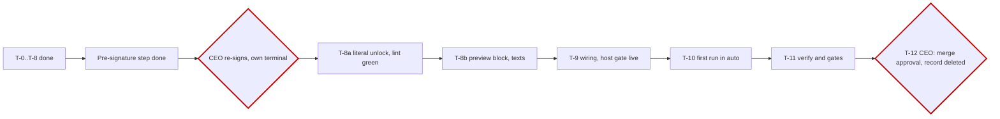

# Plan 0004 — Host enforcement: shared path policy, host gate, Bash write checks, signing preview, fail-closed hooks

- Spec: `specs/active/0004-harness-enforcement-gaps.md` (lane 3). Current text: sha12 `bd8e0c01ddf8`, the delta of 2026-11-22 ("always-auto", map in spec §14), committed in `8183bea`, **not signed**. Earlier signed texts: `9f1371e1ae39…` (REQ-37 delta, re-signed 2026-11-21; T-0..T-8 were built on it) and `a686d6dc68c3…` (first signature).
- Status: Amended 2026-11-22 to spec §12 as changed by the delta. The plan the CEO approved on 2026-11-21 (in chat) covered T-0..T-11; its rows T-0..T-8 are done. The rows T-8a, T-8b, T-9..T-12 below take effect with the CEO's re-signature of the spec; no task starts before it.
- Prepared by: delivery-manager (delivery plan from spec §12; the implementing unit adds its own step notes per task under "Ordered steps" before it codes)
- Signature: `node harness/approval.js verify specs/active/0004-harness-enforcement-gaps.md approvals harness/keys/ceo.pub.pem` → `NOT APPROVED: spec changed after approval` (run 2026-11-22 on `harness/0004-host-enforcement` @ `8183bea`; expected: the delta voids the signature of 2026-11-21). Must print `APPROVED` before T-8a.
- Baseline: `./harness/bin/check` → `CHECK GREEN (full)` @ `6951d7b` (2026-11-21). Now: `CHECK FAILED` @ `8183bea` (run 2026-11-22) with one `FAIL` line, `FAIL  unlocks-row2` for this spec's eight literal enforcement entries. Red by design until T-8a lands (spec Ruling R-25).
- The spec file is never edited by a task. Any edit voids the signature; every task starts by re-running the verify command above.
- How sessions run (CEO decision 2026-11-22, `docs/KARARLAR.md` rev. 48, last entry): always in permission mode `auto`; the CEO does not switch modes. In `auto` a hook "ask" opens no dialog and is a refusal. The CEO's only act on the spec is the signature, given in his own terminal.

## Who implements
**`polyglot-engineer`**, model `sonnet` (lane 3 rule for engineers), one invocation per task, started by the main session, session in `auto`.

Why:
- The work is Node (CommonJS, built-ins only) and POSIX `sh` under `harness/`. `dotnet-engineer` and `react-engineer` carry stack playbooks that do not apply; there is no .NET and no React here.
- The spec names `polyglot-engineer` as the owning unit of T-2..T-9, T-8a and T-8b (§12). Another unit would be a deviation from the spec text.
- `polyglot-engineer` is in the caller list of spec §7.3 condition 6 (main session, `polyglot-engineer`, `dotnet-engineer`, `react-engineer`, `devops-sre`; AC-16), so from T-9 on its file-tool edits of the eight named enforcement files pass the hooks. A unit outside the list is refused.
- `devops-sre` was considered (it owns Docker, CI, shell): rejected, because the job is hook logic and tests, not release or server work.
- Caveat: the unit's description speaks of porting other stacks. The brief must therefore carry the spec path, the task id, the file list of this plan and the global rules, not rely on the playbook. `.claude/agents/**` is not in the spec's `Unlocks:`, so the unit file is not edited in this job.
- Escalation: `opus` only if the engineer is stuck after 2 attempts on a task; 3 failed attempts → stop and report.

## Files (impact area)
No graph exists (`graphify-out/` absent); the impact area is taken from spec §12 "File ownership" and checked against the source. Going outside this list is a plan deviation.

Class 1 = hard-deny (signatures, keys, `.git`; no header opens it). Class 2 = enforcement: a glob never opens it; from T-9 on a file-tool edit passes the hooks only for the eight files the signed spec's `Unlocks:` names by exact path, for a listed caller; a Bash writer to one is always refused in `auto`. Class 4 = product-config (covered by the spec's `Unlocks:`). Free and code need nothing more than the signed spec.

| Path | Class | Tasks (sequential owner) |
|---|---|---|
| `.claude/settings.json` | 2, named | T-2, then T-9 |
| `harness/container-settings.json` | 2, **not** named | T-2 only (done); opened by no later task (S-02) |
| `harness/policy.js` | 2, named | T-3, then T-8a |
| `harness/approval.js` | 2, named | T-4; T-8b only if needed |
| `harness/bin/approve.sh` | 2, named | T-4, then T-8b |
| `harness/gate.js` | 2, named | T-5; T-8a only if the reason text needs it |
| `harness/guard.js` | 2, named | T-6, then T-8b (signing dialog only) |
| `harness/bin/install-project.sh` | 2, named | T-9; T-10 probe (one line added and removed, net no diff) |
| `CLAUDE.md` | 2, named | T-9; T-10 probe (one line added and removed, net no diff) |
| `harness/bin/check` | 4 | T-3, T-5, T-7 (no later task) |
| `harness/bin/lint.js` | 4 | T-7, T-8, T-8a (`unlocks-row2`), T-8b (`texts-0004`), then T-9 |
| `harness/test/policy.sh`, `harness/test/policy-driver.js` | 4 | T-3, T-6, then T-8a (additions only) |
| `harness/test/run.sh` | 4 | T-4, T-5, T-8a, then T-8b (additions only) |
| `harness/test/host-gate.sh` | 4 | T-5, T-8a (additions and line 230), then T-9 |
| `harness/test/guard.sh` | 4 | T-6, T-8a (additions and line 361), then T-8b (additions only) |
| `harness/test/lint-rules.sh` | 4 | T-7, T-8a (additions and lines 101, 106), T-8b, then T-9 |
| `harness/test/fixtures/*.json` | 4 | T-1 (`pretooluse-main.json` still missing, see G-P9) |
| `harness/README.md`, `templates/spec-tam.md`, `templates/spec-hizli.md` | 4 | T-8, then T-8b |
| `.claude/rules/routing.md` | 4 | T-9 |
| `site/index.html` (regenerated, never hand-edited) | code | T-4, T-5, T-6, T-8a, T-8b, T-9 |
| `docs/kanit/0004-t1.md` | free | T-1, then T-10 |
| `docs/kanit/0004-delta-kapi.md` | free | main session (gate round on the delta, pre-signature step) |
| `docs/architecture/adr/0001-path-class-taxonomy.md` | free | `architecture-board` (updated to §7.3 in `8183bea`; a further sync to the gate-round text was uncommitted in the working tree when this plan was amended, not made by this plan) |
| `specs/active/0004-…` → `specs/done/` | free | main session, T-12 (a move, no edit) |
| this spec's record under the main worktree's `approvals/` | 1 | the CEO alone, own terminal, T-12 |
| `plans/0004-plan.md`, `STATE.md` | free | delivery-manager, main session |

Not touched: `harness/stop.js`, `loop.js`, `notify.js`, `harness/bin/company-run.sh`, `ceo-keygen.sh`, `install-global.sh`, `site-data.js`, `harness/keys/**`, `.claude/agents/**`, `.claude/skills/**`, the existing lines of `run.sh`, `guard.sh`, `stop.sh`, `loop.sh`, `tools.sh` (except the four pre-approved lines of global rule 2).

## Global rules (spec §12, binding for every task)
1. `./harness/bin/check` is green after the task and the output is shown (last line `CHECK GREEN (full)`), with the commit sha. Only exception: the red window before T-8a (Ruling R-25).
2. No existing test is weakened, edited or deleted; additions only. If an existing test or lint rule asserts what the task would change: **stop and report**. Pre-approved replacements, nothing else: `lint.js:219-220` (T-9); the `lint.js:8` `ROOT` line (T-7, done); and for T-8a (line numbers as of `0df2c8f`) `harness/test/host-gate.sh:230` and `harness/test/guard.sh:361` (expected string becomes the amended path text of §7.7, exact-match form stays), `harness/test/lint-rules.sh:101` (two literal items leave the negative loop, nine stay) and `harness/test/lint-rules.sh:106` (expectation reversed); each of the three literal items is re-asserted as valid next to a glob twin that still fails (AC-17). The `unlocks-row2` block of `lint.js` (`lint.js:283-293`) is rewritten by T-8a as §7.3 says.
3. A task that changes test lines in `run.sh`/`guard.sh` or hook wiring in `.claude/settings.json` runs `node harness/bin/site-data.js --write` and includes the regenerated `site/index.html`.
4. Enforcement files (rule 4 as rewritten by the delta): sessions run in `auto`, no dialog opens.
   - Before T-9: the guard's file-tool branch still asks for the files of its pattern and `auto` settles that ask without a dialog (T-1 finding B-1).
   - From T-9 on: a file-tool edit passes the hooks only for the eight named files, while the spec is validly signed and the caller is the main session or a listed engineer unit; any other enforcement file, and any Bash writer to one, is refused.
   - In both phases the main session shows each enforcement-file diff to the CEO in chat before the commit (instruction-only; the edit is already live by then, G-1).
   - The app is a second decider after the hooks and the spec does not specify its outcome. If the app refuses an edit: stop and report; no Bash or interpreter workaround; fallback: the CEO applies the shown diff in his own terminal.
5. AC-18, at the end of each of T-8a, T-8b, T-9 and T-10: the task report quotes the two commands of "Common evidence" with their output. Any unexpected line: stop and report.

## Ordered steps

### In which order do the remaining tasks run, and where does the CEO act?

Description: one chain with no parallel branch, so the whole chain is the critical path; the two thick red diamonds labelled "CEO" are the only places the CEO acts, both outside any session. Text equivalent: the task table below.

Critical path: T-0 → T-1 → T-2 → T-3 → T-4 → T-5 → T-6 → T-7 → T-8 (all done) → pre-signature step (done) → CEO re-signature → T-8a → T-8b → T-9 → T-10 → T-11 → CEO merge approval → T-12. No slack anywhere: the spec forbids parallel work (shared files: `lint.js`, `run.sh`, `guard.sh`, `policy.sh`, `host-gate.sh`, `lint-rules.sh`, `policy.js`, `guard.js`, `approve.sh`, `.claude/settings.json`). The current blocker is the CEO's re-signature.

### Task table
No task opens a CEO dialog. The last column lists the enforcement files a task edits by file tool (global rule 4); the engineer names them before it starts, and the main session shows each diff in chat before the commit. Every task also ends with the common evidence (below the table).

| ID | Task | Owner | Files | AC made to pass | Depends on | Evidence command (besides the common one) | Enforcement files edited | State |
|---|---|---|---|---|---|---|---|---|
| T-0 | Prerequisites (see "T-0 status") | main session + CEO | none | all | none | the verify command | none | done `6951d7b` |
| T-1 | Host verification (manual; checklist below) | main session with the CEO | `docs/kanit/0004-t1.md`, `harness/test/fixtures/{pretooluse-subagent,subagentstop}.json` | AC-13 (manual part) | T-0 | `for f in harness/test/fixtures/*.json; do node -e 'JSON.parse(require("fs").readFileSync(process.argv[1],"utf8"))' "$f" \|\| echo "BAD $f"; done; grep -nE '/Users/\|/home/[a-z]\|[0-9a-f]{8}-[0-9a-f]{4}-' harness/test/fixtures/*.json` (prints nothing) | none | done `d0c2070`; `pretooluse-main.json` not captured (G-P9) |
| T-2 | Wrapper first: `\|\| exit 2` on both guard commands in `.claude/settings.json` and on the gate command in `harness/container-settings.json`; nothing else | polyglot-engineer | `.claude/settings.json`, `harness/container-settings.json` | AC-11 (part) | T-1 | `grep -c 'exit 2' .claude/settings.json harness/container-settings.json` → `2` and `1` | both files | done `20f0385` |
| T-3 | `harness/policy.js` with §7.1.1, driver, `policy.sh`; `check` lists. Not loaded by any hook | polyglot-engineer | `harness/policy.js`, `harness/test/policy-driver.js`, `harness/test/policy.sh`, `harness/bin/check` | AC-1 (matrix), AC-2, AC-6 (parser), AC-11 (source order) | T-2 | `sh harness/test/policy.sh` | `policy.js` | done `ecd3592` |
| T-4 | `approval.js` (`verifyBuffer`, `sign --expect`), `approve.sh` (`--preview`, `--expect`, main-worktree `approvals/`), `run.sh` additions, site data. **Live:** `approve.sh` refuses to sign without `--expect` | polyglot-engineer | `harness/approval.js`, `harness/bin/approve.sh`, `harness/test/run.sh`, `site/index.html` | AC-7 | T-3 | `sh harness/test/run.sh` | `approval.js`, `approve.sh` | done `8090cf5` |
| T-5 | `gate.js` through the policy: `--host` and container branch; `host-gate.sh`; container cases in `run.sh`; `check` list; site data. Not wired on the host. **Live in the container** | polyglot-engineer | `harness/gate.js`, `harness/test/host-gate.sh`, `harness/test/run.sh`, `harness/bin/check`, `site/index.html` | AC-3, AC-4, AC-5, AC-10 (gate) | T-4 | `sh harness/test/host-gate.sh && sh harness/test/run.sh` | `gate.js` | done `8161606` |
| T-6 | `guard.js`: policy, decision collector, writer targets, git global options, config/env asks, refspec and REQ-37 forms, installer ask, signing dialog, permission-mode rule, reason quoting; file-tool branch and helpers byte-identical (R-1); `guard.sh` and `policy.sh` additions; site data. **Live** | polyglot-engineer | `harness/guard.js`, `harness/test/guard.sh`, `harness/test/policy.sh`, `site/index.html` | AC-1 (consistency), AC-8, AC-9, AC-10 (guard), AC-11 (broken copy) | T-5 | `sh harness/test/guard.sh && sh harness/test/policy.sh` | `guard.js` | done `5de0373` |
| T-7 | `lint.js`: `COMPANY_LINT_ROOT`, header rule, fixture rule, wrapper rule, rule ids; `lint-rules.sh`; `check` lists | polyglot-engineer | `harness/bin/lint.js`, `harness/test/lint-rules.sh`, `harness/bin/check` | AC-6 (lint), AC-11 (lint), AC-13 (lint) | T-6 | `sh harness/test/lint-rules.sh && node harness/bin/lint.js` | none | done `c664198` |
| T-8 | Texts with no claim that the host gate is live: `harness/README.md`, both spec templates (`- Unlocks:` line), lint string checks | polyglot-engineer | `harness/README.md`, `templates/spec-tam.md`, `templates/spec-hizli.md`, `harness/bin/lint.js` | AC-14 (README, templates) | T-7 | `node harness/bin/lint.js` (rule `texts-0004`) | none | done `0df2c8f` |
| Step before T-8a | Pre-signature check (S-06): the main session prints the literal row-2 entries of the spec header as the committed `policy.js` computes them, and `git status --short -- harness` (empty); both appended to `docs/kanit/0004-delta-kapi.md`. The CEO compares the list with the `Unlocks:` line of his preview and does not sign on any difference | main session | `docs/kanit/0004-delta-kapi.md` | precondition of T-8a | gate round on the delta | the section "İmza öncesi adım (S-06)" of that file: eight entries, sha12 `bd8e0c01ddf8` | none | done 2026-11-22 (in `8183bea`); must be repeated if the spec or `harness/` changes before the signature |
| T-8a | Literal enforcement authority and its lint rule. **First step:** confirm `FAIL  unlocks-row2` for this spec is the only `FAIL` line of lint; stop on any other (R-25). `policy.js`: `decide` allows a host file-tool write to a row-2 path under the six conditions of §7.3, else the unchanged ask (R-22); same root as `resolved.root === realpath(lexical.root)` (D-1); root-independent locked set in `decide` and `unlockKinds` (D-2); caller condition with its fixed list (S-01); `parseHeader` rejects Cc, Cf, Zl, Zp (S-05); `unlockKinds` (§7.2); amended path text of §7.7; the enforcement ask reason names the unmet condition (§4). `gate.js` only if the reason needs it. `lint.js`: `unlocks-row2` as §7.3. Tests: the additions of AC-16 and AC-17 (lint part); the four pre-approved line replacements of rule 2, nothing else changed in existing tests; site data. Not live for file tools on the host until T-9; the guard's Bash decisions do not change (only the wording of its path refusal, live at the next Bash call) | polyglot-engineer | `harness/policy.js`, (`harness/gate.js`), `harness/bin/lint.js`, `harness/test/policy.sh`, `harness/test/policy-driver.js`, `harness/test/host-gate.sh`, `harness/test/guard.sh`, `harness/test/run.sh`, `harness/test/lint-rules.sh`, `site/index.html` | AC-16, AC-17 (lint), AC-6 (real repository green again), AC-18 (task end) | T-8; gate round on the delta (done, spec §14); ADR 0001 updated to §7.3 (`8183bea`; the gate-round sync, condition 6 and AC-18/AC-19, is in the working tree and must be committed first); the pre-signature step (done); **CEO re-signature in his own terminal** | `sh harness/test/policy.sh && sh harness/test/host-gate.sh && sh harness/test/guard.sh && sh harness/test/run.sh && sh harness/test/lint-rules.sh && node harness/bin/lint.js`; removed lines: `git diff -U0 0df2c8f -- harness/test/ harness/bin/lint.js harness/bin/check \| grep '^-[^-]'` → only the four pre-approved test lines and lines of the `unlocks-row2` block | `policy.js` (`gate.js` only if needed) | waiting for the signature |
| T-8b | Enforcement entries visible at signing, and the texts. `approve.sh`: the marked block of §7.5 in `--preview`, the `locked path` finding, `--expect` refuses a header with a locked literal (`approval.js` only if needed); a locked entry is on neither the `Unlocks:` line nor the block (D-6); non-ASCII printed as `\uXXXX` (S-05). `guard.js`: the `Zorlama dosyalarını açar:` segment of the signing dialog, `Unlocks: yok` for an enforcement-only header, the denial for a locked literal; file-tool branch and `ask`/`deny` helpers byte-identical (R-1). Tests: the `run.sh` and `guard.sh` additions of AC-17. `harness/README.md` (Turkish): "Yol sınıfları", "İzin kipi ve onay penceresi", "CEO nerede ve nasıl imzalar"; in "Bilinen boşluklar" the rows G-1, G-9, G-11, G-21, the instruction-only list and the recovery text as amended (D-4). Both templates: the `- Unlocks:` comment. `lint.js`: the README string checks of AC-14 under `texts-0004` (three sections, and the G-1 row contains `Unlocks:`), with `lint-rules.sh` cases (and the cases of Ruling P-5); site data. **Live:** preview block and signing dialog segment | polyglot-engineer | `harness/bin/approve.sh`, (`harness/approval.js`), `harness/guard.js`, `harness/test/run.sh`, `harness/test/guard.sh`, `harness/README.md`, `templates/spec-tam.md`, `templates/spec-hizli.md`, `harness/bin/lint.js`, `harness/test/lint-rules.sh`, `site/index.html` | AC-17 (preview, dialog), AC-14 (README sections), AC-18 (task end) | T-8a | `sh harness/test/run.sh && sh harness/test/guard.sh && sh harness/test/lint-rules.sh && node harness/bin/lint.js`; the removed-lines command of T-8a again (same expectation; the `texts-0004` checks are added lines) | `approve.sh`, `guard.js` (`approval.js` only if needed) | waiting |
| T-9 | Wiring (T-1 evidence exists): `.claude/settings.json` adds the host gate with wrapper and removes guard's file-tool entry; `lint.js:219-220` replaced by the one-owner rule; `install-project.sh` new set and merge entries; `host-gate.sh` additions (`sh -c` gate commands, `install-project.sh` cases); `lint-rules.sh` one-owner fixtures; `routing.md` and `CLAUDE.md` rule 1 (exact texts of §7.6 as amended by the delta) with lint checks; site data. **Host gate live**, and with it REQ-8 | polyglot-engineer (no CEO dialog; before the wiring edit the guard branch asks and `auto` settles it, after it the gate allows the named files) | `.claude/settings.json`, `harness/bin/install-project.sh`, `CLAUDE.md`, `.claude/rules/routing.md`, `harness/bin/lint.js`, `harness/test/host-gate.sh`, `harness/test/lint-rules.sh`, `site/index.html` | AC-11 (`sh -c`), AC-12, AC-14 (routing, rule 1), AC-18 (task end) | T-8b; T-1 evidence (`docs/kanit/0004-t1.md`) | `sh harness/test/host-gate.sh && sh harness/test/lint-rules.sh && node harness/bin/lint.js` | `CLAUDE.md`, `install-project.sh`, `.claude/settings.json` (last, Ruling P-2); all three diffs shown to the CEO in chat before the commit | waiting |
| T-10 | First run (manual), by the main session alone, session in `auto`: the five observations (a)-(e) and the bench of AC-15 by the method of Ruling R-24 ((e) by a `scout` unit the main session starts); each result, with the tool call or command and the verbatim hook output, appended to `docs/kanit/0004-t1.md`; scratch paths removed; `git status --short` empty; stop and report on any differing observation | main session | `docs/kanit/0004-t1.md` | AC-15, AC-18 (task end) | T-9 | `sh harness/test/host-gate.sh --bench` → p95 per call, target < 150 ms; `git status --short` (prints nothing) | `install-project.sh` and `CLAUDE.md`: one line added, then removed (net no diff) | waiting |
| T-11 | Verification: fresh `check`; 19 mutation probes on a temporary copy (§9: 13 of the signed text, 5 of the delta, 1 of the gate round, S-01), each must turn a test red; criterion-to-evidence map AC-1..AC-19; `ASK_MODES` vs the T-1 record; cold read of `policy.js` (T-3 left no report) and of the edits no hook saw (`policy.js`, `approve.sh`, `install-project.sh`); `qa-engineer` and then `appsec` each run the two commands of AC-18 and quote the output; then the gates | qa-engineer → appsec → internal-auditor → quality-office | none (read-only units) | all | T-10 | `git diff -U0 6951d7b -- harness/test/ harness/bin/lint.js harness/bin/check \| grep '^-[^-]'` → only the `lint.js:219-220` and `lint.js:8` replacements; the same with base `0df2c8f` → only the four pre-approved test lines and lines of the `unlocks-row2` block | none | waiting |
| T-12 | Record retirement at ship: the main session moves the spec from `specs/active/` to `specs/done/`; the CEO deletes this spec's signature record from the main worktree's `approvals/` in his own terminal (envelope: permanent deletion; no session can do it); the main session then quotes `ls approvals/` | CEO (own terminal) + main session | the spec file (moved), the record (deleted by the CEO) | AC-19 | T-11; the CEO's approval of the merge to `main` (spec §10) | `ls approvals/` in the main worktree → no file name containing `0004`; `ls specs/active` → this spec absent | none | waiting |

Common evidence for every task, in this order:
```
node harness/approval.js verify specs/active/0004-harness-enforcement-gaps.md approvals harness/keys/ceo.pub.pem   # APPROVED
./harness/bin/check                                                                                              # last line: CHECK GREEN (full)
git rev-parse --short HEAD
```
From T-8a on, also the two commands of AC-18 (quoted with their output in the reports of T-8a, T-8b, T-9, T-10; run again by `qa-engineer` and `appsec` in T-11):
```
git status --short -- CLAUDE.md .claude/settings.json harness/policy.js harness/gate.js harness/guard.js harness/approval.js harness/bin/approve.sh harness/bin/install-project.sh   # prints nothing
git log --oneline <re-sign commit>..HEAD -- <the same eight paths>   # only the commits of T-8a, T-8b, T-9 and fix commits a task report names
```
`<re-sign commit>` is the commit that holds the text the CEO re-signed (Ruling P-6: `8183bea`, as long as the spec is not changed again).

Where the CEO acts, all outside any session (no dialog, no mode switch):
1. Re-signature of the delta, in his own terminal: `harness/bin/approve.sh <ws> --preview`, compare the `Unlocks:` line with the eight entries printed in `docs/kanit/0004-delta-kapi.md` and the sha12 with `bd8e0c01ddf8`, then `harness/bin/approve.sh <ws> --expect <sha12>`. This preview is still the flat one (the marked block arrives with T-8b; G-11, A-13).
2. Approval of the merge to `main` after T-11 (envelope).
3. T-12: deleting the signature record in his own terminal.
4. Only as a fallback: applying a shown diff in his own terminal if the app refuses an enforcement-file edit (global rule 4).

Inside a session the CEO only reads: every enforcement-file diff is shown in chat before its commit.

### T-0 status
| Prerequisite (spec §12 T-0) | State | Evidence |
|---|---|---|
| Round-2 and round-3 findings folded into the spec | met | spec §14; `STATE.md` "RESUMED 2026-11-21": 17 items verified |
| ADR "Path class taxonomy" exists and is synced to the spec text | met | `docs/architecture/adr/0001-path-class-taxonomy.md`: spec path is `specs/active/…`; updated for the delta in `8183bea`; `Status: Proposed` until the re-signature (its own header says so); gate-round sync uncommitted in the working tree on 2026-11-22 (`architecture-board`) |
| Spec moved to `specs/active/`, exactly one active spec | met | `ls specs/active` → one file |
| Spec signed by the CEO | met on 2026-11-21 (two texts); **void since the delta of 2026-11-22** | verify → `NOT APPROVED: spec changed after approval`; re-signature of sha12 `bd8e0c01ddf8` awaited |
| Re-check of the folded findings (optional, "the main session's call") | not done | the text folded after the gate round on the delta has not itself been through a gate (spec §14); main session decides |
| Branch on the remote, CI run on it | branch pushed (CEO approved, 2026-11-22); CI **not run** | CI runs only on PRs; no PR opened (needs the CEO's approval, public repository) |
| Delivery plan approved, issues opened | plan approved 2026-11-21 for T-0..T-11, amended here for the delta; issues **not opened** (public repository: each needs the CEO's approval) | `Status:` line above |

### T-1 checklist (done 2026-11-21/22; historical record)
Kept as the record of what was run; results are in `docs/kanit/0004-t1.md`. The modes listed here were test inputs of T-1, not the way sessions run. Outcome: dialog proven in `default` and `acceptEdits`; finding B-1 (`auto` settles an ask without a dialog); `pretooluse-main.json` not captured. Source: spec §12 T-1, AC-13, §2, R-11. Nothing in the repo settings was edited; every target was a scratch file. No token or key file was read.

Preparation by the main session:
1. In the scratch directory, a throwaway hook script that appends its stdin (the payload) to a scratch log and prints the "ask" JSON of spec §7.8.
2. A scratch settings file that wires this hook for `PreToolUse` (matcher `Write|Edit`) and a payload-logging hook for `SubagentStop`.
3. Three more scratch settings files for step D: the hook entry pointing at a file with a syntax error, at a missing file, and each of the two again with `|| exit 2`.

With the CEO, in his own terminal (`claude --settings <scratch file>`):

| # | What was done | What is recorded in `docs/kanit/0004-t1.md` (Turkish; command used + observed result) |
|---|---|---|
| A | Session in `default` mode, a Write to the scratch file | PreToolUse payload keys for a main-session file write; the `permission_mode` value; dialog yes/no |
| B | A repeated in `acceptEdits`, `auto`, `bypassPermissions`, `plan` | per mode: the `permission_mode` value and whether the always-ask hook showed a dialog. This decided `ASK_MODES` (R-11) |
| C | A subagent that writes the scratch file, then stops | PreToolUse payload keys for a subagent write; SubagentStop payload keys |
| D | Each broken-entry settings file, the same Write | exit 1 (syntax error; missing file) does not block; the same entry with `\|\| exit 2` blocks |
| E | One session with `CLAUDE_PROJECT_DIR` empty in the environment | what the hook sees and whether a `node "$CLAUDE_PROJECT_DIR/…" \|\| exit 2` command blocks |
| F | A worktree-isolated subagent that writes a scratch file | the `CLAUDE_PROJECT_DIR` and `cwd` that subagent's hook saw |
| G | A Write, then an Edit, on an existing symlink in the scratch directory | for each tool: link replaced, or written through to the target |
| H | none | `git --version` on the host |

No stop condition of spec T-1 was hit; T-2 followed.

### T-10 checklist (main session alone, session in `auto`, after T-9; spec AC-15, Ruling R-24)
The spec stays the validly signed single active spec throughout; nothing is unsigned, moved aside or unwired. Each observation goes into `docs/kanit/0004-t1.md` with the tool call or command and the verbatim hook output, including the `permission_mode` value the refusals name.

| # | Probe | Expected |
|---|---|---|
| a | `mkdir -p .claude/worktrees/t10-probe/specs`, then a Write of the new file `.claude/worktrees/t10-probe/src/a.cs` (scratch nested root, zero active specs) | refused once, by one `BLOCKED by company gate:` message with the path text of §7.7, `"src/a.cs"` and mode `auto`; the file does not exist afterwards |
| b | A Write of the new scratch code file `t10-probe.txt` in the workspace root, then `rm t10-probe.txt` | no hook output; the `rm` gets no opinion |
| c | A Write of the new file `harness/t10-probe.js` (enforcement, named in no header) | refused once with the path text of §7.7; the file does not exist afterwards |
| d | An Edit that adds one comment line to `harness/bin/install-project.sh` and one that removes it; the same pair on `CLAUDE.md` (an HTML comment at the end) | all four pass with no hook output; the record states for each whether the app then applied it |
| e | A `scout` unit, started by the main session with the single brief to add one comment line to `harness/bin/install-project.sh` | refused once, by one `BLOCKED by company gate:` message with the path text of §7.7 and `"harness/bin/install-project.sh"`; `permission_mode` and `agent_type` recorded; file unchanged |
| bench | `sh harness/test/host-gate.sh --bench` (200 calls) | p95 per call recorded, target < 150 ms |

Cleanup: `rmdir .claude/worktrees/t10-probe/specs .claude/worktrees/t10-probe`, and `rmdir .claude/worktrees` when the `mkdir -p` of (a) created it and it is empty; then `git status --short` prints nothing.

AC-15 fails, and T-10 records, stops and reports (nothing is unsigned, unwired or weakened to make it pass), when: an observation differs (no refusal, two refusals, a refusal without the `BLOCKED by company gate:` text, a dialog, hook output where none is expected, or a refusal by the app itself of an edit the hooks gave no opinion on); or p95 ≥ 150 ms (reported with a delta proposal; the hooks stay wired).

## Gaps found in the recipe
- G-P1 (closed) — ADR header: the ADR now names the active spec path and explains its `Status: Proposed` (waiting for the re-signature). Open: its gate-round sync is an uncommitted working-tree change; it is a dependency of T-8a and must be committed before T-8a starts.
- G-P2 (informational) — the spec's own header still says `Status: Draft`. It cannot be changed without voiding the signature; validity lives in the signature record. Left as is.
- G-P3 (Type 2) — spec T-2 says "nothing else", global rule 3 asks for site data on wiring changes. See Ruling P-3.
- G-P4 (Type 2) — the playbook's branch layout (integration branch plus one branch per task) does not fit a strictly sequential job that already has a branch. See Ruling P-1.
- G-P5 (rewritten for the delta) — no hook ask reaches the CEO: sessions run in `auto`. Whether a unit may edit an enforcement file is decided by the caller condition of §7.3 (condition 6); `polyglot-engineer` is listed. If an edit is refused by the hooks or by the app: stop and report (global rule 4).
- G-P6 (rewritten for the delta) — in `auto` every policy ask is a refusal: a Bash writer to an unauthorised path, any Bash writer to an enforcement file, and, from T-9 on, a file-tool edit of an enforcement file the spec does not name by exact path. The way forward is the signed spec, not another mode. The same holds for every signing, key and installer command: the live guard refuses a Bash command that names the signing script, the key folder or an installer (seen in T-6 and T-7), so engineers run the test scripts only and never name those paths in an ad hoc command.
- G-P7 (risk) — since T-4 `approve.sh` needs `--preview` then `--expect <sha12>`. The re-signature of this delta and the signing of 0006 follow that form, in the CEO's own terminal.
- G-P8 — no `graphify` graph exists; file ownership comes from spec §12, checked against the source.
- G-P9 (open, AC-13) — `harness/test/fixtures/pretooluse-main.json` is still missing; lint only warns (`WARN  fixture-sanitized`). AC-13 needs the fixture and T-11 will fail the criterion without it. The earlier note "capture at T-9/T-10 with the CEO in Manual mode" no longer holds (no mode switch, and T-10 is run by the main session alone); the delta names no owner or moment for the capture. Recommendation: the main session files it as an expected item for the CEO (one `claude --settings <scratch file>` start in his own terminal with a payload-logging hook, as in T-1 step A; the payload does not depend on the mode), before T-11. Not blocking T-8a..T-10.
- G-P10 (by design) — `check` is red from `8183bea` until T-8a lands (Ruling R-25). No "done" claim and no green marker is possible in that window; T-8a starts by confirming the single `FAIL`.
- G-P11 (assumption A-12 of the spec) — after T-9 an unsigned code or product-config edit on the host is refused, so a lane-0 fix to a code path needs a validly signed single active spec. Free-class paths (`specs/`, `docs/`, `plans/`, `STATE.md`) stay open.
- No Type 1 gap found.

## Risks and questions (with recommendation)
| Risk | Effect | Recommendation |
|---|---|---|
| The re-signature is the only blocker and needs the CEO at his terminal | whole chain waits | file it as the next question; one sitting, two commands |
| The spec or `harness/` changes between the pre-signature step and the signature | the printed list no longer proves the signed bytes | repeat the step; the CEO checks sha12 `bd8e0c01ddf8` in his preview |
| The app refuses an enforcement-file edit in `auto` (second decider, D-3) | task stops | stop and report; no Bash or interpreter workaround; the CEO applies the shown diff in his own terminal |
| An enforcement edit is live before the CEO sees its diff (G-1) | a wrong edit acts at once | small edits, diff in chat before the commit, AC-18 commands at each task end, T-11 re-runs them |
| An existing test asserts what a task changes (global rule 2) | stop and report | only the four named lines are pre-approved; the engineer runs each test file before and after every step |
| A broken hook after T-8a, T-8b or T-9 blocks the session | work stops; in `auto` the in-session repair ask is always refused | recovery path R (spec §10): the CEO runs `git -C <repo> checkout -- harness/ .claude/settings.json` in his own terminal; commit after every green task so a restore point exists |
| A T-10 observation differs, or p95 ≥ 150 ms | AC-15 fails | record, stop, report; delta proposal for the latency case |
| CI not run (no PR) | only local evidence | ask the CEO once for a draft PR after T-8a is green |
| `pretooluse-main.json` missing (G-P9) | AC-13 fails in T-11 | capture before T-11 |

Questions for the CEO (to be filed by the main session, one per page): (1) the re-signature of sha12 `bd8e0c01ddf8`, recommendation: now, T-8a waits only for it; (2) approval to open issues and a draft PR in the public repository, recommendation: after T-8a is green; (3) the fixture capture of G-P9, recommendation: one terminal start before T-11.

## Criterion ↔ test map
| Criterion | Evidence | Passes from | Profile |
|---|---|---|---|
| AC-1 | `harness/test/policy.sh` + `policy-driver.js` (matrix); gate/guard consistency loop | T-3; T-6 | quick |
| AC-2 | `policy.sh` (regex extracted from `guard.js`) | T-3 | quick |
| AC-3 | `harness/test/host-gate.sh` | T-5 | quick |
| AC-4 | `host-gate.sh` (temp git repo, linked worktree, PATH stub) | T-5 | quick |
| AC-5 | `harness/test/run.sh` existing + additions | T-5 | quick |
| AC-6 | `policy.sh` (parser, matcher); `harness/test/lint-rules.sh`; the real repository passes lint again | T-3; T-7; T-8a | quick |
| AC-7 | `run.sh` additions (five-line preview for a spec with no literal enforcement entry) | T-4 | quick |
| AC-8 | `guard.sh` additions | T-6 | quick |
| AC-9 | `guard.sh` additions | T-6 | quick |
| AC-10 | `host-gate.sh` (gate); `guard.sh` (guard) | T-5; T-6 | quick |
| AC-11 | `policy.sh` (source order; broken copy); `lint-rules.sh`; `host-gate.sh` (`sh -c`) | T-3; T-6; T-7; T-9 (wrapper text from T-2) | quick |
| AC-12 | `lint-rules.sh` (one owner); `host-gate.sh` (`install-project.sh`) | T-9 | quick |
| AC-13 | `docs/kanit/0004-t1.md`; lint rule `fixture-sanitized`; three fixtures (one missing, G-P9) | T-1; T-7; open | manual + quick |
| AC-14 | `lint.js` rule `texts-0004`: README and templates; README sections of the delta and the G-1 row; routing and rule 1 | T-8; T-8b; T-9 | quick |
| AC-15 | first run in `auto` by the main session: observations (a)-(e) in `docs/kanit/0004-t1.md`; `host-gate.sh --bench` | T-10 | manual |
| AC-16 | `host-gate.sh`, `policy.sh` + `policy-driver.js`, `guard.sh`, `run.sh` additions | T-8a | quick |
| AC-17 | `lint-rules.sh` additions (lint); `run.sh` and `guard.sh` additions (preview, dialog) | T-8a; T-8b | quick |
| AC-18 | the two git commands, quoted with output in the reports of T-8a, T-8b, T-9, T-10; run again by `qa-engineer` and `appsec` | each task end; T-11 | manual |
| AC-19 | `ls approvals/` in the main worktree and `ls specs/active`, quoted in the end-of-job report | T-12 | manual |

## Build evidence
<!-- Marker lines only: CHECK GREEN (full, ...) @<sha> -->
- CHECK GREEN (full) @6951d7b — baseline before T-1, 2026-11-21
- CHECK GREEN (full) @20f0385, @ecd3592, @8090cf5, @8161606, @5de0373, @c664198, @0df2c8f — T-2..T-8, 2026-11-22, as recorded per task in `STATE.md` (not re-run for this amendment)
- No marker @8183bea: `CHECK FAILED`, one `FAIL  unlocks-row2` (by design, Ruling R-25), run 2026-11-22

## Rulings
- Ruling P-1: all tasks commit in order on the existing branch `harness/0004-host-enforcement`, one commit (or a short series) per task, one PR to `main` at the end; no `integration/0004-*` branch and no per-task branches — the spec forbids parallel work and the spec was committed on this branch — cost if wrong: per-task review happens on commits instead of PRs; a task branch can still be cut from any commit.
- Ruling P-2 (reason amended for the delta): inside T-9 the `.claude/settings.json` edit is the last edit of the task — the spec's order is "wiring last"; with the signed spec the live gate would let the task's other files through, but a wiring mistake would block them, and the other edits are then tested before the gate goes live — cost if wrong: none for the CEO (no dialog either way); the three enforcement diffs are shown in chat before the commit in any order.
- Ruling P-3: T-2 runs `node harness/bin/site-data.js --check` and regenerates `site/index.html` only if it reports stale — the spec says the wrapper changes no existing check — cost if wrong: one extra file in the T-2 commit.
- Ruling P-4 (extended): T-0 and the pre-signature step get no issue; T-1..T-12 including T-8a and T-8b get one each, once the CEO approves opening issues — cost: none.
- Ruling P-5: the eight `texts-0004` negative cases that T-8 ran ad hoc (open item in `STATE.md`) are added to `lint-rules.sh` in T-8b, not T-9 — T-8b is the next task that edits the `texts-0004` rule and `lint-rules.sh`, so the rule is covered before it is changed; additions only — cost if wrong: none; the CLAUDE.md and routing string checks stay in T-9 as the spec says.
- Ruling P-6: `<re-sign commit>` of AC-18 is `8183bea` — it holds the text with sha12 `bd8e0c01ddf8`, the one presented for signature — cost if wrong: if the spec changes again before the signature, the commit of that later text takes its place and the pre-signature step is repeated.
- Ruling P-7: this plan is amended in place for the delta instead of a separate delta-plan file — one plan per spec keeps the task table and the criterion map in one place; the plan as approved on 2026-11-21 is in git (`4a0e654`) — cost if wrong: a reader must use `git diff 4a0e654 -- plans/0004-plan.md` to see what the delta changed.

## Triage records
<!-- Audit triage: Finding | Decision (real/noise/defer/investigate) | Reason -->
