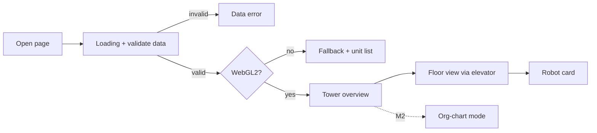
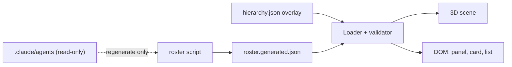

# Spec 0001 — Agency Tower 3D showcase
<!-- Header fields and Status values stay English (protocol); content is written in English. -->

- Status: Draft
- Tier: full (Lane 2; full because of new dependencies)
- Previous spec: none (this revision replaces the 49-REQ / 46-AC draft; CEO decision: simplify)
- Self-critique: done (round 2 addressed)

> Location note: the harness convention is `specs/active/NNNN-name.md` (`harness/bin/approve.sh` signs the single file in `specs/active/`). See A-1.

## 1. Intent
CEO's words: "A 3D interactive presentation of this agency as a robot-staffed office tower. For presentation/visual appeal only. It must be fully isolated from the agency itself. Someone installing the agency gets nothing from it." Later decision: simplify the spec.

Interpretation: a standalone, offline web page (Three.js, low-poly, procedural geometry) in which a visitor orbits a six-floor tower, rides an elevator between floors, sees the robots of the agency idling at their desks, and clicks a robot to read its card. Milestone 2 adds an org-chart view, day/night and mobile / reduced-motion polish. Success: the CEO opens it locally and shows the agency's structure to a third party in under two minutes without explaining the UI.

Not done: live data, example jobs / lane-flow replay (Phase 2), sound, hosting or publishing, any coupling to `harness/`, `.claude/`, `site/` or `templates/`, any change to how the agency is installed.

"Isolation" means: one self-contained folder `showcase/agency-tower/`; nothing the agency installs, executes or verifies depends on it; at runtime it depends on nothing outside itself. It reads `.claude/agents/*.md` only when the roster is regenerated, read-only, through one script. Q-1 resolved by the CEO: it stays in this repository (a `git clone` contains the folder; accepted).

## 2. Market summary (Product)
Not applicable: internal presentation piece, no `product-manager` input. Alternatives (video, static diagram, third-party 3D embed) are weighed in §6.

## 3. Requirements (EARS)
Milestone 1 (M1): tower, floors, elevator, robots with walking / typing / coffee / speech-bubble animation, desk screens, click card with wave.

Isolation and package hygiene
- REQ-1 — The showcase shall keep every file it adds under `showcase/agency-tower/`, apart from an allow-list of five files outside it: this spec, its approval record, `docs/architecture/STACK.md` (modified for the dependency entries), `docs/scout/0001-agency-tower-deps.md` and `docs/architecture/gorus-0001-agency-tower-3d-2026-11-13.md` (the two gate reports); it shall not modify any other tracked file, and shall leave `harness/bin/install-global.sh`, `harness/bin/install-project.sh` and the result of `harness/bin/check` unchanged.
- REQ-2 — The isolation check script (`scripts/check-isolation.mjs`) shall scan `src/`, `scripts/`, `index.html` and `vite.config.*` for import specifiers and path strings only (a string literal containing a path separator), and shall fail on any import resolving outside the showcase folder or any path string with a path segment exactly equal to `harness`, `.claude`, `site` or `templates` (segment match, not substring), except one allow-listed exact string: the roster generator's default agents directory constant in `scripts/build-roster.mjs`. `tests/`, `README.md` and the check script itself are excluded from the scan.
- REQ-3 — The showcase shall be self-contained: its own `package.json`, `package-lock.json`, `.npmrc` (`save-exact=true`, `registry=https://registry.npmjs.org/`, `ignore-scripts=true`, `engine-strict=true`), `.gitignore` (`node_modules/`, `dist/`, `coverage/`), `.nvmrc` and `engines.node` for Node 22, and a Turkish `README.md` (run, build, `roster:check`, isolation rules, Phase 2 list, roster staleness warning). `npm test` shall use only the committed roster JSON and fixtures, never the agents directory; `npm run roster:check` shall run only inside the repository and is not part of `npm test`. Copied alone outside the repository, `npm ci && npm run build && npm test` shall succeed, and in the repository they shall leave `git status` clean.

Data
- REQ-4 — The roster generator (`scripts/build-roster.mjs`) shall read `.claude/agents/*.md` read-only, extract from each frontmatter block only `name`, `description`, `tools` (comma list to string array) and `model`, ignore every other key (including `maxTurns`, `disallowedTools`, `effort` and `skills` with multi-line lists), and write a deterministic `src/data/roster.generated.json` (agents sorted by `name`, no timestamp) containing `sourceSha256`, the SHA-256 of the canonical serialization of the extracted fields (agents sorted by `name`, fixed key order, LF line endings).
- REQ-5 — If an agent file has no `name` or no `description`, or its frontmatter block cannot be parsed, the generator shall exit non-zero with a message naming the file and shall write nothing. Every other deviation (extra or unknown keys, absent `tools` or `model`) is not an error.
- REQ-6 — A hand-authored overlay `src/data/hierarchy.json` shall give each unit its floor, tier, reports-to, independence flag, Turkish role and accent data (§7); `npm run roster:check` shall fail if an agent file has no overlay entry, a non-manual overlay unit has no agent file, or `sourceSha256` is stale. The overlay is authoritative for the unit set.
- REQ-7 — When the app starts, it shall first show a loading state and validate both JSON files; on any violation, including a roster agent without an overlay entry or a non-manual overlay unit without a roster agent, it shall show the data-error state and nothing else; only after valid data shall it check WebGL2, and if WebGL2 is unavailable it shall show a fallback message and the plain unit list (REQ-13) and shall not create the scene.

Scene, camera, elevator
- REQ-8 — The system shall render a tower of six floors (5 to 0) with one robot per unit of the loaded data placed on the unit's floor (count derived from the data, not hard-coded), every floor holding desks, a coffee station and at least one floor-specific prop, and the Penthouse (floor 5) having glass walls, a procedural city skyline, a signing desk and the CEO robot. Overview is one fixed exterior camera pose with the elevator cabin parked at floor 0; there the exterior walls shall be at 25 % opacity and everything inside opaque; in floor view floors above the focused floor shall be ghosted to at most 10 % opacity and the focused floor's exterior walls shall be see-through. Pointer picking (raycast) shall ignore the building shell and ghosted floors: robots are selectable only on the focused floor, in overview and in org mode.
- REQ-9 — The camera shall use three's `OrbitControls` (from `three/examples/jsm`, no extra package) with pan disabled and distance and polar angle clamped so the camera stays above ground; a pointer press-and-release moving at most 5 px shall count as a click, more as a drag.
- REQ-10 — The system shall show a floor panel with one button per floor (5 to 0, Turkish names) and "Tüm kule" (overview), marking the current floor by text or shape and not by color alone; when another floor is chosen, the elevator cabin and the camera shall travel together along the shaft with eased motion lasting `clamp(0.6 s × floors travelled, 0.8 s, 3.0 s)`, a new request during a ride shall re-target from the current position (last request wins), and at arrival the doors shall open; any camera move to or from overview or org mode shall take 1.2 s (the cabin goes to or from floor 0).

Robots, selection, keyboard
- REQ-11 — The system shall distinguish tiers by scale, marker and color: CEO (1.35, crown, gold), management (1.2, badge, gold), lead (1.1, shoulder stripe, silver), specialist (1.0, no marker, floor accent color); and every robot shall run the looping activity cycle in §7 (idle, walk, work = typing at its desk, coffee break at the floor's coffee station) with durations drawn from a seedable random generator; each robot owns one desk (the CEO robot the signing desk); animation time steps are clamped to 100 ms.
- REQ-21 — While a robot works, its desk screen shall show scrolling placeholder code taken from a built-in list (never repository content); the system shall show speech bubbles above robots, each a Turkish phrase of at most 48 characters from the robot's overlay phrases, visible for 3–5 s, at most 4 on screen at once and at least one started per 20 s across the whole tower.
- REQ-12 — When the user selects a robot by click, tap or Enter on its list entry, from overview, another floor or org mode, the camera shall move to the robot's floor view (elevator ride; 1.2 s from overview or org mode), then zoom to the robot (0.6 s; a same-floor selection is the zoom only), the robot shall stop, face the camera and wave, and the card shall open; when the card is closed, the camera shall return to the floor view of that robot's floor (0.6 s), the robot shall resume its activity cycle and keyboard focus shall return to the opener. Selecting a robot in org mode exits org mode. Activating a unit-list button in the fallback (no scene) shall open the card without any camera move.
- REQ-13 — The card shall show, in Turkish labels: name, tier, role, description, tools, model and reports-to; a unit list (one button per unit, ordered by floor 5 to 0, within a floor by tier then name) shall give keyboard access to every robot and is the content of the fallback (REQ-7); all visible UI text shall be Turkish and `<html lang="tr">`, except the frontmatter description, shown as written.
- REQ-14 — The system shall accept single-key shortcuts `0`–`5` (jump to floor), `O` (org mode, from M2) and `Esc` (close the card; if no card is open, exit org mode), behaving as in the key-by-state matrix in §4, shall ignore any key event carrying a modifier key and any event while a text field has focus, and shall offer a toolbar toggle that turns all shortcuts off.

Cross-cutting (M1)
- REQ-15 — The system shall offer two quality tiers: `low` (no shadows, device pixel ratio 1) and `high` (shadows, device pixel ratio at most 1.5); a device with a coarse primary pointer starts on `low`, others on `high`, and `?quality=low|high` overrides; `?debug=1` shall show an fps overlay; rendering shall pause while the tab is hidden.
- REQ-16 — The system shall render all dynamic text through text nodes (never as HTML), parse the URL parameters `quality` and `debug` strictly and ignore invalid values, and make no network request after the initial page load.

Milestone 2 (M2): org-chart mode, day/night cycle, mobile and reduced-motion polish.
- REQ-17 — When org mode is on, the building shell (walls, floors) shall be at most 12 % opaque and robots opaque, the camera shall frame the whole tower in one fixed pose, robots shall freeze in place in their idle pose, and one static line shall connect each robot to its reports-to robot (solid; dashed for the independent unit) with an on-screen legend naming both styles in text; turning org mode off shall restore the previous opacities, camera pose and floor focus.
- REQ-18 — The system shall run a day/night cycle with a Gündüz / Gece / Otomatik control, Otomatik being the default (M1 uses fixed day lighting): a full cycle lasts 90 s, sky brightness follows `0.5 + 0.5·cos(2π·(phase − 0.25))` with the cycle starting at phase 0.25 (noon), and night (windows and floor lights lit, sky dark) applies while phase is in [0.5, 1); Gündüz and Gece hold their state.
- REQ-19 — Below 768 px viewport width the card shall be a bottom sheet; at 375 px width the floor panel shall be a compact strip with targets of at least 44×44 CSS px, the card shall be a bottom sheet of at most 60 % of the viewport height with internal scroll, the page shall have no horizontal scroll, and on touch one finger shall orbit, two fingers shall zoom, a tap (at most 5 px) shall select, and the canvas shall not scroll or zoom the page.
- REQ-20 — When `prefers-reduced-motion: reduce` is set (on load and on live change), camera and elevator moves shall be cuts instead of eases, robots shall hold static poses (no walking, a raised-arm pose replaces the wave), desk screens shall stop scrolling, speech bubbles shall appear without animation, and day/night shall hold Gündüz with the Otomatik option disabled (the manual Gündüz / Gece choice still works).

## 4. User experience
### Which states does the visitor pass through?

Description: the page loads and validates data first, then checks WebGL2, shows the overview, then the visitor rides to floors, opens robot cards, and (M2) toggles org mode. Text equivalent: open → loading → invalid data → data error | valid → (no WebGL2 → fallback list, buttons open the card) | (WebGL2 → overview) → overview ↔ floor view ↔ card; overview ↔ org mode (M2). Dashed = M2.

### What does each key do in each state?
| State | `0`–`5` | `O` (M2) | `Esc` |
|---|---|---|---|
| Ride or camera move in progress | queue the last request only; apply on arrival | queue (last wins together with floor keys) | ignored |
| Overview or floor view, no card | go to that floor | enter org mode | nothing |
| Card open | close the card, then ride to that floor | close the card, then toggle org mode | close the card |
| Org mode (no card) | leave org mode, go to that floor | leave org mode | leave org mode |

Modifier-key events, events while a text field has focus, and all keys while shortcuts are toggled off do nothing. Before M2, `O` does nothing.

| Floor | Turkish name | Units today |
|---|---|---|
| 5 | Penthouse — CEO Ofisi | CEO |
| 4 | Yönetim | Chief of Staff, delivery-manager, talent-capacity |
| 3 | Strateji ve Mimari | product-manager, scout, software-architect, business-analyst, architecture-board |
| 2 | Kalite ve Güvenlik | spec-critic, qa-engineer, appsec, internal-auditor, quality-office |
| 1 | Mühendislik | dotnet-engineer, react-engineer, polyglot-engineer, devops-sre |
| 0 | Lobi | marketing, tech-comms |

| Screen state | What the visitor sees | AC |
|---|---|---|
| Loading | "Kule yükleniyor…" | AC-5 |
| WebGL2 unsupported | "Bu tarayıcı 3B görünümü desteklemiyor." + plain unit list | AC-5 |
| Data error | "Kadro verisi okunamadı." | AC-4, AC-5 |
| Overview / floor view | scene, floor panel, toolbar | AC-6..AC-8 |
| Robot card | side panel (768 px and wider), bottom sheet (below 768 px) | AC-10, AC-16 |
| Org mode (M2) | translucent shell, lines, legend | AC-14 |
| Reduced motion (M2) | cuts, static poses | AC-16 |
| Empty / unauthorized | not applicable: fixed roster (zero units is a data error); no accounts | — |

Turkish strings live in one file, `src/i18n/tr.ts`: floor names above; "Tüm kule", "Organizasyon şeması", "Gündüz", "Gece", "Kısayollar", "Kapat"; card labels "Rol", "Açıklama", "Araçlar", "Model", "Bağlı olduğu". Visual character: clean low-poly, flat shaded. No mockups.

## 5. Acceptance criteria
M1
- [ ] AC-1 — (REQ-1, 2) `git diff --name-only main...HEAD` lists only paths under `showcase/agency-tower/` plus the five allow-listed files (this spec, its `approvals/` record, `docs/architecture/STACK.md`, `docs/scout/0001-agency-tower-deps.md`, `docs/architecture/gorus-0001-agency-tower-3d-2026-11-13.md`); `harness/bin/check` ends "CHECK GREEN (full)"; `check-isolation.mjs` passes on the showcase, fails on a planted import outside the folder and on a planted string with a `harness` path segment (and `.claude`, `site`, `templates`), does not fail on a string merely containing such a word (e.g. `website`), fails on the allow-listed constant if it appears in any other file, and ignores planted violations in `tests/` and `README.md`.
- [ ] AC-2 — (REQ-3) In the repository, `npm ci && npm run build && npm test` leaves `git status --porcelain` empty; `.npmrc`, `.gitignore`, `.nvmrc`, `engines.node` and `package-lock.json` exist with the listed content; copied alone to a directory outside the repository, `npm ci && npm run build && npm test` succeeds; `npm test` passes with the agents directory absent.
- [ ] AC-3 — (REQ-4, 5) Generator fixture tests: output is byte-equal on two runs; each agent has exactly `name`, `description`, `tools`, `model`; a fixture with `maxTurns`, `disallowedTools` and a multi-line `skills` list yields the same output as without those keys; `sourceSha256` changes when an extracted field changes and does not change when an ignored key or the body changes; a fixture with no `name`, no `description`, or an unparseable frontmatter block exits non-zero naming the file and writes no file; the fixture directory is byte-identical before and after.
- [ ] AC-4 — (REQ-6, 7) `npm run roster:check` passes on the committed state in the repository and fails for an agent without an overlay entry, an overlay unit without an agent file, and a stale hash (fixtures). Loader unit tests reject (the overlay is authoritative): a roster agent with no overlay entry, a non-manual overlay unit with no roster agent, duplicate id, id not matching `^[a-z0-9-]+$` (including `__proto__`), unknown `reportsTo`, a reporting cycle, floor outside 0–5, other than exactly one `ceo`-tier unit, and an empty list; each rejection yields the data-error state.
- [ ] AC-5 — (REQ-7, 13) With the loader delayed, the loading text is in the DOM; with invalid data and `getContext('webgl2')` returning null together, "Kadro verisi okunamadı." renders (data validation comes first) and neither the fallback nor a scene appears; with valid data and `getContext('webgl2')` returning null, the fallback message and the unit list render, no `WebGLRenderer` is constructed, and activating a list button opens the card with no camera call; with invalid data and WebGL2 present, the data error renders and no scene is created.
- [ ] AC-6 — (REQ-8) The scene model built from the committed JSON has 6 floors and as many robots as units in the data, each on its overlay floor; each floor has desks, a coffee station and a named floor-specific prop; floor 5 has glass walls, skyline, signing desk and a `ceo`-tier robot. In overview (one fixed pose, cabin at floor 0) exterior wall opacity is 0.25 and all contents 1.0; with floor 3 focused, floors 4 and 5 are at most 0.10 and floor 3's exterior walls are see-through; the picking test finds a robot on the focused floor and in overview, finds none through the shell or on a ghosted floor, and returns the robot (not the shell) when a ray crosses both. By eye (QA): the tower reads as an office tower.
- [ ] AC-7 — (REQ-9) Camera unit test: `OrbitControls` has `enablePan = false`, min and max distance set, polar angle clamped; a press-release moving 5 px is a click, 6 px is a drag and selects nothing. By eye: drag and wheel orbit and zoom.
- [ ] AC-8 — (REQ-10) The panel has buttons 5…0 plus "Tüm kule" with Turkish names; the current one has `aria-current="true"` and a text or shape marker. `rideDuration` returns 0.8 s for 1 floor, 1.2 s for 2, 3.0 s for 5; a second request mid-ride ends at the second target with no jump greater than one frame of travel; cabin y and camera target y differ by at most 0.05 on every simulated frame; at arrival the doors state is `open`; any move to or from overview or org mode lasts 1.2 s and parks or releases the cabin at floor 0.
- [ ] AC-9 — (REQ-11) Robot descriptors have scale 1.35 / 1.2 / 1.1 / 1.0 and unique markers per tier. By eye: tiers recognizable in grayscale.
- [ ] AC-10 — (REQ-12, 13) From overview, from another floor and (M2) from org mode, selecting a robot starts the move to its floor view (1.2 s from overview or org mode, ride formula from another floor), then a 0.6 s zoom ending at most 3.5 world units from the robot, and the card opens; a same-floor selection is the 0.6 s zoom only; the selected robot's state becomes `wave` facing the camera; closing by × or Esc returns the camera to the floor view of that robot's floor within 0.6 s, the robot returns to its activity cycle and `document.activeElement` is the opener; selecting in org mode leaves org mode. The card shows name, tier, role, description, tools, model and reports-to for every unit, tools and model equal to frontmatter for agent units; the unit list has one button per unit, ordered floor 5 to 0 and within a floor by tier (ceo, management, lead, specialist) then name; `<html lang="tr">`.
- [ ] AC-11 — (REQ-14) Key map test covers every cell of the key-by-state matrix in §4 (ride: only the last request is applied on arrival; card open: `0`–`5` closes the card then rides, `O` closes the card then toggles org mode, `Esc` closes the card; org mode: `0`–`5`, `O`, `Esc` leave it); `O` does nothing before M2; no action fires with Ctrl, Alt or Meta held, while an `input` has focus, or after the toolbar toggle turned shortcuts off, and turning them on restores them.
- [ ] AC-12 — (REQ-15) Quality unit test: `low` sets shadows off and DPR 1, `high` sets shadows on and DPR min(device, 1.5); a coarse pointer starts on `low`; `?quality=low|high` overrides, invalid values are ignored; the render loop does not run while `document.hidden` (rAF spy). Performance: at `high`, overview, all robots animating, the `?debug=1` overlay shows at least 30 fps on the CEO's Mac; a by-eye check is acceptable and QA records the value read.
- [ ] AC-13 — (REQ-16) A roster string `` renders as visible text and creates no element; `grep -rn "innerHTML\|outerHTML\|insertAdjacentHTML\|eval(\|new Function" src/` returns nothing; `?quality=<script>` and `?debug=2` are ignored; by eye in the browser Network tab, no request to another origin and none after the initial load.

M2
- [ ] AC-14 — (REQ-17) Org mode on: shell materials at most 0.12, robots 1.0; one line per unit with a reports-to (count derived from data), solid except the independent one dashed; legend shows a text label for each style; lines do not move and every robot stays in place in its idle pose; all robots project inside the viewport at 1440×900 and 375×667 under the framing camera; off restores exact previous opacities, camera pose and floor focus.
- [ ] AC-15 — (REQ-18) Day/night controller test: the default is Otomatik (M1 build: fixed day); phase starts at 0.25 and returns to it after 90 s ± 1 s of simulated time; brightness equals `0.5 + 0.5·cos(2π·(phase − 0.25))` at phases 0, 0.25, 0.5, 0.75; night (window and floor-light emissive on, dark sky) is true exactly for phase in [0.5, 1); "Gündüz" and "Gece" hold their state; by eye.
- [ ] AC-16 — (REQ-19, 20) By eye at 375 px width (and at 767 px for the bottom-sheet switch, 768 px for the side panel): floor-panel targets at least 44×44 CSS px, card is a bottom sheet of at most 60 % height with internal scroll, no horizontal scroll, one-finger orbit, two-finger zoom, tap selects, page does not scroll over the canvas. Unit test with the media query emulated: elevator and click-zoom complete in one frame, no robot is in `walk` or `wave`, screen scroll offset does not advance, day/night holds Gündüz, the Otomatik option is disabled and the manual Gündüz / Gece choice works, and a live change of the query takes effect without reload.

M1 (animation, added after CEO request for rich animation)
- [ ] AC-17 — (REQ-11, 21) Simulation test, fixed seed, 0.1 s step, 120 s: every robot visits at least two distinct activities; at least 3 robots take a coffee break; every transition is in the §7 table; each completed idle, work, coffee period lasts within its §7 range and each walk lasts distance ÷ 1.2 u/s (± one step); no robot owns a desk another robot owns; a step of 500 ms is clamped to 100 ms; the same seed gives an identical trace; the working state places the robot at its desk and sets its screen to scrolling (scroll offset advances); over a 300 s bubble-scheduler run there are never more than 4 concurrent bubbles, at least one bubble starts in every 20 s window, each lasts 3–5 s and shows a phrase of at most 48 characters taken from the overlay; screen code strings come from the built-in list and none is read from the repository.
- [ ] AC-18 — (REQ-11, 12, 21) By eye (QA, host): robots visibly walk between desk, coffee station and other points, type at desks with scrolling code on the screens, show speech bubbles, and the clicked robot waves toward the camera and resumes after close; the motion reads as lively without clutter in overview and in floor view.

## 6. Architecture and technology decision
| Option | For | Against |
|---|---|---|
| A. Vanilla Three.js + Vite + TypeScript, DOM overlay (chosen) | One runtime dependency; real DOM for card, panel, list; full loop control | More hand-written scene code |
| B. React Three Fiber + drei | Matches the default React stack | 3–5 extra runtime dependencies, no accessibility gain |
| C. Babylon.js | Batteries included | Larger bundle; CEO chose Three.js |
| D. Video or third-party 3D embed | No code | Not interactive; external runtime |
| E. Three.js via CDN, no build | Zero npm | External call or a vendored 1 MB file |

Choice: A. Cost: scene code by hand. Risk: scene complexity; mitigated by procedural primitives. The camera is `OrbitControls` from three's own examples (`three/examples/jsm`), no new package.

Rulings (Type 2):
- R-1 Robots, props and skyline are procedural geometry; no glTF, textures or fonts. Cost if wrong: add loaders.
- R-2 Frontmatter parsed by a small hand-written parser for the four fields; other keys skipped (including indented multi-line lists); no YAML package. Cost if wrong: add `yaml` by delta spec.
- R-3 No post-processing; glow by emissive materials. Cost if wrong: add a composer behind the quality tier.
- R-4 Key behavior per state is the §4 matrix (card open: floor key closes the card then rides). Cost if wrong: a table edit.
- R-5 Robot name labels are DOM elements shown for the hovered, focused or selected robot.

Dependencies (Scout report `docs/scout/0001-agency-tower-deps.md`; Architecture board opinion `docs/architecture/gorus-0001-agency-tower-3d-2026-11-13.md`: conditional approve). Exact pins, versions from sources accessed 2026-11-13:

| Package | Version | Scope | License | Need |
|---|---|---|---|---|
| `three` | 0.187.0 | runtime | MIT | 3D rendering, `OrbitControls` |
| `@types/three` | 0.187.0 | dev | MIT | typings (`three` ships none; keep the same version as `three`) |
| `vite` | 8.3.8 | dev | MIT | dev server and bundler |
| `typescript` | 7.0.2 | dev | Apache-2.0 | typing |
| `vitest` | 5.1.0 | dev | MIT | tests |
| `jsdom` | 31.0.1 | dev | MIT | DOM for tests |

Rules: no other dependency without a delta spec; every version change is a dependency change (no automatic upgrades); `npm audit` result goes into the QA report and high or critical findings block. Playwright is not used in Phase 1 (browser checks are by eye plus Vitest); it is listed in §13 as Phase 2. Known risk: `typescript` 7, `vite` 8 and `vitest` 5 are new majors and their mutual compatibility is unverified; T-1 proves a scaffold build and test run first, and incompatibility stops the job for a delta spec instead of silently changing a pin. Requires WebGL2.

### How do the data, app and agency folders connect?

Description: the only link from the agency into the showcase is the dashed, read-only read by the roster script when the roster is regenerated; at runtime and in `npm test` only the two committed JSON files are used. Text equivalent: agents dir → (dashed) script → generated JSON; generated JSON + overlay → loader → scene and DOM.

Layout inside `showcase/agency-tower/`: `index.html`, `package.json`, `package-lock.json`, `.npmrc`, `.gitignore`, `.nvmrc`, `README.md`, `scripts/{build-roster.mjs, check-isolation.mjs}`, `src/{main.ts, data/, scene/, ui/, i18n/}`, `tests/` (with `tests/fixtures/`).

## 7. Data and API contract
No server, no API. Two JSON files, a build-time script, URL parameters.

`src/data/roster.generated.json` (generated, committed):

| Field | Type | Constraint |
|---|---|---|
| `schemaVersion` | integer | 1 |
| `sourceSha256` | string | 64 hex; hash of the extracted fields as in REQ-4 |
| `agents[]` | array | one per `.claude/agents/*.md`, sorted by `name` |
| `agents[].name` | string | `^[a-z0-9-]+$` |
| `agents[].description` | string | 1–600 chars |
| `agents[].tools` | string[] | from the comma list; `[]` if absent |
| `agents[].model` | string or null | as written; `null` if absent |

`src/data/hierarchy.json` (hand-authored, committed):

| Field | Type | Constraint |
|---|---|---|
| `schemaVersion` | integer | 1 |
| `floors[]` | `{id 0..5, nameTr}` | 6 entries |
| `units[].id` | string | `^[a-z0-9-]+$`; `ceo` and `chief-of-staff` are manual, the rest equal an agent `name` |
| `units[].floor` | integer | 0–5 |
| `units[].tier` | enum | `ceo` \| `management` \| `lead` \| `specialist` |
| `units[].reportsTo` | string or null | existing id; `null` only for `ceo`; no cycles |
| `units[].independent` | boolean | true draws a dashed line |
| `units[].roleTr` | string | 1–60 chars, Turkish |
| `units[].phrasesTr[]` | string[] | 2–6 Turkish speech phrases, each 1–48 chars |
| `units[].manual` | object | only for `ceo`, `chief-of-staff`: `description`, `tools`, `model` |

Units (the contract the CEO signs; editorial choices in A-2, CEO reviews at signing):

| Id | Floor | Tier | Reports to |
|---|---|---|---|
| ceo | 5 | ceo | — |
| chief-of-staff | 4 | management | ceo |
| delivery-manager | 4 | management | chief-of-staff |
| talent-capacity | 4 | management | chief-of-staff |
| product-manager | 3 | lead | chief-of-staff |
| software-architect | 3 | lead | chief-of-staff |
| scout | 3 | specialist | product-manager |
| business-analyst | 3 | specialist | software-architect |
| architecture-board | 3 | specialist | chief-of-staff |
| quality-office | 2 | lead | chief-of-staff |
| spec-critic | 2 | specialist | quality-office |
| qa-engineer | 2 | specialist | quality-office |
| appsec | 2 | specialist | quality-office |
| internal-auditor | 2 | specialist | ceo (independent, dashed) |
| devops-sre | 1 | lead | chief-of-staff |
| dotnet-engineer | 1 | specialist | devops-sre |
| react-engineer | 1 | specialist | devops-sre |
| polyglot-engineer | 1 | specialist | devops-sre |
| marketing | 0 | lead | chief-of-staff |
| tech-comms | 0 | specialist | marketing |

Derived at load, not stored: delegates-to is not shown. Card source: name, tools, model, description from the generated JSON (agent units) or overlay `manual`; role, floor, tier, reports-to from the overlay. Floor accent color is derived from the floor id.

Activity cycle (REQ-11; the `wave` state on selection and the org-mode freeze override it and are not part of the cycle). A robot owns one desk; walking targets are its desk and the floor's coffee station; time steps are clamped to 100 ms.

Cycle: idle → walk → work | coffee → walk → idle. A robot idles at its home point beside its desk; after idle it picks, by seeded random choice, its desk (then works) or the coffee station (then has a coffee break); after work or coffee it walks back to the home point and idles again.

| State | Duration | Next state |
|---|---|---|
| idle (at home point) | 3–8 s random | walk (target: desk or coffee station) |
| walk | distance ÷ 1.2 u/s | work (if target is desk), coffee (if target is coffee station), idle (if target is home point) |
| work (typing at desk) | 10–30 s random | walk (target: home point) |
| coffee (at coffee station) | 6–12 s random | walk (target: home point) |

Any other transition is invalid.

Generator CLI: `node scripts/build-roster.mjs [--agents-dir <path>] [--check]`; default directory is the one allow-listed constant `../../../.claude/agents`, resolved from the script's own directory (`scripts/`); exit 0 ok, 1 invalid input or stale check, 2 usage; the only file it writes is `src/data/roster.generated.json` (never with `--check`). `npm run roster:check` calls it with `--check`.

URL parameters: `quality` (`low` | `high`), `debug` (`1`); anything else ignored. No stored preferences.

## 8. Threat model and security
Sensitive area: none (no money, identity or personal data; no accounts, cookies, analytics or storage).

| Boundary | Risk | Control |
|---|---|---|
| Agent files → generator → JSON | HTML or script in a description, prototype-pollution keys, body text or secrets leaking in | Four whitelisted fields only; body never read into output; id regex rejects `__proto__`; schema validation at load; generator reads read-only, writes one file, no network, no shell, no `eval` |
| JSON → DOM | XSS | Text nodes only (REQ-16, AC-13) |
| URL → app | Hostile parameters | Two parameters, strict parse, ignore invalid |
| npm → build | Supply chain | Exact pins, lockfile, `ignore-scripts=true`, `npm audit` in QA, no unlisted dependency |
| Showcase ↔ agency | Coupling | REQ-1, REQ-2, AC-1 |
| Browser → network | Third-party requests | No CDN, no fonts, no requests after load (AC-13) |

Residual: the generated JSON publishes unit names, descriptions, tools and models; harmless locally, needs review before any publishing (an envelope action, out of scope). Any external fetch, CDN, analytics or hosting decision raises this spec to lane 3 and a new signature.

## 9. Test and evidence plan
Layers: Vitest with jsdom from committed JSON and fixtures (scene model, camera config, controllers, DOM, loader, generator); static scripts (`check-isolation.mjs`, `git diff`, `grep`, `roster:check` in repo); manual by eye on the host (look, touch layout at 375 px, fps overlay). No browser automation in Phase 1. Evidence of look: QA views the page by eye; screenshots stay outside the repo.

| Criterion | Test | Layer |
|---|---|---|
| AC-1 | diff path filter, `harness/bin/check`, `check-isolation.mjs` with planted violations | static + unit |
| AC-2 | install, build, test, `git status --porcelain`, copy outside repo | static |
| AC-3 | generator tests with fixtures, hash compare | unit |
| AC-4 | `roster:check` on repo and fixtures; loader rejection tests | static + unit |
| AC-5 | state tests with injected delay, null WebGL2, invalid data | unit (jsdom) |
| AC-6, AC-9 | scene-model and descriptor tests; by eye for look | unit + manual |
| AC-17 | seeded simulation and bubble-scheduler tests | unit |
| AC-18 | animation by eye on the host | manual |
| AC-7, AC-8, AC-11 | camera config, `rideDuration`, ride sync, key map | unit |
| AC-10 | selection flow with a fake clock, card and list DOM tests | unit (jsdom) |
| AC-12 | quality and visibility unit tests; fps overlay read by QA | unit + manual |
| AC-13 | XSS fixture, grep, Network tab by eye | unit + static + manual |
| AC-14, AC-15 | org-mode and day/night state tests, projection test | unit |
| AC-16 | media-query emulation test; 375 px by eye | unit + manual |

Quick profile = unit + static; full = quick + manual.

## 10. Deployment and disaster recovery
Phase 1 has no deployment: `npm run dev`, `npm run build`, `npm run preview` locally; `dist/` is never committed. Hosting (static host, internal server/Plesk/Cloudflare) is a separate decision and approval. Rollback: `git revert` of the merge or delete `showcase/agency-tower/`; no state exists elsewhere. Backup: git. Monitoring: none.

## 11. Legal and compliance
No personal data, cookies or tracking. Dependencies are MIT or Apache-2.0 (Scout report). No third-party media, fonts or logos (procedural geometry, system font stack). No store, no public release in this phase.

## 12. Task list (atomic)
One engineer (`react-engineer`, TypeScript), tasks ordered, each owning its own directory.

| ID | Task | AC | Milestone | Dependency |
|---|---|---|---|---|
| T-1 | Scaffold with pins, `.npmrc`, `.nvmrc`, config; prove build + test on the pinned versions; `check-isolation.mjs` | AC-1, AC-2 | M1 | none |
| T-2 | Generator, overlay, loader/validator, committed JSON, `roster:check` | AC-3, AC-4 | M1 | T-1 |
| T-3 | App shell: loading, fallback, data error, quality tiers, `?debug=1`, visibility pause, i18n, URL parse | AC-5, AC-12, AC-13 | M1 | T-2 |
| T-4 | Tower, floors, props, coffee stations, penthouse, robots (tiers), transparency | AC-6, AC-9 | M1 | T-3 |
| T-4b | Activity state machine (seeded), walking, desk screens, speech bubbles | AC-17, AC-18 | M1 | T-4 |
| T-5 | Camera, elevator, floor panel, keyboard | AC-7, AC-8, AC-11 | M1 | T-4 |
| T-6 | Selection, wave, card, unit list, focus handling | AC-10 | M1 | T-4b, T-5 |
| T-7 | Org mode and legend; day/night | AC-14, AC-15 | M2 | T-6 |
| T-8 | Mobile layout, touch, reduced motion; README (Turkish); final isolation and fps run | AC-16, AC-1, AC-2 | M2 | T-7 |

Verification (not the maker): `qa-engineer` (criterion map, host fps reading), then `internal-auditor`. Gates before signature: `spec-critic` (lane 2); `appsec` (input and files) and `architecture-board` (dependencies, opinion already received) as in routing.

## 13. Out of scope
- Phase 2: Playwright browser tests, example jobs and lane-flow replay, live data, lane membership on cards, moon and stars, light/dark UI theme.
- Content-security-policy meta (local presentation; revisit with hosting).
- Sound, hosting, publishing, analytics (envelope actions); CI integration of showcase tests; lockfile content verification beyond `npm audit`.
- Any change to the agency's install scripts, hooks, agents, skills, templates or site; reading agent bodies or skill content.
- glTF or texture assets, VR/AR, languages other than Turkish.

## 14. Open questions and Spec critic findings
Open questions for the CEO: none. Q-1 resolved: stays in this repository. Q-2 (hierarchy table) is handled as A-2: the CEO reviews it at signing. Q-3 (spec size) resolved by the CEO's decision to simplify: 21 REQs, 18 ACs, two milestones (rich animation restored at the CEO's explicit request).

Spec critic findings: pending (`Self-critique: pending`). Own adversarial pass: each REQ is covered by an AC; perf and mobile ACs depend on a by-eye reading (accepted by the CEO decision); 18 ACs is above the 15-criteria guideline, covered by the two-milestone sequencing.

---
## Signature record (CEO only)
Approved by / on: <!-- recorded under approvals/ by harness/approval.js; validity lives in the signature file -->

## Assumptions (for the end-of-job report)
- A-1 — Spec path is `specs/active/0001-agency-tower-3d.md` (harness convention). Cost if wrong: move the file.
- A-2 — Reporting lines and tiers in §7 are editorial, derived from `routing.md` and `docs/KARARLAR.md`; the CEO reviews them at signing. Cost if wrong: JSON edit.
- A-3 — One UI theme; no light/dark toggle, no stored preferences. Cost if wrong: CSS variables plus a toggle.
- A-4 — The card shows the frontmatter description as written (English) while labels are Turkish. Cost if wrong: add a Turkish summary field to the overlay.
- A-5 — The activity animation is a simulation, not live data; a short on-screen label saying so is not required (add if the CEO wants it). Cost if wrong: one DOM line.
- A-6 — Showcase tests are not part of `harness/bin/check` or CI (would touch `harness/` or `.github/`); QA runs them by hand. Cost if wrong: separate spec.
- A-7 — Residual risks reported to the CEO: (a) graphify indexes the showcase code into the agency graph (a root ignore file is forbidden by REQ-1); (b) the roster goes stale when an agent is added or changed, because `roster:check` is not automatic (README warns); (c) the root secrets scan in `harness/bin/check` also scans `dist/` and `coverage/` after a local build (a false positive is fixed inside the showcase, e.g. by building outside the repo).
- A-8 — Constants (ride duration formula, 25 % / 10 % / 12 % opacities, scale values, 5 px threshold, 30 fps) are tunable defaults. Cost if wrong: edit constants.
- A-9 — A coarse primary pointer is the test for "phone starts low". Cost if wrong: add a viewport-width rule.

## Scorecard (end of job)
| Measure | Value |
|---|---|
| Spec revisions | |
| Fix rounds | |
| Findings: real / noise / deferred | |
| Regressions | |
| Escaped defects | |
| Tokens used | |
