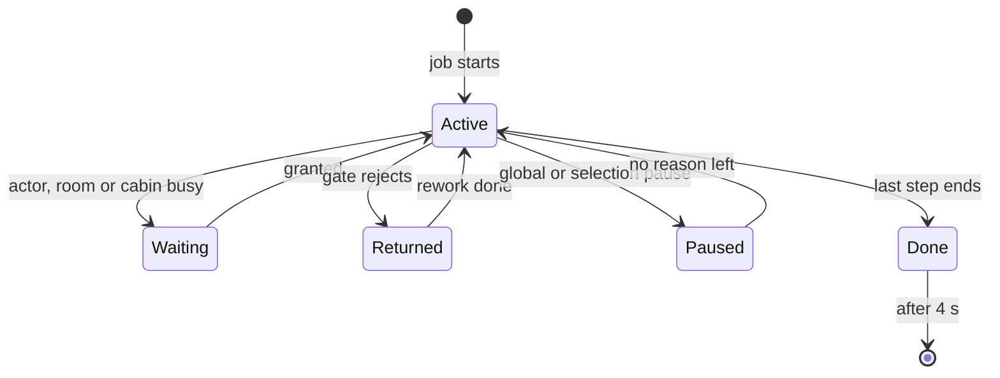
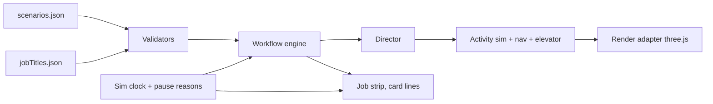
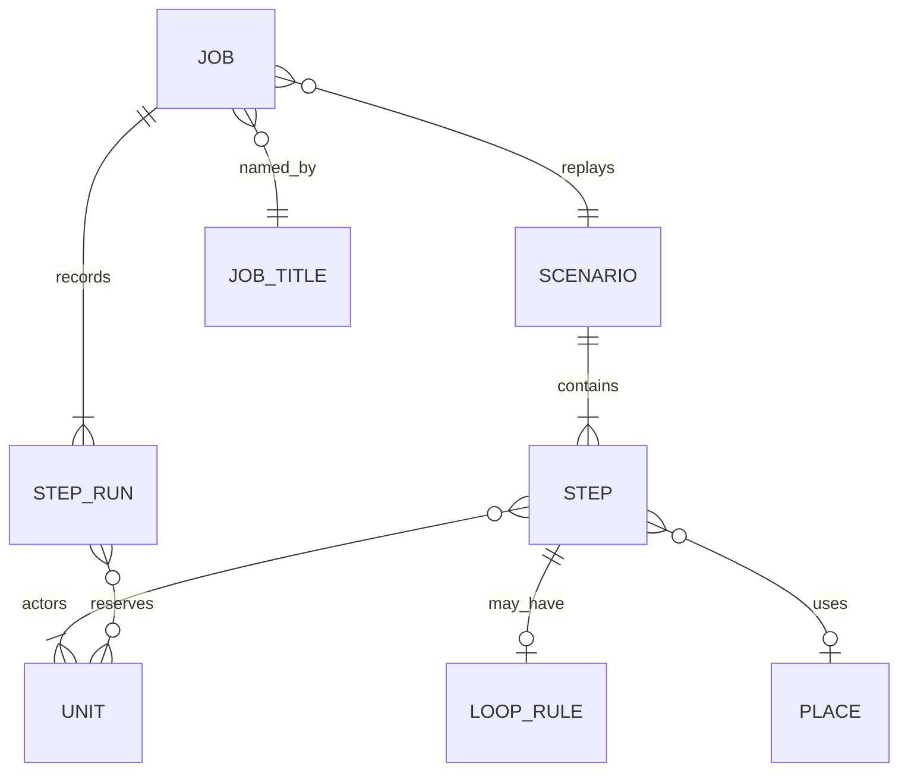

# Spec 0002 — Agency Tower: living office (workflows, movement, collaboration, meeting room)
<!-- Header fields and Status values stay English (protocol); content is written in English. -->

- Status: Draft
- Tier: full (Lane 2: visible behavior, no new trust boundary, no new dependency, no new input)
- Previous spec: 0001 (signed base; this spec extends it and changes only the clauses listed in §3.0)
- Next spec: 0003 (helpers/sub-agents, dialogues, sit/stand and pose blending; `specs/draft/0003-agency-tower-helpers-dialogue.md`); 0004 (visual realism and guided tour)
- Self-critique: done (spec-critic rounds 1 and 2, own pass 3, focused verifications 4–6 folded in; see §14)
- Model note: the CEO chose `opus` at high effort for this job (spec and build), a deliberate deviation from the routing lane-2 default (`sonnet`). Recorded here so QA and audit do not flag it as a routing defect.

> Location note: drafted at `specs/draft/` because `harness/bin/approve.sh` accepts exactly one file in `specs/active/` and 0001 is still there. After 0001 closes it moves to `specs/active/0002-agency-tower-living-office.md` and goes to signature. Work happens on a new branch `feat/agency-tower-living-office` cut from `main` after the 0001 merge.

## 1. Intent
CEO's words (Turkish, paraphrased by the main session): "Take the tower to the next level: more realistic, more detailed, a working office with more animation, workflows, random conversations. Also show the sub-agents, robots working together, and meeting-room sessions while a spec is being written."

Interpretation for this spec (the first of three): the 0001 tower stops being a set of robots looping idle/work/coffee and becomes an office in which simulated jobs visibly travel through the agency's real pipeline (lanes 0–3 of `.claude/rules/routing.md` and the immutable rules of `CLAUDE.md`). A job envelope arrives from the CEO, a spec is written in a meeting room, gates review it and can send it back, the CEO stamps it, engineers build, QA lights a red or green lamp, verifiers sign off and the evidence goes back to the chief-of-staff. Robots carry physical props between floors in an elevator, wait for each other and pair at one desk. Success: a third party who watches the three scripted opening jobs (about five minutes, A-4) with the on-screen job strip can say in their own words how a medium and a large job move through the agency, that the CEO signs before code, and that the maker never verifies its own work.

Deliberately not done here: helper robots (sub-agents), model-tier markers, robot-to-robot dialogue, sit/stand and pose blending (all spec 0003); visual realism pass and guided cinematic tour (spec 0004); live data; sound; GLTF or texture assets (0001 R-1); any new dependency, URL parameter or network request.

## 2. Market summary (Product)
Not applicable: internal presentation piece, no `product-manager` input (as 0001 §2). Alternatives are weighed in §6.

## 3. Requirements (EARS)

### 3.0 Relation to 0001
0001 stays in force except for these clauses:

| 0001 clause | Change in 0002 |
|---|---|
| REQ-1 allow-list | adds this spec, its approval record `approvals/specs__active__0002-agency-tower-living-office.md.sig.json`, `docs/KARARLAR.md` and `STATE.md` (repo root); nothing else outside `showcase/agency-tower/` |
| REQ-2 isolation check | adds the denied path segments `CLAUDE.md` and `docs`; scanned extensions unchanged (no `.json`) |
| REQ-7 loader | also validates `scenarios.json` and `jobTitles.json` before WebGL2 is checked; any failure gives the data-error state |
| REQ-8 scene | floor 3 gains a meeting room; a staff-only elevator shaft and cabin is added on the east side (Q-2, resolved); the visitor shaft and cabin are unchanged; robots and the staff cabin are ghosted with the floor they are currently on; riders in the staff cabin are not pickable (list selection follows REQ-17) |
| REQ-11 / §7 activity table | the idle/walk/work/coffee cycle remains the ambient behavior of every robot not reserved by a step; reservation interrupts it by the §7.5 transitions; walking follows the waypoint graph (REQ-13) |
| REQ-12 selection | also pauses the robot's step, step-scoped (REQ-17); on close the robot resumes its step or its cycle |
| REQ-13 card | adds the "Şu an" line and, inside a job, the job line (REQ-12) |
| REQ-15 quality tiers | each tier also sets the §7.7 limits (concurrent jobs, whiteboard texture, prop shadows) |
| REQ-17 org mode | the freeze also pauses the simulation clock (REQ-16); org lines are drawn from current robot positions |
| REQ-19 mobile | below 768 px the job strip uses its narrow form (REQ-11) |
| REQ-20 reduced motion | robots, ambient and directed alike, keep running their simulation and are rendered in static poses with position cuts at movement-leg ends (REQ-19); the simulation is no longer frozen |
| AC-16 | "no robot is in `walk` or `wave`" becomes "no robot is rendered walking or waving; rendered positions change only at leg ends"; the other AC-16 clauses stay |
| AC-17 | the ambient-cycle simulation test runs with the workflow engine off (no jobs), so its transitions and durations are the 0001 ones; only its walk-duration clause changes to "offset path length ÷ 1.2 u/s plus yield waits"; a test for a changed clause is replaced by the stricter 0002 test in §9, never deleted without a replacement |

Unchanged and binding: 0001/REQ-3 (self-contained package), REQ-14 (key matrix; strip entries reuse its card/org/ride rules), REQ-16 (text nodes, no network), REQ-18 (day/night on its own clock), REQ-21 (ambient bubbles, cap 4).

### 3.1 Isolation and data
- REQ-1 — The showcase shall keep every file this spec adds or changes under `showcase/agency-tower/`, apart from the §3.0 allow-list; it shall add no runtime or dev dependency (dependency sections of `package.json` and `package-lock.json` unchanged; only the `scripts` section may gain `budget:check`) and no URL parameter; scenario and job-title data shall be hand-authored inside the showcase and never read, generated or checked from `.claude/`, `CLAUDE.md`, `harness/`, `templates/` or `docs/` at build, test or run time.
- REQ-2 — When the app starts, the loader shall validate `src/data/scenarios.json` against the §7.1 schema and per-kind field matrix and the §7.2 pipeline rules and variant tables, and if any check fails the system shall show the 0001 data-error state ("Kadro verisi okunamadı.") and nothing else.
- REQ-3 — When the app starts, the loader shall validate `src/data/jobTitles.json` (§7.3), and if any check fails the system shall show the data-error state.

### 3.2 Workflow engine
- REQ-4 — While the scene runs, the system shall replay simulated jobs: at most 3 at once on `high` and 2 on `low`; the first three jobs shall follow the scripted table in §7.4 (variant, start offset, outcomes); afterwards a new job starts 4–10 s after a slot frees (a slot frees when the job's `done` step ends; the 4 s "Tamamlandı" display does not count as a job), with its lane drawn by the §7.4 weights and its variant by weight; a given seed shall produce an identical job trace.
- REQ-5 — The system shall advance each job through its scenario's steps in order; a unit shall take part (as actor, escort or caller) in at most one step at a time; a step shall start only when all its actors, its escort and its place are free (§7.2 free predicates), acquired together in one simulation step (all or nothing), granted by the §6 R-3 order; a reserved robot shall leave its ambient cycle by the §7.5 interrupt transitions and return to it (walk home, idle) when it has no further step.
- REQ-6 — When a carry step runs, the carrier shall take one copy of the step's prop per recipient and visit the recipients in `to` order by the §7.5 stop order, handing each its copy at the recipient's desk (or, when the recipient is the escort of the step the carrier comes from, where both stand) with a 1.2 s hand-over; a free recipient not at its desk shall be called there; if the recipient is not at its desk and free within 8 s of the carrier's arrival, the carrier shall leave the copy in the recipient's desk tray and go on, and the recipient takes it when its next step in that job starts. Whenever a robot is in a §7.5 waiting state it shall show an hourglass-shaped marker above it; a `pair-desk` build shall place both makers at one desk.
- REQ-7 — When a sign step runs, the CEO robot shall stamp the spec paper (raise, press) and hand it back to the carrier or meeting lead, after which the paper shall carry a stamp mark recognizable by shape and by the text "ONAY", not by color alone; in lanes 1 and 2 this happens at the signing desk on floor 5, in lane 3 in the meeting room (REQ-15).
- REQ-8 — While a build step runs, the building engineer's desk screen shall show a progress bar with a percentage text rising from 0 % to 100 % over the step; when a qa-engineer test step ends, the QA lamp on its desk shall show pass (green with a ✓ symbol) or fail (red with a ✗ symbol) for 6 s; when the lane-0 test step ("Kanıt: test çıktısı") ends, the chief-of-staff's screen shall show a ✓ and the text "Kanıt: test çıktısı" for 6 s; the last verifier of lanes 1–3 shall create the evidence sheet and carry it to the chief-of-staff, who ends the job.
- REQ-9 — When a review or test step with a reject chance starts, the engine shall draw its outcome once (scripted jobs take it from §7.4 instead and draw nothing); if the outcome is reject, the job shall continue at the step named in `loop.to` (a carry-back to the rework actor, or the rework step itself), and the job strip shall show the job's total loop count; a step or call that has rejected `loop.maxLoops` times in the job shall pass on its next run and draws nothing for it; inside a call, each branch review with its own `rejectP` draws its own outcome once at its start, and the call rejects if any branch rejects.
- REQ-10 — When a call step starts, the engine shall reserve, in one simulation step, the first-step actors of every branch and every place they need; all branch robots shall show a call marker and start in that simulation step; the caller waits where it stands until the join; the job shall continue at `join` only after every branch has ended; if any branch rejects, the call counts one loop, the job continues at the call's `loop.to`, and all branches run again after the rework; each reviewer keeps its copy (filed in its tray). In lane 3 the three gates sit together in the meeting room, each receives its own copy from the business-analyst on being seated, and returns a separate verdict.

### 3.3 Job strip and card
- REQ-11 — While the scene runs, the system shall show a job strip headed "Aktif işler — simülasyon"; each active job is one entry of two text lines, "#n · Hat k · <iş başlığı>" and "<adım etiketi>" (the running step's label; with parallel branches the call's label), plus "↺ m" (the job's total loops) after a rejection and the §7.8 pause text while paused; when no job is active it shall show "Şu an aktif iş yok — yeni iş bekleniyor"; a finished job shall show the static text "Tamamlandı · kanıt: taze test çıktısı" for 4 s of simulation time and then disappear; activating an active entry shall move the camera to the floor given by the §7.6b floor rule, following the 0001 floor-panel and key-matrix rules (card open: close it, then ride; org mode: leave it, then ride; during a ride: last request wins); each entry shall have an "Adımlar" toggle that expands its step list, each step marked by symbol and word (✓ bitti, ▶ şimdi, ○ sırada, ↺ geri döndü); if a focused entry disappears, focus shall move to the strip header; below 768 px the strip shall show only the newest entry plus a "+n diğer" button that expands the rest; the strip shall be absent in the fallback and data-error states.
- REQ-12 — When a robot's card opens, it shall show a "Şu an" line for the state the robot had at selection, from the §7.6 map (every §7.5 state has exactly one template), and, if the robot was in a job, a line "İş #n · <iş başlığı> · Hat k"; in the fallback (no scene) both lines shall be absent.

### 3.4 Movement
- REQ-13 — The system shall move robots within a floor only along that floor's waypoint graph, whose edges keep clear of furniture, using keep-right offset lanes, with every stationary spot (seat, desk seat, coffee spot, landing waiting spot, hand-over spot, signing-desk spot) on a spur node off every through-edge; it shall keep any two robots on the same floor at least 0.45 world units apart (centers) while either is walking, except when both are inside the §7.5c exception zones.
- REQ-14 — When a robot must change floors, it shall walk to the elevator landing, call the cabin (button-press gesture), wait at a landing waiting spot in the waiting state, board when the doors open, ride, and exit at the target landing; the cabin shall carry at most 3 robots, serve calls in request order, and take the §7.5b ride-leg time; robots shall change floors only inside the cabin. The cabin runs in a separate staff-only shaft on the east side of the tower; the visitor cabin of 0001/REQ-10 shall never carry a robot and stays reserved for the camera (Q-2).

### 3.5 Meeting room
- REQ-15 — Floor 3 shall have a meeting room with a table, 6 seats and a whiteboard, in addition to its 0001 props; the room is one place, free for a step only by the §7.2 room predicate. When a meeting step runs, its non-lead actors shall sit and its lead (the business-analyst) shall stand at the whiteboard, the step clock shall not advance until all non-lead actors are seated and the lead is present, and the whiteboard shall fill section by section with placeholder headings and scribble lines from a built-in list (never repository content) so that all sections are filled when the step ends. In lane 2 the room is held for the meeting step only and the whiteboard is erased at its end; in lane 3 the room is held from the meeting step through the sign step (rework, gate review and signature happen there), the whiteboard stays filled until the sign step ends, the CEO robot is called, rides down to floor 3, stamps the spec on the meeting table and rides back to floor 5. A step of another job that needs the room shall wait while the room is held.

### 3.6 Clock and pause
- REQ-16 — All workflow, movement, elevator, whiteboard, prop, lamp, progress and strip/card timers shall run on one simulation clock, advanced by the frame loop in steps of at most 100 ms; while a global pause reason applies (`org` mode, `user` toggle "Hareketi durdur", `hidden` tab; §7.8), the clock shall not advance and no random number shall be drawn; when the last global reason ends, every element shall resume from exactly the state it had. The 0001 day/night cycle keeps its own clock and is not paused.
- REQ-17 — When a robot is selected, the system shall pause, step-scoped, the step in which the robot is actor, escort or caller (that step's own elapsed time stops, its co-actors hold their poses) and the robot's own movement, while the clock and all other steps continue; a carrier waiting for the selected robot keeps its 8 s timer running, and a selected robot counts as busy for hand-over (the carrier waits up to 8 s, then uses the tray); a selected robot in `call-wait` does not board, and its call is re-queued at the end of the queue when the card closes; if the selected robot is riding, the ride continues, the card opens at once, the camera rides to the cabin's destination floor and zooms when the robot exits, and the robot stops and waves after exiting; when the card closes, the robot resumes its step or ambient cycle.
- REQ-18 — The toolbar shall offer a "Hareketi durdur" / "Sürdür" toggle (with `aria-pressed`) that applies the `user` global pause reason without changing the view; pause reasons are independent and an element resumes only when no reason applies to it.

### 3.7 Reduced motion and limits
- REQ-19 — When `prefers-reduced-motion: reduce` is set (on load and on live change), the simulation trace (engine and ambient cycle) shall be identical to the trace without it; every robot, ambient or directed, shall be rendered in a static pose at the start of its current movement leg (§7.5b) and cut to the leg's end at the instant the leg ends; a rider shall be rendered at the origin landing until its ride ends, then at the destination landing; on a live change to reduced motion, a robot in the middle of a leg is rendered at that leg's start until the leg ends; stamp, call and hand-over gestures shall be static poses; the whiteboard shall gain whole sections; progress bars shall update in 10 % steps; every job's step list shall be expanded by default.
- REQ-20 — The system shall enforce the §7.7 limits per quality tier; during the max-load window (§7.7) at `high` the frame rate shall stay at or above the 0001/AC-12 target of 30 fps on the CEO's Mac; the main JS chunk shall stay at or below 748 kB minified (baseline 650.89 kB × 1.15), checked by `npm run budget:check` after `npm run build` (outside `npm test`); the 0001 vertex budget (700 000) shall still hold.

**Elevators (Q-2, resolved 2026-11-14).** Robots use only the separate staff-only cabin on the east side. The visitor cabin and camera keep 0001/REQ-10 and AC-8 unchanged, so robot rides never depend on user-driven camera rides, and the simulation stays deterministic for a seed (AC-4, AC-15).

## 4. User experience

### What does a visitor see in one lane-2 replay?
```mermaid
sequenceDiagram
  %% Question: how does a medium job (variant l2-base) travel through the tower? (7 participants)
  participant CEO as CEO (5)
  participant CoS as chief-of-staff (4)
  participant BA as business-analyst (3)
  participant SC as spec-critic (2)
  participant ENG as react-engineer (1)
  participant QA as qa-engineer (2)
  participant IA as internal-auditor (2)
  CoS->>CEO: rides up, takes job envelope (intake)
  CoS->>BA: carries envelope 5→3
  Note over BA: meeting room, whiteboard fills
  BA->>SC: carries spec paper 3→2, waits beside SC
  alt reject (job #1: once)
    SC-->>BA: hands spec back, "↺ 1"; BA reworks at desk
    BA->>SC: carries revised spec 3→2
  end
  rect rgb(255, 228, 228)
    BA->>CEO: spec paper 2→5; CEO GATE: stamp "ONAY"
  end
  BA->>ENG: stamped spec 5→1; build bar 0→100 %
  ENG->>QA: build tablet 1→2; lamp ✓ or ✗
  alt QA red
    QA-->>ENG: carries tablet back 2→1; rebuild
  end
  QA->>IA: tablet; audit
  IA->>CoS: evidence sheet 2→4; done
```
Description: a lane-2 job goes CEO → chief-of-staff → business-analyst (meeting) → spec-critic (may reject) → CEO stamp → engineer build → QA lamp (may reject) → internal-auditor → evidence to chief-of-staff → done. The shaded block is the CEO gate, also named in text. Text equivalent: the l2-base table in §7.2.

### What does a visitor see in one lane-3 replay?
```mermaid
sequenceDiagram
  %% Question: how does a large job (variant l3-full) travel through the tower? (8 participants)
  participant CEO as CEO (5)
  participant CoS as chief-of-staff (4)
  participant AR as software-architect (3)
  participant BA as business-analyst (3)
  participant G as gates x3 (2,2,3)
  participant DM as delivery-manager (4)
  participant EN as dotnet + react pair (1)
  participant V as verifiers (2)
  CoS->>AR: envelope; design
  AR->>BA: meeting BA + architect + PM; room held to signature
  par one call, reserved together
    BA->>G: gates seated, one copy each
  end
  G-->>BA: three separate verdicts (any reject = one loop)
  rect rgb(255, 228, 228)
    BA->>CEO: called down 5→3; CEO GATE: stamp on meeting table
  end
  BA->>DM: stamped spec 3→4; plan
  DM->>EN: stamped spec 4→1; pair build at one desk
  EN->>V: tablet 1→2; qa → appsec → internal-auditor → quality-office (carried desk to desk)
  V->>CoS: evidence sheet 2→4; done
```
Description: a lane-3 job adds the architect first, three gates called together into the held meeting room, the CEO coming down to stamp, a delivery plan, pair work, four verifiers in order with hand-carried tablet, and the evidence back to the chief-of-staff. Text equivalent: the l3-full table in §7.2.

### Which states does a job-strip entry pass through?

Description: an entry is active, waiting, returned (after a rejection), paused or done; every state is shown in words, never color alone. Text equivalent: Active ↔ Waiting; Active → Returned → Active; Active ↔ Paused; Active → Done → removed after 4 s of simulation time.

### Screen states
| Screen state | What the visitor sees | AC |
|---|---|---|
| Loading | 0001 "Kule yükleniyor…" (scenario and job-title validation included) | AC-2, AC-3 |
| Data error | 0001 "Kadro verisi okunamadı." (also for invalid scenario or job-title data); no strip | AC-2, AC-3, AC-10 |
| WebGL2 unsupported | 0001 fallback list; no strip; card without "Şu an" or job line | AC-10, AC-11 |
| Strip empty | "Şu an aktif iş yok — yeni iş bekleniyor" | AC-10 |
| Strip active | two-line entries, "↺ m", "Adımlar" toggle | AC-10 |
| Strip paused | §7.8 texts ("Duraklatıldı", "Duraklatıldı · seçili robot") | AC-15 |
| Job done | static "Tamamlandı · kanıt: taze test çıktısı" for 4 s | AC-10 |
| Card | 0001 card plus "Şu an" line and job line | AC-11 |
| Reduced motion | step lists expanded, leg-end cuts, static poses | AC-16 |
| Narrow (< 768 px) | newest entry + "+n diğer" | AC-10 |
| Unauthorized | not applicable: no accounts | — |

New Turkish strings (in `src/i18n/tr.ts`): "Aktif işler — simülasyon", "Şu an aktif iş yok — yeni iş bekleniyor", "Hat", "Adımlar", "bitti", "şimdi", "sırada", "geri döndü", "Duraklatıldı", "Duraklatıldı · seçili robot", "Tamamlandı · kanıt: taze test çıktısı", "Kanıt: test çıktısı", "+n diğer", "Hareketi durdur", "Sürdür", "Şu an", "İş", "Toplantı odası", "ONAY", "Asansör", prop names ("iş zarfı", "spec", "onaylı spec", "derleme tableti", "kanıt sayfası"), the §7.6 templates and the whiteboard placeholder headings ("Amaç", "Gereksinimler", "Kullanıcı deneyimi", "Kabul kriterleri", "Mimari", "Veri", "Tehdit modeli", "Test planı"). Job titles live in `src/data/jobTitles.json` (§7.3). Keyboard: no new shortcut (0001 key matrix unchanged); strip entries and toggles are buttons in tab order after the floor panel; a "Tamamlandı" entry is static text, not a button; the strip header is a heading with `tabindex="-1"` (focus target). The strip is not an `aria-live` region; its content is readable on focus.

## 5. Acceptance criteria
- [ ] AC-1 — (REQ-1) On branch `feat/agency-tower-living-office`, `git diff --name-only <0001 merge commit>...HEAD` lists only paths under `showcase/agency-tower/`, this spec, `approvals/specs__active__0002-agency-tower-living-office.md.sig.json`, `docs/KARARLAR.md` and `STATE.md`; the same diff over `showcase/agency-tower/package-lock.json` is empty and over `package.json` touches only `scripts`; `harness/bin/check` ends "CHECK GREEN (full)"; `check-isolation.mjs` passes and also fails on a planted path string with a segment exactly `CLAUDE.md` or `docs` in `src/` or `scripts/` (tests and README excluded; `SCAN_EXT` still without `.json`, because `roster.generated.json` legitimately quotes "docs/dis/"); `npm test` passes with the agents directory absent; the URL parser still accepts only `quality` and `debug`.
- [ ] AC-2 — (REQ-2) The committed `scenarios.json` validates and equals the §7.2 tables row by row. One fixture per rule is rejected and yields the data-error state: unknown unit id; `labelTr` of 41 code points; a field forbidden for its kind (e.g. `to` on `work`, `durationS` on `carry`); a required field missing (e.g. `carry` without `to`); a lane without a scenario; a variant missing or with a row differing from its §7.2 table; a step reachable by neither `next` nor `loop` edges; no `done`; a `next` cycle; a `loop.to` that is neither a carry-back to the rework actor nor a rework step whose `next` chain re-enters the rejecting step or call; `maxLoops` 3; `rejectP` 0.7; `loop` on a review inside a call branch; a branch whose chain does not end at the call's `join`; two branches sharing an actor; an escort that is also an actor; a meeting with more than 6 actors (lead included); a lane-1 scenario containing spec-critic; a build not preceded by a sign on some path; a test or review sharing an actor with the build or spec it verifies; a lane-3 gate set other than exactly {spec-critic, appsec, architecture-board}; a lane-3 verify chain not in the order qa-engineer → appsec → internal-auditor → quality-office with a carry between each; a lane-2 scenario with quality-office or delivery-manager; a lane-0 scenario with a sign step; a lane-0 test step whose `labelTr` is not "Kanıt: test çıktısı"; a lane 1–3 scenario whose `done` is not preceded by an evidence carry to chief-of-staff.
- [ ] AC-3 — (REQ-3) The committed `jobTitles.json` validates; fixtures with 11 titles, an empty title, a 37-code-point title, a duplicate, a control character or a `<` are rejected; a 36-code-point title with ç ğ ı İ ö ş ü passes. Title order: scripted jobs take titles 1–3 in file order; afterwards titles are drawn from a seeded shuffle, and when the list is exhausted it is reshuffled so that the first title of the new order differs from the last one used (tested over 200 jobs: no title twice in a row).
- [ ] AC-4 — (REQ-4, 5) Engine simulation (fixed seed, 0.1 s steps): 600 s twice gives byte-identical event traces, another seed a different trace; concurrent jobs never exceed 3 (`high`) or 2 (`low`); each unscripted job starts 4–10 s after a slot frees; no unit is actor, escort or caller of two running steps at any step; every step acquires all its actors, escort and place in one simulation step and none before all are free; the grant order follows R-3 (checked over the trace); in a 1200 s run at `high` every started job finishes; every ambient-to-directed and directed-to-ambient change is a §7.5 transition; draws are counted by purpose (outcome, lane, variant, start delay) with an instrumented generator: exactly one `outcome` draw per unscripted review or test episode (including each branch review inside a call) with a reject chance that is not a forced pass; no `outcome` draw for a forced pass or a scripted outcome; no draw of any purpose per frame. Deadlock fixture: job A (l3) holds the room and its sign step needs the business-analyst; job B's meeting step has waited longer and needs the room and the business-analyst; the trace shows B reserving nothing while blocked by the room, A's sign granted the business-analyst, A releasing the room, then B's meeting starting.
- [ ] AC-5 — (REQ-4, 5) Pipeline fidelity: each variant run alone (`maxJobs` 1, no rejects, every `durationS` at its maximum, no camera rides) produces exactly the ordered (step id, kind, actors, place) list of its §7.2 table and finishes at or below the table's bound; each forced reject loop adds at most 90 s; the first three jobs start at the §7.4 offsets (± one step) with exactly the scripted outcomes.
- [ ] AC-6 — (REQ-6) Hand-off simulation: a carry to n recipients creates n copies, visits the recipients in `to` order on the §7.5b stop order, and each copy has at most one holder at any step; each hand-over is a 1.2 s `handover` at the recipient's desk (or, for the escort exception, where both stand); a free recipient away from its desk is interrupted and walks there; when the recipient is not at its desk and free within 8 s of arrival, the copy is in its tray and is taken when its next step in the job starts; a prop changes floor only while its holder is in `ride`; the lane-3 build runs with both engineers at one desk in `pair`; after a forced reject, the review's escort is not grantable to another job until the carry-back hand-over or tray drop ends; after a pass, the escort is grantable as soon as the review ends; the waiting marker is visible exactly while a robot is in `wait`, `escort-wait`, `call-hold`, `room-wait`, `call-wait` or `seat-wait`.
- [ ] AC-7 — (REQ-7, 8) Sign: the CEO robot passes `stamp-raise` then `stamp-press`, then hands the paper back; the paper prop has a `stamp-mark` mesh with the "ONAY" canvas text; l1/l2 variants stamp at `signing-desk`, l3 at `meeting-room`. Build: the screen percentage is an integer, non-decreasing, 0 at step start and 100 at step end. Lamp: pass shows green plus ✓, fail red plus ✗, each for 6 s of simulation time ± one step, then off; the lane-0 test step shows ✓ and "Kanıt: test çıktısı" on the chief-of-staff's screen for 6 s; in lanes 1–3 the evidence sheet is created by the last verifier and handed to chief-of-staff before `done`. By eye: stamp mark and lamp states distinguishable in grayscale.
- [ ] AC-8 — (REQ-9) Job #1 has exactly one spec-critic rejection and job #2 exactly one QA red (§7.4); after a reject the job runs the variant's loop rows in order (carry-back, rework, re-carry) and re-enters the rejecting step; the strip shows the job's total ("↺ 1", then "↺ 2" after a second loop at any step); a fixture with `rejectP` forced to 1 rejects exactly `maxLoops` times per step and then passes.
- [ ] AC-9 — (REQ-10) For every call: no branch actor or branch place is reserved before all of them are free, and all are reserved in the same simulation step; all branch first steps start in that step and all branch robots show the call marker; the caller is in `call-hold` until the join; the join step starts only after the last branch ends; with one branch forced to reject the job counts exactly one loop, continues at the call's `loop.to`, and all branches run again; in lane 3 the three gates occupy three meeting-room seats, each receives one spec-paper copy by hand-over after being seated, and three separate copies exist.
- [ ] AC-10 — (REQ-11) Strip DOM (jsdom, simulation clock): header "Aktif işler — simülasyon"; empty text when no job; entry lines "#n · Hat k · <iş başlığı>" and "<adım etiketi>" (a call shows the call's label); "↺ m" equals the job's total loops; static "Tamamlandı · kanıt: taze test çıktısı" visible for 4 s of simulation time, not advancing while globally paused, then removed; activating an entry rides to the §7.6b floor (fixtures: parallel actors on floors 2 and 3 → 2; a rider bound for floor 4 → 4; a job with no running step whose earliest waiting step's first actor is on floor 1 → 1); with a card open it first closes the card, in org mode it first leaves org mode, mid-ride the last request wins; when the focused entry is removed, `document.activeElement` is the strip header; "Adımlar" toggles `aria-expanded` and lists every step with ✓ / ▶ / ○ / ↺ plus their words; at 767 px only the newest entry plus "+n diğer" show and the button reveals the rest; no strip element exists in the fallback or data-error state; all text set via text nodes. By eye at 375 px: no horizontal scroll, strip covers neither the floor strip nor the card, targets at least 44×44 CSS px.
- [ ] AC-11 — (REQ-12) An exhaustiveness test maps every §7.5 state to exactly one §7.6 template; for each state the card's "Şu an" line equals the filled template for the robot's state at selection, and for a robot in a job the job line equals "İş #n · <iş başlığı> · Hat k"; no template attaches a Turkish suffix to a unit id; with WebGL2 absent neither line exists.
- [ ] AC-12 — (REQ-13) Navigation: each floor's waypoint graph is connected; every stationary spot of REQ-13 is a spur node and no through-edge (offset lanes included) passes within 0.45 u of it; every edge segment stays outside every furniture footprint inflated by 0.25 u; over a 600 s simulation at `high` every walking robot stays within 0.30 u of a graph edge, no two robots on the same floor are closer than 0.45 u while either walks unless both are inside §7.5c exception zones, no robot yields longer than 6 s, and each walk leg lasts its offset path length ÷ 1.2 u/s plus its recorded yield waits (± one step).
- [ ] AC-13 — (REQ-14) Elevator simulation: every floor change of any robot happens in `ride`; riders never exceed 3; calls are served in request order (a call re-queued after a selection goes to the end); each ride leg lasts the §7.5b formula; each rider's y equals the cabin y ± 0.05; the doors are open at every boarding and exit; no call waits longer than 20 s in a 1200 s run at `high`; robots pass `call` then `call-wait` at a landing waiting spot before boarding. The staff cabin sits in its own east shaft; the visitor cabin never carries a robot, and the 0001 visitor-elevator tests (AC-8) pass unchanged.
- [ ] AC-14 — (REQ-15) Scene model: floor 3 has a `meeting-room` group with a table, 6 `seat` nodes and a `whiteboard`, and 0001/AC-6 still passes. Room predicate: a step is granted the room only if no other job holds it and enough seats are free; `sign` in the room takes no seat (fixtures: a meeting with 6 non-lead actors is rejected by the validator, since the matrix allows 2–6 actors including the lead; a held room blocks another job). Meeting simulation: the step clock does not advance until every non-lead actor is `seated` and the lead is `present`; after elapsed fraction f the whiteboard shows ⌊f·N⌋ ± 1 of N sections and all N at step end; every whiteboard string comes from the built-in list; l2 variants release the room and erase the board at the meeting's end; in l3 the room stays held, and the board filled, from the meeting step until the sign step ends, no other job's room step starts in between, the CEO is called, rides 5→3, stamps on the meeting table and rides back to 5; another job's room step waits in `room-wait` meanwhile (strip shows the wait). By eye: the whiteboard faces the floor-3 view camera within ±60°.
- [ ] AC-15 — (REQ-16, 17, 18) Global pause: with `org`, `user` or `hidden` (simulated `visibilitychange`) applied at t, no simulation-clock timer advances (engine, elevator, whiteboard, lamp, progress, strip "Tamamlandı", ambient cycle), entries show the §7.8 text, no random number is drawn, and a snapshot taken when the last reason ends deep-equals the one at t; a trace with a 30 s global pause at 50 s equals the unpaused trace with all later times shifted by 30 s (day/night excluded); with org mode and the toggle both on, turning one off keeps everything paused; "Hareketi durdur" sets `aria-pressed="true"` and does not move the camera. Selection: only the step with the selected robot as actor, escort or caller stops its own elapsed time, its co-actors hold, another job advances, the job's entry reads "Duraklatıldı · seçili robot"; a carrier waiting for the selected robot drops its copy in the tray after 8 s; a selected robot in `call-wait` does not board and its call is re-queued at the end when the card closes; a robot selected while riding: the ride continues, the card opens at once, the camera goes to the destination floor, zoom and wave start after exit; close resumes the step.
- [ ] AC-16 — (REQ-19) With the media query emulated: the simulation trace (engine and ambient) is byte-identical to the trace without it (same seed); no robot is rendered walking, waving, stamping, calling or handing over; each robot's rendered position changes only at the instant a movement leg ends, from the leg's start to its end; a rider is rendered at the origin landing until the ride ends, then at the destination landing; whiteboard section counts change in whole sections; progress values are multiples of 10; every step list is expanded; on a live change to reduced motion a robot mid-leg is rendered at that leg's start until the leg ends, without reload.
- [ ] AC-17 — (REQ-20) Limits: simulations at `high` and `low` never exceed any §7.7 value. Max-load window: a test with the fixed seed at `high` reports the window in which all three scripted jobs are running and the l3 meeting step is in session, and asserts it starts before 120 s and lasts at least 15 s; the README records it for QA. Budgets: the vertex test (< 700 000) passes; `npm run build && npm run budget:check` passes with the real entry chunk at or below 748 000 bytes (QA records the number). In `budget-check.test.ts` the script logic passes on a fixture chunk of 748 000 bytes and fails on one of 749 000 bytes. Performance (by eye, QA records values): at `high`, `?debug=1`, inside the window, in overview and in floor-3 view, at least 30 fps on the CEO's Mac; at `low` on a phone the reading is recorded (target 24 fps, A-9).
- [ ] AC-18 — (REQ-4..19) By eye (QA, host, desktop and 375 px): a lane-2 and a lane-3 replay can be followed from the strip and the scene; props, elevator use, waiting, pair work, meeting, rejection loops, the CEO stamp and the evidence going back to the chief-of-staff are visible; the office reads as busy but not cluttered in overview and floor view; "simülasyon" is visible, so nothing suggests the jobs are real.

## 6. Architecture and technology decision
| Option | For | Against |
|---|---|---|
| A. Layered pure modules: workflow engine → director → activity sim (waypoint navigation, elevator) → render adapter, all on one simulation clock (chosen) | Each layer pure and seedable like `activity.ts`, testable in vitest without three.js; 0001 ambient cycle reused; 0003 plugs in helpers and dialogue as further consumers of engine events | More modules to wire; contracts between layers must stay stable |
| B. Grow `activity.ts` into one large state machine | Fewest files | Unreadable; 0001 tests and new behavior tangled; hard to pause per step |
| C. Pre-baked timeline per scenario (keyframes at load) | Very deterministic playback | Cannot react to contention, selection pause or reduced motion without recomputation |
| D. Library: `yuka` (navigation and steering, MIT) or an ECS (`bitecs`) | Ready navigation and steering | New dependency → architecture-board and Scout; graphs here are tiny (≤ 40 nodes per floor) |

Choice: A. Cost: about six new modules and their tests. Risk: cross-layer timing bugs; mitigated by the single clock, event traces as test oracles, and per-module random streams.

### How do the new modules connect?

Description: validated data drives a pure workflow engine on one pausable clock; the director turns steps into robot tasks for the activity simulation; only the render adapter touches three.js; strip and card read engine state and the same clock. Text equivalent: scenarios + job titles → validators → engine; clock → engine and UI; engine → director → activity sim → render; engine → strip and card.

Rulings (Type 2):
- R-1 Master seed is a fixed constant in code; each module draws from its own stream derived from it (split by module name: `engine`, `ambient`, `nav`, `titles`), so 0003 consumers do not change the 0002 engine trace. No `?seed=` parameter (REQ-1: no new input; avoids an appsec gate). Cost if wrong: one strict parameter by delta spec plus appsec.
- R-2 Waypoint graphs are hand-authored per floor next to `model.ts` constants; shortest path by a hand-written Dijkstra; head-on conflicts avoided by keep-right offset lanes (0.25 u) on aisle edges, crossings by yielding at nodes; path length is measured on the offset path. Cost if wrong: grid planner behind the same contract.
- R-3 Grant order, evaluated once per simulation step over all waiting steps: (1) a waiting step whose place is held by another job, or that lacks free seats, is skipped and reserves nothing: it neither takes units nor blocks them for other steps; (2) among the remaining steps, steps of a job that holds a place come first; (3) then oldest waiting time first; a step is granted only if all its actors, escort and place are free and no earlier step in this order needs any of them. Carriers never hold a recipient (8 s, then tray). Because a place-blocked step holds and blocks nothing and the place holder is served first, the place holder always progresses and releases the place (no deadlock); waiting time order prevents starvation among the rest (AC-4 fixture). Cost if wrong: rewrite of the grant function only.
- R-4 The simulation clock is the only time source for simulated behavior and its DOM timers (no `setTimeout` for strip, lamp or progress timing); global pause reasons stop the clock; `select:<id>` stops only the elapsed time of one step and one robot's movement (§7.8); while globally paused no module draws random numbers. Day/night stays on its 0001 clock.
- R-5 A robot's opacity follows the floor it is currently on; robots and the staff cabin above the focused floor are ghosted with that floor (0001/REQ-8); org-mode lines are drawn from robots' current, frozen positions.
- R-6 Whiteboard text is drawn to a canvas texture from the built-in list (procedural, like `textures.ts`); no DOM text, no repository content.
- R-7 Invalid scenario or job-title data uses the existing data-error state (fail fast; the files are bundled and tested).
- R-8 No new keyboard shortcut; 0001 key matrix unchanged.
- R-9 Delivery-manager appears only in lane 3 replays (routing: lane 2 "only if work spans sessions"; a replay is one session).
- R-10 `budget:check` is a small Node script inside `showcase/agency-tower/scripts/` reading the Vite output in `dist/`. Units: 1 kB = 1000 bytes; size is the raw minified file (not gzip) of the JS chunk referenced by `dist/index.html` (the entry chunk); the 650.89 kB baseline is that same measure from the 0001 build; pass ≤ 748 000 bytes; it is not part of `npm test` because `npm test` must not depend on a build.
- R-11 The escort of a review (the spec owner waiting beside the reviewer) is not an actor: it is reserved with the step, shown in `escort-wait`, and ignored by the maker-verifier rule P-4. On reject, the escort's reservation extends from the review's start to the end of the following carry-back hand-over or tray drop (the carry-back step shares it), so R-3 cannot grant the escort to another job in between; on pass it is released when the review ends.

Dependencies: none added. Architecture board: not required (no new dependency); appsec: not required (no auth, input, secrets, files or external calls; no new URL parameter). If an engineer finds a dependency is needed, the job stops for a delta spec and `architecture-board`.

## 7. Data and API contract
No server, no API, no network. Two new hand-authored JSON files under `src/data/`, bundled at build time, validated at load.

### 7.1 `src/data/scenarios.json` (schemaVersion 1)
| Field | Type | Constraint |
|---|---|---|
| `schemaVersion` | integer | 1 (0003 raises it to 2) |
| `laneWeights` | `{ "0": n, "1": n, "2": n, "3": n }` | integers 0–100, sum 100 |
| `scenarios[]` | array | exactly the six §7.2 variants |
| `.id` | string | a §7.2 variant id, unique |
| `.lane` | integer | 0–3 |
| `.weight` | integer | 1–10, choice among variants of the same lane |
| `.variantTr` | string | 1–24 code points |
| `.start` | step id | the `intake` step |
| `.steps[]` | array | 2–40 |
| `steps[].id` | string | `^[a-z0-9-]+$`, unique in scenario |
| `steps[].kind` | enum | `intake` \| `carry` \| `work` \| `meeting` \| `call` \| `review` \| `test` \| `build` \| `sign` \| `done` |
| `steps[].actors` | unit id[] | per matrix; each an id in `hierarchy.json` |
| `steps[].escort` | unit id | not in `actors` |
| `steps[].place` | enum | `desk` (desk of `actors[0]`) \| `pair-desk` (desk of `actors[1]`) \| `meeting-room` \| `signing-desk` |
| `steps[].to` | unit id[] | 1–3 recipients on one floor, visited in order |
| `steps[].prop` | enum | `envelope` \| `spec-paper` \| `spec-stamped` \| `build-tablet` \| `evidence` |
| `steps[].durationS` | `[min, max]` | numbers 1–40, min ≤ max; excludes walking, riding, waiting and hand-over time |
| `steps[].labelTr` | string | 1–40 code points, Turkish |
| `steps[].next` | step id or null | null only for `done` |
| `steps[].parallel` | step id[] | 2–4 branch starts; each branch is a `next` chain ending at `join`; branches share no actor |
| `steps[].join` | step id | the step after all branches |
| `steps[].rejectP` | number | 0–0.6 |
| `steps[].loop` | `{ to, maxLoops }` | `to`: a carry-back (`carry` by the rejecting actor to the rework actor) or a rework `work`/`build` step; its `next` chain re-enters the rejecting step or call; maxLoops 1–2 |
| `steps[].sections` | integer | 3–8 whiteboard sections |

Per-kind field matrix (R = required, O = optional, — = forbidden; `id`, `kind`, `labelTr` required everywhere):

| Kind | actors | escort | place | to | prop | durationS | next | parallel / join | rejectP | loop | sections |
|---|---|---|---|---|---|---|---|---|---|---|---|
| intake | R: [ceo, chief-of-staff] | — | R: signing-desk | — | R: envelope | R | R | — | — | — | — |
| carry | R: 1 (carrier) | — | — | R | R | — | R | — | — | — | — |
| work | R: 1 | — | R: desk, or meeting-room while the job holds it | — | — | R | R | — | — | — | — |
| meeting | R: 2–6, first business-analyst (lead, stands) | — | R: meeting-room | — | — | R | R | — | — | — | R |
| call | R: 1 (caller) | — | — | — | — | — | — | R | — | R if any branch has `rejectP` | — |
| review | R: 1 | O | R: desk or meeting-room | — | — | R | R | — | O | R if `rejectP` > 0 outside a branch; — inside a branch | — |
| test | R: 1 | — | R: desk | — | — | R | R | — | O | R if `rejectP` > 0 | — |
| build | R: 1 (desk) or 2 (pair-desk) | — | R | — | — | R | R | — | — | — | — |
| sign | R: [ceo, carrier or meeting lead] | — | R: signing-desk or meeting-room | — | — | R | R | — | — | — | — |
| done | R: [chief-of-staff] | — | R: desk | — | — | R | null | — | — | — | — |

File size at most 40 kB.

### 7.2 Pipeline rules, free predicates and variant tables
Rules encode `CLAUDE.md` immutable rules 1 and 3 and `routing.md` lanes; the validator enforces them, AC-2 tests each.
- P-1 Every scenario starts with `intake`, has exactly one `done` (actor chief-of-staff), every step reachable by `next` or `loop` edges, `next` edges acyclic, every path reaches `done`.
- P-2 Lane 0: no `sign`, `meeting`, `review` or `carry`; `work` and `test` only by `chief-of-staff`; a `test` step labelled "Kanıt: test çıktısı" directly before `done`.
- P-3 Lanes 1–3: exactly one `sign` step, actors include `ceo`; on every path every `build` comes after `sign` (no signature, no code); `done` is directly preceded by a `carry` of `evidence` to chief-of-staff.
- P-4 Lanes 1–3: a `test` or `review` after a `build` shares no actor with that build; a spec-critic or gate `review` shares no actor with the spec's `work` or the meeting's lead (the maker never verifies); escorts are not actors (R-11).
- P-5 `build` actors only `dotnet-engineer`, `react-engineer`, `polyglot-engineer`, `devops-sre`; `pair-desk` only with two of them.
- P-6 Lane 1: spec by `business-analyst` (`work`, no meeting); after `build` exactly one `test` by `qa-engineer`; no spec-critic, appsec, architecture-board, delivery-manager, internal-auditor or quality-office.
- P-7 Lane 2: spec `meeting` led by `business-analyst`; spec-critic `review` before `sign` (variants add appsec or architecture-board as a parallel branch); after `build`: `test` by qa-engineer, then `review` by internal-auditor; no quality-office, no delivery-manager.
- P-8 Lane 3: first `work` by software-architect; spec `meeting` led by business-analyst; a `call` with branches exactly spec-critic, appsec, architecture-board, all `review` at `meeting-room`, before `sign`; `sign` at `meeting-room`; delivery-manager `work` after `sign` and before `build`; after `build` the chain qa-engineer → appsec → internal-auditor → quality-office with a `carry` of the build tablet between each.
- P-9 Every referenced unit exists in `hierarchy.json`; the six variants below exist and match their tables row by row.

Free predicates: a unit is free when it is actor, escort or caller of no running step and holds no extended escort reservation (R-11) (ambient robots are free). The meeting room is free for step S of job J when no other job holds it and the seats S needs (non-lead actors of a meeting, or the branch reviewers of a call, plus a seated caller) do not exceed the 6 seats minus those already taken by J. The signing desk is free when no other step uses it.

Variant tables (durations in seconds; "→" in `to` lists recipients in order; loop rows are reached only through `loop`). Bounds are the uncontended maximum with every `durationS` at its maximum, including walking, riding, hand-overs and the 8 s wait allowance per stop (AC-5).

**l0-direct** (lane 0, weight 1, bound 90 s)
| id | kind | actors | place | to / escort | prop | durationS | next |
|---|---|---|---|---|---|---|---|
| intake | intake | ceo, chief-of-staff | signing-desk | — | envelope | 2–3 | fix |
| fix | work | chief-of-staff | desk | — | — | 6–10 | evidence |
| evidence | test "Kanıt: test çıktısı" | chief-of-staff | desk | — | — | 3–5 | done |
| done | done | chief-of-staff | desk | — | — | 1–2 | null |

**l1-quick** (lane 1, weight 1, bound 260 s)
| id | kind | actors | place | to / escort | prop | durationS | next | reject / loop |
|---|---|---|---|---|---|---|---|---|
| intake | intake | ceo, chief-of-staff | signing-desk | — | envelope | 2–3 | c-ba | |
| c-ba | carry | chief-of-staff | — | → business-analyst | envelope | — | spec | |
| spec | work | business-analyst | desk | — | — | 6–10 | c-sign | |
| c-sign | carry | business-analyst | — | → ceo | spec-paper | — | sign | |
| sign | sign | ceo, business-analyst | signing-desk | — | — | 2–3 | c-eng | |
| c-eng | carry | business-analyst | — | → react-engineer | spec-stamped | — | build | |
| build | build | react-engineer | desk | — | — | 8–14 | c-qa | |
| c-qa | carry | react-engineer | — | → qa-engineer | build-tablet | — | test | |
| test | test | qa-engineer | desk | — | — | 4–6 | c-ev | 0.35, loop → back-qa, max 2 |
| c-ev | carry | qa-engineer | — | → chief-of-staff | evidence | — | done | |
| done | done | chief-of-staff | desk | — | — | 1–2 | null | |
| back-qa | carry | qa-engineer | — | → react-engineer | build-tablet | — | rebuild | loop row |
| rebuild | build | react-engineer | desk | — | — | 5–8 | c-qa | loop row |

**l2-base** (lane 2, weight 3, bound 360 s)
| id | kind | actors | place | to / escort | prop | durationS | next | reject / loop |
|---|---|---|---|---|---|---|---|---|
| intake | intake | ceo, chief-of-staff | signing-desk | — | envelope | 2–3 | c-ba | |
| c-ba | carry | chief-of-staff | — | → business-analyst | envelope | — | meet | |
| meet | meeting (6 sections) | business-analyst, react-engineer, qa-engineer | meeting-room | — | — | 12–20 | c-sc | |
| c-sc | carry | business-analyst | — | → spec-critic | spec-paper | — | rev-sc | |
| rev-sc | review | spec-critic | desk | escort business-analyst | — | 4–8 | c-sign | 0.3, loop → back-sc, max 1 |
| c-sign | carry | business-analyst | — | → ceo | spec-paper | — | sign | |
| sign | sign | ceo, business-analyst | signing-desk | — | — | 2–3 | c-eng | |
| c-eng | carry | business-analyst | — | → react-engineer | spec-stamped | — | build | |
| build | build | react-engineer | desk | — | — | 8–14 | c-qa | |
| c-qa | carry | react-engineer | — | → qa-engineer | build-tablet | — | test | |
| test | test | qa-engineer | desk | — | — | 4–6 | c-ia | 0.35, loop → back-qa, max 2 |
| c-ia | carry | qa-engineer | — | → internal-auditor | build-tablet | — | rev-ia | |
| rev-ia | review | internal-auditor | desk | — | — | 4–6 | c-ev | |
| c-ev | carry | internal-auditor | — | → chief-of-staff | evidence | — | done | |
| done | done | chief-of-staff | desk | — | — | 1–2 | null | |
| back-sc | carry | spec-critic | — | → business-analyst (escort: hand-over in place) | spec-paper | — | rework | loop row |
| rework | work | business-analyst | desk | — | — | 5–8 | c-sc | loop row |
| back-qa | carry | qa-engineer | — | → react-engineer | build-tablet | — | rebuild | loop row |
| rebuild | build | react-engineer | desk | — | — | 5–8 | c-qa | loop row |

**l2-input** (lane 2, weight 1, bound 360 s): l2-base with these rows replacing `c-sc`, `rev-sc`, `back-sc`, `rework`:
| id | kind | actors | place | to / escort | prop | durationS | next | reject / loop |
|---|---|---|---|---|---|---|---|---|
| c-sc | carry | business-analyst | — | → spec-critic → appsec | spec-paper (2 copies) | — | gates | |
| gates | call | business-analyst | — | — | — | — | — (join c-sign) | parallel g-sc, g-as; loop → rework, max 1 |
| g-sc | review | spec-critic | desk | — | — | 4–8 | c-sign | 0.3 |
| g-as | review | appsec | desk | — | — | 4–8 | c-sign | 0.2 |
| rework | work | business-analyst | desk | — | — | 5–8 | c-sc | loop row |

**l2-dependency** (lane 2, weight 1, bound 380 s): l2-base with these rows replacing `c-sc`, `rev-sc`, `back-sc`, `rework`:
| id | kind | actors | place | to / escort | prop | durationS | next | reject / loop |
|---|---|---|---|---|---|---|---|---|
| c-ab | carry | business-analyst | — | → architecture-board | spec-paper | — | c-sc | |
| c-sc | carry | business-analyst | — | → spec-critic | spec-paper | — | gates | |
| gates | call | business-analyst | — | — | — | — | — (join c-sign) | parallel g-sc, g-ab; loop → rework, max 1 |
| g-sc | review | spec-critic | desk | — | — | 4–8 | c-sign | 0.3 |
| g-ab | review | architecture-board | desk | — | — | 4–8 | c-sign | 0.2 |
| rework | work | business-analyst | desk | — | — | 5–8 | c-ab | loop row |

**l3-full** (lane 3, weight 1, bound 480 s)
| id | kind | actors | place | to / escort | prop | durationS | next | reject / loop |
|---|---|---|---|---|---|---|---|---|
| intake | intake | ceo, chief-of-staff | signing-desk | — | envelope | 2–3 | c-ar | |
| c-ar | carry | chief-of-staff | — | → software-architect | envelope | — | design | |
| design | work | software-architect | desk | — | — | 8–12 | meet | |
| meet | meeting (8 sections; room hold starts) | business-analyst, software-architect, product-manager | meeting-room | — | — | 14–20 | gates | |
| gates | call | business-analyst | — | — | — | — | — (join sign) | parallel g-sc, g-as, g-ab; loop → rework, max 1 |
| g-sc | review | spec-critic | meeting-room | — | — | 5–8 | sign | 0.25 |
| g-as | review | appsec | meeting-room | — | — | 5–8 | sign | 0.2 |
| g-ab | review | architecture-board | meeting-room | — | — | 5–8 | sign | 0.2 |
| sign | sign (room released at end) | ceo, business-analyst | meeting-room | — | — | 2–3 | c-dm | |
| c-dm | carry | business-analyst | — | → delivery-manager | spec-stamped | — | plan | |
| plan | work | delivery-manager | desk | — | — | 6–10 | c-eng | |
| c-eng | carry | delivery-manager | — | → react-engineer | spec-stamped | — | build | |
| build | build | dotnet-engineer, react-engineer | pair-desk | — | — | 10–16 | c-qa | |
| c-qa | carry | react-engineer | — | → qa-engineer | build-tablet | — | test | |
| test | test | qa-engineer | desk | — | — | 4–6 | c-as | 0.35, loop → back-qa, max 2 |
| c-as | carry | qa-engineer | — | → appsec | build-tablet | — | rev-as | |
| rev-as | review | appsec | desk | — | — | 4–6 | c-ia | |
| c-ia | carry | appsec | — | → internal-auditor | build-tablet | — | rev-ia | |
| rev-ia | review | internal-auditor | desk | — | — | 4–6 | c-qo | |
| c-qo | carry | internal-auditor | — | → quality-office | build-tablet | — | rev-qo | |
| rev-qo | review | quality-office | desk | — | — | 4–6 | c-ev | |
| c-ev | carry | quality-office | — | → chief-of-staff | evidence | — | done | |
| done | done | chief-of-staff | desk | — | — | 1–2 | null | |
| rework | work | business-analyst | meeting-room | — | — | 6–10 | gates | loop row |
| back-qa | carry | qa-engineer | — | → react-engineer | build-tablet | — | rebuild | loop row |
| rebuild | build | dotnet-engineer, react-engineer | pair-desk | — | — | 6–10 | c-qa | loop row |

In l3 the three spec-paper copies are created when the call starts and stay with the business-analyst; the gates receive their copies in the meeting room from the business-analyst (caller) when seated; their review clock starts after the hand-over.

### 7.3 `src/data/jobTitles.json`
| Field | Type | Constraint |
|---|---|---|
| `schemaVersion` | integer | 1 |
| `titlesTr[]` | string[] | 12–40 unique fictional job titles, each 1–36 code points, no control characters, no `<` `>`, no real client, brand or person names |

Content owner: `tech-comms`; tone check by QA. Order: scripted jobs take titles 1–3 in file order; then a seeded shuffle (stream `titles`); on exhaustion a reshuffle whose first title differs from the last one used.

### 7.4 Job generation and scripted start
`laneWeights` default 15 / 35 / 30 / 20 (lanes 0–3); variant by `weight` within a lane. Job number `#n` increments from 1 per page load. Outcomes of unscripted jobs: one draw on the `engine` stream per review or test episode at its start, including each branch review inside a call; a call draws nothing itself; a pass forced by `maxLoops` or a scripted outcome draws nothing (REQ-9). The draw-count test counts `engine` draws by purpose (outcome, lane, variant, start delay).

| Job | Variant | Start (simulation time) | Scripted outcomes |
|---|---|---|---|
| #1 | l2-base | 2 s | rev-sc: reject on first run, then pass; test: pass |
| #2 | l3-full | 15 s | gates: pass; test: red on first run, then pass; other reviews pass |
| #3 | l1-quick | 30 s on `high`; on `low` 4 s after the first slot frees | test: pass |

### 7.5 Robot states and transitions
Ambient (0001): `idle`, `walk`, `work`, `coffee`, `wave`, `raise`. Directed (new): `step-walk` (to a step place), `carry-walk`, `handover`, `wait` (carrier at a recipient's desk, 8 s allowance), `escort-wait`, `call-hold` (caller until join), `room-wait`, `call` (elevator button), `call-wait`, `ride`, `seat-wait` (meeting not complete), `seated`, `present` (lead at whiteboard), `pair`, `build`, `review`, `test`, `stamp-raise`, `stamp-press`, `step-work` (desk work in a step), `called` (call marker, until moving). Waiting marker in `wait`, `escort-wait`, `call-hold`, `room-wait`, `call-wait`, `seat-wait`.

| From | Event | To |
|---|---|---|
| idle, work, coffee (ambient) | reserved by a step | `step-walk` (or the step state if already at the place); a desk screen stops scrolling |
| walk (ambient) | reserved by a step | `step-walk` re-pathed from the next waypoint node |
| wave / raise (selected) | reserved by a step | reservation waits until the card closes (REQ-17) |
| any ambient state | called as a free recipient of a hand-over | `step-walk` to its own desk, then back to ambient after the hand-over |
| `carry-walk` | arrives at a recipient's desk, recipient there and free | `handover` (1.2 s) |
| `carry-walk` | arrives, recipient absent or busy (a selected robot counts as busy) | `wait` (≤ 8 s) → `handover` if the recipient arrives free, else tray drop |
| `call-hold` (caller in the meeting room) | a branch reviewer becomes `seated` | `handover` (1.2 s) of that reviewer's copy, then back to `call-hold`; the reviewer's review clock starts after it |
| `escort-wait` (escort of a review, e.g. business-analyst in l2-base `rev-sc`) | review ends with reject | stays in `escort-wait` until the `back-sc` hand-over or tray drop ends (R-11), then the next row applies |
| `escort-wait` (escort of a review) | review ends with pass | released at once; the next row applies |
| `handover` or tray drop | more recipients in `to` | `carry-walk` to the next recipient |
| `handover` or tray drop | last recipient | carry step ends |
| any directed state | robot's last step ends, no further reservation | `walk` to home point → `idle` (new idle duration drawn) |

Hook for 0003: when a reserved robot is speaking in a dialogue exchange, its interrupt transition happens at the end of the current line (at most 3.5 s later); 0002 has no dialogue, so the hook is a no-op here.

Engine events: `job-start`, `step-start`, `step-end`, `handover`, `tray-drop`, `reject`, `sign`, `call`, `wait-start`, `wait-end`, `room-hold`, `room-release`, `job-done`. 0003 consumes the same events.

#### 7.5b Movement legs, stop order and leg time
A move from position P to target T on another floor is three legs in this order: walk P → origin landing waiting spot; ride; walk destination landing → T. On the same floor it is one walk leg. A carry visits its recipients in `to` order, one walk leg per recipient on their shared floor, after reaching that floor. Walk-leg time = offset path length ÷ 1.2 u/s + yield waits. Ride-leg time = cabin-arrival wait + 0.6 s (doors at boarding) + `clamp(0.6 s × floors, 0.8 s, 3.0 s)` + 0.6 s (doors at exit); an empty cabin travels to a call at the same rate. Each stop adds a 1.2 s hand-over and at most 8 s of waiting.

#### 7.5c Exception zones for robot separation
Two robots may be closer than 0.45 u only when both are inside one of: a meeting seat (radius 0.35 u), the two pair-desk positions, a coffee-station spot (0001 coffee points), a landing waiting spot (3 per landing), a hand-over spot (in front of each desk, 2 positions), the signing-desk spots (2), or the cabin.

### 7.6 Card "Şu an" map (Turkish; no suffix attached to a unit id)
| State | Template |
|---|---|
| idle | `Boşta` |
| walk | `Yürüyor` |
| work | `Masasında çalışıyor` |
| coffee | `Kahve molasında` |
| step-walk | `Yolda: <adım etiketi>` |
| carry-walk | `Taşıyor: <eşya adı> → <unit id>` |
| handover | `Teslim ediyor: <eşya adı>` |
| wait | `Bekliyor: <unit id>` |
| escort-wait | `Bekliyor: <unit id> (inceleme)` |
| call-hold | `Bekliyor: paralel inceleme` |
| room-wait | `Bekliyor: toplantı odası` |
| call | `Asansörü çağırıyor` |
| call-wait | `Bekliyor: asansör` |
| ride | `Asansörde → kat <n>` |
| seat-wait | `Bekliyor: toplantı katılımcıları` |
| seated | `Toplantıda` |
| present | `Tahtada sunuyor` |
| pair | `Eşli çalışıyor: <unit id>` |
| build | `Derliyor: %<p>` |
| step-work, review, test | `<adım etiketi>` |
| stamp-raise, stamp-press | `İmzalıyor` |
| called | `Çağrıldı: <adım etiketi>` |

`wave` and `raise` never appear: the card shows the state before selection. Filled lines are at most 60 code points. The job line is separate: `İş #n · <iş başlığı> · Hat k`.

#### 7.6b Strip floor rule
Activating an active entry rides to, in order of precedence: (1) the lowest current floor among the actors of the job's running steps (a rider counts on its destination floor); (2) if no step is running (all waiting), the current floor of the first actor of the job's earliest waiting step; (3) if neither exists (between a step's end and the next grant), the floor of the last step's first actor. A "Tamamlandı" entry is not activatable.

### 7.7 Limits per quality tier and max load
| Limit | `high` | `low` |
|---|---|---|
| Concurrent jobs | 3 | 2 |
| Ambient bubbles on screen (0001) | 4 | 4 (0003 lowers to 2) |
| Whiteboard texture | 1024 × 512 | 512 × 256 |
| Shadows on props | on | off |

Max-load window: with the fixed seed at `high`, the interval in which all three scripted jobs run (the concurrent-job limit saturated) and the l3 meeting step is in session; the ambient bubble scheduler runs at its cap of 4 but its momentary count is not part of the definition. AC-17 computes and records the window.

### 7.8 Pause reasons
| Reason | Scope | What is paused | Strip text |
|---|---|---|---|
| `org` (org mode) | global | the simulation clock: all steps, movement, elevator, whiteboard, lamps, progress, strip timers, ambient cycle, random draws | every entry "Duraklatıldı" |
| `user` ("Hareketi durdur") | global | as `org` | every entry "Duraklatıldı" |
| `hidden` (tab hidden) | global | as `org` (rendering also stops, 0001/REQ-15) | every entry "Duraklatıldı" (not visible) |
| `select:<id>` | step-scoped | the elapsed time of the step with that robot as actor, escort or caller; that robot's movement; an ambient robot's cycle. Not paused: the clock, the elevator, other steps, carriers' 8 s timers | that job's entry "Duraklatıldı · seçili robot" |

### How are scenario and runtime entities related?

Description: a scenario owns steps that reference units, an optional loop rule and a place; a runtime job replays a scenario under a title as step runs that reserve units. Text equivalent: scenario 1–n step; step n–n unit; step 0–1 loop rule; step n–0..1 place; job n–1 scenario; job n–1 title; job 1–n step run; step run n–n unit. Scenario, step, loop rule and title are stored; job and step run exist at runtime only.

## 8. Threat model and security
Sensitive area: none (no money, identity or personal data; no accounts, storage, cookies or analytics).

| Boundary | Risk | Control |
|---|---|---|
| Authored JSON → DOM | XSS through a label or title | Text nodes only (0001/REQ-16, AC-13 grep stays green); validator rejects control characters and `<` `>` in titles |
| Authored JSON → canvas | none (canvas text is not markup) | Whiteboard uses only the built-in list |
| Showcase ↔ agency | Coupling: scenarios derived from `routing.md` | Hand-authored copy; REQ-1, AC-1 (extra segments `CLAUDE.md`, `docs`) |
| Content | Offensive or real-world title; simulation mistaken for live work | `tech-comms` authorship, QA tone review, "simülasyon" in strip header, fictional titles only |
| Browser → network | Requests | None added (AC-1, 0001/AC-13) |

No new trust boundary, input or external call. Residual: scenarios drift from the real pipeline when `routing.md` or `CLAUDE.md` changes (A-3).

## 9. Test and evidence plan
Layers: Vitest (jsdom) on pure modules with fixed seeds and the simulation clock; static checks (diff, isolation script, `budget:check`); by eye on the host (look, grayscale, 375 px, fps). No browser automation (0001 §13). New test files: `scenarios.test.ts`, `job-titles.test.ts`, `workflow.test.ts`, `grant-order.test.ts`, `pipeline-fidelity.test.ts`, `handoff.test.ts`, `nav.test.ts`, `elevator-sim.test.ts`, `meeting.test.ts`, `sim-clock.test.ts`, `job-strip.test.ts`, `card-now.test.ts`, `reduced-motion-workflow.test.ts`, `limits.test.ts`, `budget-check.test.ts` (script logic on fixtures). Extended existing tests: `build-budget.test.ts` (0001 vertex budget, still < 700 000). `activity.test.ts` keeps its ambient-cycle cases, run with the engine off; only the walk-duration case changes per §3.0, reviewed by QA as not weaker.

| Criterion | Test | Layer | Profile |
|---|---|---|---|
| AC-1 | diff filter against the 0001 merge commit, lockfile diff, `harness/bin/check`, isolation script with planted `CLAUDE.md`/`docs`, params test | static + unit | quick |
| AC-2 | `scenarios.test.ts` (one fixture per rule; committed file equals §7.2 tables) | unit | quick |
| AC-3 | `job-titles.test.ts` (validation, reshuffle over 200 jobs) | unit | quick |
| AC-4 | `workflow.test.ts` trace, concurrency, transitions, draw count; `grant-order.test.ts` R-3 and deadlock fixture | unit | quick |
| AC-5 | `pipeline-fidelity.test.ts` per variant at max durations; scripted start | unit | quick |
| AC-6 | `handoff.test.ts` (copies, stop order, desk hand-over, tray) | unit | quick |
| AC-7 | `workflow.test.ts` + scene-model meshes; grayscale by eye | unit + manual | full |
| AC-8 | `workflow.test.ts` loop rows, scripted and forced rejects; strip total | unit | quick |
| AC-9 | `workflow.test.ts` call reservation, join, any-branch reject | unit | quick |
| AC-10 | `job-strip.test.ts` (floor rule fixtures, focus); 375 px by eye | unit (jsdom) + manual | full |
| AC-11 | `card-now.test.ts` exhaustiveness and fill | unit (jsdom) | quick |
| AC-12 | `nav.test.ts` geometry, spur nodes, exception zones, 600 s run | unit | quick |
| AC-13 | `elevator-sim.test.ts`; existing `camera.test.ts` | unit | quick |
| AC-14 | `meeting.test.ts`, `scene-model.test.ts`; whiteboard angle by eye | unit + manual | full |
| AC-15 | `sim-clock.test.ts` (§7.8 table row by row, snapshot, shift property, selection cases) | unit | quick |
| AC-16 | `reduced-motion-workflow.test.ts` trace equality, leg-end cuts, live change | unit | quick |
| AC-17 | `limits.test.ts` (window), `build-budget.test.ts`, `budget-check.test.ts`, `npm run build && npm run budget:check`, fps overlay | unit + static + manual | full |
| AC-18 | by eye on host, desktop and 375 px | manual | full |

Evidence: fresh `npm test`, `npm run build` and `npm run budget:check` output in the QA report; fps and bundle numbers recorded by QA; screenshots stay outside the repo.

## 10. Deployment and disaster recovery
Unchanged from 0001 §10: no deployment; `npm run dev` / `build` / `preview` locally; `dist/` never committed. Rollback: `git revert` of the merge; all new files live in the showcase folder, no state elsewhere. Monitoring: none. Hosting stays a separate envelope decision.

## 11. Legal and compliance
- [x] No personal data, cookies, storage or tracking.
- [x] No new dependency or license (0001 MIT/Apache set unchanged).
- [x] No third-party media, fonts, sounds or models; geometry procedural.
- [x] Job titles original and fictional; no real people (including the CEO's name), clients or brands.
- [x] Simulation labelled as such ("Aktif işler — simülasyon").
- [x] No public release (envelope action, out of scope).

## 12. Task list (atomic)
Engineer `react-engineer` (TypeScript); job-title copy `tech-comms`. Tasks touching `model.ts` (T-5, T-8) run in sequence to avoid an ownership conflict.

| ID | Task | AC | Owning unit | Dependency |
|---|---|---|---|---|
| T-1 | Scenario schema, per-kind matrix, pipeline rules, variant tables; author `scenarios.json`; isolation script segments | AC-1, AC-2 | react-engineer | none |
| T-2 | Job-title validator, order and reshuffle; fixtures | AC-3 | react-engineer | none |
| T-3 | `src/data/jobTitles.json` content only | AC-3 | tech-comms | T-2 |
| T-4 | Simulation clock with pause reasons (§7.8); workflow engine: jobs, scripted start, grant order (R-3), loops, calls, room hold (`src/sim/clock.ts`, `src/sim/workflow.ts`) | AC-4, AC-5, AC-8, AC-9, AC-15 | react-engineer | T-1 |
| T-5 | Waypoint graphs, spur nodes, exception zones, navigation (`src/sim/nav.ts`); elevator simulation (`src/sim/elevator.ts`); east staff-shaft geometry in `model.ts`; meeting-room seat, whiteboard, table-footprint and room-bounds constants for floor 3 fixed here in `src/sim/layout.ts` (T-8 geometry must use them) | AC-12, AC-13 | react-engineer | T-4 |
| T-6 | Director and directed states in `activity.ts`; interrupt and hand-over transitions; props and copies, waiting marker, pair desk, stamp, progress bar, QA lamp, evidence sheet, lane-0 evidence screen | AC-4, AC-6, AC-7 | react-engineer | T-4, T-5 |
| T-7 | Job strip, floor rule, "Adımlar", card lines, "Hareketi durdur", focus rule, Turkish strings | AC-10, AC-11, AC-15 | react-engineer | T-4, T-3 |
| T-8 | Meeting room geometry (`model.ts`), room predicate, whiteboard texture, meeting choreography, CEO call-down | AC-14 | react-engineer | T-5, T-6 |
| T-9 | Reduced motion (ambient and directed), org mode and hidden-tab integration; limits; `budget:check` script; max-load window; README (Turkish); final fps run | AC-1, AC-16, AC-17, AC-18 | react-engineer | T-6, T-7, T-8 |

Delivery chain: `delivery-manager` is not added. After the split this is 9 sequential tasks for one engineer plus one copy task, expected in one session; routing adds delivery-manager in lane 2 only if work spans sessions. If it does, the main session records progress in `STATE.md` (allowed by REQ-1) and adds delivery-manager then.

Verification (not the maker): `qa-engineer`, then `internal-auditor`. Gate before signature: `spec-critic` (lane 2). No `appsec` or `architecture-board` gate (§6) unless a gate finding changes that.

## 13. Out of scope
- Spec 0003: helper robots (sub-agents) and who spawns them (Q-1 there), model-tier markers and legend, robot-to-robot dialogue (work-bound and small talk), bubble budget changes, sit/stand, facing and pose blending.
- Spec 0004: visual realism pass (PBR materials, bloom, SSAO, monitor UI mocks, weather) and a guided cinematic tour mode.
- Live data from the agency; lane escalation replays (lane 2 → 3 after a gate finding).
- Sound; GLTF, texture or font assets; LLM-generated or networked text.
- New URL parameters (including `seed` and a forced-lane option), new keyboard shortcuts, stored preferences.
- Envelope actions (prod deploy, push to main, external messages) as scenes.
- Playwright browser tests, CI integration (as 0001 §13).

## 14. Open questions and Spec critic findings
Open questions: none.

- **Q-2 — Which elevator do robots use? Resolved 2026-11-14.** CEO answer, as relayed by the main session from the chat: "Ayrı personel asansörü", i.e. option (a): a separate staff-only shaft and cabin on the east side; the visitor cabin stays the camera's. The option-(b) branches and the (b) clause list were removed; 0001/REQ-10 and AC-8 are unchanged (REQ-14, §3.0 REQ-8 row, §3.7, AC-13, T-5).

Q-1 (who spawns helpers) moved to spec 0003 with the helpers.

This section is the spec-critic record (the critic keeps no file of its own).

Spec critic round 1 (finding → fix):
- #1 Meeting room as seats; lane-3 hold meeting → sign; call reserves room and branch actors atomically → REQ-10, REQ-15, §7.2 room predicate, R-3, AC-9, AC-14.
- #2 Join and reject semantics (join waits for all branches, any reject = one loop, `maxLoops` per step or call, "↺" job total) → REQ-9, REQ-10, AC-8, AC-9.
- #3 Path tolerance 0.30 u; length on the offset path → REQ-13, R-2, AC-12.
- #4 Round-1 text (supplied by the main session): helper limits — "lowered to at least 1" vs "limit never exceeded" at 0 free slots; whether the step waits for helper reports; spawner off-floor; helpers vs the 0.45 u spacing. Fix: helpers left 0002 entirely; resolved in 0003 (0 slots → no helpers; spawner fixed to chief-of-staff on floor 4).
- #5 Dialogue preemption → moved to 0003 (REQ-6 there); 0002 keeps the line-end hook in §7.5.
- #6 Missing §3.0 rows (0001 REQ-2, REQ-7, REQ-8, REQ-15, REQ-19) and ambient→directed interrupt transitions → §3.0, §7.5.
- #7 Diff base = 0001 merge commit on a new branch; `docs/KARARLAR.md` and `STATE.md` allowed → §3.0, AC-1.
- #8 One simulation clock incl. DOM timers; hidden tab a pause reason; no draws while paused; day/night excluded from the shift test → REQ-16, R-4, §7.8, AC-15.
- #9 Reduced-motion cuts at leg ends; trace identical with and without → REQ-19, AC-16 (extended in round 2, #7).
- #10 Scripted table with start offsets and outcomes → §7.4.
- #11 One draw per episode at its start → REQ-9, AC-4.
- #12 Variant tables, bounds at maximum durations → §7.2, AC-5.
- #13 Per-kind field matrix; job title in strip and card → §7.1, REQ-11, REQ-12, §7.3.
- #14 Strip floor rule, focus fallback, strip absent in fallback/data error → REQ-11, §7.6b, AC-10.
- #15 Fixed "Bekliyor: <unit id>" form; full state → template map → §7.6, AC-11.
- #16 Q-2 boundary → §3.7 (completed in round 2, #2; then made moot by the Q-2 resolution, see above).
- #17 Max-load window, 748 kB budget, `npm run budget:check` outside `npm test` → REQ-20, R-10, AC-17.
- #18 Lane-0 step "Kanıt: test çıktısı" → P-2, REQ-8, AC-2, AC-7.
- #19 Delivery-manager not added; reason → §12.

Spec critic round 2 (finding → fix):
- #1 CRIT deadlock (waiting-time order plus l3 room hold) → R-3 rewritten: place-blocked steps reserve and block nothing; the place-holding job's steps come first; deadlock fixture in AC-4 (`grant-order.test.ts`).
- #2 Q-2 boundary incomplete → first fixed by listing every clause answer (b) touches (AC-4, AC-13, AC-15, REQ-17, REQ-11, 0001 REQ-8/AC-8, §3.0 REQ-8 row, R-5, AC-16); then superseded when the CEO chose (a): the list and all (b) branches were deleted, and §3.7 now states the staff-only shaft and the unchanged 0001 REQ-10/AC-8.
- #3 Carry to 1–3 recipients → one copy per recipient, hand-over at the recipient's desk (escort exception), `handover` transitions in §7.5; REQ-6, AC-6.
- #4 Rework and carry-back as rows → loop rows in every §7.2 variant table (actor, place, durationS, next); `loop.to` constraint in §7.1; AC-8.
- #5 Free predicate for the meeting room → §7.2 free predicates (not held by another job, enough seats); AC-14.
- #6 Pause reasons → global `org`, `user`, `hidden`; `select:<id>` step-scoped with its own elapsed time; cabin keeps running; `call-wait` under selection re-queues; carriers' 8 s timer keeps running → REQ-16, REQ-17, R-4, §7.8, AC-15.
- #7 Reduced motion → leg cuts for ambient robots too; 0001 AC-16 change in §3.0; rider at the origin landing until the ride ends; live change renders at the current leg's start → REQ-19, AC-16.
- #8 0001 AC-17 test runs with the engine off → §3.0 AC-17 row, §9.
- #9 Exception zones; stationary spots off through-edges → REQ-13, §7.5c, AC-12.
- #10 Pause table → §7.8.
- #11 Strip fallback floors → §7.6b, AC-10.
- #12 Title reshuffle with no immediate repeat → §7.3, AC-3.
- #13 Stop order and per-leg time → §7.5b; REQ-14, AC-12, AC-13.
- #14 AC-14 non-lead seated, lead present → REQ-15, AC-14.
- #15 `done`/evidence aligned with the diagrams; l3 verify chain with carries → P-3, P-8, §7.2 tables, both sequence diagrams, REQ-8, AC-7.
- #16 Round-2 items (supplied by the main session): (1) AC-4 one draw vs scripted jobs → closed by REQ-9 and "unscripted"; (2) bubbles in the max-load window → closed in §7.7; (3) kB unit and main chunk → R-10; (4) `build-budget.test.ts` in §9 → listed; (5) "slot frees" → REQ-4; (6) #4 map entry → above. Earlier note: Applied where identifiable: "Tamamlandı" entry marked static and not activatable; the call label shown for parallel steps; `pair-desk` defined as the desk of `actors[1]`; step count limit raised to 40 for the l3 table; caller waiting position defined ("where it stands"); "sign" hands the paper back. No item remains untraced.
- Focused verifications 4, 5 and 6 (main session edits; round 6 found only §7.4 draw wording, escort pass criterion and tray-drop release, fixed as recommended): kB/entry chunk and fixtures (R-10, AC-17); slot frees (REQ-4); `build-budget.test.ts` (§9); selected robot busy for hand-over (REQ-17, §7.5); l3 caller hand-over and copies at call start (§7.3 note, §7.5); escort reservation extended on reject (R-11, §7.2 free predicate, §7.5, AC-6); forced pass and per-branch draws counted by purpose (REQ-9, §7.4, AC-4); layout constants incl. table and room bounds (T-5); AC-2/AC-14 seat fixtures.

Own adversarial pass (round 3):
- Uncontended bounds rose (l2 360 s, l3 480 s) because the tables now include every carry, the 8 s wait allowance and the evidence return; the opening is still readable because jobs #1–#3 run concurrently and the strip lists steps. If the CEO finds the pace too slow, the cheap knob is directed walk speed (A-4).
- R-3 priority for place holders could delay other jobs by at most one hold (meeting → sign), which is finite.
- The escort keeps the business-analyst beside spec-critic during a lane-2 review, which shows "a unit waiting on another" without making it a verifier (R-11).
- In l2-input, the business-analyst carries two copies on one floor; in l2-dependency the floors differ, so two carries.
- 20 REQs / 18 ACs exceed the 15 guideline; accepted because the remaining scope is one capability (pipeline replay).
- By-eye dependence remains for look, fps and grayscale (AC-7, 10, 14, 17, 18), accepted as in 0001.
- 0001 header still reads `Status: Draft` although it is the signed base; the signature file under `approvals/` is authoritative (outside this unit's write scope).

---
## Signature record (CEO only)
Approved by / on: <!-- recorded under approvals/ by harness/approval.js; validity lives in the signature file -->

## Assumptions (for the end-of-job report)
- A-1 — Meeting room on floor 3 (business-analyst's and architecture-board's floor), placed by the engineer in free floor space and checked by eye; 0001 props stay. Cost if wrong: move one group.
- A-2 — Meetings are a representation: real units do not talk to each other; the spec meeting shows the BA's work as a session with the units that matter for it (l2: BA, react-engineer, qa-engineer; l3: BA, software-architect, product-manager). Cost if wrong: edit `actors`.
- A-3 — Scenarios are a hand-written copy of `routing.md` and `CLAUDE.md` as of 2026-11-14; they go stale when those change (README warns, like the roster). Cost if wrong: edit `scenarios.json`.
- A-4 — Lane bounds (90 / 260 / 360–380 / 480 s at maximum durations), durations in §7.2 and lane weights 15/35/30/20 are tunable; directed walking keeps the 0001 speed of 1.2 u/s. Cost if wrong: constants (a faster directed walk speed shortens every replay).
- A-5 — "Hareketi durdur" toggle added (WCAG 2.2.2 pause for auto-moving content; helps the CEO narrate). Cost if wrong: remove one button.
- A-6 — Spec split by the main session (Type 3): 0002 = M1 (engine, movement, collaboration, meeting room); 0003 = helpers, dialogues, poses; 0004 = realism and tour. Cost if wrong: merge drafts before signature.
- A-7 — Card templates never attach a Turkish suffix to an English unit id (fixed `Bekliyor: <unit id>` form). Cost if wrong: a suffix helper.
- A-8 — Job titles live in their own file owned by `tech-comms` so that no file has two owners. Cost if wrong: merge files.
- A-9 — Phone target 24 fps at `low` is a working target, not a sourced number; QA records the reading. Cost if wrong: tune limits.
- A-10 — The master seed is fixed, so every page load shows the same sequence (reproducible demos and bug reports). Cost if wrong: seed from time.
- A-11 — The 748 kB budget is 650.89 kB × 1.15 rounded down; 0003 sets its own cumulative ceiling. Cost if wrong: a constant.
- A-12 — Job strip placed by the engineer so it covers neither the floor panel nor the card; checked by eye at 1440 px and 375 px. Cost if wrong: CSS.
- A-13 — The evidence sheet returns to chief-of-staff by hand (one more carry per job) to match "done = fresh evidence" and the diagrams. Cost if wrong: drop the `c-ev` rows.
- A-14 — A review's escort and a call's caller wait visibly (hourglass) instead of going home between steps. Cost if wrong: remove `escort`, accept extra rides.

## Scorecard (end of job)
| Measure | Value |
|---|---|
| Spec revisions | 3 |
| Fix rounds | |
| Findings: real / noise / deferred | |
| Regressions | |
| Escaped defects | |
| Tokens used | |
