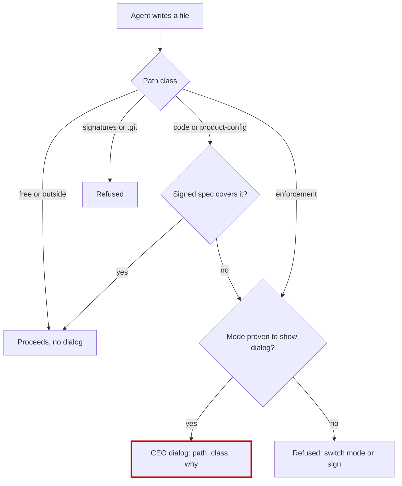
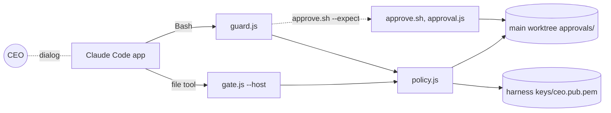
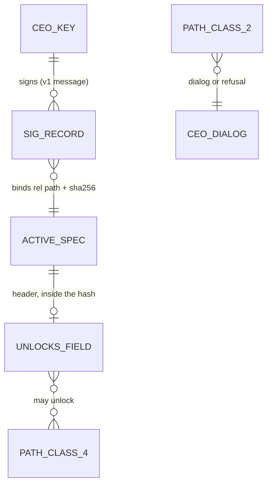
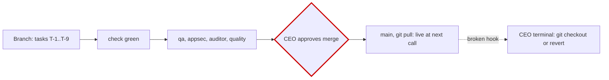
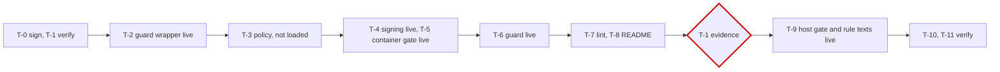

# Spec 0004 — Host enforcement: shared path policy, host signature gate, Bash write checks, signing preview, fail-closed hooks
<!-- Header fields and Status values stay English (protocol); content is written in English. -->

- Status: Draft
- Tier: full · Lane 3 (escalated from lane 2 in `docs/KARARLAR.md` rev. 48: trust-boundary finding)
- Previous spec: none (hardens the signed-spec gate of the original harness; no earlier spec is changed)
- Next spec: 0006 (`specs/draft/0006-harness-unit-areas-evidence.md`), then 0005 (`specs/draft/0005-harness-consistency-cleanup.md`). Order: **0004 → 0006 → 0005**.
- Inputs: design `docs/architecture/tasarim/0004-host-enforcement.md`; architecture board opinion `docs/architecture/gorus-0004-host-enforcement-2026-11-21.md` (CONDITIONAL APPROVE, conditions board-K1..board-K9; where the board and the design disagree, the board wins); `docs/KARARLAR.md` rev. 48.
- Self-critique: done (adversarial read, §14). Spec-critic and appsec rounds 2 and 3: done (round 3: spec-critic "signable on severity", appsec PASS WITH CONDITIONS; no Critical, no Type 1); every finding folded into this revision (map in §14). Q-1 and Q-2: closed by the CEO (`docs/KARARLAR.md` rev. 48).
- Unlocks: `harness/bin/lint.js`, `harness/bin/check`, `harness/test/policy.sh`, `harness/test/host-gate.sh`, `harness/test/lint-rules.sh`, `harness/test/run.sh`, `harness/test/guard.sh`, `harness/test/fixtures/*.json`, `harness/test/*.js`, `harness/README.md`, `templates/spec-tam.md`, `templates/spec-hizli.md`, `.claude/rules/routing.md`
- Enforcement files this spec changes (class 2: a CEO dialog on every edit, never covered by `Unlocks:`): `harness/policy.js` (new), `harness/gate.js`, `harness/guard.js`, `harness/approval.js`, `harness/bin/approve.sh`, `harness/bin/install-project.sh`, `.claude/settings.json`, `harness/container-settings.json` (the container gate command gets the `|| exit 2` wrapper, T-2; nothing else), **`CLAUDE.md` (rule 1 text, §7.6; the CEO's signature on this spec is the approval for that text)**.
- Code-class files this spec changes (signature covers them): `site/index.html` (regenerated by `node harness/bin/site-data.js --write`, see §12 rule 3).
- Numbering note: specs 0002 and 0003 reserve "0004" for the Tower job "visual realism and guided tour". That number is taken by this spec (and 0005, 0006 by the harness job). The Tower job needs a new number (0007 or later); 0002 (in `specs/done/`) and 0003 are not edited here.

## 1. Intent
CEO's words (as relayed by the Chief of Staff, rev. 48): "I want to approve everything", "but I want to be able to grant an explicit exception occasionally." CEO decision on the exception (2026-11-21, Q-1 = A): "an exception is given only through the permission dialog for now: no edit without a signature or a dialog click; a small exception is one click per edit, an exception for a whole job is a quick spec plus a one-click signature." CEO decision on permission modes (2026-11-21, Q-2 = yes, rev. 48): when an unsigned edit needs the dialog and `permission_mode` is `acceptEdits`, `auto` or `bypassPermissions`, the hook refuses ("switch to default mode or sign a spec"; for signing, key, installer and repair commands, which have no path: "switch to default mode or run the command in his own terminal"; exact texts in §7.7); a mode a real session proves to show the dialog is added to the list by a signed change; when the mode is not reported, the hook asks. CEO risk acceptance (2026-11-21): the CEO key stays passphrase-less; the host controls stop accidents, not a malicious agent with Bash; no absolute claims; every known gap is listed.

Interpretation, kept separate. Today the signature gate (`harness/gate.js`) runs only in the agent container (`harness/container-settings.json:26-31`). On the host only `guard.js` is wired (`.claude/settings.json:19-36`); its file-tool branch asks only for a fixed list of enforcement files (`guard.js:50,73-77`). So an unsigned code edit on the host passes without a dialog, although `.claude/rules/routing.md:36` says the gate is enforced where `install-project.sh` ran, and `install-project.sh:15` does not wire the gate. The gate and the guard disagree about what is protected (`gate.js:32` vs `guard.js:50`). Unit definitions, playbooks, verification tooling and templates can be changed on the host without the CEO.

Success: where the hook set of this spec is installed and the workspace has a `specs/` folder, an edit on the host by a file tool or by a recognised Bash writer to code or product configuration is not allowed silently by the hooks unless a signed active spec covers it; otherwise the CEO gets a dialog, or, in a permission mode where the dialog is not proven to appear, a clear refusal. An edit by those tools to an enforcement file is not allowed silently by the hooks whatever the signature says (dialog, or refusal where the dialog is unproven), also without `specs/`. The wired write checks (host gate for file tools, guard for Bash) classify paths through one shared module. The CEO sees what he signs (path, short hash, `Unlocks:` list) before the signature exists, whenever he signs through `approve.sh`. A gate or guard that crashes or cannot start blocks the call instead of passing (by the `|| exit 2` wrapper on the host hooks and on the container gate command, proven on the host in T-1); stop, loop and notify stay fail-open. All of this raises the bar against accidents; it does not stop an agent that works around it. What is not covered is listed one by one (§8, G-1..G-22).

Deliberately NOT done here: per-unit write areas, subagent evidence, the `stop.js` precedence and evidence commands, the QA write rule and rule 3 text (all in spec 0006); exception notes, waivers, `waive.sh`, a use log (deferred by the CEO, rev. 48); signature format v2, project id, issue-time rules (rejected, board-K1); resolved-path or hash detection of signing scripts (rejected, board D-4b); `cd` tracking, `$TMPDIR`, `-t` and `git checkout`/`git restore` targets in Bash detection (later, board-K4); a pinned hook copy outside the repo (design D-5b, later); mobile engineer units (after this job); key hardening; consistency items (spec 0005).

## 2. Market summary (Product)
None. Internal harness job, no market question. Claude Code hook behaviour (exit code 2 blocks, exit code 1 is a non-blocking error, `permissionDecision: "ask"`, payload fields `permission_mode`, `agent_type`, `agent_transcript_path`) is taken from documentation as summarised in `docs/GEREKSINIM-ANALIZI.md` and the design; it was **not observed** in this repository. Task T-1 records it on the host before any code (board-K6).

## 3. Requirements (EARS)
Threat level for every requirement below: the host hooks raise the bar against accidents and honest mistakes; they do not stop an agent with Bash that tries to get around them (rev. 48, §8).

Shared policy and path classes
- REQ-1 — The system shall decide every host and container write check (file tool or recognised Bash writer) through one shared policy module used by both the gate and the guard.
- REQ-2 — The system shall give every write target one final class out of the table in §7.1 (hard-deny, enforcement, product-config, free, code, outside; nested root re-roots and is never final) by the rule "classify both the lexical and the resolved path, stronger class wins" (§7.1.1), with Unicode NFC normalisation on every platform, case-insensitive matching of rows 1, 2 and 4 on every platform except that the carve-outs from row 2 (row 3 and the `.claude/` members of row 4) match with exact case, and case-insensitive matching of row 5 and of `Unlocks:` globs on macOS and Windows only.
- REQ-3 — The system shall classify as hard-deny or enforcement every path whose lexical or resolved form today's guard enforcement pattern (`guard.js:50`) matches, compared case-insensitively, at any depth, as an absolute path and with any suffix the pattern allows (for example `harness/gate.js.bak`), so the enforcement class is never narrower than today's guard (board-K8).
- REQ-4 — If resolving a path fails for a reason other than "does not exist", then the system shall refuse the write (host and container).

Host gate for file tools
- REQ-5 — When a file-tool write on the host targets a code path and the single active spec has no valid CEO signature, the system shall not allow it silently: it shall ask the CEO, naming the path, the class and the number of active specs found (subject to the permission-mode rule, REQ-28).
- REQ-6 — When the single active spec has a valid CEO signature, the system shall allow a code-path write on the host without a dialog.
- REQ-7 — When a file-tool write on the host targets a product-config path, the system shall allow it without a dialog only if the signed active spec's `Unlocks:` header names a matching glob; otherwise it shall ask the CEO.
- REQ-8 — When a write on the host targets an enforcement path, the system shall ask the CEO for every edit (subject to REQ-28), whatever the signature and the `Unlocks:` header say.
- REQ-9 — When a file-tool write targets the signature directory or git metadata, the system shall refuse it (host and container).
- REQ-10 — The system shall allow free-class writes (`specs/`, `docs/`, `plans/`, `STATE.md`) without a signature on the host and in the container.
- REQ-11 — Where a workspace has no `specs/` directory, the system on the host shall give no opinion on code and product-config paths without making any git lookup, and shall still apply the enforcement and hard-deny classes.
- REQ-12 — Where a path is outside the workspace and not in the enforcement class, the system on the host shall give no opinion.

Root, identity and records
- REQ-13 — The system on the host shall take the workspace root from the project directory the app reports, else from the call's working directory, and shall read signature records from the main worktree of that root and the CEO public key from the main worktree of the harness in use, never from a linked worktree copy.
- REQ-14 — If the git lookup of the workspace fails while the root contains git metadata and the root has a `specs/` directory, then the system on the host shall refuse code and product-config writes with "git lookup failed (fail closed)" and still allow free-class writes; if the harness directory contains git metadata and the lookup of its main worktree fails, then the system shall refuse code and product-config writes with "harness key lookup failed (fail closed)"; a harness directory without git metadata reads the key from its own `keys/`.
- REQ-15 — The system on the host shall ignore the test environment variables `COMPANY_PUBKEY`, `COMPANY_HARNESS_DIR` and `COMPANY_SPEC`.
- REQ-16 — The system shall keep signature format v1 (message, record fields, file name) unchanged (board-K1).
- REQ-35 — Where the workspace root on the host is a linked git worktree and the lookup of its main worktree ran (the root has a `specs/` directory, REQ-11) and succeeded (else REQ-14 applies; the remaining gap is G-15, Ruling R-18), the system shall classify a path that lies under the main worktree root and not under the workspace root against the main worktree root (§7.1, main-root rule), never as outside.

Container
- REQ-17 — While running in the container, the system shall apply the same classes with every "ask" turned into a refusal, refuse outside paths and all of `.claude/`, ignore the `specs/` directory rule of REQ-11, and keep today's environment handling, so that every existing case in `harness/test/run.sh` passes unchanged.
- REQ-18 — While running in the container, the system shall apply exactly the deltas to today's decisions listed in §7.1 ("Container deltas versus today") and no others: enforcement paths that were "code" are refused; product-config paths outside `.claude/` need a matching `Unlocks:` glob; `plans/**` and `STATE.md` are allowed without a signature; a path whose resolved form (symlink) or case-folded form falls in a stronger class takes that class; a free path that resolves outside the workspace is refused; a resolve error other than "does not exist" is refused.

`Unlocks:` header
- REQ-19 — The system shall read the `Unlocks:` list only from the bytes whose signature it verified, by the grammar in §7.3; if any glob in the field is invalid, the system shall ignore the whole field.
- REQ-20 — The system shall never treat an `Unlocks:` glob as authority over an enforcement-class path, and lint shall fail an active spec whose header is invalid or names a glob that matches an enforcement-class path.

Bash writes
- REQ-21 — When a Bash command contains a recognised writer (§7.4) whose target is a code or product-config path that is not authorised, the guard shall ask the CEO, as for file tools.
- REQ-22 — When a recognised Bash writer targets an enforcement or hard-deny path, or a Bash command runs one of the installers `install-global.sh` or `install-project.sh` (they write enforcement paths from inside a script, §7.4), the guard shall ask the CEO (subject to REQ-28).
- REQ-23 — The guard shall give no opinion for writer targets in the OS temp directories, `/dev/null` and the other device paths in §7.4, for descriptor duplications (`2>&1`, `>&2`), for read operands of copy-like commands, for `>` characters inside quoted strings, and for targets it cannot resolve literally (unless the target text, taken as a literal path, falls in rows 1-2 by §7.1.1).
- REQ-24 — The guard shall keep every existing envelope rule and every existing decision asserted by `harness/test/guard.sh`.
- REQ-33 — When one Bash command triggers several rules, the guard shall evaluate all of them, emit only the strongest decision (deny > ask > none) and name in its reason every rule that produced that decision.
- REQ-34 — When a git command carries global options before its subcommand (`git -C <dir> push`, `git -c k=v push`, `git --git-dir=<d> push`), the guard shall apply its existing envelope rules to that subcommand as if the options were absent, judging the current branch in the directory the options name (§7.4); when a `-c` or `--config-env` value, or a `git config` argument, names a hook path, editor, credential or alias key, or a git command is preceded by a git environment override (`GIT_DIR=`, `GIT_WORK_TREE=`, `GIT_CONFIG_*=`, `GIT_EXEC_PATH=`), the guard shall ask the CEO (§7.4).
- REQ-36 — When a push refspec names a protected branch with a leading `+` (`+main`) or with `refs/heads/` after the colon (`HEAD:refs/heads/main`), or an `rm` command carries `--recursive`, the guard shall apply its existing envelope rule (push to a protected branch; recursive deletion) as for `main` and `-r` (§7.4).

Signing preview
- REQ-25 — The system shall let the CEO preview, without reading the key, the spec path, the first 12 hex digits of its SHA-256 (sha12), the `Unlocks:` list and the header lint findings.
- REQ-26 — When the signing command carries an expected sha12, the guard shall show the path, the sha12 and the `Unlocks:` list in the dialog text (subject to REQ-28); if the sha12 does not match the file at that moment, or the command also carries `--preview`, the guard shall refuse.
- REQ-27 — The signing script shall refuse to sign without an expected sha12, with a mismatching sha12, with both `--preview` and `--expect`, or with an invalid header; the signing tool shall sign exactly the bytes whose hash it compared.

Permission modes (Q-2, CEO decision closed in rev. 48)
- REQ-28 — When the policy decides "ask", or the guard asks for a signing, key or installer command (§7.7 scope), or for a repair command (REQ-29), and the app reports a permission mode in which a hook dialog is not proven to appear (`acceptEdits`, `auto`, `bypassPermissions`, or any value other than `default`, `plan` and the modes proven in T-1), the system shall refuse with a message that names the mode and the ways forward; when the app reports no permission mode, the system shall ask (board-K7).

Fail closed
- REQ-29 — If the gate's (host or container) or the guard's entry file cannot run (syntax error, missing file, empty project directory) or the policy module fails to load, then the system shall block the call rather than let it pass; the guard shall instead ask for a Bash call when only the policy module failed, so the CEO can allow one repair command; that repair ask follows REQ-28 (refused in an unproven mode: repair outside the session, §10).
- REQ-30 — The stop and notification hooks shall keep failing open.

Wiring and texts
- REQ-31 — Where the host hooks are installed, exactly one hook shall decide file-tool writes (the host gate), so one edit never produces two dialogs (board-K5).
- REQ-32 — The system shall document each known gap of §8 in `harness/README.md` under "Bilinen boşluklar", and the routing rule and constitution rule 1 shall describe the host gate without absolute claims, and only from the task that wires it (T-9).

## 4. User experience
No screens. The only "screen" is the app's permission dialog (text produced by the hooks) plus the output of `approve.sh --preview`.

### What does the CEO see when an agent writes a file on the host?

Description: a signed spec silences in-scope edits; everything else that matters asks the CEO or is refused. Text equivalent:

| Path class | Signed spec covers it | Result on the host |
|---|---|---|
| free, outside | n/a | proceeds, no dialog |
| code / product-config | yes | proceeds, no dialog |
| code / product-config | no | CEO dialog (proven mode) or refusal (unproven mode) |
| enforcement | never | CEO dialog (proven mode) or refusal (unproven mode) |
| signatures, `.git` | never | refused |

Dialog states and their criteria (owner of every message: the hook that emits it; `gate.js` for file tools, `guard.js` for Bash; dialog text Turkish, refusal text to the agent English, as today):
- asking: reason names the root-relative path (quoted as in §7.8, because the agent chooses it), the class and what is missing (active spec count, or "not in `Unlocks:`") → AC-3, AC-9; a Bash command that triggers several rules shows one dialog whose reason lists each of them (REQ-33) → AC-9.
- allowed: no output → AC-3, AC-9.
- refused (hard-deny, unproven mode, git lookup failed, resolve error): exit 2, English reason → AC-3, AC-4, AC-10.
- headless run: the app refuses an "ask" because nobody can answer (existing app behaviour, unchanged; not tested here).
- error: internal fault → exit 2 "internal error (fail closed)" → AC-11.
- signing: dialog shows `"<rel>" · sha <sha12> · Unlocks: <list>` (path and globs quoted as in §7.8) → AC-8; preview output → AC-7.

## 5. Acceptance criteria
"check" = covered by `./harness/bin/check`. "manual" = evidence recorded by hand as stated.

- [ ] AC-1 — (check) `harness/test/policy.sh` classifies a fixed matrix (real symlinks built in a temp tree, temp `HOME`) with at least two paths per class of §7.1, including: a symlink inside the workspace pointing at `.claude/settings.json` → enforcement; a new file under a symlinked directory → class of the directory's target (if stronger) else its lexical class; `CLAUDE.md` as a symlink to `AGENTS.md` → enforcement; `CLAUDE.md` as a symlink to `docs/x.md` → enforcement; the reverse, `docs/x.md` as a symlink to `../CLAUDE.md` → enforcement; `<home>/.claude/settings.json` as a symlink to `<home>/dotfiles/s.json` → enforcement; `approvals` as a symlinked directory pointing into the temp dir, file `approvals/x.json` → hard-deny; the reverse, `/tmp/<t>/l` as a symlink to `<ws>/approvals`, file `/tmp/<t>/l/x` → hard-deny; `src/out.cs` as a symlink to a file outside the workspace → code; `docs/out.md` as a symlink outside → outside; `/tmp/<t>/in.cs` as a symlink into the workspace's `src/` → code; `.CLAUDE/settings.json` and `claude.md` → enforcement with platform darwin and with platform linux; `TEMPLATES/x.md` → product-config with platform linux; `DOCS/x.md` → free with platform darwin, code with platform linux (platform injected); an NFD-encoded name → same class as its NFC form; `.claude/worktrees/w1/src/a.cs` → code with `root` `.claude/worktrees/w1` in the result and in both `lexical.root` and `resolved.root`; `.claude/worktrees/w1/harness/gate.js` → enforcement; exact-case carve-outs: `.claude/Worktrees/w1/src/a.cs` → enforcement with platform linux and with platform darwin (not re-rooted), `.claude/AGENTS/x.md` → enforcement with platform linux; an injected non-ENOENT resolve error → refused. For every matrix path, `gate.js --host` and `guard.js` (as `cp /tmp/x <path>`) give consistent decisions: hard-deny → gate refuse / guard ask; enforcement → ask / ask; unauthorised code or product-config → ask / ask; free and outside → none / none.
- [ ] AC-2 — (check) Superset (board-K8): `policy.sh` extracts the `ENFORCEMENT` regular expression literal from `harness/guard.js` at test time and asserts that every path in the matrix plus these paths is hard-deny or enforcement whenever that expression matches its lexical or resolved form: `src/CLAUDE.md`, `docs/CLAUDE.md`, `/tmp/other/harness/keys/ceo.pub.pem`, `<home>/.claude/CLAUDE.md`, `<home>/.claude/settings.json`, `pkg/.github/workflows/ci.yml`, `src/approvals/x.json`, `.claude/worktrees/w1/.claude/settings.local.json`, `/tmp/other/harness/loop.js`, `/tmp/o/harness/gate.js.bak`, `src/.claude/settings.json.orig`; and, outside the expression, that `/tmp/other/harness/bin/approve.sh`, `/tmp/other/harness/bin/install-project.sh`, `src/harness/bin/ceo-keygen.sh`, `<home>/.claude.json`, `<home>/.claude/agents/x.md`, `<home>/.claude/skills/s/SKILL.md`, `<home>/.claude/rules/x.md`, `<home>/.claude/commands/x.md`, `<home>/.claude/hooks/x.sh`, `<home>/.claude/plugins/p/x.json` and, with `CLAUDE_CONFIG_DIR` set to `/tmp/<t>/cfg` in the injected env, `/tmp/<t>/cfg/agents/x.md` and `/tmp/<t>/cfg/settings.json` are enforcement (the last two are temp paths: row 2 wins over the temp rule of §7.4).
- [ ] AC-3 — (check) `harness/test/host-gate.sh`, host mode, file tools: unsigned code write → exit 0 with `permissionDecision: "ask"` and a reason containing the relative path and "0" (active spec count); validly signed → exit 0, no output; spec edited after signing → ask; two active specs → ask, reason contains "2"; product-config path listed in the signed `Unlocks:` → no output; product-config path not listed → ask; `.claude/settings.json` and `harness/gate.js` with a signed spec (temp tree, throwaway key) whose `Unlocks:` is `.claude/**, harness/**` → ask (the globs are ignored for row-2 paths); `approvals/x` and `.git/config` → exit 2; `specs/x.md`, `docs/x.md`, `plans/x.md`, `STATE.md` unsigned → no output; `/etc/hosts` → no output; workspace without `specs/`: `src/a.cs` → no output, `CLAUDE.md` → ask; missing `file_path` or unreadable input → exit 2; a `file_path` `src/a` + newline + `OK imzalı.cs` → ask whose reason contains the path as a JSON string literal (`\n` escaped, no raw newline in the reason, §7.8). Replay of the file-tool paths of `guard.sh:105-116` through `gate.js --host` in a workspace without `specs/` (as `guard.sh` uses): `harness/guard.js`, `harness/loop.js`, `harness/gate.js`, `.claude/settings.json`, `harness/container-settings.json`, `CLAUDE.md`, `.github/workflows/check.yml` and the relative `file_path` `harness/guard.js` (resolved against `cwd`) → ask; `approvals/0001.sig` → exit 2 (row 1, tighter than today's ask); `.claude/skills/scouting/SKILL.md`, `harness/test/guard.sh`, `docs/KARARLAR.md` → no output.
- [ ] AC-4 — (check) `host-gate.sh` root and identity, with a copy of the harness `*.js` in a temp non-git directory holding a throwaway public key: `CLAUDE_PROJECT_DIR` = workspace and `cwd` = a subdirectory → the active spec and records are found; a linked git worktree with an empty own `approvals/` and a valid record in the main worktree → signed code write allowed; a throwaway key set in `COMPANY_PUBKEY` that signed the spec, with the harness key differing → still ask (variable ignored); `COMPANY_SPEC` naming a second file → ignored; root with `.git` present and `git` made to fail (PATH stub) → code and product-config exit 2 with "git lookup failed", `docs/x.md` → no output; the same failing `git` in a root without `specs/` → `src/a.cs` no output (REQ-11 before the git lookup); a temp harness copy that contains `.git` while `git` fails → code write exit 2 with "harness key lookup failed". Main-root rule (REQ-35), with `CLAUDE_PROJECT_DIR` = a linked worktree outside the main tree that has `specs/`, no signature: `<main>/src/x.cs` → ask (not "no output"), with the main root named in the reason; `<main>/.claude/agents/x.md` → ask; `<main>/CLAUDE.md` → ask; `<main>/docs/x.md` → no output; `policy.classify` of `<main>/src/x.cs` reports `root` = the main root in the result, `lexical.root` and `resolved.root`; with a valid record for the main tree's single active spec, `<main>/src/x.cs` → no output.
- [ ] AC-5 — (check) Container mode (no `--host`): all existing cases of `harness/test/run.sh` pass unchanged; new cases, one per delta: signed spec + `harness/gate.js` → exit 2; signed spec + `src/CLAUDE.md` → exit 2; signed spec + `.github/workflows/x.yml` → exit 2; signed spec without `Unlocks:` + `harness/bin/x.sh` → exit 2; signed spec with `Unlocks: harness/bin/x.sh` + `harness/bin/x.sh` → exit 0; signed + `Unlocks: .claude/agents/**` + `.claude/agents/x.md` → exit 2; unsigned `plans/x.md` and `STATE.md` → exit 0; signed spec + `src/link.cs` as a symlink to `../harness/gate.js` → exit 2 (today 0: resolved-path delta); signed spec + `.CLAUDE/settings.json` → exit 2 (today 0: case-fold delta); signed spec + `src/features/approvals/x.ts` → exit 2 (today 0: nested `approvals/` delta, a product folder of that name included; A-10, G-22); no case ever prints `permissionDecision`.
- [ ] AC-6 — (check) Header grammar (`policy.sh`, driver on `policy.parseHeader` / `policy.matchGlob`): valid list with and without backticks parses; `**` matches zero or more segments, `*` and `?` stay within a segment; `- Unlocks:` twice → whole header invalid; each of `{a,b}`, `[ab]`, `!x`, `../x`, `/abs`, `~/x`, `$X/y`, `a**`, `./x` → field ignored and an error returned; matching is case-insensitive only with platform darwin and with platform win32 (case-sensitive with platform linux); a spec signed, then edited only in its `Unlocks:` line → no unlock (signature invalid). `harness/test/lint-rules.sh` (`COMPANY_LINT_ROOT`): a fixture is a copy, in a temp dir, of the tracked repository tree (the working-tree files `git ls-files` lists) plus only the change under test, so every other lint rule passes on it; the unchanged fixture → exit 0 (baseline); every negative case asserts exit 1 **and** the `FAIL` line of its own rule id (§9), not only a non-zero exit; this applies to every `lint-rules.sh` case of AC-6, AC-11, AC-12 and AC-13. Cases: an active spec with an invalid header → `FAIL  unlocks-header`; an active spec whose glob matches an enforcement path (`harness/**`, `.claude/**`, `**/CLAUDE.md`) → `FAIL  unlocks-row2`; a draft spec with the same header → a `WARN  unlocks-header` line, no `FAIL` line, exit 0; the real repository → exit 0; with `COMPANY_LINT_ROOT` set, lint prints `LINT ROOT OVERRIDDEN: <path>` as its first line; `harness/bin/check` unsets `COMPANY_LINT_ROOT` before it runs lint (asserted on the file text).
- [ ] AC-7 — (check) `approve.sh` and `approval.js` (`run.sh` additions, temp `HOME`): `approve.sh <ws> --preview` with no key under `HOME` → exit 0 and prints exactly the five lines of §7.5; `approve.sh <ws>` without `--expect` → exit 2, prints the preview command, no record written; `--expect` with a wrong sha12 → exit 5, no record; `approve.sh <ws> --preview --expect <right sha12>` (either order) → exit 2, no record; with an invalid header → exit 2, no record; with the right sha12 → record written in the main worktree's `approvals/` and `approval.js verify` prints `APPROVED`; `approval.js sign` without `--expect` behaves as today (existing `run.sh` cases unchanged); `approval.js sign ... --expect <wrong>` → exit 5, no record.
- [ ] AC-8 — (check) `guard.sh` additions: `approve.sh <ws> --expect <right sha12>` → ask, reason contains the relative spec path, the sha12 and the `Unlocks:` list; `--expect <wrong>` → exit 2 and the reason contains `--preview`; `--expect` with a non-literal workspace (`$W`) → exit 2; `approve.sh <ws> --preview --expect <right sha12>` → exit 2; `approve.sh <ws> --preview` alone → no opinion; `approve.sh . --preview && approve.sh .` → ask; `approve.sh . --preview && cat ~/.company/keys/ceo.key.pem` → ask (the preview exemption covers only its own segment); existing cases at `guard.sh:68-77` pass unchanged.
- [ ] AC-9 — (check) `guard.sh` additions, Bash writers, workspace with `specs/` and no signature, `CLAUDE_PROJECT_DIR` set explicitly by the new helper, which runs a temp copy of the harness `*.js` holding a throwaway public key (as AC-4; the real CEO key is never used): ask for each of `echo x > src/a.cs`, `echo x > "src/a.cs"`, `echo x >> src/a.cs`, `printf x | tee src/a.cs`, `cp /tmp/a src/a.cs`, `mv src/a.cs src/b.cs`, `rm src/a.cs`, `ln -s /tmp/a src/a`, `chmod 644 src/a.cs`, `chown me src/a.cs`, `truncate -s 0 src/a.cs`, `dd if=/tmp/a of=src/a.cs`, `install /tmp/a src/a`, `touch src/a.cs`, `unlink src/a.cs`, `sed -i s/a/b/ src/a.cs`, `sed -i '' 's/a/b/' src/a.cs` (BSD form), `perl -i -pe s/a/b/ src/a.cs`, `cat > src/a.cs <<'EOF'`, and for `echo x > .claude/agents/x.md`, `cp /tmp/a harness/bin/check`, `cp /tmp/a harness/test/x.sh`, `cp /tmp/a evals/x.md`, `cp /tmp/a templates/x.md`; no opinion for `echo x > docs/a.md`, `echo x > specs/a.md`, `echo x > /tmp/a`, `echo x > /private/tmp/a`, `echo x > /var/folders/ab/T/a`, `echo x > /dev/null`, `make 2>&1`, `echo x >&2`, `cp src/a.cs /tmp/b`, `echo x > $OUT/a.cs`, `git commit -m "a -> b"`, `echo "x > y"`, `sed -i '' 's/a/b/' docs/a.md` (the empty word is the backup suffix, not a target), `cat harness/bin/install-global.sh`; ask for the installers `sh harness/bin/install-global.sh` and `./harness/bin/install-project.sh /tmp/p`; combined command `echo x > src/a.cs; git push origin main` (feature repo) → one ask whose reason names both `src/a.cs` and the push to main; with a signed spec: `echo x > src/a.cs` → no opinion, `echo x > CLAUDE.md` → ask; on the host the test variables are ignored: unsigned spec, `COMPANY_PUBKEY` naming a throwaway key that did sign it, harness key differing → `echo x > src/a.cs` still ask; `COMPANY_SPEC` naming a second, signed spec while two specs are active → still ask; workspace without `specs/`: `echo x > src/a.cs` → no opinion; main-root rule (REQ-35), `CLAUDE_PROJECT_DIR` = a linked worktree outside the main tree, no signature: `cp /tmp/a <main>/src/x.cs` → ask. Git global options (REQ-34, envelope rules of `guard.js:112-133`): ask for `git -C <feat repo> push origin main`, `git -c core.x=y push origin main`, `git --git-dir=<feat repo>/.git push --force origin feat/0007-x`, `git --no-pager reset --hard HEAD~1`, `git -C <feat repo> rebase main`, `git -C <feat repo> tag v1`, run from the feature repo; `git -C <main repo> commit -m x` run from the feature repo → ask (branch judged in the `-C` directory); `git -C <temp parent> -C main-repo commit -m x` run from the feature repo → ask (several `-C` combine); `git -C <feat repo> commit -m x` run from the main repo → no opinion. Config and environment (REQ-34): ask for `git -c core.hooksPath=/dev/null commit -m x`, `git --config-env=core.hooksPath=H commit -m x`, `git -c alias.x=push x origin feat/0007-x`, `git config alias.p push`, `GIT_DIR=<main repo>/.git git commit -m x` and `env GIT_WORK_TREE=/tmp/w git status`, each run from the feature repo; no opinion for `git -c color.ui=never log` run from the feature repo. Refspecs and recursive deletion (REQ-36), from the feature repo: ask for `git push origin HEAD:refs/heads/main`, `git push origin +main`, `git push origin +HEAD:refs/heads/main`, `rm --recursive build`; no opinion for `git push origin +feat/0007-x` and `git push origin HEAD:refs/heads/feat/0007-x`. All existing `guard.sh` cases pass unchanged.
- [ ] AC-10 — (check) Permission modes (Q-2, CEO decision), in `host-gate.sh` and `guard.sh` additions (guard part through the temp harness copy of AC-9): for an "ask" decision, `permission_mode` `default` and `plan` → ask; `acceptEdits`, `auto`, `bypassPermissions`, `somethingNew` → exit 2 with a reason naming the mode and containing "switch to default mode or sign a spec" (path text of §7.7); field absent → ask; every mode in the policy's exported `ASK_MODES` → ask, and `ASK_MODES` minus `default`, `plan` is excluded from the deny list above (its match with the T-1 record is a manual cross-check in T-11); a "no output" decision is unchanged in every mode; an existing envelope ask (`git push origin main` on a feature repo) → ask in every mode; `echo x > src/a.cs; git push origin main` with `acceptEdits` → exit 2 naming the mode (the earlier envelope ask does not pre-empt the refusal); `approve.sh <ws> --expect <right sha12>` with `acceptEdits` → exit 2 naming the mode, and with the field absent → ask; the other signing, key and installer asks (§7.7 scope) with `acceptEdits` → exit 2 naming the mode, containing "switch to default mode or run the command in his own terminal" (path-less text of §7.7) and not containing "sign a spec", and with the field absent → ask, for each of `./harness/bin/approve.sh ~/proj` (no `--expect`), `node harness/approval.js sign specs/active/0001.md approvals k.pem`, `./harness/bin/ceo-keygen.sh`, `cat ~/.company/keys/ceo.key.pem`, `sh harness/bin/install-global.sh`. No hook ever emits an allow: in every new case of `host-gate.sh`, `guard.sh` and the `policy.sh` consistency loop the output never contains `"permissionDecision":"allow"`, and `policy.sh` asserts on the source of `gate.js`, `guard.js` and `policy.js` that every `permissionDecision` value written is `"ask"` (an allow would skip the app's permission rules).
- [ ] AC-11 — (check) Fail closed: `policy.sh` asserts in the source of `gate.js` and `guard.js` that the `uncaughtException` handler line comes before the first `require(` (board-K6); with a temp harness copy whose `policy.js` throws at load: `gate.js --host` file write → exit 2, `guard.js` with `ls` → ask, with `git push origin main` → ask, with `ls` and `permission_mode` `acceptEdits` → exit 2 naming the mode (repair ask refused in an unproven mode); garbage input → exit 2 for both; `lint.js` fails (`FAIL  hook-wrapper`) when a gate or guard command in `.claude/settings.json` or the gate command in `harness/container-settings.json` lacks the `|| exit 2` suffix, or a stop command has it; `sh -c '<the exact gate command string from .claude/settings.json>'` with `CLAUDE_PROJECT_DIR` pointing at a tree without `harness/gate.js` → exit 2; `sh -c '<the exact gate command string from harness/container-settings.json>'` on the host, after asserting that `/harness/gate.js` does not exist there (the case fails loudly if it does) → exit 2. (manual part in AC-13: the app's behaviour on exit 1 vs 2.)
- [ ] AC-12 — (check) Wiring: `.claude/settings.json` has `node "$CLAUDE_PROJECT_DIR/harness/gate.js" --host || exit 2` for matcher `Write|Edit|MultiEdit|NotebookEdit`, guard only for `Bash` (with `|| exit 2`), loop/notify/stop as today; `lint.js` fails (`FAIL  host-gate-owner`) when the host gate is missing for any of the four tools, when any other PreToolUse entry with a file-tool matcher runs `gate.js` or `guard.js` (one owner), or when the guard is not wired for Bash; `install-project.sh` run into an empty temp project writes a hook set that contains at least the gate, guard, loop, notify and stop entries of `.claude/settings.json` above, with absolute harness paths; run into a project with an existing `.claude/settings.json` → exit 1 and its output contains at least the three entries to merge by hand (gate `--host` with wrapper, guard with wrapper, removal of guard's file-tool entry); both assertions are "contains at least", so a later spec may add entries without editing this test.
- [ ] AC-13 — (manual + check) T-1 record `docs/kanit/0004-t1.md` (Turkish) states, each with the command used and the observed result: the PreToolUse payload keys for a main-session and a subagent file write; the SubagentStop payload keys; the `permission_mode` value in each of `default`, `acceptEdits`, `auto`, `bypassPermissions`, `plan`; for each mode whether an always-ask throwaway hook shows a dialog; that a hook exiting 1 does not block and the same hook with `|| exit 2` blocks (syntax-error entry and missing entry); behaviour with an empty `CLAUDE_PROJECT_DIR`; the host `git --version`; the `CLAUDE_PROJECT_DIR` and `cwd` a worktree-isolated subagent sees; whether Write and Edit on an existing symlink (scratch directory only) replace the link or write through to its target (the §7.1.1 rule covers both; the record says which happens). (check) The fixtures `harness/test/fixtures/pretooluse-main.json`, `pretooluse-subagent.json`, `subagentstop.json` exist, parse, and `lint.js` fails (`FAIL  fixture-sanitized`) if any fixture matches `/Users/`, `/home/[a-z]`, or a UUID pattern.
- [ ] AC-14 — (check) Texts: `harness/README.md` has a section `## Bilinen boşluklar` containing every id G-1..G-22 of §8 and a section describing the classes, the strength order and the rule "classify both the lexical and the resolved path, stronger class wins"; `templates/spec-tam.md` and `templates/spec-hizli.md` carry an optional `- Unlocks:` header line (these from T-8); `.claude/rules/routing.md` contains the exact lane-0 and last-line texts of §7.6; `CLAUDE.md` rule 1 equals the exact text of §7.6 (these from T-9, together with the wiring they describe); `lint.js` checks each of these strings.
- [ ] AC-15 — (manual) First run after wiring (T-10), main session on the host in `default` mode, recorded in `docs/kanit/0004-t1.md`: with no active spec, an Edit of a scratch code file in the workspace shows one dialog (not two); with a signed active spec, an in-scope code edit shows no dialog; an Edit of `CLAUDE.md` shows one dialog; `host-gate.sh --bench` (200 calls) prints p95 latency per call, target < 150 ms on the CEO's Mac (relative measurement, assumption A-3). If p95 ≥ 150 ms, AC-15 fails: T-10 records the value, stops and reports it to the main session with a delta proposal (for example one git lookup per call instead of two); the hooks stay wired, because slow is not unsafe.

## 6. Architecture and technology decision
No new dependency: Node built-ins (`fs`, `path`, `crypto`, `child_process`, `String.prototype.normalize`, `fs.realpathSync.native`) and POSIX `sh`; `git` is already used by `guard.js:16`. Architecture board: CONDITIONAL APPROVE; conditions board-K1..K9 are folded in (map in §14). ADR to file (board): "Path class taxonomy" (shared contract of gate, guard, stop, lint, templates; `Unlocks:` grammar; "container = host table with ask→deny"; "hooks fail closed with `|| exit 2`"), from `templates/ADR.md`, by `architecture-board`, before signature. No ADR for the signature format (unchanged).

### Which parts decide a write on the host?

Description: both PreToolUse hooks ask one policy module; the policy reads signature records and the public key from main worktrees; dialogs come from the app. Text equivalent:

| Component | Responsibility | Class |
|---|---|---|
| `harness/policy.js` (new) | resolve root and main worktree, classify a path, parse the header, decide allow / ask / deny / none for (mode, kind, class, authority, permission mode) | enforcement |
| `harness/gate.js` | parse a file-tool event, call the policy, print the hook result; `--host` selects host mode | enforcement |
| `harness/guard.js` | envelope rules (unchanged), Bash writer targets → policy, signing dialog with preview | enforcement |
| `harness/approval.js` | v1 sign/verify (unchanged), `verifyBuffer`, `sign --expect` | enforcement |
| `harness/bin/approve.sh` | `--preview`; sign only with `--expect` | enforcement |

### Options and choices
| Decision | Options | Choice and rationale | Cost / risk |
|---|---|---|---|
| Exception (Q-1) | A per-edit dialog only; B unsigned waiver; C signed waiver; E signed exception note | **A (CEO, 2026-11-21)**: nothing new to build; a whole-job exception is a quick spec + one signature; board: E adds no boundary at the accepted risk level | many clicks for a many-file exception; clicks leave no record beyond the transcript (G-13) |
| Signature format | v1 unchanged; v2 with project id and issue time | **v1 (board-K1)**: v1 already binds path + hash; v2 would break BUILD mode in the container (board B1) and the green order (B2) | cross-project replay of a record is not covered (not an accident case; G-19) |
| Signing preview | print after signing; dialog shows path/sha12/`Unlocks:` and `--expect` binds the click to the bytes; sign only in own terminal | **dialog + `--expect`** (board D-2 APPROVE): prevents signing the wrong bytes by accident | guard reads the spec (small cost) |
| Bash writes to code paths | ask as for file tools; leave as a gap | **ask** (board D-3, narrowed by board-K4) | some lane-0 noise; detection is text-based (G-3, G-8) |
| Signing-script detection | text regex (today); resolved path + hash | **regex (board rejects D-4b)** | `appr*.sh`, copies, symlinks remain a gap (G-4) |
| Where classification lives | one module; two copies | **one module**: the drift between `gate.js:32` and `guard.js:50` is the problem being fixed | both hooks load one more file (fail closed on load error) |
| File-tool ownership on the host | gate only (guard's file-tool entry removed); both wired with a written precedence | **gate only (board-K5)**: one dialog per edit; lint checks one owner | `lint.js:219-220` must be replaced by a stricter rule (§12 T-9) |
| `ask` in unproven modes (Q-2) | ask in every mode; ask only in proven modes, deny elsewhere, ask when the field is absent | **second (design D-7b + board-K7; CEO Q-2 = yes, rev. 48)** | lane-0 edits refused in `acceptEdits` until T-1 proves the dialog; signing, key and installer commands too, so until then the CEO signs in `default` mode or in his own terminal (§7.5) |
| Symlinks | classify the resolved path only; the lexical path only; both, stronger class wins | **both, stronger class wins (§7.1.1)**: resolved-only loses today's lexical coverage (`guard.js:75` tests the unresolved path), lexical-only loses symlink tricks | one more classification per call (no I/O beyond `realpath`) |
| Glob breadth cap (design: at most 20 globs) | cap; no cap | **no cap (Ruling R-15)** | a long list is harder to read in the dialog |
| Hooks load from the working tree | status quo + listed gap; pinned copy under `~/.company` | **status quo (board D-5a)** | an edit to a hook acts at the next call (G-1) |
| Non-company workspaces | apply rows 4/6 everywhere; only where `specs/` exists | **only where `specs/` exists** (Ruling R-3) | removing `specs/` switches rows 4/6 off (G-12) |

Rulings (Type 2, invisible or test-preserving implementation details):
- Ruling R-1: `guard.js`'s file-tool branch (`guard.js:73-77`) and the immediate `ask`/`deny` helpers it uses (`guard.js:62-66`) stay byte-identical; after T-9 that branch is no longer wired on the host — `guard.sh:105-116` assert its current answers (for example `.claude/skills/...` → allow), routing it through the policy would change them — cost if wrong: dead code until a later cleanup. Because `guard.sh:105-116` then test unwired code, AC-3 replays the same paths through the wired `gate.js --host`, so what the suite proves about the live hook does not shrink.
- Ruling R-2: a signing command without `--expect` still gets "ask" from the guard (as `guard.sh:68` asserts; in an unproven permission mode a refusal, §7.7) and `approve.sh` itself refuses it — keeps the existing test, which sets no permission mode — cost: one wasted click.
- Ruling R-3: rows 4 and 6 apply on the host only where the root has a `specs/` directory — keeps `guard.sh:75` (`cat > note.md <<'EOF'` in a repo without `specs/`) green in CI and avoids dialogs in unrelated repos — cost: G-12.
- Ruling R-4: the main worktree is found with `git -C <root> rev-parse --git-common-dir` (output resolved against the root) instead of `--path-format=absolute` — works with git older than 2.31 — cost: none.
- Ruling R-5: on the host, records live in the main worktree's `approvals/`, and `approve.sh` writes there (identical to today when the workspace is the main worktree) — a fresh linked worktree has no git-ignored `approvals/` — cost: `company-run.sh` on a linked-worktree workspace reads that workspace's `approvals/` and falls back to PLAN mode (fail closed, G-14).
- Ruling R-6: Bash writers = today's `FILE_WRITERS` + `touch`, `unlink`; not `mkdir`, `rmdir` — no file content changes, avoids noise — cost: G-8.
- Ruling R-7: for hard-deny and enforcement checks every operand of a writer counts (as `guard.js:98` today); for code and product-config only write targets count — keeps today's coverage, avoids asking on read operands — cost: none.
- Ruling R-8: `approve.sh` refuses to sign a spec with an invalid header — a signed spec whose `Unlocks:` is silently ignored would mislead — cost: fix the header, re-preview.
- Ruling R-9: `approval.js` gains `verifyBuffer(rel, buf, approvalsDir, pubPath)`; `verify` keeps its signature and behaviour — the gate verifies and parses the same bytes (no read-twice race) — cost: none.
- Ruling R-10: lint fails invalid headers only for `specs/active/`; drafts get WARN — a draft still being written may carry a glob that overlaps row 2 (an earlier revision of `specs/draft/0005` listed `harness/bin/**`, which overlaps enforcement scripts; today's 0005 lists exact paths only), and a FAIL on drafts would turn `check` red before the draft is final — cost: drafts can carry a bad header until activated.
- Ruling R-11: the set of modes that may "ask" is `default`, `plan`, plus each mode the T-1 record shows a dialog for; the T-1 record and `harness/README.md` name the set — T-1 runs before the policy code, so no delta round is needed — cost: a wrong observation widens the set (reviewed in T-11).
- Ruling R-12: the cross-check "the `cwd` and the project dir must share one git common dir" of the design is dropped — board B6: it depends on unobserved worktree behaviour, and it would deny every `guard.sh` case when `check` runs inside a session (`CLAUDE_PROJECT_DIR` points at this repo, `cwd` at a temp repo) — cost: a cwd in another repo is classified against the project dir (its paths are "outside").
- Ruling R-13: the container branch does no git lookup and keeps `COMPANY_PUBKEY`, `COMPANY_SPEC`, `COMPANY_HARNESS_DIR` and root = `cwd` (`container-settings.json:29`, `run.sh`) — cost: none.
- Ruling R-14: rows 1, 2 and 4 match case-insensitively on every platform, except the carve-outs from row 2 (row 3 and the `.claude/` members of row 4), which match with exact case; row 5 and `Unlocks:` globs only on darwin and win32 — folding a row-1, row-2 or non-`.claude/` row-4 member can only add matches to a stronger class, and the exact-case carve-outs keep folding from moving a path out of row 2 (folded, `.claude/Worktrees/w1/src/a.cs` would re-root to code and `.claude/AGENTS/x.md` would drop to product-config, both weaker than the unfolded row 2 on linux), while folding row 5 would loosen (on linux `DOCS/x` stays code), and the container runs linux on a case-insensitive macOS bind mount where `.CLAUDE/settings.json` is the same file as `.claude/settings.json` — cost if wrong: an uppercase product-config path in the container needs an exactly-cased `Unlocks:` glob (refused otherwise, fail closed).
- Ruling R-15: no cap on the number of `Unlocks:` globs (the design's 20 is dropped) — a count does not bound breadth (one `templates/**` opens a whole tree), row 2 is never unlocked, lint fails any glob that reaches row 2, and the preview and the dialog show the whole list — cost if wrong: a long list the CEO reads less carefully (instruction-only control, §8).
- Ruling R-16: the guard's Bash branch records every decision in a collector and emits once at the end (REQ-33); the permission-mode rule is applied to each ask in its scope (§7.7: policy, signing, key, installer, repair) before the combination — the immediate `ask()` exit (`guard.js:62-65`) let the first rule hide later ones (an envelope ask pre-empted a policy refusal in `acceptEdits`) — cost: none for existing cases, each of which triggers one rule or ends with the same strongest decision.
- Ruling R-17: class strength order for §7.1.1 is hard-deny > enforcement > product-config > code > outside > free — a lexical code path through a symlink to outside stays code, so the host still asks (resolved-only would have given "none"), and a free path through a symlink to outside is refused in the container — cost if wrong: with a signed spec, a write through an in-workspace symlink lands outside the workspace without a dialog (G-8).
- Ruling R-18: the main-root rule (REQ-35, §7.1) uses the main worktree root the context already finds for the records (R-4), so it adds no git call; it runs only where that lookup runs (R has `specs/`, REQ-11) — when the lookup fails, code under R is already refused (REQ-14) and outside paths stay row 7 (G-15) — cost if wrong: a main-tree write from a linked-worktree session whose lookup failed gets no opinion (listed in G-15).
- Ruling R-19: for `sed -i` an empty word right after `-i`/`--in-place` is the BSD backup suffix (the macOS form `sed -i '' 's/a/b/' f`, used in `guard.sh:117`); a separate non-empty suffix (`sed -i .bak ...`) is not recognised and is read as the script, so the targets shift by one word and may ask once too often — cost if wrong: an extra ask for a word such as `s/a/b/` read as a relative code path, never a missed target.

## 7. Data and API contract

### 7.1 Path classes
Root R: host = `CLAUDE_PROJECT_DIR` if set and non-empty, else `event.cwd`; container = `event.cwd`. A relative `file_path` or Bash target is resolved against `event.cwd` first (as `guard.js:75` does today). Each path is classified twice by §7.1.1, and each classification takes the first matching row, top to bottom.

Main-root rule (host only, REQ-35, Ruling R-18): when R is a linked worktree (the main worktree root found by R-4 differs from R), each of the two classifications of §7.1.1 first checks whether its path lies under the main root (lexical path under `path.resolve(mainRoot)`, resolved path under `realpath(mainRoot)`) and not under R; if so, that path is classified against the main root as its own root (its `specs/active/` and `specs/` rule, the main worktree's `approvals/`), exactly as R would be, and never falls to row 7. The root used is reported in `classify().root` and in `lexical.root` / `resolved.root` (§7.2). The container makes no git lookup (R-13), so the rule does not apply there.

Home configuration (`<cfg>`): `<home>/.claude` and, when the environment the hook runs in has a non-empty `CLAUDE_CONFIG_DIR`, that directory as well; both count at the same time.

#### 7.1.1 Classify both the lexical and the resolved path, stronger class wins
This is the single place where the rule is defined; REQ-2, the gate, the guard, lint and spec 0006 refer to it by this name.
- Lexical path: the absolute path after resolving `.` and `..` (`path.resolve`), without following symlinks, NFC-normalised; it is classified against the lexical root `path.resolve(R)`.
- Resolved path: `realpath(nearest existing ancestor) + remaining segments`, NFC-normalised; it is classified against `realpath(R)`. A resolve error other than "does not exist" → deny (REQ-4), whatever the lexical class.
- Each of the two takes one row of the table below (a nested root, row 3, re-roots and yields one of the other rows; it is never final).
- Strength order (strongest first): **hard-deny > enforcement > product-config > code > outside > free** (Ruling R-17). The final class is the stronger of the two; on a tie, the resolved path's root and relative path are reported.
- Case: rows 1, 2 and 4 match case-insensitively on every platform, except the carve-outs from row 2 (row 3 and the `.claude/` members of row 4), which match with exact case; row 5 and `Unlocks:` globs match case-insensitively on darwin and win32 only (Ruling R-14).
- The rule applies in host and container mode, to file-tool targets and to Bash writer targets alike.

| # | Class | Members | File tools, host | Bash writer target, host | File tools, container |
|---|---|---|---|---|---|
| 1 | hard-deny | R-relative `approvals/**`, `.git`, `.git/**` | refuse (exit 2) | ask | refuse |
| 2 | enforcement | the path matches today's `ENFORCEMENT` expression (`guard.js:50`, case-insensitive; right side not anchored, so `harness/gate.js.bak` and `.claude/settings.json.orig` match); anywhere (absolute path, any depth): `**/CLAUDE.md`, `**/approvals/**`, `**/harness/keys/**`, `**/.github/workflows/**`, `**/harness/{approval,gate,guard,loop,notify,policy,stop}.js`, `**/harness/container-settings.json`, `**/harness/bin/{approve,ceo-keygen,company-run,install-project,install-global}.sh`, `**/.claude/settings.json`, `**/.claude/settings.local.json`, `<cfg>/settings*.json`, `<cfg>/{agents,skills,rules,commands,hooks,plugins}/**` (every session loads them; `install-global.sh` links units there), `<home>/.claude.json`, `<cfg>/.claude.json`, `<home>/.company/**`; R-relative: `harness/*.js`, `.mcp.json`, `.claude/**` except rows 3 and 4 (exact case) | ask, every edit; never unlocked | ask | refuse |
| 3 | nested root | R-relative `.claude/worktrees/<name>/**`, exact case | classify the rest against `R/.claude/worktrees/<name>` as its own root (its `specs/active/`, the main worktree's `approvals/`) | same | refuse (all of `.claude/`) |
| 4 | product-config | R-relative `.claude/agents/**`, `.claude/skills/**`, `.claude/rules/**` (these three exact case), `harness/**` not in row 2 (includes `harness/bin/check`, `harness/bin/lint.js`, `harness/test/**`, `harness/docker/**`, `harness/README.md`), `evals/**`, `templates/**` | allow if the signed active spec's `Unlocks:` matches; else ask | same | `.claude/` part refuse; rest allow only if signed `Unlocks:` matches, else refuse |
| 5 | free | R-relative `specs/**`, `docs/**`, `plans/**`, `STATE.md` | allow | none | allow |
| 6 | code | everything else under R | allow if exactly one active spec and it is validly signed; else ask | same | allow if signed; else refuse |
| 7 | outside | not under R, not under the main root when the main-root rule applies, and not row 2 | none | none | refuse |

Host only: where the root (R, a nested root or the main root of the main-root rule) has no `specs/` directory, rows 4 and 6 give "none" (Ruling R-3), and no git lookup is made (REQ-11 is checked before REQ-14). Every host "ask" passes through the permission-mode rule (§7.7). Decision values: `allow` (exit 0, no output), `ask` (exit 0, ask JSON), `deny` (exit 2, stderr), `none` (exit 0, no output). In the guard, all rules of one Bash command (envelope rules, signing rules, every writer target) are evaluated and only the strongest decision is emitted, deny > ask > none (the guard never emits allow, §7.8), with the reasons of every rule at that level joined by ` · ` (REQ-33, Ruling R-16).

Container deltas versus today (each has a new `run.sh` case, AC-5, or a `policy.sh` case, AC-1): row 2 paths that were code (`harness/*.js`, `harness/keys/**`, the five `harness/bin` scripts, `.mcp.json`, `.github/workflows/**`, `CLAUDE.md` at any depth, nested `approvals/` including a product folder of that name, A-10 and G-22) → refuse (tighter); `harness/**` rest, `evals/**`, `templates/**` → need `Unlocks:` (tighter); `plans/**`, `STATE.md` → allowed unsigned (looser in the gate only; in PLAN mode the read-only mount still blocks them, `company-run.sh:35`); a lexical code or free path whose resolved form is in a stronger class (for example `src/link.cs` → `harness/gate.js`) takes that class (tighter); a free path whose resolved form is outside → refuse (tighter); case-folded rows 1, 2 and 4 with exact-case carve-outs (`.CLAUDE/settings.json` → refuse; tighter); a non-ENOENT resolve error → refuse (tighter). Unchanged: `.claude/**`, `approvals/**`, `.git/**`, lexical outside, `specs/**`, `docs/**`, code (including a code path through a symlink to outside: code, as today).

### 7.2 Policy module API (`harness/policy.js`, CommonJS, no side effects at load)
| Function | Input | Output |
|---|---|---|
| `context(event, opts)` | hook event; `{ mode: "host"\|"container", env, platform, harnessDir }` | `{ mode, root, mainRoot, cfgDirs, approvalsDir, pubkeyPath, platform, permissionMode, agentType }` (`cfgDirs`: the `<cfg>` directories of §7.1, from `env`); host: `approvalsDir = mainRoot/approvals`, `pubkeyPath = mainWorktree(harnessDir/..)/harness/keys/ceo.pub.pem`; container: today's env handling (R-13); git calls `execFileSync("git", [...], { timeout: 2000 })` |
| `classify(absPath, ctx)` | absolute path | final class by §7.1.1: `{ row: 1..7, root, rel, label, lexical: { row, root, rel }, resolved: { row, root, rel } }` or throws `ResolveError` (→ deny); each `root` is the absolute root its `rel` is relative to (R, a nested root of row 3, or the main root of the main-root rule; for row 7 and for row-2 paths outside every root, `root` is the filesystem root `/` and `rel` is relative to it) |
| `parseHeader(text)` | spec text | `{ unlocks: string[] \| null, errors: string[] }` |
| `matchGlob(glob, rel, fold)` | glob, POSIX relative path, case-fold flag | boolean |
| `decide(req, ctx)` | `{ kind: "file"\|"bash", target, event }` | `{ decision: "allow"\|"ask"\|"deny"\|"none", reason, row, rel }` |

`event.agent_type` is passed through untouched and has no effect in this spec (spec 0006 uses it). Tests call these functions through `harness/test/policy-driver.js` with an injected `ctx` (platform, fs errors); host-mode hooks never read `COMPANY_*` test variables.

### 7.3 `Unlocks:` header grammar
- The header is every line before the first line that starts with `## `. A field line matches exactly `^- Unlocks: (.*)$`; at most once (twice → header invalid).
- Value: comma-separated globs, each optionally wrapped in backticks, trimmed; empty items are invalid.
- Glob: POSIX relative path; segments split on `/`; `**` only as a whole segment (zero or more segments); `*` any run of characters within a segment; `?` one character within a segment; every other character literal. Invalid: braces, brackets, `!`, `.` or `..` segments, leading `/`, `~`, `$`, `**` inside a segment, empty segments.
- One invalid glob → the whole field is ignored (no unlock) and lint FAILs an active spec. A glob is never authority for a row-2 path (the gate ignores it for that path). Lint FAILs an active spec when a glob matches any path that `policy.classify` puts in row 2, tested against every file in the repository plus this fixed sample list: `CLAUDE.md`, `.mcp.json`, `.claude/settings.json`, `.claude/settings.local.json`, `.claude/commands/x.md`, `.github/workflows/check.yml`, `harness/keys/ceo.pub.pem`, `harness/container-settings.json`, `harness/{approval,gate,guard,loop,notify,policy,stop}.js`, `harness/x.js`, `harness/bin/{approve,ceo-keygen,company-run,install-project,install-global}.sh`.
- Matching: case-insensitive on darwin and win32 (Ruling R-14), against the root-relative path (nested roots: relative to the nested root); with §7.1.1 a product-config write is unlocked only when the glob matches the relative path of the final class. The gate parses the header from the same buffer it verified (`verifyBuffer`).
- No cap on the number of globs (Ruling R-15).
- Change rule: this grammar may later only be tightened. Any loosening (a new wildcard form, a new field that widens authority, accepting a glob that is invalid today) needs a new ADR and the re-signing of every active spec, because signed bytes keep their meaning only while the grammar that reads them does not widen.

### 7.4 Bash writer targets (guard), board-K4 scope
Built on the existing `strip` / `segments` / `tokens` of `guard.js:41-47`; heredoc bodies stay data, the heredoc's own redirect is a target.
- Two views (Ruling R-7). **Strip view** (for code and product-config, rows 4 and 6): the command after `strip` (`guard.js:41-45`), where every quoted string is one opaque word that maps back to its unquoted content; a `>` inside quotes is never a redirect (`git commit -m "a -> b"`, `echo "x > y"` → no target). A quoted word that stands alone as a target (`> "src/a.cs"`, `cp x 'src/a.cs'`) is taken as its unquoted content; a word that mixes quoted and unquoted parts is non-literal. **Raw view** (for rows 1 and 2 only): today's loop at `guard.js:95-100`, which only removes quote characters, keeps its `ENFORCEMENT` test on every operand and every redirect word; a raw-view word that is not in rows 1-2 is ignored, so the raw view adds asks only for rows 1-2.
- Redirect targets: the word after `>` or `>>` (also `N>`, `&>`). Not targets: words starting with `&` (`2>&1`, `>&2`); `/dev/null`, `/dev/stdout`, `/dev/stderr`, `/dev/tty`, `/dev/fd/*`. `>|` is not recognised (G-17).
- Writers: `cp`, `install`, `ln` → last operand; `mv`, `rm`, `touch`, `unlink`, `tee`, `truncate` → every non-option operand; `chmod`, `chown` → non-option operands after the first; `dd` → value of `of=`; `sed -i`/`--in-place`, `perl -i` → non-option operands after the first (the script) unless `-e`/`-f` gives the script. For `sed`, an empty word (`''` or `""`) directly after `-i` or `--in-place` is the BSD backup suffix and not an operand (`sed -i '' 's/a/b/' f`: script `s/a/b/`, target `f`); `-i<suffix>` and `--in-place=<suffix>` carry their suffix in the same word (Ruling R-19). An empty word is never a target (→ none).
- Installers (REQ-22): a segment whose command word, or whose first operand after `sh`, `bash` or `zsh`, has the basename `install-global.sh` or `install-project.sh` → ask (reason: the installer writes `<cfg>` links or another project's `.claude/settings.json` from inside a script, which the guard does not read, G-3). The CEO may accept the dialog, or run the installer in his own terminal. Reading the script (`cat`, `grep`) gives no opinion.
- For rows 1 and 2, every operand of a writer and every redirect word still counts, and today's `ENFORCEMENT` test on the raw token text stays (R-7).
- Resolution: relative targets against `event.cwd`; a leading `~/` → the home directory; then §7.1.1. A target containing `$`, `` ` ``, `*`, `?`, `[`, `{` or `(` is non-literal → none (G-8), unless the row-1/2 text test matches (today's `ENFORCEMENT` test on the raw text, or the text taken as a literal path falling in rows 1-2 by §7.1.1).
- Temp (→ none): `/tmp/**`, `/private/tmp/**`, `/var/folders/**`, `/private/var/folders/**`, `realpath(os.tmpdir())/**`, applied only when the final class of §7.1.1 is outside (a temp path that resolves into R takes R's class; a root under temp, as in tests, classifies by R first).
- Git global options (envelope rules, `guard.js:112-133`): before reading the git subcommand, the guard skips git's global options: those taking a value as the next word or after `=` (`-C`, `-c`, `--git-dir`, `--work-tree`, `--namespace`, `--exec-path`, `--super-prefix`, `--config-env`) and the flags (`--no-pager`, `-p`, `--paginate`, `-P`, `--bare`, `--no-replace-objects`, `--literal-pathspecs`, `--glob-pathspecs`, `--noglob-pathspecs`, `--icase-pathspecs`, `--no-optional-locks`, `--no-lazy-fetch`); any other word starting with `-` before the subcommand is skipped as a flag. The current branch is looked up with the same `-C`, `--git-dir` and `--work-tree` options and no other option: several `-C` combine as git combines them (each relative to the one before, the first relative to `event.cwd`), and `-c`, `--config-env`, `--exec-path` and every other option are never passed to the lookup; so `git -C <main repo> commit` asks like a commit on main (REQ-34). Today `t[gi + 1]` is taken as the subcommand (`guard.js:114`), so `git -C <dir> push origin main` gets no opinion.
- Git configuration and environment (REQ-34; envelope rules, emitted in every permission mode as the existing `git config` ask is): the key of each `-c <key>=<value>` and `--config-env[=]<key>=<var>` value, and the arguments of `git config` (`guard.js:131`), are tested with today's expression `hooksPath|core\.editor|credential` extended by `^alias\.` (case-insensitive); a match → ask "git yapılandırması (kanca yolu/kimlik/takma ad)". So `git -c core.hooksPath=/dev/null commit` asks as `git config core.hooksPath` does (it would skip hooks like the denied `--no-verify`, `guard.js:92`), and `git -c alias.x=push x ...` and `git config alias.p push` ask. A segment in which an assignment word `GIT_DIR=`, `GIT_WORK_TREE=`, `GIT_EXEC_PATH=` or `GIT_CONFIG_<anything>=` comes before the `git` word (also after `env`) → ask "git ortam değişkeni geçersiz kılma" (the branch lookup would judge another repository than the one written). Aliases already defined in a config file, other command-running keys (`core.fsmonitor`, `core.sshCommand`, `core.pager`, `include.path`) and an `export` in an earlier segment are not recognised (G-8).
- Refspecs and recursive deletion (REQ-36; envelope rules, every permission mode): today `isProtected` (`guard.js:13`) removes only a leading `refs/heads/` and then everything up to the last `:`, so `HEAD:refs/heads/main` leaves `refs/heads/main` and `+main` stays `+main`, and neither is seen as protected. New order per refspec: drop one leading `+`, take the part after the last `:`, drop a leading `refs/heads/`, then compare with the protected list. The recursive-deletion rule (`guard.js:154`, `^-[a-zA-Z]*[rR]`) also matches the word `--recursive`. Each existing case keeps its decision.

### 7.5 Signing commands
- `harness/bin/approve.sh <ws> --preview` — no key read; guard: the `approve.sh` match gives no opinion only for a segment whose command is `approve.sh` and whose arguments contain the word `--preview` and not `--expect`; any other signing or key pattern in the command (`approval.js sign`, `.company`, `ceo.key`, `ceo-keygen`, another `approve.sh` segment) still asks; a segment with both `--preview` and `--expect` → deny `use either --preview or --expect`. Prints exactly:
  ```
  Spec: <rel path of the single active spec>
  sha12: <first 12 hex of sha256>
  Unlocks: <comma list> | (none) | INVALID: <first error>
  Header lint: ok | <finding>[; <finding>]
  Sign with: harness/bin/approve.sh <ws> --expect <sha12>
  ```
  Exit 0; exit 1 when not exactly one active spec (today's message).
- `harness/bin/approve.sh <ws> --expect <sha12>` — exit 0 signed (record in `<main worktree of ws>/approvals/`); 1 no key or active spec count ≠ 1 (today); 2 usage (missing `--expect`, both `--preview` and `--expect`, invalid header); 5 sha mismatch. Calls `approval.js sign <spec> <approvalsDir> <key> --expect <sha12>`.
- `harness/approval.js sign <spec> <dir> <key> [--expect <sha12>]` — reads the file once; with `--expect`, compares `sha256(buffer).slice(0,12)`; mismatch → exit 5 `REFUSED: file changed since preview`; signs that buffer. Without `--expect`: today's behaviour. Message and record: v1, unchanged (`approval.js:13,74`).
- Guard dialog for `approve.sh ... --expect <s>` with a literal `<ws>`: the guard computes the preview itself; equal → ask with reason `CEO imzası: "<rel>" · sha <sha12> · Unlocks: <list|yok>. Bu penceredeki onay, imzanın kendisidir.`, where `"<rel>"` is the spec path written as a JSON string literal and each glob of `<list>` likewise (§7.8: `JSON.stringify`, cut to 200 characters), so the example `specs/active/0004-x.md` appears as `"specs/active/0004-x.md"`; unequal, or `<ws>` non-literal → deny `run harness/bin/approve.sh <ws> --preview first`. The equal-case ask passes through the permission-mode rule of §7.7 (refused in an unproven mode, so no signature is made through a dialog the CEO may not have seen). Without `--expect`: ask as today (R-2), also through §7.7; `approve.sh` itself then refuses (exit 2), so no record results. Every other ask of the signing-and-key pattern (`guard.js:90`: `.company`, `ceo.key`, `approval.js sign|keygen`, `approve.sh`, `ceo-keygen`) passes through §7.7 as well, so the weaker, unbound signing path (`approval.js sign` without `--expect`, G-4) is never treated more loosely than the bound one.
- Where the CEO signs (board watch item): signing through the dialog is refused in every permission mode T-1 has not proven, so until T-1 proves a mode, the CEO signs with the session in `default` mode, or runs `approve.sh` in his own terminal (no hook runs there). `harness/README.md` states this (T-8).

### 7.6 Exact texts
- `CLAUDE.md` rule 1 (whole rule, replaces the current one): "1. **No signature, no code.** Every job starts with a spec (large job: `templates/spec-tam.md`, small job/bug: `spec-hizli.md`). Only the CEO signs a spec (`harness/`); an agent does not sign and does not write to the signature directory. Where the hook set of spec 0004 is installed, the host hooks do not let an unsigned edit to code or product config through silently: it gets the CEO's permission dialog, or a refusal in a mode where the dialog is unproven; an exception for a whole job is a quick spec plus one signature. The host hooks stop accidents, not a determined agent, and have known gaps (`harness/README.md`). If a signed spec changes, the signature drops: stop, write a delta plan, get it re-signed."
- `.claude/rules/routing.md` lane 0 line: "- **0** chat, trivial fix, rename, config tweak: main session; show fresh test/build output. No spec, no units. Where the hook set of spec 0004 is installed, an unsigned code edit on the host needs a CEO click in the permission dialog, or is refused in a mode where the dialog is unproven."
- `.claude/rules/routing.md` last line: "Default stack .NET + React, a preference not a restriction. Where the hook set of spec 0004 is installed (`harness/bin/install-project.sh` from spec 0004 on, or its entries merged by hand; earlier installs keep the old hooks) and the workspace has a `specs/` folder, the host hooks do not let an unsigned code or product-config edit or any enforcement-file edit through silently (dialog, or refusal where the dialog is unproven); they stop accidents, not a determined agent, and have known gaps (`harness/README.md`, Bilinen boşluklar). Elsewhere follow the pipeline by instruction and get spec approval in chat."

### 7.7 Permission-mode rule (Q-2, CEO decision, rev. 48)
Scope: a policy "ask"; every ask of the guard's signing-and-key pattern (§7.5: `approve.sh` with or without `--expect`, `approval.js sign|keygen`, key and `~/.company` access, `ceo-keygen`); the installer ask (§7.4); and the guard's repair ask when `policy.js` fails to load (§10). The guard applies the rule inline, without the policy module, to the signing, key, installer and repair asks, so it holds when `policy.js` is broken. Not in scope: the existing envelope asks (git, `gh`, remote, publish, HTTP, `rm -r`, including the extended git configuration and environment asks of §7.4) and the raw-view enforcement-regex asks (`guard.js:98-99`), which keep today's behaviour in every mode (G-9). The raw-view carve-out only matters for non-writers, i.e. words the policy does not read as a writer operand or redirect target (for example a `>` inside a quoted string, `echo "x > CLAUDE.md"`): every operand and redirect word of a recognised writer that falls in rows 1-2 is also a policy target (REQ-3, Ruling R-7), whose ask is in scope, so through the R-16 collector the same command is refused in an unproven mode (deny is stronger than the raw-view ask). Rule: `permission_mode` absent → ask; in ASK_MODES (`default`, `plan`, plus modes proven in T-1, R-11) → ask; any other value → deny with exactly one of the two texts below (the only definition of these texts; AC-10 and §1 quote substrings of them). `<rel>` is the target path as a JSON string literal (§7.8); `<mode>` is the reported value.
  - Path ask (a policy "ask" on a file-tool or Bash writer target): `BLOCKED by company <gate|guard>: the edit of <rel> needs the CEO's dialog, but permission mode '<mode>' is not proven to show it. Ask the CEO to switch to default mode or sign a spec that covers this path (code: a validly signed single active spec; product config: such a spec whose Unlocks: names the path; enforcement, signatures, .git: no spec covers them, default mode only).`
  - Path-less ask (signing, key, installer or repair ask): `BLOCKED by company guard: this command needs the CEO's dialog, but permission mode '<mode>' is not proven to show it. Ask the CEO to switch to default mode or run the command in his own terminal (no hook runs there).`

### 7.8 Hook I/O (unchanged protocol)
deny = exit 2 + stderr `BLOCKED by company gate|guard: ...`; ask = exit 0 + `{"hookSpecificOutput":{"hookEventName":"PreToolUse","permissionDecision":"ask","permissionDecisionReason":"CEO onayı gerekir: ..."}}`; none/allow = exit 0, no output. Consumed fields: `tool_name`, `tool_input.file_path|notebook_path|command`, `cwd`, `permission_mode` (optional), `agent_type` (pass-through). Hook commands: `node "$CLAUDE_PROJECT_DIR/harness/gate.js" --host || exit 2`, `node "$CLAUDE_PROJECT_DIR/harness/guard.js" || exit 2` (other projects: absolute harness path, `install-project.sh`); container: `COMPANY_PUBKEY=/harness/keys/ceo.pub.pem node /harness/gate.js || exit 2` (`harness/container-settings.json:29` plus the wrapper, T-2). No hook ever writes `permissionDecision: "allow"` (it would skip the app's permission rules; AC-10). Quoting: every path, glob or command text taken from the event or from a spec file name appears in a reason as a JSON string literal (`JSON.stringify`, so quotes, newlines and control characters are escaped), cut to 200 characters with `…`, so an agent-chosen name cannot add lines or fake text to the dialog.

### Which records exist and which one decides?

Description: one signature format (v1) binds a spec's path and hash; the `Unlocks:` header is inside the hash and can open only product-config paths. Text equivalent:

| Record | Location | Written by | Git | Authoritative |
|---|---|---|---|---|
| Signature record v1 `{version:1, spec, sha256, signature, signedAt}` | main worktree `approvals/<rel with __>.sig.json` | `approval.js sign` via `approve.sh` after the CEO dialog | ignored (`*.sig.json`, unchanged) | yes; any edit of the spec voids it |
| Active spec | `specs/active/<n>.md` | business-analyst | tracked | yes, with its record |
| T-1 record | `docs/kanit/0004-t1.md` | main session with the CEO | tracked | evidence for R-11 and AC-13 |
| Fixtures | `harness/test/fixtures/*.json` | main session (T-1), sanitized | tracked | test input |

## 8. Threat model and security
Sensitive area: authorization and signing (the enforcement layer itself). No money, identity or personal data.

**Threat level (CEO, rev. 48).** The CEO key `~/.company/keys/ceo.key.pem` stays passphrase-less. On the host the gate and the guard stop accidents and honest mistakes (an agent that forgets the pipeline, a prompt-injected instruction that uses the obvious tools). They do not stop an agent with Bash that tries to get around them: `harness/bin/appr*.sh .` signs without the guard's text pattern seeing `approve.sh` (`guard.js:90`), and `node -e` / `python -c` can read the key and write any file. A host signature is a record of intent, not proof of presence. The container path is not affected: the key is never mounted and the mount mode is set by the OS (`company-run.sh:32-36`). Wording rule for this spec, `harness/README.md`, `routing.md` and `CLAUDE.md`: no absolute claims about host controls; "not allowed silently by the hooks", "raises the bar", and a pointer to the gaps below.

Trust boundaries: agent (untrusted, may be prompt-injected; the main session included) → hooks (code run by the app, loaded from the working tree on every call) → CEO dialog → signature records and key (CEO only, by instruction; see threat level).

| Abuse / accident | Control | Residual |
|---|---|---|
| Unsigned code edit by a file tool on the host | host gate asks (AC-3) | unproven modes refuse until T-1 proves the dialog (G-9); writes outside R (G-15); other write-capable tools (G-16); old installs (G-18) |
| Edit of a unit definition, playbook, test or template without the CEO | product-config needs `Unlocks:` in the signed spec, else ask (AC-3, AC-9) | Bash interpreter writes (G-3) |
| Edit of the enforcement layer | row 2 asks every time, never unlocked (AC-3, AC-6) | the edit acts at the next hook call (G-1) |
| Spec smuggles a broad `Unlocks:` | header inside the hash; preview and dialog show it; lint fails row-2 overlap (AC-6..8) | the CEO must read it |
| CEO signs other bytes than he read | `--expect` binds the click to the sha12; `--preview` with `--expect` refused; every signing and key ask, `--expect` or not, is refused in unproven modes (AC-7, AC-8, AC-10) | direct `approval.js sign` without `--expect` (G-4) |
| Forged or replayed record | `approvals/` hard-deny for file tools (AC-3) | Bash and interpreters (G-4); a record copied from another project (G-19); a finished spec moved back into `specs/active/` (G-21) |
| Symlink, case or Unicode trick | both lexical and resolved path classified, stronger class wins; rows 1, 2 and 4 case-folded everywhere with exact-case carve-outs; NFC (AC-1, AC-2, AC-5) | swap between check and write (G-20); with a signed spec, a write through an in-R symlink can land outside R; hard links (G-8) |
| Main-tree write from a linked-worktree session | main-root rule: classified against the main root, never "outside" (AC-4) | lookup failure and sibling worktrees outside the main tree (G-15) |
| Global unit or session config edited | `<cfg>/{agents,skills,rules,commands,hooks,plugins}/**` and settings are row 2; installers ask (AC-2, AC-9) | the repo copies behind the links are row 4, so an edit there reaches every project with a signature's `Unlocks:` or one click |
| One rule hides another in a combined Bash command | all rules evaluated, strongest emitted (AC-9, AC-10) | none known |
| Git global options hide an envelope rule (`git -C <d> push origin main`, `git -c core.hooksPath=... commit`, `-c alias.x=push`, `GIT_DIR=`) | options skipped, branch judged in the named directory; hook-path, editor, credential and alias keys and git environment overrides ask (AC-9) | options the guard does not know that take a value; aliases already defined; other command-running keys (G-8) |
| Crashed or missing hook entry passes the call | `|| exit 2` wrapper; handler before `require` (AC-11) | stop/loop/notify not wrapped (by design) |
| Broken policy traps the session | guard asks for one repair command; recovery path R (§10) | entry-file syntax error: repair only outside the session |

Known gaps (each goes, in Turkish, into `harness/README.md` "Bilinen boşluklar"; ids are checked by lint, AC-14):
- G-1 Hooks load from the working tree: an edit to `gate.js`, `guard.js`, `policy.js` or `stop.js` acts at the next call; a linked worktree runs its own copy. Mitigation: row 2 asks on detected edits; reviewers check row-2 diffs.
- G-2 A hook entry file with a syntax error or missing on disk exits 1, which the app treats as non-blocking. Mitigation: `|| exit 2` on the host gate and guard and on the container gate command (proof: T-1, on the host only; the container runs the Claude Code version pinned in `harness/docker/Dockerfile`, not observed, A-11); stop, loop and notify are not wrapped (fail open by design). Deleting the settings line is a row-2 edit.
- G-3 Inline interpreter writes are not recognised: `node -e`, `python -c`, `perl -e`, `ruby -e`, `awk` with an inner redirect, `osascript`, scripts run from temp, `bash -c "<writer>"`.
- G-4 Signing and key access through an interpreter, `appr*.sh`, a symlinked or copied signing script, or `approval.js sign` without `--expect` (not bound to a preview).
- G-5 Working-tree git operations are not classified: `git apply`, `patch`, `git am`, `git cherry-pick`, `git merge` off main, `git switch`/`checkout <branch>`, `git checkout -- <p>`, `git restore`, `git stash pop`, `git worktree add`.
- G-6 Writes into `.git/` by git itself (hooks via templates, config); `core.hooksPath` asks (`guard.js:131`) and redirects into `.git/` ask.
- G-7 Build and package tools that write as a side effect (`npm install` scripts, generators, `make`, `dotnet`, `xcodebuild`): not checked, engineers need them on the host.
- G-8 Bash targets the guard cannot see literally: variables, globs, command substitution, `eval`, `xargs`; `cd` is not followed (relative targets resolve against the call's `cwd`); `cp -t`/`--target-directory`; `$TMPDIR`; `mkdir`, `rmdir`; a symlink inside R that points outside R is classified by its in-R class (§7.1.1), so with a signed spec a write through it lands outside R without a dialog; a git global option the guard does not list that takes a separate value can make the guard read the value as the subcommand; a git alias already defined in a config file (`git p` for `push`) is not expanded; `-c`/`git config` keys that run commands other than those of §7.4 (`core.fsmonitor`, `core.sshCommand`, `core.pager`, `include.path`) and a `GIT_DIR` exported in an earlier segment are not recognised; hard links: `realpath` does not reveal them, so a write through a hard link to a row-1 or row-2 file that was made earlier, outside the session or by an interpreter, is classified by the link's own path (creating one with `ln` asks, because every operand counts for rows 1-2, R-7).
- G-9 Whether the app shows a hook "ask" in `acceptEdits`, `auto`, `bypassPermissions`: unproven; policy asks, every signing and key ask (`approve.sh` with or without `--expect`, `approval.js sign|keygen`, key and `~/.company` access, `ceo-keygen.sh`), the installer ask and the repair ask are refused there until T-1 proves it (Q-2), so until then the CEO signs in `default` mode or in his own terminal (§7.5). The guard's existing envelope asks (including the extended git configuration and environment asks) and raw-view enforcement-regex asks are emitted in every mode, as today; in a mode where the app accepts an ask silently they give no CEO decision.
- G-10 The passphrase-less key: a signature is a record of intent (rev. 48).
- G-11 Bootstrap: before T-6 and T-9, edits to `policy.js`, `approve.sh` and `install-project.sh` are not asked on the host (today's guard pattern does not know them); spec 0004 itself is signed without a preview (the preview does not exist yet). Covered by review in T-11.
- G-12 Workspaces without a `specs/` folder get no opinion on code and product-config; removing or renaming `specs/` switches those rows off (`rm -rf` still asks; `mv specs x` asks for `x`).
- G-13 A dialog click leaves no record beyond the session transcript.
- G-14 `company-run.sh` run on a linked worktree reads that worktree's `approvals/` and falls back to PLAN mode.
- G-15 Writes outside R get no opinion on the host unless they are row 2: an absolute path into another repository or workspace, directories added with `--add-dir`, and, when `CLAUDE_PROJECT_DIR` is empty, everything outside the call's `cwd` (the `cwd` becomes R; Ruling R-12). The main-root rule (REQ-35) covers only the main tree: a sibling linked worktree outside the main tree, a linked worktree outside the main tree when R is the main worktree, and every main-tree path when the git lookup did not run (no `specs/` in R) or failed (code under R is then refused, REQ-14) stay outside (Ruling R-18).
- G-16 Write-capable tools other than `Write`, `Edit`, `MultiEdit`, `NotebookEdit` and `Bash` (MCP server tools, plugin tools) are not checked by any hook.
- G-17 Bash commands that write but are not recognised writers: `git rm`, `git mv`, `git pull`, `git revert`, `git stash apply`, `curl -o`/`--output`, `wget -O`, `tar -x`, `unzip`, `find -delete`, `sort -o`, and the `>|` redirect.
- G-18 Projects installed with `install-project.sh` before spec 0004 keep the guard-only file-tool wiring after `git pull` (their settings file is not rewritten): no host gate there until the entries printed by the new `install-project.sh` are merged by hand.
- G-19 Signature replay across projects: a v1 record binds the relative spec path and its hash, not the project; with the same CEO key, a record copied into another project with a byte-identical spec at the same path validates there (board-K1: not an accident case).
- G-20 Check-then-write race: a hook classifies a path when the call is made; a symlink swapped afterwards (by a parallel Bash call or another session) is not re-checked at write time.
- G-21 Signature replay inside the same project: records persist in `approvals/`, keyed by relative path and hash (`approval.js:14,74`), and `specs/**` is free, so moving a finished spec byte-identical back into `specs/active/` (by accident or on purpose) silently re-authorises code and its `Unlocks:` at the next call. Signature format v1 stays (REQ-16). Mitigation, owned by spec 0005: its "shipped" step includes a CEO-run retirement of the spec's approval record; until that step exists, the main session checks `specs/active/` against `specs/done/` before code work (instruction-only).
- G-22 Product folders named `approvals`: row 2 contains `**/approvals/**`, so a product module such as `src/features/approvals/` is enforcement: every edit asks on the host and every edit is refused in the container even with a signed spec, and no `Unlocks:` opens it (A-10). Trigger: a product needs an `approvals` module → CEO decision (narrow the member, or rename the module); not narrowed here because narrowing is visible and costly to undo.

Instruction-only (no hook): that a unit follows its playbook; that the CEO reads the `Unlocks:` line; that no finished spec is moved back into `specs/active/` (G-21, until 0005's retirement step).

## 9. Test and evidence plan
All automated tests run under `./harness/bin/check` (new files are added to its syntax and run lists as new lines). New test helpers set or unset `CLAUDE_PROJECT_DIR` explicitly; existing helpers are not edited. Any new test that runs a hook with a signed spec uses a temp copy of the harness `*.js` holding a throwaway public key (host mode ignores `COMPANY_PUBKEY`, REQ-15, so `$HERE/guard.js` and `$HERE/gate.js` would read the real CEO public key).

| Criterion | Test | Layer | Profile |
|---|---|---|---|
| AC-1 | `harness/test/policy.sh` + `policy-driver.js` (matrix, T-3), gate/guard consistency loop (T-6) | unit + integration | quick |
| AC-2 | `policy.sh` (regex extracted from `guard.js`) | unit | quick |
| AC-3 | `harness/test/host-gate.sh` (temp harness copy, throwaway key) | integration | quick |
| AC-4 | `host-gate.sh` (temp git repo, `git worktree add`, PATH stub for git) | integration | quick |
| AC-5 | `harness/test/run.sh` existing + additions | integration | quick |
| AC-6 | `policy.sh` (parser, matcher); `harness/test/lint-rules.sh` (`COMPANY_LINT_ROOT`) | unit + integration | quick |
| AC-7 | `run.sh` additions (temp `HOME`, temp git repo for the main-worktree record) | integration | quick |
| AC-8 | `guard.sh` additions | unit | quick |
| AC-9 | `guard.sh` additions | unit | quick |
| AC-10 | `host-gate.sh`, `guard.sh` additions | unit | quick |
| AC-11 | `policy.sh` (source order T-3, broken copy T-6); `lint-rules.sh` (T-7); `host-gate.sh` (`sh -c` host and container gate commands, T-9) | integration | quick |
| AC-12 | `lint-rules.sh` (fixture settings, T-9); `host-gate.sh` (`install-project.sh` into temp dirs, T-9) | integration | quick |
| AC-13 | manual T-1 record; lint fixture rule | manual + unit | manual |
| AC-14 | `lint.js` string checks against the real files | unit | quick |
| AC-15 | manual first run; `host-gate.sh --bench` (not run by `check`) | manual | manual |

Lint rule ids (C-1): every new `lint.js` rule prints its id as the first word after `FAIL  ` or `WARN  `, and `lint-rules.sh` asserts that id: `unlocks-header` (AC-6), `unlocks-row2` (AC-6), `hook-wrapper` (AC-11), `host-gate-owner` (AC-12), `fixture-sanitized` (AC-13), `texts-0004` (AC-14).

Evidence for "done": fresh `./harness/bin/check` output, all green, with the counts of new tests; removed-lines evidence (S-07): `git diff -U0 <base> -- harness/test/ harness/bin/lint.js harness/bin/check | grep '^-[^-]'` lists only the `lint.js:219-220` replacement (T-9) and the `lint.js:8` `ROOT` line replaced to honour `COMPANY_LINT_ROOT` (T-7), nothing else; `qa-engineer` mutation probes on a temporary copy, each must turn a test red: remove one row-2 member; make row 4 ignore `Unlocks:`; drop the case fold; classify the resolved path only; drop `|| exit 2` from the settings; remove the gate entry from `.claude/settings.json` (lint red); make the permission-mode rule always ask; skip the `--expect` comparison in `approval.js`; restore the immediate exit on the first Bash rule; read the git subcommand as the word after `git`; drop the main-root rule; fold row 3 case-insensitively; drop the `|| exit 2` of the container gate command.

## 10. Deployment and disaster recovery
No server, no Cloudflare, no Plesk. The change reaches the CEO's machine by branch → `check` green → reviews → CEO approves the merge to `main` (envelope) → `git pull`. Hooks then act at the next call (no restart). Other projects: `install-project.sh` writes the new hook set for a new project; for an existing `.claude/settings.json` it refuses and prints the three entries to merge by hand (gate `--host` with wrapper, guard with wrapper, guard's file-tool entry to remove). Projects installed earlier are not rewritten by `git pull` and keep the old hooks until merged by hand (G-18); the main session lists them for the CEO after merge (instruction-only).

### By which path does the change go live, and how is it rolled back?

Description: the CEO's merge is the only gate to live; recovery runs in the CEO's own terminal. Text equivalent: branch → check → reviews → CEO merge → pull; on a broken hook, restore from git outside the session.

Rollback: `git revert` the merge commit. The signature format does not change, so existing records stay valid in both directions.

Recovery path R (board-K9 / B4), when a broken `policy.js` or entry file makes the hooks block: the CEO, in his own terminal outside any session, runs `git -C <repo> checkout -- harness/ .claude/settings.json` (or `git revert <commit>`); no session restart is needed because hooks are read from disk on every call. A never-committed `policy.js` is not removed by `checkout`, but then the restored, committed `gate.js`/`guard.js` either do not require it (policy not yet committed) or the committed `policy.js` is restored with them. Inside a session: a policy load failure makes the guard ask for each Bash call, so the CEO can allow one repair command (in an unproven mode it is refused, §7.7 applied inline by the guard: repair outside; AC-11). An entry-file syntax error blocks the whole tool through the wrapper and can only be repaired outside the session; `harness/README.md` states this.

Monitoring: none (local tool). Backup: git.

## 11. Legal and compliance
- No personal data processed. Fixtures are sanitized (no user name, home path, session id or token) because the repository is public (MIT); lint enforces the patterns of AC-13.
- No new licence (no dependency). No external call. The T-1 record contains no secrets (the token file is never read).

## 12. Task list (atomic)
Global rules for every task: (1) `./harness/bin/check` green after the task, output shown. (2) No existing test is weakened, edited or deleted; additions only. If an existing test (`run.sh`, `guard.sh`, `stop.sh`, `loop.sh`, `tools.sh`) or an existing lint rule asserts behaviour or text that the task would change, **stop and report** to the main session; the only pre-approved replacements are `lint.js:219-220` in T-9 and the `lint.js:8` `ROOT` line in T-7 (replaced to honour `COMPANY_LINT_ROOT`, §9). (3) A task that changes test lines in `run.sh`/`guard.sh` or hook wiring in `.claude/settings.json` runs `node harness/bin/site-data.js --write` and includes the regenerated `site/index.html` (lint runs `site-data.js --check`, `lint.js:229`). (4) Row-2 files: each edit is a CEO dialog.

| ID | Task | AC | Owning unit | Dependency |
|---|---|---|---|---|
| T-0 | Prerequisites: round-2 findings folded in (done in this revision; a re-check is the main session's call); architecture-board updates the ADR "Path class taxonomy" (`docs/architecture/adr/0001-path-class-taxonomy.md`) to this text; CEO moves this spec to `specs/active/` and signs with today's `approve.sh` (reads the `Unlocks:` line himself, G-11) | all | main session + CEO | none |
| T-1 | Host verification (board-K6, U-1, U-2; whether the worktree-isolated subagent's `CLAUDE_PROJECT_DIR` is the linked worktree, which decides how often the main-root rule of REQ-35 fires; the rule itself needs no observation): with a throwaway always-ask hook given by `claude --settings <scratch file>` (no repo settings edit), target a scratch file under the session scratch directory only; capture payloads (main, subagent, SubagentStop), `permission_mode` per mode and whether the dialog appears; exit 1 vs `|| exit 2` with a syntax-error entry and a missing entry; empty `CLAUDE_PROJECT_DIR`; `git --version`; worktree-isolated subagent's `CLAUDE_PROJECT_DIR`/`cwd`; whether Write/Edit on a scratch symlink replace the link or write through. Write `docs/kanit/0004-t1.md`; commit sanitized fixtures. Stop and write a delta if: exit 2 does not block, `default` mode shows no dialog, `permission_mode` is never present, or a worktree-isolated subagent's paths fall outside both R and `.claude/worktrees/` | AC-13 | main session (host) with the CEO | T-0 |
| T-2 | Wrapper first (board-K5): append `|| exit 2` to both guard commands in `.claude/settings.json` and to the gate command in `harness/container-settings.json` (C-6; `lint.js:82` and `site-data.js` read only the script name, so no existing check changes); nothing else | AC-11 (part) | polyglot-engineer (CEO dialog for both files) | T-1 (wrapper proven) |
| T-3 | `harness/policy.js` (with §7.1.1), `harness/test/policy-driver.js`, `harness/test/policy.sh` (matrix, superset, parser, source order); add to `check` lists. Not required by any hook yet | AC-1 (matrix), AC-2, AC-6 (parser), AC-11 (source order) | polyglot-engineer | T-2 |
| T-4 | `approval.js` (`verifyBuffer`, `sign --expect`), `approve.sh` (`--preview`, `--expect`, both → exit 2, main-worktree `approvals/`), `run.sh` additions; site data. **Live:** `approve.sh` refuses to sign without `--expect`; until T-6 the guard shows its generic signing ask for `--preview` and `--expect` | AC-7 | polyglot-engineer | T-3 |
| T-5 | `gate.js` via policy: `--host` branch and container branch (deltas of §7.1 only); `harness/test/host-gate.sh` (AC-3 incl. the `guard.sh:105-116` replay, AC-4, AC-10 gate part); container cases in `run.sh`; site data. Not wired on the host. **Live in the container** at the next `company-run.sh` | AC-3, AC-4, AC-5, AC-10 (gate) | polyglot-engineer | T-4 |
| T-6 | `guard.js`: try-require policy; decision collector (R-16); writer targets (§7.4, two views); git global options (§7.4, REQ-34); git configuration and environment asks, refspec and `--recursive` fixes (REQ-36), installer ask (§7.4); signing dialog (§7.5); permission-mode rule incl. every signing, key, installer and repair ask (§7.7); reason quoting (§7.8); file-tool branch and `ask`/`deny` helpers untouched (R-1); `guard.sh` additions (temp harness copy, throwaway key); `policy.sh` additions: gate/guard consistency loop (AC-1) and the broken-`policy.js` copy (AC-11); site data. **Live at the next Bash call** | AC-1 (consistency), AC-8, AC-9, AC-10 (guard), AC-11 (broken copy) | polyglot-engineer | T-5 |
| T-7 | `lint.js`: `COMPANY_LINT_ROOT` (prints `LINT ROOT OVERRIDDEN`); header rule (active FAIL, draft WARN); fixture rule; wrapper rule (host settings and container gate command); rule ids (§9); `harness/test/lint-rules.sh` (fixtures = tracked-tree copy + one change, AC-6); `check` lists and `unset COMPANY_LINT_ROOT` in `check`. Each new rule passes on the current repo | AC-6 (lint), AC-11 (lint), AC-13 (lint) | polyglot-engineer | T-6 |
| T-8 | Texts with no claim about the host gate being live: `harness/README.md` (classes, strength order and §7.1.1, permission-mode set from T-1, recovery R, where the CEO signs until T-1 proves a mode (§7.5), Bilinen boşluklar G-1..G-22 in Turkish; the host gate described as "wired by T-9"); `templates/spec-tam.md`, `spec-hizli.md` (`- Unlocks:` line); lint string checks for these in `lint.js` | AC-14 (README, templates) | polyglot-engineer | T-7 |
| T-9 | Wiring, only when T-1 evidence exists (board-K7; Q-2 is closed): `.claude/settings.json` adds the host gate with wrapper and removes guard's file-tool entry; `lint.js:219-220` replaced by the stricter one-owner rule of AC-12 (not removed); `install-project.sh` writes the new set and prints the merge entries; `host-gate.sh` additions: `sh -c '<gate command>'` for the host and the container gate command (AC-11) and `install-project.sh` cases (AC-12); `lint-rules.sh` one-owner fixtures; `routing.md` and `CLAUDE.md` rule 1 (§7.6) with their lint string checks, in the same task as the wiring they describe; site data. **Host gate live** | AC-11 (`sh -c`), AC-12, AC-14 (routing, rule 1) | polyglot-engineer (CEO dialog for `CLAUDE.md` and `.claude/settings.json`) | T-8, T-1 evidence |
| T-10 | First run (manual), add results to `docs/kanit/0004-t1.md` | AC-15 | main session + CEO | T-9 |
| T-11 | Verification: fresh `check`, mutation probes (§9), criterion-to-evidence map; then `appsec`, `internal-auditor`, `quality-office` | all | qa-engineer → appsec → internal-auditor → quality-office | T-10 |

File ownership (sequential, never parallel): `.claude/settings.json` T-2 then T-9; `harness/container-settings.json` T-2 only; `lint.js` T-7, T-8 (string checks), T-9 (one rule, string checks); `check` T-3, T-5, T-7; `run.sh` T-4, T-5; `guard.sh` T-6 only; `policy.sh` T-3, then T-6 (additions only); `host-gate.sh` T-5, then T-9 (additions only); `lint-rules.sh` T-7, then T-9 (additions only); `gate.js` T-5; `guard.js` T-6; `policy.js` T-3 (fixes in later tasks are allowed and named in the task report); `routing.md`, `CLAUDE.md` T-9; `harness/README.md`, templates T-8. Each AC clause passes from the task named in the AC column above, and `check` is green after every task (global rule 1).

### In which order is the enforcement layer rebuilt while `check` stays green?

Description: each part is tested before it is loaded; T-2, T-4, T-5, T-6 and T-9 change live behaviour (hooks, signing or container gate); T-3, T-7 and T-8 change only tests, lint and documentation. Text equivalent: T-0/T-1 → T-2 (live: wrapper) → T-3 (not loaded) → T-4 (live: `approve.sh` needs `--expect`, records in the main worktree) → T-5 (live in the container at the next `company-run.sh`; host gate not wired) → T-6 (live: guard) → T-7/T-8 (lint, README, templates) → T-1 evidence checked → T-9 (live: host gate, `routing.md`, `CLAUDE.md` rule 1) → T-10/T-11.

## 13. Out of scope
- Spec 0006: per-unit write areas keyed on `agent_type`, SubagentStop evidence, `stop.js` precedence and evidence commands, QA write rule, rule 3 and lane-1 texts, `test-removals`.
- Spec 0005: consistency cleanup (BookStack rule removal, routing rows, test repair, spec lifecycle, STATE.md, run defaults). 0005 already follows this spec's text: it names `harness/bin/company-run.sh` as its one enforcement-class file (dialog per edit), lists `harness/README.md` (product-config) in its `Unlocks:`, uses exact paths only (a `harness/bin/**` glob would fail lint for an active spec, because it overlaps row 2), and does not change `CLAUDE.md` (rule 1 changes here). After 0004 is signed, the main session re-checks 0005 against the signed text of 0004 before 0005 is activated.
- Exception notes, waivers, `waive.sh`, use log (CEO, rev. 48: later, as a separate small job if clicks become a burden).
- Signature format v2, project id, issue-time rules (board-K1); resolved-path/hash detection of signing scripts (board D-4b); `cd`, `$TMPDIR`, `-t`, `git checkout`/`restore` targets (board-K4); pinned hook copy (design D-5b).
- Wrapping `loop.js` and `notify.js`; changing `company-run.sh`; site texts in `harness/bin/site-data.js` (for example the fixed "87 testle sınar" edge label, `site-data.js:98`): candidate for 0005.
- Key hardening; mobile engineer units (the classes are stack-neutral and do not assume the container).

## 14. Open questions and Spec critic findings
Open questions: none.

**Q-1 (closed, CEO 2026-11-21, `docs/KARARLAR.md` rev. 48):** an exception is given only through the per-edit permission dialog; a whole-job exception is a quick spec plus one signature.
**Q-2 (closed, CEO 2026-11-21, rev. 48):** yes. When an edit needs the CEO's dialog and `permission_mode` is `acceptEdits`, `auto`, `bypassPermissions` or any unproven value, the hook refuses with a message naming the mode until a real session proves the dialog appears in that mode (added to `ASK_MODES` by a signed change, R-11); when the field is absent, the hook asks. Applied in REQ-28, §7.7, AC-10, G-9; T-9 waits only for T-1 evidence.

Board conditions folded in: board-K1 (v1 kept, `--expect` optional in `approval.js`, mandatory in `approve.sh`) → §7.5, REQ-16, REQ-27; board-K2 (exception = A) → §1, §6; board-K3 (split; areas as a constant) → spec 0006; board-K4 (Bash detection scope) → §7.4, G-8; board-K5 (wrapper first; one file-tool owner) → T-2, T-9, REQ-31; board-K6 (T-1 checks, handler order test) → T-1, AC-11, AC-13; board-K7 (absent mode → ask; T-9 after T-1 evidence, Q-2 closed) → §7.7, T-9; board-K8 (superset at any depth) → REQ-3, AC-2; board-K9 (recovery text, row 3 per T-1) → §10, T-1 stop condition.

Round-1 findings: the design maps S-02/C2 (row 2 never unlocked; narrowed `Unlocks:`), S-03 (preview before signing), S-04/K2/K10 (Bash writer targets and negatives), S-05/K3 (superset; container deltas), S-06/K8 (root and identity), C5 (class matrix), K6 (use log dropped, moot under Q-1 = A), K9 (header grammar), K11/K12 (moved to 0006). Findings S-07, S-08, C3, C4, C6, C7 are not itemised in the design; spec-critic round 2 confirms their closure against this text.

Round 2 (spec-critic C-n, appsec K-x / N-1; no Critical, no Type 1), all folded in:
- C-1 Q-2 closed → header, §1, REQ-28, §6, §7.7, T-0, T-9, §12 diagram, this section.
- C-2 / N-1 / K-a coverage loss (resolved path only) → §7.1.1 "classify both the lexical and the resolved path, stronger class wins", row 2 regex member, REQ-2, REQ-3, AC-1 (symlink, reverse symlink), AC-2 (suffix names), AC-13 (link replaced or written through: observed in T-1; not verified yet).
- C-3 quoted `>` → §7.4 two views, REQ-23, AC-9 negatives and quoted target.
- C-4 first ask hides later rules → REQ-33, Ruling R-16, §7.1, AC-9, AC-10.
- C-5 / K-c `--preview` with `--expect` → §7.5, REQ-26, REQ-27, AC-7, AC-8.
- C-6 `--expect` ask in unproven modes → REQ-28, §7.5, §7.7, G-9, AC-10.
- C-7 / K-g absolute claims → §1 Success, §7.6 texts ("where the hook set of spec 0004 is installed").
- C-8 / K-e gaps → G-15..G-20; case fold of rows 1-4 everywhere (Ruling R-14, AC-1, AC-5; refined in round 3, C-5: exact-case carve-outs); `<home>/.claude.json` in row 2 (AC-2); `COMPANY_LINT_ROOT` printed by lint and unset by `check` (AC-6, T-7).
- C-9 task mapping → §12 AC column, file ownership, §9 table.
- C-10 live behaviour per task → §12 table and diagram; rule texts moved to T-9.
- C-11 unwired `guard.sh:105-116` → Ruling R-1, AC-3 replay.
- C-12 container deltas → REQ-18, §7.1, AC-5.
- C-13 real CEO key in tests → §9, AC-9, AC-10.
- C-14 undefined outcomes → AC-15 (p95 ≥ 150 ms), REQ-11/REQ-14 order, REQ-14 harness lookup, AC-4, AC-11.
- K-b signing scripts at any depth → row 2, AC-2. K-d removed-lines evidence → §9. K-f host ignores test variables (guard) → AC-9. K-g mutation "remove the gate entry" → §9.
- Closing notes: `Unlocks:` grammar tighten-only rule → §7.3; glob count cap dropped as a decision → Ruling R-15, §6.
- Added after round 2 (coordinator, from source `guard.js:112-114`): git global options hide the envelope rules → REQ-34, §7.4, AC-9, §8.

Round 3 (spec-critic C-n "signable on severity"; appsec N4-n PASS WITH CONDITIONS; cross-spec items; no Critical, no Type 1), all folded in:
- C-1 lint fixtures failed other rules and `lint.js:168` throws without `harness/bin` → fixture = tracked-tree copy + one change, baseline case, each negative asserts its own `FAIL <rule id>` (AC-6, §9 rule ids, AC-11..AC-13, T-7).
- C-2 BSD `sed -i ''` → §7.4 writers, Ruling R-19, AC-9 (`docs/a.md` none, `src/a.cs` ask).
- C-3 `git -c core.hooksPath=...` / `--config-env` → REQ-34, §7.4 git configuration, AC-9.
- C-4 product folder `approvals/` → not narrowed (main session decision); A-10, G-22, §7.1 container deltas, AC-5 case.
- C-5 folding row 3 (and the `.claude/` part of row 4) could weaken → exact-case carve-outs: REQ-2, §7.1.1 Case, §7.1 rows 2-4, Ruling R-14, AC-1 cases.
- C-6 container gate command unwrapped (`container-settings.json:29`) → wrapped in T-2 (no existing check reads the command text: `lint.js:82`, `site-data.js:176`); header, REQ-29, §7.8, G-2, AC-11, A-11.
- N4-1 same-project replay → G-21 (mitigation owned by 0005), §8 table, instruction-only line.
- N4-2 signing and key asks ignored the mode → §7.7 scope, §7.5, REQ-28, R-2, G-9, AC-10.
- N4-3 `<home>/.claude/{agents,...}` outside → row 2 `<cfg>` members with `CLAUDE_CONFIG_DIR`, §7.2 `cfgDirs`, installer ask (§7.4, REQ-22), AC-2, AC-9, AC-10.
- N4-4 aliases and `GIT_DIR=` → §7.4 (ask), branch lookup passes only `-C`/`--git-dir`/`--work-tree`, several `-C` combine, G-8, AC-9.
- N4-5 REQ-23 "today's pattern" → "rows 1-2 by §7.1.1"; reason quoting → §7.8, §4, AC-3.
- N4-6 hard links → G-8; reverse symlink into `approvals` → AC-1.
- N6-3 `root` per classification → §7.2 `classify`, AC-1, AC-4.
- H-1 linked-worktree root misses main-tree writes → REQ-35, §7.1 main-root rule, Ruling R-18, G-15, AC-4, AC-9, T-1 note (specified without payload data; no fail-closed fallback needed).
- Coordinator, from source (`guard.js:13`, `guard.js:154`): `HEAD:refs/heads/main` and `+main` were not seen as protected pushes, `rm --recursive` not as recursive deletion → REQ-36, §7.4, AC-9, T-6.
- "No allow" test → AC-10, §7.8. Board watch item (sign in `default` mode or own terminal) → §7.5, §6, G-9, T-8.

---
## Signature record (CEO only)
Approved by / on: <!-- recorded under approvals/ by harness/approval.js; this line is informational, validity lives in the signature file -->

## Assumptions (for the end-of-job report)
- A-1 — Root `README.md` is code (row 6): a signature or a click, as in the container today.
- A-2 — `plans/**` and `STATE.md` are free in the container gate too; PLAN-mode mounts still keep them read-only (OS).
- A-3 — Latency budget p95 < 150 ms per PreToolUse call including one `git rev-parse`; measured relatively on the CEO's Mac (AC-15); a miss is reported with a delta proposal, the hooks stay wired meanwhile.
- A-9 — No workspace lives under a directory whose path contains `approvals/`, `.github/workflows/` or `harness/keys/`; if one does, the unanchored row-2 expression makes every edit there ask (today's guard behaves the same, `guard.js:50`).
- A-4 — One CEO, one machine, 1..5 parallel sessions.
- A-5 — No other project relies on a signed active spec inside a linked worktree (R-5 changes where `approve.sh` writes only for linked worktrees).
- A-6 — `.github/workflows/**` becomes enforcement in the container too: `devops-sre` edits CI on the host with a dialog.
- A-7 — Spec 0004 is signed with today's `approve.sh`, without a preview (G-11).
- A-8 — The Tower "visual realism and guided tour" job gets a number of 0007 or later.
- A-10 — No product in this company needs a folder named `approvals` for now; such a folder is enforcement (host: a dialog on every edit; container: refused even when signed; never unlockable). Decided by the main session not to narrow row 2 (visible and costly to undo); the trigger and the choice go to the CEO when a product needs one (G-22).
- A-11 — The container's Claude Code (version pinned in `harness/docker/Dockerfile`) treats exit 1 and exit 2 of a hook like the host app T-1 observes; not observed in the container.

## Scorecard (end of job)
| Measure | Value |
|---|---|
| Spec revisions | 4 (round 1 rejected; rewrite; round-2 fixes; round-3 fixes) |
| Fix rounds | |
| Findings: real / noise / deferred | |
| Regressions | |
| Escaped defects | |
| Tokens used | |
