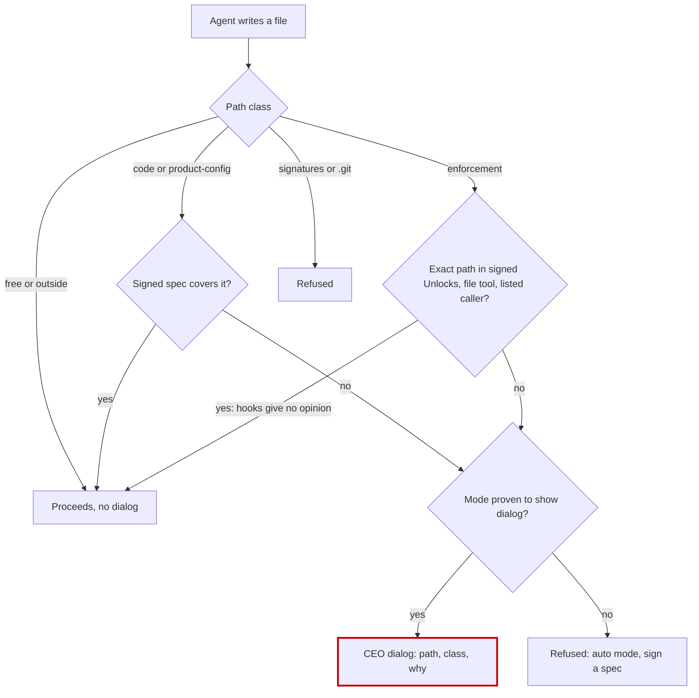
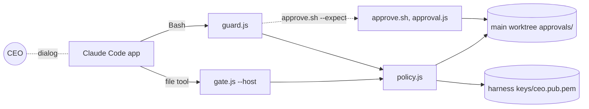
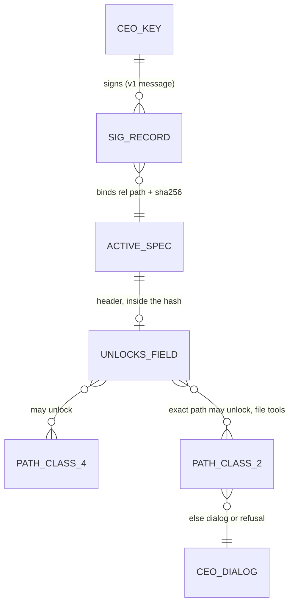
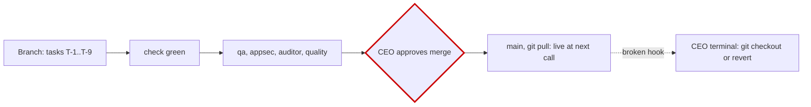
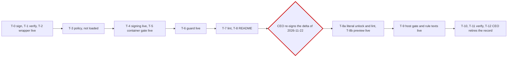

# Spec 0004 — Host enforcement: shared path policy, host signature gate, Bash write checks, signing preview, fail-closed hooks
<!-- Header fields and Status values stay English (protocol); content is written in English. -->

- Status: Draft
- Tier: full · Lane 3 (escalated from lane 2 in `docs/KARARLAR.md` rev. 48: trust-boundary finding)
- Previous spec: none (hardens the signed-spec gate of the original harness; no earlier spec is changed)
- Next spec: 0006 (`specs/draft/0006-harness-unit-areas-evidence.md`), then 0005 (`specs/draft/0005-harness-consistency-cleanup.md`). Order: **0004 → 0006 → 0005**.
- Inputs: design `docs/architecture/tasarim/0004-host-enforcement.md`; architecture board opinion `docs/architecture/gorus-0004-host-enforcement-2026-11-21.md` (CONDITIONAL APPROVE, conditions board-K1..board-K9; where the board and the design disagree, the board wins); `docs/KARARLAR.md` rev. 48.
- Self-critique: done (adversarial read, §14). Spec-critic and appsec rounds 2 and 3: done (round 3: spec-critic "signable on severity", appsec PASS WITH CONDITIONS; no Critical, no Type 1); every finding folded into this revision (map in §14). Q-1 and Q-2: closed by the CEO (`docs/KARARLAR.md` rev. 48). Re-opened after signature by a delta (2026-11-21, CEO decision, `docs/KARARLAR.md` rev. 48 "Spec 0004 fark planı": REQ-37, map in §14): the signature given on the text of commit `6951d7b` does not cover this text; spec-critic round 4 (delta only, 2026-11-21): "delta signable", its five items folded in; the signature is void until the CEO re-signs. Re-opened a second time by a delta (2026-11-22, CEO decision "always `auto`", `docs/KARARLAR.md` rev. 48, last entry; map in §14 "Delta 2026-11-22 (always-auto)"): the signature given on the text with sha256 `9f1371e1ae39…` does not cover this text; gate round on the delta done (2026-11-22; spec-critic round 5, delta only: "delta signable"; appsec: PASS WITH CONDITIONS; no Critical, no High; record `docs/kanit/0004-delta-kapi.md`), its findings D-1..D-8, S-01..S-03, S-05, S-06 and I-02 folded into this text (map in §14, "Gate round on this delta"); the signature is void until the CEO re-signs.
- Unlocks: `harness/bin/lint.js`, `harness/bin/check`, `harness/test/policy.sh`, `harness/test/host-gate.sh`, `harness/test/lint-rules.sh`, `harness/test/run.sh`, `harness/test/guard.sh`, `harness/test/fixtures/*.json`, `harness/test/*.js`, `harness/README.md`, `templates/spec-tam.md`, `templates/spec-hizli.md`, `.claude/rules/routing.md`, `CLAUDE.md`, `.claude/settings.json`, `harness/policy.js`, `harness/gate.js`, `harness/guard.js`, `harness/approval.js`, `harness/bin/approve.sh`, `harness/bin/install-project.sh`
- Enforcement files this spec changes (class 2; delta 2026-11-22: each is named by its exact path in the `Unlocks:` line above, the last eight entries, so that from T-9 on a file-tool edit of it passes without a dialog while this spec is validly signed, REQ-8; no other enforcement file is opened by this spec): `harness/policy.js` (new), `harness/gate.js`, `harness/guard.js`, `harness/approval.js`, `harness/bin/approve.sh`, `harness/bin/install-project.sh`, `.claude/settings.json`, **`CLAUDE.md` (rule 1 text, §7.6; the CEO's signature on this spec is the approval for that text)**. Not in this list and not in `Unlocks:` (delta 2026-11-22, S-02): `harness/container-settings.json`, which only T-2 changed (the `|| exit 2` wrapper on the container gate command; done and committed), so no later task needs it opened and it stays closed.
- Code-class files this spec changes (signature covers them): `site/index.html` (regenerated by `node harness/bin/site-data.js --write`, see §12 rule 3).
- Numbering note: specs 0002 and 0003 reserve "0004" for the Tower job "visual realism and guided tour". That number is taken by this spec (and 0005, 0006 by the harness job). The Tower job needs a new number (0007 or later); 0002 (in `specs/done/`) and 0003 are not edited here.

## 1. Intent
CEO's words (as relayed by the Chief of Staff, rev. 48): "I want to approve everything", "but I want to be able to grant an explicit exception occasionally." CEO decision on the exception (2026-11-21, Q-1 = A): "an exception is given only through the permission dialog for now: no edit without a signature or a dialog click; a small exception is one click per edit, an exception for a whole job is a quick spec plus a one-click signature." CEO decision on permission modes (2026-11-21, Q-2 = yes, rev. 48): when an unsigned edit needs the dialog and `permission_mode` is `acceptEdits`, `auto` or `bypassPermissions`, the hook refuses ("switch to default mode or sign a spec"; for signing, key, installer and repair commands, which have no path: "switch to default mode or run the command in his own terminal"; exact texts in §7.7); a mode a real session proves to show the dialog is added to the list by a signed change; when the mode is not reported, the hook asks. CEO risk acceptance (2026-11-21): the CEO key stays passphrase-less; the host controls stop accidents, not a malicious agent with Bash; no absolute claims; every known gap is listed. CEO decision on the mode of work (2026-11-22, rev. 48, last entry; delta 2026-11-22): "ben bu manuel geçişlerini istemiyorum her zaman auto" (I do not want these manual switches, always auto). Sessions always run in permission mode `auto`; the CEO does not switch modes. In `auto` a hook "ask" opens no dialog (T-1 finding B-1) and is refused under Q-2, so the per-edit dialog of Q-1 is not reached in practice and the only human act is the signature, which the CEO gives in his own terminal (preview, then `--expect`). So that the enforcement files of a job can still be edited, an enforcement file that a validly signed spec names by its exact path in `Unlocks:` is edited without a dialog; a glob never opens one; the signature directory, the keys and git metadata are opened by no header; the signing preview lists the enforcement entries apart. The main session's objection (the brake itself opens with one signature; with the passphrase-less key this stays at "stops accidents") is recorded in `docs/KARARLAR.md`; the CEO decided knowing it.

Interpretation, kept separate. Today the signature gate (`harness/gate.js`) runs only in the agent container (`harness/container-settings.json:26-31`). On the host only `guard.js` is wired (`.claude/settings.json:19-36`); its file-tool branch asks only for a fixed list of enforcement files (`guard.js:50,73-77`). So an unsigned code edit on the host passes without a dialog, although `.claude/rules/routing.md:36` says the gate is enforced where `install-project.sh` ran, and `install-project.sh:15` does not wire the gate. The gate and the guard disagree about what is protected (`gate.js:32` vs `guard.js:50`). Unit definitions, playbooks, verification tooling and templates can be changed on the host without the CEO.

Success: where the hook set of this spec is installed and the workspace has a `specs/` folder, an edit on the host by a file tool or by a recognised Bash writer to code or product configuration is not allowed silently by the hooks unless a signed active spec covers it; otherwise the CEO gets a dialog, or, in a permission mode where the dialog is not proven to appear, a clear refusal. An edit to an enforcement file is not allowed silently by the hooks (dialog, or refusal where the dialog is unproven, as in `auto`), also without `specs/`, with one exception (delta 2026-11-22): a file-tool edit of an enforcement file that the validly signed single active spec names by its exact path in `Unlocks:` passes; a Bash writer to an enforcement file is asked whatever the header says. The wired write checks (host gate for file tools, guard for Bash) classify paths through one shared module. The CEO sees what he signs (path, short hash, `Unlocks:` list) before the signature exists, whenever he signs through `approve.sh`. A gate or guard that crashes or cannot start blocks the call instead of passing (by the `|| exit 2` wrapper on the host hooks and on the container gate command, proven on the host in T-1); stop, loop and notify stay fail-open. All of this raises the bar against accidents; it does not stop an agent that works around it. What is not covered is listed one by one (§8, G-1..G-22).

Deliberately NOT done here: per-unit write areas, subagent evidence, the `stop.js` precedence and evidence commands, the QA write rule and rule 3 text (all in spec 0006); exception notes, waivers, `waive.sh`, a use log (deferred by the CEO, rev. 48); signature format v2, project id, issue-time rules (rejected, board-K1); resolved-path or hash detection of signing scripts (rejected, board D-4b); `cd` tracking, `$TMPDIR`, `-t` and `git checkout`/`git restore` targets in Bash detection (later, board-K4); a pinned hook copy outside the repo (design D-5b, later); mobile engineer units (after this job); key hardening; consistency items (spec 0005).

## 2. Market summary (Product)
None. Internal harness job, no market question. Claude Code hook behaviour (exit code 2 blocks, exit code 1 is a non-blocking error, `permissionDecision: "ask"`, payload fields `permission_mode`, `agent_type`, `agent_transcript_path`) is taken from documentation as summarised in `docs/GEREKSINIM-ANALIZI.md` and the design; it was **not observed** in this repository. Task T-1 records it on the host before any code (board-K6).

## 3. Requirements (EARS)
Threat level for every requirement below: the host hooks raise the bar against accidents and honest mistakes; they do not stop an agent with Bash that tries to get around them (rev. 48, §8).

Shared policy and path classes
- REQ-1 — The system shall decide every host and container write check (file tool or recognised Bash writer) through one shared policy module used by both the gate and the guard.
- REQ-2 — The system shall give every write target one final class out of the table in §7.1 (hard-deny, enforcement, product-config, free, code, outside; nested root re-roots and is never final) by the rule "classify both the lexical and the resolved path, stronger class wins" (§7.1.1), with Unicode NFC normalisation on every platform, case-insensitive matching of rows 1, 2 and 4 on every platform except that the carve-outs from row 2 (row 3 and the `.claude/` members of row 4) match with exact case, and case-insensitive matching of row 5 and of `Unlocks:` globs on macOS and Windows only.
- REQ-3 — The system shall classify as hard-deny or enforcement every path whose lexical or resolved form today's guard enforcement pattern (`guard.js:50`) matches, compared case-insensitively, at any depth, as an absolute path and with any suffix the pattern allows (for example `harness/gate.js.bak`), so the enforcement class is never narrower than today's guard (board-K8).
- REQ-4 — If resolving a path fails for a reason other than "does not exist", then the system shall refuse the write (host and container).

Host gate for file tools
- REQ-5 — When a file-tool write on the host targets a code path and the single active spec has no valid CEO signature, the system shall not allow it silently: it shall ask the CEO, naming the path, the class and the number of active specs found (subject to the permission-mode rule, REQ-28).
- REQ-6 — When the single active spec has a valid CEO signature, the system shall allow a code-path write on the host without a dialog.
- REQ-7 — When a file-tool write on the host targets a product-config path, the system shall allow it without a dialog only if the signed active spec's `Unlocks:` header names a matching glob; otherwise it shall ask the CEO.
- REQ-8 — When a file-tool write on the host targets an enforcement path, the hooks shall give no opinion on it (exit 0, no output, no dialog from them) only if the single active spec has a valid CEO signature and its `Unlocks:` header names that path by a literal entry (no `*`, no `?`) equal to its exact root-relative path, under the conditions of §7.3 "Literal enforcement entries", the caller condition included (delta 2026-11-22, S-01); otherwise the system shall ask the CEO for every edit (subject to REQ-28). (Delta 2026-11-22; before: asked whatever the signature and the header said. Delta 2026-11-22, D-3: worded "the hooks give no opinion", before "the system shall allow it without a dialog"; whether the edit then proceeds is decided by the app's own permission handling in `auto`, a second decider whose outcome this spec does not specify, §12 rule 4. Bash writers: REQ-22. Container: REQ-17, refused.)
- REQ-9 — When a file-tool write targets the signature directory or git metadata, the system shall refuse it (host and container).
- REQ-10 — The system shall allow free-class writes (`specs/`, `docs/`, `plans/`, `STATE.md`) without a signature on the host and in the container.
- REQ-11 — Where a workspace has no `specs/` directory, the system on the host shall give no opinion on code and product-config paths without making any git lookup, and shall still apply the enforcement and hard-deny classes.
- REQ-12 — Where a path is outside the workspace and not in the enforcement class, the system on the host shall give no opinion.

Root, identity and records
- REQ-13 — The system on the host shall take the workspace root from the project directory the app reports, else from the call's working directory, and shall read signature records from the main worktree of that root and the CEO public key from the main worktree of the harness in use, never from a linked worktree copy.
- REQ-14 — If the git lookup of the workspace fails while the root contains git metadata and the root has a `specs/` directory, then the system on the host shall refuse code and product-config writes with "git lookup failed (fail closed)" and still allow free-class writes; if the harness directory contains git metadata and the lookup of its main worktree fails, then the system shall refuse code and product-config writes with "harness key lookup failed (fail closed)"; a harness directory without git metadata reads the key from its own `keys/`.
- REQ-15 — The system on the host shall ignore the test environment variables `COMPANY_PUBKEY`, `COMPANY_HARNESS_DIR` and `COMPANY_SPEC`.
- REQ-16 — The system shall keep signature format v1 (message, record fields, file name) unchanged (board-K1).
- REQ-35 — Where the workspace root on the host is a linked git worktree and the lookup of its main worktree ran (the root has a `specs/` directory, REQ-11) and succeeded (else REQ-14 applies; the remaining gap is G-15, Ruling R-18), the system shall classify a path that lies under the main worktree root and not under the workspace root against the main worktree root (§7.1, main-root rule), never as outside.

Container
- REQ-17 — While running in the container, the system shall apply the same classes with every "ask" turned into a refusal, refuse outside paths and all of `.claude/`, ignore the `specs/` directory rule of REQ-11, and keep today's environment handling, so that every existing case in `harness/test/run.sh` passes unchanged.
- REQ-18 — While running in the container, the system shall apply exactly the deltas to today's decisions listed in §7.1 ("Container deltas versus today") and no others: enforcement paths that were "code" are refused; product-config paths outside `.claude/` need a matching `Unlocks:` glob; `plans/**` and `STATE.md` are allowed without a signature; a path whose resolved form (symlink) or case-folded form falls in a stronger class takes that class; a free path that resolves outside the workspace is refused; a resolve error other than "does not exist" is refused.

`Unlocks:` header
- REQ-19 — The system shall read the `Unlocks:` list only from the bytes whose signature it verified, by the grammar in §7.3; if any glob in the field is invalid, the system shall ignore the whole field.
- REQ-20 — The system shall never treat an `Unlocks:` glob (an entry containing `*` or `?`) as authority over an enforcement-class path, and shall treat no entry, glob or literal, as authority over a locked path (the signature directory, the keys, git metadata and, delta 2026-11-22, D-2, the home and session configuration whatever the root, `.claude/settings.local.json` and `harness/bin/ceo-keygen.sh`; §7.3 condition 3); lint shall fail an active spec whose header is invalid, names a glob that matches an enforcement-class path, names a locked path by a literal entry, or names an enforcement path in another case than the known path (§7.3). A literal entry that names an enforcement path in its exact case is valid (delta 2026-11-22; before: every entry that matched an enforcement path failed lint).

Bash writes
- REQ-21 — When a Bash command contains a recognised writer (§7.4) whose target is a code or product-config path that is not authorised, the guard shall ask the CEO, as for file tools.
- REQ-22 — When a recognised Bash writer targets an enforcement or hard-deny path, or a Bash command runs one of the installers `install-global.sh` or `install-project.sh` (they write enforcement paths from inside a script, §7.4), the guard shall ask the CEO (subject to REQ-28), whatever the signature and the `Unlocks:` header say: a literal enforcement entry (REQ-8) does not unlock a Bash writer (stated by the delta of 2026-11-22; behaviour unchanged).
- REQ-23 — The guard shall give no opinion for writer targets in the OS temp directories, `/dev/null` and the other device paths in §7.4, for descriptor duplications (`2>&1`, `>&2`), for read operands of copy-like commands, for `>` characters inside quoted strings, and for targets it cannot resolve literally (unless the target text, taken as a literal path, falls in rows 1-2 by §7.1.1).
- REQ-24 — The guard shall keep every existing envelope rule and every existing decision asserted by `harness/test/guard.sh`.
- REQ-33 — When one Bash command triggers several rules, the guard shall evaluate all of them, emit only the strongest decision (deny > ask > none) and name in its reason every rule that produced that decision.
- REQ-34 — When a git command carries global options before its subcommand (`git -C <dir> push`, `git -c k=v push`, `git --git-dir=<d> push`), the guard shall apply its existing envelope rules to that subcommand as if the options were absent, judging the current branch in the directory the options name (§7.4); when a `-c` or `--config-env` value, or a `git config` argument, names a hook path, editor, credential or alias key, or a git command is preceded by a git environment override (`GIT_DIR=`, `GIT_WORK_TREE=`, `GIT_CONFIG_*=`, `GIT_EXEC_PATH=`), the guard shall ask the CEO (§7.4).
- REQ-36 — When a push refspec names a protected branch with a leading `+` (`+main`) or with `refs/heads/` after the colon (`HEAD:refs/heads/main`), or an `rm` command carries `--recursive`, the guard shall apply its existing envelope rule (push to a protected branch; recursive deletion) as for `main` and `-r` (§7.4).
- REQ-37 — When the command word of a git, `gh` or `rm` command is written with a path (`/usr/bin/git`, `/opt/homebrew/bin/gh`, `/bin/rm`), when `rm` follows command wrappers (`sudo rm`), or when a `git push` argument is a cluster of short flags containing `f` or `d` (`-uf`, `-fu`, `-df`), the guard shall apply its existing envelope rules (the git rules; the gh rules; recursive deletion; force or delete push) as for `git`, `gh`, `rm`, `-f` and `-d`; when a `git push` carries `--all`, `--branches`, `--tags` or `--follow-tags`, the guard shall ask the CEO on every branch; a refspec that is `HEAD` or `@` with no colon shall be judged by the current branch, as a bare push, and a refspec with an empty source (`:x`) shall count as `--delete` (§7.4).

Signing preview
- REQ-25 — The system shall let the CEO preview, without reading the key, the spec path, the first 12 hex digits of its SHA-256 (sha12), the `Unlocks:` list, with the entries that open enforcement files listed apart under a marked heading (§7.5; delta 2026-11-22), and the header lint findings.
- REQ-26 — When the signing command carries an expected sha12, the guard shall show the path, the sha12 and the `Unlocks:` list, with the entries that open enforcement files named apart (§7.5; delta 2026-11-22), in the dialog text (subject to REQ-28); if the sha12 does not match the file at that moment, or the command also carries `--preview`, the guard shall refuse.
- REQ-27 — The signing script shall refuse to sign without an expected sha12, with a mismatching sha12, with both `--preview` and `--expect`, with an invalid header, or with a literal `Unlocks:` entry that names a locked path (§7.3; delta 2026-11-22); the signing tool shall sign exactly the bytes whose hash it compared.

Permission modes (Q-2, CEO decision closed in rev. 48)
- REQ-28 — When the policy decides "ask", or the guard asks for a signing, key or installer command (§7.7 scope), or for a repair command (REQ-29), and the app reports a permission mode in which a hook dialog is not proven to appear (`acceptEdits`, `auto`, `bypassPermissions`, or any value other than `default`, `plan` and the modes proven in T-1), the system shall refuse with a message that names the mode and the ways forward; when the app reports no permission mode, the system shall ask (board-K7).

Fail closed
- REQ-29 — If the gate's (host or container) or the guard's entry file cannot run (syntax error, missing file, empty project directory) or the policy module fails to load, then the system shall block the call rather than let it pass; the guard shall instead ask for a Bash call when only the policy module failed, so the CEO can allow one repair command; that repair ask follows REQ-28 (refused in an unproven mode: repair outside the session, §10).
- REQ-30 — The stop and notification hooks shall keep failing open.

Wiring and texts
- REQ-31 — Where the host hooks are installed, exactly one hook shall decide file-tool writes (the host gate), so one edit never produces two dialogs (board-K5).
- REQ-32 — The system shall document each known gap of §8 in `harness/README.md` under "Bilinen boşluklar", and the routing rule and constitution rule 1 shall describe the host gate without absolute claims, and only from the task that wires it (T-9).

## 4. User experience
No screens. The only "screen" is the app's permission dialog (text produced by the hooks) plus the output of `approve.sh --preview`.

### What does the CEO see when an agent writes a file on the host?

Description: a signed spec silences in-scope edits; everything else that matters asks the CEO or is refused; sessions run in `auto`, where every ask is a refusal (delta 2026-11-22: the enforcement branch and the `auto` label; D-3: on the enforcement branch "proceeds" means that the hooks give no opinion, and the app's own permission handling in `auto` decides after them, §12 rule 4; S-01: "listed caller" is the caller condition of §7.3, condition 6). Text equivalent:

| Path class | Signed spec covers it | Result on the host |
|---|---|---|
| free, outside | n/a | proceeds, no dialog |
| code / product-config | yes | proceeds, no dialog |
| code / product-config | no | CEO dialog (proven mode) or refusal (unproven mode; `auto`, in which sessions run) |
| enforcement (delta 2026-11-22) | yes: file tool, `Unlocks:` names the exact path, and the caller is the main session or a listed engineer unit (§7.3; S-01) | the hooks give no opinion: no output, no dialog from them; the app's own handling in `auto` decides next (§12 rule 4; D-3) |
| enforcement | no: not named, named only by a glob, reached through a symlink, a locked path, a caller outside the list of §7.3 condition 6 (S-01), or a Bash writer | CEO dialog (proven mode) or refusal (unproven mode; `auto`) |
| signatures, `.git` | never | refused |

Dialog states and their criteria (owner of every message: the hook that emits it; `gate.js` for file tools, `guard.js` for Bash; dialog text Turkish, refusal text to the agent English, as today):
- asking: reason names the root-relative path (quoted as in §7.8, because the agent chooses it), the class and what is missing (active spec count, or "not in `Unlocks:`") → AC-3, AC-9; a Bash command that triggers several rules shows one dialog whose reason lists each of them (REQ-33) → AC-9. For an enforcement path (delta 2026-11-22) the reason keeps the class label `(enforcement)` and names the condition of §7.3 that is not met (no validly signed single active spec, with the count; not named by its exact path in `Unlocks:`; reached through a symlink; a locked path; a caller outside the list of condition 6, delta 2026-11-22, S-01; a Bash writer) → AC-16.
- allowed: no output → AC-3, AC-9; a literally unlocked enforcement file (delta 2026-11-22; D-3: the hooks give no opinion, and an app refusal after that is handled by §12 rule 4) → AC-16.
- refused (hard-deny, unproven mode, git lookup failed, resolve error): exit 2, English reason → AC-3, AC-4, AC-10.
- headless run: the app refuses an "ask" because nobody can answer (existing app behaviour, unchanged; not tested here).
- error: internal fault → exit 2 "internal error (fail closed)" → AC-11.
- signing: dialog shows `"<rel>" · sha <sha12> · Unlocks: <list>` (path and globs quoted as in §7.8) → AC-8; preview output → AC-7; enforcement entries apart in the preview and in the dialog (delta 2026-11-22) → AC-17. With sessions in `auto` the signing dialog is not reached: the CEO signs in his own terminal (§7.5).

## 5. Acceptance criteria
"check" = covered by `./harness/bin/check`. "manual" = evidence recorded by hand as stated.

- [ ] AC-1 — (check) `harness/test/policy.sh` classifies a fixed matrix (real symlinks built in a temp tree, temp `HOME`) with at least two paths per class of §7.1, including: a symlink inside the workspace pointing at `.claude/settings.json` → enforcement; a new file under a symlinked directory → class of the directory's target (if stronger) else its lexical class; `CLAUDE.md` as a symlink to `AGENTS.md` → enforcement; `CLAUDE.md` as a symlink to `docs/x.md` → enforcement; the reverse, `docs/x.md` as a symlink to `../CLAUDE.md` → enforcement; `<home>/.claude/settings.json` as a symlink to `<home>/dotfiles/s.json` → enforcement; `approvals` as a symlinked directory pointing into the temp dir, file `approvals/x.json` → hard-deny; the reverse, `/tmp/<t>/l` as a symlink to `<ws>/approvals`, file `/tmp/<t>/l/x` → hard-deny; `src/out.cs` as a symlink to a file outside the workspace → code; `docs/out.md` as a symlink outside → outside; `/tmp/<t>/in.cs` as a symlink into the workspace's `src/` → code; `.CLAUDE/settings.json` and `claude.md` → enforcement with platform darwin and with platform linux; `TEMPLATES/x.md` → product-config with platform linux; `DOCS/x.md` → free with platform darwin, code with platform linux (platform injected); an NFD-encoded name → same class as its NFC form; `.claude/worktrees/w1/src/a.cs` → code with `root` `.claude/worktrees/w1` in the result and in both `lexical.root` and `resolved.root`; `.claude/worktrees/w1/harness/gate.js` → enforcement; exact-case carve-outs: `.claude/Worktrees/w1/src/a.cs` → enforcement with platform linux and with platform darwin (not re-rooted), `.claude/AGENTS/x.md` → enforcement with platform linux; an injected non-ENOENT resolve error → refused. For every matrix path, `gate.js --host` and `guard.js` (as `cp /tmp/x <path>`) give consistent decisions: hard-deny → gate refuse / guard ask; enforcement → ask / ask; unauthorised code or product-config → ask / ask; free and outside → none / none.
- [ ] AC-2 — (check) Superset (board-K8): `policy.sh` extracts the `ENFORCEMENT` regular expression literal from `harness/guard.js` at test time and asserts that every path in the matrix plus these paths is hard-deny or enforcement whenever that expression matches its lexical or resolved form: `src/CLAUDE.md`, `docs/CLAUDE.md`, `/tmp/other/harness/keys/ceo.pub.pem`, `<home>/.claude/CLAUDE.md`, `<home>/.claude/settings.json`, `pkg/.github/workflows/ci.yml`, `src/approvals/x.json`, `.claude/worktrees/w1/.claude/settings.local.json`, `/tmp/other/harness/loop.js`, `/tmp/o/harness/gate.js.bak`, `src/.claude/settings.json.orig`; and, outside the expression, that `/tmp/other/harness/bin/approve.sh`, `/tmp/other/harness/bin/install-project.sh`, `src/harness/bin/ceo-keygen.sh`, `<home>/.claude.json`, `<home>/.claude/agents/x.md`, `<home>/.claude/skills/s/SKILL.md`, `<home>/.claude/rules/x.md`, `<home>/.claude/commands/x.md`, `<home>/.claude/hooks/x.sh`, `<home>/.claude/plugins/p/x.json` and, with `CLAUDE_CONFIG_DIR` set to `/tmp/<t>/cfg` in the injected env, `/tmp/<t>/cfg/agents/x.md` and `/tmp/<t>/cfg/settings.json` are enforcement (the last two are temp paths: row 2 wins over the temp rule of §7.4).
- [ ] AC-3 — (check) `harness/test/host-gate.sh`, host mode, file tools: unsigned code write → exit 0 with `permissionDecision: "ask"` and a reason containing the relative path and "0" (active spec count); validly signed → exit 0, no output; spec edited after signing → ask; two active specs → ask, reason contains "2"; product-config path listed in the signed `Unlocks:` → no output; product-config path not listed → ask; `.claude/settings.json` and `harness/gate.js` with a signed spec (temp tree, throwaway key) whose `Unlocks:` is `.claude/**, harness/**` → ask (the globs are ignored for row-2 paths); `approvals/x` and `.git/config` → exit 2; `specs/x.md`, `docs/x.md`, `plans/x.md`, `STATE.md` unsigned → no output; `/etc/hosts` → no output; workspace without `specs/`: `src/a.cs` → no output, `CLAUDE.md` → ask; missing `file_path` or unreadable input → exit 2; a `file_path` `src/a` + newline + `OK imzalı.cs` → ask whose reason contains the path as a JSON string literal (`\n` escaped, no raw newline in the reason, §7.8). Replay of the file-tool paths of `guard.sh:105-116` through `gate.js --host` in a workspace without `specs/` (as `guard.sh` uses): `harness/guard.js`, `harness/loop.js`, `harness/gate.js`, `.claude/settings.json`, `harness/container-settings.json`, `CLAUDE.md`, `.github/workflows/check.yml` and the relative `file_path` `harness/guard.js` (resolved against `cwd`) → ask; `approvals/0001.sig` → exit 2 (row 1, tighter than today's ask); `.claude/skills/scouting/SKILL.md`, `harness/test/guard.sh`, `docs/KARARLAR.md` → no output.
- [ ] AC-4 — (check) `host-gate.sh` root and identity, with a copy of the harness `*.js` in a temp non-git directory holding a throwaway public key: `CLAUDE_PROJECT_DIR` = workspace and `cwd` = a subdirectory → the active spec and records are found; a linked git worktree with an empty own `approvals/` and a valid record in the main worktree → signed code write allowed; a throwaway key set in `COMPANY_PUBKEY` that signed the spec, with the harness key differing → still ask (variable ignored); `COMPANY_SPEC` naming a second file → ignored; root with `.git` present and `git` made to fail (PATH stub) → code and product-config exit 2 with "git lookup failed", `docs/x.md` → no output; the same failing `git` in a root without `specs/` → `src/a.cs` no output (REQ-11 before the git lookup); a temp harness copy that contains `.git` while `git` fails → code write exit 2 with "harness key lookup failed". Main-root rule (REQ-35), with `CLAUDE_PROJECT_DIR` = a linked worktree outside the main tree that has `specs/`, no signature: `<main>/src/x.cs` → ask (not "no output"), with the main root named in the reason; `<main>/.claude/agents/x.md` → ask; `<main>/CLAUDE.md` → ask; `<main>/docs/x.md` → no output; `policy.classify` of `<main>/src/x.cs` reports `root` = the main root in the result, `lexical.root` and `resolved.root`; with a valid record for the main tree's single active spec, `<main>/src/x.cs` → no output.
- [ ] AC-5 — (check) Container mode (no `--host`): all existing cases of `harness/test/run.sh` pass unchanged; new cases, one per delta: signed spec + `harness/gate.js` → exit 2; signed spec + `src/CLAUDE.md` → exit 2; signed spec + `.github/workflows/x.yml` → exit 2; signed spec without `Unlocks:` + `harness/bin/x.sh` → exit 2; signed spec with `Unlocks: harness/bin/x.sh` + `harness/bin/x.sh` → exit 0; signed + `Unlocks: .claude/agents/**` + `.claude/agents/x.md` → exit 2; unsigned `plans/x.md` and `STATE.md` → exit 0; signed spec + `src/link.cs` as a symlink to `../harness/gate.js` → exit 2 (today 0: resolved-path delta); signed spec + `.CLAUDE/settings.json` → exit 2 (today 0: case-fold delta); signed spec + `src/features/approvals/x.ts` → exit 2 (today 0: nested `approvals/` delta, a product folder of that name included; A-10, G-22); no case ever prints `permissionDecision`.
- [ ] AC-6 — (check) Header grammar (`policy.sh`, driver on `policy.parseHeader` / `policy.matchGlob`): valid list with and without backticks parses; `**` matches zero or more segments, `*` and `?` stay within a segment; `- Unlocks:` twice → whole header invalid; each of `{a,b}`, `[ab]`, `!x`, `../x`, `/abs`, `~/x`, `$X/y`, `a**`, `./x` → field ignored and an error returned; matching is case-insensitive only with platform darwin and with platform win32 (case-sensitive with platform linux); a spec signed, then edited only in its `Unlocks:` line → no unlock (signature invalid). `harness/test/lint-rules.sh` (`COMPANY_LINT_ROOT`): a fixture is a copy, in a temp dir, of the tracked repository tree (the working-tree files `git ls-files` lists) plus only the change under test, so every other lint rule passes on it; the unchanged fixture → exit 0 (baseline); every negative case asserts exit 1 **and** the `FAIL` line of its own rule id (§9), not only a non-zero exit; this applies to every `lint-rules.sh` case of AC-6, AC-11, AC-12 and AC-13. Cases: an active spec with an invalid header → `FAIL  unlocks-header`; an active spec whose glob matches an enforcement path (`harness/**`, `.claude/**`, `**/CLAUDE.md`) → `FAIL  unlocks-row2`; a draft spec with the same header → a `WARN  unlocks-header` line, no `FAIL` line, exit 0; the real repository → exit 0; with `COMPANY_LINT_ROOT` set, lint prints `LINT ROOT OVERRIDDEN: <path>` as its first line; `harness/bin/check` unsets `COMPANY_LINT_ROOT` before it runs lint (asserted on the file text).
- [ ] AC-7 — (check) `approve.sh` and `approval.js` (`run.sh` additions, temp `HOME`): `approve.sh <ws> --preview` with no key under `HOME` → exit 0 and prints exactly the five lines of §7.5 (a spec with no literal enforcement entry; with one, AC-17, delta 2026-11-22); `approve.sh <ws>` without `--expect` → exit 2, prints the preview command, no record written; `--expect` with a wrong sha12 → exit 5, no record; `approve.sh <ws> --preview --expect <right sha12>` (either order) → exit 2, no record; with an invalid header → exit 2, no record; with the right sha12 → record written in the main worktree's `approvals/` and `approval.js verify` prints `APPROVED`; `approval.js sign` without `--expect` behaves as today (existing `run.sh` cases unchanged); `approval.js sign ... --expect <wrong>` → exit 5, no record.
- [ ] AC-8 — (check) `guard.sh` additions: `approve.sh <ws> --expect <right sha12>` → ask, reason contains the relative spec path, the sha12 and the `Unlocks:` list; `--expect <wrong>` → exit 2 and the reason contains `--preview`; `--expect` with a non-literal workspace (`$W`) → exit 2; `approve.sh <ws> --preview --expect <right sha12>` → exit 2; `approve.sh <ws> --preview` alone → no opinion; `approve.sh . --preview && approve.sh .` → ask; `approve.sh . --preview && cat ~/.company/keys/ceo.key.pem` → ask (the preview exemption covers only its own segment); existing cases at `guard.sh:68-77` pass unchanged.
- [ ] AC-9 — (check) `guard.sh` additions, Bash writers, workspace with `specs/` and no signature, `CLAUDE_PROJECT_DIR` set explicitly by the new helper, which runs a temp copy of the harness `*.js` holding a throwaway public key (as AC-4; the real CEO key is never used): ask for each of `echo x > src/a.cs`, `echo x > "src/a.cs"`, `echo x >> src/a.cs`, `printf x | tee src/a.cs`, `cp /tmp/a src/a.cs`, `mv src/a.cs src/b.cs`, `rm src/a.cs`, `ln -s /tmp/a src/a`, `chmod 644 src/a.cs`, `chown me src/a.cs`, `truncate -s 0 src/a.cs`, `dd if=/tmp/a of=src/a.cs`, `install /tmp/a src/a`, `touch src/a.cs`, `unlink src/a.cs`, `sed -i s/a/b/ src/a.cs`, `sed -i '' 's/a/b/' src/a.cs` (BSD form), `perl -i -pe s/a/b/ src/a.cs`, `cat > src/a.cs <<'EOF'`, and for `echo x > .claude/agents/x.md`, `cp /tmp/a harness/bin/check`, `cp /tmp/a harness/test/x.sh`, `cp /tmp/a evals/x.md`, `cp /tmp/a templates/x.md`; no opinion for `echo x > docs/a.md`, `echo x > specs/a.md`, `echo x > /tmp/a`, `echo x > /private/tmp/a`, `echo x > /var/folders/ab/T/a`, `echo x > /dev/null`, `make 2>&1`, `echo x >&2`, `cp src/a.cs /tmp/b`, `echo x > $OUT/a.cs`, `git commit -m "a -> b"`, `echo "x > y"`, `sed -i '' 's/a/b/' docs/a.md` (the empty word is the backup suffix, not a target), `cat harness/bin/install-global.sh`; ask for the installers `sh harness/bin/install-global.sh` and `./harness/bin/install-project.sh /tmp/p`; combined command `echo x > src/a.cs; git push origin main` (feature repo) → one ask whose reason names both `src/a.cs` and the push to main; with a signed spec: `echo x > src/a.cs` → no opinion, `echo x > CLAUDE.md` → ask; on the host the test variables are ignored: unsigned spec, `COMPANY_PUBKEY` naming a throwaway key that did sign it, harness key differing → `echo x > src/a.cs` still ask; `COMPANY_SPEC` naming a second, signed spec while two specs are active → still ask; workspace without `specs/`: `echo x > src/a.cs` → no opinion; main-root rule (REQ-35), `CLAUDE_PROJECT_DIR` = a linked worktree outside the main tree, no signature: `cp /tmp/a <main>/src/x.cs` → ask. Git global options (REQ-34, envelope rules of `guard.js:112-133`): ask for `git -C <feat repo> push origin main`, `git -c core.x=y push origin main`, `git --git-dir=<feat repo>/.git push --force origin feat/0007-x`, `git --no-pager reset --hard HEAD~1`, `git -C <feat repo> rebase main`, `git -C <feat repo> tag v1`, run from the feature repo; `git -C <main repo> commit -m x` run from the feature repo → ask (branch judged in the `-C` directory); `git -C <temp parent> -C main-repo commit -m x` run from the feature repo → ask (several `-C` combine); `git -C <feat repo> commit -m x` run from the main repo → no opinion. Config and environment (REQ-34): ask for `git -c core.hooksPath=/dev/null commit -m x`, `git --config-env=core.hooksPath=H commit -m x`, `git -c alias.x=push x origin feat/0007-x`, `git config alias.p push`, `GIT_DIR=<main repo>/.git git commit -m x` and `env GIT_WORK_TREE=/tmp/w git status`, each run from the feature repo; no opinion for `git -c color.ui=never log` run from the feature repo. Refspecs and recursive deletion (REQ-36), from the feature repo: ask for `git push origin HEAD:refs/heads/main`, `git push origin +main`, `git push origin +HEAD:refs/heads/main`, `rm --recursive build` (run from a feature repo without `specs/`, so the envelope rule alone decides); no opinion for `git push origin +feat/0007-x` and `git push origin HEAD:refs/heads/feat/0007-x`. Command word, flag clusters and all-refs pushes (REQ-37), run from a feature repo without `specs/` (the writer rule gives no opinion there, so the envelope rule alone decides): ask for `git push -uf origin feat/x`, `git push --all`, `git push --branches`, `git push --tags`, `git push --follow-tags`, `/usr/bin/git push origin main`, `/opt/homebrew/bin/gh pr merge 12` (no `gh` on the test path, as `guard.sh:48`: base unknown), `/opt/homebrew/bin/gh release create v1`, `/bin/rm -rf build`, `sudo rm -rf build`; no opinion for `git push -u origin feat/x`, `/usr/bin/git status`, `/opt/homebrew/bin/gh pr view 12`, `sudo rm x.txt`; `git push origin HEAD` and `git push -u origin HEAD` → ask from the main repo, no opinion from the feature repo; `git push origin :feat/old` → ask. All existing `guard.sh` cases pass unchanged.
- [ ] AC-10 — (check) Permission modes (Q-2, CEO decision), in `host-gate.sh` and `guard.sh` additions (guard part through the temp harness copy of AC-9): for an "ask" decision, `permission_mode` `default` and `plan` → ask; `acceptEdits`, `auto`, `bypassPermissions`, `somethingNew` → exit 2 with a reason naming the mode and containing "switch to default mode or sign a spec" (path text of §7.7); field absent → ask; every mode in the policy's exported `ASK_MODES` → ask, and `ASK_MODES` minus `default`, `plan` is excluded from the deny list above (its match with the T-1 record is a manual cross-check in T-11); a "no output" decision is unchanged in every mode; an existing envelope ask (`git push origin main` on a feature repo) → ask in every mode; `echo x > src/a.cs; git push origin main` with `acceptEdits` → exit 2 naming the mode (the earlier envelope ask does not pre-empt the refusal); `approve.sh <ws> --expect <right sha12>` with `acceptEdits` → exit 2 naming the mode, and with the field absent → ask; the other signing, key and installer asks (§7.7 scope) with `acceptEdits` → exit 2 naming the mode, containing "switch to default mode or run the command in his own terminal" (path-less text of §7.7) and not containing "sign a spec", and with the field absent → ask, for each of `./harness/bin/approve.sh ~/proj` (no `--expect`), `node harness/approval.js sign specs/active/0001.md approvals k.pem`, `./harness/bin/ceo-keygen.sh`, `cat ~/.company/keys/ceo.key.pem`, `sh harness/bin/install-global.sh`. No hook ever emits an allow: in every new case of `host-gate.sh`, `guard.sh` and the `policy.sh` consistency loop the output never contains `"permissionDecision":"allow"`, and `policy.sh` asserts on the source of `gate.js`, `guard.js` and `policy.js` that every `permissionDecision` value written is `"ask"` (an allow would skip the app's permission rules).
- [ ] AC-11 — (check) Fail closed: `policy.sh` asserts in the source of `gate.js` and `guard.js` that the `uncaughtException` handler line comes before the first `require(` (board-K6); with a temp harness copy whose `policy.js` throws at load: `gate.js --host` file write → exit 2, `guard.js` with `ls` → ask, with `git push origin main` → ask, with `ls` and `permission_mode` `acceptEdits` → exit 2 naming the mode (repair ask refused in an unproven mode); garbage input → exit 2 for both; `lint.js` fails (`FAIL  hook-wrapper`) when a gate or guard command in `.claude/settings.json` or the gate command in `harness/container-settings.json` lacks the `|| exit 2` suffix, or a stop command has it; `sh -c '<the exact gate command string from .claude/settings.json>'` with `CLAUDE_PROJECT_DIR` pointing at a tree without `harness/gate.js` → exit 2; `sh -c '<the exact gate command string from harness/container-settings.json>'` on the host, after asserting that `/harness/gate.js` does not exist there (the case fails loudly if it does) → exit 2. (manual part in AC-13: the app's behaviour on exit 1 vs 2.)
- [ ] AC-12 — (check) Wiring: `.claude/settings.json` has `node "$CLAUDE_PROJECT_DIR/harness/gate.js" --host || exit 2` for matcher `Write|Edit|MultiEdit|NotebookEdit`, guard only for `Bash` (with `|| exit 2`), loop/notify/stop as today; `lint.js` fails (`FAIL  host-gate-owner`) when the host gate is missing for any of the four tools, when any other PreToolUse entry with a file-tool matcher runs `gate.js` or `guard.js` (one owner), or when the guard is not wired for Bash; `install-project.sh` run into an empty temp project writes a hook set that contains at least the gate, guard, loop, notify and stop entries of `.claude/settings.json` above, with absolute harness paths; run into a project with an existing `.claude/settings.json` → exit 1 and its output contains at least the three entries to merge by hand (gate `--host` with wrapper, guard with wrapper, removal of guard's file-tool entry); both assertions are "contains at least", so a later spec may add entries without editing this test.
- [ ] AC-13 — (manual + check) T-1 record `docs/kanit/0004-t1.md` (Turkish) states, each with the command used and the observed result: the PreToolUse payload keys for a main-session and a subagent file write; the SubagentStop payload keys; the `permission_mode` value in each of `default`, `acceptEdits`, `auto`, `bypassPermissions`, `plan`; for each mode whether an always-ask throwaway hook shows a dialog; that a hook exiting 1 does not block and the same hook with `|| exit 2` blocks (syntax-error entry and missing entry); behaviour with an empty `CLAUDE_PROJECT_DIR`; the host `git --version`; the `CLAUDE_PROJECT_DIR` and `cwd` a worktree-isolated subagent sees; whether Write and Edit on an existing symlink (scratch directory only) replace the link or write through to its target (the §7.1.1 rule covers both; the record says which happens). (check) The fixtures `harness/test/fixtures/pretooluse-main.json`, `pretooluse-subagent.json`, `subagentstop.json` exist, parse, and `lint.js` fails (`FAIL  fixture-sanitized`) if any fixture matches `/Users/`, `/home/[a-z]`, or a UUID pattern.
- [ ] AC-14 — (check) Texts: `harness/README.md` has a section `## Bilinen boşluklar` containing every id G-1..G-22 of §8 and a section describing the classes, the strength order and the rule "classify both the lexical and the resolved path, stronger class wins"; `templates/spec-tam.md` and `templates/spec-hizli.md` carry an optional `- Unlocks:` header line (these from T-8); `.claude/rules/routing.md` contains the exact lane-0 and last-line texts of §7.6; `CLAUDE.md` rule 1 equals the exact text of §7.6 (these from T-9, together with the wiring they describe; texts as amended by the delta of 2026-11-22); (delta 2026-11-22, from T-8b) in `harness/README.md` the section `## Yol sınıfları` contains the rule name "an exact path may open an enforcement file, a glob never does" (§7.3), the section `## CEO nerede ve nasıl imzalar` contains the words `ENFORCEMENT FILES THIS SIGNATURE OPENS` (§7.5), and the section `## İzin kipi ve onay penceresi` exists; (delta 2026-11-22, D-4, from T-8b) the G-1 row of the table in `## Bilinen boşluklar` contains `Unlocks:`; `lint.js` checks each of these strings.
- [ ] AC-15 — (manual; rewritten by the delta of 2026-11-22: observations in `auto` by the main session alone instead of dialog observations in `default` mode with the CEO) First run after wiring (T-10), made by the main session alone (for (e): by a unit the main session starts; delta 2026-11-22, S-01) on the host with the session in `auto` mode (the `permission_mode` value the refusals name is part of the record) while this spec is the validly signed single active spec. Each observation is recorded in `docs/kanit/0004-t1.md` with the tool call or command and the verbatim hook output (method: Ruling R-24): (a) no signed active spec: after `mkdir -p .claude/worktrees/t10-probe/specs` (a scratch nested root, §7.1 row 3, with zero active specs, in a git-ignored directory), a Write of the new file `.claude/worktrees/t10-probe/src/a.cs` is refused once, by one `BLOCKED by company gate:` message carrying the path text of §7.7 with `"src/a.cs"` and mode `auto` (one refusal, not two), and the file does not exist afterwards; (b) signed active spec: a Write of the new scratch code file `t10-probe.txt` in the workspace root passes with no hook output, and `rm t10-probe.txt` afterwards gets no opinion; (c) enforcement file not named in `Unlocks:`: a Write of the new file `harness/t10-probe.js` (row 2 by the R-relative member `harness/*.js`; named in no header) is refused once with the path text of §7.7, and the file does not exist afterwards; (d) enforcement file named literally: an Edit that adds one comment line to `harness/bin/install-project.sh` and a second Edit that removes it both pass with no hook output, and so do an Edit that adds one line (an HTML comment) at the end of `CLAUDE.md` and a second Edit that removes it (delta 2026-11-22, D-3: the constitution file is probed too; for each of the four Edits the record states that the hooks printed nothing and whether the app then applied the edit; if the app itself refuses one, §12 rule 4 applies: record, stop and report, no workaround); (e) caller condition (delta 2026-11-22, S-01): a unit outside the caller list of §7.3 condition 6 that has the Edit tool (`scout`), started by the main session with the single brief to add one comment line to `harness/bin/install-project.sh`, is refused once, by one `BLOCKED by company gate:` message carrying the path text of §7.7 with `"harness/bin/install-project.sh"` (the `permission_mode` and `agent_type` of that call are part of the record), and the file is unchanged afterwards. After `rmdir .claude/worktrees/t10-probe/specs .claude/worktrees/t10-probe`, and `rmdir .claude/worktrees` as well when the `mkdir -p` of (a) created that directory and it is empty (delta 2026-11-22, I-02: no empty directory is left behind), `git status --short` prints nothing. `host-gate.sh --bench` (200 calls) prints p95 latency per call, target < 150 ms on the CEO's Mac (relative measurement, assumption A-3). If p95 ≥ 150 ms, AC-15 fails: T-10 records the value, stops and reports it to the main session with a delta proposal (for example one git lookup per call instead of two); the hooks stay wired, because slow is not unsafe. If an observation differs (no refusal, two refusals, a refusal without the `BLOCKED by company gate:` text, a dialog, hook output where none is expected, or, delta 2026-11-22, D-3, a refusal by the app itself of an edit the hooks gave no opinion on), AC-15 fails: T-10 records it, stops and reports; nothing is unsigned, unwired or weakened to make it pass.
- [ ] AC-16 — (check; added by the delta of 2026-11-22) Literal enforcement authority (REQ-8, REQ-20, REQ-22, §7.3), in a temp tree with a throwaway key and a temp harness copy as in AC-4 and AC-9. `host-gate.sh` additions, workspace WL with one active spec whose `Unlocks:` is `CLAUDE.md, harness/gate.js, templates/**, harness/keys/k.pem, approvals/x.json, src/approvals/y.json, .git/config`: unsigned → `CLAUDE.md` and `harness/gate.js` ask; signed → `CLAUDE.md` no output with each of Write, Edit, MultiEdit and NotebookEdit, `harness/gate.js` no output, and `CLAUDE.md` no output with each `permission_mode` of AC-10 (`default`, `plan`, `acceptEdits`, `auto`, `bypassPermissions`, `somethingNew`, absent); `.claude/settings.json` (not named) → ask whose reason contains `(enforcement)` and `Unlocks:`, and with `permission_mode` `auto` → exit 2 with exactly the path text of §7.7 for `".claude/settings.json"`; locked paths get no authority: `harness/keys/k.pem` → ask, `src/approvals/y.json` → ask, `approvals/x.json` → exit 2, `.git/config` → exit 2; exact case: `claude.md` → ask; symlinks (real ones, built in the tree): `docs/l.md` pointing at `../CLAUDE.md`, target `docs/l.md` → ask; in a second signed workspace whose `Unlocks:` is `CLAUDE.md, AGENTS.md, harness/gate.js, harness/guard.js`, with `CLAUDE.md` a symlink to `AGENTS.md` and `harness/gate.js` a symlink to `guard.js`: `CLAUDE.md` → ask, `harness/gate.js` → ask, `harness/guard.js` → no output; WL's spec edited after signing (one more literal entry) → `CLAUDE.md` ask; a second active spec copied in → ask, reason contains "2"; wrong spec: the single active spec signed without the entry while a signed `specs/done/0000.md` (record present) carries `- Unlocks: CLAUDE.md` → `CLAUDE.md` ask; a glob never unlocks: signed specs whose `Unlocks:` is `CLAUDE.m?`, `harness/gate.j*` or `**/CLAUDE.md` → ask for the matching path (the `.claude/**, harness/**` cases of AC-3 stay unchanged); nested root: `.claude/worktrees/w1/CLAUDE.md` → ask although WL's signed spec names `CLAUDE.md`; outside every root: a signed spec whose literal entry equals the filesystem-root-relative path of `<home>/.claude/settings.json` (temp `HOME`) → that file asks; main root (REQ-35): `CLAUDE_PROJECT_DIR` = a linked worktree, the main tree's single active spec signed and naming `CLAUDE.md` → `<main>/CLAUDE.md` no output, `<main>/harness/gate.js` (not named) → ask; a signed workspace naming `CLAUDE.md`, with `.git` present and `git` made to fail (PATH stub, as AC-4) → `CLAUDE.md` ask (no authority, Ruling R-22); workspace without `specs/` → `CLAUDE.md` ask (as AC-3). Added by the gate round (delta 2026-11-22), still `host-gate.sh`. Same root (D-1): a signed workspace reached through a symlinked parent (`CLAUDE_PROJECT_DIR` = `<t>/link/ws`, `<t>/link` a symlink to `<t>/real`) that names `CLAUDE.md` → `CLAUDE.md` no output (`resolved.root` equals `realpath(lexical.root)`); `CLAUDE_PROJECT_DIR` = a linked worktree LW whose single active spec is signed and names `CLAUDE.md`, with `<LW>/CLAUDE.md` a symlink to `<main>/CLAUDE.md` (equal root-relative path, lexical root LW, resolved root the main root) → ask. Locked whatever the root (D-2), each named by a literal entry of the signed single active spec: `.claude/settings.local.json` → ask; `harness/bin/ceo-keygen.sh` → ask; with the temp `HOME` equal to the workspace root: `.claude/settings.json` → ask, `.claude.json` → ask, `.company/x.json` → ask; with `CLAUDE_CONFIG_DIR` = `<ws>/cfg` in the hook's environment: `cfg/agents/x.md` → ask; in a signed workspace whose `HOME` is elsewhere and whose spec names `.claude/settings.json` by a literal entry → `.claude/settings.json` no output (the lock follows the `<cfg>` member, not the file name). Caller (S-01), WL signed, target `CLAUDE.md`: `agent_type` absent → no output; `agent_type` `polyglot-engineer`, `dotnet-engineer`, `react-engineer` and `devops-sre` → no output each; `agent_type` `scout` → ask whose reason contains `(enforcement)`, and with `permission_mode` `auto` → exit 2 with the path text of §7.7; `agent_type` `somethingNew` → ask. Nested root pair (D-8): `.claude/worktrees/w2/` holding, as its single active spec, a byte-identical copy of WL's signed spec at the same relative path → `.claude/worktrees/w2/CLAUDE.md` no output (the main worktree's record validates the copy); `.claude/worktrees/w3/` whose single active spec differs from that copy by one byte → `.claude/worktrees/w3/CLAUDE.md` ask. `policy.sh` additions (driver on `policy.decide` and `policy.unlockKinds`, platform injected): a named `CLAUDE.md` → allow with platform darwin and with platform linux; `claude.md` against the entry `CLAUDE.md`, and `CLAUDE.md` against the entry `claude.md` → ask with both platforms; an NFD-encoded entry opens its NFC-encoded target; `kind: "bash"` on a named path → ask; `unlockKinds` puts `CLAUDE.md`, `harness/x.js` and `.mcp.json` in `enforcement`, `approvals/x.json`, `.git/config`, `harness/keys/k.pem` and `src/approvals/y.json` in `locked`, `templates/**`, `harness/**` and `src/a.cs` in `other`; added by the gate round (delta 2026-11-22): `unlockKinds` puts `.claude/settings.local.json` and `harness/bin/ceo-keygen.sh` in `locked`, with the injected home equal to the root also `.claude/settings.json`, `.claude.json` and `.company/x.json`, and with an injected `CLAUDE_CONFIG_DIR` of `<root>/cfg` also `cfg/agents/x.md` (D-2); `decide` for a named `CLAUDE.md` with `agentType` `scout` → ask, with `agentType` absent or `devops-sre` → allow (S-01). `guard.sh` additions, WL signed: `echo x > CLAUDE.md`, `cp /tmp/a harness/gate.js` and `sed -i '' 's/a/b/' CLAUDE.md` → ask each, and with `permission_mode` `auto` → exit 2 naming the mode (a Bash writer is never unlocked). `run.sh` additions (container): signed spec with `Unlocks: harness/gate.js, CLAUDE.md` → `harness/gate.js` exit 2 and `CLAUDE.md` exit 2. No new case prints `"permissionDecision":"allow"`. The two exact-text cases `host-gate.sh:230` and `guard.sh:361` assert the path text of §7.7 as amended (pre-approved replacement, §12 rule 2).
- [ ] AC-17 — (check; added by the delta of 2026-11-22) Enforcement entries are shown apart before the signature and are checked by lint (REQ-20, REQ-25, REQ-26, REQ-27). `run.sh` additions (temp `HOME`, no key for the preview): for an active spec whose header line is ``- Unlocks: `templates/**`, `CLAUDE.md`, `harness/gate.js` ``, `approve.sh <ws> --preview` → exit 0 and prints exactly eight lines: `Spec:`, `sha12:`, `Unlocks: templates/**`, the heading line of §7.5, `  CLAUDE.md`, `  harness/gate.js`, `Header lint: ok` and the `Sign with:` line; with `CLAUDE.md` as the only entry → line 3 is `Unlocks: (none)` and the block follows; with `harness/**` as the only entry (a glob) → the five lines of AC-7, no block; the existing five-line case (`run.sh:65`) passes unchanged; with the literal entry `harness/keys/k.pem` and, separately, `approvals/x.json` → `--preview` exits 0, prints no block line for that entry and a `Header lint:` finding that quotes the entry and contains `locked path`, and `--expect <right sha12>` on that spec → exit 2, no record; (delta 2026-11-22, D-6) a locked entry is not on the `Unlocks:` line either: for the header `` `templates/**`, `harness/keys/k.pem` `` line 3 is exactly `Unlocks: templates/**`, and with `harness/keys/k.pem` as the only entry line 3 is `Unlocks: (none)`; (delta 2026-11-22, S-05) an entry that contains U+202E (category Cf; written in the test by its escape) → line 3 starts with `Unlocks: INVALID:`, no block, and `--expect <right sha12>` → exit 2, no record, while an entry with the letter U+00E9 in a file name under `docs/` is printed with `é` in its place. `guard.sh` additions: `approve.sh <ws> --expect <right sha12>` for the first spec → ask whose reason contains `Unlocks: "templates/**"` and ` · Zorlama dosyalarını açar: "CLAUDE.md", "harness/gate.js"`; the same command for a spec with the literal entry `harness/keys/k.pem` → exit 2; (delta 2026-11-22, D-6) the same command for a spec whose only entry is `CLAUDE.md` (an enforcement-only header) → ask whose reason contains ` · Unlocks: yok · Zorlama dosyalarını açar: "CLAUDE.md". `; the existing AC-8 cases (`guard.sh:309`, `guard.sh:323`) pass unchanged. `lint-rules.sh` additions (fixture and assertion rules of AC-6): an active spec with `` `CLAUDE.md`, `harness/gate.js`, `harness/x.js`, `.mcp.json`, `harness/container-settings.json`, `templates/**` `` → exit 0, no `FAIL` line, `ok    unlocks-row2`; each glob twin `` `CLAUDE.m?` ``, `` `harness/gate.j*` ``, `` `harness/?.js` ``, `` `.mcp.jso?` `` and `` `templates/**`, `harness/container-settings.jso?` `` → `FAIL  unlocks-row2`; each locked literal `` `approvals/x.json` ``, `` `.git/config` ``, `` `harness/keys/ceo.pub.pem` `` and `` `src/approvals/x.json` `` → `FAIL  unlocks-row2`; wrong case `` `claude.md` `` → `FAIL  unlocks-row2` (the existing `HARNESS/GATE.JS` case stays unchanged); a draft spec with `` `harness/keys/ceo.pub.pem` `` → `WARN  unlocks-row2`, no `FAIL` line, exit 0; a draft spec with `` `CLAUDE.md` `` → no `WARN` line for it; the real repository (this spec's header with its eight literal enforcement entries; nine before S-02) → exit 0. In `lint-rules.sh:101` the two literal items (`` `.mcp.json` `` and `` `templates/**`, `harness/container-settings.json` ``) leave the negative loop and `lint-rules.sh:106` (`` `harness/x.js` ``) is reversed; each is re-asserted above as valid, next to a glob twin that still fails (pre-approved replacement, §12 rule 2).
- [ ] AC-18 — (manual: a command check, not part of `./harness/bin/check`; added by the delta of 2026-11-22, S-02) The unlocked window is bounded. At the end of each of T-8a, T-8b, T-9 and T-10 the task report quotes two commands and their output, and in T-11 `qa-engineer` and `appsec` each run them again: `git status --short -- CLAUDE.md .claude/settings.json harness/policy.js harness/gate.js harness/guard.js harness/approval.js harness/bin/approve.sh harness/bin/install-project.sh` (the eight enforcement files this spec names) prints nothing, and `git log --oneline <re-sign commit>..HEAD -- <the same eight paths>` lists only the commits of T-8a, T-8b and T-9 and fix commits that a task report names (`<re-sign commit>`: the commit that holds the text the CEO re-signed). Any other line in either output fails AC-18: stop and report.
- [ ] AC-19 — (manual; added by the delta of 2026-11-22, S-03) After T-12, `ls approvals/` in the main worktree lists no record of this spec (no file name containing `0004`), and `specs/active/` no longer holds this spec.

## 6. Architecture and technology decision
No new dependency: Node built-ins (`fs`, `path`, `crypto`, `child_process`, `String.prototype.normalize`, `fs.realpathSync.native`) and POSIX `sh`; `git` is already used by `guard.js:16`. Architecture board: CONDITIONAL APPROVE; conditions board-K1..K9 are folded in (map in §14). ADR to file (board): "Path class taxonomy" (shared contract of gate, guard, stop, lint, templates; `Unlocks:` grammar; "container = host table with ask→deny"; "hooks fail closed with `|| exit 2`"), from `templates/ADR.md`, by `architecture-board`, before signature. No ADR for the signature format (unchanged).

### Which parts decide a write on the host?

Description: both PreToolUse hooks ask one policy module; the policy reads signature records and the public key from main worktrees; dialogs come from the app. Text equivalent:

| Component | Responsibility | Class |
|---|---|---|
| `harness/policy.js` (new) | resolve root and main worktree, classify a path, parse the header, decide allow / ask / deny / none for (mode, kind, class, authority, permission mode) | enforcement |
| `harness/gate.js` | parse a file-tool event, call the policy, print the hook result; `--host` selects host mode | enforcement |
| `harness/guard.js` | envelope rules (unchanged), Bash writer targets → policy, signing dialog with preview | enforcement |
| `harness/approval.js` | v1 sign/verify (unchanged), `verifyBuffer`, `sign --expect` | enforcement |
| `harness/bin/approve.sh` | `--preview`; sign only with `--expect` | enforcement |

### Options and choices
| Decision | Options | Choice and rationale | Cost / risk |
|---|---|---|---|
| Exception (Q-1) | A per-edit dialog only; B unsigned waiver; C signed waiver; E signed exception note | **A (CEO, 2026-11-21)**: nothing new to build; a whole-job exception is a quick spec + one signature; board: E adds no boundary at the accepted risk level | many clicks for a many-file exception; clicks leave no record beyond the transcript (G-13) |
| Signature format | v1 unchanged; v2 with project id and issue time | **v1 (board-K1)**: v1 already binds path + hash; v2 would break BUILD mode in the container (board B1) and the green order (B2) | cross-project replay of a record is not covered (not an accident case; G-19) |
| Signing preview | print after signing; dialog shows path/sha12/`Unlocks:` and `--expect` binds the click to the bytes; sign only in own terminal | **dialog + `--expect`** (board D-2 APPROVE): prevents signing the wrong bytes by accident | guard reads the spec (small cost) |
| Bash writes to code paths | ask as for file tools; leave as a gap | **ask** (board D-3, narrowed by board-K4) | some lane-0 noise; detection is text-based (G-3, G-8) |
| Signing-script detection | text regex (today); resolved path + hash | **regex (board rejects D-4b)** | `appr*.sh`, copies, symlinks remain a gap (G-4) |
| Where classification lives | one module; two copies | **one module**: the drift between `gate.js:32` and `guard.js:50` is the problem being fixed | both hooks load one more file (fail closed on load error) |
| File-tool ownership on the host | gate only (guard's file-tool entry removed); both wired with a written precedence | **gate only (board-K5)**: one dialog per edit; lint checks one owner | `lint.js:219-220` must be replaced by a stricter rule (§12 T-9) |
| `ask` in unproven modes (Q-2) | ask in every mode; ask only in proven modes, deny elsewhere, ask when the field is absent | **second (design D-7b + board-K7; CEO Q-2 = yes, rev. 48)** | lane-0 edits refused in `acceptEdits` until T-1 proves the dialog; signing, key and installer commands too. Delta 2026-11-22: sessions run in `auto`, where each of these asks is a refusal, so the CEO signs in his own terminal (§7.5) and an unsigned code edit waits for a signed spec (A-12) |
| Symlinks | classify the resolved path only; the lexical path only; both, stronger class wins | **both, stronger class wins (§7.1.1)**: resolved-only loses today's lexical coverage (`guard.js:75` tests the unresolved path), lexical-only loses symlink tricks | one more classification per call (no I/O beyond `realpath`) |
| Glob breadth cap (design: at most 20 globs) | cap; no cap | **no cap (Ruling R-15)** | a long list is harder to read in the dialog |
| Hooks load from the working tree | status quo + listed gap; pinned copy under `~/.company` | **status quo (board D-5a)** | an edit to a hook acts at the next call (G-1) |
| Non-company workspaces | apply rows 4/6 everywhere; only where `specs/` exists | **only where `specs/` exists** (Ruling R-3) | removing `specs/` switches rows 4/6 off (G-12) |

Rulings (Type 2, invisible or test-preserving implementation details):
- Ruling R-1: `guard.js`'s file-tool branch (`guard.js:73-77`) and the immediate `ask`/`deny` helpers it uses (`guard.js:62-66`) stay byte-identical; after T-9 that branch is no longer wired on the host — `guard.sh:105-116` assert its current answers (for example `.claude/skills/...` → allow), routing it through the policy would change them — cost if wrong: dead code until a later cleanup. Because `guard.sh:105-116` then test unwired code, AC-3 replays the same paths through the wired `gate.js --host`, so what the suite proves about the live hook does not shrink.
- Ruling R-2: a signing command without `--expect` still gets "ask" from the guard (as `guard.sh:68` asserts; in an unproven permission mode a refusal, §7.7) and `approve.sh` itself refuses it — keeps the existing test, which sets no permission mode — cost: one wasted click.
- Ruling R-3: rows 4 and 6 apply on the host only where the root has a `specs/` directory — keeps `guard.sh:75` (`cat > note.md <<'EOF'` in a repo without `specs/`) green in CI and avoids dialogs in unrelated repos — cost: G-12.
- Ruling R-4: the main worktree is found with `git -C <root> rev-parse --git-common-dir` (output resolved against the root) instead of `--path-format=absolute` — works with git older than 2.31 — cost: none.
- Ruling R-5: on the host, records live in the main worktree's `approvals/`, and `approve.sh` writes there (identical to today when the workspace is the main worktree) — a fresh linked worktree has no git-ignored `approvals/` — cost: `company-run.sh` on a linked-worktree workspace reads that workspace's `approvals/` and falls back to PLAN mode (fail closed, G-14).
- Ruling R-6: Bash writers = today's `FILE_WRITERS` + `touch`, `unlink`; not `mkdir`, `rmdir` — no file content changes, avoids noise — cost: G-8.
- Ruling R-7: for hard-deny and enforcement checks every operand of a writer counts (as `guard.js:98` today); for code and product-config only write targets count — keeps today's coverage, avoids asking on read operands — cost: none.
- Ruling R-8: `approve.sh` refuses to sign a spec with an invalid header — a signed spec whose `Unlocks:` is silently ignored would mislead — cost: fix the header, re-preview.
- Ruling R-9: `approval.js` gains `verifyBuffer(rel, buf, approvalsDir, pubPath)`; `verify` keeps its signature and behaviour — the gate verifies and parses the same bytes (no read-twice race) — cost: none.
- Ruling R-10: lint fails invalid headers only for `specs/active/`; drafts get WARN — a draft still being written may carry a glob that overlaps row 2 (an earlier revision of `specs/draft/0005` listed `harness/bin/**`, which overlaps enforcement scripts; today's 0005 lists exact paths only), and a FAIL on drafts would turn `check` red before the draft is final — cost: drafts can carry a bad header until activated.
- Ruling R-11: the set of modes that may "ask" is `default`, `plan`, plus each mode the T-1 record shows a dialog for; the T-1 record and `harness/README.md` name the set — T-1 runs before the policy code, so no delta round is needed — cost: a wrong observation widens the set (reviewed in T-11).
- Ruling R-12: the cross-check "the `cwd` and the project dir must share one git common dir" of the design is dropped — board B6: it depends on unobserved worktree behaviour, and it would deny every `guard.sh` case when `check` runs inside a session (`CLAUDE_PROJECT_DIR` points at this repo, `cwd` at a temp repo) — cost: a cwd in another repo is classified against the project dir (its paths are "outside").
- Ruling R-13: the container branch does no git lookup and keeps `COMPANY_PUBKEY`, `COMPANY_SPEC`, `COMPANY_HARNESS_DIR` and root = `cwd` (`container-settings.json:29`, `run.sh`) — cost: none.
- Ruling R-14: rows 1, 2 and 4 match case-insensitively on every platform, except the carve-outs from row 2 (row 3 and the `.claude/` members of row 4), which match with exact case; row 5 and `Unlocks:` globs only on darwin and win32 — folding a row-1, row-2 or non-`.claude/` row-4 member can only add matches to a stronger class, and the exact-case carve-outs keep folding from moving a path out of row 2 (folded, `.claude/Worktrees/w1/src/a.cs` would re-root to code and `.claude/AGENTS/x.md` would drop to product-config, both weaker than the unfolded row 2 on linux), while folding row 5 would loosen (on linux `DOCS/x` stays code), and the container runs linux on a case-insensitive macOS bind mount where `.CLAUDE/settings.json` is the same file as `.claude/settings.json` — cost if wrong: an uppercase product-config path in the container needs an exactly-cased `Unlocks:` glob (refused otherwise, fail closed).
- Ruling R-15: no cap on the number of `Unlocks:` globs (the design's 20 is dropped) — a count does not bound breadth (one `templates/**` opens a whole tree), row 2 is never unlocked by a glob (delta 2026-11-22: only by an exact path, which the preview lists apart), lint fails any glob that reaches row 2, and the preview and the dialog show the whole list — cost if wrong: a long list the CEO reads less carefully (instruction-only control, §8).
- Ruling R-16: the guard's Bash branch records every decision in a collector and emits once at the end (REQ-33); the permission-mode rule is applied to each ask in its scope (§7.7: policy, signing, key, installer, repair) before the combination — the immediate `ask()` exit (`guard.js:62-65`) let the first rule hide later ones (an envelope ask pre-empted a policy refusal in `acceptEdits`) — cost: none for existing cases, each of which triggers one rule or ends with the same strongest decision.
- Ruling R-17: class strength order for §7.1.1 is hard-deny > enforcement > product-config > code > outside > free — a lexical code path through a symlink to outside stays code, so the host still asks (resolved-only would have given "none"), and a free path through a symlink to outside is refused in the container — cost if wrong: with a signed spec, a write through an in-workspace symlink lands outside the workspace without a dialog (G-8).
- Ruling R-18: the main-root rule (REQ-35, §7.1) uses the main worktree root the context already finds for the records (R-4), so it adds no git call; it runs only where that lookup runs (R has `specs/`, REQ-11) — when the lookup fails, code under R is already refused (REQ-14) and outside paths stay row 7 (G-15) — cost if wrong: a main-tree write from a linked-worktree session whose lookup failed gets no opinion (listed in G-15).
- Ruling R-19: for `sed -i` an empty word right after `-i`/`--in-place` is the BSD backup suffix (the macOS form `sed -i '' 's/a/b/' f`, used in `guard.sh:117`); a separate non-empty suffix (`sed -i .bak ...`) is not recognised and is read as the script, so the targets shift by one word and may ask once too often — cost if wrong: an extra ask for a word such as `s/a/b/` read as a relative code path, never a missed target.

Rulings added by the delta of 2026-11-22 (always-auto):
- Ruling R-20: a literal enforcement entry opens a path only when the lexical and the resolved classification of §7.1.1 are both row 2 against the same root (delta 2026-11-22, D-1: "the same root" is `resolved.root === realpath(lexical.root)`, the comparison `policy.js:287` already makes for `isRoot`, because `lexical.root` comes from `path.resolve(R)` and `resolved.root` from `realpath(R)` and the two strings differ when R lies behind a symlink, as a macOS temp directory does) and report the same root-relative path, and that path equals the entry byte for byte after NFC normalisation, with exact case on every platform (§7.3) — the dual-path rule stays in force for the match, a symlink can neither borrow the authority of a named file nor redirect a named path to another enforcement file, and the result does not depend on whether `realpath` returns the on-disk case — cost if wrong: an enforcement file that is a symlink or is reached through one, or that is spelled in another case than the header, is not unlocked and asks (refused in `auto`); the write is repeated with the real path as the header names it.
- Ruling R-21: the locked paths, which no header opens, are row 1 (`approvals/**`, `.git`, `.git/**`), the row-2 members `**/approvals/**` and `**/harness/keys/**`, and every row-2 path outside the roots (home configuration, `<home>/.company/**`, another repository); and, delta 2026-11-22, D-2, whatever the root: every path that is row 2 by a `<cfg>` or `<home>` member (`<cfg>/…`, `<home>/.claude.json`, `<home>/.company/**`), `.claude/settings.local.json` and `harness/bin/ceo-keygen.sh`; every other row-2 file under a root, the signing scripts `approve.sh` and `approval.js` included, can be named by its exact path — the CEO's decision names the signature directory and the keys (`docs/KARARLAR.md`, 2026-11-22), `Unlocks:` paths are root-relative so an outside path must never match by accident, and T-8b itself has to edit `approve.sh`; D-2: "keys never" held for `<home>/.company/**` and `<cfg>` only while they lay outside every root, and when a root contains them (R is the home directory, or `CLAUDE_CONFIG_DIR` lies under R) `policy.js:103-115` gives row 2 under R, which a literal entry would have opened, so the lock no longer depends on the root; the key generator and the local settings file are needed by no task of this spec — cost if wrong: a file the CEO expected to stay closed (for example `approve.sh`) can be opened by a signature; it then appears by name under the marked heading of the preview (A-14); a file locked here that a later job has to edit is edited by the CEO in his own terminal or unlocked by a delta.
- Ruling R-22: when the authority of §7.3 cannot be established (no `specs/` directory, active spec count other than 1, missing or invalid record, invalid header, failed git or key lookup; and, delta 2026-11-22, S-01, a caller outside the list of condition 6), an enforcement write keeps today's decision, ask (subject to REQ-28), with no git lookup where the root has no `specs/` (REQ-11) and no new refusal text; the container keeps refusing every enforcement path (REQ-17) — every existing enforcement case of `host-gate.sh`, `guard.sh`, `policy.sh` and `run.sh` keeps its decision — cost if wrong: none known (ask is the decision the signed text gave in all of these cases).
- Ruling R-23: the preview prints the marked block only when the header holds a literal enforcement entry, between the `Unlocks:` line and the `Header lint:` line, and otherwise prints the five lines byte for byte as before; the guard dialog gains its segment under the same condition; the gate, the preview, the dialog and lint take the entry kinds from one policy function (`unlockKinds`, §7.2), which sorts by the classification of `<root>/<entry>` and so may list an entry that the gate will not open (for example a symlinked path), never the reverse — keeps `run.sh:65`, `guard.sh:309` and `guard.sh:323` unchanged, and an entry missing from the marked list can never open an enforcement file, because the lexical class of a path does not depend on the disk; delta 2026-11-22, D-2: it does depend on the environment for the `<cfg>` and `<home>` members (`CLAUDE_CONFIG_DIR`, the home directory), and those are locked whatever the root (§7.3 condition 3), so an entry that the environment of the preview sorts as `other` is not opened in a session whose environment makes it row 2; delta 2026-11-22, D-6: an entry of kind `locked` is printed neither on the `Unlocks:` line nor in the marked block, only in the `Header lint:` finding — cost if wrong: an over-listed entry makes the CEO read one line too many.
- Ruling R-24: T-10 observes (a) through a scratch nested root (`.claude/worktrees/t10-probe/` with an empty `specs/`), (c) through a new file name `harness/t10-probe.js` and (d) through an add-and-remove edit of `harness/bin/install-project.sh` and, delta 2026-11-22, D-3, of `CLAUDE.md`, all by live tool calls of the main session through the wired hook, and, delta 2026-11-22, S-01, (e) through one Edit by a `scout` unit the main session starts, while this spec stays signed and active — row 3 re-roots the path, a root with `specs/` and zero active specs gives "active spec count 0" (`policy.js:88-90`, `policy.js:259`, `policy.js:318`; read from source, not run), so nothing is unsigned, moved aside or unwired; a probe that the hook wrongly lets through creates a harmless new file instead of changing a hook — cost if wrong: if the app or the hook treats the scratch root otherwise, (a) fails visibly and T-10 stops (fallback to propose then: a temp workspace driven through the wired command string, as the `sh -c` case of AC-11); a probe file left behind by a failed (a) or (c) is removed by the CEO in his own terminal, because the hooks refuse that cleanup in `auto`. Delta 2026-11-22, I-02 (no weakening found): `mkdir -p` may create `.claude/worktrees/` itself; when it did and the directory is empty after the probe, `rmdir .claude/worktrees` removes it too (AC-15).
- Ruling R-25: the lint change (`unlocks-row2`, §7.3) is part of T-8a, the first task after the re-signature — from the commit of this delta until T-8a lands, today's `lint.js:283-289` fails the active spec for its eight literal enforcement entries (nine before S-02; `FAIL  unlocks-row2`; read from source, not run), so `./harness/bin/check` is red by design in that window, and a second header edit to avoid it would cost a second signature — cost if wrong: none beyond the red window; T-8a starts by confirming that this is the only `FAIL` line and stops on any other.
- Ruling R-26: the path text of §7.7 changes in its parenthesis only (the enforcement clause; "keys" added to the last clause) and the path-less text does not change — "enforcement ...: no spec covers them" would be false after this delta, while "switch to default mode" stays true (the mode logic is unchanged) — cost: the two exact-text cases `host-gate.sh:230` and `guard.sh:361` are replaced with the new text (§12 rule 2); every substring assertion (`host-gate.sh:226`, `guard.sh:345`, `guard.sh:346`, `policy-driver.js:307`, and for the path-less text `guard.sh:330`, `guard.sh:360`, `policy.sh:132`) and every lint rule stays untouched (no lint rule pins either text).
- Ruling R-27: lint fails a literal enforcement entry whose spelling differs only in case from a row-2 path of the repository or of the sample list (§7.3) — the gate compares with exact case (R-20), so such an entry would open only a path spelled that way (on macOS an alias of the real file, on linux another file that is enforcement by case folding), which is not what its author meant; it also keeps the existing case `HARNESS/GATE.JS` of `lint-rules.sh:101` red — cost if wrong: a spec author corrects the spelling.
- Ruling R-28: `CLAUDE.md` rule 1 and the lane-0 line of `routing.md` (§7.6) are reworded although only the last line of `routing.md` contradicts REQ-8 — both would tell every session that an unsigned edit "gets the CEO's permission dialog", which no longer happens in the mode sessions run in — cost if wrong: two sentences to restore; no test pins them yet (their lint checks are written in T-9).

## 7. Data and API contract

### 7.1 Path classes
Root R: host = `CLAUDE_PROJECT_DIR` if set and non-empty, else `event.cwd`; container = `event.cwd`. A relative `file_path` or Bash target is resolved against `event.cwd` first (as `guard.js:75` does today). Each path is classified twice by §7.1.1, and each classification takes the first matching row, top to bottom.

Main-root rule (host only, REQ-35, Ruling R-18): when R is a linked worktree (the main worktree root found by R-4 differs from R), each of the two classifications of §7.1.1 first checks whether its path lies under the main root (lexical path under `path.resolve(mainRoot)`, resolved path under `realpath(mainRoot)`) and not under R; if so, that path is classified against the main root as its own root (its `specs/active/` and `specs/` rule, the main worktree's `approvals/`), exactly as R would be, and never falls to row 7. The root used is reported in `classify().root` and in `lexical.root` / `resolved.root` (§7.2). The container makes no git lookup (R-13), so the rule does not apply there.

Home configuration (`<cfg>`): `<home>/.claude` and, when the environment the hook runs in has a non-empty `CLAUDE_CONFIG_DIR`, that directory as well; both count at the same time.

#### 7.1.1 Classify both the lexical and the resolved path, stronger class wins
This is the single place where the rule is defined; REQ-2, the gate, the guard, lint and spec 0006 refer to it by this name.
- Lexical path: the absolute path after resolving `.` and `..` (`path.resolve`), without following symlinks, NFC-normalised; it is classified against the lexical root `path.resolve(R)`.
- Resolved path: `realpath(nearest existing ancestor) + remaining segments`, NFC-normalised; it is classified against `realpath(R)`. A resolve error other than "does not exist" → deny (REQ-4), whatever the lexical class.
- Each of the two takes one row of the table below (a nested root, row 3, re-roots and yields one of the other rows; it is never final).
- Strength order (strongest first): **hard-deny > enforcement > product-config > code > outside > free** (Ruling R-17). The final class is the stronger of the two; on a tie, the resolved path's root and relative path are reported.
- Case: rows 1, 2 and 4 match case-insensitively on every platform, except the carve-outs from row 2 (row 3 and the `.claude/` members of row 4), which match with exact case; row 5 and `Unlocks:` globs match case-insensitively on darwin and win32 only (Ruling R-14).
- The rule applies in host and container mode, to file-tool targets and to Bash writer targets alike.

| # | Class | Members | File tools, host | Bash writer target, host | File tools, container |
|---|---|---|---|---|---|
| 1 | hard-deny | R-relative `approvals/**`, `.git`, `.git/**` | refuse (exit 2) | ask | refuse |
| 2 | enforcement | the path matches today's `ENFORCEMENT` expression (`guard.js:50`, case-insensitive; right side not anchored, so `harness/gate.js.bak` and `.claude/settings.json.orig` match); anywhere (absolute path, any depth): `**/CLAUDE.md`, `**/approvals/**`, `**/harness/keys/**`, `**/.github/workflows/**`, `**/harness/{approval,gate,guard,loop,notify,policy,stop}.js`, `**/harness/container-settings.json`, `**/harness/bin/{approve,ceo-keygen,company-run,install-project,install-global}.sh`, `**/.claude/settings.json`, `**/.claude/settings.local.json`, `<cfg>/settings*.json`, `<cfg>/{agents,skills,rules,commands,hooks,plugins}/**` (every session loads them; `install-global.sh` links units there), `<home>/.claude.json`, `<cfg>/.claude.json`, `<home>/.company/**`; R-relative: `harness/*.js`, `.mcp.json`, `.claude/**` except rows 3 and 4 (exact case) | allow if the signed active spec's `Unlocks:` names the path by its exact path (§7.3 "Literal enforcement entries", REQ-8; delta 2026-11-22); else ask. Never unlocked: by a glob; the locked members `**/approvals/**` and `**/harness/keys/**` and, delta 2026-11-22, D-2, the other locked paths of §7.3 condition 3 (the `<cfg>` and `<home>` members whatever the root, `.claude/settings.local.json`, `harness/bin/ceo-keygen.sh`); a path outside every root; for a caller outside the list of §7.3 condition 6 (delta 2026-11-22, S-01) | ask; never unlocked (REQ-22) | refuse |
| 3 | nested root | R-relative `.claude/worktrees/<name>/**`, exact case | classify the rest against `R/.claude/worktrees/<name>` as its own root (its `specs/active/`, the main worktree's `approvals/`) | same | refuse (all of `.claude/`) |
| 4 | product-config | R-relative `.claude/agents/**`, `.claude/skills/**`, `.claude/rules/**` (these three exact case), `harness/**` not in row 2 (includes `harness/bin/check`, `harness/bin/lint.js`, `harness/test/**`, `harness/docker/**`, `harness/README.md`), `evals/**`, `templates/**` | allow if the signed active spec's `Unlocks:` matches; else ask | same | `.claude/` part refuse; rest allow only if signed `Unlocks:` matches, else refuse |
| 5 | free | R-relative `specs/**`, `docs/**`, `plans/**`, `STATE.md` | allow | none | allow |
| 6 | code | everything else under R | allow if exactly one active spec and it is validly signed; else ask | same | allow if signed; else refuse |
| 7 | outside | not under R, not under the main root when the main-root rule applies, and not row 2 | none | none | refuse |

Host only: where the root (R, a nested root or the main root of the main-root rule) has no `specs/` directory, rows 4 and 6 give "none" (Ruling R-3), and no git lookup is made (REQ-11 is checked before REQ-14). Every host "ask" passes through the permission-mode rule (§7.7). Decision values: `allow` (exit 0, no output), `ask` (exit 0, ask JSON), `deny` (exit 2, stderr), `none` (exit 0, no output). In the guard, all rules of one Bash command (envelope rules, signing rules, every writer target) are evaluated and only the strongest decision is emitted, deny > ask > none (the guard never emits allow, §7.8), with the reasons of every rule at that level joined by ` · ` (REQ-33, Ruling R-16).

Container deltas versus today (each has a new `run.sh` case, AC-5, or a `policy.sh` case, AC-1): row 2 paths that were code (`harness/*.js`, `harness/keys/**`, the five `harness/bin` scripts, `.mcp.json`, `.github/workflows/**`, `CLAUDE.md` at any depth, nested `approvals/` including a product folder of that name, A-10 and G-22) → refuse (tighter); `harness/**` rest, `evals/**`, `templates/**` → need `Unlocks:` (tighter); `plans/**`, `STATE.md` → allowed unsigned (looser in the gate only; in PLAN mode the read-only mount still blocks them, `company-run.sh:35`); a lexical code or free path whose resolved form is in a stronger class (for example `src/link.cs` → `harness/gate.js`) takes that class (tighter); a free path whose resolved form is outside → refuse (tighter); case-folded rows 1, 2 and 4 with exact-case carve-outs (`.CLAUDE/settings.json` → refuse; tighter); a non-ENOENT resolve error → refuse (tighter). Unchanged: `.claude/**`, `approvals/**`, `.git/**`, lexical outside, `specs/**`, `docs/**`, code (including a code path through a symlink to outside: code, as today).

### 7.2 Policy module API (`harness/policy.js`, CommonJS, no side effects at load)
| Function | Input | Output |
|---|---|---|
| `context(event, opts)` | hook event; `{ mode: "host"\|"container", env, platform, harnessDir }` | `{ mode, root, mainRoot, cfgDirs, approvalsDir, pubkeyPath, platform, permissionMode, agentType }` (`cfgDirs`: the `<cfg>` directories of §7.1, from `env`); host: `approvalsDir = mainRoot/approvals`, `pubkeyPath = mainWorktree(harnessDir/..)/harness/keys/ceo.pub.pem`; container: today's env handling (R-13); git calls `execFileSync("git", [...], { timeout: 2000 })` |
| `classify(absPath, ctx)` | absolute path | final class by §7.1.1: `{ row: 1..7, root, rel, label, lexical: { row, root, rel }, resolved: { row, root, rel } }` or throws `ResolveError` (→ deny); each `root` is the absolute root its `rel` is relative to (R, a nested root of row 3, or the main root of the main-root rule; for row 7 and for row-2 paths outside every root, `root` is the filesystem root `/` and `rel` is relative to it); delta 2026-11-22, D-1: `lexical.root` is taken under `path.resolve(R)` and `resolved.root` under `realpath(R)` (§7.1.1), so the two strings differ when R lies behind a symlink, and "the same root" in §7.3 condition 1 is defined as `resolved.root === realpath(lexical.root)` |
| `parseHeader(text)` | spec text | `{ unlocks: string[] \| null, errors: string[] }` |
| `matchGlob(glob, rel, fold)` | glob, POSIX relative path, case-fold flag | boolean |
| `decide(req, ctx)` | `{ kind: "file"\|"bash", target, event }` | `{ decision: "allow"\|"ask"\|"deny"\|"none", reason, row, rel }`; for row 2, `kind: "file"`, host mode: `allow` under §7.3 "Literal enforcement entries" (delta 2026-11-22) |
| `unlockKinds(unlocks, root, ctx)` (delta 2026-11-22) | a parsed `Unlocks:` list; the root of the spec it came from | `{ enforcement: string[], locked: string[], other: string[] }` by the entry kinds of §7.3; the one source for `decide`, `approve.sh --preview`, the guard's signing dialog and lint (Ruling R-23) |

`event.agent_type` is passed through untouched (`ctx.agentType`); its one effect in this spec is the caller condition of §7.3 "Literal enforcement entries", condition 6 (delta 2026-11-22, S-01; before: no effect in this spec); spec 0006 uses it for write areas. Tests call these functions through `harness/test/policy-driver.js` with an injected `ctx` (platform, fs errors); host-mode hooks never read `COMPANY_*` test variables.

### 7.3 `Unlocks:` header grammar
- The header is every line before the first line that starts with `## `. A field line matches exactly `^- Unlocks: (.*)$`; at most once (twice → header invalid).
- Value: comma-separated globs, each optionally wrapped in backticks, trimmed; empty items are invalid.
- Glob: POSIX relative path; segments split on `/`; `**` only as a whole segment (zero or more segments); `*` any run of characters within a segment; `?` one character within a segment; every other character literal. Invalid: braces, brackets, `!`, `.` or `..` segments, leading `/`, `~`, `$`, `**` inside a segment, empty segments, and (delta 2026-11-22, S-05; a tightening under the change rule below) any character of Unicode category Cc, Cf, Zl or Zp (control, format and bidi characters, line and paragraph separators).
- One invalid glob → the whole field is ignored (no unlock) and lint FAILs an active spec. An entry that contains `*` or `?` (a glob) is never authority for a row-2 path (the gate ignores it for that path); an entry without them (a literal entry) can be, under "Literal enforcement entries" below (delta 2026-11-22; before: no entry was). Lint FAILs an active spec when a glob matches any path that `policy.classify` puts in row 2, tested against every file in the repository plus this fixed sample list: `CLAUDE.md`, `.mcp.json`, `.claude/settings.json`, `.claude/settings.local.json`, `.claude/commands/x.md`, `.github/workflows/check.yml`, `harness/keys/ceo.pub.pem`, `harness/container-settings.json`, `harness/{approval,gate,guard,loop,notify,policy,stop}.js`, `harness/x.js`, `harness/bin/{approve,ceo-keygen,company-run,install-project,install-global}.sh`. Delta 2026-11-22, same rule id `unlocks-row2`, active FAIL and draft WARN as before (R-10): lint also FAILs a literal entry of kind `locked` (below; message: no header opens signatures, keys or git metadata) and a literal entry of kind `enforcement` that equals a row-2 path of that file-and-sample list when case is ignored but not byte for byte (`HARNESS/GATE.JS` for `harness/gate.js`; Ruling R-27); a literal entry that names an enforcement path in its exact case, or an enforcement path not yet in the list (a new file), is valid.
- **Literal enforcement entries** (delta 2026-11-22; REQ-8; rule name, used by `harness/README.md` and lint: "an exact path may open an enforcement file, a glob never does"). A file-tool write on the host to a path whose final class is enforcement is allowed without a dialog (decision `allow`: exit 0, no output, in every permission mode, like a signed code write) only when all six conditions hold (five in the text sent to the gate round; condition 6 added by S-01); otherwise the decision is the unchanged ask, subject to §7.7 (Ruling R-22):
  1. Root. Both classifications of §7.1.1, lexical and resolved, are row 2 against the same root, and that root is R, a nested root or the main root (§7.1). "The same root" (delta 2026-11-22, D-1) means `resolved.root === realpath(lexical.root)`: the lexical classification runs against `path.resolve(R)` and the resolved one against `realpath(R)` (§7.1.1), two strings that differ when R lies behind a symlink (a macOS temp directory, for example), so the lexical root is resolved before the two are compared, as `policy.js:287` does for `isRoot`; a workspace behind a symlinked parent therefore still matches, and a path whose lexical root is R while its resolved root is the main root does not. A row-2 path outside every root (home configuration, `<home>/.company/**`, another repository) is never unlocked.
  2. No symlink in the way. The root-relative path of the lexical classification equals that of the resolved classification (`lexical.rel` and `resolved.rel` of §7.2, both NFC-normalised). The match is therefore made after the same resolution the classifier uses, the rule of §7.1.1 stays in force, and a write that reaches an enforcement file through a symlink, or to an enforcement path that is itself a symlink, is not unlocked (Ruling R-20).
  3. Not locked. Neither path lies under `approvals/` or `harness/keys/` at any depth (the row-2 members `**/approvals/**` and `**/harness/keys/**`, compared without case as row 2 is). With row 1 (`approvals/**`, `.git`, `.git/**`: refused for file tools before this rule is reached) these are the locked paths: no header opens the signature directory, the keys or git metadata (Ruling R-21). Delta 2026-11-22, D-2: the lock does not depend on the root. Also locked, for the lexical and for the resolved path alike: every path that is row 2 by a `<cfg>` or `<home>` member of §7.1 (`<cfg>/settings*.json`, `<cfg>/{agents,skills,rules,commands,hooks,plugins}/**`, `<cfg>/.claude.json`, `<home>/.claude.json`, `<home>/.company/**`), also when a root contains it (R is the home directory, or `CLAUDE_CONFIG_DIR` lies under R: `policy.js:103-115` gives row 2 under R there); a path the row-2 member `**/.claude/settings.local.json` matches; and a path the row-2 member `**/harness/bin/ceo-keygen.sh` matches (both compared without case, as row 2 is).
  4. Signature. The single active spec of that root is validly signed, found by the same lookup as for rows 4 and 6: records from the main worktree's `approvals/` and the key from the main worktree of the harness (REQ-13), test variables ignored (REQ-15). No `specs/` directory (no git lookup then, REQ-11), an active spec count other than 1, a missing or invalid record, or a failed git or key lookup → no authority.
  5. Entry. The `Unlocks:` list parsed from the verified bytes (REQ-19; an invalid field gives no list) holds an entry without `*` and without `?` that equals that root-relative path byte for byte after NFC normalisation, with exact case on every platform (tighter than the fold of globs, R-14; Ruling R-20).
  6. Caller (delta 2026-11-22, S-01). `event.agent_type` is absent (the main session) or is exactly one of `polyglot-engineer`, `dotnet-engineer`, `react-engineer`, `devops-sre` (a fixed list in `policy.js`); for any other value the decision is the unchanged ask. Without this condition the authority was per path, not per caller: a unit with Write and Edit but no engineering task (`scout` and `product-manager` read the web) could have rewritten `CLAUDE.md` or `harness/gate.js` with one Edit while this spec is signed.
  Not unlocked by this rule: a Bash writer target (REQ-22: the guard asks whatever the header says, so in `auto` it is refused) and every write in the container (REQ-17: refused).
  Entry kinds (`policy.unlockKinds`, §7.2), for the spec's root: a glob is always `other`. A literal entry E is classified as `<root>/E` by §7.1.1: `locked` when its final class is row 1, or its lexical or resolved path lies under `approvals/` or `harness/keys/` at any depth, or (delta 2026-11-22, D-2) its lexical or resolved path is one of the other locked paths of condition 3 (a `<cfg>` or `<home>` member whatever the root, `.claude/settings.local.json`, `harness/bin/ceo-keygen.sh`); else `enforcement` when its lexical or its resolved classification is row 2; else `other`. An entry that can meet conditions 1 to 5 (condition 6 concerns the caller, not the entry) is always of kind `enforcement`, because the lexical classification of a path does not depend on what is on disk, and where it depends on the environment (the `<cfg>` and `<home>` members) the path is locked; the reverse does not hold (Ruling R-23).
- Matching: case-insensitive on darwin and win32 (Ruling R-14), against the root-relative path (nested roots: relative to the nested root); with §7.1.1 a product-config write is unlocked only when the glob matches the relative path of the final class. The gate parses the header from the same buffer it verified (`verifyBuffer`).
- No cap on the number of globs (Ruling R-15).
- Change rule: this grammar may later only be tightened. Any loosening (a new wildcard form, a new field that widens authority, accepting a glob that is invalid today) needs a new ADR and the re-signing of every active spec, because signed bytes keep their meaning only while the grammar that reads them does not widen. The delta of 2026-11-22 falls under this rule: the syntax is unchanged, but a literal entry gains authority over row 2. So `architecture-board` updates ADR 0001 (`docs/architecture/adr/0001-path-class-taxonomy.md`) to "Literal enforcement entries" before the re-signature, and the only active spec, this one, is re-signed. No other signed bytes gain authority: no spec under `specs/done/` carries an `Unlocks:` line, and the drafts 0005, 0006 and 0007 list product-config entries only (read 2026-11-22). Corrected by the gate round (delta 2026-11-22, D-5; the sentence said "0005, 0006, 0007 and 0009"): draft 0009 also names `CLAUDE.md` by its exact path, an enforcement entry; it is an unsigned draft with no record, so that entry carries no authority until the CEO signs 0009 with it shown (read 2026-11-22).

### 7.4 Bash writer targets (guard), board-K4 scope
Built on the existing `strip` / `segments` / `tokens` of `guard.js:41-47`; heredoc bodies stay data, the heredoc's own redirect is a target.
- Two views (Ruling R-7). **Strip view** (for code and product-config, rows 4 and 6): the command after `strip` (`guard.js:41-45`), where every quoted string is one opaque word that maps back to its unquoted content; a `>` inside quotes is never a redirect (`git commit -m "a -> b"`, `echo "x > y"` → no target). A quoted word that stands alone as a target (`> "src/a.cs"`, `cp x 'src/a.cs'`) is taken as its unquoted content; a word that mixes quoted and unquoted parts is non-literal. **Raw view** (for rows 1 and 2 only): today's loop at `guard.js:95-100`, which only removes quote characters, keeps its `ENFORCEMENT` test on every operand and every redirect word; a raw-view word that is not in rows 1-2 is ignored, so the raw view adds asks only for rows 1-2.
- Redirect targets: the word after `>` or `>>` (also `N>`, `&>`). Not targets: words starting with `&` (`2>&1`, `>&2`); `/dev/null`, `/dev/stdout`, `/dev/stderr`, `/dev/tty`, `/dev/fd/*`. `>|` is not recognised (G-17).
- Writers: `cp`, `install`, `ln` → last operand; `mv`, `rm`, `touch`, `unlink`, `tee`, `truncate` → every non-option operand; `chmod`, `chown` → non-option operands after the first; `dd` → value of `of=`; `sed -i`/`--in-place`, `perl -i` → non-option operands after the first (the script) unless `-e`/`-f` gives the script. For `sed`, an empty word (`''` or `""`) directly after `-i` or `--in-place` is the BSD backup suffix and not an operand (`sed -i '' 's/a/b/' f`: script `s/a/b/`, target `f`); `-i<suffix>` and `--in-place=<suffix>` carry their suffix in the same word (Ruling R-19). An empty word is never a target (→ none).
- Installers (REQ-22): a segment whose command word, or whose first operand after `sh`, `bash` or `zsh`, has the basename `install-global.sh` or `install-project.sh` → ask (reason: the installer writes `<cfg>` links or another project's `.claude/settings.json` from inside a script, which the guard does not read, G-3). The CEO may accept the dialog, or run the installer in his own terminal. Reading the script (`cat`, `grep`) gives no opinion.
- For rows 1 and 2, every operand of a writer and every redirect word still counts, and today's `ENFORCEMENT` test on the raw token text stays (R-7).
- Resolution: relative targets against `event.cwd`; a leading `~/` → the home directory; then §7.1.1. A target containing `$`, `` ` ``, `*`, `?`, `[`, `{` or `(` is non-literal → none (G-8), unless the row-1/2 text test matches (today's `ENFORCEMENT` test on the raw text, or the text taken as a literal path falling in rows 1-2 by §7.1.1).
- Temp (→ none): `/tmp/**`, `/private/tmp/**`, `/var/folders/**`, `/private/var/folders/**`, `realpath(os.tmpdir())/**`, applied only when the final class of §7.1.1 is outside (a temp path that resolves into R takes R's class; a root under temp, as in tests, classifies by R first).
- Git global options (envelope rules, `guard.js:112-133`): before reading the git subcommand, the guard skips git's global options: those taking a value as the next word or after `=` (`-C`, `-c`, `--git-dir`, `--work-tree`, `--namespace`, `--exec-path`, `--super-prefix`, `--config-env`) and the flags (`--no-pager`, `-p`, `--paginate`, `-P`, `--bare`, `--no-replace-objects`, `--literal-pathspecs`, `--glob-pathspecs`, `--noglob-pathspecs`, `--icase-pathspecs`, `--no-optional-locks`, `--no-lazy-fetch`); any other word starting with `-` before the subcommand is skipped as a flag. The current branch is looked up with the same `-C`, `--git-dir` and `--work-tree` options and no other option: several `-C` combine as git combines them (each relative to the one before, the first relative to `event.cwd`), and `-c`, `--config-env`, `--exec-path` and every other option are never passed to the lookup; so `git -C <main repo> commit` asks like a commit on main (REQ-34). Today `t[gi + 1]` is taken as the subcommand (`guard.js:114`), so `git -C <dir> push origin main` gets no opinion.
- Git configuration and environment (REQ-34; envelope rules, emitted in every permission mode as the existing `git config` ask is): the key of each `-c <key>=<value>` and `--config-env[=]<key>=<var>` value, and the arguments of `git config` (`guard.js:131`), are tested with today's expression `hooksPath|core\.editor|credential` extended by `^alias\.` (case-insensitive); a match → ask "git yapılandırması (kanca yolu/kimlik/takma ad)". So `git -c core.hooksPath=/dev/null commit` asks as `git config core.hooksPath` does (it would skip hooks like the denied `--no-verify`, `guard.js:92`), and `git -c alias.x=push x ...` and `git config alias.p push` ask. A segment in which an assignment word `GIT_DIR=`, `GIT_WORK_TREE=`, `GIT_EXEC_PATH=` or `GIT_CONFIG_<anything>=` comes before the `git` word (also after `env`) → ask "git ortam değişkeni geçersiz kılma" (the branch lookup would judge another repository than the one written). Aliases already defined in a config file, other command-running keys (`core.fsmonitor`, `core.sshCommand`, `core.pager`, `include.path`) and an `export` in an earlier segment are not recognised (G-8).
- Refspecs and recursive deletion (REQ-36; envelope rules, every permission mode): today `isProtected` (`guard.js:13`) removes only a leading `refs/heads/` and then everything up to the last `:`, so `HEAD:refs/heads/main` leaves `refs/heads/main` and `+main` stays `+main`, and neither is seen as protected. New order per refspec: drop one leading `+`, take the part after the last `:`, drop a leading `refs/heads/`, then compare with the protected list. The recursive-deletion rule (`guard.js:154`, `^-[a-zA-Z]*[rR]`) also matches the word `--recursive`. Each existing case keeps its decision.
- Command word, flag clusters and all-refs pushes (REQ-37; envelope rules, every permission mode; delta after signature, 2026-11-21). **Git word:** today the git rules start at the first word that is exactly `git` (`guard.js:112`), searched in the whole segment, so `sudo git push origin main` and `bash -c "git push origin main"` are found, but `/usr/bin/git push origin main` is not. New: the git rules are tried at every word of the segment that does not start with `-` and whose basename is `git` (basename as `baseCmd` takes it for the remote tools, `guard.js:53`, `guard.js:104-105`), so each command found today stays found and a path argument named `git` earlier in the segment cannot hide a later git word; "the `git` word" in the two git bullets above means such a word. An option value written in the same word (`--exec-path=/usr/lib/git`) is therefore not a git word; a value written as its own word (`git -C ~/src/git commit -m x`) is tried as one, with the branch of `event.cwd`, and may over-ask (safe side). A git word with no envelope subcommand after it (`/usr/bin/git status`) gives no opinion. **`gh` word:** the gh rules (`guard.js:134-153`) start the same way, at the first word that is exactly `gh` (`guard.js:112`), so `/opt/homebrew/bin/gh pr merge 12` and `/opt/homebrew/bin/gh release create v1` are not seen. New: the gh rules are tried at every word of the segment whose basename is `gh`, as for git; `/opt/homebrew/bin/gh pr view 12` gives no opinion. **`rm`:** today the recursive-deletion rule needs the first word to be exactly `rm` (`guard.js:154`), so `/bin/rm -rf x` and `sudo rm -rf x` are not seen. New: the rule applies when the segment's command, read as `baseCmd` reads it (`guard.js:52-53`: the first word that is not in `WRAPPERS` and does not start with `-`, by basename), is `rm` and a word after it is a recursive flag (the `--recursive` form of REQ-36 included); `sudo rm x.txt` gets no opinion from this rule. A wrapper option that takes a separate value (`sudo -u root rm -rf x`, `nice -n 10 rm -rf x`) makes `baseCmd` read the value as the command: not recognised (G-8); the git and gh rules are not affected. **Short-flag clusters:** today the force/delete test matches whole words only (`guard.js:116`), so `git push -uf origin feat/x` is not seen as a force push. New: among the arguments of `git push`, a word made of `-` and two or more letters (`^-[A-Za-z]{2,}$`) that contains a lower-case `f` or `d` counts as `-f` or `-d` (`-uf`, `-fu`, `-df` → ask; `-u`, `-uv` → no change); a push-option value written in the same word as `-o` (`-odeploy`) is read as a cluster and may ask (safe side). **`--all`, `--branches`, `--tags`, `--follow-tags`:** today no refspec is named, so the push is judged as a bare push and asks only when the current branch is protected or unknown (`guard.js:117-123`). New: a `git push` whose arguments contain the word `--all`, `--branches`, `--tags` or `--follow-tags` asks on every branch, with or without a remote or refspec: `--all` and `--branches` (git's other name for `--all`; reason "tüm dalların push'u: korumalı dal da güncellenebilir") can update a protected branch, `--tags` and `--follow-tags` (reason "etiket yayını (sürüm)") publish tags as `git tag` does (`guard.js:132`). **`HEAD`, `@` and `:x` refspecs:** today `isProtected` (`guard.js:13`) compares the word `HEAD` with the protected list and a named refspec is never judged by the current branch (`guard.js:117-123`), so `git push origin HEAD` on main is not asked, and `:feat/old` deletes a remote branch without `--delete`. New: a refspec that is `HEAD` or `@` with no colon (after a leading `+` is dropped, REQ-36) is judged by the current branch, as a bare push (ask when the branch is protected or unknown); a refspec with an empty source (`:x`) counts as `--delete`. **Lookups:** branch and PR lookups always execute `git` and `gh` from PATH (`guard.js:16`, `guard.js:23`, `guard.js:34`), never the word written in the command. Each existing case keeps its decision: no case in `harness/test/guard.sh` has a short flag on a push, `--all`, `--branches`, `--tags`, `--follow-tags`, a path-prefixed `git`, `gh` or `rm`, `rm` after a wrapper, or a refspec that is `HEAD`, `@` or `:x` (`sudo ssh host uptime`, `guard.sh:90`, is decided by the remote-tool rule).

### 7.5 Signing commands
- `harness/bin/approve.sh <ws> --preview` — no key read; guard: the `approve.sh` match gives no opinion only for a segment whose command is `approve.sh` and whose arguments contain the word `--preview` and not `--expect`; any other signing or key pattern in the command (`approval.js sign`, `.company`, `ceo.key`, `ceo-keygen`, another `approve.sh` segment) still asks; a segment with both `--preview` and `--expect` → deny `use either --preview or --expect`. Prints exactly:
  ```
  Spec: <rel path of the single active spec>
  sha12: <first 12 hex of sha256>
  Unlocks: <comma list> | (none) | INVALID: <first error>
  Header lint: ok | <finding>[; <finding>]
  Sign with: harness/bin/approve.sh <ws> --expect <sha12>
  ```
  Exit 0; exit 1 when not exactly one active spec (today's message).
  Enforcement entries apart (delta 2026-11-22, REQ-25, Ruling R-23): when the valid header holds one or more entries of kind `enforcement` (§7.3), the `Unlocks:` line carries only the other entries (`(none)` when there is no other) and, between the `Unlocks:` line and the `Header lint:` line, the preview prints this heading line exactly, then one line per enforcement entry, in header order, indented by two spaces and shown like the other values:
  ```
  ENFORCEMENT FILES THIS SIGNATURE OPENS (file-tool edits pass without a dialog while this spec is signed):
    <entry>
    <entry>
  ```
  With no such entry, and with an invalid header, the output is the five lines above, unchanged. An entry of kind `locked` is listed in neither place: it never appears on the `Unlocks:` line and never in the block (delta 2026-11-22, D-6: stated outright and asserted in AC-17; with a locked entry as the only entry the line is `Unlocks: (none)`); `Header lint:` reports it as `<entry as a JSON string> names a locked path (signatures, keys, git metadata): no header opens it`, and `--expect` then refuses (exit 2), as for an invalid header (R-8).
  Non-ASCII (delta 2026-11-22, S-05): wherever the preview or the guard's signing dialog below prints an entry, each character outside printable ASCII (U+0020 to U+007E) is printed as `\uXXXX` (UTF-16 code units), so non-ASCII in an entry is never shown as a look-alike glyph; an entry of printable ASCII is printed as before, so the five-line and eight-line outputs of AC-7 and AC-17 do not change. A character of category Cc, Cf, Zl or Zp does not get this far: it makes the header invalid (§7.3).
- `harness/bin/approve.sh <ws> --expect <sha12>` — exit 0 signed (record in `<main worktree of ws>/approvals/`); 1 no key or active spec count ≠ 1 (today); 2 usage (missing `--expect`, both `--preview` and `--expect`, invalid header, a literal entry of kind `locked`: delta 2026-11-22); 5 sha mismatch. Calls `approval.js sign <spec> <approvalsDir> <key> --expect <sha12>`.
- `harness/approval.js sign <spec> <dir> <key> [--expect <sha12>]` — reads the file once; with `--expect`, compares `sha256(buffer).slice(0,12)`; mismatch → exit 5 `REFUSED: file changed since preview`; signs that buffer. Without `--expect`: today's behaviour. Message and record: v1, unchanged (`approval.js:13,74`).
- Guard dialog for `approve.sh ... --expect <s>` with a literal `<ws>`: the guard computes the preview itself; equal → ask with reason `CEO imzası: "<rel>" · sha <sha12> · Unlocks: <list|yok>. Bu penceredeki onay, imzanın kendisidir.`, where `"<rel>"` is the spec path written as a JSON string literal and each glob of `<list>` likewise (§7.8: `JSON.stringify`, cut to 200 characters), so the example `specs/active/0004-x.md` appears as `"specs/active/0004-x.md"`; when the header holds entries of kind `enforcement` (delta 2026-11-22, REQ-26, Ruling R-23), `<list|yok>` carries only the other entries and the reason is `CEO imzası: "<rel>" · sha <sha12> · Unlocks: <list|yok> · Zorlama dosyalarını açar: <enforcement list>. Bu penceredeki onay, imzanın kendisidir.`, each entry quoted in the same way, and a header with an entry of kind `locked` is denied like an unequal sha12; unequal, or `<ws>` non-literal → deny `run harness/bin/approve.sh <ws> --preview first`. The equal-case ask passes through the permission-mode rule of §7.7 (refused in an unproven mode, so no signature is made through a dialog the CEO may not have seen). Without `--expect`: ask as today (R-2), also through §7.7; `approve.sh` itself then refuses (exit 2), so no record results. Every other ask of the signing-and-key pattern (`guard.js:90`: `.company`, `ceo.key`, `approval.js sign|keygen`, `approve.sh`, `ceo-keygen`) passes through §7.7 as well, so the weaker, unbound signing path (`approval.js sign` without `--expect`, G-4) is never treated more loosely than the bound one.
- Where the CEO signs (board watch item; rewritten by the delta of 2026-11-22): sessions run in `auto` mode (CEO decision 2026-11-22), in which every signing and key ask is refused (§7.7), so the CEO signs in his own terminal, outside any session, where no hook runs: `harness/bin/approve.sh <ws> --preview`, read the output including the marked block of enforcement entries, then `harness/bin/approve.sh <ws> --expect <sha12>`. The guard dialog above stays, unchanged in logic, for a session someone starts in a mode proven to show it (`ASK_MODES`, R-11). `harness/README.md` states this (T-8b).

### 7.6 Exact texts
The three texts below are as amended by the delta of 2026-11-22 (Ruling R-28). Changed against the signed text of 2026-11-21: rule 1, "(`harness/`); an agent" → "(`harness/`), in his own terminal; an agent", and "it gets the CEO's permission dialog, or a refusal in a mode where the dialog is unproven" → "sessions run in `auto` mode, where it is refused (in a mode proven to show the CEO's permission dialog it gets that dialog)"; lane 0, the last sentence; last line, "or any enforcement-file edit through silently (dialog, or refusal where the dialog is unproven)" → the two clauses on enforcement files and on `auto`.
- `CLAUDE.md` rule 1 (whole rule, replaces the current one): "1. **No signature, no code.** Every job starts with a spec (large job: `templates/spec-tam.md`, small job/bug: `spec-hizli.md`). Only the CEO signs a spec (`harness/`), in his own terminal; an agent does not sign and does not write to the signature directory. Where the hook set of spec 0004 is installed, the host hooks do not let an unsigned edit to code or product config through silently: sessions run in `auto` mode, where it is refused (in a mode proven to show the CEO's permission dialog it gets that dialog); an exception for a whole job is a quick spec plus one signature. The host hooks stop accidents, not a determined agent, and have known gaps (`harness/README.md`). If a signed spec changes, the signature drops: stop, write a delta plan, get it re-signed."
- `.claude/rules/routing.md` lane 0 line: "- **0** chat, trivial fix, rename, config tweak: main session; show fresh test/build output. No spec, no units. Where the hook set of spec 0004 is installed, an unsigned code edit on the host is refused in `auto` mode, in which sessions run, until a signed active spec opens it (in a mode proven to show the permission dialog it needs a CEO click)."
- `.claude/rules/routing.md` last line: "Default stack .NET + React, a preference not a restriction. Where the hook set of spec 0004 is installed (`harness/bin/install-project.sh` from spec 0004 on, or its entries merged by hand; earlier installs keep the old hooks) and the workspace has a `specs/` folder, the host hooks do not let an unsigned code or product-config edit through silently, nor an enforcement-file edit unless the signed spec's `Unlocks:` names that file by its exact path (refusal in `auto` mode, in which sessions run; a dialog in a mode proven to show it); they stop accidents, not a determined agent, and have known gaps (`harness/README.md`, Bilinen boşluklar). Elsewhere follow the pipeline by instruction and get spec approval in chat."

### 7.7 Permission-mode rule (Q-2, CEO decision, rev. 48)
Scope: a policy "ask"; every ask of the guard's signing-and-key pattern (§7.5: `approve.sh` with or without `--expect`, `approval.js sign|keygen`, key and `~/.company` access, `ceo-keygen`); the installer ask (§7.4); and the guard's repair ask when `policy.js` fails to load (§10). The guard applies the rule inline, without the policy module, to the signing, key, installer and repair asks, so it holds when `policy.js` is broken. Not in scope: the existing envelope asks (git, `gh`, remote, publish, HTTP, `rm -r`, including the extended git configuration and environment asks of §7.4) and the raw-view enforcement-regex asks (`guard.js:98-99`), which keep today's behaviour in every mode (G-9). The raw-view carve-out only matters for non-writers, i.e. words the policy does not read as a writer operand or redirect target (for example a `>` inside a quoted string, `echo "x > CLAUDE.md"`): every operand and redirect word of a recognised writer that falls in rows 1-2 is also a policy target (REQ-3, Ruling R-7), whose ask is in scope, so through the R-16 collector the same command is refused in an unproven mode (deny is stronger than the raw-view ask). Rule: `permission_mode` absent → ask; in ASK_MODES (`default`, `plan`, plus modes proven in T-1, R-11) → ask; any other value → deny with exactly one of the two texts below (the only definition of these texts; AC-10 and §1 quote substrings of them). `<rel>` is the target path as a JSON string literal (§7.8); `<mode>` is the reported value.
  - Path ask (a policy "ask" on a file-tool or Bash writer target): `BLOCKED by company <gate|guard>: the edit of <rel> needs the CEO's dialog, but permission mode '<mode>' is not proven to show it. Ask the CEO to switch to default mode or sign a spec that covers this path (code: a validly signed single active spec; product config: such a spec whose Unlocks: names the path; enforcement: such a spec whose Unlocks: names the exact path, file tools only; signatures, keys, .git: no spec covers them, default mode only).`
    (Delta 2026-11-22, Ruling R-26: only the parenthesis changed, from "enforcement, signatures, .git: no spec covers them, default mode only" to the enforcement clause and the clause "signatures, keys, .git: ..." above. Pinned as a whole by `harness/policy.js:251` and by the exact-text cases `harness/test/host-gate.sh:230` and `harness/test/guard.sh:361`, which T-8a replaces with this text, §12 rule 2. The substring assertions `host-gate.sh:226`, `guard.sh:345`, `guard.sh:346` and `policy-driver.js:307` hold for both texts. No lint rule pins it.)
  - Path-less ask (signing, key, installer or repair ask): `BLOCKED by company guard: this command needs the CEO's dialog, but permission mode '<mode>' is not proven to show it. Ask the CEO to switch to default mode or run the command in his own terminal (no hook runs there).` (Unchanged by the delta of 2026-11-22. Sessions run in `auto`, so of the two ways forward each text names, the one in use is the second: a signed spec, or the CEO's own terminal.)

### 7.8 Hook I/O (unchanged protocol)
deny = exit 2 + stderr `BLOCKED by company gate|guard: ...`; ask = exit 0 + `{"hookSpecificOutput":{"hookEventName":"PreToolUse","permissionDecision":"ask","permissionDecisionReason":"CEO onayı gerekir: ..."}}`; none/allow = exit 0, no output. Consumed fields: `tool_name`, `tool_input.file_path|notebook_path|command`, `cwd`, `permission_mode` (optional), `agent_type` (pass-through; read only by the caller condition of §7.3, delta 2026-11-22, S-01). Hook commands: `node "$CLAUDE_PROJECT_DIR/harness/gate.js" --host || exit 2`, `node "$CLAUDE_PROJECT_DIR/harness/guard.js" || exit 2` (other projects: absolute harness path, `install-project.sh`); container: `COMPANY_PUBKEY=/harness/keys/ceo.pub.pem node /harness/gate.js || exit 2` (`harness/container-settings.json:29` plus the wrapper, T-2). No hook ever writes `permissionDecision: "allow"` (it would skip the app's permission rules; AC-10). Quoting: every path, glob or command text taken from the event or from a spec file name appears in a reason as a JSON string literal (`JSON.stringify`, so quotes, newlines and control characters are escaped), cut to 200 characters with `…`, so an agent-chosen name cannot add lines or fake text to the dialog.

### Which records exist and which one decides?

Description: one signature format (v1) binds a spec's path and hash; the `Unlocks:` header is inside the hash and can open product-config paths and, by exact path only, enforcement files for file tools (delta 2026-11-22: the second `UNLOCKS_FIELD` line; before, only product-config paths); it never opens the signature directory, the keys or git metadata. Text equivalent:

| Record | Location | Written by | Git | Authoritative |
|---|---|---|---|---|
| Signature record v1 `{version:1, spec, sha256, signature, signedAt}` | main worktree `approvals/<rel with __>.sig.json` | `approval.js sign` via `approve.sh`, run by the CEO in his own terminal (delta 2026-11-22; in a proven mode also after the CEO dialog) | ignored (`*.sig.json`, unchanged) | yes; any edit of the spec voids it |
| Active spec | `specs/active/<n>.md` | business-analyst | tracked | yes, with its record |
| T-1 record | `docs/kanit/0004-t1.md` | main session with the CEO | tracked | evidence for R-11 and AC-13 |
| Fixtures | `harness/test/fixtures/*.json` | main session (T-1), sanitized | tracked | test input |

## 8. Threat model and security
Sensitive area: authorization and signing (the enforcement layer itself). No money, identity or personal data.

**Threat level (CEO, rev. 48).** The CEO key `~/.company/keys/ceo.key.pem` stays passphrase-less. On the host the gate and the guard stop accidents and honest mistakes (an agent that forgets the pipeline, a prompt-injected instruction that uses the obvious tools). They do not stop an agent with Bash that tries to get around them: `harness/bin/appr*.sh .` signs without the guard's text pattern seeing `approve.sh` (`guard.js:90`), and `node -e` / `python -c` can read the key and write any file. A host signature is a record of intent, not proof of presence. The container path is not affected: the key is never mounted and the mount mode is set by the OS (`company-run.sh:32-36`). Wording rule for this spec, `harness/README.md`, `routing.md` and `CLAUDE.md`: no absolute claims about host controls; "not allowed silently by the hooks", "raises the bar", and a pointer to the gaps below.

Trust boundaries: agent (untrusted, may be prompt-injected; the main session included) → hooks (code run by the app, loaded from the working tree on every call) → CEO dialog → signature records and key (CEO only, by instruction; see threat level). Delta 2026-11-22: with sessions in `auto` the dialog step is not reached; the boundary a session cannot cross by the obvious tools is the signature given in the CEO's terminal, and what one signature opens now includes the enforcement files its header names by exact path.

| Abuse / accident | Control | Residual |
|---|---|---|
| Unsigned code edit by a file tool on the host | host gate asks (AC-3) | unproven modes refuse until T-1 proves the dialog (G-9); writes outside R (G-15); other write-capable tools (G-16); old installs (G-18) |
| Edit of a unit definition, playbook, test or template without the CEO | product-config needs `Unlocks:` in the signed spec, else ask (AC-3, AC-9) | Bash interpreter writes (G-3) |
| Edit of the enforcement layer | row 2 asks (in `auto`: is refused) unless the signed active spec's `Unlocks:` names the file by its exact path, file tools only; a glob never opens it (AC-3, AC-6, AC-16; delta 2026-11-22) | the edit acts at the next hook call (G-1) |
| One signature can open enforcement files (delta 2026-11-22) | exact paths only, never a glob; the signature directory, the keys and git metadata are opened by no header, nor, whatever the root, the home and session configuration, `.claude/settings.local.json` and `ceo-keygen.sh` (delta 2026-11-22, D-2); only the main session and the four engineer units of §7.3 condition 6 get the authority (delta 2026-11-22, S-01); the unlocked window is checked at every task end (AC-18) and closed at ship by T-12 (delta 2026-11-22, S-02, S-03); the preview lists the enforcement entries apart under a marked heading and the dialog names them apart; no symlink, no other case; Bash writers stay asked; lint fails a locked or wrongly cased entry (AC-16, AC-17) | the CEO must read the marked list; the key is passphrase-less, so this stops accidents, not an adversarial agent with Bash, which can sign any header (G-4, G-10); an opened hook file acts at the next call with no human in between (G-1); a replayed record re-opens the files its header names (G-21; this spec's own record is deleted in T-12); row 2 in a nested root (delta 2026-11-22, D-8): a nested root (`.claude/worktrees/<name>`) whose single active spec is a byte-identical copy of the signed spec at the same relative path validates with the main worktree's record, so that worktree's copies of the named enforcement files are opened too, as its code already is (a copy that differs by one byte asks; AC-16). Accepted by the CEO (rev. 48 and 2026-11-22; the main session's objection is recorded in `docs/KARARLAR.md`) |
| Spec smuggles a broad `Unlocks:` | header inside the hash; preview and dialog show it, enforcement entries apart (AC-17); lint fails row-2 overlap by a glob (AC-6..8) | the CEO must read it |
| CEO signs other bytes than he read | `--expect` binds the click to the sha12; `--preview` with `--expect` refused; every signing and key ask, `--expect` or not, is refused in unproven modes (AC-7, AC-8, AC-10) | direct `approval.js sign` without `--expect` (G-4) |
| Forged or replayed record | `approvals/` hard-deny for file tools (AC-3) | Bash and interpreters (G-4); a record copied from another project (G-19); a finished spec moved back into `specs/active/` (G-21) |
| Symlink, case or Unicode trick | both lexical and resolved path classified, stronger class wins; rows 1, 2 and 4 case-folded everywhere with exact-case carve-outs; NFC (AC-1, AC-2, AC-5) | swap between check and write (G-20); with a signed spec, a write through an in-R symlink can land outside R; hard links (G-8) |
| Main-tree write from a linked-worktree session | main-root rule: classified against the main root, never "outside" (AC-4) | lookup failure and sibling worktrees outside the main tree (G-15) |
| Global unit or session config edited | `<cfg>/{agents,skills,rules,commands,hooks,plugins}/**` and settings are row 2; installers ask (AC-2, AC-9) | the repo copies behind the links are row 4, so an edit there reaches every project with a signature's `Unlocks:` or one click |
| One rule hides another in a combined Bash command | all rules evaluated, strongest emitted (AC-9, AC-10) | none known |
| Git global options hide an envelope rule (`git -C <d> push origin main`, `git -c core.hooksPath=... commit`, `-c alias.x=push`, `GIT_DIR=`) | options skipped, branch judged in the named directory; hook-path, editor, credential and alias keys and git environment overrides ask (AC-9) | options the guard does not know that take a value; aliases already defined; other command-running keys (G-8) |
| Crashed or missing hook entry passes the call | `|| exit 2` wrapper; handler before `require` (AC-11) | stop/loop/notify not wrapped (by design) |
| Broken policy traps the session | guard asks for one repair command; recovery path R (§10) | entry-file syntax error: repair only outside the session |

Known gaps (each goes, in Turkish, into `harness/README.md` "Bilinen boşluklar"; ids are checked by lint, AC-14):
- G-1 Hooks load from the working tree: an edit to `gate.js`, `guard.js`, `policy.js` or `stop.js` acts at the next call; a linked worktree runs its own copy. Mitigation: row 2 asks on detected edits, unless the signed spec's `Unlocks:` names the file by its exact path (REQ-8, delta 2026-11-22: such an edit passes and acts at the next call with no human in between); reviewers check row-2 diffs; the main session shows every enforcement-file diff to the CEO before commit (instruction-only). Delta 2026-11-22, S-02: the diff is shown after the edit is already live (a changed hook file acts at the next call), so showing it bounds what is committed, not what runs; AC-18 checks at each task end that no named enforcement file is left changed outside the task commits.
- G-2 A hook entry file with a syntax error or missing on disk exits 1, which the app treats as non-blocking. Mitigation: `|| exit 2` on the host gate and guard and on the container gate command (proof: T-1, on the host only; the container runs the Claude Code version pinned in `harness/docker/Dockerfile`, not observed, A-11); stop, loop and notify are not wrapped (fail open by design). Deleting the settings line is a row-2 edit.
- G-3 Inline interpreter writes are not recognised: `node -e`, `python -c`, `perl -e`, `ruby -e`, `awk` with an inner redirect, `osascript`, scripts run from temp, `bash -c "<writer>"`.
- G-4 Signing and key access through an interpreter, `appr*.sh`, a symlinked or copied signing script, or `approval.js sign` without `--expect` (not bound to a preview).
- G-5 Working-tree git operations are not classified: `git apply`, `patch`, `git am`, `git cherry-pick`, `git merge` off main, `git switch`/`checkout <branch>`, `git checkout -- <p>`, `git restore`, `git stash pop`, `git worktree add`.
- G-6 Writes into `.git/` by git itself (hooks via templates, config); `core.hooksPath` asks (`guard.js:131`) and redirects into `.git/` ask.
- G-7 Build and package tools that write as a side effect (`npm install` scripts, generators, `make`, `dotnet`, `xcodebuild`): not checked, engineers need them on the host.
- G-8 Bash targets the guard cannot see literally: variables, globs, command substitution, `eval`, `xargs`; `cd` is not followed (relative targets resolve against the call's `cwd`); `cp -t`/`--target-directory`; `$TMPDIR`; `mkdir`, `rmdir`; a symlink inside R that points outside R is classified by its in-R class (§7.1.1), so with a signed spec a write through it lands outside R without a dialog; a git global option the guard does not list that takes a separate value can make the guard read the value as the subcommand; a git alias already defined in a config file (`git p` for `push`) is not expanded; `-c`/`git config` keys that run commands other than those of §7.4 (`core.fsmonitor`, `core.sshCommand`, `core.pager`, `include.path`) and a `GIT_DIR` exported in an earlier segment are not recognised; hard links: `realpath` does not reveal them, so a write through a hard link to a row-1 or row-2 file that was made earlier, outside the session or by an interpreter, is classified by the link's own path (creating one with `ln` asks, because every operand counts for rows 1-2, R-7). A wrapper option that takes a separate value hides `rm` from the recursive-deletion rule (`sudo -u root rm -rf x`, `nice -n 10 rm -rf x`; REQ-37, §7.4) and a remote tool from the remote-tool rule (`sudo -u deploy ssh host`; `guard.js:53`, as today, no rule added). Command-word forms the envelope rules still do not see (REQ-37): a quoted command word (`"git" push origin main`: `strip` empties the quoted word, `guard.js:43`), a backslash before it (`\rm -rf x`), and, for `rm` only (a `git` or `gh` word is searched in the whole segment), a wrapper outside the wrapper set (`doas`, `timeout 5`, `xargs rm -rf`) and `bash -c "rm -rf x"` (the raw view finds a git word there, not `rm`).
- G-9 Whether the app shows a hook "ask" in `acceptEdits`, `auto`, `bypassPermissions`: unproven; policy asks, every signing and key ask (`approve.sh` with or without `--expect`, `approval.js sign|keygen`, key and `~/.company` access, `ceo-keygen.sh`), the installer ask and the repair ask are refused there until T-1 proves it (Q-2). T-1 proved `default` and `acceptEdits` and found that `auto` shows no dialog (B-1); sessions run in `auto` (CEO decision 2026-11-22), so the CEO signs in his own terminal (§7.5) and none of these asks reaches him as a dialog (delta 2026-11-22). The guard's existing envelope asks (including the extended git configuration and environment asks) and raw-view enforcement-regex asks are emitted in every mode, as today; in a mode where the app accepts an ask silently they give no CEO decision.
- G-10 The passphrase-less key: a signature is a record of intent (rev. 48).
- G-11 Bootstrap: before T-6 and T-9, edits to `policy.js`, `approve.sh` and `install-project.sh` are not asked on the host (today's guard pattern does not know them); spec 0004 itself is signed without a preview (the preview does not exist yet). Covered by review in T-11. Delta 2026-11-22: the re-signature of that delta is made before T-8b exists, so its preview shows the eight enforcement entries (nine before S-02) inside the flat `Unlocks:` line, not under the marked heading; before he signs, the main session prints the eight for the CEO by the pre-signature step of §12, computed by the committed `policy.js`, and the CEO compares that list with the header (A-13; delta 2026-11-22, S-06).
- G-12 Workspaces without a `specs/` folder get no opinion on code and product-config; removing or renaming `specs/` switches those rows off (`rm -rf` still asks; `mv specs x` asks for `x`).
- G-13 A dialog click leaves no record beyond the session transcript.
- G-14 `company-run.sh` run on a linked worktree reads that worktree's `approvals/` and falls back to PLAN mode.
- G-15 Writes outside R get no opinion on the host unless they are row 2: an absolute path into another repository or workspace, directories added with `--add-dir`, and, when `CLAUDE_PROJECT_DIR` is empty, everything outside the call's `cwd` (the `cwd` becomes R; Ruling R-12). The main-root rule (REQ-35) covers only the main tree: a sibling linked worktree outside the main tree, a linked worktree outside the main tree when R is the main worktree, and every main-tree path when the git lookup did not run (no `specs/` in R) or failed (code under R is then refused, REQ-14) stay outside (Ruling R-18).
- G-16 Write-capable tools other than `Write`, `Edit`, `MultiEdit`, `NotebookEdit` and `Bash` (MCP server tools, plugin tools) are not checked by any hook.
- G-17 Bash commands that write but are not recognised writers: `git rm`, `git mv`, `git pull`, `git revert`, `git stash apply`, `curl -o`/`--output`, `wget -O`, `tar -x`, `unzip`, `find -delete`, `sort -o`, and the `>|` redirect.
- G-18 Projects installed with `install-project.sh` before spec 0004 keep the guard-only file-tool wiring after `git pull` (their settings file is not rewritten): no host gate there until the entries printed by the new `install-project.sh` are merged by hand.
- G-19 Signature replay across projects: a v1 record binds the relative spec path and its hash, not the project; with the same CEO key, a record copied into another project with a byte-identical spec at the same path validates there (board-K1: not an accident case).
- G-20 Check-then-write race: a hook classifies a path when the call is made; a symlink swapped afterwards (by a parallel Bash call or another session) is not re-checked at write time.
- G-21 Signature replay inside the same project: records persist in `approvals/`, keyed by relative path and hash (`approval.js:14,74`), and `specs/**` is free, so moving a finished spec byte-identical back into `specs/active/` (by accident or on purpose) silently re-authorises code and its `Unlocks:` at the next call. Signature format v1 stays (REQ-16). Mitigation, owned by spec 0005: its "shipped" step includes a CEO-run retirement of the spec's approval record; until that step exists, the main session checks `specs/active/` against `specs/done/` before code work (instruction-only). Delta 2026-11-22: a header re-authorised in this way also re-opens the enforcement files it names by exact path (this spec names eight; nine before S-02), so the retirement step of 0005 matters more than before. Delta 2026-11-22, S-03: for this spec the retirement does not wait for 0005. T-12 (§12): at ship, when this spec moves to `specs/done/`, the CEO deletes this spec's record from `approvals/` in his own terminal (envelope: permanent deletion; AC-19). The record is git-ignored (`*.sig.json`), so until T-12 it stays on disk and a replay would validate.
- G-22 Product folders named `approvals`: row 2 contains `**/approvals/**`, so a product module such as `src/features/approvals/` is enforcement: every edit asks on the host and every edit is refused in the container even with a signed spec, and no `Unlocks:` opens it (A-10). Trigger: a product needs an `approvals` module → CEO decision (narrow the member, or rename the module); not narrowed here because narrowing is visible and costly to undo.

Instruction-only (no hook): that a unit follows its playbook; that the CEO reads the `Unlocks:` line and, from the delta of 2026-11-22 on, the marked list of enforcement entries in the preview; that the main session shows every enforcement-file diff to the CEO before commit (`docs/KARARLAR.md`, 2026-11-22; shown after the edit is already live, G-1, delta 2026-11-22, S-02); that no finished spec is moved back into `specs/active/` (G-21, until 0005's retirement step; this spec's own record is deleted in T-12, delta 2026-11-22, S-03); and, added by the gate round (delta 2026-11-22): that the CEO compares the list of the pre-signature step with the header before he re-signs (§12, S-06); that a task whose edit the app refuses stops and reports instead of working around it by Bash or an interpreter (§12 rule 4, D-3).

## 9. Test and evidence plan
All automated tests run under `./harness/bin/check` (new files are added to its syntax and run lists as new lines). New test helpers set or unset `CLAUDE_PROJECT_DIR` explicitly; existing helpers are not edited. Any new test that runs a hook with a signed spec uses a temp copy of the harness `*.js` holding a throwaway public key (host mode ignores `COMPANY_PUBKEY`, REQ-15, so `$HERE/guard.js` and `$HERE/gate.js` would read the real CEO public key).

| Criterion | Test | Layer | Profile |
|---|---|---|---|
| AC-1 | `harness/test/policy.sh` + `policy-driver.js` (matrix, T-3), gate/guard consistency loop (T-6) | unit + integration | quick |
| AC-2 | `policy.sh` (regex extracted from `guard.js`) | unit | quick |
| AC-3 | `harness/test/host-gate.sh` (temp harness copy, throwaway key) | integration | quick |
| AC-4 | `host-gate.sh` (temp git repo, `git worktree add`, PATH stub for git) | integration | quick |
| AC-5 | `harness/test/run.sh` existing + additions | integration | quick |
| AC-6 | `policy.sh` (parser, matcher); `harness/test/lint-rules.sh` (`COMPANY_LINT_ROOT`) | unit + integration | quick |
| AC-7 | `run.sh` additions (temp `HOME`, temp git repo for the main-worktree record) | integration | quick |
| AC-8 | `guard.sh` additions | unit | quick |
| AC-9 | `guard.sh` additions | unit | quick |
| AC-10 | `host-gate.sh`, `guard.sh` additions | unit | quick |
| AC-11 | `policy.sh` (source order T-3, broken copy T-6); `lint-rules.sh` (T-7); `host-gate.sh` (`sh -c` host and container gate commands, T-9) | integration | quick |
| AC-12 | `lint-rules.sh` (fixture settings, T-9); `host-gate.sh` (`install-project.sh` into temp dirs, T-9) | integration | quick |
| AC-13 | manual T-1 record; lint fixture rule | manual + unit | manual |
| AC-14 | `lint.js` string checks against the real files | unit | quick |
| AC-15 | manual first run by the main session alone in `auto` (five observations (a)-(e), Ruling R-24; delta 2026-11-22; four before the gate round, (e) added by S-01); `host-gate.sh --bench` (not run by `check`) | manual | manual |
| AC-16 (delta 2026-11-22) | `host-gate.sh`, `policy.sh` + `policy-driver.js`, `guard.sh`, `run.sh` additions (T-8a) | unit + integration | quick |
| AC-17 (delta 2026-11-22) | `lint-rules.sh` additions (T-8a); `run.sh` and `guard.sh` additions (T-8b) | integration | quick |
| AC-18 (delta 2026-11-22, S-02) | the two git commands of AC-18, quoted with their output in the reports of T-8a, T-8b, T-9 and T-10 and run again by `qa-engineer` and `appsec` in T-11 (not run by `check`) | manual | manual |
| AC-19 (delta 2026-11-22, S-03) | `ls approvals/` in the main worktree after T-12, quoted in the end-of-job report | manual | manual |

Lint rule ids (C-1): every new `lint.js` rule prints its id as the first word after `FAIL  ` or `WARN  `, and `lint-rules.sh` asserts that id: `unlocks-header` (AC-6), `unlocks-row2` (AC-6; AC-17 from the delta of 2026-11-22: locked and wrongly cased literal entries under the same id, no new id), `hook-wrapper` (AC-11), `host-gate-owner` (AC-12), `fixture-sanitized` (AC-13), `texts-0004` (AC-14).

Evidence for "done": fresh `./harness/bin/check` output, all green, with the counts of new tests; removed-lines evidence (S-07): `git diff -U0 <base> -- harness/test/ harness/bin/lint.js harness/bin/check | grep '^-[^-]'` lists only the `lint.js:219-220` replacement (T-9) and the `lint.js:8` `ROOT` line replaced to honour `COMPANY_LINT_ROOT` (T-7), nothing else; `qa-engineer` mutation probes on a temporary copy, each must turn a test red: remove one row-2 member; make row 4 ignore `Unlocks:`; drop the case fold; classify the resolved path only; drop `|| exit 2` from the settings; remove the gate entry from `.claude/settings.json` (lint red); make the permission-mode rule always ask; skip the `--expect` comparison in `approval.js`; restore the immediate exit on the first Bash rule; read the git subcommand as the word after `git`; drop the main-root rule; fold row 3 case-insensitively; drop the `|| exit 2` of the container gate command. Added by the delta of 2026-11-22: removed-lines evidence for T-8a and T-8b, `git diff -U0 0df2c8f -- harness/test/ harness/bin/lint.js harness/bin/check | grep '^-[^-]'` (base: the T-8 commit; delta 2026-11-22, D-7: `harness/bin/lint.js` and `harness/bin/check` added to the diff, which covered `harness/test/` only) lists only these expected removals: under `harness/test/` the four pre-approved test lines of §12 rule 2 (`host-gate.sh:230`, `guard.sh:361`, `lint-rules.sh:101`, `lint-rules.sh:106`); in `harness/bin/lint.js` lines of the `unlocks-row2` block that T-8a rewrites as §7.3 says (`lint.js:283-293` as of `0df2c8f`, §12 rule 2), while the `texts-0004` string checks of T-8b are added lines; in `harness/bin/check` none; nothing else; five more mutation probes, each must turn a test red: let a glob entry open a row-2 path; skip the signature check for a literal enforcement entry; let a Bash writer use a literal enforcement entry; drop the locked paths (`harness/keys/`, nested `approvals/`) from the rule; print the enforcement entries inside the flat `Unlocks:` line of the preview instead of under the heading; and a sixth from the gate round (delta 2026-11-22, S-01): ignore the caller condition, so that any `agent_type` may use a literal enforcement entry.

## 10. Deployment and disaster recovery
No server, no Cloudflare, no Plesk. The change reaches the CEO's machine by branch → `check` green → reviews → CEO approves the merge to `main` (envelope) → `git pull`. Hooks then act at the next call (no restart). Other projects: `install-project.sh` writes the new hook set for a new project; for an existing `.claude/settings.json` it refuses and prints the three entries to merge by hand (gate `--host` with wrapper, guard with wrapper, guard's file-tool entry to remove). Projects installed earlier are not rewritten by `git pull` and keep the old hooks until merged by hand (G-18); the main session lists them for the CEO after merge (instruction-only).

### By which path does the change go live, and how is it rolled back?

Description: the CEO's merge is the only gate to live; recovery runs in the CEO's own terminal. Text equivalent: branch → check → reviews → CEO merge → pull; on a broken hook, restore from git outside the session.

Rollback: `git revert` the merge commit. The signature format does not change, so existing records stay valid in both directions.

Recovery path R (board-K9 / B4), when a broken `policy.js` or entry file makes the hooks block: the CEO, in his own terminal outside any session, runs `git -C <repo> checkout -- harness/ .claude/settings.json` (or `git revert <commit>`); no session restart is needed because hooks are read from disk on every call. A never-committed `policy.js` is not removed by `checkout`, but then the restored, committed `gate.js`/`guard.js` either do not require it (policy not yet committed) or the committed `policy.js` is restored with them. Inside a session: a policy load failure makes the guard ask for each Bash call, so the CEO can allow one repair command (in an unproven mode it is refused, §7.7 applied inline by the guard: repair outside; AC-11). Delta 2026-11-22, D-4: sessions run in `auto`, an unproven mode, so this in-session repair ask is always refused there and "the CEO can allow one repair command" is reached only in a session started in a proven mode; in practice the repair is made outside the session by recovery path R, and `harness/README.md` says so (T-8b). An entry-file syntax error blocks the whole tool through the wrapper and can only be repaired outside the session; `harness/README.md` states this.

Monitoring: none (local tool). Backup: git.

## 11. Legal and compliance
- No personal data processed. Fixtures are sanitized (no user name, home path, session id or token) because the repository is public (MIT); lint enforces the patterns of AC-13.
- No new licence (no dependency). No external call. The T-1 record contains no secrets (the token file is never read).

## 12. Task list (atomic)
Global rules for every task: (1) `./harness/bin/check` green after the task, output shown. (2) No existing test is weakened, edited or deleted; additions only. If an existing test (`run.sh`, `guard.sh`, `stop.sh`, `loop.sh`, `tools.sh`) or an existing lint rule asserts behaviour or text that the task would change, **stop and report** to the main session; the only pre-approved replacements are `lint.js:219-220` in T-9, the `lint.js:8` `ROOT` line in T-7 (replaced to honour `COMPANY_LINT_ROOT`, §9) and, added by the delta of 2026-11-22 for T-8a (line numbers as of commit `0df2c8f`), four test lines whose asserted behaviour or text that delta changes by the CEO's decision: `harness/test/host-gate.sh:230` and `harness/test/guard.sh:361` (the expected string becomes the path text of §7.7 as amended; the exact-match form of the assertion stays), `harness/test/lint-rules.sh:101` (the two literal items `` `.mcp.json` `` and `` `templates/**`, `harness/container-settings.json` `` leave the negative loop; its nine other items stay) and `harness/test/lint-rules.sh:106` (`` `harness/x.js` ``, expectation reversed); each of the three literal items is re-asserted as valid, together with a glob twin that still fails (AC-17), so no path loses its test. The `unlocks-row2` block of `lint.js` (`lint.js:283-293`, written in T-7) is changed by T-8a as §7.3 says. (3) A task that changes test lines in `run.sh`/`guard.sh` or hook wiring in `.claude/settings.json` runs `node harness/bin/site-data.js --write` and includes the regenerated `site/index.html` (lint runs `site-data.js --check`, `lint.js:229`). (4) Row-2 files (rewritten by the delta of 2026-11-22; before: "each edit is a CEO dialog"): sessions run in `auto`, so no dialog opens. Before T-9 the guard's file-tool branch (wired until T-9) still asks for the files of its pattern and `auto` settles that ask without a dialog (T-1 finding B-1; `docs/KARARLAR.md`, 2026-11-22, "auto ile devam et"). From T-9 on, a file-tool edit passes the hooks only for the eight enforcement files this spec's `Unlocks:` names by exact path (nine before S-02), while the spec is validly signed and the caller is the main session or a listed engineer unit (REQ-8; §7.3 condition 6, S-01); any other enforcement file, and any Bash writer to one, is refused. In both phases the main session shows each enforcement-file diff to the CEO in chat before the commit (instruction-only; the edit is already live by then, G-1, S-02), and each task report quotes the two commands of AC-18 with their output (S-02). The app is a second decider (delta 2026-11-22, D-3): in `auto` the app's own permission handling decides after the hooks (before T-9 on the guard's ask, from T-9 on after the hooks gave no opinion), and this spec does not specify its outcome. If the app refuses the edit: stop and report to the main session; no Bash or interpreter workaround; fallback: the CEO applies the shown diff in his own terminal.

Step before T-8a (pre-signature check; delta 2026-11-22, S-06; done by the main session; no file under the signature changes). The re-signature of this delta is made with the flat preview (G-11), so before the CEO signs, the main session prints (1) the literal row-2 entries of this spec's header as the committed `harness/policy.js` computes them (`parseHeader` on the spec text, then `classify` for each entry without `*` and `?`; the entries whose row is 1 or 2), and (2) the output of `git status --short -- harness` (expected: empty, so the `policy.js` that computed the list is the committed one). The CEO compares the printed list with the `Unlocks:` line of his preview; expected are the eight enforcement files of the header and nothing else, and on any difference he does not sign. Both outputs are appended to `docs/kanit/0004-delta-kapi.md`; T-8a does not start without them.

| ID | Task | AC | Owning unit | Dependency |
|---|---|---|---|---|
| T-0 | Prerequisites: round-2 findings folded in (done in this revision; a re-check is the main session's call); architecture-board updates the ADR "Path class taxonomy" (`docs/architecture/adr/0001-path-class-taxonomy.md`) to this text; CEO moves this spec to `specs/active/` and signs with today's `approve.sh` (reads the `Unlocks:` line himself, G-11) | all | main session + CEO | none |
| T-1 | Host verification (board-K6, U-1, U-2; whether the worktree-isolated subagent's `CLAUDE_PROJECT_DIR` is the linked worktree, which decides how often the main-root rule of REQ-35 fires; the rule itself needs no observation): with a throwaway always-ask hook given by `claude --settings <scratch file>` (no repo settings edit), target a scratch file under the session scratch directory only; capture payloads (main, subagent, SubagentStop), `permission_mode` per mode and whether the dialog appears; exit 1 vs `|| exit 2` with a syntax-error entry and a missing entry; empty `CLAUDE_PROJECT_DIR`; `git --version`; worktree-isolated subagent's `CLAUDE_PROJECT_DIR`/`cwd`; whether Write/Edit on a scratch symlink replace the link or write through. Write `docs/kanit/0004-t1.md`; commit sanitized fixtures. Stop and write a delta if: exit 2 does not block, `default` mode shows no dialog, `permission_mode` is never present, or a worktree-isolated subagent's paths fall outside both R and `.claude/worktrees/` | AC-13 | main session (host) with the CEO | T-0 |
| T-2 | Wrapper first (board-K5): append `|| exit 2` to both guard commands in `.claude/settings.json` and to the gate command in `harness/container-settings.json` (C-6; `lint.js:82` and `site-data.js` read only the script name, so no existing check changes); nothing else | AC-11 (part) | polyglot-engineer (CEO dialog for both files) | T-1 (wrapper proven) |
| T-3 | `harness/policy.js` (with §7.1.1), `harness/test/policy-driver.js`, `harness/test/policy.sh` (matrix, superset, parser, source order); add to `check` lists. Not required by any hook yet | AC-1 (matrix), AC-2, AC-6 (parser), AC-11 (source order) | polyglot-engineer | T-2 |
| T-4 | `approval.js` (`verifyBuffer`, `sign --expect`), `approve.sh` (`--preview`, `--expect`, both → exit 2, main-worktree `approvals/`), `run.sh` additions; site data. **Live:** `approve.sh` refuses to sign without `--expect`; until T-6 the guard shows its generic signing ask for `--preview` and `--expect` | AC-7 | polyglot-engineer | T-3 |
| T-5 | `gate.js` via policy: `--host` branch and container branch (deltas of §7.1 only); `harness/test/host-gate.sh` (AC-3 incl. the `guard.sh:105-116` replay, AC-4, AC-10 gate part); container cases in `run.sh`; site data. Not wired on the host. **Live in the container** at the next `company-run.sh` | AC-3, AC-4, AC-5, AC-10 (gate) | polyglot-engineer | T-4 |
| T-6 | `guard.js`: try-require policy; decision collector (R-16); writer targets (§7.4, two views); git global options (§7.4, REQ-34); git configuration and environment asks, refspec and `--recursive` fixes (REQ-36), command-word, flag-cluster and `--all`/`--tags` rules (REQ-37), installer ask (§7.4); signing dialog (§7.5); permission-mode rule incl. every signing, key, installer and repair ask (§7.7); reason quoting (§7.8); file-tool branch and `ask`/`deny` helpers untouched (R-1); `guard.sh` additions (temp harness copy, throwaway key); `policy.sh` additions: gate/guard consistency loop (AC-1) and the broken-`policy.js` copy (AC-11); site data. **Live at the next Bash call** | AC-1 (consistency), AC-8, AC-9, AC-10 (guard), AC-11 (broken copy) | polyglot-engineer | T-5 |
| T-7 | `lint.js`: `COMPANY_LINT_ROOT` (prints `LINT ROOT OVERRIDDEN`); header rule (active FAIL, draft WARN); fixture rule; wrapper rule (host settings and container gate command); rule ids (§9); `harness/test/lint-rules.sh` (fixtures = tracked-tree copy + one change, AC-6); `check` lists and `unset COMPANY_LINT_ROOT` in `check`. Each new rule passes on the current repo | AC-6 (lint), AC-11 (lint), AC-13 (lint) | polyglot-engineer | T-6 |
| T-8 | Texts with no claim about the host gate being live: `harness/README.md` (classes, strength order and §7.1.1, permission-mode set from T-1, recovery R, where the CEO signs until T-1 proves a mode (§7.5), Bilinen boşluklar G-1..G-22 in Turkish; the host gate described as "wired by T-9"); `templates/spec-tam.md`, `spec-hizli.md` (`- Unlocks:` line); lint string checks for these in `lint.js` | AC-14 (README, templates) | polyglot-engineer | T-7 |
| T-8a (delta 2026-11-22) | Literal enforcement authority and its lint rule. Starts from a red lint by design (Ruling R-25): confirm that `FAIL  unlocks-row2` for this spec is the only `FAIL` line, stop on any other. `harness/policy.js`: `decide` allows a file-tool write on the host to a row-2 path under the six conditions of §7.3 "Literal enforcement entries", else the unchanged ask (R-22); added by the gate round (delta 2026-11-22): "the same root" as `resolved.root === realpath(lexical.root)` (D-1), the root-independent locked set of condition 3 in `decide` and in `unlockKinds` (D-2), the caller condition with its fixed list (S-01), and `parseHeader` rejecting characters of category Cc, Cf, Zl and Zp (S-05); `unlockKinds` (§7.2); the path text of §7.7 as amended; the enforcement ask reason names the unmet condition (§4). `harness/gate.js` only if the reason needs it. `harness/bin/lint.js`: `unlocks-row2` as §7.3 (glob on row 2, locked literal, wrongly cased literal fail; exact literal valid). Tests: the `host-gate.sh`, `policy.sh` / `policy-driver.js`, `guard.sh` and `run.sh` additions of AC-16 (a glob does not unlock, a locked path is not unlockable, unsigned does not unlock, wrong spec and two active specs do not unlock, case and symlink variants, nested root, outside root, main root, Bash writer, container); the `lint-rules.sh` additions of AC-17; the four pre-approved test-line replacements of rule 2, nothing else changed in existing tests; site data. Not live for file tools on the host until T-9 (the gate is not wired); the guard's Bash decisions do not change | AC-16, AC-17 (lint), AC-6 (real repository green again), AC-18 (task end) | polyglot-engineer | T-8; one gate round on the delta (done, §14); ADR 0001 updated to §7.3 by `architecture-board` (`docs/`, free class); the pre-signature step above (delta 2026-11-22, S-06); CEO re-signature in his own terminal |
| T-8b (delta 2026-11-22) | Enforcement entries visible at signing, and the texts. `harness/bin/approve.sh`: the marked block of §7.5 in `--preview`, the `locked path` finding, `--expect` refuses a header with a locked literal (`harness/approval.js` only if needed). `harness/guard.js`: the `Zorlama dosyalarını açar:` segment of the signing dialog and the denial for a locked literal (§7.5); the file-tool branch and the `ask`/`deny` helpers stay byte-identical (R-1). Tests: the `run.sh` and `guard.sh` additions of AC-17. `harness/README.md` (Turkish), three sections: "Yol sınıfları" (row 2: an exact path in the signed spec's `Unlocks:` opens the file for file tools, a glob never does, the locked paths, Bash writers stay asked; with the rule name of §7.3), "İzin kipi ve onay penceresi" (sessions run in `auto`, so an ask is a refusal and no dialog opens; the way forward is a signed spec, not a mode switch; the mode table stays), "CEO nerede ve nasıl imzalar" (in his own terminal: preview, read the block under `ENFORCEMENT FILES THIS SIGNATURE OPENS`, then `--expect`; signing inside a session is refused in `auto`; the flow diagram's approval node says "own terminal"). `templates/spec-tam.md`, `templates/spec-hizli.md`: the comment of the `- Unlocks:` line no longer says "never opens an enforcement file"; it says a glob never does and an exact path may, listed apart in the preview. `lint.js`: the three README string checks of AC-14 under `texts-0004`, with `lint-rules.sh` cases; site data. Added by the gate round (delta 2026-11-22). D-4, `harness/README.md`: in "Bilinen boşluklar" the rows G-1, G-9, G-11 and G-21 as amended in §8 (`harness/README.md:127` is stale: it still says row 2 asks on every detected edit), the instruction-only list (`harness/README.md:167`, stale: "three things") as amended in §8, and the recovery text with the §10 sentence that in `auto` the in-session repair ask is refused, so repair is made outside the session; one more `texts-0004` string check, the G-1 row contains `Unlocks:` (AC-14), with its `lint-rules.sh` case. D-6: a locked entry is printed neither on the `Unlocks:` line nor in the block, and the dialog of an enforcement-only header reads `Unlocks: yok` before its segment (§7.5; the AC-17 cases). S-05: the preview and the signing dialog print non-ASCII in an entry as `\uXXXX` (§7.5; the AC-17 case) | AC-17 (preview, dialog), AC-14 (README sections), AC-18 (task end) | polyglot-engineer | T-8a |
| T-9 | Wiring, only when T-1 evidence exists (board-K7; Q-2 is closed): `.claude/settings.json` adds the host gate with wrapper and removes guard's file-tool entry; `lint.js:219-220` replaced by the stricter one-owner rule of AC-12 (not removed); `install-project.sh` writes the new set and prints the merge entries; `host-gate.sh` additions: `sh -c '<gate command>'` for the host and the container gate command (AC-11) and `install-project.sh` cases (AC-12); `lint-rules.sh` one-owner fixtures; `routing.md` and `CLAUDE.md` rule 1 (§7.6, texts as amended by the delta of 2026-11-22) with their lint string checks, in the same task as the wiring they describe; site data. **Host gate live**, and with it REQ-8: from the wiring edit on, a file-tool edit of an enforcement file passes only for the eight files this spec's `Unlocks:` names (nine before S-02) | AC-11 (`sh -c`), AC-12, AC-14 (routing, rule 1), AC-18 (task end) | polyglot-engineer (delta 2026-11-22: no CEO dialog; session in `auto`; before the wiring edit the guard branch asks and `auto` settles it, after it the gate allows the named files; diffs of `CLAUDE.md`, `.claude/settings.json` and `install-project.sh` shown to the CEO in chat before the commit) | T-8b, T-1 evidence (exists: `docs/kanit/0004-t1.md`) |
| T-10 | First run (manual; rewritten by the delta of 2026-11-22), by the main session alone with the session in `auto`: the five observations (a)-(e) and the bench of AC-15 by the method of Ruling R-24 (delta 2026-11-22: (d) also probes `CLAUDE.md`, D-3; (e), by a `scout` unit the main session starts, S-01); each result, with the tool call or command and the verbatim hook output, appended to `docs/kanit/0004-t1.md`; scratch paths removed, an emptied `.claude/worktrees/` that the probe created included (I-02), and `git status --short` empty; stop and report on any differing observation | AC-15, AC-18 (task end) | main session | T-9 |
| T-11 | Verification: fresh `check`, mutation probes (§9), criterion-to-evidence map; `qa-engineer` and then `appsec` each run the two commands of AC-18 and quote the output (delta 2026-11-22, S-02); then `appsec`, `internal-auditor`, `quality-office` | all | qa-engineer → appsec → internal-auditor → quality-office | T-10 |
| T-12 (delta 2026-11-22, S-03) | Record retirement at ship. When this spec moves from `specs/active/` to `specs/done/` (main session; `specs/**` is free class), the CEO deletes this spec's signature record from the main worktree's `approvals/` in his own terminal (envelope: permanent deletion; the CEO does it himself, no session does it: `approvals/**` is refused for file tools and a Bash `rm` there is refused in `auto`). The main session then quotes `ls approvals/` (AC-19). Until then G-21 holds for this record | AC-19 | CEO (own terminal) + main session | T-11; the CEO's approval of the merge (§10) |

File ownership (sequential, never parallel): `.claude/settings.json` T-2 then T-9; `harness/container-settings.json` T-2 only; `lint.js` T-7, T-8 (string checks), T-9 (one rule, string checks); `check` T-3, T-5, T-7; `run.sh` T-4, T-5; `guard.sh` T-6 only; `policy.sh` T-3, then T-6 (additions only); `host-gate.sh` T-5, then T-9 (additions only); `lint-rules.sh` T-7, then T-9 (additions only); `gate.js` T-5; `guard.js` T-6; `policy.js` T-3 (fixes in later tasks are allowed and named in the task report); `routing.md`, `CLAUDE.md` T-9; `harness/README.md`, templates T-8. Added by the delta of 2026-11-22, still sequential: `policy.js`, `policy.sh`, `policy-driver.js` also T-8a; `gate.js` T-8a only if the reason text needs it; `lint.js` also T-8a (`unlocks-row2`) and T-8b (`texts-0004`), before T-9; `host-gate.sh` T-5, T-8a (additions and line 230), then T-9; `lint-rules.sh` T-7, T-8a (additions and lines 101, 106), T-8b, then T-9; `guard.sh` T-6, T-8a (additions and line 361), then T-8b (additions only); `run.sh` T-4, T-5, T-8a, then T-8b (additions only); `guard.js` T-6, then T-8b (signing dialog only); `approve.sh` T-4, then T-8b; `approval.js` T-4 (T-8b only if needed); `harness/README.md`, templates T-8, then T-8b. Added by the gate round (delta 2026-11-22): `harness/container-settings.json` stays T-2 only and is opened by no later task (S-02); this spec's record under `approvals/` is touched by the CEO alone, in T-12 (S-03). Each AC clause passes from the task named in the AC column above, and `check` is green after every task (global rule 1).

### In which order is the enforcement layer rebuilt while `check` stays green?

Description: each part is tested before it is loaded; T-2, T-4, T-5, T-6, T-8b and T-9 change live behaviour (hooks, signing or container gate); T-3, T-7, T-8 and T-8a change only tests, lint, documentation and code that is not yet wired for file tools on the host (T-8a also changes, live at the next Bash call, the wording of the guard's path refusal, §7.7, and no decision). Delta 2026-11-22: the first two nodes are merged, the CEO gate is now the re-signature (the T-1 evidence exists), and T-8a and T-8b are new. Text equivalent: T-0/T-1 → T-2 (live: wrapper) → T-3 (not loaded) → T-4 (live: `approve.sh` needs `--expect`, records in the main worktree) → T-5 (live in the container at the next `company-run.sh`; host gate not wired) → T-6 (live: guard) → T-7/T-8 (lint, README, templates) → gate round on the delta, ADR update, CEO re-signature in his own terminal → T-8a (policy and lint; `check` green again) → T-8b (live: preview block and signing dialog segment; README, templates) → T-9 (live: host gate with REQ-8, `routing.md`, `CLAUDE.md` rule 1) → T-10/T-11 → T-12 (at ship: the CEO deletes this spec's record in his own terminal; delta 2026-11-22, S-03; last node relabelled, and "CEO re-signature" above is preceded by the pre-signature step of S-06).

## 13. Out of scope
- Spec 0006: per-unit write areas keyed on `agent_type`, SubagentStop evidence, `stop.js` precedence and evidence commands, QA write rule, rule 3 and lane-1 texts, `test-removals`.
- Spec 0005: consistency cleanup (BookStack rule removal, routing rows, test repair, spec lifecycle, STATE.md, run defaults). 0005 already follows this spec's text: it names `harness/bin/company-run.sh` as its one enforcement-class file (dialog per edit), lists `harness/README.md` (product-config) in its `Unlocks:`, uses exact paths only (a `harness/bin/**` glob would fail lint for an active spec, because it overlaps row 2), and does not change `CLAUDE.md` (rule 1 changes here). After 0004 is signed, the main session re-checks 0005 against the signed text of 0004 before 0005 is activated. Delta 2026-11-22: the drafts 0005, 0006 and 0007 still describe enforcement files as "a dialog on every edit, never covered by `Unlocks:`". Corrected by the gate round (delta 2026-11-22, D-5; the sentence included 0009 here and said that 0009 "keeps the unlocking of enforcement files as an open question (its Q-1)"): draft 0009 has closed its Q-1 by pointing to this delta (the rule is written here, not there), lists "unlocking enforcement files" as deliberately not done there for that reason, and already names `CLAUDE.md` by its exact path in its own `Unlocks:` (read 2026-11-22). None of the drafts is edited by this spec; each is brought in line with REQ-8 (its enforcement files named by exact path in its own `Unlocks:`) in its own revision before it is signed.
- Exception notes, waivers, `waive.sh`, use log (CEO, rev. 48: later, as a separate small job if clicks become a burden).
- Signature format v2, project id, issue-time rules (board-K1); resolved-path/hash detection of signing scripts (board D-4b); `cd`, `$TMPDIR`, `-t`, `git checkout`/`restore` targets (board-K4); pinned hook copy (design D-5b).
- Wrapping `loop.js` and `notify.js`; changing `company-run.sh`; site texts in `harness/bin/site-data.js` (for example the fixed "87 testle sınar" edge label, `site-data.js:98`): candidate for 0005.
- Key hardening; mobile engineer units (the classes are stack-neutral and do not assume the container).

## 14. Open questions and Spec critic findings
Open questions: none.

**Q-1 (closed, CEO 2026-11-21, `docs/KARARLAR.md` rev. 48):** an exception is given only through the per-edit permission dialog; a whole-job exception is a quick spec plus one signature.
**Q-2 (closed, CEO 2026-11-21, rev. 48):** yes. When an edit needs the CEO's dialog and `permission_mode` is `acceptEdits`, `auto`, `bypassPermissions` or any unproven value, the hook refuses with a message naming the mode until a real session proves the dialog appears in that mode (added to `ASK_MODES` by a signed change, R-11); when the field is absent, the hook asks. Applied in REQ-28, §7.7, AC-10, G-9; T-9 waits only for T-1 evidence.

Board conditions folded in: board-K1 (v1 kept, `--expect` optional in `approval.js`, mandatory in `approve.sh`) → §7.5, REQ-16, REQ-27; board-K2 (exception = A) → §1, §6; board-K3 (split; areas as a constant) → spec 0006; board-K4 (Bash detection scope) → §7.4, G-8; board-K5 (wrapper first; one file-tool owner) → T-2, T-9, REQ-31; board-K6 (T-1 checks, handler order test) → T-1, AC-11, AC-13; board-K7 (absent mode → ask; T-9 after T-1 evidence, Q-2 closed) → §7.7, T-9; board-K8 (superset at any depth) → REQ-3, AC-2; board-K9 (recovery text, row 3 per T-1) → §10, T-1 stop condition.

Round-1 findings: the design maps S-02/C2 (row 2 never unlocked; narrowed `Unlocks:`), S-03 (preview before signing), S-04/K2/K10 (Bash writer targets and negatives), S-05/K3 (superset; container deltas), S-06/K8 (root and identity), C5 (class matrix), K6 (use log dropped, moot under Q-1 = A), K9 (header grammar), K11/K12 (moved to 0006). Findings S-07, S-08, C3, C4, C6, C7 are not itemised in the design; spec-critic round 2 confirms their closure against this text.

Round 2 (spec-critic C-n, appsec K-x / N-1; no Critical, no Type 1), all folded in:
- C-1 Q-2 closed → header, §1, REQ-28, §6, §7.7, T-0, T-9, §12 diagram, this section.
- C-2 / N-1 / K-a coverage loss (resolved path only) → §7.1.1 "classify both the lexical and the resolved path, stronger class wins", row 2 regex member, REQ-2, REQ-3, AC-1 (symlink, reverse symlink), AC-2 (suffix names), AC-13 (link replaced or written through: observed in T-1; not verified yet).
- C-3 quoted `>` → §7.4 two views, REQ-23, AC-9 negatives and quoted target.
- C-4 first ask hides later rules → REQ-33, Ruling R-16, §7.1, AC-9, AC-10.
- C-5 / K-c `--preview` with `--expect` → §7.5, REQ-26, REQ-27, AC-7, AC-8.
- C-6 `--expect` ask in unproven modes → REQ-28, §7.5, §7.7, G-9, AC-10.
- C-7 / K-g absolute claims → §1 Success, §7.6 texts ("where the hook set of spec 0004 is installed").
- C-8 / K-e gaps → G-15..G-20; case fold of rows 1-4 everywhere (Ruling R-14, AC-1, AC-5; refined in round 3, C-5: exact-case carve-outs); `<home>/.claude.json` in row 2 (AC-2); `COMPANY_LINT_ROOT` printed by lint and unset by `check` (AC-6, T-7).
- C-9 task mapping → §12 AC column, file ownership, §9 table.
- C-10 live behaviour per task → §12 table and diagram; rule texts moved to T-9.
- C-11 unwired `guard.sh:105-116` → Ruling R-1, AC-3 replay.
- C-12 container deltas → REQ-18, §7.1, AC-5.
- C-13 real CEO key in tests → §9, AC-9, AC-10.
- C-14 undefined outcomes → AC-15 (p95 ≥ 150 ms), REQ-11/REQ-14 order, REQ-14 harness lookup, AC-4, AC-11.
- K-b signing scripts at any depth → row 2, AC-2. K-d removed-lines evidence → §9. K-f host ignores test variables (guard) → AC-9. K-g mutation "remove the gate entry" → §9.
- Closing notes: `Unlocks:` grammar tighten-only rule → §7.3; glob count cap dropped as a decision → Ruling R-15, §6.
- Added after round 2 (coordinator, from source `guard.js:112-114`): git global options hide the envelope rules → REQ-34, §7.4, AC-9, §8.

Round 3 (spec-critic C-n "signable on severity"; appsec N4-n PASS WITH CONDITIONS; cross-spec items; no Critical, no Type 1), all folded in:
- C-1 lint fixtures failed other rules and `lint.js:168` throws without `harness/bin` → fixture = tracked-tree copy + one change, baseline case, each negative asserts its own `FAIL <rule id>` (AC-6, §9 rule ids, AC-11..AC-13, T-7).
- C-2 BSD `sed -i ''` → §7.4 writers, Ruling R-19, AC-9 (`docs/a.md` none, `src/a.cs` ask).
- C-3 `git -c core.hooksPath=...` / `--config-env` → REQ-34, §7.4 git configuration, AC-9.
- C-4 product folder `approvals/` → not narrowed (main session decision); A-10, G-22, §7.1 container deltas, AC-5 case.
- C-5 folding row 3 (and the `.claude/` part of row 4) could weaken → exact-case carve-outs: REQ-2, §7.1.1 Case, §7.1 rows 2-4, Ruling R-14, AC-1 cases.
- C-6 container gate command unwrapped (`container-settings.json:29`) → wrapped in T-2 (no existing check reads the command text: `lint.js:82`, `site-data.js:176`); header, REQ-29, §7.8, G-2, AC-11, A-11.
- N4-1 same-project replay → G-21 (mitigation owned by 0005), §8 table, instruction-only line.
- N4-2 signing and key asks ignored the mode → §7.7 scope, §7.5, REQ-28, R-2, G-9, AC-10.
- N4-3 `<home>/.claude/{agents,...}` outside → row 2 `<cfg>` members with `CLAUDE_CONFIG_DIR`, §7.2 `cfgDirs`, installer ask (§7.4, REQ-22), AC-2, AC-9, AC-10.
- N4-4 aliases and `GIT_DIR=` → §7.4 (ask), branch lookup passes only `-C`/`--git-dir`/`--work-tree`, several `-C` combine, G-8, AC-9.
- N4-5 REQ-23 "today's pattern" → "rows 1-2 by §7.1.1"; reason quoting → §7.8, §4, AC-3.
- N4-6 hard links → G-8; reverse symlink into `approvals` → AC-1.
- N6-3 `root` per classification → §7.2 `classify`, AC-1, AC-4.
- H-1 linked-worktree root misses main-tree writes → REQ-35, §7.1 main-root rule, Ruling R-18, G-15, AC-4, AC-9, T-1 note (specified without payload data; no fail-closed fallback needed).
- Coordinator, from source (`guard.js:13`, `guard.js:154`): `HEAD:refs/heads/main` and `+main` were not seen as protected pushes, `rm --recursive` not as recursive deletion → REQ-36, §7.4, AC-9, T-6.
- "No allow" test → AC-10, §7.8. Board watch item (sign in `default` mode or own terminal) → §7.5, §6, G-9, T-8.

Delta after signature, 2026-11-21, CEO decision (`docs/KARARLAR.md` rev. 48, "Spec 0004 fark planı"; signed text: commit `6951d7b`; read from source, not run): `guard.js:112` (exact word `git`), `guard.js:154` (first word exactly `rm`: path and wrapper forms missed), `guard.js:116` (whole-word force/delete flags) and `guard.js:117-123` (`--all`/`--tags` judged as a bare push) left five envelope gaps → REQ-37, §7.4 (new bullet), AC-9 (new cases), T-6, G-8 (wrapper option values). None of the five was covered by an existing requirement (REQ-34 covers options after the `git` word, REQ-36 refspec forms and `--recursive`); `sudo git ...` was already found (`guard.js:112` searches the whole segment). §9 lists no mutation for REQ-36, so none is added for REQ-37. Added by the main session's ruling, same class (2026-11-21; not among the CEO's five, covered by his re-signature of the whole diff; read from source, not run): path-prefixed `gh` (`guard.js:112`, exact word `gh`) → REQ-37, §7.4, AC-9; `git push --branches` as `--all` and `--follow-tags` as `--tags` → REQ-37, §7.4, AC-9; the remote-tool form of the wrapper-option gap (`sudo -u deploy ssh host`) → G-8, no rule; the REQ-36 case `rm --recursive build` in AC-9 now names the repo without `specs/` (wording only). Spec-critic round 4 (delta only, 2026-11-21): "delta signable", no blocker; its five items folded in: (1) added on the critic's finding, same class (`guard.js:13`, `guard.js:117-123`): a `HEAD` or `@` refspec judged by the current branch, `:x` as `--delete` → REQ-37, §7.4, AC-9; (2) lookups run `git` and `gh` from PATH → §7.4; (3) command-word forms still unseen → G-8; (4) a git word does not start with `-`, over-ask for a separate option value stated → §7.4; (5) this result → header. The signature is void until the CEO re-signs.

### Delta 2026-11-22 (always-auto)
Second delta after signature. CEO decision of 2026-11-22 (`docs/KARARLAR.md` rev. 48, last entry): sessions always run in permission mode `auto`; the CEO does not switch modes. In `auto` a hook "ask" opens no dialog (T-1 finding B-1) and is refused under REQ-28, so the only human act is the signature, given in the CEO's own terminal. The signed text (sha256 `9f1371e1ae39…`, re-signed 2026-11-21) asked on every enforcement edit (REQ-8), which in `auto` means that no harness file could be edited once T-9 wires the host gate, and its AC-15 asked for dialog observations in `default` mode. T-0..T-8 are implemented and committed on that signed text (`0df2c8f`); T-9..T-11 are not started. Everything below was read from source, not run. Not changed: the mode logic (REQ-28, Ruling R-11, `ASK_MODES`, AC-10), signature format v1, the `Unlocks:` syntax, the Bash writer rules (REQ-21..REQ-24, REQ-33..REQ-37), the container decisions (REQ-17, REQ-18), every REQ, AC and task not named here, and all numbering.

Each changed place carries the mark "delta 2026-11-22" in the text:
- Header: second re-opening note; `Unlocks:` gains eight literal enforcement entries (`CLAUDE.md`, `.claude/settings.json`, `harness/policy.js`, `harness/gate.js`, `harness/guard.js`, `harness/approval.js`, `harness/bin/approve.sh`, `harness/bin/install-project.sh`; the text sent to the gate round had a ninth, `harness/container-settings.json`, dropped by S-02), each checked against the classifier (`harness/policy.js:22`, `:24`, `:118-121`: row 2) and equal to the list "Enforcement files this spec changes"; the other candidates named for this job are product-config and were already listed (`.claude/rules/routing.md`: `policy.js:120`; `harness/bin/lint.js`, `harness/bin/check`, `harness/test/**`: `policy.js:124`); that list's parenthesis reworded.
- §1: the CEO's sentence and its consequences; the Success sentence on enforcement files.
- REQ-8 (rewritten: literal enforcement authority for file tools), REQ-20 (a glob never, a locked path never, an exact literal valid; lint), REQ-22 (Bash writers not unlocked: stated, behaviour unchanged), REQ-25 and REQ-26 (enforcement entries apart in the preview and in the dialog), REQ-27 (no signature over a locked literal).
- §4: diagram (enforcement branch, `auto` label), table (two enforcement rows), dialog states (enforcement reason, allowed, signing).
- AC-7 (scope note), AC-14 (amended texts; three README checks), AC-15 (rewritten: four observations in `auto` by the main session alone, bench kept; five after the gate round), AC-16 (new: authority cases), AC-17 (new: preview, dialog, lint cases); from the gate round, AC-18 and AC-19 (new). AC-3, AC-6, AC-8, AC-9 and AC-10 are unchanged: their enforcement cases use globs, unsigned specs or Bash writers, which decide as before.
- §6: cost cell of the Q-2 row; Ruling R-15 (one clause); Rulings R-20 (exact, symlink-free match), R-21 (locked paths), R-22 (fallback is the unchanged ask; container unchanged), R-23 (one source for the entry kinds; five-line preview unchanged without enforcement entries), R-24 (how T-10 observes), R-25 (lint change in T-8a; red window), R-26 (path text of §7.7), R-27 (wrongly cased literal fails lint), R-28 (rule 1 and lane 0 reworded).
- §7.1 row 2 (file-tool and Bash cells); §7.2 (`decide` note, `unlockKinds`); §7.3 (glob and literal entries, lint rule text, "Literal enforcement entries" with the five conditions (six after the gate round) and the entry kinds, change rule); §7.5 (marked block with its exact heading, locked literal refused, dialog segment, "Where the CEO signs"); §7.6 (all three texts, changes listed there); §7.7 (parenthesis of the path text; the path-less text unchanged); the record diagram after §7.8 and its description.
- §8: threat rows "Edit of the enforcement layer" and "Spec smuggles a broad `Unlocks:`", new row "One signature can open enforcement files"; G-1, G-9, G-11, G-21; the instruction-only line.
- §9: rows AC-15, AC-16, AC-17; lint rule id note; removed-lines evidence for T-8a and T-8b; five mutation probes.
- §12: global rules 2 (four pre-approved test-line replacements) and 4; tasks T-8a and T-8b (new, before T-9), T-9 (texts, owner cell, dependency), T-10 (rewritten; owner: main session); file ownership; order diagram; from the gate round, the pre-signature step before T-8a and T-12 (new).
- §13: the drafts 0005, 0006, 0007 and 0009 are to be brought in line in their own revisions.
- Assumptions A-12..A-15.

For the gate round and the CEO, three points that reverse or replace something the signed text or an existing test asserted:
1. Three lint cases that today assert "a literal enforcement entry fails" are reversed (`lint-rules.sh:101`, two items; `lint-rules.sh:106`), and two exact-text cases get the amended refusal text (`host-gate.sh:230`, `guard.sh:361`). This is the CEO's decision applied to the tests, pre-approved in §12 rule 2 by his signature on this text, and each reversed case keeps a glob twin that still fails; it is not a weakening made by a task on its own.
2. From this delta's commit until T-8a lands, `./harness/bin/check` is red: one `FAIL  unlocks-row2` for this spec (Ruling R-25).
3. This re-signature is made with the flat preview (G-11, A-13); the marked list exists from T-8b on. Until then the pre-signature step of §12 stands in for it (S-06).

Gate round on this delta (2026-11-22; record `docs/kanit/0004-delta-kapi.md`; reviewed bytes sha12 `8e3fff972daf`, the working tree before this fold). spec-critic round 5 (delta only): "delta signable", no Critical, no High, 4 Medium, 4 Low (D-1..D-8). appsec: PASS WITH CONDITIONS, no Critical, no High, 3 Medium, 3 Low, 3 informational (S-n, I-n). Main session's decision: every finding is folded into the text before the signature, as recommended in the record. S-04 is the same finding as D-2 and I-01 the same as D-5; I-03 is outside this delta (`gate.js:26` precedence of `file_path || notebook_path`; sha12 is 48 bits) and changes nothing here. The folded text has not itself been through a gate; a re-check is the main session's call. ADR 0001 stays a dependency of T-8a (§12). Numbering is kept: nothing is renumbered; AC-18, AC-19, T-12 and condition 6 of §7.3 are added at the end of their lists. Each changed place carries "delta 2026-11-22" and the finding id.

| Finding | Where it is folded in |
|---|---|
| D-1 "same root" undefined across the lexical and resolved form | §7.3 condition 1; Ruling R-20; §7.2 `classify` row; AC-16 (symlinked parent → no output; lexical root R with resolved root main → ask); T-8a |
| D-2 (= S-04) lock depended on the root | §7.3 condition 3 and entry kinds; REQ-20; Ruling R-21, Ruling R-23; §7.1 row 2 cell; §8 row "One signature can open enforcement files"; AC-16 (`host-gate.sh` and `unlockKinds` cases, temp `HOME` = workspace root); T-8a; A-14 |
| D-3 the app's `auto` handling is a second decider | §12 rule 4; REQ-8 and §4 (diagram edge, description, table row, "allowed" state) worded "the hooks give no opinion"; AC-15 (d) `CLAUDE.md` probe and the fail clause; Ruling R-24; T-10; §8 instruction-only line |
| D-4 README rows and recovery text stale | T-8b (G-1, G-9, G-11, G-21 rows, instruction-only list, recovery sentence); §10 sentence; AC-14 (`texts-0004` check: the G-1 row contains `Unlocks:`) |
| D-5 (= I-01) two false statements about draft 0009 | §7.3 change rule (last sentences); §13 (spec 0005 bullet, delta sentence) |
| D-6 a locked entry never on the `Unlocks:` line | §7.5 (preview paragraph); Ruling R-23; AC-17 (`run.sh` line-3 assertions; `guard.sh` enforcement-only header); T-8b |
| D-7 removed-lines evidence covered `harness/test/` only | §9 "Evidence for done" (diff over `harness/bin/lint.js` and `harness/bin/check` too; expected removals named) |
| D-8 nested root with an identical signed spec | §8 row "One signature can open enforcement files" (residual); AC-16 (nested root pair) |
| S-01 authority was per path, not per caller | §7.3 condition 6; REQ-8; §7.2 sentence on `agent_type`; §7.8; §7.1 row 2 cell; §4 (diagram node, table, "asking" state); Ruling R-22, Ruling R-24; AC-16 (`agent_type` cases); AC-15 (e); §9 (sixth mutation probe, AC-15 row); §12 rule 4; T-8a, T-10; §8 row |
| S-02 the unlocked window had no written bound | (a) header `Unlocks:` and enforcement-files line (eight entries; `harness/container-settings.json` out), and "nine" → "eight" in Ruling R-25, AC-17, G-11, G-21, §12 rule 4, T-9, A-13 and the header bullet above; (b) AC-18, §9 row, §12 rule 4, T-8a..T-11; (c) G-1 and the instruction-only line |
| S-03 record replay after the job | T-12; AC-19; §9 row; G-21; §8 row and instruction-only line; file ownership; order diagram and its text equivalent |
| S-05 header grammar accepted C1 and bidi characters | §7.3 (Invalid list); §7.5 (non-ASCII printed as `\uXXXX`); AC-17 (`run.sh` case); T-8a (`parseHeader`), T-8b (printing) |
| S-06 re-signature with the flat preview | §12 "Step before T-8a"; T-8a dependency; G-11; A-13; point 3 above; §8 instruction-only line |
| I-02 `mkdir -p` may leave an empty `.claude/worktrees/` | AC-15 (cleanup); Ruling R-24; T-10 |

The signature is void until the CEO re-signs.

---
## Signature record (CEO only)
Approved by / on: <!-- recorded under approvals/ by harness/approval.js; this line is informational, validity lives in the signature file -->

## Assumptions (for the end-of-job report)
- A-1 — Root `README.md` is code (row 6): a signature or a click, as in the container today.
- A-2 — `plans/**` and `STATE.md` are free in the container gate too; PLAN-mode mounts still keep them read-only (OS).
- A-3 — Latency budget p95 < 150 ms per PreToolUse call including one `git rev-parse`; measured relatively on the CEO's Mac (AC-15); a miss is reported with a delta proposal, the hooks stay wired meanwhile.
- A-9 — No workspace lives under a directory whose path contains `approvals/`, `.github/workflows/` or `harness/keys/`; if one does, the unanchored row-2 expression makes every edit there ask (today's guard behaves the same, `guard.js:50`).
- A-4 — One CEO, one machine, 1..5 parallel sessions.
- A-5 — No other project relies on a signed active spec inside a linked worktree (R-5 changes where `approve.sh` writes only for linked worktrees).
- A-6 — `.github/workflows/**` becomes enforcement in the container too: `devops-sre` edits CI on the host with a dialog.
- A-7 — Spec 0004 is signed with today's `approve.sh`, without a preview (G-11).
- A-8 — The Tower "visual realism and guided tour" job gets a number of 0007 or later.
- A-10 — No product in this company needs a folder named `approvals` for now; such a folder is enforcement (host: a dialog on every edit; container: refused even when signed; never unlockable). Decided by the main session not to narrow row 2 (visible and costly to undo); the trigger and the choice go to the CEO when a product needs one (G-22).
- A-11 — The container's Claude Code (version pinned in `harness/docker/Dockerfile`) treats exit 1 and exit 2 of a hook like the host app T-1 observes; not observed in the container.
- A-12 (delta 2026-11-22) — With sessions always in `auto`, after T-9 an unsigned code or product-config edit on the host is refused, not asked. A lane-0 fix to a code path therefore needs a validly signed single active spec (any such spec opens every code path, REQ-6); free-class paths (`specs/`, `docs/`, `plans/`, `STATE.md`) stay open. This follows from the CEO's decision and from REQ-5 and REQ-28 as signed; how often the CEO signs is the subject of draft 0009.
- A-13 (delta 2026-11-22) — The CEO re-signs this delta in his own terminal with today's `approve.sh`, whose preview shows the eight enforcement entries (nine before S-02) inside the flat `Unlocks:` line (the marked block arrives with T-8b); the main session prints the eight for him beforehand by the pre-signature step of §12, computed by the committed `policy.js`, and he compares that list with the header (G-11; delta 2026-11-22, S-06).
- A-14 (delta 2026-11-22) — Every row-2 file under a root that is outside the locked paths can be named by exact path, `approve.sh`, `approval.js` and the hook files included (Ruling R-21); the CEO's decision names the signature directory and the keys as the paths no header opens. If he wants more files locked, the locked set of §7.3 grows by a delta. Amended by the gate round (delta 2026-11-22, D-2): `harness/bin/ceo-keygen.sh`, which this sentence listed as nameable, `.claude/settings.local.json` and the home and session configuration (the `<cfg>` and `<home>` members, whatever the root) joined the locked set.
- A-15 (delta 2026-11-22) — The dialog path (Q-1, `ASK_MODES`, the guard's signing dialog) stays in the code and in the tests for a session started in a proven mode; it is not removed because the CEO does not use it.

## Scorecard (end of job)
| Measure | Value |
|---|---|
| Spec revisions | 4 (round 1 rejected; rewrite; round-2 fixes; round-3 fixes) |
| Fix rounds | |
| Findings: real / noise / deferred | |
| Regressions | |
| Escaped defects | |
| Tokens used | |
