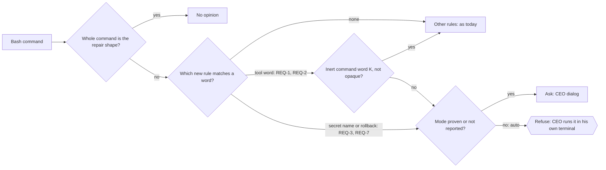
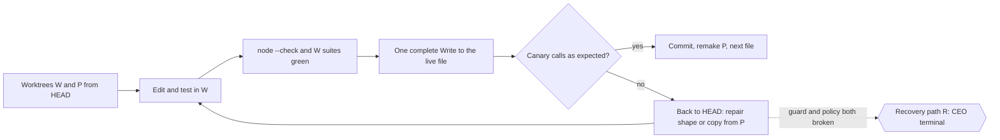

# Spec 0010 — Guard hardening for mobile (D2 of spec 0008): store, signing and key commands; hook-source rollback; hook work in a linked worktree
<!-- Header fields and Status values stay English (protocol); content is written in English. -->

- Status: Awaiting approval
- Tier: full · Lane 3 (trust boundary: enforcement files, signing material)
- Previous spec: 0004 (`specs/done/0004-harness-enforcement-gaps.md` once T-0 has moved it; describes today's behaviour). This spec IS dependency D2 of spec 0008 (§6.7, "guard hardening for mobile"); 0008 AC-24 checks the table of §7 item by item.
- Inputs: design `docs/architecture/tasarim/0010-guard-hardening.md`, cut by the main session to what blocks 0008 phase 1b plus what makes this job safe to run (where this spec and the design differ, this spec wins); round 1 gate findings and main-session decisions `docs/kanit/0010-kapi-tur1.md`; board opinion `docs/architecture/gorus-0010-guard-hardening-2026-11-26.md`; `docs/ACIK-ISLER.md` B32-B34; `docs/KARARLAR.md` rev. 48 (always `auto`); ADR 0001 (D-8), ADR 0002 (Proposed; resync in T-0).
- Self-critique: Round 1: spec-critic not signable (1 High, text), appsec PASS WITH CONDITIONS, board CONDITIONAL APPROVE; all folded. Round 2: board APPROVE; spec-critic 3 Medium + Low, all folded (this revision). Records: `docs/kanit/0010-kapi-tur1.md`, `docs/architecture/gorus-0010-guard-hardening-2026-11-26.md`.
- Unlocks: `harness/bin/lint.js`, `harness/bin/secret-names.js`, `harness/test/guard.sh`, `harness/test/policy.sh`, `harness/test/policy-driver.js`, `harness/test/lint-rules.sh`, `harness/test/fixtures/commands-ordinary.txt`, `harness/README.md`, `harness/guard.js`, `harness/policy.js`
- Enforcement files this signature opens (class 2: `harness/guard.js` by `harness/policy.js:24`, `harness/policy.js` by `:26` and `:209`; exact literal paths, file tools only, in the main root and in a linked worktree that holds the same signed spec, R-6): the last two entries. The eight others are product-config (class 4, `policy.js:215`; none matches `:24`, `:26` or the locked set of `:179`). Not opened, because no task edits them: `harness/bin/check` (S-11), `harness/gate.js`, `harness/test/host-gate.sh`, `.claude/settings.json`, `CLAUDE.md`, `.claude/rules/routing.md`, `harness/approval.js`, `harness/bin/approve.sh`, the installers; no `harness/shell.js` and no `harness/bin/hook-scratch.sh` is created. Code class, covered by the signature: `site/index.html` (§12 rule 4). Free: `docs/**`, `specs/**`.

## 1. Intent
CEO's words (relayed by the main session): the mobile engineer comes first and works "with the fewest approvals"; "her zaman auto" (sessions always run in permission mode `auto`; the CEO signs in his own terminal). Interpretation, kept separate: spec 0008 cannot ship its Bash-capable mobile unit while store-upload, release-signing and signing-material commands pass the guard silently (appsec baseline of 2026-11-26: 41 D2 forms, 0 refused). Success: in `auto` every command of the D2 list is refused by the guard and stays the CEO's alone, a keystore or profile cannot sit in a repository unnoticed, a committed hook source is not swapped for another version by a plain git command, and the engineer can develop and repair hook sources without locking the session (the lesson of 0004) and without any loosening of the path policy. Deliberately NOT done: every other open guard finding (§13, spec 0011); a shell parser; file identity.
IN (design numbering): M-1 D2 minimum list plus the S-10 extras → REQ-1..5 · M-8 (B34 h) hook work in a linked worktree (procedure, no policy change), repair shape → §10, REQ-8 · M-9 (B34 k) lint fixture → REQ-6 · hook-source slice of B34 (g) → REQ-7. OUT: M-2..M-7, M-10..M-12 and decision Q-2, one line each in §13.

## 2. Market summary (Product)
None: internal harness job. No external content was used; the BA has no shell, so every behaviour claim not read from source is tested red-first (T-2..T-5) or proven by the first write of §10 step 1.

## 3. Requirements (EARS)
Threat level for every line: the guard reads command text and the policy compares path text; both stop accidents, honest mistakes and plainly spelled injected instructions, not an agent with Bash that works around them (§8). No absolute wording.
- REQ-1 — When a word of a command part names a tool of the S set, an `xcodebuild` flag of the F list, a Gradle task of the G rule or a store API host (§7, D2-1..D2-10), at any word position, behind any wrapper, in any letter case and across continuation lines, the guard shall record a CEO decision; where the command word of that part is in the inert set K and the command is not D2-opaque (§7), it shall give no opinion.
- REQ-2 — When a word found as in REQ-1 (any position, any wrapper, basename, no case; K applies) is `security` followed by a word other than `find-identity` or `help`, `codesign` with a signing identity other than `-`, `keytool` followed by a word other than `-genkeypair`, `-genkey` or `-help`, `apksigner` followed by `sign`, or `jarsigner` (the last two unless their keystore lies under the temp set), the guard shall record a CEO decision (D2-11..D2-13).
- REQ-3 — When a word of a command (assignment and `-Pkey=value` values included, quoted or not) is a secret-file name (§7), the guard shall record a CEO decision, unless the word is in an allowed location (§7), the command word of its part is `ls`, `stat`, `test` or `[` in a command that is not D2-opaque, or the word is the value of `-m` (alone or ending a short cluster), `--message` or `--message=` of `git commit`, `tag`, `merge`, `stash` or `notes`; void in a D2-opaque command; set K does not apply (D2-14).
- REQ-4 — When a rule of REQ-1..3 or REQ-7 records a CEO decision, the guard shall ask if no permission mode is reported or the mode is proven to show the dialog, and shall refuse in every other mode (`auto` included) with the text of §7; no signature, no `Unlocks:` entry and no caller shall change that decision.
- REQ-5 — The system shall provide a file-name scan that lists every tracked or not-ignored file under a given root whose name is a scan name (§7), allows only the exact path `android/app/debug.keystore`, reads no file content, and exits 0 when clean, 1 on a finding, 2 on a usage error; lint shall run it on its root (D2-15).
- REQ-6 — The lint-rule tests shall build their own active spec, so that `check` is green on a copy of the repository whose `specs/active/` is absent.
- REQ-7 — When a command runs `git` with the subcommand `restore`, `checkout`, `reset`, `stash`, `apply`, `am`, `read-tree` or `checkout-index` and a later word names a hook source, `harness` or `.` (§7), and the whole command is not the repair shape, the guard shall record a CEO decision.
- REQ-8 — When the whole command equals the repair shape of §7, the guard shall give no opinion in every permission mode and for every caller, also when the policy module cannot be loaded; any other command shall keep today's decision in that state (the one loosening of this spec).
- REQ-9 — `harness/README.md` shall carry the gaps G-23..G-27 of §8, the safe-edit procedure of §10 under the heading `## Hook kaynağı güvenle nasıl değiştirilir`, and the place where the CEO runs CEO-only commands under the heading `## CEO'ya ait komutlar`.
- REQ-10 — Every existing test case shall keep its expected value and no existing test line shall change; every guard rule not named in REQ-1..4, REQ-7 and REQ-8 shall keep today's decision in every permission mode.
- REQ-11 — On the ordinary-command corpus (at least 60 lines: React Native, Xcode, Gradle, .NET and everyday session commands) in a signed workspace in mode `auto`, every line shall get no opinion from the guard, and its p95 time per Bash call shall stay under 150 ms (200 calls, the CEO's Mac).

## 4. User experience
### No screen: which decision does a store, signing, key or rollback command get?

Description: a matching command is the CEO's alone; in `auto` it is refused, and everything else is judged as today. The hexagon is the CEO step (shape and label carry the meaning, no colour). Text equivalent: (1) the repair shape is matched first, on the whole command; (2) continuation lines joined, every word of every part tried; (3) set K is tried for the tool-word rules only (REQ-1, REQ-2): an inert command word such as `ls` or `which` in a command that is not D2-opaque leaves the decision to today's rules; (4) the name rule (REQ-3) has its own exceptions (allowed location, `ls`/`stat`/`test`/`[`, a git message value) and the rollback rule (REQ-7) has none but the repair shape; (5) a match is a dialog in a proven mode or with no mode reported, a refusal otherwise; (6) all rules record, one decision leaves: refuse over ask over none. States: refused → AC-3; asked → AC-3; no opinion → AC-1, AC-2, AC-5; policy cannot load → AC-6. Error-text owner: `guard.js`.

## 5. Acceptance criteria
Every case is a test line written red first. "Refused in `auto`": exit 2 and the text of §7 on stderr. "No opinion": exit 0, empty stdout.
- [ ] AC-1 — Each of D2-1..D2-10 and each REQ-1 extra (§7 table) has every listed command refused in `auto` and every listed neighbour with no opinion. Also refused: `bundle exec`, `npm exec … --`, `pnpm dlx`, `yarn dlx`, `bunx`, `xcrun`, `timeout 600` and an unknown wrapper word in front of an S-set tool; `xcodebuild` and `-exportArchive` on two lines joined by a backslash; `(fastlane deliver)`, `{ fastlane deliver; }`, `if true; then fastlane deliver; fi`, `echo x & fastlane deliver`, `"fastlane" deliver`, `FASTLANE deliver`, `\fastlane deliver`; one case per trigger of the D2-opaque list (§7, the bracketed cases). No opinion: `which fastlane`, `ls fastlane`, `cat fastlane/Fastfile`, `brew info fastlane`, `grep -r eas .`, `git commit -m "run fastlane deliver later"`, `git -C <dir> log --grep "fastlane deliver"` with an existing `<dir>` (the `-c` trigger of the D2-opaque list is case-sensitive: git `-C` is no trigger), and a `git commit -m "$(cat <<'EOF' … EOF)"` whose here-doc body names `fastlane`.
- [ ] AC-2 — Each of D2-11..D2-14 and each REQ-2 extra (§7 table) has every listed command refused in `auto` and every listed neighbour with no opinion. Also refused: `ORG_GRADLE_PROJECT_x=release.jks ./gradlew assembleRelease`, `./gradlew assembleRelease -Pstore=upload.p12`, `cat "release.jks"`, `bash -c "cat release.jks"`, `ls $(cat release.jks)`, `cd /tmp && cat x.jks`, `git show -m HEAD:release.jks` (`-m` of a subcommand outside the message list), `cat link.jks` where `link.jks` under a literal temp path is a symlink to a keystore in the repository. No opinion: a keystore under a literal temp path, `security` or `keytool` as the last word of a part.
- [ ] AC-3 — For one command each of REQ-1, REQ-2, REQ-3 and REQ-7: no mode, `default`, `plan`, `acceptEdits` ask; `auto`, `bypassPermissions`, `somethingNew` are refused and stderr equals the text of §7 byte for byte; the result is the same in a validly signed workspace whose `Unlocks:` names anything, and for `agent_type` `polyglot-engineer`. `git push origin main`, `gh release create v1`, `ssh host`, `rm -rf build`, `git rebase main` ask in all six modes, as today.
- [ ] AC-4 — D2-15: `node harness/bin/secret-names.js <root>` exits 1 and prints one path per line for a tracked `x.jks`, an untracked not-ignored `a/b.keystore`, `c.p12`, `d.p8`, `e.mobileprovision`, `f.pfx`, `g.pepk`, `credentials.json`, `android/key.properties` and `ios/android/app/debug.keystore`; exits 0 when only `android/app/debug.keystore` or an ignored `x.jks` is present; exits 2 without an argument; a file with key content under another name is not reported (name scan only). Lint runs it on its root: a planted `x.jks` in the lint fixture gives `FAIL  secret-names` and no other failing rule, so `check` turns red; `git diff` of `harness/bin/check` is empty.
- [ ] AC-5 — Refused in `auto`: `git restore --source=HEAD~5 -- harness/guard.js`, `git checkout abc1234 -- harness/policy.js`, `git restore -s abc1234 harness/`, `git checkout -- .`, `git stash push harness/guard.js`, `git reset HEAD~5 -- harness/gate.js`, `git -C sub checkout -- harness/guard.js`, `git checkout-index -f harness/guard.js`, `git apply --include harness/guard.js x.patch`, `git am --include harness/guard.js x.mbox`, `git read-tree --prefix harness/ abc1234`. No opinion: `git checkout feat/x`, `git checkout harness/0010-guard-hardening` (a branch name), `git restore docs/x.md`, `git stash list`, `git diff harness/guard.js`, `git add .`, and the repair shape. Unchanged and named in G-26, because they hold no such word: `git stash` and `git reset --soft HEAD~5` (no opinion), `git reset --hard HEAD~1` (asks, `guard.sh:35`).
- [ ] AC-6 — In a temp copy of `harness/` whose `policy.js` does not load, in `auto`: `git restore --source=HEAD -- harness/policy.js` and the two-file form get no opinion, also with an `agent_type`; `git status`, and the shape with `&& x`, `--source=HEAD~1`, `harness/bin/check`, `CLAUDE.md` or one more word, keep today's refusal. With a loadable policy the shape gets no opinion in all six modes.
- [ ] AC-7 — `check` is green in a linked-worktree copy whose `specs/active/` is absent (§10 step 7), and `lint-rules.sh` runs the same number of cases there as in the repository; `harness/test/lint-rules.sh:51` and `:64` are unchanged. Lint (rule id `texts-0010`) fails when `harness/README.md` lacks an entry G-23..G-27, the heading `## Hook kaynağı güvenle nasıl değiştirilir` or the heading `## CEO'ya ait komutlar`, or still holds the text `specs/active/0004-`. The same rule fails when the G-9 entry lacks the text `D2` (the mode-rule sentence), when the section `## Hook'lar kilitlenirse` lacks the text `git restore --source=HEAD -- harness/` (the repair shape), or when the README lacks the text `git rm --cached` (the CEO-terminal note).
- [ ] AC-8 — Fresh `./harness/bin/check` output is green; `git diff` of the existing test files shows added lines only; every corpus line gets no opinion; the bench shows p95 under 150 ms; `docs/kanit/0010-teslim.md` holds the baseline and first-write result of §10 step 1, the canary results of each live write and, from a real `auto` session, one refused and one passing command per family (dummy input, nothing uploaded).

| REQ | 1 | 2 | 3 | 4 | 5 | 6 | 7 | 8 | 9 | 10 | 11 |
|---|---|---|---|---|---|---|---|---|---|---|---|
| AC | AC-1 | AC-2 | AC-2 | AC-3 | AC-4 | AC-7 | AC-5 | AC-6 | AC-7 | AC-3, AC-8 | AC-8 |

## 6. Architecture and technology decision
No new dependency (Node built-ins, POSIX sh, `git`). Components: `guard.js` (D2 rules, rollback rule, repair shape) → `policy.js` (secret-name and allowed-location functions); `lint.js` → `secret-names.js` (new) → `policy.js`; no cycle. Component diagram: design, "Component view" (link, not a copy; `shell.js`, the `gate.js` change, the scratch script and the scratch exemption drop out). Architecture board: conditional approval, conditions GK-1..GK-6 folded in; ADR 0002 is resynced by the board before the signature (decision 1, the scratch exemption, moves to its rejected options; the rollback rule joins the mode-rule scope of decision 3).
| Decision | Options | Choice and reason | Cost of backing out |
|---|---|---|---|
| Where the D2 rules live | new pre-pass module `harness/shell.js` · **`guard.js` alone** | `guard.js` alone (R-1): it already has the word-level tools D2 needs; one enforcement file fewer to open | low: the module arrives with spec 0011 |
| Wrappers | add names to the wrapper set · **try the rule at every word + inert set K** | every word: an unknown wrapper fails closed; cost: a false refusal on names such as `node scripts/eas` | low |
| Keystore reads | list reader commands · **the secret-file name is the protected word** | name rule: no reader list to keep up (`xxd`, `openssl`, `cp`, `<`); a throwaway key lives in the temp set | low |
| Developing hook sources | scratch copy under the temp set + policy exemption (round 1: a loosening, and its own first write could not be tested) · **detached linked worktree under `.claude/worktrees/` (ADR 0001 D-8)** · instruction only (failed in 0004) | linked worktree (R-6): no policy change, authority stays under the signature and the caller list, every candidate is tested before it goes live | none: two git commands |
| Unlock in `auto` | recovery path R only · **narrow repair shape** | the shape returns only to the content of `HEAD`; R stays the fallback | low: one line |
| Where the scan runs | a new step in `harness/bin/check` (round 1) · **a lint rule** | lint: `check` already runs lint, so `check` stays closed while `.claude/settings.local.json` allows it without a dialog (S-11) | low |
- Ruling R-1: no `harness/shell.js` in this job. The D2 rules (REQ-1..3, REQ-7) read their own view; existing rules keep their views and the `opaque` test of `guard.js:297` is untouched. Six steps: backslash-newline joined; a backslash before any other character dropped; a single `&` splits parts like `&&`, `||`, `;`, `|` and newline; `(`, `{`, `!` and `)`, `;` trimmed from word edges; each word read unquoted through the existing quote memory (`guard.js:87-101`) and compared without case; D2 opacity (§7) tested on the command text with here-doc bodies dropped and double-quoted content kept, because the existing test runs on `strip()` output, which empties double quotes (`guard.js:51`) — cost if wrong: a spelling outside these steps passes silently until the general pre-pass and tripwire of spec 0011 (G-23).
- R-2: dropped with the scratch exemption (GK-2 a).
- Ruling R-3: a D2 match is a CEO decision under the mode rule, not a hard refusal, and tools already in today's remote set (`fastlane`, `eas`, `altool`, `firebase`, …) keep their dialog reason — the cases `guard.sh:88-89` (no mode) keep "ask" — cost if wrong: a session started in a proven mode could pass a store command with one dialog click.
- Ruling R-4: the gate's parse pre-check of the design is not built; the safe-edit rule is a procedure plus canaries (§10), so `harness/gate.js` stays closed — cost if wrong: an unparseable `Write` locks one hook until the repair of §10 step 5.
- Ruling R-5: the secret-file names and the allowed-location test live once, as pure exported functions of `harness/policy.js` (no shared `RegExp` object; enforcement class, pure at load, already opened by this spec); `guard.js` and `secret-names.js` both call them (the scan takes its paths from `git ls-files -co --exclude-standard`, a directory walk without git; app repositories and 0008's pre-commit part call the same script with their own root). When the policy cannot be loaded REQ-3 is not evaluated: in that state every Bash call but the repair shape already gets the repair question (`guard.js:203`); the constants of REQ-1, REQ-2 and REQ-7 stay in `guard.js` and work without the policy — one copy, and no enforcement file depends on a product-config file — cost if wrong: two functions move.
- Ruling R-6: hook sources are developed in a detached linked worktree W under `.claude/worktrees/` (git-ignored, `.gitignore:16`); the path policy does not change. Read from source: a file-tool write to `<main root>/.claude/worktrees/<name>/harness/<x>.js` is re-rooted to that worktree (`policy.js:191-193`, exact case), stays class 2 and is allowed only when all of these hold (`policy.js:429-454`): the write comes from a file tool; the caller is the main session or one of `polyglot-engineer`, `dotnet-engineer`, `react-engineer`, `devops-sre`; the path is not locked, is spelled as on disk and reaches the file through no symlink; the worktree has `specs/` and its `specs/active/` holds exactly one `.md`, byte for byte the signed spec at the same relative path; the worktree is a git linked worktree, so the signature record is looked up in the main root's `approvals/` (`policy.js:330-337, 446-447`); that spec's `Unlocks:` names the exact path. Product-config and code files of the worktree follow the same lookup (`policy.js:481-500`). Test: `host-gate.sh:318-326` (identical copy: no output; one byte off: asks; a plain directory without a spec: asks). The live session keeps loading its hooks from the main root, so a broken file in W locks nothing. Not run by the BA and not observed live for a hook-source name: the first write of §10 step 1 proves it — cost if wrong: that write is refused; stop and report, nothing is locked.

## 7. Data and API contract
No persisted data, no entity model (constants only); signature format, `Unlocks:` grammar, path classes and decision values (refuse: exit 2 + stderr; ask: exit 0 + JSON; no opinion) are unchanged.
- S set (basename, trailing `@version` dropped): `fastlane`, `eas`, `eas-cli`, `altool`, `notarytool`, `iTMSTransporter`, `transporter`, `appcenter`, `appcenter-cli`, `firebase`, `firebase-tools`, `bundletool`, `bundletool*.jar`.
- F list: a part holds a word with basename `xcodebuild` and one of `-exportArchive`, `-exportNotarizedApp`, `-allowProvisioningUpdates`, `-allowProvisioningDeviceRegistration`, `-authenticationKey*`.
- G rule: a part holds a word with basename `gradlew`, `gradlew.bat` or `gradle` at any position and a later word that matches `^(:?[\w.-]+:)*:?(publish|promote|appDistributionUpload)` and does not end in `ToMavenLocal`.
- Store API hosts: a word that holds `androidpublisher` (no case) or `api.appstoreconnect.apple.com`.
- REQ-2 details: `security` and `keytool`: the subcommand is the next word; none: no opinion. `codesign`: refused unless no short option cluster holds `s` and no `--sign*` word exists, or the identity value is exactly `-`; the identity is the value of `-s`, `--sign`, `--sign=`, the rest of a short cluster after `s`, or the word after a cluster that ends in `s`. `apksigner sign` and `jarsigner`: no opinion only when the value of `--ks` or `-keystore` lies under the temp set in its written and its resolved form, in a command without `cd` or `pushd` (the temp-set half of the allowed-location test below; no keystore option: refused).
- K, inert command words, REQ-1 and REQ-2 only: `cd ls cat head tail grep rg find which type man echo printf mkdir rm cp mv touch chmod wc diff stat test [`; `git` with one of `status diff log show add commit mv rm grep blame ls-files checkout switch restore stash branch`; `brew info|list|search`; `gem list`; `npm ls|view`.
- D2-opaque: the command holds one of the following (each bracketed command is an AC-1 case, refused in `auto`): `$(` or a backtick [`echo "$(fastlane deliver)"`, `` echo fastlane deliver > x.sh; `cat x.sh` ``]; `<(` or `>(` [`cat <(fastlane deliver)`, `echo fastlane deliver > >(sh)`]; `eval` or `xargs` [`eval "fastlane deliver"`, `echo fastlane deliver | xargs env`]; `source` or `.` as a command word [`echo fastlane deliver > x.sh; . x.sh`, `echo fastlane deliver > x.sh; source x.sh`]; a shell word (`sh bash zsh dash ksh`) that is a command word, carries an option cluster holding `c`, or is fed by a pipe, here-string or here-doc [`bash -lc "fastlane deliver"`, `echo fastlane deliver | sh`, `bash <<< "fastlane deliver"`, a here-doc with that body into `sh`]; `env -S` [`env -S "fastlane deliver"`]; `-c` or `--call` after `npx`, `npm exec`, `pnpm` or `su` [`npx -c "fastlane deliver"`, `npx --call "fastlane deliver"`, `su x -c "fastlane deliver"`]; `osascript -e` [`osascript -e 'do shell script "fastlane deliver"'`]; `find` with `-exec`, `-execdir`, `-ok` or `-okdir` [`find . -name x -exec fastlane deliver \;`, and the same command with `-execdir`, with `-ok` and with `-okdir` in place of `-exec`]; `git` with `-c`, `--exec`, `-x`, `bisect run`, `submodule foreach`, `rebase` or `filter-branch` [`git -c alias.x='!fastlane deliver' x`, `git ls-remote --exec "fastlane deliver" origin`, `git rebase -x "fastlane deliver" main`, `git bisect run fastlane deliver`, `git submodule foreach fastlane deliver`, `git filter-branch --tree-filter "fastlane deliver"`]. The `-c` trigger is case-sensitive in every item of this list (git `-C` is no trigger). Effect: K is void for every part, every quoted string is read word by word, the body of a here-doc fed to a shell word is read as words, and the command-word exception of REQ-3 is void.
- Secret-file names (last `/` segment of the word, or of the value after `=`; no case): `*.jks`, `*.keystore`, `*.p12`, `*.p8`, `*.mobileprovision`, `key.properties`. Scan names (REQ-5): the same six plus `*.pfx`, `*.pepk`, `credentials.json`.
- Temp set: `/tmp`, `/private/tmp`, `/var/folders`, `/private/var/folders`, the resolved `os.tmpdir()`. Allowed location (REQ-3): a literal path whose written form and resolved form are both `<R>/android/app/debug.keystore` (`<R>`: the workspace root as the classifier resolves it) or both under the temp set; void when the command holds `cd` or `pushd`.
- Hook-source word (REQ-7): `git` is found at every word by basename and its global options are skipped as today's git rules do; a word after the subcommand counts when, with a leading `./` and a trailing `/` dropped, it is `.`, is `harness` or ends in `/harness`, or its last two segments are `harness/<x>.js` (`<x>` may hold glob characters).

| D2 item (0008 §6.7, in its order) | REQ · AC | Refused in `auto` (test cases) | No-opinion neighbours |
|---|---|---|---|
| D2-1 `xcodebuild -exportArchive` | 1 · AC-1 | `xcodebuild -exportArchive -archivePath a -exportPath b`, `xcodebuild -exportNotarizedApp …` | `xcodebuild -scheme A build` |
| D2-2 `xcodebuild -allowProvisioningUpdates` | 1 · AC-1 | that flag, and `-allowProvisioningDeviceRegistration` | `xcodebuild -showBuildSettings` |
| D2-3 `-authenticationKey*` | 1 · AC-1 | `xcodebuild … -authenticationKeyPath k -authenticationKeyID i` | `xcodebuild test` |
| D2-4 `xcrun iTMSTransporter` | 1 · AC-1 | `xcrun iTMSTransporter -m upload`, `xcrun altool …`, `xcrun notarytool …` | `xcrun simctl list` |
| D2-5 `eas-cli`, `npx eas-cli submit` | 1 · AC-1 | `npx eas-cli submit`, `eas build --local` (A-2) | `npx expo prebuild`, `npx expo run:android` |
| D2-6 `./gradlew publish*` | 1 · AC-1 | `./gradlew publishReleaseBundle`, `./gradlew :app:publishBundle`, `./gradlew app:publishReleaseBundle`, `gradle publishBundle`, `sh gradlew publishBundle` | `./gradlew assembleRelease`, `./gradlew publishToMavenLocal`, `dotnet publish -c Release`, `npm run publish:docs` |
| D2-7 `./gradlew promote*` (rollout change) | 1 · AC-1 | `./gradlew promoteArtifact --user-fraction 0.5` | `./gradlew bundleRelease`, `./gradlew test` |
| D2-8 `bundletool` | 1 · AC-1 | `bundletool build-apks …`, `java -jar bundletool-all.jar …` | `which bundletool`, `java -jar app.jar` |
| D2-9 Play publisher API scripts | 1 · AC-1 | `curl https://AndroidPublisher.googleapis.com/x`, `curl https://api.appstoreconnect.apple.com/v1/apps` | `curl https://example.com/`, `grep -r androidpublisher .`; a script called by name is not seen (G-24) |
| D2-10 wrappers `bundle exec`, `npm exec`, `pnpm dlx`/`dlx` | 1 · AC-1 | `bundle exec fastlane pilot upload`, `npm exec eas-cli -- submit`, `pnpm dlx eas-cli submit` | `bundle exec pod install` |
| D2-11 `security` read or export | 2 · AC-2 | `security find-generic-password -w -s x`, `security export -k k`, `security dump-keychain`, `sudo security dump-keychain`, `env security export -k k`, `/usr/bin/security dump-keychain` | `security find-identity -v -p codesigning`, `which security`, `grep -r security docs` |
| D2-12 non-adhoc `codesign -s` | 2 · AC-2 | `codesign -s "Apple Distribution: X" A.app`, `codesign --sign ID A.app`, `codesign --sign=ID A.app`, `codesign -fs ID A.app`, `codesign -sID A.app`, `xcrun codesign -s ID A.app` | `codesign -s - A.app`, `codesign -s "-" A.app`, `codesign -dv A.app`, `which codesign` |
| D2-13 `keytool -list`, export | 2 · AC-2 | `keytool -list -keystore x.jks`, `keytool -exportcert …`, `keytool -importkeystore …`, `bash -c "keytool -list"` | `keytool -genkeypair -keystore /tmp/k/x.jks …` |
| D2-14 `base64`/`cat` of keystore files | 3 · AC-2 | `cat release.jks`, `cat "my release.jks"`, `base64 -i upload.keystore`, `cp a.p12 b`, `openssl pkcs12 -in a.p12`, `git rm --cached release.jks` | `cat android/app/debug.keystore`, `ls android/app/release.jks`, `git commit -m "ignore *.jks"` |
| D2-15 secret scan by file name, `debug.keystore` allowlisted by exact path | 5 · AC-4 | `secret-names.js` exit 1; lint `FAIL  secret-names` | only `android/app/debug.keystore`: exit 0 |
| Extras, not in the 0008 list (S-10) | 1, 2, 5 · AC-1, AC-2, AC-4 | `firebase appdistribution:distribute a.apk`, `npx firebase-tools deploy`, `appcenter-cli distribute release`, `./gradlew appDistributionUploadRelease`, `apksigner sign --ks release.jks a.apk`, `jarsigner -keystore release.jks a.apk x`, `jarsigner a.apk x`; scan names `*.pfx`, `*.pepk`, `credentials.json` | `apksigner verify a.apk`, `apksigner sign --ks /tmp/k/x.jks a.apk`, `jarsigner -keystore /tmp/k/x.jks a.apk x` |
- Refusal text (exact; `<mode>` as today: ASCII, 40 characters; every other placeholder comes from a fixed set, never from raw event text): `BLOCKED by company guard: <rule> is the CEO's alone, and permission mode '<mode>' is not proven to show his dialog. The CEO runs this command in his own terminal (no hook runs there); no spec opens it. Do not rewrite the command to get around this refusal.<hint>` with `<rule>` one of `store upload or release signing (<tool>)`, `signing material (<tool>)`, `secret file name (<pattern>)`, `hook source rollback (git <subcommand>)`. `<tool>` for REQ-1: the S-set name as listed above, `xcodebuild`, `gradle`, `androidpublisher` or `api.appstoreconnect.apple.com`; for REQ-2: `security`, `codesign`, `keytool`, `apksigner` or `jarsigner`. `<hint>` is empty, except ` To list names use ls, stat or the Glob tool.` for the name rule and ` Only "git restore --source=HEAD -- harness/<name>.js" stays open.` for the rollback rule. Several rules: their texts joined by today's separator. New dialog reasons (proven mode) follow the Turkish style of today's guard. Path text and path-less text: unchanged.
- Repair shape, verbatim, matched on the whole command before any other rule: `^git restore --source=HEAD -- harness/[A-Za-z0-9_-]+\.js( harness/[A-Za-z0-9_-]+\.js)*$`

## 8. Threat model and security
Sensitive area: enforcement layer (guard, policy) and signing material (file names only; no key content is read; no personal data). Stated plainly: an envelope ask is not a refusal in `auto` today (`guard.js:192`; `docs/kanit/0004-t1.md:24-33`: the app settles it without a dialog); this spec changes that for the D2 family and the hook-source rollback only (A-1). The real boundary for store credentials is that they are not reachable by this user (0008 R-13); the hook is the sign in front of it.
| Boundary or asset | Abuse | Control | Residual |
|---|---|---|---|
| Store account, upload key | upload, rollout or signing by a tool call, also behind a wrapper or a shell string | REQ-1, 2, 4; D2-opaque list | words built at run time, spellings outside R-1, Gradle task abbreviations such as `pRB` (G-23); script content, tools outside the S set (G-24) |
| Keystore and profile files | read, copy, commit | REQ-3, REQ-5 | detection by name only (G-25) |
| Committed hook sources | a plain git command brings back an older or other version (`--source=HEAD~5`, `checkout <sha> -- harness/`, `checkout -- .`); silent today | REQ-7 | forms with no path word (`git stash`, `git reset --soft`, `git checkout <commit>`, `git apply x.patch`), path spellings that do not spell `harness/`, a moved `HEAD` (G-26) |
| **The one loosening: repair shape** | any caller discards uncommitted hook edits; the content of `HEAD` returns, whichever commit `HEAD` is | none added: the shape is a loosening, not a control. Its width is the whole-command match, `--source=HEAD` and `harness/<name>.js`; with a loadable policy the command gets no opinion today already | G-26 |
| Hook-source copies in the worktree | edited without the CEO | no loosening: the conditions of R-6 (same signed spec bytes, exact path, caller list, file tools only); live hooks load from the main root | open while the spec is signed, as the main root's files are |
| Bringing files to the main root | an untested file goes live; a directory copy passes the per-file checks | one complete `Write` per named file after `node --check` and green suites in W, so the exact-path and caller checks apply; a Bash directory copy, archive or patch (`cp -R`, `ditto`, `tar`, `patch`, `git apply`) into the main root is forbidden by task rule | such a copy is not classified per file (G-27; G-5, G-17) |
| Live hook sources during this job | a broken file locks the session | repair shape first and alone (T-2); candidates tested in W; canaries; unedited copy P; recovery path R | two hook files broken at once: CEO terminal |
| `harness/bin/check` | `.claude/settings.local.json` allows it without a dialog, so an edited `check` would run unasked | not opened by this spec (S-11); CEO to-do C-1 | B33 (spec 0011) |
Known gaps added to `harness/README.md` after G-22: G-23 D2 rules see only visible words in the spellings of R-1; words built at run time and Gradle task abbreviations pass · G-24 script content (Fastfile lane, npm script, Gradle plugin, an API script called by name) and tools outside the S set · G-25 secret files are known by name only · G-26 the repair shape discards uncommitted hook edits for every caller and returns the content of `HEAD`; git forms with no path word, path spellings that do not spell `harness/` (a working directory inside `harness`, as in `cd harness && git checkout abc1234 -- guard.js`; the pathspec `:/`; `--pathspec-from-file`) and a moved `HEAD` are not seen by the rollback rule · G-27 a Bash directory copy, archive or patch into the main root is not classified per file (see G-5, G-17). G-9 gains one sentence: the mode rule now covers the D2 family and the hook-source rollback, not the other envelope rules.

## 9. Test and evidence plan
| Criterion | Test | Layer | Profile |
|---|---|---|---|
| AC-1, AC-2, AC-3, AC-5, AC-6 | `harness/test/guard.sh`, new sections; D2 cases named `D2-n`; AC-6 in a temp copy of `harness/` with an unloadable `policy.js` | hook | quick |
| AC-2 (names, allowed location) | `harness/test/policy.sh` + `policy-driver.js`: the two exported functions of R-5 | unit | quick |
| AC-4 | `harness/test/lint-rules.sh`: the script against temp git repositories, the `secret-names` rule against the lint fixture | unit + lint | quick |
| AC-7 | `lint-rules.sh` (`texts-0010`); `check` in the empty-active worktree of §10 step 7 | lint | full |
| AC-8 | `./harness/bin/check`; corpus loop and `--bench` in `guard.sh`; record `docs/kanit/0010-teslim.md` | all + manual | full |
Pre-approved changes to existing test lines: none; this job is additions only. Read against commit `10aa039`: `guard.sh:88-89` (`fastlane deliver`, `xcrun altool`, no mode) stay "ask" (R-3); `guard.sh:35` stays "ask" (no path word); `guard.sh:361, 384`, `host-gate.sh:230, 258`, `policy-driver.js:417` stay because the path text is not changed; `lint-rules.sh:51, 64` stay because the fixture spec is written before them. If any existing case would change value: stop and report (§12 rule 2).

## 10. Deployment and disaster recovery
No server. Hooks load from the working tree of the main root (`.claude/settings.json` unchanged); other projects call this harness by absolute path and get the rules with `git pull`; the container is not affected. Delivery: work branch → `check` green → verification chain → merge to `main` with the CEO's approval (envelope, today's flow). Rollback: `git revert` of the merge; the D2 family is then silent again. Live moments: the first tool call after each `Write` to `harness/guard.js` (T-2, T-4) or `harness/policy.js` (T-3).
### How is a live hook source changed without locking the session?

Description: a hook source is developed and tested in the worktree W, goes live with one write and is probed at once; one broken file is repaired inside the session, two from the CEO's terminal (hexagon = CEO step). W is `.claude/worktrees/0010-hooks` (work), P is `.claude/worktrees/0010-head` (never edited). No helper script exists: the git commands below are the whole tool. Text equivalent, the safe-edit procedure:
1. Create both from the main root, on the work branch, after T-0 (the signed spec bytes are committed in `specs/active/`): `git worktree add --detach .claude/worktrees/0010-hooks HEAD` and `git worktree add --detach .claude/worktrees/0010-head HEAD`. Baseline: `.claude/worktrees/0010-hooks/harness/bin/check` is green, and one file-tool `Edit` of `<W>/harness/guard.js` passes in `auto` (R-6). Either fails: stop and report.
2. Edit in W with file tools only (no Bash writer, script or interpreter writes a hook source, in W or in the main root); run W's own tests (`sh <W>/harness/test/guard.sh`).
3. Before a live write: `node --check <W>/harness/<x>.js` passes and W's `check` is green. Then bring the candidate to the main root with one complete `Write` to the named file, one hook source at a time; never a chain of `Edit`s on a live hook source, never a Bash copy, archive, `patch` or `git apply` into the main root. Test and other files reach the main root by file tools too. Every `harness/**` file of T-2..T-6 (tests, fixture, lint, README included) is edited in W first and brought over by `Write`.
4. Load-check at once with three canary calls: Bash `git status --short` runs; Bash `echo git --no-verify` is blocked by the guard; a `Write` to `docs/kanit/0010-teslim.md` passes.
5. On any other result, back to `HEAD`: broken `policy.js` → `git restore --source=HEAD -- harness/policy.js` (live since T-2); broken `guard.js` (Bash closed, file tools open) → `Read` `
/harness/guard.js` and `Write` it back; both broken → recovery path R (`harness/README.md`, "Hook'lar kilitlenirse"). Then compose again in W; three live writes per task at most, then stop and report.
6. Main root `check` green → commit → remake P so that it equals the new `HEAD`: `git worktree remove .claude/worktrees/0010-head`, then the second command of step 1.
7. AC-7 copy (T-6): `git worktree add --detach .claude/worktrees/0010-empty HEAD`, `rm .claude/worktrees/0010-empty/specs/active/0010-guard-hardening.md`, then `rmdir .claude/worktrees/0010-empty/specs/active` (a fresh clone without an active spec has no such folder), run that copy's `harness/bin/check`, then `git worktree remove --force .claude/worktrees/0010-empty` (its only change is the removed spec copy).
8. End of job: `git -C .claude/worktrees/0010-hooks add -A`; `git -C .claude/worktrees/0010-hooks diff --cached --stat <work branch> -- harness` prints nothing (W holds nothing under `harness/` that the branch lacks); then `git worktree remove --force .claude/worktrees/0010-hooks` and `git worktree remove .claude/worktrees/0010-head`. Run by the main session; on any output stop and report, W is not removed.

## 11. Legal and compliance
None new. Public repository: corpus and tests carry no real name, path, identity or key content; the scan reads names only. No unit uploads or signs, so store rules are untouched.

## 12. Task list (atomic)
Rules: (1) `./harness/bin/check` green after every task, output shown. (2) Tests are additions only; no existing line changes; a refusal or an unexpected flip is never worked around (no interpreter or script write): stop and report. (3) Safe-edit procedure for live hook sources (§10): develop in W, `node --check` and W suites green, one complete `Write` per named file, canaries at once; red after the write: back to `HEAD`, compose again, three writes per task at most, then stop. (4) A task that changes `guard.sh` regenerates the site data (`node harness/bin/site-data.js --write`) in W before §10 step 3 and in the main root before the commit, and commits `site/index.html`. (5) T-2, T-3 and T-4 go live at the write: one commit each; the diff is shown to the CEO in chat before the commit for information, the engineer does not wait for a reply. (6) No task edits `harness/bin/check`. Chain (lane 3): delivery-manager → `polyglot-engineer` → qa-engineer → appsec → internal-auditor → quality-office.
| ID | Task | AC | Owning unit | Dependency |
|---|---|---|---|---|
| T-0 | Activation, one commit: this spec `specs/draft/` → `specs/active/`, and `specs/active/0004-harness-enforcement-gaps.md` → `specs/done/` if it is still there (exactly one active spec). Before the signature: round 2 recheck by the gates; the board resyncs ADR 0002; the main session diffs 0008 §6.7 on `origin/spec/0008-team-expansion` against §7 (the BA read 0008 from the working copy `.claude/worktrees/team-expansion/`, having no shell for `git show`). The CEO signs in his own terminal (`--preview`: the enforcement block lists exactly `harness/guard.js` and `harness/policy.js`; then `--expect`). After the signature no byte of the spec changes: the worktrees of §10 carry the committed bytes | all | main session + CEO | gates passed |
| T-1 | Plan with file ownership and the order below | all | delivery-manager | T-0 |
| T-2 | First implementation task, alone: §10 step 1 (W, P, baseline, first write); red AC-6 cases in `guard.sh`; LIVE: `guard.js` with the repair shape and nothing else | AC-6 | polyglot-engineer | T-1 |
| T-3 | Cases in `policy.sh` and `policy-driver.js`; LIVE: `policy.js` gains the two pure functions of R-5 (secret and scan names, allowed location with the temp set) and nothing else | AC-2 | polyglot-engineer | T-2 |
| T-4 | Corpus fixture `commands-ordinary.txt` (single-line commands only; one line is `dotnet publish -c Release`); red cases of AC-1, 2, 3, 5 in `guard.sh`; LIVE: `guard.js` (D2 view of R-1, REQ-1..4, REQ-7, refusal text) | AC-1, 2, 3, 5 | polyglot-engineer | T-3 |
| T-5 | `lint-rules.sh`: the fixture creates its base `specs/active/` (`mkdir -p`), empties it and writes its own spec (added lines only), then the scan and text cases; `secret-names.js`; `lint.js` rules `secret-names` and `texts-0010`; `harness/README.md`: gaps G-23..G-27, the G-9 sentence, the two headings of REQ-9, the repair shape in "Hook'lar kilitlenirse", the note that `git rm --cached x.jks` belongs to the CEO's terminal and `.gitignore` edits to the file tools, and line 27 naming `specs/done/0004-…` | AC-4, AC-7 | polyglot-engineer | T-4 |
| T-6 | Verification, fresh context each, in order: qa-engineer (mutation runs, corpus, bench, §10 step 7), appsec (every D2 item against the installed hook with dummy input: the input of 0008 AC-31; the repair shape; the rollback rule), internal-auditor, quality-office; live `auto` record; §10 step 8; then the main session marks B34 (h), (k) and the hook-source slice of (g) in `docs/ACIK-ISLER.md` and files §13 as input for spec 0011 | AC-8 | as named | T-5 |
CEO actions outside this spec's ACs, not preconditions (the main session files them as "Beklenenler"): C-1 remove the allow entries `Bash(./harness/bin/check)` and the stale `approval.js verify …0004…` from `.claude/settings.local.json` in his own terminal (the file is locked). C-2 GitHub ruleset on `main`: pull request required, forced push and deletion blocked, `check` status required.

## 13. Out of scope
Later (spec 0011), one line each; the design holds the detail:
- B32 (a)-(c): quoted `"main"`, the rest of a here-doc line, `word=` tokens hide a push to `main`.
- B32 (d): git state redirects a plain push (`@{push}`; `pushurl`, `pushInsteadOf` stay with ruleset C-2).
- B34 (a): `CLAUDE.local.md` into the enforcement class and the locked set.
- B34 (b) beyond R-1: general plain-form pre-pass (`harness/shell.js`), tripwire "unmodelled construct + protected word = refuse", `cd` and same-command branch tracking; the D2 rules then move to that one view.
- B34 (c): `git commit -n`, `+branch` refspec, `checkout main && merge && push`, tag push.
- B34 (e): regular-file and size check before the active spec is read.
- B34 (f): refusal texts name the whole locked set.
- B34 (g), the rest: `git restore`, `git checkout -- <file>` and the other git writers classified per target for every path, forms with no path word (G-26); gate parse pre-check of hook sources (R-4). Only the hook-source slice is in (REQ-7).
- B34 (i): dotless-ı root folding, re-cased `.claude/WORKTREES`, hard links and other volumes (file identity).
- B34 (j): 0004 AC-13 leftovers (main-session fixture, `plan`/`bypassPermissions` observation).
- B33: Bash writers of `internal-auditor` and `appsec` refused; `internal-auditor.md` text; lint warning for `settings.local.json` allow entries.
- Envelope under the mode rule: push or merge to `main`, release, remote and the other existing rules refused in `auto` (the design recommends it because the app, not the CEO, settles an ask in `auto`; it changes the CEO's daily flow and needs C-2 first).
- Decision Q-2: recursive `rm` judged by target, branch clean-up on feature branches; today's behaviour is untouched here.
- Design L-1, L-7..L-11: root `package.json` module type; per-unit command allowlist; live hooks loaded from a merged version only (L-8; the worktree of R-6 is a copy for development, not that); the rest of the remote tool set at every word; `debug.keystore` pinned by SHA-256; `sh -n` pre-check and a merge helper.
Also out: per-unit write areas (draft 0006), approval cadence texts (draft 0009), an `Envelope:` header field (rejected in the design), the mobile units themselves (spec 0008), any scratch exemption in the path policy (round 1; dropped).

## 14. Open questions and Spec critic findings
Open questions: none (design Q-1 and Q-2 were closed by the main session: A-1; Q-2 is out of scope; the round 1 findings are all decided). BA adversarial read, round 2: (a) REQ-3 refuses harmless mentions such as `find . -name "*.jks"`, `echo "*.jks" >> .gitignore` or `git add release.jks` (use `ls`, the Glob tool, a file tool or the CEO's terminal; the refusal text says so); (b) REQ-7 also refuses index-only forms such as `git restore --staged harness/guard.js`; (c) a D2-opaque command reads its quoted strings as words, so `git commit -m "fastlane notes $(date)"` is refused while the usual here-doc commit is not; (d) every `firebase` call is refused, the local emulator included (A-2), and `npm install firebase` and `yarn add firebase` are known false refusals (the word is matched at any position and neither command word is in K); (e) "main in `auto`" stays an ask the app settles, stated in §8, not hidden; (f) two forms of S-05 hold no path word and stay silent (A-4). The corpus (REQ-11) guards the common cases.
### Round 1 finding map
| Id | Where it is applied |
|---|---|
| K-1, GK-1, S-03 | T-2: repair shape first, alone; §12 rule 3; §10 step 3 (`node --check`, W suites). The bootstrap exception no longer exists |
| K-2, GK-5 | §10 steps 1, 5, 6: unedited copy P, remade after each commit |
| K-3 | REQ-7 of round 1 dropped; the copy is a git linked worktree, so `git ls-files` works there (R-6) |
| K-4, GK-4 | R-1 sixth step; §7 D2-opaque; AC-1 here-doc commit case (a multi-line command, so an AC-1 case and not a corpus line) |
| K-5, S-06 | §7 G rule; D2-6 cases and neighbours; G-23 (abbreviations); corpus line `dotnet publish -c Release`, named in T-4 |
| K-6, S-01 | §7 K as a closed list (git subcommands enumerated) and the D2-opaque list, one AC-1 case per trigger |
| K-7, S-02 | REQ-2; §7 "REQ-2 details"; D2-11..D2-13 cases |
| K-8 | D2-8 neighbours |
| K-9 | §7 F list and `<tool>` values |
| K-10 | D2-9 row; G-24; A-2 |
| K-11 | REQ-9 and AC-7 (both headings, rule `texts-0010`); REQ-11 wording |
| K-12 | header line "Previous spec"; T-5 (README line 27); §12 rule 3 (three writes); the citation ranges of R-2 and old AC-5 left with them |
| GK-2 (a) | R-6, §6 table, §10; REQ-7/REQ-8 of round 1, R-2, the scratch-name rule, the bootstrap exception, the temp-set lint rule and `hook-scratch.sh` dropped |
| GK-3 | not applicable: no exemption |
| GK-6, S-08 (a) | §4 diagram and text; K covers the tool-word rules REQ-1 and REQ-2 (as K-7 and S-02 word it), never REQ-3 or REQ-7 |
| S-04 | §8 row "Bringing files to the main root"; §10 step 3; G-27 |
| S-05 | REQ-7, AC-5, §7 hook-source word and refusal text, §8 rows 3 and 4 (the repair shape is no longer called a control), G-26, A-4 |
| S-07 | §7 store API hosts; D2-9 |
| S-08 (b)-(d) | REQ-3 (git message value); §7 allowed location (`cd`, `pushd`, both forms); refusal `<hint>`; T-5 README note; AC-2 |
| S-09 | R-1 (no case, backslash dropped); AC-1 `FASTLANE`, `\fastlane` |
| S-10 | §7 S set, G rule, REQ-2 (`apksigner`, `jarsigner`), scan names; extras row |
| S-11 | `Unlocks:` without `harness/bin/check`; REQ-5 and AC-4 (lint rule); §12 rule 6; C-1 not a precondition |
| GÖ-1 | R-5 (pure functions; REQ-3 without the policy) |
### Round 2 finding map
Ids follow the order of the round 2 `spec-critic` report (R2-1..R2-3 Medium, R2-4..R2-8 Low); the board approved in round 2.
| Id | Where it is applied |
|---|---|
| R2-1 | §10 step 7 (`rmdir`); REQ-6 and AC-7 ("absent"); T-5 (the fixture creates `specs/active/`) |
| R2-2 | §10 step 3 (every `harness/**` file goes through W); §10 step 8 (main session; stop on any output) |
| R2-3 | REQ-3 (message options and git subcommands named; void when D2-opaque); AC-2 `git show -m HEAD:release.jks` |
| R2-4 | §12 rule 4 (site data in W and in the main root) |
| R2-5 | map rows K-4 and K-5; T-4 (corpus line named, single-line only); §7 D2-opaque (a bracketed case for each trigger; `-c` case-sensitive); AC-1 (`git -C` case) |
| R2-6 | AC-5 (`apply`, `am`, `read-tree`); G-26 and its §8 row (path spellings); A-4; §14 (d) |
| R2-7 | §7 allowed location (`<R>`); §10 step 5 and §12 rule 3 (per task); §12 rule 5; AC-7 (README checks for the T-5 items) |
| R2-8 | header: gate status and `Status: Awaiting approval` |

---
## Signature record (CEO only)
Approved by / on: <!-- recorded under approvals/ by harness/approval.js; this line is informational, validity lives in the signature file -->

## Assumptions (for the end-of-job report)
- A-1 (decision Q-1, shown at signing) — Store-upload, release-signing and signing-material commands (D2-1..D2-14, the S-10 extras) and the hook-source rollback (REQ-7) are refused in `auto` and are the CEO's alone, in his own terminal; no spec opens them. Push or merge to `main`, `npm publish`, `gh release create` and every other existing envelope rule keep today's behaviour: the guard records its ask in every mode and the chat approval rule of the constitution governs. Stricter alternative, not taken: all envelope rules refused in `auto` (§13).
- A-2 — `bundletool`, every `eas`/`eas-cli` subcommand (also `eas build --local`) and every `firebase`/`firebase-tools` call (also the local emulator) are refused; D2-9 catches a host literal in the command text only, a script called by name is G-24; the `.p8` name is added to the minimum list; `*.pfx`, `*.pepk` and `credentials.json` are scan names only, not guard words (S-10 as written); `publishToMavenLocal` gets no opinion; the `debug.keystore` allowance is the one exact path; a throwaway signing key is created and used under the temp set; the corpus has at least 60 lines.
- A-3 — One pull request; D2 counts as met for spec 0008 when the commit holding T-5 is on `main`. Gradle `--scan` (a design extra, not in the minimum list) is not refused here; spec 0008 forbids it by instruction.
- A-4 — The rollback rule is applied as S-05 words it (a path word is required). Of the six forms appsec listed, `git stash` and `git reset --soft HEAD~5` hold no such word and stay silent (G-26); refusing them would refuse everyday stash and reset in `auto`, which is the rest of B34 (g) in spec 0011. `git restore .`, `git checkout -- .` and `git reset .` are refused in `auto` in every project that uses this harness.
- A-5 — Set K covers REQ-1 and REQ-2 (K-7, S-02), not REQ-3 or REQ-7 (S-08 a, GK-6): without K a common word such as `grep -r security docs` would be refused.
- A-6 — The worktrees of §10 are disposable copies: removing W with `--force` after the proof of step 8, and the empty-active copy of step 7, is not treated as an envelope deletion. The worktree path is read from source and proven by the first write (R-6); in `auto` the app's own classifier still decides after the hooks.

## Scorecard (end of job)
| Measure | Value |
|---|---|
| Spec revisions | |
| Fix rounds | |
| Findings: real / noise / deferred | |
| Regressions | |
| Escaped defects | |
| Tokens used | |
