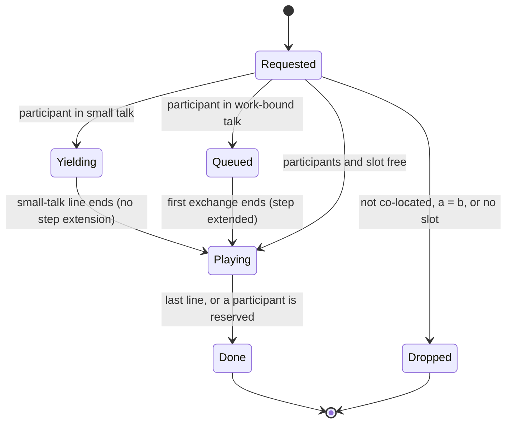
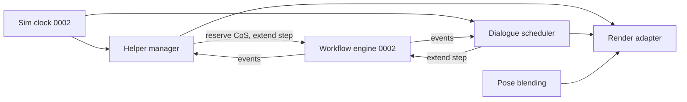
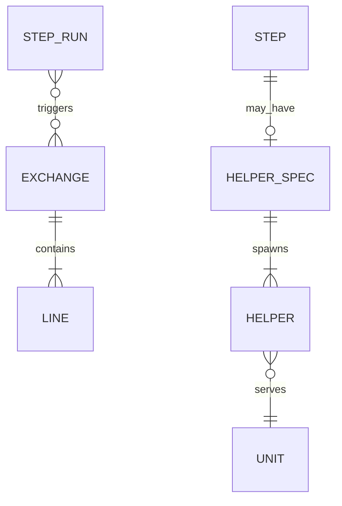

# Spec 0003 — Agency Tower: helpers (sub-agents), dialogues and poses
<!-- Header fields and Status values stay English (protocol); content is written in English. -->

- Status: Draft
- Tier: full (Lane 2: visible behavior, no new trust boundary, no new dependency, no new input)
- Previous spec: 0002 (workflow engine, movement, meeting room; this spec builds on its engine events, simulation clock and pause reasons and changes only the clauses in §3.0); 0001 (base)
- Next spec: 0004 (visual realism and guided tour)
- Self-critique: done (round 3: spec-critic focused round F-1..F-12 folded in, see §14)
- Model note: the CEO chose `opus` at high effort for this job (spec and build), a deliberate deviation from the routing lane-2 default (`sonnet`). Recorded so QA and audit do not flag it as a routing defect.

> Location note: draft only. It goes to `specs/active/` after 0002 closes (`harness/bin/approve.sh` accepts one active spec). Work happens on a new branch `feat/agency-tower-helpers-dialogue` cut from `main` after the 0002 merge.

## 1. Intent
CEO's words (Turkish, paraphrased by the main session): "Take the tower to the next level: … more animation, … random conversations. Also show the sub-agents, robots working together …" and, for sub-agents: "when a unit spawns helpers (Explore/haiku fan-out, general-purpose, a fork of itself), small helper robots appear, work briefly, report back and vanish. Show model tier visually (opus/sonnet/haiku) in a way not carried by color alone." Q-1 decision (2026-11-14): "Yalnız chief-of-staff".

Interpretation: on top of the 0002 pipeline replay, (1) helper robots make the agency's real sub-agent mechanism visible: only the chief-of-staff (main session) spawns them, at its desk on floor 4, and each is tagged with the unit it serves; (2) every robot acting in a step shows which model tier this job assigns it; (3) robots talk in short hand-written Turkish exchanges tied to the workflow step or as small talk, the listeners facing the speaker, with gestures; (4) robots sit at desks and meeting seats and move between poses smoothly. Success: a viewer can tell in one replay which robots are temporary helpers and who started them, which tier each robot works on in this job, and that conversations follow the work.

Not done: visual realism and guided tour (0004); live or LLM-generated text; sound; new dependency, URL parameter or network request.

## 2. Market summary (Product)
Not applicable (internal presentation piece, as 0001 §2).

## 3. Requirements (EARS)

### 3.0 Relation to 0001 and 0002
| Clause | Change in 0003 |
|---|---|
| 0001/REQ-1, 0002/REQ-1 allow-list | adds this spec, `approvals/specs__active__0003-agency-tower-helpers-dialogue.md.sig.json`, `docs/KARARLAR.md`, `STATE.md` |
| 0001/REQ-7, 0002/REQ-2 loader | `scenarios.json` becomes schemaVersion 2 (`model`, `helpers`, `mainSessionModel`); `dialogues.json` is validated too |
| 0001/REQ-21 bubbles | the cap is shared with dialogue lines and is 2 on `low` (REQ-8) |
| 0001/REQ-20, 0002/REQ-19 reduced motion | gestures, sit/stand, facing become cuts; helper walks follow the 0002 leg-end rule; helper appear and vanish cut at the effect start (REQ-10) |
| 0002/REQ-5, R-3 engine grant | a step with `helpers` also reserves chief-of-staff, in the same all-or-nothing grant, from the step's grant until its receiving moment ends (REQ-4) |
| 0002/REQ-5, R-1 engine trace | the engine accepts step-extension inputs from the helper manager (fan-out) and the dialogue scheduler (exchange length, queue wait); with extensions on the trace is still deterministic for a seed; 0002 AC-4, AC-5, AC-6 and AC-13 keep running with extensions off |
| 0002/AC-5 bounds | with extensions on, each variant's bound is the 0002 bound plus the §7.4 extension allowance (AC-12) |
| 0002/REQ-6 hand-over | lasts the longer of 1.2 s and its exchange (REQ-6) |
| 0002/§7.5 line-end hook | becomes active: when a robot taking part in an exchange (speaker or listener) is reserved by a step, its interrupt transition happens at the end of the current line (at most 3.5 s later) and the exchange ends early at that line end (REQ-6) |
| 0002/REQ-11 strip | gains the tier legend (REQ-5) |
| 0002/REQ-12, §7.6 card map | gains `spawning`, `fan-out-wait` and `receiving` templates; exhaustiveness test extended |
| 0002/REQ-16, 17, §7.8 pause | helpers, exchanges, lines and gestures run on the same simulation clock; `org` also hides helpers and bubbles; selection rules in REQ-11 |
| 0002/§7.7 limits and window | adds helpers, bubbles and exchanges per tier; the 0003 max-load window replaces the 0002 one for fps readings (§7.4) |
| 0002/REQ-20 budget | cumulative JS ceiling 781 kB (REQ-12) |

Assumptions about 0002 (signed text not re-read here; if one is false, 0003 needs a delta before signature): **AS-1** the 0002 grant function can reserve units that are not step actors (as it does for an escort or caller) and accepts one more such unit per step; **AS-2** the 0002 step clock starts only when all actors are at the step's place (meeting: non-lead seated, lead present); **AS-3** 0002 emits a `handover` event at the start of each hand-over, marks carry-back steps (reached through `loop.to`), and walk legs use 1.2 u/s and the §7.5b leg times; **AS-4** the 0002 variant tables, step ids and bounds are as in the 0002 draft of 2026-11-14 (l0 90 s, l1 260 s, l2-base/l2-input 360 s, l2-dependency 380 s, l3 480 s).

Unchanged and binding: 0001 isolation, text nodes, no network, key matrix, card "Model" field (roster model from frontmatter); 0002 per-module random streams (helpers draw on `helpers`, dialogue on `dialogue`).

### 3.1 Isolation and data
- REQ-1 — The showcase shall keep every file this spec adds or changes under `showcase/agency-tower/`, apart from the §3.0 allow-list; it shall add no dependency (dependency sections of `package.json` and `package-lock.json` unchanged) and no URL parameter; dialogue data shall be hand-authored inside the showcase.
- REQ-2 — When the app starts, the loader shall validate `scenarios.json` schemaVersion 2 against the §7.1 additions, model rules M-1..M-4 and helper rules H-1..H-4, and if any check fails the system shall show the data-error state.
- REQ-3 — When the app starts, the loader shall validate `src/data/dialogues.json` against §7.2 (2–4 lines per exchange, exactly 2 for `handoff` and `pass`, each line 1–48 code points; file at most 20 kB), and if any check fails the system shall show the data-error state.

### 3.2 Sub-agents and model tiers
- REQ-4 — When a step with `helpers` is granted, chief-of-staff shall be reserved with it and, if not already there, walk (and ride) back to its floor-4 desk (the return-to-desk leg, 0002 §7.5b); at its desk it shall have a 1.5 s spawn moment, after which n helper robots appear within 1 u of it with a 0.5 s spawn effect, where n is the declared count lowered to the free helper slots; if no slot is free, the step shall run without helpers, chief-of-staff is released at once and no spawn or receiving moment happens. Each helper (0.55 × specialist scale, walking at 1.2 u/s) is tagged "<display name> · <served unit id>" (§7.1 display map; served unit = the step's `actors[0]`), works for its §7.4 duration, walks back to chief-of-staff and waits; when the last one has arrived, chief-of-staff has a receiving moment lasting the longer of 1.5 s and its `helper-report` exchange, takes a report chip from each, and the helpers vanish with a 0.5 s effect; chief-of-staff is released and the owning step may end only after the receiving moment ends. Helpers shall not be pickable, not appear in the unit list or card, never ride the elevator, and not count for co-presence episodes.
- REQ-5 — While a robot acts in a step that assigns it a model (§7.1 `model`, per actor), and on every helper, the system shall show that tier by a head-marker shape plus letter (opus: diamond, "O"; sonnet: sphere, "S"; haiku: cone, "H"), color only as reinforcement; the job strip shall carry the text legend "İşteki atama: ◆ O = opus · ● S = sonnet · ▲ H = haiku"; robots not acting in such a step show no marker; the card keeps showing the roster model (0001/REQ-13).

### 3.3 Dialogues
- REQ-6 — When the firing instant of a work-bound trigger in the §7.3 table occurs, and every bound participant is on the same floor within 2.0 u of slot a, and slot a ≠ slot b, the system shall play one exchange of that trigger: listeners turn to face the current speaker within 0.4 s of each line start, lines appear one at a time above the speaker for 2.5–3.5 s each on the simulation clock, the speaker performs the line's gesture, and the triggering step shall last at least the exchange length counted from the firing instant. If a participant is in a small-talk exchange, that exchange ends at the end of its current line and the work-bound one starts then; this yield wait does not extend the step, and lines that would end after the step ends are not shown (if none fits, the exchange is dropped). If a participant is already in a work-bound exchange, the new one queues, starts when the first ends, and extends its triggering step by the queue wait. If participants are not co-located, a = b, or no exchange slot is free and none can be freed by ending a small-talk line, the exchange is dropped and the step is not extended. When any participant (speaker or listener) is reserved by a step, it leaves at the end of the current line and the exchange ends there. No exchange shall have two gates (spec-critic, appsec, architecture-board) as speakers.
- REQ-7 — When a co-presence episode begins (§7.3: two or more non-helper robots at the same coffee station for at least 1 s; robots riding or waiting at one landing together; for end-of-day, two or more idle robots on one floor with the episode starting while the office phase is in [0.40, 0.50)), the system shall make exactly one start-decision draw at the episode's onset (probability 0.5, subject to a per-floor cooldown of 20 s and, for end-of-day only, at most 2 exchanges per office day) and make the follow-up draws (exchange pick, speaker pick, line durations) only after a "yes"; the office phase is `(0.25 + simTime ÷ 90 s) mod 1` on the 0002 simulation clock, independent of the lighting mode (Otomatik, Gündüz held or Gece held) and of reduced motion; an end-of-day exchange may continue past phase 0.50 once started; no exchange shall repeat within the last 6 picks of its trigger; an elevator exchange ends at the moment its speakers part.
- REQ-8 — The system shall keep all bubbles (0001 ambient phrases plus dialogue lines) within the §7.4 caps, giving slots to work-bound lines first, small talk second and ambient phrases last (a work-bound line ends the oldest ambient bubble when the cap is full; a small-talk line yields at its line end per REQ-6), and keep the 0001 rule of at least one bubble started per 20 s.

### 3.4 Poses
- REQ-9 — Robots shall sit while working at a desk (ambient `work`, `step-work`, `build`, `pair`) and in a meeting seat (`seated`), take 0.5 s to sit down or stand up, and blend every pose change over 0.3 s so that no joint angle changes by more than 0.2 rad between consecutive 1/60 s frames and the root never moves faster than walk speed, except while riding (root follows the cabin), for reduced-motion cuts and for helper spawn or vanish.

### 3.5 Reduced motion, pause, limits
- REQ-10 — When `prefers-reduced-motion: reduce` is set, the engine trace and the dialogue trace (picks, speakers, line start times) shall be identical to the traces without it; gestures, sit/stand and facing turns shall be cuts to the end pose at the instant the animated version would end; helper walks shall follow the 0002 REQ-19 leg-end rule (rendered at the leg start, cut to the leg end when the leg ends); a helper's appear and vanish shall be cuts at the start of the spawn or vanish effect.
- REQ-11 — Helpers, exchanges, line timers and gestures shall run on the 0002 simulation clock: while a global pause reason applies they do not advance, nothing is released and no random number is drawn on any stream; while `org` applies helpers and bubbles are hidden; when the last reason ends everything resumes from exactly the state it had. Selecting a participant (a slot-bound speaker or listener) of an exchange pauses that exchange, step-scoped, until the card closes, with all participants staying bound; selecting chief-of-staff during a fan-out lets the helpers finish their work and walk, after which they wait beside it and the receiving moment starts when the card closes.
- REQ-12 — The system shall enforce the §7.4 limits per quality tier; during the 0003 max-load window (§7.4) at `high` the frame rate shall stay at or above 30 fps on the CEO's Mac (0001/AC-12); the main JS chunk shall stay at or below 781 kB minified (650.89 kB × 1.20, cumulative over 0002) via `npm run budget:check`; the vertex budget (700 000) shall hold with 6 helpers present. Frame rate with 6 helpers on screen is not measured: the 6-helper limit is covered by simulation and the vertex test only.

## 4. User experience

### How does a helper fan-out look?
```mermaid
sequenceDiagram
  %% Question: what happens when a step declares 3 Explore helpers? (4 participants)
  participant U as acting unit (e.g. software-architect, floor 3)
  participant CoS as chief-of-staff (floor 4, spawner)
  participant H as helpers x3 (Explore, H)
  participant S as job strip
  U->>CoS: step granted; CoS reserved, returns to desk
  CoS->>H: 1.5 s spawn moment; helpers appear (0.5 s effect)
  Note over H: work per §7.4; tag "Explore · software-architect"
  H->>CoS: walk back at 1.2 u/s, wait
  CoS->>U: receiving moment (≥ 1.5 s); chips; helpers vanish
  U->>S: CoS released; step may end
```
Description: the chief-of-staff is reserved with the step, returns to its desk on floor 4, starts helpers, which work briefly, return report chips and vanish before the acting unit's step may end. Text equivalent: grant (CoS reserved) → return-to-desk leg → spawn moment → helpers appear → helpers work → walk back → receiving moment (at least 1.5 s or the report exchange) → vanish → CoS released → step can end.

### How does the scheduler decide what is said?

Description: a request plays at once, after a small-talk line ends (without extending the step), or after a running work-bound exchange finishes (extending the step); it is dropped when its participants are not together, slots a and b are the same robot, or no slot can be found; it ends early when a participant is reserved. Text equivalent: requested → playing; requested → yielding → playing; requested → queued → playing; requested → dropped; playing → done (last line or early end).

### Screen states
| Screen state | What the visitor sees | AC |
|---|---|---|
| Data error | 0001 "Kadro verisi okunamadı." also for invalid schemaVersion-2 scenarios or dialogues | AC-2, AC-3 |
| Helpers active | small robots on floor 4 with tier marker and tag "<display name> · <unit id>"; chief-of-staff in spawn, wait or receiving moment | AC-4, AC-5 |
| Strip legend | "İşteki atama: ◆ O = opus · ● S = sonnet · ▲ H = haiku" | AC-5 |
| Exchange | bubble above the current speaker, listeners facing it | AC-6 |
| Org mode / paused | helpers and bubbles hidden (`org`) or frozen (`user`, `hidden`, selection) | AC-11 |
| Reduced motion | cuts for gestures, sit/stand, facing, helper legs; helpers appear and vanish at the effect start | AC-10 |
| Card | adds "Yardımcı başlatıyor: <n> × <display name>", "Bekliyor: yardımcılar", "Rapor alıyor"; "Model" field stays the roster model | AC-11 |
| Fallback, empty, unauthorized | unchanged from 0001/0002 (no helpers or dialogue without a scene; no accounts) | — |

New Turkish strings in `src/i18n/tr.ts`: the legend, "Yardımcı başlatıyor: <n> × <display name>", "Bekliyor: yardımcılar", "Rapor alıyor", and the §7.1 display map. Dialogue lines live in `dialogues.json`.

## 5. Acceptance criteria
- [ ] AC-1 — (REQ-1) On branch `feat/agency-tower-helpers-dialogue`, `git diff --name-only <0002 merge commit>...HEAD` lists only paths under `showcase/agency-tower/`, this spec, its approval record, `docs/KARARLAR.md` and `STATE.md`; `package-lock.json` unchanged and `package.json` dependency sections unchanged; `harness/bin/check` ends "CHECK GREEN (full)"; `check-isolation.mjs` passes; the URL parser still accepts only `quality` and `debug`.
- [ ] AC-2 — (REQ-2) The committed schemaVersion-2 `scenarios.json` validates and every 0002 fixture is still rejected. New fixtures rejected: `model` missing an entry for an actor of a `work`, `meeting`, `call`, `review`, `test` or `build` step; `model` present on `intake`, `carry`, `sign` or `done`; a `model` key that is not an actor; a lane-1 entry not sonnet; a lane-3 software-architect, business-analyst, appsec or internal-auditor entry not opus; `helpers` on a kind other than `work` or `meeting`, or inside a call branch; helper `count` 0 or 5; `explore` not haiku; `general-purpose` not sonnet; `fork` not equal to `mainSessionModel`; an unknown helper `kind`; a `servesTr` or `spawner` field (both forbidden); a §7.4 scripted placement missing or with a different count.
- [ ] AC-3 — (REQ-3) The committed `dialogues.json` validates with at least 3 exchanges per work-bound trigger, at least 6 per small-talk trigger, at least 50 in total, and is at most 20 kB. Fixtures rejected: a 49-code-point line (a 48-code-point line with ç ğ ı İ ö ş ü passes); a 1-line and a 5-line exchange; a 3-line `handoff` or `pass`; the same speaker on two consecutive lines; a first line not by `a`; slot `c` in a `coffee` or `call` exchange; an unknown trigger or gesture; a duplicate id; a control character; a `{` or `}`; a 21 kB file.
- [ ] AC-4 — (REQ-4) Helper simulation (fixed seed, simulation clock): for each helper step, chief-of-staff is reserved in the same simulation step as the owning step's other units and stays reserved until its receiving moment ends; if away from its desk it takes the return-to-desk leg with the 0002 §7.5b leg time; it then has a 1.5 s `spawning` moment; helpers appear within 1 u of it with a 0.5 s `spawn` state, work for their §7.4 duration, walk back at 1.2 u/s (offset path length ÷ 1.2 ± one step) and wait; the `receiving` moment starts when the last helper arrives and lasts max(1.5 s, the `helper-report` exchange length); each helper hands one report chip; all vanish in 0.5 s; the owning step ends no earlier. Low tier: a requested count of 4 yields n = 2, n = 1 when one slot is free, and with no free slot the step runs without helpers, chief-of-staff is released at once and no spawning or receiving moment occurs; in each case the card line reads "Yardımcı başlatıyor: <n> × <display name>" with n the number actually spawned. Helpers are absent from picking results, the unit list, cards and co-presence episodes; no helper enters `ride`; every tag reads "<display name> · <actors[0] of the step>"; every spawner in the trace is chief-of-staff.
- [ ] AC-5 — (REQ-5) Every helper and every robot acting in a step with a `model` entry for it has a tier marker whose mesh shape and letter match that entry (diamond/O, sphere/S, cone/H); in a meeting with mixed tiers each actor shows its own; robots in steps without `model` and robots not in a step have none; the strip contains the legend text "İşteki atama: …"; the card's "Model" field equals the roster model, not the marker. By eye: tiers distinguishable in grayscale.
- [ ] AC-6 — (REQ-6) For each §7.3 work-bound row, the scheduler requests the trigger exactly at the row's firing instant with the row's slot binding (fixtures per row, incl. `step-start` firing when the step clock starts and not at the grant, and `reject-qa` firing at the carry-back hand-over); a request whose participants are not on one floor within 2.0 u is dropped; a `pass` request with a = b is skipped; tray drops and pick-ups request nothing; one hand-over requests at most one exchange (pass or reject-qa take precedence over handoff); listeners' facing error toward the current speaker is at most 10° within 0.4 s of each line start; lines are sequential, 2.5–3.5 s each, above the speaker, the speaker in the line's gesture state; the triggering step lasts at least the exchange counted from the firing instant; a hand-over lasts max(1.2 s, exchange); with a participant in small talk the small talk ends exactly at its current line end, the work-bound exchange starts then, the step is not extended by that wait, and lines that would end after the step ends are not shown; with a participant already in a work-bound exchange the second starts when the first ends and its step is extended by exactly that wait; with all exchange slots held by work-bound exchanges a new request is dropped and its step is not extended; when a speaker or listener is reserved by a step it leaves at the end of the current line and the exchange ends there; no exchange in the trace has two gates as speakers; the gate picked for a `call` exchange comes from the `dialogue` stream; the same seed yields the same picks.
- [ ] AC-7 — (REQ-7) Over a 600 s simulation: exactly one start-decision draw on the `dialogue` stream per co-presence episode, at its onset, and follow-up draws only after a "yes" (instrumented per stream; `helpers` and `engine` streams not counted); an episode begins in the first step its condition holds after a step in which it did not, and ends when the condition stops holding; coffee exchanges start only with ≥ 2 non-helper robots at one station for ≥ 1 s; elevator exchanges only between co-riders or co-waiters and end the moment they part; end-of-day exchanges start only while the office phase is in [0.40, 0.50) (one may run on past 0.50), at most 2 per office day, with the same timing under Otomatik, Gündüz held, Gece held and reduced motion; per-floor cooldown 20 s; no exchange repeats within the last 6 picks of its trigger; no episode and no draw while a global pause applies.
- [ ] AC-8 — (REQ-8) Over the same run: concurrent bubbles ≤ 4 (`high`) / ≤ 2 (`low`); concurrent exchanges ≤ 2 / ≤ 1; a work-bound line never waits longer than the remainder of one small-talk line and ends the oldest ambient bubble when the cap is full; at least one bubble starts in every 20 s window.
- [ ] AC-9 — (REQ-9) Pose tests: `work`, `step-work`, `build`, `pair` and `seated` use the sit pose with hip at seat height ± 0.05; sit-down and stand-up take 0.5 s; for every pair of states in 0002 §7.5 plus §7.5 here, the blended pose changes no joint by more than 0.2 rad between consecutive 1/60 s frames and the root moves at most walk speed × dt + 0.01 u per frame, except in `ride` (root y equals cabin y ± 0.05), reduced-motion cuts and spawn/vanish.
- [ ] AC-10 — (REQ-10) With the media query emulated: engine and dialogue traces are byte-identical to the traces without it; no gesture, sit/stand, facing or spawn animation frame is rendered; each gesture, sit/stand or facing change is a single-step cut at the instant the animated version would end; each helper is rendered at its walk leg's start and cut to its end when the leg ends; a helper appears in the step its spawn effect starts and disappears in the step its vanish effect starts.
- [ ] AC-11 — (REQ-11) `org`, `user` and `hidden` each stop helper, exchange and line timers and all draws on every stream; nothing is released (participants stay bound, helpers stay assigned, chief-of-staff stays reserved); `org` hides helpers and bubbles; a snapshot after resume deep-equals the one at pause. Selecting a speaker or a listener pauses its exchange (line timer) until the card closes while other exchanges continue; selecting chief-of-staff mid-fan-out: helpers finish working, walk back and wait, and the receiving moment starts after the card closes. The card map exhaustiveness test covers `spawning` ("Yardımcı başlatıyor: <n> × <display name>"), `fan-out-wait` ("Bekliyor: yardımcılar") and `receiving` ("Rapor alıyor").
- [ ] AC-12 — (REQ-12) Limits: simulations at `high` and `low` never exceed §7.4. Bounds: with extensions on, every 0002 variant run alone at maximum durations, maximum exchange lengths and maximum fan-out time (return-to-desk leg included) finishes within its 0002 bound plus its §7.4 allowance. Max-load window: a test with the fixed seed reports the window in which all three scripted jobs run, the job #2 `design` helpers (§7.4 scripted placement, 3) are present and at least one exchange plays, measures the helper count, exchange count and bubble count in it, and asserts it lasts at least 8 s; the README records it. Budgets: the vertex test with 6 helpers added passes (< 700 000); `npm run build && npm run budget:check` passes at or below 781 kB and fails on a 782 kB fixture chunk (QA records the number). Performance (by eye, QA records): at `high`, `?debug=1`, inside the window, at least 30 fps on the CEO's Mac. Not measured: fps with 6 helpers on screen.
- [ ] AC-13 — (REQ-6) Coverage: in a fixed-seed simulation at `high` from load until jobs #1–#3 are done, each of the ten work-bound triggers (`intake`, `handoff`, `reject-spec`, `reject-qa`, `pass`, `sign`, `meeting-open`, `meeting-close`, `call`, `helper-report`) plays at least once.
- [ ] AC-14 — (REQ-4..11) By eye (QA, host, desktop and 375 px): helpers read as temporary assistants started by the chief-of-staff; tiers readable in grayscale; conversations follow the work and do not clutter; sitting and pose changes look smooth; Turkish lines read naturally (QA tone check: no real names, no offensive content).

## 6. Architecture and technology decision
| Option | For | Against |
|---|---|---|
| A. Two new pure modules consuming 0002 engine events on the shared simulation clock: helper manager and dialogue scheduler; pose blending inside `pose.ts` (chosen) | Same pattern as 0002; testable without three.js; own random streams keep the engine trace stable | Engine must accept one extra reserved unit per step and step-extension inputs |
| B. Fold helpers and dialogue into the 0002 engine | One module | Engine trace changes with every content edit; harder tests |
| C. Animation library (e.g. `@tweenjs/tween.js`) for blending | Ready easing and blending | New dependency → architecture-board; blending is ~50 lines |

Choice: A. Rulings (Type 2):
- R-1 Exchange length is fixed at pick time (line durations drawn then on the `dialogue` stream, after the start decision), so the engine extends the step by a known amount; the extension is an engine input, keeping the engine pure.
- R-2 Chief-of-staff is reserved as part of the owning step's grant (0002 R-3 order, AS-1) from the grant until its receiving moment ends; when chief-of-staff is itself the step's actor (l0-direct `fix`), no extra reservation and no return-to-desk leg are needed.
- R-3 Helpers use the floor-4 waypoint graph (0002/REQ-13) at 1.2 u/s and count for robot separation, but not for co-presence episodes.
- R-4 Gestures and sit/stand are pose layers blended by one shared 0.3 s blend function; pose code stays three.js-free and testable.
- R-5 Tags and tier letters are canvas textures (procedural), not DOM; the tag uses the §7.1 display name.
- R-6 `dialogues.json` is bundled into the main chunk; its 20 kB cap keeps the 781 kB ceiling reachable.

### How do the new modules connect?

Description: helper manager and dialogue scheduler react to engine events on the shared clock; the helper manager adds chief-of-staff to a step's grant and both may extend a step; the render adapter draws helpers, bubbles and blended poses. Text equivalent: clock → helper manager, dialogue scheduler; engine events → both; helper manager → reserve chief-of-staff and extend step; dialogue scheduler → extend step; both and pose blending → render adapter.

Dependencies: none. Architecture board and appsec gates not required (no dependency, input, files or external calls).

## 7. Data and API contract

### 7.1 `scenarios.json` schemaVersion 2 (additions to 0002 §7.1)
| Field | Type | Constraint |
|---|---|---|
| `schemaVersion` | integer | 2 |
| `mainSessionModel` | enum | `opus` \| `sonnet`; the chief-of-staff's model for lane-0 steps and `fork` helpers; default `opus` (A-4) |
| `steps[].model` | object | `{ <actor id>: "opus" \| "sonnet" \| "haiku" }`, one entry per actor, keys only actors; required on `work`, `meeting`, `call`, `review`, `test`, `build`; forbidden on `intake`, `carry`, `sign`, `done` |
| `steps[].helpers` | object | `work` or `meeting` only, never inside a call branch: `{ kind, count, model }` |
| `helpers.kind` | enum | `explore` \| `general-purpose` \| `fork` |
| `helpers.count` | integer | 1–4 (requested; n actually spawned may be lower, REQ-4) |
| `helpers.model` | enum | H-3 |

There is no `spawner` field (always chief-of-staff, Q-1) and no `servesTr` field: the served unit is the step's `actors[0]`.

Display map (tag and card use the display name; the kind id stays in data):

| Kind id | Display name |
|---|---|
| `explore` | Explore |
| `general-purpose` | General-purpose |
| `fork` | Fork |

Model rules (from `routing.md` "Models"):
- M-1 Lane 0: chief-of-staff entries equal `mainSessionModel`.
- M-2 Lane 1: every entry is sonnet.
- M-3 Lane 2: every entry is sonnet (no variant covers auth, crypto or payment, the only case for an opus appsec).
- M-4 Lane 3: opus for software-architect, business-analyst, appsec and internal-auditor entries; sonnet for engineers, qa-engineer, delivery-manager, spec-critic, architecture-board, quality-office and product-manager (smallest model that can do the job; A-5).

Helper rules:
- H-1 Spawner: chief-of-staff only, at its floor-4 desk.
- H-2 Exactly the §7.4 scripted placements carry `helpers`; each kind appears at least once.
- H-3 `explore` → haiku; `general-purpose` → sonnet; `fork` → `mainSessionModel`.
- H-4 No helpers on a step inside a call branch (gates work alone).

### 7.2 `src/data/dialogues.json`
| Field | Type | Constraint |
|---|---|---|
| `schemaVersion` | integer | 1 |
| `exchanges[]` | array | at least 50; file at most 20 kB |
| `.id` | string | `^[a-z0-9-]+$`, unique |
| `.trigger` | enum | work-bound: `intake`, `handoff`, `reject-spec`, `reject-qa`, `pass`, `sign`, `meeting-open`, `meeting-close`, `call`, `helper-report`; small talk: `coffee`, `elevator`, `end-of-day` |
| `.lines[]` | array | 2–4; exactly 2 for `handoff` and `pass` |
| `lines[].speaker` | enum | `a` \| `b` \| `c` \| `d`; first line `a`; no two consecutive lines by the same speaker; allowed slots per §7.3 |
| `lines[].textTr` | string | 1–48 code points, Turkish, no control characters, no `{` `}` (no interpolation) |
| `lines[].gesture` | enum | `none` \| `nod` \| `point` \| `shrug` \| `raise` \| `thumbs` \| `wave` |

Content owner: `tech-comms`; no personal names (including the CEO's), no real clients or brands.

### 7.3 Triggers, firing instants and episodes
"Step clock start" is the instant the step's own clock starts, after all actors are at its place (AS-2), not the grant.

| Trigger | Fires at | Slots | Allowed slots |
|---|---|---|---|
| intake | step clock start of `intake` | a = ceo, b = chief-of-staff | a, b |
| handoff | start of a carry hand-over that is neither a carry-back nor a `pass` hand-over (not a tray drop) | a = carrier, b = recipient | a, b |
| reject-spec | end of a rejecting spec-critic review (escort present), or end of a call with any rejecting branch (at the join instant) | a = first rejecting reviewer in branch order, b = rework actor | a, b |
| reject-qa | start of the carry-back hand-over after a qa-engineer reject | a = qa-engineer (carrier), b = rework actor (recipient) | a, b |
| pass | start of the next hand-over in the same job after a passed `review`/`test` outside a call branch, when the reviewer is that hand-over's carrier | a = reviewer (carrier), b = that hand-over's recipient; a = b → skipped | a, b |
| sign | step clock start of `sign` | a = ceo, b = the sign step's second actor | a, b |
| meeting-open | step clock start of `meeting` | a = business-analyst, b–d = other actors in actor order | a–d |
| meeting-close | nominal end of `meeting` (last section filled); the step lasts until the exchange ends | as meeting-open | a–d |
| call | the instant all called robots are at their branch places | a = caller, b = one called robot, picked uniformly on the `dialogue` stream | a, b |
| helper-report | start of the receiving moment | a = first arrived helper, b = chief-of-staff | a, b |
| coffee | co-presence episode onset at a coffee station | two co-present robots, picked on the `dialogue` stream | a, b |
| elevator | co-presence episode onset at a landing or in the cabin | two co-riders or co-waiters | a, b |
| end-of-day | co-presence episode onset while the office phase is in [0.40, 0.50) | two or three idle robots on one floor | a–c |

A carry-back after a spec-critic or call reject fires nothing (its reject-spec already fired). One hand-over requests at most one exchange. Events not listed (`tray-drop`, tray pick-up, `wait-start`, `room-hold`, …) trigger nothing. Co-location for work-bound triggers: all bound participants on one floor within 2.0 u of slot a at the firing instant; otherwise the request is dropped. Episodes: an episode begins in the first simulation step its condition holds after a step in which it did not, its participant set is fixed at onset, and it ends when the condition stops holding; helpers never take part; one start-decision draw per episode, follow-up draws only after "yes". The `call` slot limit (a, b) and the `reject-spec` binding guarantee that no exchange has two gates as speakers.

### 7.4 Limits, scripted placements, extension allowance and max load (extends 0002 §7.7)
| Limit | `high` | `low` |
|---|---|---|
| Helpers on screen | 6 | 2 |
| Bubbles on screen (ambient + dialogue) | 4 | 2 |
| Concurrent exchanges | 2 | 1 |
| Shadows on helpers | on | off |

Scripted placements (the only steps with `helpers`; these counts and work durations are the tuning knob for the max-load window and the pace):

| Variant · step | Kind | Count | Helper work duration | Serves (`actors[0]`) |
|---|---|---|---|---|
| l0-direct · `fix` | explore | 2 | 3–5 s | chief-of-staff |
| l2-base · `meet` | general-purpose | 1 | 4–6 s | business-analyst |
| l3-full · `design` | explore | 3 | 4–6 s | software-architect |
| l3-full · `meet` | fork | 1 | 5–8 s | business-analyst |

Fan-out time = return-to-desk leg (0002 §7.5b; none in l0) + 1.5 s spawn + 0.5 s effect + helper work + walk back + receiving (max(1.5 s, exchange)) + 0.5 s vanish; it extends the owning step by however much it exceeds the step's own duration.

| Variant | 0002 bound | Extension allowance (exchanges, fan-outs incl. return-to-desk legs) | 0003 bound |
|---|---|---|---|
| l0-direct | 90 s | +45 s | 135 s |
| l1-quick | 260 s | +60 s | 320 s |
| l2-base | 360 s | +130 s | 490 s |
| l2-input | 360 s | +90 s | 450 s |
| l2-dependency | 380 s | +90 s | 470 s |
| l3-full | 480 s | +200 s | 680 s |

Max-load window: with the fixed seed at `high`, the interval in which all three scripted jobs run, the job #2 `design` helpers are present and at least one exchange plays; AC-12 computes it, measures helpers, exchanges and bubbles in it, and records it. If the window is shorter than 8 s or fps falls below 30, the knob is the scripted count and work duration above, not walk speed.

### 7.5 New states
Units: `spawning` (1.5 s), `fan-out-wait` (chief-of-staff waiting for helpers), `receiving` (max(1.5 s, exchange)), `sit-down`, `stand-up` (0.5 s; pose layer). Helpers: `spawn`, `helper-work`, `helper-walk`, `helper-wait` (beside chief-of-staff, incl. while it is selected), `helper-report`, `vanish` (never on a card). Gestures and facing are pose layers over the current state, not states.

### How are dialogue and helper entities related to the engine?

Description: exchanges hold lines and are triggered by step runs; a step may declare a helper spec whose helpers, spawned by the chief-of-staff, serve the step's first actor. Text equivalent: exchange 1–n line; step run n–n exchange; step 0–1 helper spec; helper spec 1–n helper; helper n–1 served unit. Exchange, line and helper spec are stored; helpers and step runs exist at runtime only.

## 8. Threat model and security
Sensitive area: none.

| Boundary | Risk | Control |
|---|---|---|
| Authored JSON → DOM | XSS through a line | Bubbles use text nodes (0001/REQ-16); validator rejects control characters and braces |
| Authored JSON → canvas | none | Tags and letters from built-in data |
| Content | Offensive line, real person or client named | `tech-comms` authorship, QA tone review |
| Browser → network | Requests | None added |

No new trust boundary, input or external call.

## 9. Test and evidence plan
New test files: `scenarios-v2.test.ts`, `dialogues-data.test.ts`, `helpers.test.ts`, `tier-marker.test.ts`, `dialogue.test.ts`, `dialogue-mapping.test.ts`, `dialogue-coverage.test.ts`, `pose-blend.test.ts`, `reduced-motion-dialogue.test.ts`; extensions to `sim-clock.test.ts`, `card-now.test.ts`, `limits.test.ts`, `build-budget.test.ts`, `budget-check.test.ts`, `pipeline-fidelity.test.ts` (extensions on). 0002 `workflow.test.ts` (AC-4, AC-5), `handoff.test.ts` (AC-6) and `elevator-sim.test.ts` (AC-13) keep running with extensions off.

| Criterion | Test | Layer | Profile |
|---|---|---|---|
| AC-1 | diff against the 0002 merge commit, lockfile, `harness/bin/check`, isolation, params | static + unit | quick |
| AC-2 | `scenarios-v2.test.ts` | unit | quick |
| AC-3 | `dialogues-data.test.ts` | unit | quick |
| AC-4 | `helpers.test.ts` (incl. `low` n = 2, 1, 0) | unit | quick |
| AC-5 | `tier-marker.test.ts`, `card.test.ts`; grayscale by eye | unit + manual | full |
| AC-6 | `dialogue-mapping.test.ts` (one fixture per §7.3 row), `dialogue.test.ts` | unit | quick |
| AC-7, AC-8 | `dialogue.test.ts` (generator instrumented per stream) | unit | quick |
| AC-9 | `pose-blend.test.ts` | unit | quick |
| AC-10 | `reduced-motion-dialogue.test.ts` | unit | quick |
| AC-11 | `sim-clock.test.ts`, `card-now.test.ts` extensions | unit | quick |
| AC-12 | `limits.test.ts`, `pipeline-fidelity.test.ts`, `build-budget.test.ts`, `budget-check.test.ts` (782 kB fixture), `npm run budget:check`, fps overlay | unit + static + manual | full |
| AC-13 | `dialogue-coverage.test.ts` | unit | quick |
| AC-14 | by eye on host | manual | full |

## 10. Deployment and disaster recovery
Unchanged from 0001 §10 (no deployment; rollback by `git revert` of the merge).

## 11. Legal and compliance
- [x] No personal data, storage or tracking.
- [x] No new dependency or license.
- [x] Dialogue lines original and fictional; no real people (including the CEO's name), clients or brands.
- [x] No third-party media or sounds.
- [x] No public release.

## 12. Task list (atomic)
| ID | Task | AC | Owning unit | Dependency |
|---|---|---|---|---|
| T-1 | Scenario schemaVersion 2: fields, display map, M and H rules, scripted placements, fixtures; update `scenarios.json` | AC-2 | react-engineer | none |
| T-2 | Dialogue validator and fixtures; stub `dialogues.json` with valid shape | AC-3 | react-engineer | none |
| T-3 | `src/data/dialogues.json` content only | AC-3, AC-14 | tech-comms | T-2 |
| T-4 | Helper manager (chief-of-staff reservation, return-to-desk leg, fan-out), helper robot geometry, tags, spawn/vanish effects (`src/sim/helpers.ts`, `src/scene/helperRobot.ts`); engine extension input | AC-4 | react-engineer | T-1 |
| T-5 | Tier markers and strip legend | AC-5 | react-engineer | T-4 |
| T-6 | Dialogue scheduler: firing instants, mapping, co-location, episodes, office phase, facing, gestures, yield, queueing, dropping, early end, step extension (`src/sim/dialogue.ts`) | AC-6, AC-7, AC-8, AC-13 | react-engineer | T-2, T-4 |
| T-7 | Sit/stand and pose blending (`pose.ts`) | AC-9 | react-engineer | none |
| T-8 | Reduced motion, pause and card integration; limits; window; bounds; README (Turkish); budget and fps run | AC-1, AC-10, AC-11, AC-12, AC-14 | react-engineer | T-3..T-7 |

Delivery chain: `delivery-manager` not added (8 tasks, one engineer, one session expected); added by the main session if the work spans sessions. Verification: `qa-engineer`, then `internal-auditor`. Gate before signature: `spec-critic`.

## 13. Out of scope
- Spec 0004: visual realism pass (PBR, bloom, SSAO, monitor UI mocks, weather) and guided cinematic tour mode.
- Helpers spawned by any unit other than chief-of-staff (Q-1); helper cards, helper selection, helpers riding the elevator.
- Measuring fps with 6 helpers on screen (covered by simulation and the vertex test only).
- Speaker names in bubbles, voice or sound, LLM text, translations.
- Live data; new URL parameters or shortcuts.

## 14. Open questions and Spec critic findings
Open questions: none.

- **Q-1 — Who spawns helper robots (sub-agents)? Resolved 2026-11-14.** CEO answer, as relayed by the main session from the chat: "Yalnız chief-of-staff", i.e. option (a): only chief-of-staff spawns helpers, on floor 4, each tagged with the unit it serves. Evidence behind the recommendation: no unit in `roster.generated.json` has an `Agent` or `Task` tool, and `routing.md` "Fork only if the unit needs this conversation" describes the main session forking. The option-(b) branches were removed (REQ-4, H-1, §7.1, AC-4, §13).

This section is the spec-critic record (the critic keeps no file of its own).

Carried over from 0002 round 1 (applied when this content moved here): #5 preemption and queueing (REQ-6, AC-6); #8 shared simulation clock, no draws while paused (REQ-11, AC-11); #9 traces identical under reduced motion (REQ-10, AC-10); #11 one draw per episode onset (REQ-7, AC-7); #13 per-kind rules for `model` and `helpers` (§7.1); #15 card templates for new unit states (AC-11); #17 max load and cumulative budget (REQ-12, AC-12).

Spec critic round 1 on 0003 (finding → fix):
- #1 End-of-day depends on the simulation-clock office phase, not on held lighting → REQ-7, AC-7, A-3.
- #2 Receiving lasts max(1.5 s, exchange) → REQ-4, §7.5, AC-4.
- #3 AC-12 window: scripted helper placements, measured → §7.4, AC-12.
- #4 §3.0 rows for 0002: engine extension inputs, new bounds, new window → §3.0, §7.4.
- #5 Office phase on the simulation clock; Gece held defined → REQ-7, AC-7.
- #6 No free helper slot → the step runs without helpers, no wait → REQ-4, AC-4.
- #7 No free exchange slot → drop, no step extension → REQ-6, AC-6.
- #8 Co-location required at the event; tray drop and pick-up trigger nothing → REQ-6, §7.3, AC-6.
- #9 Reservation of a speaking robot waits for the line end (≤ 3.5 s) → §3.0, AC-6 (wording revised in F-11).
- #10 Event → trigger mapping, gate-pick rule on the `dialogue` stream → §7.3, AC-6 (firing instants added in F-1).
- #11 Draws counted per stream; episode boundaries; helpers excluded → §7.3, REQ-4, AC-7 (start decision split in F-9).
- #12 Participant scope, pauses release nothing, chief-of-staff selected mid-fan-out → REQ-11, §7.5, AC-11.
- #13 (Type 3) Model per actor; card shows the roster model; legend "İşteki atama" → §7.1, REQ-5, AC-5, A-6.
- #14 `dialogues.json` ≤ 20 kB; 782 kB fail fixture → REQ-3, R-6, AC-3, AC-12.
- #15 Ride exception for root speed; listeners face the speaker → REQ-9, REQ-6, AC-9, AC-6.
- #16 Minor display and field fixes: not itemized in the brief this unit received; applied where identifiable (`helper-wait` state; `call` binds once all called are present; `handoff`/`pass` fixed at 2 lines). The `servesTr` field added then was removed again in F-4.

Spec critic focused round (finding → fix):
- F-1 Exact firing instant per trigger; `step-start` = step clock start, not the grant; `reject-qa` at the carry-back hand-over; coverage AC → §7.3 "Fires at" column, REQ-6, AC-6, new AC-13 (`dialogue-coverage.test.ts`).
- F-2 `pass` b = the next hand-over's recipient; a = b skipped → §7.3, REQ-6, AC-6, state diagram.
- F-3 Display map; tag and card use the display name → §7.1 display map, REQ-4, R-5, AC-4, AC-11.
- F-4 `servesTr` dropped; served unit = `actors[0]` → §7.1, REQ-4, AC-2 (field now forbidden), §7.4 table.
- F-5 n = helpers actually spawned; `low` test → REQ-4, AC-4 (n = 2, 1, 0 at `low`), §9.
- F-6 Helpers follow the 0002 REQ-19 leg-end rule, walk at 1.2 u/s; appear/vanish cut at the effect start → REQ-10, REQ-4, R-3, AC-10, AC-4.
- F-7 Chief-of-staff reserved from the grant through receiving as part of the owning step's grant; return-to-desk leg defined; allowance and AC-12 updated → REQ-4, R-2, §3.0 row, AS-1, §7.4 fan-out time and allowances (l0 +45, l2-base +130, l3 +200), AC-4, AC-12.
- F-8 The knob is the scripted helper count and duration in §7.4; fps at 6 helpers not measured → §7.4 scripted placements and knob sentence, REQ-12, AC-12, §13.
- F-9 One start-decision draw per episode; follow-up draws only after "yes" → REQ-7, §7.3, R-1, AC-7.
- F-10 0002 AC-6 and AC-13 added to the extensions-off list → §3.0, §9.
- F-11 §3.0 wording; a reserved listener leaves at the line end and the exchange ends early → §3.0 line-end row, REQ-6, AC-6.
- F-12 End-of-day starts only in [0.40, 0.50) and may run on; the yield wait does not extend the step → REQ-7, REQ-6, AC-7, AC-6.

Own adversarial pass (round 3):
- Reserving chief-of-staff for a whole fan-out (F-7) blocks it for intakes and evidence hand-ins of other jobs for up to the fan-out time; with four scripted placements this is bounded and covered by the allowances, but concurrent jobs wait longer. Measured in AC-12; the knob is §7.4.
- `call` exchanges need co-location, so they only play in l3 (gates in the meeting room); in l2-input and l2-dependency the gates are at their own desks and the request is dropped. AC-13 is still met through job #2 (l3).
- With the yield rule (F-12), a work-bound exchange that starts late can lose lines; a 2-line handoff always keeps at least its first line if the hand-over (≥ 1.2 s) and the yield (≤ 3.5 s) leave room, otherwise it is dropped. Accepted: the yield case only arises with small talk at the hand-over spot.
- AS-1..AS-4 are assumptions about 0002, not re-read against the version going to signature; the critic or the main session should confirm them before 0003 goes to signature.
- 12 REQs / 14 ACs: within the 15 guideline.
- The Q-1 answer reached this unit through the main session, not first-hand; recorded as such.

---
## Signature record (CEO only)
Approved by / on: <!-- recorded under approvals/ by harness/approval.js; validity lives in the signature file -->

## Assumptions (for the end-of-job report)
- A-1 — Split from 0002 by the main session (Type 3); 0004 holds realism and tour. Cost if wrong: merge drafts before signature.
- A-2 — Helpers are not selectable and not in the unit list (they are transient). Cost if wrong: a helper card variant.
- A-3 — End-of-day small talk follows the simulation-clock office phase (same 90 s formula as 0001 day/night), so it also happens while lighting is held on Gündüz or Gece and under reduced motion. Cost if wrong: tie it to the lighting phase.
- A-4 — `mainSessionModel` default `opus` (the main session's model is not fixed by routing). Cost if wrong: one field.
- A-5 — In lane 3, spec-critic, architecture-board, quality-office and product-manager are shown as sonnet ("smallest model that can do the job"; routing names opus only for architect, spec, appsec, internal-auditor). Cost if wrong: data edit.
- A-6 — (critic #13, Type 3) Models are assigned per actor; markers mean "this job's assignment", the card keeps the roster model, and the legend says "İşteki atama". Cost if wrong: one legend string and a field shape.
- A-7 — Cumulative budget 781 kB is 650.89 kB × 1.20; a working ceiling, not a sourced number. Cost if wrong: a constant.
- A-8 — Extension allowances and scripted helper counts and durations in §7.4 are tunable targets. Cost if wrong: constants.
- A-9 — Display names stay English technical terms ("Explore", "General-purpose", "Fork"), as in `routing.md`. Cost if wrong: three strings.

## Scorecard (end of job)
| Measure | Value |
|---|---|
| Spec revisions | 3 |
| Fix rounds | |
| Findings: real / noise / deferred | |
| Regressions | |
| Escaped defects | |
| Tokens used | |
