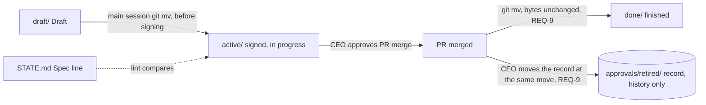
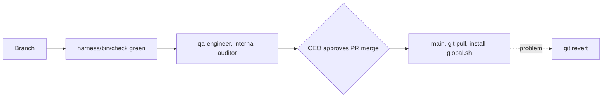
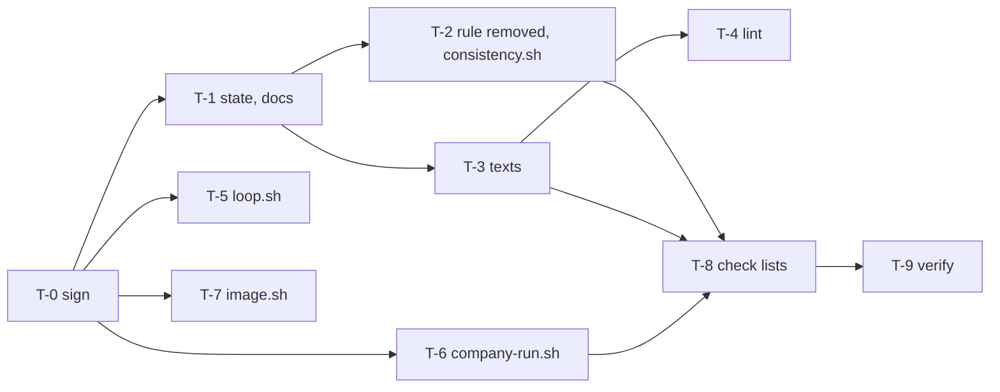

# Spec 0005 — Harness consistency cleanup: BookStack rule removal, prerequisites, routing rows, test repairs, spec lifecycle, STATE.md, run defaults
<!-- Header fields and Status values stay English (protocol); content is written in English. -->

- Status: Draft
- Tier: full (the CEO/Chief-of-Staff asked for the full template). Lane 2. Gates: spec-critic round 1 and the final consistency read of 2026-11-21 done (signable after its two blockers, fixed here); `appsec` recommended for REQ-12 (an argument becomes part of a file path), the main session decides.
- Previous specs: 0004 (`specs/draft/0004-harness-enforcement-gaps.md`) and 0006 (`specs/draft/0006-harness-unit-areas-evidence.md`). Sign and implementation order: **0004 → 0006 → 0005 → 0007**. 0005 is signed and implemented after 0004 and 0006 are merged and moved to `specs/done/`. It relies on, from 0004: path classes §7.1 and the rule "classify both the lexical and the resolved path, stronger class wins" (§7.1.1), the `Unlocks:` grammar §7.3, `COMPANY_LINT_ROOT` and `harness/test/lint-rules.sh` (0004 T-7), signature format v1 (0004 REQ-16); from 0006: `harness/bin/test-removals` (evidence only, §9). Next spec: 0007 (`specs/draft/0007-agency-config-update.md`).
- Self-critique: spec-critic round 1 folded in (§14); final consistency read (spec-critic, 2026-11-21): signable once its two blockers were fixed (the §6 record node and the Q-A status), both fixed in this revision. This revision follows the final 0004 and 0006 text and `docs/KARARLAR.md` rev. 48 (2026-11-21); no "pending 0004 revision" marker remains. Q-A is decided (`docs/KARARLAR.md` rev. 48, §14); Q-B is closed. Open questions: none.
- Unlocks: `.claude/rules/routing.md`, `.claude/rules/questions-bookstack.md`, `.claude/skills/delivery-management/SKILL.md`, `harness/bin/lint.js`, `harness/bin/check`, `harness/test/lint-rules.sh`, `harness/test/loop.sh`, `harness/test/image.sh`, `harness/test/consistency.sh`, `harness/test/run-defaults.sh`, `harness/README.md`, `templates/STATE.md`
- Enforcement files this spec changes (class 2 of 0004 §7.1: a CEO dialog on every edit, never covered by `Unlocks:`): **`harness/bin/company-run.sh`** (T-6). Nothing else: no hook, no `.claude/settings.json`, no `CLAUDE.md`, no `install-global.sh` (it already drops its own dangling links, `install-global.sh:23-29`; AC-1 proves it).
- Free-class files this spec changes (no list entry, no signature needed): `docs/KARARLAR.md`, `docs/ACIK-ISLER.md`, `STATE.md`, `specs/**` (spec moves). Code-class files (the signature covers them, no list entry): root `README.md`, `site/index.html` (regenerated by `node harness/bin/site-data.js --write`, T-5).
- Header grammar: the `Unlocks:` line above uses only exact relative paths (no `harness/bin/**`, which would overlap the row-2 scripts and fail 0004's lint for an active spec).

## 1. Intent
CEO decision D2 (as relayed): "`.claude/rules/questions-bookstack.md` must leave the agency repo: BookStack is a temporary third-party tool from my separate selfhost-stack setup and will be replaced by my own app. Questions to the CEO go back to chat." The other items were found by the Chief of Staff and verified in source: undeclared external tools, an ambiguous engineer row, a loop test that may pass without testing its claim, `company-run.sh` defaults that contradict routing, a spec lifecycle that has no written rule for the finished state, and (2026-11-21, `docs/ACIK-ISLER.md` B28) an image test that is red on this machine because its time limit cannot fire.

Interpretation: make the repository say one true thing in each of these places, and make `./harness/bin/check` fail when it drifts again, **where drift can be seen offline from files**. Success: no BookStack rule or reference remains in the agency repo (history and unrelated notes aside); missing external tools are reported as warnings with a degraded-mode rule; every engineer unit has a routing row; the loop test really reaches the unwritable directory; the finished state of a spec is written down as a rule and `STATE.md` and `specs/active/` agree; `company-run.sh` uses the unit's own model and turn budget; `image.sh` test 14 cannot pass without the time limit firing.

Facts since the last revision (CEO, `docs/KARARLAR.md` rev. 48, 2026-11-21): spec 0002 is finished; it was moved byte-identical (SHA-256 `716c8397…`) from `specs/active/` to `specs/done/`; `specs/active/` is empty; its open QA items are in `docs/ACIK-ISLER.md` under the section "B2. Spec 0002 (Yaşayan Ofis) kapanışından kalanlar" (not the Stop-hook item B2). `STATE.md` exists at the repo root since 2026-11-21. The header date of `docs/ACIK-ISLER.md` is already 2026-11-21. Container tests run fresh on 2026-11-21 (Docker 29.9.3, image `company-agent:dev`): `e2e.sh` 18/18, `python.sh` 4/4, `image.sh` 14/15.

Premise for the loop test repair (observed by the Chief of Staff, Node v26.13.1, `./harness/bin/check` output): the case "unwritable state dir still fails open" in `harness/test/loop.sh` line 26 prints `SyntaxError: missing ) after argument list`; the shell expands the JSON object inside `sh -c` into broken `node -e` arguments, the hook receives empty stdin, parses `{}`, finds no tool name and exits 0 (`harness/loop.js` lines 50-52), so the case passes without reaching the unwritable directory (lines 54-58). This is observed, not inferred: on this machine (Node v26.13.1, 2026-11-21) `./harness/bin/check` prints three `SyntaxError: missing ) after argument list` blocks during the loop guard tests, at `process.stdout.write(JSON.stringify(session_id:"a"))`, `...(tool_name:"Bash")` and `...(tool_input:{command:"x"})`, i.e. the shell splits the brace expression into three `node -e` arguments; the QA reports for spec 0002 note the same lines on Node 22 and 25. (The business analyst had no shell and read the quoting of line 26 as well-formed; the observed output outranks that reading.) T-5 still starts by running the unrepaired case with stderr visible and quotes the output in the PR, as the "before" evidence.

Premise for the image test repair (observed 2026-11-21, `docs/ACIK-ISLER.md` B28; the business analyst read `visual-check.sh`, `shot.js` and `image.sh` but ran nothing): `visual-check.sh <page> <out> 1` passes `SHOT_TIMEOUT_MS=1000` to `shot.js` (`visual-check.sh:19`), whose overall timer (`shot.js:36`) exits 1 with `shot.js failed: overall timeout`. The test (`image.sh:56-57`) uses the same small "Hello" page as test 12, so on a machine where the whole job takes less than 1 s the job finishes first: three measurements 1038, 980, 997 ms, four screenshots, exit 0. This is not a product bug; the test assumes the job takes longer than the limit.

Deliberately NOT done: building the CEO's own replacement app; adding mobile units (after this job); touching other projects' files that mention BookStack (reported, not edited); any other enforcement change (0004, 0006); an offline "was the PR merged?" check (impossible without network, §6); the site labels in `harness/bin/site-data.js` that 0004 §13 and 0006 §13 name as candidates (for example the fixed "87 testle sınar" edge label): cosmetic, left out to keep this spec to the items the CEO named (Assumption A-9).

## 2. Market summary (Product)
None. Internal consistency job.

## 3. Requirements (EARS)
- REQ-1 — The repository shall not contain the file `.claude/rules/questions-bookstack.md`, and no tracked text file shall reference it or describe the BookStack question workflow, except `docs/KARARLAR.md` (history), `docs/architecture/STACK.md` (a dependency note about another product), and `specs/`.
- REQ-2 — When `harness/bin/install-global.sh` runs, it shall create no link for the removed rule and shall drop an existing link of its own (a link whose target is under the repo) that points at it. (Already true of the current script; this requirement is proven by a test, not by an edit.)
- REQ-3 — The system shall record the removal and its reason in `docs/KARARLAR.md` (CEO decision D2), and questions to the CEO shall go to chat with a recommendation (constitution rule 5, unchanged).
- REQ-4 — The system shall declare `caveman-review`, `caveman-commit` (user skills) and `graphify` (host tool) as prerequisites, each with a degraded-mode rule for when it is missing, in `routing.md` and in a new `## Önkoşullar` section of `README.md`.
- REQ-5 — When `lint.js` runs and a prerequisite is missing, it shall report a warning for it and shall not fail; it shall not execute any binary to find out.
- REQ-6 — The routing table shall have one row naming `dotnet-engineer` and one naming `react-engineer`, besides the existing `polyglot-engineer` row, and `routing.md` shall state under the table the rule that every engineer unit has exactly one such row. `lint.js` enforces the rows (REQ-7); the rule sentence itself is checked only by a text assertion (§9).
- REQ-7 — When `lint.js` runs, it shall extract unit names from `routing.md` only from the table whose header row has `Unit` as its second cell: every backticked token matching `^[a-z][a-z0-9-]*$` in the second cell of each row of that table. It shall fail if an extracted name has no `.claude/agents/<name>.md`, if that table is missing, or if an agent file `*-engineer.md` with `Write` or `Edit` in its `tools:` line, except `qa-engineer` (the verifier, excluded by name), is named in zero rows or in more than one row. Backticked tokens elsewhere in `routing.md` (lane text, model text, `caveman-review`, `caveman-commit`, `graphify`, `STATE.md`) and other tables (the prerequisites table, and any table whose first header cell is `Unit`) are never extracted.
- REQ-8 — The loop-guard test shall build its hook input with a helper that emits valid JSON without nested shell quoting, and the case "unwritable state dir" shall hand the hook that valid input so the unwritable directory is actually exercised. The case "garbage input fails open" stays as it is (invalid input must still yield exit 0).
- REQ-9 — Process rule (a file-and-path rule, not checkable offline): after the PR of a signed spec is merged with the CEO's approval, the main session shall move the spec from `specs/active/` to `specs/done/` with `git mv` and change no byte of it (the `Status:` line stays as signed; the location is the record of the finished state), note the move and the first 12 hex digits of its SHA-256 in `docs/KARARLAR.md`, and update `STATE.md`, so the next job can be signed. The move goes into the next job's branch or a docs-only PR, never a direct push to `main` (rule 4). At the same move the CEO retires the spec's approval record (appsec N4-1): in his own terminal, or through the permission dialog that the guard raises for any Bash write under `approvals/` (0004 REQ-22; refused in an unproven permission mode, 0004 REQ-28, so then only in his terminal), he runs, in the main worktree, `mkdir -p approvals/retired && mv approvals/specs__active__<NAME>.sig.json approvals/retired/` (`<NAME>` = the file name with its `.md`, as `approval.js:14` builds it). The record is moved, not deleted (no permanent deletion, rule 4), and signature format v1 stays: lookups read `approvals/<rel with __>.sig.json` only and never a subdirectory, so a retired record authorises nothing, and a put-back of the file into `specs/active/` finds no record. Agents cannot do this step (`approvals/` is hard-deny for file tools, 0004 row 1). A spec put back into `specs/active/` is a new activation: new preview, new signature. This is the standing rule (Q-A, decided, §14: precedent of the CEO-approved move of 0002; the CEO's signature on this spec confirms the retirement step).
- REQ-10 — `lint.js` shall check only what files declare: it shall fail when `specs/active/` holds more than one spec; when it holds none and `STATE.md` does not say `Spec: none`; when it holds one and the `Spec:` line of `STATE.md` does not name it; when the `Spec:` line names a path that is not in `specs/active/`; and when `<root>/approvals/` holds a record `specs__active__<file>.sig.json` for a file that is in `specs/done/` and not in `specs/active/` (a live record of a finished spec; CI has no `approvals/`, so this can only fire locally, where the CEO retires the record). It shall not tell whether a PR merged and shall not pair a spec's `Status:` value with its directory (by REQ-9 the `Status:` of a moved spec is not edited; `specs/done/0001-…` and `0002-…` still say `Status: Draft`).
- REQ-11 — The repository shall have a root `STATE.md` in the `templates/STATE.md` form, with a `Last updated: YYYY-MM-DD` line, and `templates/STATE.md` shall show the same date format. `docs/ACIK-ISLER.md` shall carry a `Son güncelleme: YYYY-MM-DD` line whose date is not older than the newest date on any checked item (`- [x]` line) of that file; dates on open items, on the header line, and in other prose do not count. The A7 item of `docs/ACIK-ISLER.md` shall no longer claim a Docker server version of 20.10.22.
- REQ-12 — When `company-run.sh` is started with an agent name, it shall read `model` and `maxTurns` from `<repo>/.claude/agents/<name>.md`, where `<repo>` is the repository that holds the script (the same directory it mounts into the container), not the workspace argument. Precedence, high to low: `COMPANY_MODEL` / `COMPANY_MAX_TURNS` environment values, the unit's own front matter, the defaults `sonnet` and 12. A missing or non-numeric (for turns) key falls back to the default; it is not an error. Order of steps: workspace directory resolves, then the agent name is validated (`^[a-z][a-z0-9-]*$`, else exit 2), then the agent file must exist (else exit 2), then model and turns resolve and one line `[company-run] model=<m> max_turns=<n>` goes to **stderr** (every run, like the existing `mode=` line), then, when `COMPANY_DRY_RUN=1`, exit 0 before the public-key, token, proxy and docker checks and before any directory is created in the workspace. The two defaults are assigned on their own lines as `DEFAULT_MODEL=sonnet` and `DEFAULT_MAX_TURNS=12`, so a later lint can read them.
- REQ-13 — When `harness/test/image.sh` test 14 runs, the system shall give `visual-check.sh` a page that cannot finish loading together with the 1-second limit, and the test shall require a non-zero exit code and the text `overall timeout` on the run's stderr, so that the time limit is the only thing that can end the run. This repairs a test that did not test its claim on this machine (B28); the expectation (non-zero exit) is kept and gains a second assertion, it is not loosened.
- REQ-14 — The `Unlocks:` header of this spec shall be valid by the grammar of 0004 §7.3 and shall name no path of the enforcement class; the only enforcement-class file this spec changes is `harness/bin/company-run.sh`, and each edit of it is a CEO dialog.

## 4. User experience
None (no screens). The CEO sees: `lint.js` WARN lines for missing prerequisites, FAIL lines naming the drifted file, chat questions instead of a BookStack page, and the permission dialog on each edit of `company-run.sh` (REQ-14; in `acceptEdits`, `auto` or `bypassPermissions` mode the hook refuses instead, 0004 REQ-28: T-6 runs in default mode).

## 5. Acceptance criteria
Each criterion states how it is checked. "Auto" means `./harness/bin/check` runs it. "Manual" means QA evidence recorded in the verification report; `check` cannot run it. Nine criteria.

- [ ] AC-1 (auto, `consistency.sh`) — `.claude/rules/questions-bookstack.md` does not exist; a case-insensitive search of all tracked text files for `questions-bookstack` or `BookStack` finds matches only in `docs/KARARLAR.md`, `docs/architecture/STACK.md` and `specs/`; `docs/KARARLAR.md` contains a line with `BookStack kuralı kaldırıldı`. Installer: in a temporary `CLAUDE_HOME` that holds a dangling link `rules/questions-bookstack.md` whose target is `<repo>/.claude/rules/questions-bookstack.md` (a path under the repo; the installer skips links that point elsewhere), `install-global.sh` removes that link and `rules/questions-bookstack.md` does not exist afterwards. The test does not assert the exact list of other rule links. If this case is red, the fix would be an edit of an enforcement file outside this spec's list: stop and report.
- [ ] AC-2 (lint behavior auto, `lint-rules.sh`; text auto, `consistency.sh`) — With an empty temporary `CLAUDE_HOME` and a `PATH` without `graphify`, `lint.js` (run on the real repository, `COMPANY_LINT_ROOT` unset) prints three `WARN` lines (`caveman-review`, `caveman-commit`, `graphify`) and still exits 0 on an otherwise green tree; with the two skill directories present and a `graphify` file on `PATH`, it prints three `ok` lines and no `WARN`. Text assertions: `routing.md` has a heading "Prerequisites and degraded mode" and, inside that section, a row for each of the three names with a non-empty "If missing" cell; `README.md` has a heading `## Önkoşullar` whose section names all three.
- [ ] AC-3 (lint behavior auto, `lint-rules.sh` fixtures via `COMPANY_LINT_ROOT`; text auto, `consistency.sh`) — Each fixture case asserts one specific `FAIL  <file>: <reason>` line or its absence and ignores the first line `LINT ROOT OVERRIDDEN: <path>` (0004 AC-6). `lint.js` reports FAIL when a new `mobile-engineer.md` with write tools exists and no Unit-column row names it; FAIL when a Unit-column row names an unknown unit; FAIL when one engineer is named in two rows; FAIL when the table with `Unit` as its second header cell is missing; ok when a backticked non-unit (`caveman-review`) appears outside the Unit column; ok when another table with `Unit` as its first header cell is present (its tokens are not extracted); ok when `qa-engineer.md` (with write tools) has no engineer-rule row beyond its existing one; ok on the real repository, including every string check that 0004 and 0006 run on `routing.md` (the new section sits before `## Briefs and reports`, so the last line of the file is unchanged). Text assertions: `routing.md` has a row naming `dotnet-engineer`, a row naming `react-engineer`, and the sentence "Each engineer unit has exactly one row".
- [ ] AC-4 (auto for the cases; manual for the mutation probe) — `harness/test/loop.sh` builds its hook input with a helper that emits valid JSON without nested quoting; a new case asserts the helper output parses as JSON; the case "unwritable state dir still fails open" keeps its expectation (exit 0) but now runs on valid input and additionally asserts that stderr contains no `SyntaxError`; a new case "unwritable state dir is still evaluated" runs valid input with `COMPANY_LOOP_MAX=1` and `COMPANY_LOOP_DIR=/nonexistent/dir` and expects exit 2 (`loop.js` lines 58-60: the write fails, the call is still evaluated; `detect` returns a hit for one call when the limit is 1, `loop.js:29-31`). The case "garbage input fails open" is unchanged and still expects 0. No existing expectation changes. Mutation probe M-1 (manual, run by `qa-engineer` and quoted in the report): restore the original line-26 form; the `SyntaxError` assertion and the "still evaluated" case must both go red; then revert.
- [ ] AC-5 (auto, `lint-rules.sh` fixtures; text auto, `consistency.sh`) — `lint.js` reports FAIL for: a spec in `specs/active/` that the `Spec:` line of `STATE.md` does not name; a `Spec:` line that names a file missing from `specs/active/` (other than the value `none`); `Spec: none` while a spec sits in `specs/active/`; two or more specs in `specs/active/`; no spec in `specs/active/` while `STATE.md` does not say `Spec: none`. It reports ok when `specs/active/` is empty and `STATE.md` says `Spec: none`, and ok on the real repository (at activation: `specs/active/` holds this spec and `STATE.md` names it). A fixture where a spec in `specs/done/` carries `Status: Draft` is ok (no status/directory pairing). Retired records (N4-1): a fixture with `approvals/specs__active__<file>.sig.json` for a spec that sits in `specs/done/` only → FAIL; the same record under `approvals/retired/` → ok; a record for the spec in `specs/active/` → ok; no `approvals/` directory → ok. On this machine 0001 and 0002 have no records (the main session confirmed; my search of `approvals/` found none), so nothing is to be retired for them and the real repository is ok; the rule bites from the next move (0004, then 0006). Text assertion: `.claude/skills/delivery-management/SKILL.md` contains the lifecycle sentence of §7 (the words `specs/done/`, `git mv`, "the location records the finished state" and "retire") in Method and in Checklist.
- [ ] AC-6 (auto, `lint-rules.sh` fixtures; texts auto, `consistency.sh`) — `lint.js` reports FAIL when root `STATE.md` is missing, lacks any `## ` heading found in `templates/STATE.md`, or has no line starting `Last updated: YYYY-MM-DD` with a real calendar date (text after the date is allowed); FAIL when `docs/ACIK-ISLER.md` has no `Son güncelleme: YYYY-MM-DD` line or its date is older than the newest date on a `- [x]` line; ok when a later date appears only on an open `- [ ]` line; ok on the real repository (read on 2026-11-21: header 2026-11-21, newest checked-item date 2026-11-05; not run by the business analyst). `consistency.sh` asserts: `templates/STATE.md` carries `Last updated: <!-- YYYY-MM-DD -->`; the A7 line of `docs/ACIK-ISLER.md` does not contain `20.10.22`.
- [ ] AC-7 (dry-run part auto, `run-defaults.sh`; container part manual) — Auto: `COMPANY_DRY_RUN=1 harness/bin/company-run.sh <dir> "<task>" dotnet-engineer` exits 0 before any docker, token or key check (the test puts a `docker` stub on `PATH` that records a call and runs with no token file and no key; the stub must not be called) and its stderr has `model=sonnet max_turns=60`; `talent-capacity` gives `model=haiku max_turns=25`; with no agent, `model=sonnet max_turns=12`; `COMPANY_MODEL=haiku COMPANY_MAX_TURNS=5` override both cases; the names `../x`, `a b`, `Dotnet` and `nonexistent-unit` exit 2; the workspace directory is still empty after a dry run (no `approvals/`, `specs/active/`, `docs/` created); in a temporary repo copy (script copied to `<tmp>/harness/bin/`, fixture agent files under `<tmp>/.claude/agents/`) an agent file with no `model` and no `maxTurns` gives `sonnet` and 12, and one with `maxTurns: abc` gives 12; the file text has the lines `DEFAULT_MODEL=sonnet` and `DEFAULT_MAX_TURNS=12`. Manual (needs docker, not run by `check`; `check` only syntax-checks `e2e.sh`): `harness/test/e2e.sh` expectations still hold (18/18 on 2026-11-21 before this change; the script runs with no agent name and asserts no model value), run by `qa-engineer` on the CEO's machine and quoted in the report.
- [ ] AC-8 (manual: `image.sh` needs Docker and the image, it is not part of `check`; syntax part auto) — Evidence expected from `qa-engineer` on a machine with Docker and `company-agent:dev`, quoted in the report: (a) `sh harness/test/image.sh` prints `ok    14 an overall timeout stops the run (non-zero exit)` and the new `ok    14b the run was stopped by the overall limit, not by something else`, and ends with `IMAGE TESTS GREEN: 16 passed, 0 failed` (16 with the proxy running; with the proxy stopped tests 6-8 print one `skip` line and the count is 3 lower; in both cases 0 failed); (b) the test-14 command repeated three times, each time exit non-zero with `shot.js failed: overall timeout` on stderr (the original three runs of the old page all exited 0); (c) mutation probe M-2: temporarily point test 14 back at the small "Hello" page of test 12; on this machine the `overall timeout` assertion must go red (the job finishes before 1 s), then revert. The file stays in `check`'s shell-syntax list (auto).
- [ ] AC-9 (auto for the lint header rule; manual for `approve.sh --preview` and the diff) — With this spec in `specs/active/`, `lint.js` (0004 T-7) reports no header FAIL (auto). Manual, quoted by `qa-engineer`: `harness/bin/approve.sh . --preview` (0004 §7.5; reads no key) prints `Header lint: ok` and an `Unlocks:` list equal to the header line; `git diff --name-only <base>` lists only paths that are in the `Unlocks:` list, free-class paths, `README.md`, `site/index.html`, or `harness/bin/company-run.sh`; each path classified with `harness/test/policy-driver.js` (0004 T-3); any other enforcement-class path fails the criterion. `git diff -M --summary <base>` shows every moved spec as a rename with similarity 100% and shows no edit of a spec in `specs/done/`; `ls approvals/` (and `ls approvals/retired/`) shows that no live `specs__active__` record of a spec in `specs/done/` remains.

## 6. Architecture and technology decision
No new dependency; `lint.js` stays zero-dependency Node, tests stay POSIX shell.

- **Prerequisites check**: (a) `lint.js` warns, never fails (chosen: CI on GitHub has none of the three, so a failure would break every PR; a warning still surfaces drift locally); (b) fail locally only: rejected, `check` must give one answer everywhere. The check looks files up (`CLAUDE_HOME/skills/<name>/`, directories on `PATH`) and never runs a binary.
- **Spec lifecycle signal**: (a) enforce only what files declare: `STATE.md` linkage with `specs/active/` (chosen: offline, deterministic, no `gh` or network); (b) ask GitHub whether the PR merged: rejected, network in `check`, flaky in CI; (c) lint "a merged spec is not in `active/`": impossible, lint sees only declared state, so that part is a process rule (REQ-9).
- **Finished state of a signed spec (Q-A)**: (1) explicit post-merge exception to rule 1, a status edit plus a move: rejected, it edits signed bytes and changes `CLAUDE.md` (enforcement class, CEO dialog; 0004 §7.6 already rewrites rule 1 and adds no such exception); (2) **location only, bytes untouched (chosen; Q-A decided, §14)**: the CEO approved exactly this move for 0002 on 2026-11-21 (`docs/KARARLAR.md` rev. 48: file unchanged, same SHA-256), so it has a precedent; no constitution change, no enforcement change; (3) a sidecar index with the file left in `active/`: rejected here, it needs `approve.sh` and `company-run.sh` to ignore indexed specs, an enforcement change that 0004 does not contain and that its signature format v1 (REQ-16) makes unnecessary. Cost of (2): `Status:` of a finished spec keeps its signed value (`Draft` in 0001 and 0002), so a reader must use the directory, not the field; the signature record is retired by the CEO (moved to `approvals/retired/`, not deleted) so it cannot revive the spec (see §7 "What the signature means after the move").
- **`company-run.sh` defaults**: (a) align to the unit's own definition (chosen, one source of truth); (b) only document `haiku`: rejected, it contradicts routing for engineers. Cost: engineer runs on `sonnet` use more quota than `haiku`.
- **Routing extraction**: (a) read only the Unit column of the one table whose second header cell is `Unit` (chosen: no false fails on backticked non-units); (b) every backticked token in the file: rejected, `caveman-review`, `graphify` and `STATE.md` would fail.
- **Image test 14 repair**: (a) a page whose inline script never returns (``) with the unchanged 1-second limit (chosen): the load event never fires, so only the overall limit can end the run, on any machine speed; the real mechanism is exercised; (b) a limit of 0 seconds: rejected, it fires before the browser starts and tests a degenerate case; (c) a named pipe in the page directory so the page server blocks: rejected, special files through Docker Desktop file sharing are unreliable; (d) a longer or bigger page: rejected, still depends on machine speed. The stderr assertion tells the limit apart from other failures (a missing image or the host watchdog at `SECS + 15` s, `visual-check.sh:24`, which kills with another exit code and no such message).

### Where does a spec live in each state, and who moves it?

Description: the main session moves a spec from draft to active before the CEO signs (the signature is path-bound); after the PR merges it moves to done without any edit (Q-A, decided); at that move the CEO moves the signature record to `approvals/retired/`, where no lookup reads it; lint compares `STATE.md` with the content of `active/`. Text equivalent: draft → (main session moves) active → (CEO merges PR) merged → (main session moves, no edit) done, and at the same move (CEO moves the record) `approvals/retired/`; `STATE.md` `Spec:` names the one active spec or `none`; lint checks that line against `specs/active/`; the retired record is kept as history and authorises nothing.

## 7. Data and API contract
Texts to land (exact, so ACs are testable):

`routing.md` table rows (additions; the existing `polyglot-engineer` row stays):
| `.NET`, C#, ASP.NET, EF Core, backend API | `dotnet-engineer` |
| React, TypeScript, front end, UI, web page | `react-engineer` |

Rule under the table: "Each engineer unit has exactly one row; when a new engineer unit is created, add its row (lint fails otherwise). A spec task names its engineer unit; if two stacks apply, split the task. Mobile (Swift, Kotlin, Flutter): no unit yet, use `polyglot-engineer` on the host (iOS builds cannot run in the Linux container) until a mobile engineer exists."

"Prerequisites and degraded mode" section (a `##` section placed before `## Briefs and reports`, so the last line of `routing.md`, the one 0004 §7.6 fixes, stays the last line):
| Prerequisite | Where | If missing |
|---|---|---|
| `caveman-review` | user skill in `~/.claude/skills/` | write the review in plain terse text following `terse-mode.md`; say "caveman-review unavailable" once |
| `caveman-commit` | user skill in `~/.claude/skills/` | short imperative subject under 72 characters, body only if needed |
| `graphify` | host binary on `PATH` (pinned in `harness/docker/Dockerfile`) | use Grep and Glob; mark graph facts "graph unavailable" in reports |

Lines of `routing.md` owned by other specs stay byte-identical: lane 0 and last line (0004 §7.6), lane 1 (0006 §7.5); the "Models" section belongs to 0007.

`README.md`: new section `## Önkoşullar` (Turkish) listing the same three with a one-line effect each.

Lint output: `ok    prerequisite <name>: found` or `WARN  prerequisite <name>: missing (<degraded rule>)`; the summary line keeps its form and appends `, N warnings` only when N > 0. Routing and state failures print `FAIL  <file>: <reason>`.

Unit-name extraction (`lint.js`): split `routing.md` into lines; the table is the run of `|` lines whose header cell 2 is `Unit`; for each following row take cell 2, collect `` `token` `` matches that fit `^[a-z][a-z0-9-]*$`. A cell such as "`product-manager` (+ `scout`: ready-made solution?)" yields `product-manager` and `scout`. Agent write tools: the `tools:` front matter line contains `Write` or `Edit`. Exclusion list: `qa-engineer`.

`company-run.sh`: `COMPANY_DRY_RUN=1` env; stderr line `[company-run] model=<m> max_turns=<n>`; front matter parse in POSIX sh: take lines between the first two `---` lines of `<repo>/.claude/agents/<name>.md`, match `^model:` and `^maxTurns:`, trim spaces, a trailing CR and surrounding quotes; `maxTurns` must be digits only. `COMPANY_MODEL` and `COMPANY_MAX_TURNS` are passed through unvalidated as today (one quoted argument each). Exit codes: 2 for a bad or unknown agent name; the existing exits 1 for missing key, token, proxy stay. The edit of this file is an enforcement-class edit (0004 §7.1 row 2: `**/harness/bin/company-run.sh`): one CEO dialog per edit.

`STATE.md`: required headings read from `templates/STATE.md` at lint time (`Tasks`, `Parked questions (for the CEO)`, `Assumptions (Type 3)`, `Reasons to stop`, `Next step`; extra headings are allowed). Fields: the first line starting `Spec:` gives the value `none`, or, after removing backticks, the first path-like word (a `specs/active/*.md` path); text after it is ignored. The first line starting `Last updated:` is followed by `YYYY-MM-DD`. While no spec is active (drafting), `Spec: none` and the drafts are named in Tasks or Next step.

`docs/ACIK-ISLER.md`: header line `Son güncelleme: YYYY-MM-DD` (present); comparison set = ISO dates on lines starting `- [x]`. A7 after T-1: `- [x] **A7. Docker Desktop güncellemesi:** gerekmedi. Eski not (sunucu 20.10.22) bayattı: 2026-11-21 koşusunda sunucu 29.9.3.`

Spec lifecycle sentence added to `delivery-management` Method (after step 9) and Checklist: "After the PR of a signed spec is merged with the CEO's approval: ask the main session to move it with `git mv specs/active/NNNN-x.md specs/done/NNNN-x.md` (no edit of any byte, the `Status:` line stays as signed: the location records the finished state), note the move and the first 12 hex digits of its SHA-256 in `docs/KARARLAR.md`, set `STATE.md` `Spec:` to the next active spec or `none`, and tell the CEO to retire the spec's approval record (he moves `approvals/specs__active__NAME.sig.json` to `approvals/retired/` in his own terminal, or by accepting the permission dialog the guard raises for that command (refused in an unproven permission mode, then only in his terminal; REQ-9); agents cannot do it on their own: `approvals/` is hard-deny for file tools and every Bash write there needs the CEO's dialog). A spec put back into `specs/active/` needs a new CEO signature." (The unit's own file area has no `specs/`, 0006 §7.1, so the main session moves the file; the unit updates `STATE.md`.)

What the signature means after the move (0004 keeps signature format v1, REQ-16): the record is `approvals/<spec path with / replaced by __>.sig.json` in the main worktree (0004 §7, the table "Which records exist and which one decides?"; git-ignored, so it is local and not in git history), holding `{version:1, spec:"specs/active/<name>.md", sha256, signature, signedAt}`; the signed message binds the relative path and the hash (`approval.js:13`). After `git mv` the bytes are identical and the path differs: `approval.js verify` for the new path finds no record (`approval.js:37`), which is intended, because nothing reads `specs/done/` as authority (the gate, `company-run.sh` and `approve.sh` look only at `specs/active/`, so a finished spec's `Unlocks:` grants nothing). Left in place, that record would validate again for the same bytes at the old path, so a put-back of a done spec into `specs/active/` (even by accident, `specs/**` being free class) would silently re-authorise code and its `Unlocks:` (appsec N4-1, Medium). Therefore the CEO retires the record at the move (REQ-9): the file is moved to `approvals/retired/` (kept as history, not deleted), which the lookup never reads. The proof that the moved file is the signed file is that the retired record's `sha256` equals the SHA-256 of the file now in `specs/done/` (and the first 12 hex digits written in `docs/KARARLAR.md` at the move). Enforcement: lint fails locally while a live record of a finished spec exists (REQ-10, AC-5); the step itself is the CEO's (instruction-only, listed in §8).

`image.sh` test 14 (after T-7): a second page directory `$W/hang` (mode 755, file 644) holding `<!doctype html><html lang="en"><meta charset="utf-8"><title>t</title><body></body></html>`; the call `COMPANY_IMAGE="$IMG" sh "$HERE/bin/visual-check.sh" "$W/hang" "$W/out2" 1 >/dev/null 2>"$W/err2"; rc=$?`; test 14 keeps its name and its expectation `nonzero`; new test 14b "the run was stopped by the overall limit, not by something else" expects `yes` for `grep -q 'overall timeout' "$W/err2"`. Tests 12 and 13 and the page they use stay unchanged.

Data model: none (files only). Error codes: `lint.js` exit 1 on any FAIL, 0 otherwise (warnings do not count).

## 8. Threat model and security
Sensitive area: none (no money, identity or personal data). Points checked: the prerequisite lookup executes nothing (no command injection through `PATH`); the agent-name check (pattern, then file existence under `<repo>/.claude/agents/`) blocks path traversal into other files' front matter and cannot read from the workspace; the front matter parse only reads two keys and passes `model` as one quoted argument; `COMPANY_DRY_RUN=1` only ends a run earlier, it skips nothing in a real run; removing the rule changes behavior in the CEO's other projects that load `~/.claude/rules/` (intended, D2); deletion is a removal on a branch, recoverable from history, so it is not a permanent deletion under rule 4. The image test 14 page runs in the same locked-down visual container as test 12 (no network, read-only, only the out dir writable; `visual-check.sh:16-21`), so no trust boundary is added; the host watchdog (`SECS + 15` s) still bounds the run. Edits to files under `.claude/rules/`, `.claude/skills/`, `harness/bin/lint.js`, `harness/bin/check`, `harness/test/` and `templates/` need the signed `Unlocks:` list above or a dialog (0004 rule); the one enforcement-class file, `harness/bin/company-run.sh`, needs a dialog per edit whatever the signature says.

Residual risks: (1) until the CEO retires a finished spec's signature record (REQ-9), a put-back into `specs/active/` would revive its `Unlocks:` authority; the host hooks do not classify the move (a `mv` into `specs/` is free class, `git mv` is not a recognised writer, 0004 G-17). Controls: the retirement (a move under `approvals/`, hard-deny for agents' file tools and a guard dialog for Bash writes, 0004 rows 1 and REQ-22), and the local lint FAIL on a live record of a finished spec. Left: the step depends on the CEO doing it (instruction-only); a put-back before retirement is caught by lint only when someone runs `check` locally; a record copied elsewhere (0004 G-19). (2) The `Status:` field of a finished spec is no longer the state; a tool that reads it would be wrong (lint does not).

## 9. Test and evidence plan
| Criterion | Test | Layer | Run by `check`? |
|---|---|---|---|
| AC-1 | new `harness/test/consistency.sh` (grep pattern built from two halves so the test does not match itself; temp `CLAUDE_HOME`; fixture link under the repo path) | integration | yes (from T-8) |
| AC-2 | lint behavior: `harness/test/lint-rules.sh` (temp `CLAUDE_HOME`, `PATH`, stub file); text assertions: `consistency.sh` | integration | yes |
| AC-3 | `harness/test/lint-rules.sh` (`COMPANY_LINT_ROOT` fixtures); row and sentence text: `consistency.sh` | integration | yes |
| AC-4 | `harness/test/loop.sh` (repair and additions) | unit | yes; mutation probe M-1: manual, `qa-engineer` |
| AC-5 | `harness/test/lint-rules.sh`; lifecycle sentence: `consistency.sh` | integration | yes |
| AC-6 | `harness/test/lint-rules.sh`; template and A7 text: `consistency.sh` | integration | yes |
| AC-7 | new `harness/test/run-defaults.sh` (dry run, no docker; temp repo copy for fixture agents) | unit | yes; `e2e.sh` expectations: manual, needs docker |
| AC-8 | `harness/test/image.sh` (test 14 repair, test 14b) | integration | **no** (needs Docker and the image; manual, evidence listed in AC-8) |
| AC-9 | lint header rule of 0004 (auto); `approve.sh --preview` and `git diff` classification (manual) | integration + manual | partly |

New files are added to the syntax and run lists of `harness/bin/check` (`consistency.sh`, `run-defaults.sh`; `image.sh` is already in the syntax list and stays out of the run list). Evidence for "done": fresh `./harness/bin/check` output, all green, counts of new tests; the manual items above quoted separately and labelled "manual". Removed-lines evidence: `harness/bin/test-removals main` (0006; if it is not there, `git diff -U0 <base> -- harness/test/ | grep '^-[^-]'`) shall list only the replaced `loop.sh` line 26 and the replaced `image.sh` lines 56-57, and `qa-engineer` explains each. The loop.sh and image.sh repairs fix tests whose claim they did not exercise on this machine, not a weakening: the original expectations are kept and stronger cases are added. Not verified by the business analyst (no shell): that `./harness/bin/check` is green, that `site-data.js --check` needs a regeneration after the `loop.sh` additions (`site-data.js:114-118,169` count `t "` lines of `loop.sh`), that test 14 with the new page behaves as described.

## 10. Deployment and disaster recovery
No server. Ships by PR and merge to `main` (CEO approval each time), then `git pull`; the CEO or main session then runs `harness/bin/install-global.sh` on the CEO's machine once to drop the dangling link. `company-run.sh` changes act at its next run. Rollback: `git revert` the merge (the removed rule returns with it). Monitoring: `check` in CI.

### By which path does this change go live, and how is it rolled back?

Description: work on a branch, green `check`, independent review (with the manual container evidence), CEO approves the merge, install on the CEO's machine, revert if needed. Text equivalent: branch → check → qa-engineer and internal-auditor → CEO approves merge → main, pull, install → (on problem) revert.

## 11. Legal and compliance
No personal data, no new license, no external call. The removed rule mentioned a separate local tool of the CEO; nothing of it is copied elsewhere.

## 12. Task list (atomic)
Global rules: `./harness/bin/check` green after every task, output shown; no existing test is weakened, deleted or skipped (the two repairs are the only edits of existing test lines, named in T-5 and T-7); each edit of an enforcement file (`company-run.sh`) is a CEO dialog, in default permission mode; a task that changes test counts of `loop.sh` runs `node harness/bin/site-data.js --write` and includes the regenerated `site/index.html`.

| ID | Task | AC | Owning unit | Dependency |
|---|---|---|---|---|
| T-0 | Prerequisite: 0004 and 0006 merged and moved to `specs/done/` (REQ-9) and their approval records retired by the CEO (`approvals/retired/`); this spec in `specs/active/` and `STATE.md` `Spec:` naming it; the CEO runs `approve.sh . --preview`, reads the `Unlocks:` line and signs with `--expect` (0004 §7.5) | all | main session + CEO | 0004, 0006 |
| T-1 | `STATE.md` (exists but untracked today: first `git add STATE.md`, so it is tracked before T-4 adds the rule "FAIL when root `STATE.md` is missing"; 0004's lint fixtures copy only tracked files and CI sees only tracked files, so an untracked `STATE.md` would turn the `lint-rules.sh` baseline and CI red; then set `Spec:` and `Last updated`); `templates/STATE.md` date format; `docs/ACIK-ISLER.md` A7 text, header date; `docs/KARARLAR.md` lines (BookStack rule removed, D2; lifecycle rule, Q-A decided in rev. 48, retirement step confirmed by this spec's signature; image test repair); no edit of a signed spec | AC-5, AC-6, AC-1 | main session | T-0 |
| T-2 | Remove `.claude/rules/questions-bookstack.md`; `harness/test/consistency.sh` (AC-1 plus the text assertions of AC-2, AC-3, AC-5, AC-6); run `install-global.sh` on the CEO's machine (local config, reported to the CEO); report any mention in `~/.claude/CLAUDE.md` or other projects without editing them | AC-1 | polyglot-engineer (file), main session (host run) | T-1 |
| T-3 | `routing.md` rows, rule and prerequisites section (before `## Briefs and reports`); `README.md` new `## Önkoşullar`; `delivery-management` step and checklist line; if an eval case in `evals/` asserts the old skill text, stop and report | AC-2, AC-3, AC-5 | polyglot-engineer | T-1 |
| T-4 | `lint.js`: prerequisites WARN, routing extraction and checks, STATE and ACIK checks; `harness/test/lint-rules.sh` cases (additions only); each new rule passes on the real repository at this task | AC-2, AC-3, AC-5, AC-6 | polyglot-engineer | T-3 |
| T-5 | `harness/test/loop.sh`: first run the unrepaired case with stderr visible and quote it; then the helper, the repaired case and the two new cases (line 26 is the only existing line replaced); site data | AC-4 | polyglot-engineer | T-0 |
| T-6 | `company-run.sh` defaults, dry run, name check (enforcement file: CEO dialog per edit); `harness/test/run-defaults.sh`; `harness/README.md` note on defaults and `COMPANY_DRY_RUN` (Turkish) | AC-7 | polyglot-engineer (CEO dialog) | T-0 |
| T-7 | `harness/test/image.sh`: test 14 on the hang page, stderr captured, test 14b (lines 56-57 are the only existing lines replaced) | AC-8 | polyglot-engineer | T-0 |
| T-8 | Add `consistency.sh`, `run-defaults.sh` to the syntax and run lists of `harness/bin/check` (`check` stays green because the texts of T-1 and T-3 exist) | AC-1, AC-7 | polyglot-engineer | T-2, T-3, T-6 |
| T-9 | Verification: fresh `check`, M-1, M-2, `e2e.sh` and `image.sh` on the CEO's machine, `git diff` classification, criterion-to-evidence map; then `internal-auditor` | all | qa-engineer, then internal-auditor | T-1 to T-8 |

File ownership: `lint.js` only T-4; `routing.md` only T-3; `check` only T-8; `loop.sh` only T-5; `image.sh` only T-7; `company-run.sh` and `harness/README.md` only T-6; `lint-rules.sh` only T-4; `consistency.sh` only T-2; `templates/STATE.md`, `STATE.md`, `docs/ACIK-ISLER.md`, `docs/KARARLAR.md` only T-1. Sequential, never parallel.

### In which order are the tasks done while `check` stays green?

Description: texts exist before the lint rules and tests that assert them, new tests join `check` last; T-5, T-6 and T-7 are independent of the text tasks. Text equivalent: T-0 → T-1 → T-2, T-3; T-3 → T-4; T-0 → T-5, T-6, T-7; T-2, T-3, T-6 → T-8 → T-9.

## 13. Out of scope
- The CEO's own replacement question app; mobile engineer units (after this job); editing other projects' files that mention BookStack; any enforcement-layer change other than `company-run.sh` (0004, 0006); changing the BookStack note in `docs/architecture/STACK.md`; an offline or networked check of "PR merged"; a status/directory pairing check in lint; site labels in `site-data.js` (A-9); the open QA items of 0002 (`docs/ACIK-ISLER.md`, section B2 of spec 0002).

## 14. Open questions and Spec critic findings
Spec critic round 1: fixes folded in for findings 1, 4, 5, 6, 7, 8, 9, 10, 11 (all rated fixable). Findings 2 and 3 were the two Type 1 questions below; both are closed (Q-A decided, Q-B closed). Final consistency read (spec-critic, 2026-11-21): signable once its two blockers (the §6 record node contradicting REQ-9, and Q-A still reading open) were fixed; both are fixed in this revision. Open questions: none.

**Q-A (Type 1, critic #2) — How is a merged spec recorded as finished without editing a signed spec? DECIDED (`docs/KARARLAR.md` rev. 48): Option 2, written into REQ-9, §6, §7 and AC-5.** Basis: the precedent is the CEO-approved move of spec 0002 on 2026-11-21 (bytes untouched, the finished state recorded by location). The record-retirement step was added after appsec finding N4-1 and was not asked separately; the CEO's signature on this spec confirms it.
Setting `Status: Shipped` and moving a signed spec changes a signed file and its path; constitution rule 1 (as 0004 §7.6 rewrites it) ends "If a signed spec changes, the signature drops: stop, write a delta plan, get it re-signed" and has no exception for status edits. Evidence: `specs/done/0001-agency-tower-3d.md` and `specs/done/0002-agency-tower-living-office.md` both still say `Status: Draft`; the CEO approved, on 2026-11-21 (`docs/KARARLAR.md` rev. 48), exactly one move: 0002 from `specs/active/` to `specs/done/`, file unchanged.
- Option 1: explicit post-merge exception to rule 1 (status-only edit plus move). Changes `CLAUDE.md` (enforcement class, CEO dialog); 0004 already rewrites rule 1 and does not add it.
- Option 2 (chosen, precedent-backed): the file stays byte-identical; the finished state is its location only (`git mv` to `specs/done/`, no `Status` edit). The signature record is retired by the CEO at the move (moved to `approvals/retired/`, kept as history, no longer a live record: REQ-9, A-13, §7; this is the mitigation 0004 gap G-21 relies on); `STATE.md` and `docs/KARARLAR.md` carry the note and the hash.
- Option 3: keep the file in place and byte-identical, record the shipped state in a sidecar index; needs `approve.sh` and `company-run.sh` to ignore indexed specs (an enforcement change that belongs to 0004; 0004 does not contain it).
- Decision: Option 2 (rev. 48; the retirement step is confirmed by this spec's signature). Residual: a move changes the path; the 0002 precedent treats it as not an edit (had it counted as one, Option 3 would have been a delta to 0004). Second residual: the CEO-run retirement step (§7, REQ-9) is what stops a put-back from reviving the old record; it needs his terminal or a dialog click per record.

**Q-B — CLOSED (CEO, 2026-11-21, `docs/KARARLAR.md` rev. 48).** Spec 0002 is finished and was moved byte-identical from `specs/active/` to `specs/done/` (SHA-256 `716c8397…`); `specs/active/` is empty; the open QA items went to `docs/ACIK-ISLER.md` (section "B2. Spec 0002 … kapanışından kalanlar"). The lint behavior that used to be tied to Q-B is now fixed in REQ-10 and recorded as Assumption A-10.

---
## Signature record (CEO only)
Approved by / on: <!-- recorded under approvals/ by harness/approval.js; this line is informational, validity lives in the signature file -->

## Assumptions (for the end-of-job report)
- A-1 — `docs/architecture/STACK.md` line 24 mentions BookStack as the source HTML of another product's sanitizer dependency; it does not reference the removed rule, so it stays. Cost if wrong: one more edit.
- A-2 — `company-run.sh` moves from `haiku` to the unit's own `sonnet` for engineers, and its agentless default from `haiku` to `sonnet`: more quota per run, consistent with routing. Agentless turn default stays 12.
- A-3 — Whether 0001 and 0002 count as finished is no longer open (0002: CEO decision, rev. 48; 0001 sits in `specs/done/` already); no `Status: Shipped` edit is planned for either.
- A-4 — Mobile work is routed to `polyglot-engineer` on the host as an interim sentence only; the mobile job may replace it.
- A-5 — Prerequisites are warnings, not failures, because GitHub CI cannot have the user's skills or `graphify`.
- A-6 — Spec numbering: 0002 and 0003 reserve "0004" for the Tower "visual realism" spec; that spec needs a later number (see 0004 A-8).
- A-7 — The `consistency.sh` text assertions are plain `grep` on headings and fixed phrases; a reworded heading fails the test on purpose. Cost if wrong: a one-line test edit.
- A-8 — The `ACIK-ISLER.md` date scope (checked items only) is a Type 3 choice: open items may hold forecasts. Cost if wrong: a one-line change in `lint.js`.
- A-9 — Site labels in `site-data.js` (0004 §13 and 0006 §13 call them candidates for 0005) are left out: cosmetic, and this spec already carries nine criteria. Cost if wrong: a small follow-up job.
- A-10 — Lint behavior for `specs/active/` (more than one spec: FAIL, matching `approve.sh` and `company-run.sh`; none: ok only with `Spec: none`) is a Type 3 choice, no CEO answer exists. Cost if wrong: a few lines in `lint.js` and its fixtures.
- A-11 — The A7 item of `docs/ACIK-ISLER.md` is closed (`[x]`) with the corrected note, not just reworded: the Docker server is 29.9.3, so no update is pending. Cost if wrong: reopen with one character.
- A-13 — Retiring a record means moving it to `approvals/retired/` (not deleting): history is kept, rule 4 (permanent deletion) is not touched, and signature format v1 and the lookup code stay unchanged. The lint FAIL on a live record of a finished spec fires only on a machine that has `approvals/` (not in CI). Cost if wrong: the CEO would prefer deletion or a helper script (a new product-config file, a small delta).
- A-12 — The image test 14 repair uses an inline infinite loop in the page; the business analyst did not run it. T-9 and AC-8 prove it on the CEO's machine; if the container's Chromium reacts differently (for example by killing the renderer and failing fast), the stderr assertion would fail visibly and the page is changed in the PR.

## Scorecard (end of job)
| Measure | Value |
|---|---|
| Spec revisions | 3 (draft, round-1 fixes, revision against final 0004/0006) |
| Fix rounds | |
| Findings: real / noise / deferred | |
| Regressions | |
| Escaped defects | |
| Tokens used | |
