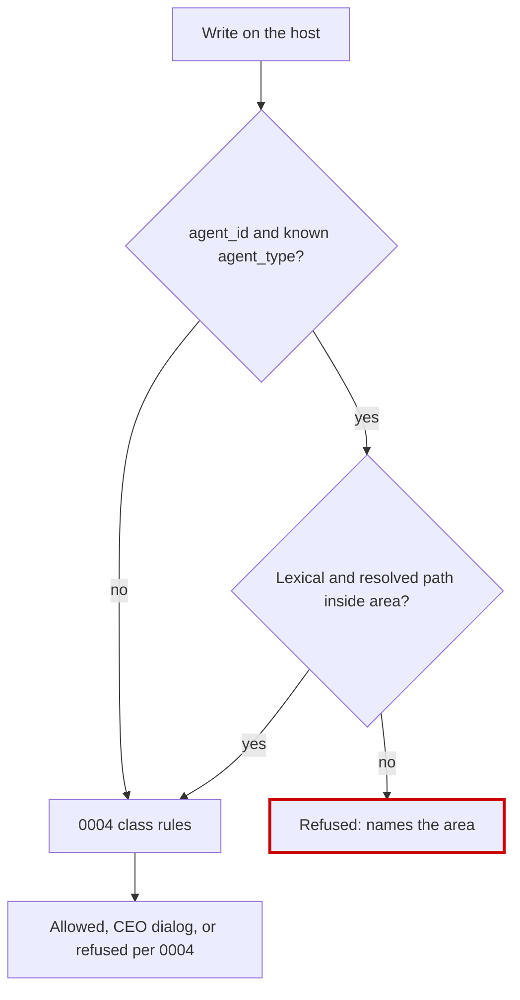
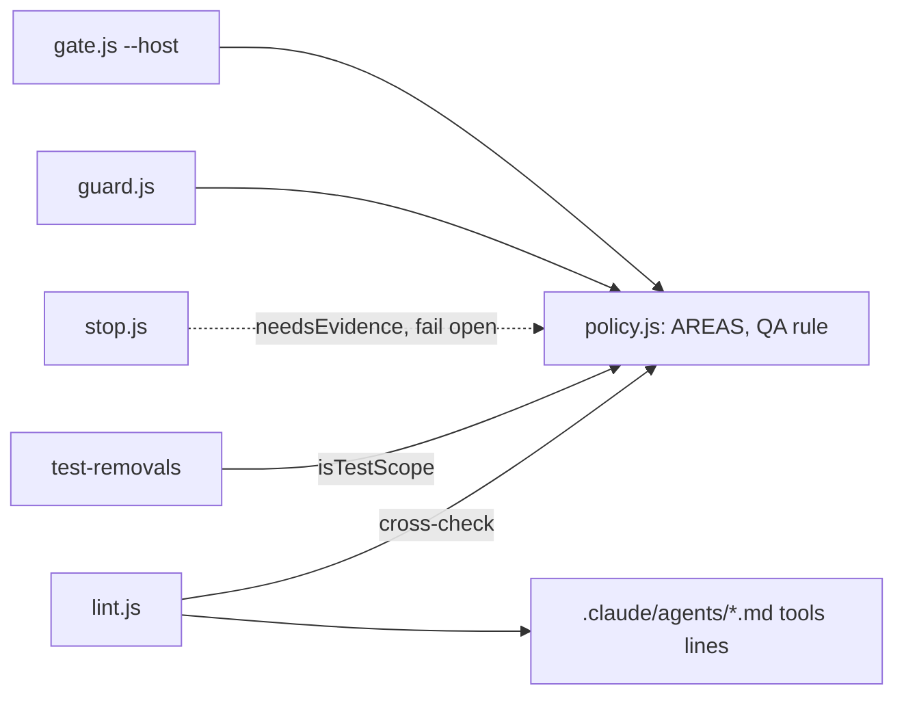
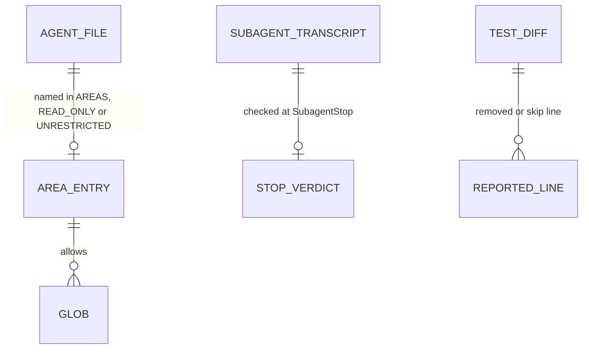
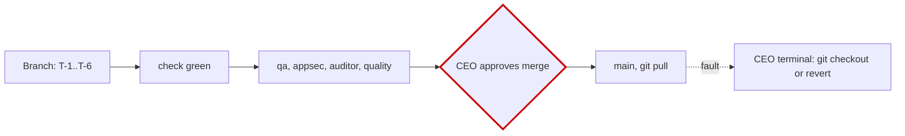
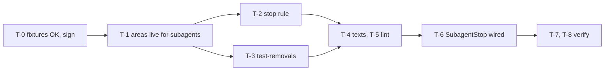

# Spec 0006 — Unit write areas, subagent evidence, QA write rule and reviewer independence
<!-- Header fields and Status values stay English (protocol); content is written in English. -->

- Status: Draft
- Tier: full · Lane 3 (same job as 0004, escalated in `docs/KARARLAR.md` rev. 48)
- Previous spec: 0004 (`specs/draft/0004-harness-enforcement-gaps.md`). **Depends on 0004 merged**: it uses `harness/policy.js` (`context`, `decide`, `classify`, `matchGlob`, the `agent_type` pass-through), the host gate wiring, `COMPANY_LINT_ROOT`, `harness/test/lint-rules.sh`, `harness/test/policy-driver.js`, the T-1 fixtures and record `docs/kanit/0004-t1.md`.
- Re-check: done against the final 0004 (sections, REQ/AC/ruling/gap ids and the rule "classify both the lexical and the resolved path, stronger class wins", 0004 §7.1.1); the re-check tags are removed. Corrected in that pass: area globs match both `lexical.rel` and `resolved.rel` (§7.1), the symlink-swap gap points to 0004 G-20, G-3 and G-17 (§8, GU-9), 0004's gaps are the `G-n` series (§13). Gap ids: 0004 owns the `G-n` series (it is still growing); the gaps of this spec use the prefix `GU-` (GU-1..GU-9) and are never numbered into the `G-n` series, so the two lists cannot collide in `harness/README.md`.
- Next spec: 0005 (`specs/draft/0005-harness-consistency-cleanup.md`). Order: **0004 → 0006 → 0005**.
- Inputs: design `docs/architecture/tasarim/0004-host-enforcement.md` ("Per-unit write areas", D-6, D-8, D-9, evidence rule K12); board opinion `docs/architecture/gorus-0004-host-enforcement-2026-11-21.md` (board-K3: areas as a constant in the policy module, not a JSON file; split into this spec); `docs/KARARLAR.md` rev. 48 (threat level; CEO decision on the QA rule and the rule 3 wording, line 416).
- Self-critique: done (adversarial read, §14). Gate rounds recorded in §14: round 1 (spec-critic and appsec: no Critical) and round 3 (appsec N6-1..N6-3), all findings folded in; no round-2 findings are recorded for this spec. Final consistency read (spec-critic, 2026-11-21): signable.
- Unlocks: `harness/bin/lint.js`, `harness/bin/check`, `harness/bin/test-removals`, `harness/test/areas.sh`, `harness/test/stop.sh`, `harness/test/test-removals.sh`, `harness/test/lint-rules.sh`, `harness/test/fixtures/*.json`, `harness/test/*.js`, `harness/README.md`, `.claude/rules/routing.md`, `.claude/agents/qa-engineer.md`, `.claude/skills/qa-verification/SKILL.md`
- Enforcement files this spec changes (class 2 of 0004: a CEO dialog on every edit, never covered by `Unlocks:`): `harness/policy.js`, `harness/guard.js` (REQ-16 only: the subagent signing denial and the unit name in reasons; the Bash branch, not the file-tool branch of 0004 R-1), `harness/stop.js`, `.claude/settings.json`, `harness/bin/install-project.sh`, **`CLAUDE.md` (rule 3 text, §7.5; the CEO's signature on this spec is the approval for that text)**.
- Code-class files this spec changes (signature covers them): `site/index.html` (regenerated by `node harness/bin/site-data.js --write` after test-count or wiring changes).
- Numbering note: specs 0002 and 0003 reserve "0004" for the Tower job "visual realism and guided tour"; 0004, 0005 and 0006 are now harness specs. The Tower job needs a new number (0007 or later).

## 1. Intent
CEO's words (relayed, rev. 48): "I want to approve everything"; the twelve findings of the structure review are fixed before the mobile units. CEO decision (2026-11-21, `docs/KARARLAR.md` line 416): "QA yalnız yeni test dosyası yazar (ya da `repro/` altında düzenler); mevcut testlere ve üretim koduna dokunamaz, kanca zorlar. Kural 3 'doğrulayan, incelediği işi değiştiremez' anlamında yeniden yazılır."

Three findings are here: per-unit write areas exist only as text ("marketing writes only `docs/marka/`"); engineer subagents are not held to "done = fresh evidence" (`stop.js` runs for the main session only, and `stop.js:10` treats every `.md` file as non-code, so playbook edits never need evidence); rule 3 says reviewers have no write tool, but the only lane-1 reviewer, `qa-engineer`, has `Write, Edit, Bash` (`.claude/agents/qa-engineer.md:4`).

Interpretation, kept separate. On the host, inside a subagent call (the hook input carries `agent_id`), file-tool writes and recognised Bash writes outside the unit's declared area are refused by the hooks; the QA unit may only create new test files or edit files under a `repro/` folder in test paths; subagents get the same evidence check as the main session, on their own transcript; edits to playbooks, unit definitions, evals and templates need evidence; the constitution says what is true. Threat level as in 0004 §8 and `docs/KARARLAR.md` rev. 48: these hooks stop accidents and honest mistakes, not an adversarial agent with Bash; each known gap is listed (§8).

Success: a subagent file-tool write outside its area is refused with the area named; a QA file-tool write to an existing test outside `repro/` is refused, and `test-removals` prints test lines removed or disabled by any route, including routes the hooks do not see (delete-then-recreate, interpreters); a subagent that edited code and ran no check is sent back once; `CLAUDE.md` rule 3 and the routing lane-1 line say what the hooks check and point to the gaps.

Deliberately NOT done: the shared policy, host gate, Bash writer detection, signing preview and wrappers (0004); a JSON area file (board-K3); frontmatter hooks per agent (design D-6b, D-9b); areas inside the container (board: container has no unit areas); areas for host main sessions started with `claude --agent <unit>` (GU-1); CI running `test-removals` (it needs a full-history checkout and a row-2 edit of `.github/workflows/check.yml`; later); consistency items (0005).

## 2. Market summary (Product)
None. Internal harness job. Payload fields `agent_id` and `agent_type` (PreToolUse inside a subagent), `agent_transcript_path` and `stop_hook_active` (SubagentStop) are taken from the Claude Code hook documentation as relayed in the design and the gate reports; they were **not observed** by this unit (no shell). Per that documentation `agent_type` is also set for a whole session started with `--agent`, while `agent_id` is present only inside a subagent call. 0004 T-1 records the payloads on this host (`docs/kanit/0004-t1.md`, 0004 AC-13); if a needed field is absent, this spec stops (T-0).

## 3. Requirements (EARS)
Unit write areas (host only)
- REQ-1 — When, in host mode, a file-tool write or a recognised Bash writer target comes from a call that carries `agent_id` and an `agent_type` that is in the area table (§7.1), and the target is outside that unit's area, the system shall refuse it and name the unit and the area, before any class rule of 0004 applies.
- REQ-2 — When the target is inside the unit's area, the system shall apply the class rules of 0004 unchanged.
- REQ-3 — Where the call carries no `agent_id` (main session, including a session started with `--agent`), no `agent_type`, or an `agent_type` not in the table, or the mode is container, the system shall apply no area limit.
- REQ-4 — The system shall allow `spec-critic`, `appsec` and `internal-auditor` no file-tool write, and Bash writer targets only in the OS temp directories and device paths of 0004 §7.4.
- REQ-5 — The system shall keep the area table as a constant inside the shared policy module. Lint shall fail when an agent with a write tool or Bash is in no table, when a table names an agent that does not exist, when a `READ_ONLY` unit has a file-write tool (`Write`, `Edit`, `MultiEdit`, `NotebookEdit`, as `lint.js:68`), or when `spec-critic` has `Bash` (constant `NO_BASH`). `appsec` and `internal-auditor` keep `Bash`.
- REQ-6 — A target is inside an area only when both paths that 0004 §7.1.1 classifies (lexical and resolved) are inside it.
- REQ-16 — When, in host mode, a Bash call carries `agent_id` (any subagent, whether or not its `agent_type` is in the area table, `UNRESTRICTED` units included), the guard shall deny (exit 2, English reason naming the unit) every command that contains a signing or key pattern of 0004 §7.5 (`approve.sh` with `--expect`, `approval.js sign`, `ceo-keygen`, a read of `ceo.key` or `.company/`); `approve.sh --preview` keeps the decision of 0004. When the gate or the guard emits an ask or a refusal for a call that carries `agent_type`, the reason shall include it (`from unit <agent_type>`; `from a subagent` when only `agent_id` is present), so a dialog that appears in the middle of a run says which unit caused it. Calls without `agent_id` (the main session) keep 0004's signing dialog unchanged.

QA write rule (Q-3, CEO decision 2026-11-21, closed)
- REQ-7 — When `qa-engineer` writes with a file tool, the system shall allow (subject to the class rules) only a new test file, a file under a `repro/` folder in test paths, or a path in the OS temp directories, each as defined in §7.2; it shall refuse every other path, including existing tests outside `repro/`, production code, test-runner configuration, `harness/test/**` unless the signed spec's `Unlocks:` lists it, and every enforcement path.
- REQ-8 — When `qa-engineer` runs a recognised Bash writer, the system shall allow targets in temp, device paths and paths REQ-7 allows, and refuse others.
- REQ-9 — The system shall provide a command that, between the merge base of a given base and the working tree, prints every removed or changed line of a test-scope file (renames shown as removals) and every added line that matches a known skip marker, including in untracked test-scope files; its non-empty output is information for the reviewer, never a failure.

Subagent evidence and the evidence rule
- REQ-10 — When a subagent stops, the system shall apply the evidence rule to that subagent's own transcript (`agent_transcript_path`) and never to the main session's transcript; the subagent's turn starts after its first user text row.
- REQ-11 — The system shall count as needing evidence an edit to an enforcement, product-config or code path of 0004 §7.1, including `.md` files under `.claude/agents|skills|rules/`, `evals/`, `templates/` and `CLAUDE.md`; it shall count as not needing evidence free paths, signature records, `harness/README.md`, and `.md`/`.txt` files in the code class; a path that cannot be resolved counts as needing evidence.
- REQ-12 — Where a path is outside the workspace or the root is unknown, the system shall apply the same rule by folder names (§7.3).
- REQ-13 — The system shall accept as evidence, in addition to today's commands, `vitest`, `jest`, `playwright test`, `pnpm`/`yarn`/`bun` test, build and lint, `flutter test|analyze`, `xcodebuild` test, build or build-for-testing, `gradle`/`gradlew` test, build, check or assemble, `swift test|build`, `mvn test|verify`, `deno test`, each only in command position (§7.3).
- REQ-14 — If the policy module cannot be loaded, then the stop hook shall fall back to today's rule and still fail open.

Texts
- REQ-15 — `CLAUDE.md` rule 3, the routing lane-1 line, the QA unit text and the QA playbook's tools line shall state the QA rule in one shared phrase and point to the known gaps, without absolute claims (§7.5); `harness/README.md` shall label each unit limit as hook-checked or instruction-only and list gaps GU-1..GU-9.

## 4. User experience
No screens. Subagents receive refusals (English, exit 2, from `gate.js`/`guard.js` via the policy); the CEO sees nothing new except fewer silent mistakes. A blocked subagent stop returns a reason to the subagent (owner: `stop.js`). Refusal text owner: `policy.js`; format `area: <agent_type> may write only <globs> (+ temp); refused <rel>`.

### What happens when a subagent writes a file on the host?

Description: the area check runs first and only narrows; 0004's classes decide everything inside the area. Text equivalent: main session, `--agent` session or unknown unit → class rules; known subagent unit with both paths inside its area → class rules; known subagent unit with either path outside → refused (red, thick border).

States: refused (exit 2, reason names unit, path and area) → AC-1..AC-4; allowed → AC-1, AC-3; subagent stop sent back once (`{"decision":"block"}`) → AC-8; error in the stop hook → fail open → AC-8, AC-9.

## 5. Acceptance criteria
"check" = covered by `./harness/bin/check`. "manual" = evidence recorded by hand. All new hook test cases (existing cases unchanged) run with `CLAUDE_PROJECT_DIR` set to a temp workspace that has a `specs/` folder; "probe dir" = a second `mktemp -d`, outside that workspace. Payloads are built from `harness/test/fixtures/pretooluse-subagent.json` (carries `agent_id`; the fixture is created by 0004 AC-13, T-0 checks the field).

- [ ] AC-1 — (check) `harness/test/areas.sh`, `gate.js --host`, table-driven from the matrix §9.1: for every row of `AREAS` one in-area path → no output and one out-of-area path → exit 2 with the unit's globs in the reason; for each `UNRESTRICTED` unit unsigned `src/x.tsx` → ask (class rule); `appsec` Write `docs/x.md` → exit 2. Plus: `marketing` → `.claude/settings.json` → exit 2 (area reason, not ask); `marketing` Write `<probe>/x.md` → no output; symlink `docs/marka/l -> ../../src`, `marketing` Write `docs/marka/l/x.cs` → exit 2; `marketing` with `agent_id` removed → class rules only (`docs/x.md` no output); `general-purpose` and absent `agent_type` → class rules only (`docs/x.md` no output). Non-temp outside path (N6-2; every `mktemp` directory counts as temp, so the probe dir proves nothing here): a `policy-driver.js` case on `decide` with an injected `ctx.tmpdir` of `/nonexistent-tmp` → `marketing` Write `/srv/x.md` → refused with the area named, `marketing` Write `/nonexistent-tmp/x.md` → no output, `appsec` writes `/srv/x.md` through `echo x > /srv/x.md` → refused; `/tmp/x.md` stays temp by the fixed list of 0004 §7.4. Nested root (N6-3, uses `lexical.root` / `resolved.root` of `classify()`): `marketing` Write `.claude/worktrees/w1/docs/marka/a.md` → no output, `.claude/worktrees/w1/docs/x.md` → exit 2. Reason (REQ-16): the ask for `react-engineer` unsigned `src/x.tsx` contains `react-engineer`.
- [ ] AC-2 — (check) `areas.sh`, `guard.js` with `agent_id` and `agent_type`: `appsec`, `internal-auditor` and `spec-critic` running `echo x > src/a`, `echo x > docs/a.md`, `cp /tmp/a docs/b` → exit 2; `echo x > /tmp/a`, `echo x > /private/tmp/a`, `echo x > /var/folders/ab/T/a`, `cmd > /dev/null`, `git diff`, `ls`, `dotnet test` → no opinion; probe-dir symlink `<probe>/l -> <ws>/src`, `appsec` `echo x > <probe>/l/a` → exit 2; `appsec` without `agent_id` → same output as with no `agent_type`; `quality-office` `echo x > docs/kalite/a.md` → no opinion, `echo x > docs/x.md` → exit 2. REQ-16 (N6-1): with `agent_id`, for `dotnet-engineer` (`UNRESTRICTED`), `qa-engineer`, `appsec` and `general-purpose`: `harness/bin/approve.sh . --expect <sha12>`, `node harness/approval.js sign x approvals key`, `harness/bin/ceo-keygen.sh`, `cat ~/.company/keys/ceo.key.pem` → exit 2 with the unit named in the reason; `harness/bin/approve.sh . --preview` → no opinion; the same `--expect` command without `agent_id` → ask as in 0004 AC-8; a guard ask for `echo x > src/a.cs` from `dotnet-engineer` (unsigned) has `dotnet-engineer` in its reason, and the same ask without `agent_type` has no `from unit` text.
- [ ] AC-3 — (check) `areas.sh`, `qa-engineer` file tools, signed spec, workspace with tracked `tests/old.test.ts` and `tests/repro/bug1.test.ts`: Write `tests/new.test.ts` (absent) → no output; Edit `tests/old.test.ts` → exit 2; Write `tests/old.test.ts` (overwrite) → exit 2; Edit `tests/repro/bug1.test.ts` → no output; Write `tests/repro/data.json` → no output; Write `src/Order.cs` → exit 2; Write `src/NewTest.cs` (absent) → no output; Write `src/Latest.cs` and `src/Contest.cs` (absent) → exit 2; Write (absent) `tests/conftest.py`, `tests/__mocks__/a.js`, `tests/Directory.Build.props`, `tests/xunit.runner.json`, `tests/pytest.ini`, `tests/out.txt`, `tests/repro/jest.config.js` → exit 2; Write `tests/helpers.ts` (absent) → no output (GU-6); Write `src/repro/Foo.cs` → exit 2; Write `harness/test/x.sh` without `Unlocks:` → exit 2, with `Unlocks: harness/test/x.sh` → no output; Write `tests/CLAUDE.md` → exit 2; symlink `tests/repro/l.test.ts -> ../old.test.ts`, Edit `tests/repro/l.test.ts` → exit 2; Edit `<probe>/src/x.cs` and Write `<probe>/x.cs` → no output; probe-dir symlink `<probe>/l -> <ws>/src`, Edit `<probe>/l/Order.cs` → exit 2; unsigned `tests/new2.test.ts` → ask (class rule).
- [ ] AC-4 — (check) `areas.sh`, `qa-engineer` Bash: `cp -r src <probe>/c` and `sed -i s/a/b/ <probe>/c/x.cs` → no opinion; `sed -i s/a/b/ tests/old.test.ts`, `echo x >> tests/old.test.ts`, `rm tests/old.test.ts`, `mv tests/old.test.ts tests/repro/old.test.ts` → exit 2; `echo x > tests/repro/r.test.ts` → no opinion (signed); `echo x > src/a.cs` → exit 2.
- [ ] AC-5 — (check) `harness/test/lint-rules.sh` (`COMPANY_LINT_ROOT` trees built in a temp dir): an agent file with `Write` that is in no table → FAIL; a table entry with no agent file → FAIL; `appsec` with `Edit` → FAIL; `spec-critic` with `Bash` → FAIL; `appsec` and `internal-auditor` with `Bash` (as in the repo) → ok; the real repository → ok.
- [ ] AC-6 — (check, last clause manual) `harness/test/test-removals.sh` (temp git repo, base branch `main`): a removed line in committed `tests/a.test.ts` → printed `tests/a.test.ts: -<line>`; a changed line → the old line printed; the same removal left uncommitted in the working tree → printed; `git mv tests/a.test.ts src/a.ts` → every old line printed under `tests/a.test.ts`; an added `[Ignore]`, `@pytest.mark.skip`, `it.only(` or `#if false` line in a tracked test → printed `+SKIP <line>`; an untracked new `tests/b.test.ts` containing `xit(` → printed; an added plain test → nothing; a change in `src/a.cs` → nothing; no changes → empty output, exit 0; unknown base → exit 2 with `unknown base: <base>`; outside a git repo → exit 2. `lint.js` checks that `harness/bin/check` contains the step that runs `test-removals "$COMPANY_BASE"` only when `COMPANY_BASE` is set and does not fail on non-empty output. Manual: one run of `COMPANY_BASE=main ./harness/bin/check` recorded in T-8.
- [ ] AC-7 — (check) `.claude/settings.json` wires `node "$CLAUDE_PROJECT_DIR/harness/stop.js"` for `SubagentStop` (no `|| exit 2`); `install-project.sh` into an empty temp project writes a `SubagentStop` entry `node "<repo>/harness/stop.js"` (absolute, like `Stop`); into a temp project that already has `.claude/settings.json` → exit 1, output contains `merge the hooks by hand` and `SubagentStop`, the file is byte-identical; `lint.js` fails when the SubagentStop entry is missing or wrapped.
- [ ] AC-8 — (check) `stop.sh` additions, payloads built from `harness/test/fixtures/subagentstop.json` with `hook_event_name: "SubagentStop"`: code edit without later evidence in the subagent transcript → block; with evidence → no output; honest "not verified" → no output; `stop_hook_active: true` → no output; subagent transcript with an unverified edit while `transcript_path` names a clean transcript → block; `agent_transcript_path` absent while `transcript_path` names a transcript with an unverified code edit → no output; `agent_transcript_path` names a missing file → no output; unreadable file (mode 000; skipped with a printed note when run as root) → no output; brief, code edit, a second user text row, final text → block (turn starts after the first user row), while the same file as a main-session Stop → no output (today's case 8 rule). All 11 existing `stop.sh` cases pass unchanged.
- [ ] AC-9 — (check) `stop.sh` additions, edit-only turns, `CLAUDE_PROJECT_DIR` and `cwd` = a temp workspace with `specs/`: block for `.claude/agents/x.md`, `.claude/skills/x/SKILL.md`, `.claude/rules/x.md`, `evals/x.md`, `templates/x.md`, `CLAUDE.md`, `harness/bin/x.sh`, `src/a.cs`, and `src/docs/x.cs` (row 6; the folder-name fallback would allow); allow for `docs/x.md`, `specs/x.md`, `plans/x.md`, `STATE.md`, `README.md`, `harness/README.md`, `approvals/x.sig.json`, and `src/evals/x.md` (row 6 `.md`; the fallback would block); outside the workspace: `/p/templates/x.md` → block, `/p/docs/x.md` → allow; with a temp copy of `stop.js` whose `policy.js` throws at load: `/p/src/A.cs` → block (today's rule), garbage stdin → allow. `areas.sh` through `policy-driver.js` with an injected `ResolveError` → `needsEvidence` true.
- [ ] AC-10 — (check) `stop.sh` additions: each of `npx vitest run`, `CI=1 npx vitest run`, `jest`, `npx playwright test`, `pnpm test`, `cd web && pnpm test`, `yarn build`, `bun run lint`, `flutter test`, `xcodebuild -scheme App test`, `./gradlew test`, `gradle assemble`, `swift test`, `mvn verify`, `deno test` after an edit → allow; `git status`, `ls`, `pnpm install`, `cat jest.config.js`, `npm i -D vitest`, `echo xcodebuild test` → block.
- [ ] AC-11 — (check) `CLAUDE.md` rule 3, the `routing.md` lane-1 line, the body of `.claude/agents/qa-engineer.md` and line "Tools and permissions" of `.claude/skills/qa-verification/SKILL.md` equal the exact texts of §7.5; `lint.js` checks each string.
- [ ] AC-12 — (check) `harness/README.md` has a unit-limit table with exactly one row per key of `AREAS`, `READ_ONLY` and `UNRESTRICTED` (row starts with `` | `<key>` | ``), each row containing "kanca" (hook-checked) or "yalnız talimat" (instruction-only), and the ids GU-1..GU-9 (the `G-n` ids of 0004 are checked by 0004's own lint rule, AC-14 there; the two series do not overlap); `lint.js` reads the keys from `policy.js` and checks rows, labels and ids.
- [ ] AC-13 — (manual) In a real host session (default mode, signed spec), recorded in `docs/kanit/0006-gozlem.md` (Turkish) with transcript excerpts: a `marketing` subagent asked to write `docs/x.md` is refused with the area named; a `qa-engineer` subagent asked to edit an existing test outside `repro/` is refused; a `react-engineer` subagent that edits a scratch code file and stops without a check is sent back once.

## 6. Architecture and technology decision
No new dependency (Node built-ins, POSIX `sh`, `git`). Board: D-6a APPROVE as a constant (board-K3), D-8a APPROVE, D-9a APPROVE.

### Where are unit limits decided?

Description: one module holds the areas, the test-path definitions and the evidence rule; hooks and `test-removals` use it, lint compares it with the agent files. Text equivalent: gate and guard ask the policy for areas; stop asks it for "needs evidence" and falls back if it fails (dashed); `test-removals` asks which files are test scope; lint checks the table against agent tool lines.

| Decision | Options | Choice and rationale | Cost / risk |
|---|---|---|---|
| Where areas live | constant in `policy.js`; `harness/write-areas.json`; frontmatter `hooks` per agent | **constant (board-K3)**: no extra file, no "lookup failed" branch; agent files are product-config, so a unit editing its own frontmatter would lift its own limit | an area change is a row-2 edit (dialog), which is intended |
| Unit identity | `agent_id` + `agent_type` from the app's hook input; `agent_type` alone; text in the prompt | **`agent_id` + `agent_type`** (R-3): `agent_type` alone also marks `--agent` main sessions; model text is untrusted | if the app omits either field in a subagent, that call has no area (GU-4) |
| QA vs rule 3 (Q-3) | a) new tests + `repro/` only, hook-checked, `test-removals` evidence, rule 3 reworded; b) QA read-only; c) reword only | **a, decided by the CEO** (2026-11-21, rev. 48; design D-8a, board APPROVE) | Bash interpreter writes, delete-then-recreate stay gaps (GU-2, GU-7) |
| "New file" test | path absent on disk (lexical and resolved); not in `git ls-files` | **absent on disk** (R-1) | delete-then-recreate (GU-7); `test-removals` shows it |
| Test-file definition | design K11 folder globs (any file in a test folder); test-named files plus code files in test folders, config names refused | **narrow** (R-7): folder globs let a new `conftest.py`, `__mocks__`, `Directory.Build.props` or `xunit.runner.json` skip existing tests | QA cannot add non-code fixtures outside `repro/`; new code files in test folders remain (GU-6) |
| QA probe copy | file tools allowed in OS temp; Bash only | **file tools in temp** (R-6): QA's method edits a temp copy; Bash-only would push QA to `sed` | temp holds scratch output, not the repo |
| Subagent evidence | `SubagentStop` in settings → `stop.js`; frontmatter Stop per engineer | **settings** (D-9a): one wiring point, enforcement class | block text goes to the subagent |
| Evidence classification | row-based via policy + folder-name fallback; regex only | **row-based + fallback**: one class source; fallback keeps the existing absolute-path tests | none |

Rulings (Type 2):
- Ruling R-1: QA "new file" = at the time of the call `lstat` of the lexical path gives ENOENT and the resolved path does not exist (any other `lstat` error → treated as existing) — no git call, also covers tests the maker created but did not commit (design gap G-9 closed for file tools) — cost if wrong: QA iterates under `repro/`; a test removed by an unrecognised route and recreated passes as new (GU-7).
- Ruling R-2: the `repro` rule needs a `repro` folder segment plus either a test folder segment before it or a test-named file — `src/repro/Foo.cs` would otherwise ship with production code — cost: a top-level `repro/` folder takes only test-named files.
- Ruling R-3: areas apply only in host mode and only to calls that carry `agent_id` (a subagent call) — the container session is itself started with `--agent $AGENT` (`company-run.sh:37,56`), so per the documentation it may carry `agent_type`; the mode check, not field absence, keeps areas out of the container (no unit areas there by board decision; mounts are OS-enforced); a host main session started with `claude --agent <unit>` carries `agent_type` but no `agent_id` and gets no area (GU-1); 0004 T-1 records the observed payloads — cost if wrong: if subagent calls lack `agent_id`, areas never apply; T-0 stops on that.
- Ruling R-4: area refusals are exit 2 and are not subject to 0004's permission-mode rule (they never ask) — cost: none.
- Ruling R-5: `devops-sre` is unrestricted like the engineers (design table), although `harness/bin/site-data.js:106` describes it as "ops/, docs/ops/, Dockerfile, CI" — CI files are enforcement class anyway — cost if wrong: narrow later by a row-2 edit (Assumption A-2).
- Ruling R-6: every unit in `AREAS` (QA included) may also write with file tools to the OS temp paths of 0004 §7.4; `READ_ONLY` units get none (they have no file tools) — subagents use the session scratch directory and QA needs its probe copy; temp is outside the root (row 7, "none") — cost if wrong: scratch output in temp, not in the repo.
- Ruling R-7: test folder names `test`, `tests`, `__tests__` and test-name patterns `*.test.*`, `*.spec.*`, `*_test.*`, `test_*.py` are case-folded on darwin/win32; the `Test`/`Tests` suffix of a file or folder name is matched case-sensitively — `src/Latest.cs` and `src/Contest.cs` are production code — cost: `orderTest.cs` (lower-case suffix boundary) is not a test file for QA; it can still go under `repro/`.

## 7. Data and API contract

### 7.1 Area table (constant `AREAS` in `harness/policy.js`)
| `agent_type` | File tools may write | Recognised Bash writer targets |
|---|---|---|
| `spec-critic`, `appsec`, `internal-auditor` (`READ_ONLY`; `spec-critic` also in `NO_BASH`) | nothing | temp and device paths only |
| `qa-engineer` | QA rule (§7.2) + temp | temp, device paths, QA rule paths |
| `quality-office` | `docs/kalite/**`, `docs/uyum/**` + temp | same + device paths |
| `delivery-manager` | `plans/**`, `STATE.md`, `docs/**` + temp | same + device paths |
| `business-analyst` | `specs/**`, `docs/**` + temp | n/a (no Bash) |
| `architecture-board` | `docs/architecture/**` + temp | n/a |
| `software-architect` | `docs/architecture/tasarim/**` + temp | n/a |
| `product-manager` | `docs/product/**` + temp | n/a |
| `scout` | `docs/scout/**` + temp | n/a |
| `marketing` | `docs/marka/**` + temp | n/a |
| `tech-comms` | `docs/dis/**` + temp | n/a |
| `talent-capacity` | `docs/talent/**` + temp | n/a |
| `dotnet-engineer`, `react-engineer`, `polyglot-engineer`, `devops-sre` (`UNRESTRICTED`) | no area limit (class rules) | no area limit |

Globs use the 0004 §7.3 grammar and are matched against both `classify().lexical.rel` and `classify().resolved.rel` (0004 §7.2; each relative to the `root` returned with it, `lexical.root` and `resolved.root`: 0004's `classify()` returns `root` with both results, and nested roots such as `.claude/worktrees/<name>` are handled by that value, not re-derived here). "Temp" and "device paths" are those of 0004 §7.4; a path is temp only when it is not under the root (root first, as 0004 §7.4 says for roots under temp in tests). Both paths that 0004 §7.1.1 classifies (lexical and resolved) must pass; if either fails, the call is refused (the same two-path idea as the rule "classify both the lexical and the resolved path, stronger class wins"). `context()` gains `agentId` (from `event.agent_id`) next to `agentType` (0004 §7.2) and a `tmpdir` option (default `os.tmpdir()`, injectable in `policy-driver.js` so a test can use a non-temp outside path). Future units (for example mobile engineers) are added to `UNRESTRICTED` or `AREAS` in the spec that adds them; lint fails until they are.

### 7.2 QA rule and test paths (exported from `policy.js`)
- Test folder segment: `test`, `tests`, `__tests__` (case-folded on darwin/win32), or a segment ending in `Tests` (case-sensitive, for example `OrderTests`, `Order.Tests`).
- Test-named file (basename): `*.test.*`, `*.spec.*`, `*_test.*`, `test_*.py` (case-folded), or one or more characters followed by `Test.<ext>` or `Tests.<ext>` (case-sensitive, R-7).
- Code extensions E (case-folded): `.cs .fs .vb .ts .tsx .js .jsx .mjs .cjs .py .go .rs .java .kt .kts .swift .dart .rb .php .sh`.
- Runner-config names C (basename, case-folded), refused everywhere for QA: `conftest.py`, `jest.config.*`, `jest.setup.*`, `vitest.config.*`, `vitest.setup.*`, `vitest.workspace.*`, `playwright.config.*`, `karma.conf.*`, `setupTests.*`, `global-setup.*`, `global-teardown.*`, `globalSetup.*`, `globalTeardown.*`, `AssemblyInfo.cs`, `Directory.Build.props`, `Directory.Build.targets`, `Directory.Packages.props`, `xunit.runner.json`, `pytest.ini`, `tox.ini`, `package.json`, `*.runsettings`, `*.csproj`; also any path with a `__mocks__` segment.
- `isTestFile(rel)` = not in C and (test-named, or under a test folder segment with an extension in E).
- `isRepro(rel)` = not in C and has a `repro` segment (case-folded) and (a test folder segment precedes it, or the file is test-named) (R-2).
- `isTestScope(rel)` (for `test-removals`, broad on purpose) = has a test folder segment (any extension, case-folded), or is test-named (case-folded), or is in C.
- QA file tools allowed = under the root: ((`isTestFile` and new per R-1) or `isRepro`) and not row 2 and (not under `harness/test/` or the signed active spec's `Unlocks:` matches); not under the root: temp (R-6). Checked on the lexical and the resolved path; both must pass. Then the 0004 class rules apply.

### 7.3 Evidence rule (`policy.needsEvidence(absPath, ctx)`)
Computed on both paths 0004 §7.1.1 classifies (`classify().lexical` and `.resolved`, each with its own `root`); true if either gives true. Under the root: row 1 → false; row 2 → true; row 3 never occurs (0004 §7.1.1 and §7.2: a nested root re-roots and is never final, so `classify()` never returns it); row 4 → true, except `harness/README.md` → false; row 5 → false; row 6 → true, except `*.md`, `*.txt` → false. `ResolveError` → true. Outside the root or root unknown (folder-name fallback): false if a folder segment is `docs`, `specs`, `plans` or `approvals`; else true if the path contains `.claude/agents/`, `.claude/skills/`, `.claude/rules/`, `evals/`, `templates/`, `harness/` (except `harness/README.md`) or the file name is `CLAUDE.md`; else false for `*.md`, `*.txt`; else true. If `policy.js` fails to load: today's `NON_CODE` (`stop.js:10`).

Evidence commands: today's `EVIDENCE` regex (`stop.js:11`) stays unchanged (substring match; GU-3). The new patterns count only in command position: at the start of a command segment (segments split on `;`, `&&`, `||`, `|`, newline, `(`), after skipping leading `NAME=value` assignments and the launchers `npx`, `bunx`, `pnpm exec`, `pnpm dlx`, `yarn dlx`, `env`, `time`; the command word is compared by its basename (`./gradlew` → `gradlew`). Patterns on that position: `vitest`, `jest`, `playwright\s+test`, `(pnpm|yarn|bun)\s+(run\s+)?(test|build|lint)\b`, `flutter\s+(test|analyze)\b`, `xcodebuild\b[^;&|\n]*\b(test|build|build-for-testing)\b`, `(gradle|gradlew)\s+[^;&|\n]*\b(test|build|check|assemble)\b`, `swift\s+(test|build)\b`, `mvn\s+[^;&|\n]*\b(test|verify)\b`, `deno\s+test\b`.

SubagentStop: when `hook_event_name` is `SubagentStop`, the transcript is `agent_transcript_path` (field name as recorded in the 0004 fixture `subagentstop.json`, 0004 AC-13); `transcript_path` is never read on SubagentStop. Field absent or empty → allow; field present but the file is missing or unreadable → allow (fail open, today's `stop.js:21`). The turn is every row after the transcript's **first** user text row (the brief), so mid-task messages and resumed runs do not reset it; the main-session Stop keeps today's "after the last user text row" (`stop.js:31-32`). Output protocol unchanged: `{"decision":"block","reason":"..."}` or no output.

### 7.4 `harness/bin/test-removals <base>`
POSIX `sh`. `mb=$(git merge-base <base> HEAD)`; `git diff --no-renames --no-ext-diff --no-textconv -U0 <mb>` (merge base to the working tree: committed, staged and unstaged changes of tracked files); keeps files where `policy.isTestScope` (called through `node`, one definition) is true. Prints every removed line as `<path>: -<line>` and every added line matching a skip marker as `<path>: +SKIP <line>`; untracked files from `git ls-files --others --exclude-standard` in test scope are scanned whole for skip markers. Skip markers (added lines): `[Ignore`, `Skip =` / `Skip=`, `@pytest.mark.skip`, `@pytest.mark.skipif`, `@pytest.mark.xfail`, `@unittest.skip`, `pytest.skip(`, `.skip(`, `.only(`, `.todo(`, `xit(`, `xdescribe(`, `xtest(`, `#if false`, `#if 0`, `@Disabled`, `@Ignore`, `XCTSkip`, `t.Skip(`. Exit 0 (output may be empty; non-empty output is information, never a failure); exit 2 `unknown base: <base>` when the base does not resolve, `not a git repository` outside a repo. Default base in the texts: `main`. Limits: GU-5.

`harness/bin/check` step: runs `test-removals "$COMPANY_BASE"` only when `COMPANY_BASE` is set; prints its output; the step fails only when the command exits non-zero (unknown base, not a repo).

### 7.5 Exact texts
Shared QA phrase in all four: "may only create new test files or edit files under a `repro/` folder in test paths".
- `CLAUDE.md` rule 3 (replaces line 8): "3. **The maker never verifies.** Review and audit are done by a separate agent that cannot change the work under review: `spec-critic`, `appsec` and `internal-auditor` have no write tool; `qa-engineer` may only create new test files or edit files under a `repro/` folder in test paths, never existing tests or production code. On the host the hooks check this for subagent file-tool writes and recognised Bash writes; they stop accidents, not a determined agent, and the known gaps are listed in `harness/README.md`."
- `.claude/rules/routing.md` lane-1 line: "- **1** small job/bug; no new data model, auth, external call, dependency or visible redesign: quick spec → CEO signs in chat → one engineer → one review by `qa-engineer` (QA + audit; it may only create new test files or edit files under a `repro/` folder in test paths, and attaches the output of `harness/bin/test-removals main`). No gates, no delivery-manager, no quality-office."
- `.claude/agents/qa-engineer.md` body (replaces line 13): "You are the company's QA unit. Your playbook is loaded; follow it. You may only create new test files or edit files under a `repro/` folder in test paths, never existing tests or production code; on the host the harness refuses other file-tool writes and recognised Bash writes, and the known gaps are listed in `harness/README.md`. When you probe a test by breaking the code, work on a temporary copy in the OS temp directory (your file tools work there), not on the repo. Attach the output of `harness/bin/test-removals main` to your report (another base only if the brief names one) and explain every line it prints. Show outputs in the chat; do not put output files in the repo."
- `.claude/skills/qa-verification/SKILL.md` "Tools and permissions" line (replaces `SKILL.md:49`): "Read, Grep, Glob, Bash (test/build/read, copying files for the temporary copy, `harness/bin/test-removals`), Write and Edit: it may only create new test files or edit files under a `repro/` folder in test paths (for example a failing reproduction test), plus the temporary copy in the OS temp directory. It never changes existing tests or production code."

### Which records does this spec add?

Description: no new stored records; the area table is code, verdicts and reported lines are hook and command output. Text equivalent: each agent file has exactly one table entry; an entry has globs; a subagent transcript yields one stop verdict; a diff yields removed or skip-marker test lines.

## 8. Threat model and security
Sensitive area: authorization (unit limits, reviewer independence). No money, identity or personal data. Threat level: as 0004 §8 and `docs/KARARLAR.md` rev. 48: the hooks stop accidents and honest mistakes, not an adversarial agent with Bash. No absolute claims; each known gap below.

| Abuse / accident | Control | Residual |
|---|---|---|
| Unit writes outside its area by a file tool | area check before class rules, lexical and resolved path (AC-1) | main session, `--agent` sessions, unknown units (GU-1); symlink races (GU-9) |
| Read-only reviewer writes through Bash | Bash writer targets limited to temp (AC-2) | interpreter writes, build side effects (GU-2) |
| QA rewrites a failing test to make it pass | existing tests outside `repro/` refused, also via symlink (AC-3, AC-4); `test-removals` prints removed and skip lines (AC-6) | interpreter writes (GU-2); delete-then-recreate (GU-7); edits under `repro/` allowed by design |
| QA adds a file that disables existing tests | runner-config names and `__mocks__` refused; only test-named or code files in test folders (AC-3) | new code files in test folders (GU-6) |
| Subagent claims "done" without evidence | SubagentStop check on its own transcript (AC-8) | command text, not result (GU-3) |
| Playbook edited without evidence | precedence: product-config `.md` needs evidence (AC-9) | GU-3 |
| Unit edits its own limit | limits are in `policy.js` (enforcement class: dialog every edit) | G-1 of 0004 |
| Spoofed identity | `agent_id`/`agent_type` come from the app's hook input, not model text | app omits the fields (GU-4); a unit starts `claude -p` (GU-8) |
| A Bash-capable subagent runs the signing command and a dialog appears mid-run | guard denies signing and key patterns when `agent_id` is present; every dialog reason names the unit (REQ-16, AC-1, AC-2) | a subagent call without `agent_id` looks like the main session (GU-4); interpreters (0004 G-4) |

Known gaps (added to `harness/README.md` "Bilinen boşluklar" next to the `G-n` gaps of 0004, which owns that series; the ids of this spec carry the prefix `GU-` and are checked by lint, AC-12):
- GU-1 Calls without `agent_id` (main session, a host session started with `claude --agent <unit>`) or with an unknown `agent_type` (plugins, built-in agents such as `general-purpose`, `Explore`) have no area limit; class rules still apply.
- GU-2 Units with Bash can write through interpreters (`node -e`, `python -c`), git working-tree operations (0004 G-5) and build tools (0004 G-7); the area check sees only recognised writers.
- GU-3 The evidence rule matches command text, not its result (`echo` lines, a failed run); today's patterns also match as substrings (`cat harness/test/stop.sh` counts); reviewers check outputs.
- GU-4 Areas depend on the app sending `agent_id` and `agent_type` for each subagent call; a call without them has no area limit.
- GU-5 `test-removals` sees tracked changes and untracked files' skip lines only; it knows a fixed skip-marker list (other disabling, for example conditional compilation with another symbol, a config outside test scope or a changed CI filter, is not shown); the base must exist locally.
- GU-6 QA may add new code files in test folders (for example a helper, an `__init__.py`, an assembly-level attribute or a module initialiser) that can still change how existing tests run; the runner-config list is fixed.
- GU-7 Delete-then-recreate: a test removed by a route the hooks do not see (`git rm`, `git checkout`, an interpreter) is "absent on disk" and can be recreated by a QA file tool; `test-removals` prints its removed lines (detection, not prevention).
- GU-8 Any unit with Bash can start a new session (`claude -p ...`) whose calls carry no `agent_id`: no area limit there; class rules still apply.
- GU-9 Symlinks are checked at call time only: a link swapped between the check and the write (0004 G-20), or created by an unrecognised writer (0004 G-3, G-17), is not seen.

Instruction-only (labelled in `harness/README.md`): that a unit follows its playbook beyond its area; that QA's `repro/` edits and new test files are honest.

## 9. Test and evidence plan
All automated tests run under `./harness/bin/check` (new files added to its syntax and run lists). New helpers set `CLAUDE_PROJECT_DIR` explicitly; existing helpers are not edited; `policy-driver.js` gains calls by addition only.

| Criterion | Test | Layer | Profile |
|---|---|---|---|
| AC-1 | `harness/test/areas.sh` (gate, temp harness copy as in 0004 `host-gate.sh`, AC-3, AC-4), matrix §9.1 | integration | quick |
| AC-2 | `areas.sh` (guard) | integration | quick |
| AC-3 | `areas.sh` (gate, temp workspace with tracked tests, probe dir, symlinks) | integration | quick |
| AC-4 | `areas.sh` (guard) | integration | quick |
| AC-5 | `harness/test/lint-rules.sh` additions | integration | quick |
| AC-6 | `harness/test/test-removals.sh` (temp git repo); `lint.js` string check of the `check` step; manual run in T-8 | integration + manual | quick |
| AC-7 | `lint-rules.sh`; `areas.sh` (`install-project.sh` into two temp dirs) | integration | quick |
| AC-8 | `harness/test/stop.sh` additions | unit | quick |
| AC-9 | `stop.sh` additions (temp `stop.js` copy with broken policy); `areas.sh` via `policy-driver.js` | unit | quick |
| AC-10 | `stop.sh` additions | unit | quick |
| AC-11 | `lint.js` string checks | unit | quick |
| AC-12 | `lint.js` row, label and id checks | unit | quick |
| AC-13 | manual session record | manual | manual |

### 9.1 AC-1 matrix (one in-area and one out-of-area path per row)
| `agent_type` | In area → no output | Out of area → exit 2 |
|---|---|---|
| `quality-office` | `docs/kalite/a.md` | `docs/x.md` |
| `delivery-manager` | `plans/x.md`, `STATE.md` | `src/x` |
| `business-analyst` | `specs/x.md` | `src/x.cs` |
| `architecture-board` | `docs/architecture/x.md` | `docs/x.md` |
| `software-architect` | `docs/architecture/tasarim/x.md` | `docs/architecture/x.md` |
| `product-manager` | `docs/product/x.md` | `docs/x.md` |
| `scout` | `docs/scout/x.md` | `docs/marka/x.md` |
| `marketing` | `docs/marka/a.md` | `docs/x.md`, `src/x.cs` |
| `tech-comms` | `docs/dis/x.md` | `docs/marka/x.md` |
| `talent-capacity` | `docs/talent/x.md` | `docs/x.md` |
`qa-engineer` is covered by AC-3, `READ_ONLY` by AC-1 (`appsec`) and AC-2, `UNRESTRICTED` by the ask case of AC-1. The test iterates over the keys it reads from `policy.js` and fails if a key has no matrix row.

Evidence for "done": fresh `./harness/bin/check` output with new test counts; output of `harness/bin/test-removals main` on the branch showing no line from the existing `harness/test/*.sh` files (this spec only adds test lines); one run of `COMPANY_BASE=main ./harness/bin/check`; `qa-engineer` mutation probes on a temporary copy in the OS temp directory, each must turn a test red: drop the area check; check only the lexical path; let QA edit existing tests; count any new file in a test folder as a test file; fold the `Test` suffix case; treat `.md` as non-code again; drop the SubagentStop branch; read `transcript_path` on SubagentStop; start the subagent turn at the last user row; drop `--no-renames`; remove one evidence command; drop the command-position anchor.

## 10. Deployment and disaster recovery
Same path as 0004 §10: branch → `check` green → reviews → CEO approves the merge (envelope) → `git pull`; hooks act at the next call. Other projects: `install-project.sh` adds SubagentStop for new projects; for a project that already has settings it changes nothing, exits 1 and prints a hand-merge message that names `SubagentStop` (AC-7).

### By which path does the change go live, and how is it rolled back?

Description: same release and recovery path as 0004. Text equivalent: branch → check → reviews → CEO merge (red, thick border: CEO gate) → pull; on a fault (dashed), restore from git outside the session.

Live effects during the work: `policy.js` changes act at the next call, but areas touch only subagent calls, so a fault does not block the main session (repair from the main session after a dialog). `stop.js` fails open. Rollback: `git revert`; no stored data. Recovery path R of 0004 §10 applies unchanged.

## 11. Legal and compliance
No personal data; fixtures reused from 0004 (sanitized, lint-checked). No licence change, no external call.

## 12. Task list (atomic)
Global rules (as 0004 §12): `check` green after every task, output shown; no existing test weakened, edited or deleted (additions only); if an existing test or lint rule asserts behaviour or text the task would change, **stop and report**; after test-count or wiring changes run `node harness/bin/site-data.js --write` and include `site/index.html`; each row-2 edit is a CEO dialog.

| ID | Task | AC | Owning unit | Dependency |
|---|---|---|---|---|
| T-0 | Prerequisites: 0004 merged and moved to `specs/done/`, and 0004's approval record retired by the CEO (moved to `approvals/retired/`) at that move, before this spec is activated (0004 gap G-21; the retirement rule itself is owned by 0005 REQ-9 and is applied by instruction until 0005 is merged); the gate rounds of §14 closed (final consistency read 2026-11-21: signable; a re-check is the main session's call); the 0004 fixtures contain `agent_id` and `agent_type` (PreToolUse in a subagent) and `agent_transcript_path` (SubagentStop); `docs/kanit/0004-t1.md` states whether a host session started with `claude --agent <unit>` carries `agent_type` without `agent_id` (if 0004's record lacks it, the main session records it in `docs/kanit/0006-t0.md`) — if a subagent field is absent, stop and write a delta (areas become instruction-only + lint, subagent evidence dropped); every reference into 0004 re-checked against the merged text; CEO previews and signs this spec (`approve.sh --preview`, `--expect`) | all | main session + CEO | 0004 |
| T-1 | `policy.js`: `AREAS`, `READ_ONLY`, `UNRESTRICTED`, `NO_BASH`, `agentId` in `context`, test-path functions (§7.2), QA rule, area check first in `decide` (lexical and resolved), `needsEvidence`, `tmpdir` option, unit name in reasons; `guard.js`: REQ-16 signing denial and reasons (CEO dialog); `policy-driver.js` additions; `harness/test/areas.sh`; `check` lists. Live for subagent calls at once | AC-1..AC-4, AC-9 (driver part) | polyglot-engineer | T-0 |
| T-2 | `stop.js`: SubagentStop branch (own transcript, first-user-row turn), `needsEvidence` via try-require, evidence commands in command position; `stop.sh` additions; site data | AC-8..AC-10 | polyglot-engineer | T-1 |
| T-3 | `harness/bin/test-removals`, `harness/test/test-removals.sh`, `check` (conditional step and lists) | AC-6 | polyglot-engineer | T-1 |
| T-4 | Texts (§7.5) in `CLAUDE.md`, `routing.md`, `qa-engineer.md`, `qa-verification/SKILL.md`; `harness/README.md` unit-limit table and GU-1..GU-9 (Turkish); `lint.js` string, row, label, id and `check`-step checks in the same task. If an eval case in `evals/` asserts the old SKILL text, stop and report | AC-6 (lint part), AC-11, AC-12 | polyglot-engineer (CEO dialog for `CLAUDE.md`) | T-2, T-3 |
| T-5 | `lint.js` area cross-check (`READ_ONLY`, `NO_BASH`); `lint-rules.sh` additions | AC-5 | polyglot-engineer | T-4 |
| T-6 | Wiring: `.claude/settings.json` SubagentStop; `install-project.sh` (entry and hand-merge message); `lint.js` SubagentStop rule; site data | AC-7 | polyglot-engineer | T-5 |
| T-7 | Real-session observation (manual) | AC-13 | main session + CEO | T-6 |
| T-8 | Verification: fresh `check`, `test-removals main`, `COMPANY_BASE=main ./harness/bin/check`, mutation probes (§9), criterion-to-evidence map; then appsec, internal-auditor, quality-office | all | qa-engineer → appsec → internal-auditor → quality-office | T-7 |

File ownership (sequential): `policy.js` T-1; `guard.js` T-1 (REQ-16, after 0004 T-6); `policy-driver.js` T-1; `stop.js` T-2; `check` T-1, T-3; `lint.js` T-4, T-5, T-6; `.claude/settings.json` T-6; `install-project.sh` T-6; `stop.sh` T-2 only; `routing.md` T-4 only.

### In which order does this spec go live?

Description: areas and test-path functions go live first (subagent calls only), the stop rule, `test-removals` and wiring after. Text equivalent: T-0 → T-1; T-1 → T-2 and T-3; T-2 and T-3 → T-4/T-5 → T-6 → T-7/T-8.

## 13. Out of scope
- Everything in 0004 (policy, host gate, Bash detection, signing, wrappers, and the `G-n` gap series, which 0004 owns).
- Spec 0005 (consistency). 0005 was revised against the final 0004 and carries no "pending 0004 revision" marker (see 0004 §13).
- Areas in the container or for `--agent` main sessions; CI running `test-removals`; deriving `site-data.js` `WRITE` texts from `AREAS` (candidate for 0005; `site-data.js:104-109`, which still says `qa-engineer`: "yalnız test dosyaları"); the `qa-engineer.md` description line 3 (unchanged; not a rule text).
- Mobile engineer units (they will be added to `UNRESTRICTED` by their own spec).

## 14. Open questions and Spec critic findings
**Q-3 (Type 1) — CLOSED.** CEO decision 2026-11-21 (`docs/KARARLAR.md` rev. 48, line 416): `qa-engineer` may only create new test files or edit under `repro/`, never existing tests or production code, enforced by the hook; rule 3 is reworded with the CEO's verb "cannot change" (§7.5), the hook checks it for file tools and recognised Bash writes, gaps listed (§8).

Open questions: none.

Self-critique (adversarial read): the area table is transcribed from the design and the agents' text, not from a CEO statement (Type 3, A-1); the narrow test-file definition (R-7) is a Type 2 ruling the design did not have; the folder-name fallback keeps the existing absolute-path stop tests (`stop.sh:19-46`, no `cwd`) green whether or not `CLAUDE_PROJECT_DIR` leaks into the test environment (those paths sit outside any real root); the payload field claims (§2, R-3) are relayed from documentation and not verified by this unit; this unit had no shell, so `./harness/bin/check` was not run against anything here.

Gate findings round 1 (spec-critic C-n, appsec L-x), all folded in: C-1 Q-3 closed (§3 header, §6, §12 T-0, §14); C-2 "cannot change" (§7.5); C-3 `NO_BASH` (REQ-5, §7.1, AC-5); C-4/L-e `agent_id` and R-3 reason (§1, §2, REQ-1, REQ-3, R-3, T-0, AC-1, AC-2); C-5 QA file tools in temp (R-6, §7.2, AC-3, texts); C-6 narrow test files (R-7, §7.2, AC-3, GU-6); C-7/L-c case-sensitive `Test` suffix (R-7, AC-3); C-8/L-d `test-removals` to the working tree, `--no-renames`, skip markers, base `main` (REQ-9, §7.4, AC-6, texts, §9); C-9 first user row (§7.3, AC-8, A-4); C-10 never `transcript_path` (§7.3, AC-8); C-11 `CLAUDE_PROJECT_DIR`, discriminating cases, `ResolveError` (§7.3, AC-9); C-12 overwrite, `rm`, `mv`, `>>` (AC-3, AC-4); C-13 matrix (§9.1, AC-1); C-14 README rows linted (AC-12); C-15 informational output, `check` step test, hand-merge AC (§7.4, AC-6, AC-7, §10); C-16 command position (§7.3, AC-10, GU-3); C-17 shared phrase (§7.5); L-a lexical and resolved path (REQ-6, §7.1, §7.2, AC-1..AC-3); L-b gaps GU-7..GU-9 and §1 success reworded.

Gate findings round 3 (appsec N6-1..N6-3, coordinator), folded in: N6-1 a Bash-capable subagent can run the signing command and the dialog appears mid-run without naming the unit → REQ-16, AC-2, AC-1, §8; N6-2 every "outside" test path was a temp dir → AC-1 (injected `tmpdir`, `/srv/x.md`), §7.1; N6-3 `classify()` returns `root` with both results → §7.1, §7.3, AC-1 (nested root). Gap ids: the series of this spec was renamed GU-1..GU-9 (collision with 0004's `G-n` series, coordinator decision).

Final consistency read (spec-critic, 2026-11-21): this spec is signable; the label fixes of that read (row 3 "never occurs" in §7.3, gate-round labels, 0004 record retirement in T-0) are folded in.

---
## Signature record (CEO only)
Approved by / on: <!-- recorded under approvals/ by harness/approval.js; this line is informational, validity lives in the signature file -->

## Assumptions (for the end-of-job report)
- A-1 — Areas are transcribed from the design table and the units' own text (`harness/bin/site-data.js:104-109` agrees except `devops-sre`).
- A-2 — `devops-sre` is unrestricted like the engineers (R-5).
- A-3 — Bash-less units (`business-analyst`, `marketing`, ...) need no Bash area row; if a later spec gives them Bash, the area applies to their recognised writers automatically.
- A-4 — A resumed subagent appends to the same `agent_transcript_path`; with the first-user-row rule its earlier run is then part of the turn (stricter, not looser). Not verified; T-0 notes it if 0004 T-1 shows otherwise.
- A-5 — The Tower "visual realism and guided tour" job gets a number of 0007 or later.
- A-6 — The default base for `test-removals` in the texts is `main` (the repository's main branch).

## Scorecard (end of job)
| Measure | Value |
|---|---|
| Spec revisions | 2 |
| Fix rounds | 1 |
| Findings: real / noise / deferred | 19 / 0 / 0 (round 1) |
| Regressions | |
| Escaped defects | |
| Tokens used | |
