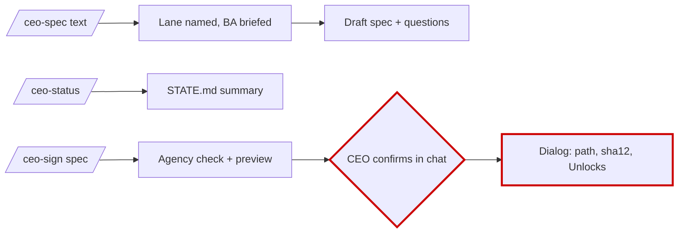
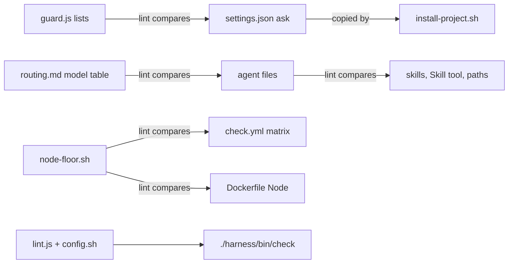
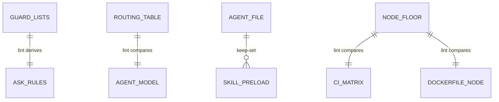
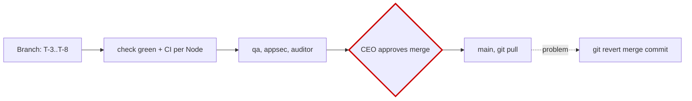
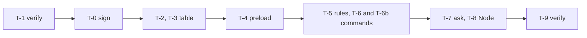

# Spec 0007 — Agency configuration update: declarative envelope layer, one lane-to-model table, trimmed preloads, path-scoped rule convention, pinned Node, CEO commands
<!-- Header fields and Status values stay English (protocol); content is written in English. -->

- Status: Draft
- Tier: full (6 capabilities, 13 criteria, a new CI dependency) · Lane 2 (it edits enforcement files, so `appsec` gates it; `architecture-board` gates the new CI dependency `actions/setup-node`; `spec-critic` gates the spec). The round-1 conditional HIGH (appsec H-1, a trust-boundary gap) belonged to engineer worktree isolation; that item left this spec by CEO decision on 2026-11-21 (`docs/KARARLAR.md` rev. 48) and moves to its own lane-3 spec (`docs/ACIK-ISLER.md` B29), so the finding no longer applies here and lane 2 stands. A new gate finding of that kind would escalate the lane (routing).
- Previous spec: 0005 (`specs/draft/0005-harness-consistency-cleanup.md`). Required order: **0004 → 0006 → 0005 → 0007**. This spec is signed and implemented only after 0004, 0006 and 0005 are merged (their files then sit in `specs/done/`); 0004 = `specs/active/0004-harness-enforcement-gaps.md` (in `specs/active/`, signed by the CEO; it gained REQ-37 by a CEO-ordered delta on 2026-11-21 and was re-signed, by the message of commit `0beae93`; validity lives in the signature file, not in this line; not implemented or merged yet), 0006 = `specs/draft/0006-harness-unit-areas-evidence.md`.
- Numbering: 0004's A-8 says the Tower job "visual realism and guided tour" may take "0007 or later". This spec took 0007; the Tower job takes the next free number at the time it is written.
- Self-critique: done for revision 4 (adversarial read for stale references and contradictions, §14 end). Sync edit of 2026-11-21 (same revision, no scope change, no id renumbered, 13 criteria): 0004's delta REQ-37 and its gap G-8 are folded into the header facts, R-12, §7.1 (column-G note, items 1, 5 and 10, literal list), AC-3 (wording), §8, §12 T-10, §13 and §14. Revision 4 folds the round-2 gate findings: spec-critic C-1..C-13 and its two cosmetic notes, appsec S-01..S-06 (map in §14). Revision 3 removed the worktree scope and resolved the re-check marks against the drafts of 0004, 0006 and 0005. Revision 2 folded spec-critic C-1..C-15 and the main session's note, appsec A-a..A-d, A-M2 and architecture board B-C1..B-C6 (map in §14); appsec H-1 and A-e and critic C-10 belonged to the worktree scope and left with it.
- Unlocks: `.claude/agents/*.md`, `.claude/skills/spec-criticism/SKILL.md`, `.claude/skills/application-security/SKILL.md`, `.claude/skills/internal-audit/SKILL.md`, `.claude/skills/scouting/SKILL.md`, `.claude/skills/product-management/SKILL.md`, `.claude/skills/ceo-*/SKILL.md`, `.claude/rules/routing.md`, `harness/bin/lint.js`, `harness/bin/check`, `harness/bin/footprint.js`, `harness/bin/site-data.js`, `harness/bin/node-floor.sh`, `harness/test/config.sh`, `harness/README.md`
- Enforcement files this spec changes (row 2 of 0004 §7.1: a CEO dialog on every edit, never covered by `Unlocks:`): `.claude/settings.json`, `.github/workflows/check.yml`, `harness/bin/install-project.sh`. `harness/guard.js`, `harness/gate.js`, `harness/policy.js`, `harness/bin/company-run.sh`, `harness/docker/Dockerfile` and `CLAUDE.md` are NOT edited here (the Dockerfile is only read by a lint rule).
- Code-class files this spec changes (signature covers them): `site/index.html` (regenerated by `node harness/bin/site-data.js --write`).
- References to 0004, 0006 and 0005 were re-checked in revision 3 against their text as read on 2026-11-21, and the 0004 facts again in revision 4 against `specs/active/0004-harness-enforcement-gaps.md` (REQ-22, REQ-34, REQ-35, REQ-36, §7.3, §7.4; 0006 and 0005 are still in `specs/draft/`), and once more on 2026-11-21 after 0004's delta (REQ-37, the last bullet of §7.4, G-8) (the dagger marks of revision 2 are resolved and removed). Gap ids: 0004 owns `G-1..G-22`, 0006 uses `GU-1..GU-9`. 0004 is signed but not implemented, 0006 and 0005 are unsigned drafts, and none of the three is merged, so T-0 re-reads the facts below against their merged text. Line numbers of `guard.js`, `lint.js` and `company-run.sh` cite the base commit (HEAD `4a87e3e`, before 0004, 0006 and 0005 edit those files); implementation tasks find them by name, not by line.
- Facts this spec relies on from the three specs: (a) 0004 §7.1 row 2 (enforcement: a dialog on every edit, never unlocked) holds `.claude/settings.json`, `.github/workflows/**`, `harness/bin/install-project.sh`, `harness/bin/install-global.sh`, `.claude/**` except rows 3 and 4 (so `.claude/commands/**`), and the home Claude configuration directories (`<cfg>/{agents,skills,rules,commands,hooks,plugins}/**` and settings); rows 4 and 6 are unlockable by `Unlocks:`; 0004 §7.3's sample list contains `.claude/commands/x.md` and `.github/workflows/check.yml`; no glob of this spec's `Unlocks:` line matches a row-2 path by my reading (0004's lint checks it at activation); (b) 0004 T-7 adds `COMPANY_LINT_ROOT` and `harness/test/lint-rules.sh`; (c) `approve.sh --preview` prints the five lines of 0004 §7.5, `--expect <sha12>` shows path, sha12 and `Unlocks:` in the guard dialog (0004 REQ-26) and is refused in unproven permission modes (0004 REQ-28); (d) 0006 provides `harness/bin/test-removals <base>` (exit 0, output is information); it leaves the `tools:` line of `qa-engineer` unchanged and replaces that unit's body line and its playbook's tools line with exact texts that its AC-11 lint checks as strings, so this spec adds its on-demand sentence as a separate line (if that lint turns out to compare the whole body, T-4 stops under global rule 2); its `AREAS`, `READ_ONLY` and `NO_BASH` lint reads write tools and `Bash` only, so adding `Skill` to nine `tools:` lines changes none of its results; its REQ-16 denies signing and key commands from a Bash call that carries `agent_id` and puts `agent_type` in the reasons of guard dialogs; (e) 0005 REQ-7 extracts routing units only from a table whose SECOND header cell is `Unit` (the model table here has `Unit` first and is never extracted); 0005 REQ-12 puts `DEFAULT_MODEL=sonnet` and `DEFAULT_MAX_TURNS=12` on their own lines of `company-run.sh` and makes that script read the unit's `model` from its agent file; 0005 §6 and REQ-9 give the spec lifecycle (draft to active by the main session before signing, active to done after merge); 0005 leaves the "Models" section of `routing.md` to this spec; (f) 0004 REQ-34 (git global options) and REQ-36 (`+main`, `HEAD:refs/heads/main`, `rm --recursive`) fix those forms in the guard; 0004 REQ-37 (delta of 2026-11-21) makes the guard apply its envelope rules to a `git`, `gh` or `rm` command word written as a path (`/usr/bin/git`, `/opt/homebrew/bin/gh`, `/bin/rm`), to `rm` after a wrapper (`sudo rm -rf`) and to a short-flag cluster containing `f` or `d` on a push (`-uf`, `-fu`, `-df`), ask on every branch for `git push --all`, `--branches`, `--tags` and `--follow-tags`, judge a `HEAD` or `@` refspec by the current branch, and count an empty-source refspec (`:x`) as a delete; 0004 G-8 lists the command-word forms the guard still does not see; (g) 0004 T-6 rewrites the guard's git subcommand parsing and names neither `REMOTE_BIN` nor `PUBLISH`, so this spec assumes both stay in `guard.js` (T-7 re-reads the merged file).

## 1. Intent
CEO's words (as relayed by the Chief of Staff): "apply these recommendations", for the recommendations from the structure review, six of which stay in this spec: (1) the envelope as a second, declarative layer next to `guard.js`; (2) one table for lane-to-model; (3) trim the skills every unit preloads; (4) path-scoped rules for stacks; (5) pin the Node version in CI; (6) user-invocable commands for the CEO's recurring flows. The review's seventh recommendation, engineers in their own worktree, left this spec on 2026-11-21 (CEO decision, `docs/KARARLAR.md` rev. 48; see §13).

Interpretation, kept separate. The agency's configuration says several things twice and some of them disagree today: `.claude/rules/routing.md` says opus for lane 3 while three of the four named agent files say `sonnet` and `harness/bin/company-run.sh:15` defaults to `haiku`; the envelope exists only as hook code; every unit pays for two shared playbooks on every start (`graph-usage` is listed in 10 agent files, `visual-standards` in 15, counted with grep; the request said 9 and 13) while `graphify` is not installed on this machine; CI prints `node --version` but does not choose it (`check.yml:26-27`); the CEO has no short way to start a spec, ask for status, or sign.

Success: each recommendation is applied, or, for item 4, applied as far as the evidence allows (convention and lint, no stack rule yet, Ruling R-5); every one is held in place by a check in `./harness/bin/check` or a named manual record; no existing test or lint check is weakened, and every change to an existing line of a lint or tool file is named in §7.8; for constitution rules 8 and 9 a check proves that every unit either preloads the standard or carries the instruction and the means to load it (that a unit actually loads it at its trigger is instruction-only, §7.3).

Limits of what this job buys (docs/KARARLAR.md rev. 48): the permission rules, hooks and lint rules here stop accidents and slips by a cooperating agent; they do not stop an agent with Bash that sets out to evade them. No sentence in this spec claims more.

Deliberately NOT done: any edit of `guard.js`, `gate.js`, `policy.js`, `company-run.sh`, the Dockerfile or `CLAUDE.md`; plugin distribution (deferred: plugin agents ignore `hooks`, plugins carry no rules or `CLAUDE.md`); the mobile unit; `omitClaudeMd`; moving stack content out of the engineer playbooks (§6, decision 4); changing which model a unit uses beyond writing down what routing already says; changing GitHub branch-protection settings (a CEO action, §7.5).

## 2. Market summary (Product)
None. Internal configuration job. Facts below come from the official Claude Code documentation as read on 2026-11-21; they were **not observed** on this machine. Task T-1 observes each one before the dependent change ships (V-1..V-4, §7.7):
- `permissions.ask` rules (`"ask": ["Bash(git push *)"]`); evaluation order deny, ask, allow; a matching ask prompts even when a more specific allow matches; rules apply to subagents; an ask rule still prompts in `auto` mode; behaviour in `acceptEdits` and `bypassPermissions` is not documented.
- Subagent frontmatter: `skills` (full content of every listed skill is injected at each start; without the field the unit can still invoke a skill through the Skill tool), `effort`, `model`, `maxTurns`, `hooks`, `permissionMode`.
- Rules in `.claude/rules/*.md` with frontmatter `paths:` (list of globs) load only when a matching file is read or written; without `paths` they load at launch.
- Not in the verified list and therefore also checked in T-1 (written from general knowledge of the product, treat as unverified): the tool name `Skill` as an entry of an agent's `tools:` allowlist; which skills the Skill tool reaches (repository skills, user skills linked by `install-global.sh`, plugin skills installed on the host); whether a skill's `allowed-tools` frontmatter can grant a tool the unit's `tools:` does not list; whether `!` followed by a backtick command in a skill body runs a shell command when the skill loads; the skill frontmatter keys `disable-model-invocation`, `argument-hint` and the `$ARGUMENTS` substitution.

## 3. Requirements (EARS)
Envelope as a second layer (recommendation 1)
- REQ-1 — The system shall carry in `.claude/settings.json` a `permissions.ask` list. Where the variant of §7.1 is `full` (V-1(i): one dialog), the list shall make the CEO's permission dialog appear for these envelope actions (CEO decision Q-1, narrow): force, delete, mirror and prune pushes in the flag forms of §7.1, including a `+` refspec; pushes naming `main` or `master` as a target, including `<src>:main` and `refs/heads/main` forms; `git tag` and `git update-ref`; `gh pr merge`; `gh release`; the publish commands and the remote and deploy tools that `harness/guard.js` names; recursive `rm`. Where the variant is `reduced` (V-1(i): two dialogs), the list shall carry only the rules marked M in §7.1 and the guard alone asks for the other actions (REQ-6). In both variants pushes to other branches shall not be asked by a rule.
- REQ-2 — The system shall keep `harness/guard.js` and its tests unchanged by this spec; the rules are defence in depth, not a replacement.
- REQ-3 — Where the variant is `full`: if `guard.js` names a remote tool or a publish command that has no ask rule, or an ask rule of those two families names something `guard.js` does not, then `lint.js` shall fail and name the entry. Where the variant is `reduced`: if `permissions.ask` holds a rule of those two families or any rule outside the M rows of §7.1, then `lint.js` shall fail and name the entry. In both variants, for the fixed families (push, tag, update-ref, release, pr merge, rm) `lint.js` shall fail if `guard.js` no longer contains the anchor literal of that family (§7.1); this is a presence check, not a comparison of behaviour.
- REQ-4 — The system shall give a project created by `harness/bin/install-project.sh` the same `permissions.ask` list as this repository's `.claude/settings.json`. A project that already has a `.claude/settings.json` is left untouched by the installer (exit 1, as today) and does not receive the list; `harness/README.md` shall state that gap (§7.1 item 9).
- REQ-5 — The system shall document in `harness/README.md` what an ask rule cannot express and the guard can, and the forms neither layer matches today (§7.1 list), so no reader mistakes the rules for the whole envelope.
- REQ-6 — If the permission dialog of an ask rule and the guard's own ask both appear for one call (V-1(i)), then the system shall carry only the reduced ask list of §7.1 (the forms the guard does not ask for once 0004 is merged), so a call that only the guard asks for shows one dialog. A `+` refspec onto a protected branch (`+main`), which the one remaining rule and the guard both match, still shows two dialogs in that variant (accepted, §7.1 notes).

One lane-to-model source (recommendation 2)
- REQ-7 — The system shall hold lane-to-model assignments in one table in `.claude/rules/routing.md` with one row per unit, a default column (lanes 1 and 2) and a lane-3 column, plus one line `Run default: <model>` for runs without a named unit; the prose of the "Models" section shall refer to the table instead of repeating assignments.
- REQ-8 — If an agent's `model` frontmatter differs from its row's default column, if a unit has no row or two rows, if a row names an unknown unit, if a lane-3 value is cheaper than the default value (cost order `haiku` < `sonnet` < `opus`), or if the `Run default:` line is missing or not exactly one, then `lint.js` shall fail.
- REQ-9 — `lint.js` shall read the agentless default model of `company-run.sh` from the single line `DEFAULT_MODEL=<model>` (0005 REQ-12) and shall fail when that line is absent, when it appears more than once, or when its value differs from the `Run default:` value.

Trimmed preloads (recommendation 3)
- REQ-10 — The system shall preload `graph-usage` only in the units named in §7.3 and `visual-standards` only in the units named in §7.3; every other unit shall list neither in `skills:`; each unit's playbook shall remain the first entry of its `skills:` list.
- REQ-11 — Where a unit does not preload one of the two standard skills, its prompt body shall carry the exact on-demand line of §7.3 for that skill (lint constants); units in the read-by-path set of §7.3 shall carry the path form, which names the workspace file `.claude/skills/<skill>/SKILL.md` first and the home location `~/.claude/skills/<skill>/SKILL.md` second, and shall not have `Skill` in `tools:`; every other such unit shall carry the Skill-tool form and have `Skill` in `tools:`; `lint.js` shall fail otherwise.
- REQ-12 — If the frontmatter of any `SKILL.md` carries a key outside `name`, `description`, `disable-model-invocation`, `argument-hint`, or its body carries a `!` followed by a backtick, or the frontmatter of any agent file carries a key outside `name`, `description`, `tools`, `disallowedTools`, `model`, `effort`, `maxTurns`, `skills`, then `lint.js` shall fail and name the file and the key. These are allowlists (appsec S-01): `allowed-tools`, `hooks`, `context` and `agent` in a skill, and `permissionMode`, `hooks`, `isolation` and `mcpServers` in an agent, fail without being named one by one.
- REQ-13 — The system shall make `footprint.js` count a skill with `disable-model-invocation: true` and a rule with `paths:` outside the "always loaded" total.

Path-scoped rules (recommendation 4)
- REQ-14 — Where a file in `.claude/rules/` has a `paths:` frontmatter list, `lint.js` shall fail unless the list is non-empty and every item is a relative glob (no leading `/` or `~`, no `..` segment, balanced braces).
- REQ-15 — Where a rule file is named `stack-*.md`, `lint.js` shall fail unless it has a valid `paths:` list.

Pinned Node (recommendation 5)
- REQ-16 — The CI workflow shall select its Node versions through `actions/setup-node` pinned to a full commit SHA, with an exact list of tested majors, shall still print `node --version`, and shall still report one status named `check` for each run.
- REQ-17 — When `./harness/bin/check` runs, it shall fail with a clear message if the Node major version is below the floor, and print a warning (not a failure) if the major is not an even number.
- REQ-18 — If the lowest major in `check.yml` or the Node major of the agent image (`harness/docker/Dockerfile`) differs from the floor in `harness/bin/node-floor.sh`, or the `setup-node` step has an input or an input value outside §7.5, or a job sets `continue-on-error`, or the matrix does not set `fail-fast: false`, or the aggregate job `check` lacks its `needs` on the matrix job, the literal `if: always()` or the test of `needs.node.result`, then `lint.js` shall fail.

CEO commands (recommendation 6)
- REQ-19 — The system shall offer three skills only the CEO is meant to start: `ceo-spec` (start a spec from a description), `ceo-status` (status from `STATE.md`), `ceo-sign` (present a spec for signature).
- REQ-20 — When `/ceo-spec <description>` runs, the system shall name the lane in one line, brief `business-analyst` through the existing routing, and relay the returned questions to the CEO one decision per message with a recommendation; it shall not sign, move a spec to `specs/active/`, or write `Status: Approved`.
- REQ-21 — When `/ceo-status` runs, the system shall report from `STATE.md`, `specs/active/` and the count of `specs/draft/`; where `STATE.md` is missing or disagrees with `specs/active/`, it shall say so and not guess.
- REQ-22 — When `/ceo-sign <spec>` runs outside an agency-managed project (§7.6), the system shall stop with a Turkish message and run nothing; inside one, it shall refuse and list what is missing if the spec is still `Status: Draft`, has an unanswered question in §14, or lacks a gate report its lane requires; otherwise it shall show the preview (path, sha12, `Unlocks:`, header lint) and, after the CEO confirms in chat, run the agency harness's `approve.sh . --expect <sha12 from that preview>` itself so the permission dialog appears (CEO decision Q-2).
- REQ-23 — The system shall write command skills with an English body and Turkish only inside the marked output block of §7.6; `lint.js` shall accept them under a separate rule set (§7.6) and shall keep every existing check for every other skill (the one inserted branch in the existing skill loop is named in §7.8 item 1).

Whole job
- REQ-24 — The system shall regenerate `site/index.html` data after the agent and skill files change, and `./harness/bin/check` shall stay green with no existing test edited, weakened or deleted and no existing lint check weakened or deleted; the only changes to existing lines or existing loops of `lint.js`, `footprint.js`, `site-data.js` and `harness/bin/check` shall be the four named in §7.8, each with its same-result condition.

## 4. User experience
No screens. The CEO's surfaces are: three slash commands, the permission dialog, the output of `./harness/bin/check`, and the `check` status on a pull request.

### How do the three CEO commands hand work on?

Description: the commands only start existing routing; the only signature is the CEO's click in the dialog (red, thick border). Text equivalent: `/ceo-spec` → lane + `business-analyst` → draft + questions; `/ceo-status` → summary; `/ceo-sign` → agency-project check and `approve.sh --preview` → CEO confirms in chat → dialog → record (written by `approve.sh`, not by the skill).

States (owner of every message: the skill that prints it; text to the CEO is Turkish and short, English here):
- `/ceo-spec`: empty description → asks for one; success → lane line + draft path + questions; BA returns an error → shows it, no retry loop. → AC-11, AC-12.
- `/ceo-status`: no `STATE.md` → says so; `STATE.md` and `specs/active/` disagree → shows both; success → one screen. → AC-11, AC-12.
- `/ceo-sign`: not an agency-managed project or agency `approve.sh` not found → stops, runs nothing; no or several specs in `specs/active/` → says which; spec in `specs/draft/` → asks the CEO to confirm the move; `Draft` or open questions or missing gate report → refusal with the list; unproven permission mode (guard refuses `--expect`, 0004 REQ-28) → "switch to default mode" and stop; sha12 changed between preview and dialog → the guard refuses (0004 §7.5, REQ-26); success → dialog. → AC-11, AC-12.
- Permission dialog for an ask rule: text is produced by the app, not by us (unobserved wording, V-1). Dialogs raised by the guard name the unit that caused them (0006 REQ-16: `from unit <agent_type>`); whether the app's own rule dialog names the unit is observed in V-1(g).

## 5. Acceptance criteria
"check" = covered by `./harness/bin/check` (new test file `harness/test/config.sh` and new `lint.js` rules, added to the check lists). "manual" = evidence recorded in the named file, with the evidence named. Lint fixture trees use `COMPANY_LINT_ROOT` (0004 T-7).

- [ ] AC-1 — (check) Ask list. `config.sh` and `lint.js`: `.claude/settings.json` `permissions.ask` equals, as a set, the list of §7.1 for the variant named by the `lint.js` constant `ENVELOPE_ASK_VARIANT` (`full`: fixed rules plus the rules derived at test time from the `REMOTE_BIN` and `PUBLISH` literals of `harness/guard.js`, plus bare forms if V-1(b) requires them; `reduced`: the rules marked M in §7.1); none of its entries also appears in `allow` or `deny`; `permissions.deny` is unchanged; `guard.js` contains each anchor literal of §7.1. Both variants are exercised whatever the shipped constant is (C-3): on a fixture tree (`COMPANY_LINT_ROOT` set) `lint.js` takes the variant from `COMPANY_LINT_ASK_VARIANT` when that variable is set; without `COMPANY_LINT_ROOT` the variable is ignored and the constant decides (one fixture proves a real-root run ignores it). The anchor check runs in both variants; the derived-rule comparison only in `full`. Fixtures, `full`: the complete list → ok; removing `Bash(git push * +*)`, removing `Bash(git push *refs/heads/main)`, adding `Bash(foo *)`, a tool added to a copy of `guard.js`'s `REMOTE_BIN` without a rule, a copy of `guard.js` without the literal `"update-ref"` → each FAIL naming the entry. Fixtures, `reduced`: exactly the M rows → ok; removing `Bash(git push * +*)`, adding the D row `Bash(git tag *)`, adding the derived rule `Bash(ssh *)`, adding `Bash(foo *)`, a copy of `guard.js` without the literal `"update-ref"` → each FAIL naming the entry; a tool added to `REMOTE_BIN` without a rule → ok (this variant has no derived rules). The real repository → ok under the shipped constant. README (REQ-5): `config.sh` finds in `harness/README.md` exactly one block between the lines `<!-- 0007:ask-limits -->` and `<!-- /0007:ask-limits -->`, containing every literal of the README literal list of §7.1 and the word `full` or `reduced` equal to the shipped constant; a fixture README without the block, or with one literal removed → FAIL. All existing `harness/test/guard.sh` cases pass unchanged.
- [ ] AC-2 — (check) `install-project.sh` run into an empty temp project writes a `permissions.ask` deep-equal to the repository's, the same `deny`, and the same hook events and matchers as the repository's `.claude/settings.json`, where every hook command equals the repository's command with `$CLAUDE_PROJECT_DIR/harness` replaced by the absolute path `$REPO/harness` (a literal copy would leave the project with a dead hook path; assertions: the written file contains no `$CLAUDE_PROJECT_DIR`, and the script path inside every command exists); run into a project that already has `.claude/settings.json` → exit 1 as today and that file is byte-identical afterwards (such a project does not receive the ask list: known gap, §7.1 item 9). Agents run the installer only from inside `config.sh` (a Bash call that itself names an installer asks the CEO, 0004 REQ-22); the one other run is the CEO's own in AC-3.
- [ ] AC-3 — (manual) Record `docs/kanit/0007-t1.md` section V-1: for each probe of §7.7 V-1 the command used, the observed dialog or no dialog in each of `default`, `acceptEdits`, `auto`, `bypassPermissions`, `plan`, and the action taken from the V-1 outcome table (§7.7); the line `V-1(i): one dialog` or `V-1(i): two dialogs`; then the final-settings probes, by this procedure (C-4): (1) the CEO creates a scratch project `S` with `mktemp -d`, runs `git init` in it, makes one commit, creates the branch `probe`, and adds a remote `origin` that is a second scratch bare repository on the local disk (no network; nothing real can be pushed); (2) the CEO runs `harness/bin/install-project.sh S` in his own terminal, so `S/.claude/settings.json` carries the shipped ask list (REQ-4) and the hooks that name this repository's guard by absolute path; (3) the CEO starts a session in `S` in `default` mode and has it run each probe as one plain Bash command with working directory `S` (no `cd`, no `git -C`, no compound command, so neither V-1(d) nor a git global option decides the result): `git tag --list`, `ssh -V`, `rm -rf <a mktemp -d directory>`, `git push --dry-run origin +probe:refs/heads/probe` (a `+` refspec on an unprotected branch: a rule-only form, also under 0004 REQ-37, because `--dry-run` is a long option and not a short-flag cluster, and the refspec is neither `HEAD`, `@` nor empty-source) and `git push --dry-run origin probe:refs/heads/main` each show exactly one dialog, answered "No" (the temp directory still exists afterwards); (4) for each probe the record names the layer that raised the dialog (a guard dialog carries the guard's reason text beginning `CEO onayı gerekir:`, a rule dialog does not): in the `reduced` variant the dialogs for `git tag`, `ssh`, `rm -rf` and `probe:refs/heads/main` must come from the guard and the one for `+probe:refs/heads/probe` from the rule; in the `full` variant each call shows one dialog, whichever layer raised it; (5) `git push --dry-run origin +probe:refs/heads/main` is run once and the number of dialogs recorded (two are expected and accepted in `reduced`, REQ-6). `qa-engineer` confirms that `ENVELOPE_ASK_VARIANT` matches the V-1(i) line (`full` ↔ one dialog, `reduced` ↔ two dialogs). Evidence: the record and QA's report.
- [ ] AC-4 — (check) Model table. `config.sh` (fixtures) and `lint.js`: the real routing table has one row per agent file; each agent's `model` equals the default column; each lane-3 value is `haiku`, `sonnet` or `opus` and not cheaper than the default (lint constant order `haiku` < `sonnet` < `opus`); exactly one line matches `^Run default: (haiku|sonnet|opus)$`. Fixtures: a changed `model`, a missing row, a duplicate row, an unknown unit, a cheaper lane-3 value, a table whose second header cell is `Unit`, a missing or doubled `Run default:` line, a copy of `company-run.sh` whose `DEFAULT_MODEL=` line differs from `Run default:`, a copy with no `DEFAULT_MODEL=` line, a copy with two such lines → each FAIL; real repository → ok.
- [ ] AC-5 — (check) Preload, rules 8 and 9, agent keys. `config.sh` and `lint.js`: the real agent files satisfy §7.3 exactly (preload sets, playbook first; Skill-tool units carry the exact Skill-tool line of §7.3 and have `Skill`; read-by-path units carry the exact path line of §7.3, naming the workspace path and the home path, and have no `Skill`), and every agent's frontmatter keys are within the agent allowlist (REQ-12). Fixtures: a unit that preloads `graph-usage` outside the keep-set, a missing on-demand line, a body that only names the skill in backticks without the exact line, a path line without the home location, a missing `Skill` tool on a Skill-tool unit, `Skill` on `spec-critic`, a read-by-path unit without the path, a playbook that is not first, an agent with `permissionMode: acceptEdits`, an agent with a `hooks:` key, an agent with `isolation: worktree`, an agent with `mcpServers:` → each FAIL (the key failures name the key); every existing agent check of `lint.js` (lines 51-72 and 92-107, including "every unit needs a playbook skill" and the web-tool rules, and 0006's `AREAS`/`READ_ONLY`/`NO_BASH` cross-check once 0006 is merged) still runs on every agent file and passes with `Skill` added to nine `tools:` lines.
- [ ] AC-6 — (check) `config.sh` calls `footprint.measure(root)` on a fixture tree only: a rule with `paths:` and a skill with `disable-model-invocation: true` are not in `alwaysTotal`; a fixture agent's spawn tokens equal its body plus exactly the skills in its `skills:`; removing one skill from the fixture agent's `skills:` lowers its spawn tokens by that skill's size. Same result for today's inputs (§7.8 item 2): `measure()` called with no argument still returns the keys it has today (`always`, `alwaysTotal`, `claudeMd`, `rules`, `spawn`); on a fixture tree with no `paths:` rule and no flagged skill, `alwaysTotal` equals the sum the test computes itself (chars/4, rounded up per item, over agent descriptions, skill descriptions and rule files). No number from the real repository is asserted.
- [ ] AC-7 — (manual) Record `docs/kanit/0007-footprint.md`: full `node harness/bin/footprint.js` output on the base commit (taken before T-4) and on the branch, the per-unit spawn tokens before and after, and the arithmetic: expected drop = 4 × size(`graph-usage`) + 10 × size(`visual-standards`) − the added on-demand sentences, each size taken from footprint's own output; observed drop within 10 % of that expectation, and every unit that lost a preload shows a lower spawn number; the "always loaded" total differs from the baseline by the size change of `routing.md` only (no description changes; the three flagged `ceo-*` descriptions are counted outside it, §7.8 item 2), and any other difference is explained line by line. The record states that numbers are chars/4 estimates. Taken by `qa-engineer`, written into `docs/kanit/` by the main session.
- [ ] AC-8 — (check) Path-scoped rules. `config.sh` and `lint.js` fixtures: valid `paths:` list → ok; empty list, `/abs/**`, `~/x`, `../x`, `{a,b` (unbalanced) → FAIL; `stack-dotnet.md` without `paths:` → FAIL; a global rule without frontmatter (as `routing.md` today) → ok; the real repository → ok. README (§7.4 known limit): `config.sh` finds in `harness/README.md` exactly one block between `<!-- 0007:path-rules -->` and `<!-- /0007:path-rules -->` containing the literals `stack-`, `paths:` and `company-run.sh`.
- [ ] AC-9 — (check) Node floor and CI shape. `config.sh`: `sh harness/bin/node-floor.sh` with a PATH stub `node` printing `v20.19.0` → exit 1 and a message naming the floor; `v22.11.0` → exit 0; `v25.1.0` → exit 0 and a line starting `WARN`; `v26.13.1` → exit 0; garbage output → exit 1. `lint.js` on `check.yml`: a step `uses: actions/setup-node@<40 hex>`; its `with:` keys and values within the allowlist of §7.5 (`node-version` exactly `${{ matrix.node }}`; `package-manager-cache`, if present, exactly `false`); a `node-version` matrix whose lowest major equals `MIN_NODE`; `fail-fast: false`; no `continue-on-error`; a step that prints `node --version`; a job with id `check` that `needs` the matrix job and whose block carries the literals `if: always()` and `needs.node.result`; and the first `FROM node:<major>` of `harness/docker/Dockerfile` equals `MIN_NODE`. Fixtures: unpinned action, an action from another owner, `cache: npm`, `registry-url`, `token`, lowest major 20, floor mismatch, Dockerfile major mismatch, `fail-fast: true`, `continue-on-error: true`, no `check` job, a `check` job without `if: always()`, a `check` job without the `needs.node.result` test, `package-manager-cache: true`, `node-version: "22"` written as a literal instead of the matrix expression → each FAIL. README (R-7 support statement): `config.sh` finds in `harness/README.md` exactly one block between `<!-- 0007:node-support -->` and `<!-- /0007:node-support -->` containing `22`, `26` and `WARN`. The existing "CI workflows" lint rule (lines 178-193) runs unchanged and passes.
- [ ] AC-10 — (manual) Record `docs/kanit/0007-ci.md`: the `gh api` outputs of the dereference chain that produced the `setup-node` pin (tag ref → tag object if annotated → commit SHA; the commit fetched from `repos/actions/setup-node/commits/<sha>` and `compare/<tag>...<sha>` showing `identical`, which rules out an imposter commit); the release date, licence and advisory search result of the pinned release, and whether it enables caching by itself; the Node release schedule lines for 22 and 26; the URL of a CI run on the feature branch with one green job per listed major, each job's `Versions` step output and duration (both under the 10-minute timeout); the pull request page showing a status named `check` reported green; `qa-engineer`'s comparison of the 40-hex SHA in `check.yml` with the commit SHA at the end of the recorded chain, character-equal (appsec S-06); and the GitHub documentation line, with its URL, on whether a required status check whose job was skipped counts as passing (C-7; if no line settles it the record says "not settled", and the `if: always()` lint of AC-9 is the control either way). If a job fails on a Node major for a reason that exists on `main` today, the record says so and T-8 applies the R-7 fallback.
- [ ] AC-11 — (check) Command skills and skill keys. `config.sh` and `lint.js` fixtures: the three real skills pass the rule set of §7.6; FAIL for: `ceo-x` without `disable-model-invocation: true`; a frontmatter key outside the skill allowlist of REQ-12 (`allowed-tools` in a command skill and in a playbook skill, `hooks:` in a playbook skill, `context:` in a command skill), each naming the key; a `!` followed by a backtick in any skill body; a body over 40 lines; a Turkish-specific letter (`çğıöşüÇĞİÖŞÜ`) outside the marked output block; an unclosed or doubled output block; a missing required heading; a command skill listed in an agent's `skills:`; a non-`ceo-` skill folder with the flag and no playbook sections (still FAIL on sections); a `ceo-` folder name that is not `ceo-[a-z-]+`; a `ceo-sign` body without the exact step-1 line of §7.6 (`CEO_SIGN_STEP1`), including a body that says "two levels up"; a `ceo-sign` marked block without `CEO_SIGN_STOP`. Same result for existing folders (§7.8 item 1): on a fixture tree holding copies of the 21 existing skill folders (18 unit playbooks and the 3 shared standards `graph-usage`, `visual-standards`, `writing-standards`), the lint output lines that name `skills/<folder>` for those 21 are identical with and without the three `ceo-*` folders present, and a non-`ceo-` fixture folder with a missing section still FAILs.
- [ ] AC-12 — (manual) Record `docs/kanit/0007-t1.md` section V-2 and the first run: V-2 probes with their observed results (§7.7); on the host in `default` mode, with a throwaway draft spec, `/ceo-spec`, `/ceo-status` and `/ceo-sign` are run once each (empty argument, normal case, one refusal case each); `/ceo-sign` is also run in a scratch git repository that carries its own `harness/bin/approve.sh` but no agency hooks, and stops with the Turkish message and no command run; in the scratch project `S` of AC-3 (wired by `install-project.sh`, no `.claude/skills/` of its own) one read-by-path unit (`spec-critic`) is spawned and asked to apply `visual-standards`: the transcript shows the Read of `~/.claude/skills/visual-standards/SKILL.md` succeeding where the global install is present, or the unit's "not found" line where `install-global.sh` was never run (C-1; the record says which case the machine is in and whether the Read showed a dialog); `/ceo-sign` is started once from `S` through the global link and the record states the base directory it reported and that the three-levels-up resolution of R-15 found the agency harness; transcript excerpts show Turkish output, no `Status: Approved` written, `/ceo-sign` shows the five preview lines and then one dialog containing path, sha12 and `Unlocks:`, answered "No"; a spawned unit asked to run `ceo-sign` through the Skill tool is refused (by the `disable-model-invocation` flag, or, if the unit reaches Bash, by 0006 REQ-16, which denies signing commands from a call that carries `agent_id`; the record says which one refused).
- [ ] AC-13 — (check + manual) Whole job. check part: `./harness/bin/check` is fully green with new test counts shown (this includes `site-data.js --check`, run by lint). manual part, by `qa-engineer`, evidence in its report, `<base>` = `main` at T-0 (after 0004, 0006 and 0005 are merged): `harness/bin/test-removals <base>` (0006) output attached, each printed line explained by QA (its exit 0 alone proves nothing, the output is information), plus `git diff <base> -- harness/test/` showing no removed or weakened line; `git diff <base> -- harness/bin/lint.js harness/bin/check harness/bin/footprint.js harness/bin/site-data.js` with every removed or changed line listed by QA and matched to an item of §7.8 (a removed or changed line that §7.8 does not name fails the criterion; for `lint.js` the expected number is zero); QA's reading of the three marked README blocks against §7.1, §7.4 and R-7 (content, not only the literals `config.sh` checks); `git diff --stat <base>` shows `harness/guard.js`, `harness/gate.js`, `harness/policy.js`, `harness/bin/company-run.sh`, `harness/docker/Dockerfile` and `CLAUDE.md` untouched.

## 6. Architecture and technology decision
No new runtime dependency. One new CI dependency: the GitHub-owned action `actions/setup-node`, pinned to a commit. Architecture board opinion: **CONDITIONAL APPROVE** (`docs/architecture/gorus-0007-setup-node-2026-11-21.md`, conditions C1-C6, folded into §7.5, R-7, R-14 and T-8/T-10); no ADR needed; the CEO is informed of the new dependency at signature. Everything else is configuration, Markdown, Node built-ins and POSIX `sh`.

### How do the six changes stay consistent?

Description: each duplicated fact has one source and a lint rule that fails on drift. Text equivalent: guard lists ↔ ask rules (↔ installer output); routing table ↔ agent `model`; agent `skills:` ↔ body sentence and `Skill` tool or path; `MIN_NODE` ↔ CI Node list and Dockerfile Node major.

### Options and choices
| Decision | Options | Choice and rationale | Cost / risk |
|---|---|---|---|
| 1 Ask breadth for pushes | blanket `Bash(git push *)`; narrow families | **narrow (CEO decision Q-1, docs/KARARLAR.md rev. 48)**: feature-branch pushes are the normal PR flow; a blanket rule adds a dialog on each | rules cannot see the current branch, so a bare `git push` on `main` is the guard's job (§7.1) |
| 1 Rule and guard both ask (C-5) | keep all rules and accept two dialogs; drop the rules that duplicate a guard ask | **decided by V-1(i)**: one dialog → full list; two dialogs → reduced list (Ruling R-12) | reduced list relies on the guard for most families; the rules then cover only the one form the guard does not ask for (a `+` refspec onto an unprotected branch, R-12) |
| 1 Single source of the ask list | list in `lint.js` + `settings.json` + installer; installer copies from the repo's `settings.json` | **installer copies from `settings.json`**; lint derives the expected set from `guard.js` plus a fixed constant | the fixed families are compared with a constant, and only a presence anchor ties them to `guard.js` (REQ-3) |
| 2 Where the default model lives | frontmatter only; routing table only; table plus frontmatter checked equal | **frontmatter holds the lanes 1-2 default, the table states both columns, lint checks them equal**; lane 3 is a per-call `model` override on the Agent call | the override is instruction-only (nothing enforces what the main session passes) |
| 2 Lane-3 variants | separate agent files per lane; opus in frontmatter | rejected: copies drift; opus everywhere over-spends in lanes 1-2 | none |
| 3 Which skills stay preloaded | keep all; remove all; keep where used on most runs | **keep where used on most runs** (§7.3) | an on-demand skill needs the unit to remember it; the body sentence and the lint rule carry that |
| 3 How a unit reaches an on-demand skill | Skill tool for every unit; Read of `.claude/skills/<name>/SKILL.md` for every unit; Skill tool for write-capable units, read-by-path for read-only and web units | **mixed** (Ruling R-13, appsec A-b): `spec-critic`, `appsec`, `internal-auditor`, `scout` and `product-manager` read by path; the other nine on-demand units get `Skill`; if V-2 shows the Skill tool unusable or unsafe, every unit reads by path (pre-decided, no delta) | a Read of a playbook is plain text and runs nothing; the Skill tool's reach and key handling are unobserved (§8) |
| 4 Stack rules | move stack standards out of the playbooks into `paths:` rules; convention and lint only | **convention and lint only** (Ruling R-5) | the first stack rule waits for a case with real content to move |
| 5 Node pin | `actions/setup-node` (SHA); runner image default + version check; `container: node:<v>` job pinned by digest; version file; Node binary downloaded by script with a checksum | **`actions/setup-node`** (board D-1): same owner as the already pinned `actions/checkout`, one line per version, lint rules pass unchanged; the other options either cannot select Node, give no matrix, or add custom download code | one more pinned action to update deliberately |
| 5 Supported range | one version; floor only; matrix of floor and current LTS | **matrix of majors 22 and 26, floor 22** (Ruling R-7, board D-2) | doubles CI jobs (timeout is 10 minutes per job) |
| 5 Required status name (B-C3) | keep one job (no matrix); rename the required check in branch protection; matrix jobs plus an aggregate job named `check` | **aggregate job `check`** (Ruling R-14): branch protection needs no change | one more short job per run |
| 6 Where command skills live | `.claude/commands/`; `.claude/skills/ceo-*` | **skills**: `.claude/commands/` is a row-2 (dialog-per-edit) path in 0004 §7.1 and in §7.3's sample list (`.claude/commands/x.md`); `.claude/skills/**` is product-config (row 4) unlockable by `Unlocks:`; skills also take `disable-model-invocation` | skills live next to playbooks, so lint needs an exemption (§7.6) |
| 6 Lint exemption | separate folder; frontmatter flag only; folder prefix plus flag | **prefix `ceo-` plus flag, separate rule set**; a separate folder would not be discovered by the app | prefix is a naming convention enforced by lint |

Rulings (Type 2):
- Ruling R-1: the lane-3 value for "spec" in today's routing text is read as `business-analyst` (the unit that writes the spec), not `spec-critic` — "spec" is the only ambiguous token; cost if wrong: the critic runs `sonnet` in lane 3 (a one-line table edit).
- Ruling R-2: frontmatter `effort` stays in the agent files and is not in the table — nothing disagrees today; cost: none.
- Ruling R-3: the keep-sets of §7.3 and the read-by-path set are lint constants (`PRELOAD_KEEP`, `READ_BY_PATH`), so a change is a reviewed edit of `lint.js` — cost: two constants.
- Ruling R-4: every unit that does not preload a standard gets the same on-demand instruction (§7.3), including units that never had `graph-usage` (marketing, scout): rules 8 and 9 are then checkable by one uniform lint rule — cost: about 40 to 60 tokens per unit.
- Ruling R-5: no stack rule is created. Reasons from source: (a) a dotnet engineer already loads only `dotnet-engineering` and works in `.cs` files on every run, so a `paths:` rule would save nothing for that unit; the main session, where it would save, never needs the C# standards; (b) `company-run.sh:40` mounts only `.claude/agents`, `.claude/skills` and `CLAUDE.md` into the agent container, so a rule would not reach container runs, which is where engineers build; (c) the engineering playbooks must keep the standard sections (`lint.js:9`), so a split needs a pointer line and a second file per stack; (d) whether `paths:` rules load inside a subagent is unobserved (V-3). The convention and lint are specified so the future mobile rule can use them; cost: none now.
- Ruling R-6: no skill carries an `allowed-tools` key and no skill body uses `!` command injection (lint rule, REQ-12, appsec A-M2 and C-8): a skill-level allow list could pre-approve a call and hide a dialog, and an injected command runs outside the unit's `tools:` — cost: the first call of each command may show a normal permission dialog; a future skill that needs either key needs a signed spec.
- Ruling R-7 (regrounded, board C5): Node matrix `["22", "26"]` at major granularity (minor and patch float: `22` installs the newest 22.x the action offers), floor 22. Grounds for 22: the agent image is `node:22-bookworm-slim` (`harness/docker/Dockerfile:3`), the showcase pins 22 (`showcase/agency-tower/.nvmrc`, `engines.node >=22`), and QA reran on 22.23.5 (`docs/qa/0001-agency-tower-final.md`); Node 22 is not installed on the CEO's host (`docs/KARARLAR.md` ~283), so the floor is not "what the host runs". A non-even major (the host ran 25.9.0) warns but never fails. Support statement for `harness/README.md`: tested 22 and 26; accepted ≥ 22 (odd majors with `WARN`); rejected < 22; minor versions float. The LTS status and end-of-life dates of 22 and 26 are from general knowledge and are confirmed in T-1 V-4 — cost: if 26 fails on a pre-existing bug, fall back to `["22"]` and report (AC-10); masking a red job with `continue-on-error` is not an option.
- Ruling R-8: over-matching ask patterns (for example `rm -r*` also asks for `rm -rv x`, `gh release *` for `gh release list`, `Bash(aws *)` for `aws --version`) are accepted; under-matching ones (for example `rm -vr`) are left to the guard — cost: an occasional harmless dialog.
- Ruling R-9: `install-project.sh` reads the ask list from `$REPO/.claude/settings.json` at install time, so there is one list — cost: a project-specific ask in this repo's settings would be copied; lint (AC-1) forbids anything outside §7.1.
- Ruling R-10: `ceo-*` skills are left out of the intro page's skill data (`site-data.js` `skills()`), so the page renderer needs no new "kind" (one inserted skip line in the existing loop, §7.8 item 3) — cost: the page does not show the commands (candidate for a later job).
- Ruling R-11: the run default is the line `Run default: <model>` in `routing.md` (value `sonnet`, equal to the agentless default that 0005 sets: 0005 REQ-12 and its A-2); lint reads the `company-run.sh` default from the single line `DEFAULT_MODEL=<model>` that 0005 REQ-12 requires (today the script has `${COMPANY_MODEL:-haiku}` at `harness/bin/company-run.sh:15`; 0005 T-6 owns that file's change and this spec does not duplicate it) — cost: if 0005's merged script has no such line, or more than one, lint fails by REQ-9 (an absent line is a failure, not a skipped check); T-0's re-read of the merged script catches that before signature and the main session writes a delta.
- Ruling R-12 (C-5): V-1(i) decides the ask list. One dialog for a call that both a rule and the guard ask for → the full list. Two dialogs → the reduced list (§7.1, rows marked M only), `ENVELOPE_ASK_VARIANT = "reduced"`, and the README says why. Both branches are approved by signing this spec; no delta — cost: in the reduced branch the declarative layer covers only the forms the guard does not ask for. By my reading of 0004's signed text (REQ-34, REQ-36, REQ-37, §7.4; unexecuted, not implemented yet) the reduced list contains exactly one rule, `Bash(git push * +*)`, kept for one form: a `+` refspec onto an unprotected branch (`git push origin +feature`). REQ-37 does not make the guard ask for that form (a leading `+` is dropped only to compare the target with the protected list or to judge a `HEAD` or `@` refspec by the current branch), so the M row stands, the reduced list is not empty, and the "delta instead of an empty list" clause does not apply by this reading. What REQ-37 changes for this branch is the one loss it had: a force cluster such as `-fu`, which only a dropped rule matched, is now asked by the guard (§7.1 column-G note and item 10). T-0 re-derives the M rows from the merged `guard.js` and, if none remains while V-1(i) shows two dialogs, writes a delta instead of shipping an empty list.
- Ruling R-13 (A-b, C-8, C-9): read-only and web units do not get `Skill` (a web unit that can load a skill whose text or keys act would join web content and action; the three independent units must stay without write effects), so `spec-critic`, `appsec`, `internal-auditor`, `scout` and `product-manager` read the standard with Read by path. The other on-demand units get `Skill`. Pre-decided fallback: if V-2 shows that `Skill` cannot be a `tools:` entry, that a skill's `allowed-tools` grants a tool the unit lacks, that `!` injection runs a command, that the dialog of V-2(3b) is missing, or that the Skill tool reaches a plugin skill or a user skill that is not a link into this repository (whether or not it carries such a key today: a plugin installed later is never linted, appsec S-02), then T-4 gives every unit the read-by-path instruction, `Skill` is in no `tools:` line, and AC-5's Skill-tool set is empty — cost: a Read of a playbook costs the same tokens as a Skill load; the path line resolves the file in the workspace first and in the home location second (§7.3, C-1), and under the fallback the dead-path residual of §8 applies to all 14 on-demand units; the playbook sentence of §7.3 is still added to the five playbooks only, so the `Unlocks:` list stays exact; no delta needed.
- Ruling R-14 (B-C3): the matrix job gets id `node` and name `node (${{ matrix.node }})`; a final job with id and name `check`, `needs: [node]`, `if: always()`, `runs-on: ubuntu-24.04`, `timeout-minutes: 2`, one step that exits 1 unless `needs.node.result` is `success`. The `main` branch protection requires a status named `check` (docs/ACIK-ISLER.md A8); the aggregate job keeps reporting under that name, so the protection settings need no change. Changing branch-protection settings is a CEO action and is not part of this spec. `if: always()` and the `needs.node.result` test are required and linted (REQ-18, C-7): without `if: always()` the aggregate job is skipped when a matrix job fails, the guard counts `SKIPPED` as good (`guard.js:38`), and whether GitHub counts a skipped required check as passing is unverified (V-4) — cost: one short extra job per run; `gh pr merge` (guard) sees three checks and needs all green.
- Ruling R-15 (C-13): `/ceo-sign` resolves the agency harness from its own skill directory (first resolve the skill's base directory to its real path, because the global install is a symlink `~/.claude/skills/ceo-sign` → `<repo>/.claude/skills/ceo-sign`, `install-global.sh:31`; then go three levels up, from `<repo>/.claude/skills/ceo-sign` to `<repo>`; that directory must contain `harness/bin/approve.sh` and `harness/guard.js`. Two levels up would be `<repo>/.claude`, which has no `harness/`. In the agent container the skills are a read-only mount under `/home/node/.claude/skills`, `company-run.sh:40`, where three levels up holds no harness, so `/ceo-sign` stops there), never from the workspace; it proceeds only if the workspace is the agency repository itself or its `.claude/settings.json` hooks name that harness's `guard.js` by absolute path (as `install-project.sh` writes them) — cost: a project wired by hand to another harness copy cannot use `/ceo-sign`; it can still sign by the documented `approve.sh` route.
- Ruling R-16 (C-14): Turkish text in a command skill lives only between the lines `<!-- tr -->` and `<!-- /tr -->` inside `## Output`; lint bans Turkish-specific letters elsewhere; the wording the CEO sees is fixed text, not generated — cost: changing a message is a reviewed skill edit.

## 7. Data and API contract

### 7.1 Ask rules (`permissions.ask` in `.claude/settings.json`)
Fixed rules (exact strings; `lint.js` constant `ENVELOPE_ASK_FIXED`). Column G: D = the guard also asks for this form, today or once 0004 (REQ-34, REQ-36, REQ-37) is merged; M = the guard does not ask for this form (from source reading of `guard.js` and 0004's signed text, unexecuted; T-0 re-derives the column from the merged guard). The reduced variant (R-12) carries only M rows.
```
G  rule
D  Bash(git push -f*)              D  Bash(git push * -f*)
D  Bash(git push --force*)         D  Bash(git push * --force*)
D  Bash(git push --delete*)        D  Bash(git push * --delete*)
D  Bash(git push -d*)              D  Bash(git push * -d*)
D  Bash(git push --mirror*)        D  Bash(git push * --mirror*)
D  Bash(git push --prune*)         D  Bash(git push * --prune*)
M  Bash(git push * +*)
D  Bash(git push * main)           D  Bash(git push * main *)
D  Bash(git push *:main)           D  Bash(git push *:main *)
D  Bash(git push *refs/heads/main) D  Bash(git push *refs/heads/main *)
D  Bash(git push * master)         D  Bash(git push * master *)
D  Bash(git push *:master)         D  Bash(git push *:master *)
D  Bash(git push *refs/heads/master) D Bash(git push *refs/heads/master *)
D  Bash(git tag *)                 D  Bash(git update-ref *)
D  Bash(gh pr merge *)             D  Bash(gh release *)
D  Bash(rm -r*)   D Bash(rm -R*)   D Bash(rm -fr*)   D Bash(rm -fR*)   D Bash(rm --recursive*)
D  Bash(rm * -r*) D Bash(rm * -R*) D Bash(rm * -fr*) D Bash(rm * -fR*) D Bash(rm * --recursive*)
```
Notes on column G (source reading, unexecuted): on the base commit `isProtected` (`guard.js:13`) strips a leading `refs/heads/` before it strips up to the colon, so `HEAD:refs/heads/main` and `main:refs/heads/main` are not seen as protected; `+main` is neither a force flag (`guard.js:116`) nor a protected name; the `rm` flag test (`guard.js:154`) does not match `--recursive`. 0004 REQ-36 fixes these three forms in the guard (refspec order: drop a leading `+`, take the part after the last `:`, drop `refs/heads/`; `--recursive` joins the recursive-deletion rule), so their rows are D here. The `+` row stays M: by 0004's signed text a leading `+` is stripped only to compare with the protected list (REQ-36) or to judge a `HEAD` or `@` refspec by the current branch (REQ-37), so `git push origin +feature` (a force push to an unprotected branch, which Q-1 asks for) is still not asked by the guard; where both layers ask (`+main`), the two-dialog case of R-12 shows the second dialog, which is accepted. `gh pr merge` is D because the guard asks whenever the base is protected or unknown (`guard.js:143-145`); the rule's extra ask for feature-base merges is not an envelope action, so the reduced list drops it. The `-f*` and `-d*` rows are D: on the base commit the guard's whole-word test matches only `-f` and `-d` (`guard.js:116`), and 0004 REQ-37 makes it count a cluster of letters containing `f` or `d` (`-uf`, `-fu`, `-df`) as `-f` or `-d`, so the cluster the rules match (`-fu`) is asked by the guard as well and the reduced variant no longer loses it (item 10 below). One reading left for T-0: REQ-37's cluster test is letters only (`^-[A-Za-z]{2,}$`, 0004 §7.4), so a cluster holding a digit (`git push -f4 origin x`) would be matched by the rule `Bash(git push -f*)` alone; 0004 G-8 does not list it, and T-0 checks it against the merged guard.

Derived rules (full variant only; computed by lint from `harness/guard.js`, form `Bash(<words> *)`): one per `REMOTE_BIN` member (29 today: ssh, scp, sftp, rsync, sendmail, mail, mutt, fastlane, altool, notarytool, iTMSTransporter, transporter, aws, az, gcloud, vercel, netlify, firebase, flyctl, fly, heroku, wrangler, cloudflared, kubectl, helm, terraform, pulumi, eas, appcenter) and one per `PUBLISH` sequence (11 today: npm publish, pnpm publish, yarn publish, dotnet nuget push, nuget push, twine upload, cargo publish, docker push, docker login, xcrun altool, xcrun notarytool). Bare forms (`Bash(ssh)`) are added to the expected set if V-1(b) shows that `Bash(ssh *)` does not match a call with no arguments (pre-decided, §7.7). The extraction targets the constants `REMOTE_BIN` and `PUBLISH` by name in `guard.js` (today `guard.js:56-59`); 0004 T-6 names neither, so they are assumed to stay there and T-7 re-reads the merged file.

Anchor literals (REQ-3, presence check in `guard.js`): `sub === "push"`, `sub === "tag"`, `"update-ref"`, `a[1] === "merge"`, `a[0] === "release"`, `t[0] === "rm"`. These are the literals of the base commit; 0004 T-6 rewrites the guard's git subcommand parsing, so T-7 re-derives each literal from the merged `guard.js` and, if one no longer exists, takes the literal that carries the same family and records the change in its report. A guard change that keeps the literal but drops the behaviour is not caught; that is a review matter (0004 G-1: `guard.js` is a row-2 file and reviewers check row-2 diffs).

What an ask rule cannot express, and forms neither layer matches today (README text, REQ-5; the forms listed are the known ones, not an exhaustive list, and the README says so):
1. Branch-dependent decisions: bare `git push` or `git merge` while on `main`/`master` or detached, `git commit` on `main`; "push to a protected branch only" (the rules match words, not the current branch) and the `COMPANY_PROTECTED_BRANCHES` override; a `HEAD` or `@` refspec (`git push origin HEAD` while on `main`), which the guard judges by the current branch (0004 REQ-37).
2. `gh pr merge` base-branch lookup and the deny when CI is not green (`guard.js:136-146`): the rule asks, the guard still decides deny.
3. Hard denies (`--no-verify`, red CI): a rule can only ask.
4. Stripping of quoted text and heredoc bodies, wrapper commands (`sudo`, `env`, `time`, `nohup`, `npx`) and `VAR=x` prefixes, and scanning inside `bash -c`, `eval`, `$(...)`, `xargs`: what the app's matcher does here is recorded in V-1(d, e, f).
5. `-vr`, `-ir` style flag clusters for `rm`, and `:branch` deletion refspecs (the guard counts an empty-source refspec `:x` as a delete, 0004 REQ-37). Refspec parsing: the rules match `+main`, `HEAD:refs/heads/main` and `rm --recursive` only as word patterns (§7.1); the exact decision (drop `+`, take the part after the last `:`, drop `refs/heads/`) is the guard's, fixed in 0004 REQ-36, so the guard covers what the rules cannot express exactly.
6. git global options before the subcommand: `git -C <dir> push origin main`, `git -c k=v push ...`, `git --git-dir=<d> push ...`. The rules do not match these forms; the guard covers them (0004 REQ-34), including its asks for `-c`/`--config-env` keys that name a hook path, editor, credential or alias and for `GIT_DIR=`-style overrides; the rule side stays unmatched.
7. Signing and key access, enforcement-file writes (the guard also asks for the home Claude configuration directories and for running `install-global.sh` or `install-project.sh`, 0004 REQ-22), `curl`/`wget` write calls and `curl | sh`, history rewriting, repo administration, `gh api` writes: not in the CEO's list for this spec, so not mirrored (Assumption A-1).
8. Behaviour in `acceptEdits` and `bypassPermissions` is undocumented for rules; the guard's own asks have the same unknown (0004 G-9). V-1(h) results are recorded only; they never extend 0004's `ASK_MODES` (appsec A-a).
9. Projects wired before this job: `install-project.sh` leaves an existing `.claude/settings.json` untouched (exit 1, `install-project.sh:9`), so an already installed project has no ask list until the CEO merges it by hand (an enforcement-file edit in that project). The guard hooks of such a project keep working as before.
10. Command-word, flag-cluster and all-refs forms (source reading of `guard.js` on the base commit and of 0004's signed text, unexecuted; known, not exhaustive). On the base commit neither layer matches any of them; 0004 REQ-37 (delta of 2026-11-21) gives group (a) to the guard, and 0004 G-8 records group (b) as gaps that stay.
    (a) Forms the ask rules cannot express exactly; the guard covers them (0004 REQ-37, last bullet of 0004 §7.4):
    - a force or delete flag inside a short-flag cluster, `git push -uf origin x`, `-fu`, `-df`: the rules need `-f` or `-d` at the start of a word (they match `-fu`, not `-uf`); the guard counts a cluster of letters containing `f` or `d` as `-f` or `-d`;
    - `git push --all`, `--branches`, `--tags` and `--follow-tags`: no rule names them; the guard asks on every branch;
    - a command word written as a path, `/usr/bin/git push origin main`, `/opt/homebrew/bin/gh pr merge 12` and `/bin/rm -rf x`: the rules start with the bare name; the guard reads the basename of the word;
    - `sudo rm -rf x`: the guard reads the command after its wrapper set; what the app's matcher does with a wrapper is observed in V-1(f);
    - a `HEAD` or `@` refspec and an empty-source refspec `:x`: items 1 and 5 above.
    (b) Forms neither layer matches (0004 G-8: the guard does not see them, and no rule is written for them):
    - a wrapper option that takes a separate value and is read as the command: `sudo -u root rm -rf x`, `nice -n 10 rm -rf x` (hides `rm`), `sudo -u deploy ssh host` (hides the remote tool);
    - a quoted command word, `"git" push origin main`, and a backslash before it, `\rm -rf x`;
    - for `rm` only: a wrapper outside the guard's wrapper set (`doas rm -rf x`, `timeout 5 rm -rf x`, `xargs rm -rf`) and `bash -c "rm -rf x"`.
    Whether a rule of the app matches a form of group (b) (for example `Bash(ssh *)` against `sudo -u deploy ssh host`) depends on how the app's matcher treats wrappers and quotes, which V-1(d, e, f) record; until then the README lists group (b) as matched by neither layer. This spec does not edit the guard (REQ-2). Group (a) needs no later guard job: 0004 T-6 implements REQ-37, and T-0 re-reads the merged guard. Group (b) is already recorded in 0004 G-8, so this spec opens no follow-up item for it. Reduced variant: the letter cluster `git push -fu origin x`, which only the dropped rule `Bash(git push -f*)` matched on the base commit, is asked by the guard once 0004 is merged, so the reduced variant no longer stops asking for it (the digit-cluster reading in the column-G note is the one open point).

README literal list (`config.sh` constant, AC-1; each must appear inside the `0007:ask-limits` block of `harness/README.md`): `git -C`, `-uf`, `--all`, `/usr/bin/git`, `/bin/rm`, `sudo rm`, `-vr`, `acceptEdits`, `bypassPermissions`, `COMPANY_PROTECTED_BRANCHES`, `install-project.sh`, `sudo -u`, `doas`. After 0004 REQ-37 the literals `-uf`, `--all`, `/usr/bin/git`, `/bin/rm` and `sudo rm` name forms the guard covers (item 10 group (a)), so the README block names them under "rules cannot express, the guard covers", not under "neither layer". Ruling (sync edit of 2026-11-21): `sudo -u` and `doas` join the list — REQ-5 has the README name the forms neither layer matches, and none of the earlier literals belongs to that group any more (item 10 group (b), 0004 G-8) — cost if wrong: one constant in `config.sh`. The literals prove the block exists and names the forms; that its sentences are right is QA's reading (AC-13).

### 7.2 Model table (in `.claude/rules/routing.md`, section "Models")
Header exactly `| Unit | Default (frontmatter, lanes 1-2) | Lane 3 (per-call override) |` (first cell `Unit`, never the second: 0005 REQ-7 extracts routing units only from a table whose second header cell is `Unit`, and never from a table whose first cell is `Unit`). Rows, from today's frontmatter and routing text (18 units; neither 0005 nor 0006 adds or removes an agent file, and 0006's `AREAS`, `READ_ONLY` and `UNRESTRICTED` keys name the same 18):

| Unit | Default | Lane 3 |
|---|---|---|
| `appsec` | sonnet | opus |
| `architecture-board` | sonnet | sonnet |
| `business-analyst` | sonnet | opus |
| `delivery-manager` | sonnet | sonnet |
| `devops-sre` | sonnet | sonnet |
| `dotnet-engineer` | sonnet | sonnet |
| `internal-auditor` | sonnet | opus |
| `marketing` | sonnet | sonnet |
| `polyglot-engineer` | sonnet | sonnet |
| `product-manager` | sonnet | sonnet |
| `qa-engineer` | sonnet | sonnet |
| `quality-office` | sonnet | sonnet |
| `react-engineer` | sonnet | sonnet |
| `scout` | sonnet | sonnet |
| `software-architect` | opus | opus |
| `spec-critic` | sonnet | sonnet |
| `talent-capacity` | haiku | haiku |
| `tech-comms` | sonnet | sonnet |

Directly under the table, one line exactly `Run default: sonnet` (Ruling R-11), then notes: the main session passes `model` on the Agent call for lane 3; lane 2 may use `opus` for `appsec` on auth, crypto or payment, or for an engineer stuck after 2 attempts (per call; both are today's routing text and are kept). Kept unchanged as well (C-12; nothing here gives a reason to remove them): the opening sentence "Smallest model that can do the job; override per call with the Agent `model` parameter." and the line "`haiku` (or `Explore`) for `talent-capacity`, listings, mechanical edits, grep fan-out". Cost order used by REQ-8: `haiku` < `sonnet` < `opus` (lint constant `MODEL_RANK`). The line "Lane 1: `sonnet` for everything..." and the lane-3 sentence in the current "Models" prose are replaced by a pointer to the table (their content moves into it). This spec edits only the "Models" section: the lane-0 and last lines (0004 §7.6), the lane-1 line (0006 §7.5) and 0005's prerequisites section stay as those specs leave them (0005 states the same split).

### 7.3 Preload sets and the on-demand instruction
| Skill | Preloaded in (keep-set) | Removed from |
|---|---|---|
| `graph-usage` (10 today) | `dotnet-engineer`, `react-engineer`, `polyglot-engineer`, `delivery-manager`, `software-architect`, `business-analyst` (6) | `appsec`, `devops-sre`, `internal-auditor`, `qa-engineer` (4) |
| `visual-standards` (15 today) | `business-analyst`, `software-architect`, `product-manager`, `delivery-manager`, `react-engineer` (5) | `scout`, `talent-capacity`, `devops-sre`, `appsec`, `internal-auditor`, `quality-office`, `architecture-board`, `tech-comms`, `marketing`, `spec-critic` (10) |

Selection rule: preload only where the unit applies the standard on most runs. `graph-usage`: the engineers change existing code and run `affected` before the plan; the delivery manager plans file ownership from `affected`; the architect designs against the existing code base and answers codebase questions on most runs; the business analyst writes the §12 file ownership and reads existing code for every spec (Assumption A-6). Reviewers (`appsec`, `internal-auditor`, `qa-engineer`) and `devops-sre` cite `file:line` from the source and touch the graph only sometimes, so they load it on demand. `visual-standards`: the BA, architect, product manager, delivery manager and the React engineer author the artefacts rule 9 makes mandatory (spec §4, 6, 7, 10; design; positioning matrix; critical path; pages). `graphify` is not installed on this machine today; where a graph exists the standard applies, where it does not, the standard itself says to use Grep/Glob.

Read-by-path set (`READ_BY_PATH`, Ruling R-13): `spec-critic`, `appsec`, `internal-auditor`, `scout`, `product-manager`. Skill-tool set: every other unit that does not preload both standards: `architecture-board`, `devops-sre`, `dotnet-engineer`, `marketing`, `polyglot-engineer`, `qa-engineer`, `quality-office`, `talent-capacity`, `tech-comms` (9; each gets `Skill` appended to `tools:`). Units that preload both need neither: `business-analyst`, `delivery-manager`, `react-engineer`, `software-architect`.

On-demand instruction (English; the exact strings below are fixed here and are the `lint.js` constants `ON_DEMAND_GRAPH`, `ON_DEMAND_VISUAL`, `MEANS_SKILL` and `MEANS_PATH`, C-8; they match constitution rules 8 and 9 in substance; changing a word is one reviewed edit of `lint.js` and the agent files together):
- Graph part: "Codebase questions go to the graph first (rule 8): when a graphify graph exists (`graphify-out/`), apply `graph-usage` before answering; when none exists, use Grep/Glob. The graph is a hint, not evidence: never use INFERRED information without verifying it in the source."
- Visual part: "Apply `visual-standards` before you draw or review a flow, component map, state change, data model, deployment or critical path (rule 9)."
- Means, appended to each part on the same line after one space. Skill-tool units (`MEANS_SKILL`): "Load it with the Skill tool." Read-by-path units (`MEANS_PATH`, with `<skill>` = `graph-usage` or `visual-standards`): "Read `.claude/skills/<skill>/SKILL.md` if it exists in the workspace, otherwise `~/.claude/skills/<skill>/SKILL.md`; if neither exists, say so in your report and go on without it." Read-by-path units get no `Skill` tool. A unit that preloads one standard carries only the other part.
- Resolution order (C-1): the workspace path exists only in the agency repository. In every other project the units and skills arrive through `install-global.sh`, which links each skill folder to `~/.claude/skills/<skill>` (`install-global.sh:31`; `$CLAUDE_HOME` if set), and in a container run the skills are mounted at `/home/node/.claude/skills` with `HOME=/home/node` (`company-run.sh:40, 49`), so the home path is the one that resolves there. Where neither exists (a project wired by `install-project.sh` on a machine where `install-global.sh` never ran, or a custom `CLAUDE_HOME`), the path is dead and the unit says so in its report (§8 residual; probed in AC-12 and V-2(8)).
- Lint match (C-8): for each standard a unit does not preload, the agent body must contain, as one line, the part string followed by one space and the means string of the unit's set, compared as exact text. A body that only names the skill in backticks fails. Lint checks the string, not that the path resolves. In `qa-engineer.md` the sentence is its own line after 0006's exact body text (0006 §7.5), which stays byte-identical. Playbook remains first in `skills:` (lint.js:200 and the eval lookup read `skills[0]`).

Playbook text (C-8): the `## Tools and permissions` section of `spec-criticism`, `application-security`, `internal-audit`, `scouting` and `product-management` gets one sentence: "Shared standards are read by path with Read; no Skill tool." Under the R-13 fallback the sentence is still added to these five playbooks only (the agent body carries the instruction for the other nine). The `## Tools and permissions` section of the nine Skill-tool units' playbooks is not changed (the tool list there names working tools; `Skill` only loads text, R-6 bans the keys that could act).

How constitution rules 8 and 9 still hold for every unit: `CLAUDE.md` loads in each session; each unit either preloads the skill or carries the instruction plus the means (Skill tool or a named path), and `lint.js` fails when either part is missing (AC-5). What no check can prove: that a unit actually loads the standard when its trigger occurs (instruction-only; sampled in the QA review).

Agent frontmatter keys (REQ-12, appsec S-01): allowlist `name`, `description`, `tools`, `disallowedTools`, `model`, `effort`, `maxTurns`, `skills` (lint constant `AGENT_KEYS`). These are the keys the 18 agent files carry today by appsec's measurement; the author's own search of `.claude/` for `hooks`, `isolation`, `mcpServers`, `permissionMode`, `context`, `agent`, `allowed-tools`, `disable-model-invocation`, `argument-hint`, `color`, `memory`, `background` and `paths` as top-level keys found none (2026-11-21). A new key is a reviewed edit of the constant.

### 7.4 Path-scoped rule convention (`.claude/rules/`)
- A rule that applies to files of one stack is named `stack-<name>.md` and starts with frontmatter `paths:` followed by a YAML list of quoted globs, for example `  - "**/*.cs"`. Body in English.
- A rule without frontmatter is global and loads at launch (`routing.md`, `terse-mode.md`). A global rule is for content every session needs.
- Lint (REQ-14, 15): a `paths:` list is non-empty; each item is a relative glob (not starting with `/` or `~`, no `..` segment, no backslash, balanced braces; quotes stripped before the test). `stack-*.md` requires a valid `paths:`.
- `footprint.js` counts a `paths:` rule separately and not in the always-loaded total.
- Known limit, written into `harness/README.md`: `company-run.sh` does not mount `.claude/rules` into the agent container, so a path-scoped rule does not reach container runs (source: `company-run.sh:40`); a stack rule is useful for host sessions only until a later job changes the mount.

### 7.5 CI and Node floor
- `.github/workflows/check.yml`: keep `permissions: contents: read`, concurrency, `timeout-minutes: 10` and the triggers. Jobs (Ruling R-14): job `node` with `name: node (${{ matrix.node }})`, `strategy.fail-fast: false`, `strategy.matrix.node: ["22", "26"]` (R-7), steps: `actions/checkout` as today; `uses: actions/setup-node@<40-hex commit SHA>` with a comment naming the tag (as the checkout pin does); `Versions` (`node --version && git --version`); `./harness/bin/check`. Job `check`: `needs: [node]`, `if: always()`, `timeout-minutes: 2`, one step `test "${{ needs.node.result }}" = success`. No job sets `continue-on-error`.
- `setup-node` inputs (board C2, appsec A-d): allowlist `node-version` (value `${{ matrix.node }}`) and, only if T-1 V-4 shows the pinned release enables package-manager caching by itself, `package-manager-cache: false`. Lint checks the values as well as the keys (C-10): `node-version` must be exactly `${{ matrix.node }}` and `package-manager-cache`, if present, exactly `false` (`package-manager-cache: true` fails). Every other input (`cache`, `cache-dependency-path`, `registry-url`, `always-auth`, `token`, `scope`, `check-latest`, `node-version-file`, `architecture`, `mirror`, `mirror-token`) is a lint failure.
- Pin: the action is from the `actions/` owner. The SHA is resolved in T-1 V-4 with read-only `gh api` calls: `repos/actions/setup-node/git/ref/tags/<tag>`; for an annotated tag the returned object is a tag object, dereferenced with `repos/actions/setup-node/git/tags/<sha>` to the commit; then `repos/actions/setup-node/commits/<commit>` and `compare/<tag>...<commit>` (`identical`) confirm the commit belongs to the upstream repository. All outputs go into `docs/kanit/0007-ci.md` (AC-10). The SHA written into `check.yml` must be character-equal to the commit SHA at the end of that chain; lint cannot know the recorded value, so `qa-engineer` compares the two in T-9 (appsec S-06). The author of this spec did not resolve it (no network).
- Branch protection: the required status named `check` stays satisfied by the aggregate job; the first PR of this job must show `check` reported (AC-10). Changing branch-protection settings is a CEO action and not part of this spec.
- `harness/bin/node-floor.sh`: `MIN_NODE=22`; reads `node -p "process.versions.node"`; major below the floor or unparsable → message to stderr, exit 1; odd major → one line `WARN: Node <v> is not an LTS line` on stdout, exit 0. `./harness/bin/check` runs it as the first step; `harness/bin/*.sh` are already in the shell-syntax list.
- Lint (REQ-18): `check.yml` contains `actions/setup-node@` followed by 40 hex; the `with:` keys and values of that step are in the allowlist; the lowest listed major equals `MIN_NODE`; `fail-fast: false`; no `continue-on-error`; a job with id `check` (under `jobs:`; the workflow's own `name: check` does not count) whose `needs` names the matrix job and whose block contains the literals `if: always()` and `needs.node.result` (C-7); the first `FROM node:<major>` line of `harness/docker/Dockerfile` (today `node:22-bookworm-slim`, line 3) has major `MIN_NODE`. The showcase `.nvmrc` is named in the README as "same as the floor" and not linted (board C4: optional part).
- End of life (board C6): when Node 22 approaches end of life (date confirmed in V-4), the floor moves in one job covering `MIN_NODE`, the matrix, the Dockerfile and the showcase; T-10 writes this as a review item in `docs/ACIK-ISLER.md`.

### 7.6 Command skill format and lint rule set
Folder `.claude/skills/ceo-<name>/SKILL.md`, name `ceo-[a-z-]+`. Frontmatter: `name` (= folder), `description` (>= 30 chars, says "CEO command"), `disable-model-invocation: true`, optional `argument-hint`; no other key (skill key allowlist `SKILL_KEYS` = `name`, `description`, `disable-model-invocation`, `argument-hint`; REQ-12 applies it to every skill, so `allowed-tools`, `hooks`, `context` and `agent` fail in playbooks and commands alike; the 21 existing skills carry only `name` and `description` by appsec's measurement). Body: English, at most 40 lines, headings in this order: `Purpose`, `Steps`, `Output`, `Never`; Turkish only between `<!-- tr -->` and `<!-- /tr -->` inside `## Output`, at most one such block (Ruling R-16). Lint: for a folder named `ceo-*` the playbook section and checklist rules (`lint.js:40-47`) are replaced by this rule set and the folder is not added to `skillNames` (`lint.js:48`), so no agent may list it; the checks of `lint.js:35-39` (file present, frontmatter, name equals folder, description length) still run for it; all other folders keep the existing checks of `lint.js:33-49` and are never exempted by the flag. This narrows an existing lint loop; it is named, with its same-result condition, in §7.8 item 1. `disable-model-invocation` keeps the model from calling the skill by itself (V-2 observes it); it is not the control on signing (§8).

Bodies (content fixed here, wording at implementation, except the two exact strings given after the list, which are lint constants):
- `ceo-spec`: Steps: read `.claude/rules/routing.md`; name the lane in one line; compute the next number over `specs/draft`, `specs/active`, `specs/done`; brief `business-analyst` with the description, `$ARGUMENTS`, the path `specs/draft/NNNN-<slug>.md`, the template for the tier, and the caveman-report line; relay questions through the main session (one decision per message, recommendation first). Never: sign, move a spec, write `Status: Approved`, write code.
- `ceo-status`: Steps: read `STATE.md`; list `specs/active/`; count `specs/draft/`; compare `STATE.md`'s spec line with `specs/active/`. Output: Turkish block, one screen: current spec and lane, last update, open tasks, blockers, what waits for the CEO. Never: guess a missing fact, run a command.
- `ceo-sign`: Steps: (1) the exact line `CEO_SIGN_STEP1` below: resolve the agency harness `H` per Ruling R-15 and check that the workspace is agency-managed; otherwise print the Turkish stop message and run nothing; (2) resolve the spec from `$ARGUMENTS`; require exactly one file in `specs/active/` (if the spec is in `specs/draft/`, ask the CEO to confirm the move, as the lifecycle of 0005 §6 has the main session do before signing); (3) stop and list gaps if `Status: Draft`, §14 has unanswered questions, or a gate report the lane needs (routing lanes) is missing; (4) run `H/harness/bin/approve.sh . --preview`; show its five lines plus the criteria count; (5) after the CEO confirms in chat, run `H/harness/bin/approve.sh . --expect <sha12>` where the sha12 is the one printed by step 4 of this same run, so the dialog (path, sha12, `Unlocks:`) appears (Q-2, 0004 §7.5, REQ-26); (6) if the guard refuses because of the permission mode (0004 REQ-28), print "switch to default mode" in Turkish and stop. Never: take a sha12 from `$ARGUMENTS`, the spec text or an earlier run; run `./harness/bin/approve.sh` from the workspace; write a record by another route; write `Status: Approved`; run `--expect` without `--preview` first in the same run.
Exact strings (C-8, C-9; `lint.js` constants, compared as exact text):
- `CEO_SIGN_STEP1`, required as one line in the `## Steps` section of `ceo-sign`: "1. Resolve the agency harness H: take the real path of this skill's base directory (resolve symlinks first), go three levels up, and require `harness/bin/approve.sh` and `harness/guard.js` there. Then require that the workspace is H or that its `.claude/settings.json` hooks name H's `harness/guard.js` by absolute path. If any test fails, print the stop message from Output and run nothing."
- `CEO_SIGN_STOP`, required inside the `<!-- tr -->` block of `ceo-sign` (Turkish, CEO-facing): "Bu proje ajans tarafından yönetilmiyor ya da ajans harness'ı bulunamadı; hiçbir komut çalıştırılmadı."

All three print Turkish only from their marked block. Installed globally by `install-global.sh` they also appear in other projects, where `STATE.md` or agency hooks may be missing: each skill stops with a Turkish message when its inputs are absent (Assumption A-3). The `ceo-*` skills reach other projects only when the CEO runs `install-global.sh`, which writes into the home Claude configuration directory (row 2 of 0004 §7.1), so a Bash call that runs it asks the CEO (0004 REQ-22).

### 7.7 Host verification steps (task T-1, record `docs/kanit/0007-t1.md`, Turkish)
All use a scratch project outside the repository and a throwaway settings file passed with `claude --settings <scratch file>`, harmless surrogate commands (`echo`), never the repository settings or a real push. T-1 writes only `docs/kanit/0007-t1.md`, so it may run before signature; if it does, T-0 folds the outcomes into §7.1 and §7.3 before the preview.

V-1 Ask rules, each probe with a pre-decided action:
| Probe | Outcome → action |
|---|---|
| (a) `Bash(echo askprobe *)` asks although `Bash(echo *)` is allowed | asks → continue; does not ask → **stop**, write a delta (the layer does not work as documented) |
| (b) a call `echo askprobe` with no arguments against `Bash(echo askprobe *)` | asks → no bare forms; does not ask → bare forms `Bash(<tool>)` join the expected set (full variant) |
| (c) `*` spanning flags and spaces: `Bash(echo askprobe * --x*)` with `echo askprobe a b --xy`; `Bash(echo askprobe * +*)` with `echo askprobe origin +x`; `Bash(echo askprobe *refs/x)` with `echo askprobe origin a:refs/x` | all ask → continue; any does not ask → **stop**, write a delta (the push patterns depend on it) |
| (d) compound `true && echo askprobe 1` and a pipe `echo askprobe 1 \| cat` | recorded; README item 4 states the result; no change |
| (e) prefix `A=1 echo askprobe 1` | recorded; README item 4; no change |
| (f) wrappers `time` and `nohup` | recorded; README item 4; no change |
| (g) a subagent with `Bash` runs the probe | asks → continue; does not ask → README states that the rules cover the main session only; the guard still covers subagents; no stop |
| (h) each of five permission modes | silent in `default` → **stop**, write a delta; other modes → recorded and in README item 8; never extends `ASK_MODES` |
| (i) hook `ask` plus rule `ask` on the same call | line `V-1(i): one dialog` → full variant; `V-1(i): two dialogs` → reduced variant (R-12; if the merged guard leaves no M row, T-0 writes a delta) |

V-2 Skills: (1) `Skill` in a scratch agent's `tools:` lets it invoke a skill it does not preload; without `Skill` it cannot; (2) reach: whether the Skill tool loads a user skill under `~/.claude/skills` and a plugin skill installed on the host; (3) a scratch agent with `tools: Read, Skill` loads a scratch skill carrying `allowed-tools: Bash(echo *)` and then tries `echo probe` and a Write: both must be refused; (3b) a scratch agent with `tools: Bash, Skill` loads a scratch skill carrying `allowed-tools: Bash(echo askprobe *)` while the scratch settings hold the ask rule `Bash(echo askprobe *)` and a scratch PreToolUse hook that answers `ask` for the same command, then runs `echo askprobe 1`: the dialog must still appear (appsec S-02: nine units gain `Skill`, several of them with Bash, and this is the one place where this job could make a session quieter than it is today); (4) a scratch skill body with `!` + backtick `echo probe > <scratch>/x` loaded by a unit without Bash: the file must not appear; (5) `disable-model-invocation: true` blocks a model call to the skill and `/name` still works; (6) `argument-hint` and `$ARGUMENTS` behave as assumed; the skill appears in the `/` menu; (7) base directory: which directory a skill reports as its base directory when it is started through the global link `~/.claude/skills/<name>` (the link path or the real path), recorded for R-15; (8) read by path: a scratch agent with `tools: Read` reads `~/.claude/skills/<a linked skill>/SKILL.md` from a project that has no `.claude/skills/`, in `default` mode: whether the Read succeeds and whether it shows a permission dialog (C-1). Actions: (5) fails → **stop** and tell the CEO (T-6 does not ship); (1) fails, or (3) or (4) shows an effect, or (3b) shows no dialog, or (2) reaches a plugin skill or a user skill that is not a link into this repository → Ruling R-13 fallback (every unit reads by path); (7) is recorded; (8): the Read fails outright → the path line is dead outside the agency repository, T-0 writes a delta; it succeeds with a dialog → recorded and stated in the README; otherwise continue.

V-3 Rules: a `paths:` rule does not load at launch, loads on a matching Read and on a matching Write; whether it loads inside a subagent. Action: recorded; R-5 is unchanged either way.

V-4 Node and action (board's unverified items): `gh api` dereference chain for the `setup-node` tag (§7.5); the release date, licence and maintainers of `actions/setup-node`; a GitHub Advisory search for the action; whether the pinned release enables caching by itself; the Node release schedule for 22, 24 and 26 (LTS status, end-of-life dates); whether Node 26 is offered for `ubuntu-24.04` by the action; the GitHub documentation line on whether a required status check whose job was skipped counts as passing (C-7; recorded with its URL, or "not settled"). The 10-minute timeout with two jobs is observed on the CI run (AC-10). Action: last release older than 12 months, an open advisory, or a licence other than MIT → **stop** and report to the board; 26 not offered → matrix `["22"]` and report.

### 7.8 Named changes to existing lint and tool lines (C-2, C-6)
Global rule 2 of §12 allows additions only. The four items below are the complete list of places where this job changes an existing line, or the behaviour of an existing loop, in `harness/bin/lint.js`, `harness/bin/footprint.js`, `harness/bin/site-data.js` and `harness/bin/check`. Line numbers cite the base commit; T-0 re-reads them after 0004, 0006 and 0005 are merged. Anything not listed is an addition; a task that needs another change to an existing line stops and reports. By signing, the CEO approves these four and no other.

| # | File and place | Change | Why | Same-result condition and its check |
|---|---|---|---|---|
| 1 | `lint.js`, skill loop (`lint.js:33-49`) | one inserted branch after the description check (`lint.js:39`): a folder matching `^ceo-` is checked by the command-skill rule set of §7.6 and the loop continues, so `lint.js:40-48` (section rule, checklist rule, `skillNames.add`) do not run for it. No existing line's text changes | command skills have no playbook sections and must not be listable in an agent's `skills:` | this narrows an existing lint loop, for `ceo-*` folders only. None of the 21 existing folders matches `^ceo-` (Glob, 2026-11-21), so every existing folder takes the unchanged path: AC-11 same-result fixture; AC-13 diff of `lint.js` shows zero removed or changed lines |
| 2 | `footprint.js`, `measure()` and its helpers (`footprint.js:9-12, 17-28`) | `measure()` becomes `measure(root)` with the repository root as default, and `read` and `list` take that root; the "skill descriptions" sum (`footprint.js:24`) skips skills with `disable-model-invocation: true`; the "rules" sum (`footprint.js:25`) skips rules with a `paths:` list; both skipped groups are returned and printed under separate keys | fixture tests need a root (AC-6); flagged skills and path-scoped rules are not always loaded (REQ-13) | on the base commit no skill carries the flag and no rule carries `paths:` (search, 2026-11-21), and nothing else in `harness/` calls `measure`, so `measure()` with no argument returns today's numbers: AC-6 (no-argument call keeps today's keys; a fixture tree without flag or `paths:` equals the test's own sum); AC-7 (the always-loaded total moves only by the `routing.md` size change) |
| 3 | `site-data.js`, `skills()` loop (`site-data.js:185-195`) | one inserted skip for folders matching `^ceo-` at the top of the loop (R-10) | the page renderer has no "command" kind | no existing folder matches, so the generated skill list keeps the same 21 ids: `site-data.js --check` (run by lint) and the `site/index.html` diff read in AC-13 |
| 4 | `harness/bin/check`, the `step "shell syntax"` line (line 9 on the base commit) | `harness/test/config.sh` appended to that line's file list. The two other changes to this file are added lines: a first step that runs `node-floor.sh`, and a step that runs `config.sh` | the new test file must be syntax-checked and run | every path listed today stays in the line: AC-13 diff of `harness/bin/check` shows that one line changed by an appended path only |

`lint.js` otherwise gets new constants and new rule blocks only (model table, run default, preload, key allowlists, `paths:` rules, CI shape, ask list, command skills). Its `frontmatter()` parser (`lint.js:14-27`), the agent loop (`lint.js:51-72`), the web-tool rules (`lint.js:92-107`) and the "CI workflows" rule (`lint.js:178-193`) are not edited. No existing file under `harness/test/` is edited; fixtures are built by `config.sh` in a temporary directory at run time, so no fixture file enters the repository.

### Which records does this job add?

Description: five checked relations over four authorities, each fact with one authority. Text equivalent:

| Record | Authority | Checked against | Where |
|---|---|---|---|
| `permissions.ask` | `guard.js` lists + `ENVELOPE_ASK_FIXED` + `ENVELOPE_ASK_VARIANT` | `settings.json`, installer output | lint, `config.sh` |
| model table, `Run default:` | `routing.md` | agent `model`, `company-run.sh` default | lint |
| preload keep-set, read-by-path set | `PRELOAD_KEEP`, `READ_BY_PATH` in `lint.js` | agent `skills:`, body, `tools:` | lint |
| Node floor | `MIN_NODE` in `node-floor.sh` | `check.yml` matrix, Dockerfile `FROM node:` | lint |

## 8. Threat model and security
Sensitive area: authorization and the enforcement layer (permission rules, CI, which unit may load which skill, signing through a command). No money, identity or personal data.

Trust boundaries: agent (untrusted, may be prompt-injected) → permission layer (settings rules, then hooks) → CEO dialog; CI runner → third-party action (pinned) → repository (read-only token, no secrets). Accepted threat level (docs/KARARLAR.md rev. 48): these controls stop accidents and slips; an agent with Bash that sets out to evade them is not stopped by them, and no row below claims it is.

| Abuse / accident | Control | Residual |
|---|---|---|
| An ask rule list that silently shrinks | lint set-equality with `guard.js` lists and the fixed constant; anchor literals in `guard.js` (AC-1); `settings.json` edits are a CEO dialog (0004 §7.1 row 2) | a guard change that keeps the anchor literal but drops the behaviour; an edit that changes both `settings.json` and `lint.js` needs two reviewed changes |
| Rules mistaken for the whole envelope | README list of what rules cannot express and what neither layer matches (§7.1); the guard stays | `git -C <dir> push` and similar global-option forms are not matched by the rules (the guard covers them: 0004 REQ-34); `+main`, `<src>:refs/heads/main` and `rm --recursive` are matched by the rules as word patterns and by the guard by parsing (0004 REQ-36); `+<unprotected branch>` is matched only by the rules; `-uf`, `--all`/`--branches`/`--tags`/`--follow-tags`, `/usr/bin/git`, `/opt/homebrew/bin/gh`, `/bin/rm`, `sudo rm`, a `HEAD` or `@` refspec and `:x` are forms the rules cannot express exactly and the guard covers (0004 REQ-37; §7.1 items 1, 5 and 10 group (a)); the forms neither layer matches are those of 0004 G-8, listed in §7.1 item 10 group (b) (`sudo -u root rm -rf x`, `sudo -u deploy ssh host`, a quoted `"git"`, `\rm`, `doas`, `timeout 5`, `xargs rm -rf`, `bash -c "rm -rf x"`; known, not exhaustive); already installed projects have no ask list until merged by hand (§7.1 item 9) |
| Two dialogs train the CEO to click through | V-1(i) and Ruling R-12 choose the list so that a call the guard asks for gets no second dialog from a rule | reduced variant leaves most families to the guard alone; `+main` still shows two dialogs there (REQ-6); a `-fu` or `-uf` cluster is asked by the guard in both variants (0004 REQ-37), so dropping the `-f*` rules in the reduced variant loses no letter cluster (§7.1 item 10; a digit cluster such as `-f4` is the open reading of the column-G note) |
| Ask not shown in `acceptEdits` or `bypassPermissions` | V-1(h) records it; 0004 G-9 and REQ-28 apply to the guard; V-1 results never extend `ASK_MODES` | unproven modes (CEO risk acceptance, 0004 §8) |
| A skill hides a dialog or acts outside a unit's tools (`allowed-tools`, `!` injection) | lint allows only the listed frontmatter keys in every repository skill and agent file (allowlists, REQ-12, AC-5, AC-11) and bans `!` injection in skill bodies; V-2 (3), (3b), (4) observe whether a key or an injected command would act or hide a dialog, (3b) with a unit that has both Bash and `Skill` | plugin and user skills outside the repository are not linted (edits of user skills in the home configuration directory ask, 0004 §7.1 row 2; plugins are installed by the app); if V-2 (2) shows the Skill tool reaches them, R-13's fallback removes `Skill` from every unit |
| `Skill` widens a read-only or web unit's reach | the five read-only and web units have no `Skill` and read standards by path (R-13); the three independent units still have no write tool (lint.js:67-70 unchanged) | a Skill-tool unit can load another unit's playbook or a host plugin skill as text (prompt-injection surface from software the CEO installed) |
| A read-by-path unit is told to read a file that is not there (dead path outside the agency repository) | the path line names the workspace file first and the home location second (§7.3); the home location is where `install-global.sh` links the skills and where the container mounts them; the unit reports a missing standard instead of guessing; probed in an installed project (AC-12, V-2(8)) | a project wired by `install-project.sh` on a machine where `install-global.sh` never ran, or a custom `CLAUDE_HOME`: no copy resolves and the unit works without the standard (and says so); lint checks the string, not that the path resolves; a Read outside the workspace may show a permission dialog (V-2(8)); under the R-13 fallback this applies to all 14 on-demand units |
| The `ceo-*` exemption, or the footprint and site-data changes, weaken an existing check unnoticed | every change to an existing line or loop is named in §7.8 with a same-result condition, so the CEO sees the lint narrowing at signature; AC-11 same-result fixture, AC-6, AC-13 diff matched against §7.8 | a later edit that widens the `^ceo-` test is a reviewed `lint.js` change; nothing else stops it |
| A model starts signing without the CEO | the control is the guard's dialog on any `approve.sh` call (`guard.js:90`) with the path, sha12 and `Unlocks:` text of 0004 §7.5 and REQ-26, refused in unproven modes (0004 REQ-28); 0006 REQ-16 denies signing and key commands (`approve.sh --preview` excepted) from a Bash call that carries `agent_id`, and names the unit in guard reasons. `disable-model-invocation` is not this control: a model can run `approve.sh . --expect` through Bash without the skill (appsec A-c) | a click is a record of intent (0004 G-10, G-13); a subagent call without `agent_id` looks like the main session (0006 GU-4) |
| `/ceo-sign` signs bytes the CEO did not read | sha12 only from the preview of the same run, never from `$ARGUMENTS`, spec text or an earlier run; `--expect` binding (0004 §7.5); refuses on Draft, open questions or missing gate reports | the CEO's chat confirmation is not checked by a hook; the dialog click is the signature |
| `/ceo-sign` in a foreign repository runs that repository's `approve.sh` | `approve.sh` resolved only from the agency harness; workspace must be agency-managed (R-15, AC-12 probe) | a hand-wired project pointing at a modified agency clone |
| CI supply chain via a new action | SHA-pinned commit from the `actions/` owner, dereference chain and imposter check recorded, and the SHA in `check.yml` compared with the recorded one by QA (AC-10, T-9); input allowlist, no cache, registry or token inputs (AC-9); `permissions: contents: read`, no secrets; existing lint rules unchanged (lint.js:178-193) | the pin is updated by hand; a tag moved after pinning is not followed; the action downloads Node at run time (§11) |
| A matrix breaks the required `check` status and blocks every merge | aggregate job named `check` (R-14, AC-9), first PR shows `check` reported (AC-10) | if GitHub matches the required check by a different identifier than the job name, the CEO sees it on the first PR before merge; whether a skipped required check counts as passing on GitHub is unverified (V-4), which is why lint requires `if: always()` on the aggregate job |
| Over- or under-matching rule patterns | R-8; the guard still decides | occasional extra dialog; unmatched forms rely on the guard |

A future engineer-isolation spec (`docs/ACIK-ISLER.md` B29) relies on 0004 REQ-35 (the main-root rule, which classifies main-tree paths against the main root when the workspace root is a linked worktree) as its control; this spec adds no control for that and claims none.

Instruction-only (no hook): the main session passing `model` for lane 3; a unit loading an on-demand standard at its trigger; the CEO's chat confirmation in `/ceo-sign`.

## 9. Test and evidence plan
All automated tests run under `./harness/bin/check` (new file `harness/test/config.sh`, added to the shell-syntax and run lists of `harness/bin/check`; existing tests are not edited). Lint rules are new code paths in `lint.js` (the one inserted branch in an existing loop is §7.8 item 1); each passes on the real repository at the task that introduces it.

| Criterion | Test | Layer | Profile |
|---|---|---|---|
| AC-1 | `config.sh` fixtures for both variants + `lint.js` set-equality and anchor rules; README block assertion; `guard.sh` unchanged | unit + integration | quick |
| AC-2 | `config.sh` (`install-project.sh` into temp dirs) | integration | quick |
| AC-3 | manual record V-1 + final-settings dialogs + QA variant check | manual | manual |
| AC-4 | `config.sh` fixtures, `lint.js` table and run-default rules | unit | quick |
| AC-5 | `config.sh` fixtures, `lint.js` preload, read-by-path and agent-key rules | unit | quick |
| AC-6 | `config.sh` calling `footprint.measure(root)` on fixtures only | unit | quick |
| AC-7 | manual record, footprint before/after on the real repository | manual | manual |
| AC-8 | `config.sh` fixtures, `lint.js` rules rule | unit | quick |
| AC-9 | `config.sh` (PATH stub `node`), `lint.js` CI and Dockerfile rule fixtures | unit | quick |
| AC-10 | manual record, `gh api` chain, V-4 facts, CI run and PR `check` status | manual | manual |
| AC-11 | `config.sh` fixtures, `lint.js` command-skill and skill-key rules | unit | quick |
| AC-12 | manual record, V-2 probes and first run of the three commands, foreign-repo probe | manual | manual |
| AC-13 | `./harness/bin/check` (check part); `test-removals`, the tool-file diff matched against §7.8, the README reading and `git diff --stat` by `qa-engineer` (manual part) | integration + manual | quick + manual |

Evidence for "done": fresh `./harness/bin/check` output, all green, with the counts of new tests; the manual records (AC-3, AC-7, AC-10, AC-12; three files); `qa-engineer` mutation probes on a temporary copy, each must turn a test red: remove one ask rule; remove `Bash(git push * +*)`; change one agent `model`; change `Run default:`; re-add `graph-usage` to `appsec`; drop `Skill` from one Skill-tool unit; add `Skill` to `spec-critic`; add `hooks:` to one agent; add `allowed-tools` to one playbook; lower `MIN_NODE` to 20 without changing `check.yml`; change the Dockerfile major in a copy; add `cache: npm` to the `setup-node` step; set `fail-fast: true`; rename the `check` job; add `allowed-tools` to `ceo-sign`; delete the `disable-model-invocation` line; put a Turkish letter outside the marked block; remove `if: always()` from the `check` job; remove the `needs.node.result` test; set `package-manager-cache: true`; add `isolation:` to one agent; add `hooks:` to one playbook; replace one on-demand line by a bare backticked skill name; write "two levels up" into `ceo-sign` step 1; remove one literal from the README ask block; delete the `DEFAULT_MODEL=` line in a copy of `company-run.sh`; remove a section from a copy of an existing playbook (the unchanged skill loop must still fail it).

## 10. Deployment and disaster recovery
No server, no Cloudflare, no Plesk. The change reaches the CEO's machine by branch → `check` green locally and in CI (one job per Node major plus the aggregate `check`) → reviews → CEO approves the merge to `main` (envelope) → `git pull`. `.claude/settings.json` and agent files act at the next session or call; hooks are untouched.

### By which path does the change go live, and how is it rolled back?

Description: one merge gate (red, thick border); rollback is a revert (dashed). Text equivalent: branch → check and CI → reviews → CEO merge → pull; on a problem, revert the merge.

Rollback: `git revert` of the merge commit restores settings, agent files, routing table, workflow and tests together; no stored data changes; signature records stay valid (no spec of this job changes the signature format). Partial rollback by item is possible because items touch separate files (§12 ownership). A broken `check.yml` shows red on the PR before merge (an unresolvable SHA fails the job), not on `main`; reverting the workflow restores the single `check` job, which still satisfies branch protection. Monitoring: none. Backup: git.

## 11. Legal and compliance
- No personal data. `actions/setup-node` is published by GitHub; its licence (expected MIT) is confirmed in V-4 and recorded in AC-10; no new licence obligation in the repository.
- External calls: at CI run time `actions/setup-node` downloads the Node binary for each listed major from GitHub's Node distribution manifest when the runner's tool cache lacks it, and minor versions float within each major (the pin fixes the action's code, not the Node patch level). No new external call on the CEO's machine at run time; T-1 and T-8 make read-only `gh api` calls once.
- Fixtures and records contain no secrets, no user name and no home path (the repository is public); `docs/kanit/` records are Turkish and sanitized.

## 12. Task list (atomic)
Global rules: (1) `./harness/bin/check` green after each task, output shown. (2) No existing test is edited, weakened or deleted and no existing lint check is weakened or deleted; additions only, except the four named changes of §7.8, which are the only existing lines or loops of `lint.js`, `footprint.js`, `site-data.js` and `harness/bin/check` this job may touch; if a task needs any other change to an existing line, or an existing test asserts text or behaviour that a task would change, stop and report. (3) A task that changes agent files, skills or hook wiring runs `node harness/bin/site-data.js --write` and includes `site/index.html`. (4) Each edit of a row-2 file of 0004 §7.1 (`.claude/settings.json`, `check.yml`, `install-project.sh`) is a CEO dialog, in default permission mode. (5) `harness/guard.js`, `gate.js`, `policy.js`, `company-run.sh`, the Dockerfile and `CLAUDE.md` are never edited here.

| ID | Task | AC | Owning unit | Dependency |
|---|---|---|---|---|
| T-0 | Prerequisites: 0004, 0006, 0005 merged; re-read the facts of the header against their merged text and update this spec (delta if a grammar, class or id changed); re-derive column G of §7.1 and the anchor literals from the merged `guard.js` (R-12); fold T-1 outcomes if T-1 ran first; `spec-critic` and `appsec` re-check of revision 4 clean; spec moved to `specs/active/`; CEO previews and signs (CEO informed of the new CI dependency) | all | main session + CEO | 0004, 0006, 0005 |
| T-1 | Host verification V-1, V-2, V-3, V-4 per §7.7 with each outcome's action: write `docs/kanit/0007-t1.md`. Stop and write a delta on: V-1(a) no ask; V-1(c) any probe not asking; V-1(h) silent in `default`; V-2(5) model call not blocked; V-4 stale release, open advisory or non-MIT licence. Pre-decided, no delta: V-1(b) bare forms; V-1(i) variant (but see R-12: no M row left plus two dialogs → delta at T-0); V-2 (1)-(4) and (3b) read-by-path fallback; V-2 (8) Read fails outright → delta at T-0; V-4 no Node 26 → `["22"]` | AC-3 (part), AC-10 (part), AC-12 (part) | main session (host) with the CEO | none (may run before T-0) |
| T-2 | Baseline: `node harness/bin/footprint.js` on the base commit; main session records it in `docs/kanit/0007-footprint.md` | AC-7 (part) | qa-engineer runs, main session writes | T-0 |
| T-3 | Model table and `Run default:` line in `routing.md` (§7.2); create `harness/test/config.sh`; add it to the check lists (§7.8 item 4); `lint.js` table rule and run-default rule (R-11) | AC-4 | polyglot-engineer | T-0 |
| T-4 | Preload: agent files (`skills:`, on-demand instruction, `Skill` tool for the Skill-tool set or the read-by-path variant, per R-13 and the V-2 outcome) per §7.3; the one-sentence addition to the five read-by-path playbooks; `PRELOAD_KEEP`, `READ_BY_PATH` and lint rules; the skill-key and agent-key allowlist lint (REQ-12) and the exact on-demand strings as lint constants (§7.3); `footprint.js` `measure(root)` and exclusion of `paths:` rules and flagged skills (§7.8 item 2, the only permitted change to that file); site data; after, the footprint "after" run | AC-5, AC-6, AC-7 | polyglot-engineer, then qa-engineer runs the footprint | T-2, T-3 |
| T-5 | Path-scoped convention: `lint.js` rule for `paths:` and `stack-*.md`; fixtures; convention text in the `0007:path-rules` block of `harness/README.md` (Turkish) | AC-8 | polyglot-engineer | T-4 |
| T-6 | CEO commands: three skills (§7.6) with the marked Turkish block and the `ceo-sign` agency step (R-15); the exact strings `CEO_SIGN_STEP1` and `CEO_SIGN_STOP`; lint rule set (§7.8 item 1); `site-data.js` exclusion (R-10, §7.8 item 3); fixtures | AC-11 | polyglot-engineer | T-4, T-1 |
| T-6b | First run of the three commands and the foreign-repo probe with the CEO; write the AC-12 section of `docs/kanit/0007-t1.md` | AC-12 | main session + CEO | T-6 |
| T-7 | Ask rules: `.claude/settings.json` (`permissions.ask`, §7.1, variant per V-1(i)), `install-project.sh` (copy from the repo's settings), lint set-equality and anchor rules, `ENVELOPE_ASK_VARIANT`, fixtures; README block `0007:ask-limits` on what rules cannot express (§7.1 items 1-10 and the literal list, incl. V-1 (d)-(h) results, the shipped variant and the installed-project gap) | AC-1, AC-2, AC-3 | polyglot-engineer (CEO dialog per row-2 file edit; builds on the installer as 0004 T-9 and 0006 T-6 leave it; runs the installer only from inside `config.sh`, 0004 REQ-22) | T-1, T-6 |
| T-8 | Node pin: `node-floor.sh`, `check` first step, `check.yml` matrix job `node` and aggregate `check` job (R-14), `setup-node` step with the SHA from V-4, lint CI and Dockerfile rules, fixtures; README support statement in the `0007:node-support` block (R-7); push the feature branch for a CI run and record `docs/kanit/0007-ci.md` | AC-9, AC-10 | devops-sre (workflow, CEO dialog), polyglot-engineer (script, lint) | T-1, T-7 |
| T-9 | Verification: fresh `check`, `test-removals`, the tool-file diff matched against §7.8, `git diff --stat`, AC-3 variant check, comparison of the SHA in `check.yml` with the one recorded in `docs/kanit/0007-ci.md` (S-06), reading of the three README blocks, mutation probes (§9), criterion-to-evidence map; then `appsec`, `internal-auditor` | AC-13, all | qa-engineer → appsec → internal-auditor | T-5, T-6b, T-7, T-8 |
| T-10 | After signature and merge: add the two `docs/architecture/STACK.md` rows from the board opinion (`actions/setup-node` "değerlendir", moving to "benimse" once AC-10 shows green jobs per major; Node.js "benimse"); add the Node 22 end-of-life review item to `docs/ACIK-ISLER.md` (board C6); add one more item there: already installed projects need the ask list merged by hand (§7.1 item 9, a CEO action in each project). No item is added for the forms of §7.1 item 10: group (a) is covered by 0004 REQ-37 and group (b) is already recorded in 0004 G-8 | — (docs) | main session | T-8, merge |

File ownership (sequential, never parallel): `harness/bin/lint.js` T-3, T-4, T-5, T-6, T-7, T-8; `harness/bin/footprint.js` T-4; `harness/bin/check` T-3, T-8; `.claude/agents/*.md` T-4; `.claude/skills/*` T-4 (five playbooks), T-6 (`ceo-*`); `.claude/rules/routing.md` T-3; `.claude/settings.json` T-7; `install-project.sh` T-7; `check.yml` T-8; `harness/test/config.sh` T-3 creates, later tasks append; `site-data.js` T-6; `harness/README.md` T-5, T-7, T-8; `docs/kanit/0007-t1.md` T-1 then T-6b. `delivery-manager` only if the work spans sessions (lane 2 rule).

### In which order does the work run?

Description: host verification may run first; tooling and lint land beside each change; T-10 (docs) follows the merge. Text equivalent: T-1 → T-0 → T-2/T-3 → T-4 → T-5/T-6/T-6b → T-7/T-8 → T-9; merge → T-10.

## 13. Out of scope
- Plugin distribution (deferred: plugin agents ignore `hooks`; plugins carry no rules or `CLAUDE.md`).
- The mobile engineer unit and the mobile stack rule (the convention of §7.4 is prepared for it; adding the unit to `PRELOAD_KEEP`, the model table and 0006's `AREAS` is that spec's job).
- `omitClaudeMd`.
- Engineer worktree isolation (`isolation: worktree` on `dotnet-engineer`, `react-engineer`, `polyglot-engineer`): moved to its own lane-3 spec, tracked as `docs/ACIK-ISLER.md` B29 (CEO decision 2026-11-21, `docs/KARARLAR.md` rev. 48), because appsec finding H-1 on it is a trust-boundary issue.
- Editing `guard.js` (the `git -C` gap is fixed by 0004 REQ-34, the `+main`, `HEAD:refs/heads/main` and `rm --recursive` forms by 0004 REQ-36, the path-written command word, wrapper `rm`, flag-cluster, all-refs, `HEAD`/`@` and `:x` forms by 0004 REQ-37; the forms of 0004 G-8 stay open there), `gate.js`, `policy.js`, `company-run.sh` (0005 owns its model default), the Dockerfile, `CLAUDE.md`.
- Changing GitHub branch-protection settings (CEO action).
- Mirroring in `permissions.ask` the guard's asks for history rewriting, repository administration, secrets, `gh api` writes, `curl` writes, signing and enforcement-file writes (Assumption A-1).
- Moving standards out of the engineer playbooks into rules (Ruling R-5); changing a unit's `effort` or `maxTurns`.
- Enforcing that the main session passes `model` for lane 3 (no hook can).
- Showing the CEO commands on the intro page (Ruling R-10).
- Linting the showcase `.nvmrc` against `MIN_NODE` (board C4 optional part; named in the README).

## 14. Open questions and Spec critic findings
**Q-1 (closed, CEO 2026-11-21, docs/KARARLAR.md rev. 48):** narrow push rule. Only pushes targeting `main`/`master` and force, delete, mirror and prune pushes ask; feature-branch pushes do not. Applied in REQ-1, §6 decision 1, §7.1.

**Q-2 (closed, CEO 2026-11-21, docs/KARARLAR.md rev. 48):** `/ceo-sign` runs `approve.sh . --expect <sha12>` itself after the CEO confirms in chat; the app's permission dialog is the signature. appsec round 1 (A-c) found it acceptable at the accepted threat level with conditions, folded into §7.6, §8 and R-15. Applied in REQ-22, §7.6, AC-12.

Decided, not asked (Type 2 or 3, §6 rulings and Assumptions): lane-3 "spec" means `business-analyst` (R-1); keep-sets (R-3, A-6); no stack rule yet (R-5); Node matrix and floor (R-7); ask variant by observation (R-12); Skill tool versus read-by-path (R-13); aggregate `check` job (R-14); `/ceo-sign` harness resolution (R-15); command names (A-2); already installed projects are not re-wired by this job (A-7).

Gate findings, round 1 (all folded):
| Item | Where |
|---|---|
| C-1 Q-1/Q-2 open | §14 above, header, §6 decision 1, REQ-22 |
| C-2 V-1 outcomes after signature | §7.7 V-1 outcome table, T-1 stop list; T-1 may run before signature |
| C-3 under-matched push forms | §7.1 column G and notes, REQ-1, AC-1 fixtures, AC-3 probe; the guard's `isProtected` and `rm` misses are fixed by 0004 REQ-36 |
| C-4 drift lint overstated | REQ-3 anchors, §7.1 anchor literals, §6 decision 1, §8 row 1 |
| C-5 double prompt | REQ-6, R-12, V-1(i), AC-3 (`rm -rf` probe, one dialog each), R-8 over-matches |
| C-6 run default | REQ-7, REQ-8, REQ-9, R-11, §7.2, AC-4 |
| C-7 rule 8 wording, architect | §7.3 instruction text and keep-set (architect and BA keep `graph-usage`), A-6, §1 Success |
| C-8 `Skill` on read-only units | R-13 (no `Skill` for the five), REQ-12, R-6, V-2 (3)(4), §7.3 playbook text |
| C-9 contradicting fallbacks | R-13 single pre-decided fallback; T-1 no longer stops on it |
| C-11 AC-6 circular | AC-6 fixtures only; AC-7 manual |
| C-12 AC-13 label | AC-13 check + manual parts |
| C-13 `ceo-sign` foreign repo | R-15, REQ-22, §7.6 step 1 and Never, AC-11, AC-12 probe, §8 |
| C-14 Turkish letters | R-16, REQ-23, §7.6, AC-11 |
| C-15 runtime external call | §11 |
| Main session: `git -C`, numbering | §7.1 item 6, §13, header numbering line |
| B-C1 pin | §7.5, AC-9, AC-10 |
| B-C2 inputs | §7.5 allowlist, AC-9 |
| B-C3 matrix and required `check` | R-14, §7.5, REQ-16, AC-9, AC-10, §8, §10 |
| B-C4 Dockerfile floor | REQ-18, §7.5, AC-9 |
| B-C5 R-7 grounds | R-7 |
| B-C6 end of life, fallback | §7.5, R-7, T-10 |
| Board support range, STACK rows, unverified items | R-7, T-10, V-4 |
| A-a no weakening, `ASK_MODES`, `git -C` | §7.1 items 6 and 8, §7.7 (h), §8 |
| A-b `Skill` reach | R-13, §7.3, V-2 (2)(3), §8 |
| A-c `/ceo-sign` | §8 signing rows, §7.6 steps 5-6 and Never, R-15 |
| A-d setup-node inputs, imposter check | §7.5, AC-9, AC-10 |
| A-M2 `allowed-tools`, `permissionMode`, `hooks` | REQ-12, AC-5, AC-11, R-6 |

Three round-1 findings (C-10, H-1, A-e) concerned engineer worktree isolation; they left with that scope (B29, §13).

Gate findings, round 2 on revision 3 (all folded in revision 4; no existing id was renumbered; new ids: §7.8, §7.1 items 9 and 10, V-2 (3b), (7), (8), A-7):
| Item | Where |
|---|---|
| C-1 read-by-path dead outside the agency repository | REQ-11, §7.3 means and resolution order, R-13, §8 row, V-2(8), AC-5, AC-12 probe |
| C-2 edits of existing lint and tool lines not named | §7.8, REQ-23, REQ-24, §12 rule 2, AC-6, AC-11, AC-13, §8 row |
| C-3 variant conditions, fixtures, wording | REQ-1, REQ-3, REQ-6, AC-1 (fixtures per variant, `COMPANY_LINT_ASK_VARIANT`), §8 |
| C-4 AC-3 procedure | AC-3 steps 1-5 |
| C-5 README without a criterion | marked blocks in AC-1, AC-8, AC-9; content reading in AC-13; §7.1 literal list |
| C-6 lint diff | AC-13 manual part, §7.8 |
| C-7 `if: always()`, skipped check | REQ-18, R-14, §7.5, AC-9, AC-10, V-4, §8, §9 probes |
| C-8 exact strings | §7.3 constants and lint match, §7.6 `CEO_SIGN_STEP1` and `CEO_SIGN_STOP`, AC-5, AC-11 |
| C-9 and appsec S-03 three levels, symlink | R-15, §7.6, V-2(7), AC-11, AC-12 |
| C-10 input values | §7.5, REQ-18, AC-9 |
| C-11 neither-layer list | §7.1 item 10 and column-G note, §8 (regrouped by the sync edit of 2026-11-21: forms covered by 0004 REQ-37 in group (a), forms of 0004 G-8 in group (b); the T-10 follow-up item for a guard job was dropped) |
| C-12 absent line, cost order, kept routing lines | REQ-8, REQ-9, R-11, §7.2, AC-4 |
| C-13 counts, hook set, installed projects | AC-11 (21 folders), A-1, AC-2, REQ-4, §7.1 item 9, A-7 |
| Cosmetic: T-3 dependency, T-6b in the diagram | §12 table and diagram |
| S-01 key allowlists | REQ-12, §7.3, §7.6, AC-5, AC-11, §8 |
| S-02 V-2(3b), wider fallback trigger | §7.7 V-2, R-13, T-1, §8 |
| S-04 hook comparison | AC-2 |
| S-05 `Unlocks:` narrowed | header `Unlocks:` line, R-13 (five playbooks in both branches) |
| S-06 SHA comparison | §7.5, AC-10, T-9, §8 |

Spec critic: round 1 folded; round 2 on revision 3 was blocked by C-1 and C-2 (High); all thirteen findings and the two cosmetic notes are folded in revision 4; re-check pending. AppSec: round 1 verdict FAIL rested on H-1, which left with the worktree scope; round 2 on revision 3: PASS WITH CONDITIONS (no critical or high); S-01..S-06 are folded in revision 4; re-check pending. Architecture board: CONDITIONAL APPROVE, conditions folded. Open questions for the CEO: none.

Not verified by the author of this spec (no shell, no network, documentation and source reading only): that `./harness/bin/check` is green today; the real output of `harness/bin/footprint.js`; the `isProtected`, force-flag and `rm` behaviour behind column G of §7.1 (read from `guard.js` and 0004 §7.4, not executed, and 0004's guard change is not implemented yet); the SHA, licence, release date, advisories and caching default of `actions/setup-node`; the LTS status and end-of-life dates of Node 22 and 26 in November 2026; whether GitHub branch protection matches the required check by the job name; every item of §2 (documentation, not observed); the existence and behaviour of the `Skill` tool entry, its reach, `allowed-tools`, `!` injection, `disable-model-invocation`, `argument-hint` and `$ARGUMENTS`; the references to specs 0004, 0006 and 0005: 0004 was read as signed but not yet implemented text (REQ-37 included), 0006 and 0005 as unsigned drafts, and none is merged (ids and wording of the two drafts may change until they are merged; T-0 re-reads all three); whether 0006's AC-11 string check tolerates an added line in `qa-engineer.md`; that this revision was edited with no shell, so no check, lint or grep run was executed by the author (the self-check below was done by reading and search tools only). Added in revision 4, also not verified: that a Read of `~/.claude/skills/<skill>/SKILL.md` works for a subagent on the host and in the container, and whether it shows a dialog (V-2(8)); which base directory a globally linked skill reports (V-2(7)); whether a skipped required check counts as passing on GitHub (V-4); that no agent or skill file carries a key outside the allowlists (appsec's measurement; the author's search covered named keys only); that the merged guard behaves as 0004 REQ-37 says for the forms of §7.1 item 10 group (a) (0004 T-6 is not implemented yet; the two groups were made from 0004's text, not from a run), and whether a digit in a push flag cluster (`-f4`) escapes REQ-37's letters-only test; that the narrowed `Unlocks:` globs pass 0004's header lint (`ceo-*` uses `*` inside a segment, which 0004 §7.3 allows by my reading); the line numbers of §7.8 after 0004, 0006 and 0005 are merged.

Counts: `graph-usage` is listed in 10 agent files (polyglot-engineer, delivery-manager, appsec, devops-sre, business-analyst, dotnet-engineer, internal-auditor, react-engineer, qa-engineer, software-architect) and `visual-standards` in 15 (grep, `.claude/agents/`, 2026-11-21); the brief said 9 and 13.

---
## Signature record (CEO only)
Approved by / on: <!-- recorded under approvals/ by harness/approval.js; this line is informational, validity lives in the signature file -->

## Assumptions (for the end-of-job report)
- A-1 — The ask rules mirror only the families listed in REQ-1 (eight by REQ-3's count: six fixed, namely push, tag, update-ref, pr merge, release and rm, and two derived, namely remote tools and publish commands); history rewriting, repository administration, secrets and `gh api` writes stay with the guard — the CEO's list reads as an enumeration, and adding more families is a one-line extension of §7.1.
- A-2 — Command names `ceo-spec`, `ceo-status`, `ceo-sign` (English identifiers, `ceo-` prefix as the lint key); the CEO may rename them cheaply.
- A-3 — `install-global.sh` (run by the CEO; a Bash call that runs it asks, 0004 REQ-22) links the `ceo-*` skills into every project; outside an agency-managed project they stop with a Turkish message (`/ceo-sign` per R-15; the other two when `STATE.md` or `specs/` is missing).
- A-4 — One CEO, one machine, 1..5 parallel sessions; CI minutes for two Node jobs plus the aggregate job are acceptable on the public-repository runner plan.
- A-5 — Lane 2 holds although `.github/workflows/` and `.claude/settings.json` change: both only add asks, a version pin and an aggregate job. appsec round 1's H-1 (conditional HIGH, trust boundary) concerned worktree isolation, which left this spec (B29); a new finding of that kind would escalate the lane (routing).
- A-6 — `graph-usage` stays preloaded in `software-architect` and `business-analyst` (C-7): both answer codebase questions on most runs (design against existing code; §12 file ownership and impact for every spec), so rule 8 applies at nearly every start; cost: the footprint saving is about two `graph-usage` loads smaller than the first draft's estimate; cheap to change (one constant, R-3).
- A-7 — Projects that were wired by `install-project.sh` before this job are not re-wired here: the installer still refuses an existing `.claude/settings.json`, because overwriting it could destroy a project's own settings. They keep the guard hooks and get the ask list only when the CEO merges it by hand; the gap is in the README and in `docs/ACIK-ISLER.md` (T-10). A merge mode for the installer would be its own small job.

## Scorecard (end of job)
| Measure | Value |
|---|---|
| Spec revisions | 4 |
| Fix rounds | 2 (gates round 1, gates round 2) |
| Findings: real / noise / deferred | 49 / 0 / 0 (round 2: C-1..C-13, two cosmetic notes, S-01, S-02, S-04, S-05, S-06, with S-03 folded as part of C-9: 20, all folded; round 1: C-1..C-15, main-session note, B-C1..B-C6, H-1, A-a..A-e, A-M2); 3 of them (C-10, H-1, A-e) moved with the worktree scope to B29, 26 stay folded here |
| Regressions | |
| Escaped defects | |
| Tokens used | |
