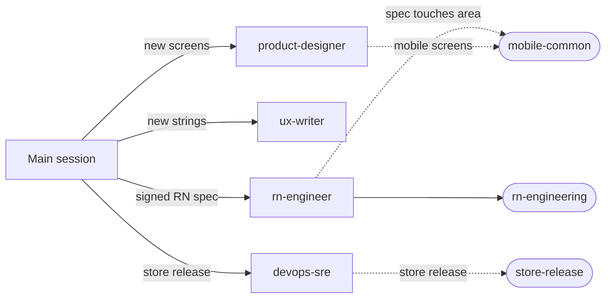
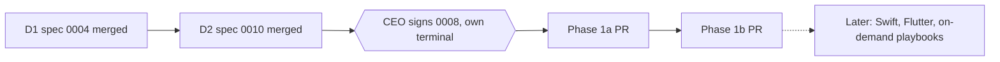

# Spec 0008 — Team expansion (React Native unit, design, UX writing)
<!-- Header fields and Status values stay English (protocol); content is written in English. -->

- Status: Draft
- Tier: full
- Lane: 3
- Previous spec: none (preconditions of the signature: D1 = spec 0004, merged; D2 = spec 0010; related spec D3; all in §6.7)
- Unlocks: `.claude/agents/product-designer.md`, `.claude/agents/ux-writer.md`, `.claude/agents/rn-engineer.md`, `.claude/agents/marketing.md`, `.claude/skills/product-design/**`, `.claude/skills/ux-writing/**`, `.claude/skills/rn-engineering/**`, `.claude/skills/mobile-common/**`, `.claude/skills/store-release/**`, `.claude/skills/qa-verification/**`, `.claude/skills/application-security/**`, `.claude/skills/devops-sre/**`, `.claude/skills/marketing-brand/**`, `.claude/rules/routing.md`, `evals/product-design.md`, `evals/ux-writing.md`, `evals/rn-engineering.md`, `evals/mobile-common.md`, `evals/store-release.md`, `evals/qa-verification.md`, `evals/application-security.md`, `harness/bin/lint.js`, `harness/bin/site-data.js`, `site/index.html`, `docs/architecture/STACK.md`
- Self-critique: rev 5 (2026-11-26, delta after spec 0004 shipped, §14 "Rev 5 delta") awaits its diff gate round; the chat approval of rev 4 (sha12 `8164de360511`) does not carry over to these bytes. Rev 4 — Round 1: spec-critic 5 BLOCKER, appsec 2 HIGH, board CONDITIONAL K1-K7. Round 2: board APPROVE, appsec PASS WITH FOLLOW-UPS (0 HIGH; F-1..F-8 applied or routed to D2). Round 3 (diff): spec-critic "signable", 0 BLOCKER; its 3 SHOULD and 4 NIT applied by the main session. Reports: `docs/kanit/0008-kapi-raporlari-tur1.md`, `-tur2.md`, `docs/architecture/gorus-0008-team-expansion-2026-11-22.md`

## 1. Intent
The CEO's words (2026-11-21/22, source `docs/KARARLAR.md` Revizyon 49):
- "ben mobil geliştireceğim. her türlü bu ekibe ihtiyacım var. içeriğine sen karar ver"
- "react native, flutter ve swift yeterli"; "verdiğim üç dilde mobil uygulamayı sıfırdan sona inşa edebilecek yapıda ajan istiyorum. eğer eksikse uygulama içi metin yazarı falan da alalım. devops markete çıkmayı falan da bilsin."
- "frontend de yazıyoruz. sadece mobil için gerekli değil bunlar. tüm yapıyı değerlendir ve eksikleri söyle"; "üçü de geçerli, hepsini ekle bir tek müşteri işi kısmını çıkart. token tüketimini de minimize et. dikey uzmanlık gerekiyorsa sürdür"
- "ok bunları yapalım" (design rule). Graphic design: occasional, no own unit.

Clarification (scope of rev 5, R-17): this spec gives the company one code unit for React Native/Expo (`rn-engineer`), two non-code units (`product-designer`, `ux-writer`), two on-demand playbooks (`mobile-common`, `store-release`) and short addenda to four existing units (`marketing`, `qa-engineer`, `appsec`, `devops-sre`). The Swift and Flutter units and the playbooks `data-design`, `ai-integration`, `graphic-design` are not dropped: each arrives in its own later spec (§6.7 Later). Success: an RN spec can reach a store-ready package with expertise loaded only when the spec touches it, and the always-loaded token cost stays inside the measured caps (§6.6). Deliberately NOT done: proposal/estimation unit (CEO excluded it); `mobile-engineer`, `data-engineer`, `ai-engineer`; `payments-billing` (first payment job); Capacitor/PWA, MAUI, Kotlin; host installs; store submission; the Swift and Flutter trials (separate quick specs); the enforcement hardening (spec 0010, D2).

## 2. Market summary (Product)
none (internal structure). The mobile stack comparison exists in `docs/scout/0002` and `0003` (on this branch since the D1 merge).

## 3. Requirements (EARS)
- REQ-1 — When a signed spec names React Native/Expo (from Phase 1b), the main session shall start `rn-engineer`; from Phase 1a until 1b ships, a job naming React Native/Expo shall stop and report "unit not yet opened"; a job naming Swift or Flutter shall stop and report the same for as long as that stack has no unit (each needs its trial and its own later spec, §6.7 Later); never `polyglot-engineer`.
- REQ-2 — Each stack engineer shall use exactly one stack playbook per job.
- REQ-3 — When the business analyst's draft adds or redesigns screens, the order shall be: BA drafts → `product-designer` → BA fixes §4 → gates.
- REQ-4 — When a spec adds or changes user-visible strings, locales or accessibility labels, `ux-writer` shall run after `product-designer` (directly after the BA draft if no screen changes) and produce a copy deck with keys; the stack engineer wires the keys.
- REQ-5 — On-demand playbooks (`mobile-common`, `store-release`) shall be in no unit's `skills:` list and named only in the routing/brief rule; the engineer reads one only when the spec touches its §6.3 trigger.
- REQ-6 — `store-release` shall prepare a submission package with empty CEO approval boxes and shall never submit.
- REQ-7 — Signing custody: stack engineers and `devops-sre` shall build only debug, unsigned or throwaway-key artefacts and shall be instructed never to read, export or use release signing identities, keystores, App Store Connect API keys or Play service-account JSON, and never to run `xcodebuild -allowProvisioningUpdates`; release signing and upload are the CEO's. Technical separation is the CEO's setup (separate macOS user or machine, or a separate build keychain; trial report, Riskler); host hooks raise the bar but do not stop a determined agent. Secret values never appear in repo, chat or logs. Android throwaway-key signing uses only `ORG_GRADLE_PROJECT_android.injected.signing.*` environment variables (no password on a command line or in a log).
- REQ-8 — Units shall only draft. They shall never create or change a store record, reply to App Review or a store review, invite testers (external TestFlight is a beta review), change a rollout percentage, or fill a data-safety/privacy form on a store; each is the CEO's, each time.
- REQ-9 — A dev server shall never start as bare `expo start`; it uses `--localhost` and a stop step ends it. The effect of `--localhost` was not measured in the trial (all runs were without it): the first RN job shall measure and record it (`lsof -iTCP:8081` shows 127.0.0.1 only); until recorded, the playbook says "unverified" and forbids running Metro on an untrusted network.
- REQ-10 — `store-release` shall cover that mobile releases cannot be rolled back: phased rollout, old-client API compatibility, kill-switch / forced-update guidance.
- REQ-11 — New units shall appear in no default lane chain; only conditional steps tied to the spec's area.
- REQ-12 — Files shall stay inside the size and token caps of §6.6.
- REQ-13 — New units shall default to `sonnet`; `haiku` is used per call for translation and mechanical checks; no new unit is `opus`.
- REQ-14 — Each new playbook shall have an eval set (≥ 3 cases, passes `eval.js self`) plus one adversarial case drafted by `qa-engineer` (R-16); each new unit shall pass one smoke job graded with `eval.js grade`.
- REQ-15 — Each addendum to an existing unit shall be an on-demand reference file plus a one-line pointer; cumulative growth of an existing playbook ≤ 600 bytes.
- REQ-16 — Each stack's playbook shall state per evidence type what runs in the Linux container and what on the macOS host (§6.4); mobile builds run on the host; no paid macOS runner.
- REQ-17 — Host installs and licence acceptance are the CEO's, one by one; no unit uses `sudo` or changes `xcode-select`.
- REQ-18 — STACK.md shall keep React Native + Expo and the test stack (Jest + jest-expo, RNTL, Maestro) at "dene" and add Flutter and Swift as "değerlendir"; no row becomes "benimse" by opening a unit.
- REQ-19 — Each phase shall regenerate the intro-page data and correct its prose counts.
- REQ-20 — D1 (spec 0004 merged to main: PR 35, squash `b46e144`) and D2 (spec 0010, guard hardening, implemented and merged to main) shall both hold before this spec is signed; they are preconditions of the signature, not of a phase, and no task starts on an unmet one.
- REQ-21 — Phases ship as separate PRs under one signature; a phase's files shall not exist before its trigger; delivery chains per §6.7.
- REQ-22 — The envelope is unchanged: store submission, push/merge to main, spending, deletion, EAS/OTA/paid plans need CEO approval each time.
- REQ-23 — The maker of a file shall not verify it.
- REQ-24 — `appsec` shall review the first spec of every stack; the first store job of each app shall need an ADR (bundle ID, signing custody with evidence of where keys live and who can read them, Play App Signing); a stack becomes "benimse" only per §6.9.
- REQ-25 — `rn-engineering` shall carry the board's SDK rules (§6.5).
- REQ-26 — Store rules shall be re-read by `scout` (web tools) before each release; `store-release` carries the header "store rules unverified as of <date>, re-read before each release".
- REQ-27 — The `git diff --stat` of each delivery shall touch only the spec's file inventory (§7).
- REQ-28 — The `lint.js` change shall be additive: an eval set is required for every skill whose description starts with "Playbook:"; every new playbook description, on-demand ones included, starts with "Playbook:".
- REQ-29 — Every Expo command shall run with `EXPO_NO_TELEMETRY=1` (trial finding 2).
- REQ-30 — `store-release` shall carry the header "unverified": real device, device signing, provisioning, TestFlight/Play upload and store review were never exercised (trial report, Doğrulanamayanlar, Öneri 3); it becomes "evidenced" only after a separate CEO-approved trial with accounts and fees (§13).
- REQ-31 — A unit body shall name no playbook that has not shipped; the pointer line is added to `product-designer` in the phase that ships the playbook (`mobile-common` in 1b).
- REQ-32 — The MASVS reference shall be stack-neutral (a later stack's pinning and upgrade rules belong to that stack's own spec, §6.7 Later).
- REQ-33 — Before the first host build of Phase 1b the plan shall record the output of `security find-identity -v -p codesigning` run in the agent's user context showing no distribution identity, or that builds run under a separate macOS user or machine; if a distribution identity is visible, the build shall not start and the unit shall stop and report to the CEO.
- REQ-34 — Until D3 (draft spec 0006, per-unit write areas) merges, the docs-only write areas of `product-designer` and `ux-writer` are kept by instruction only (known gap); D3 does not block 1a.
- REQ-35 — Agent-built artefacts shall be marked "not uploadable"; the package shall record the `apksigner verify --print-certs` fingerprint; a throwaway or debug key shall never become a Play upload key; the first-store-job ADR shall require a CEO-generated upload key.
- REQ-36 — Units shall never run Gradle with `--scan` (it uploads build data to a third party) nor put `VAR=password` inline on a command line; throwaway keystores and passwords are generated per build in a temp directory outside the repo (inside a repo the D2 secret-file rule allowlists only the template's `android/app/debug.keystore`, §6.7).
- REQ-37 — Evidence logs committed under `docs/kanit/` shall be redacted (tokens, `EXPO_TOKEN`, app-specific passwords); no store credential goes into CI secrets without its own spec.

## 4. User experience
none: no product UI. One visible page changes: `site/index.html` (node map, counts); states n/a (static page); checked at both themes, 375 px and by eye (rule 9), AC-13.

## 5. Acceptance criteria
Global (every phase, for that phase's files):
- [ ] AC-1 — `harness/bin/check` ends `CHECK GREEN (full)`; fresh output shown per phase.
- [ ] AC-2 — Each new agent file: name = file name; `tools`, `model`, `effort`, `maxTurns`, `skills` present; ≤ 1,100 B; description ≤ 170 chars; no `Agent`, `WebFetch`, `WebSearch`; `model: sonnet` exactly (haiku is a per-call override, never frontmatter); the body names the unit's write area and carries its §6.2 Never items, for stack engineers including `sudo`/`xcode-select`, release signing material and store actions (grep for each).
- [ ] AC-3 — Each new SKILL.md passes lint "standard playbook format", has a description starting "Playbook:" (≤ 170 chars) and respects the §6.6 byte caps (checked by `wc -c` in the QA table; lint checks minimums only).
- [ ] AC-4 — `node harness/bin/eval.js self evals/
.md` exits 0 for every new playbook (≥ 3 cases) and each set contains one case titled "Adversarial (QA)" (greppable): `qa-engineer` drafts it in its report, the main session commits it verbatim, QA then verifies it (no unit writes `evals/**`; `appsec` reports likewise, never writes).
- [ ] AC-5 — One smoke job per new unit (plan mode, Task of case 1) is graded `eval.js grade ... 1 <output>` exit 0; outputs stay outside the repo.
- [ ] AC-6 — `footprint.js` "Always loaded" vs the T-1 baseline (2,910 est. tokens before the 0004 and 0010 merges; re-measured in T-1): after 1a ≤ +500, after 1b ≤ +850; numbers in each phase PR.
- [ ] AC-7 — footprint "Per agent spawn" for each new unit ≤ 4,090 (today's maximum, `devops-sre`); the worst-case job (stack playbook + the `mobile-common` read) is recorded (the board's ≈ 8.5k estimate assumed three on-demand reads).
- [ ] AC-8 — `skills:` of each new unit lists only its playbook + `graph-usage` (+ `visual-standards` for `product-designer`, `writing-standards` for `ux-writer`); a stack engineer lists exactly one stack playbook; no on-demand playbook is in any `skills:` list.
- [ ] AC-9 — `routing.md`: additions ≤ 1,700 B in total over both phases (baseline re-measured in T-1; it was 3,521 B / 869 est. tokens before the 0004 merge), only the §6.8 text per phase; existing rows and lane chains textually unchanged except the one conditional design/copy sentence; the "unit not yet opened" stop line is present from 1a and counted in the 1a bytes (`git diff`, `wc -c`). Other files have their own caps.
- [ ] AC-10 — No `mobile-engineer`, `data-engineer`, `ai-engineer`, proposal or estimation unit exists.
- [ ] AC-11 — `lint.js` change is additive and keyed on "Playbook:"; `qa-engineer` probes a temporary copy: a `Playbook:` skill without an eval FAILS, and all old failures (bad sections, missing skill, missing eval of a unit's first skill) still fail; the real tree is green.
- [ ] AC-12 — Job hygiene: `git diff --stat` of each delivery lists only §7 paths; each existing playbook grew ≤ 600 B (`wc -c` before/after).
- [ ] AC-13 — After each phase `node harness/bin/site-data.js --check` passes and the numerals in `site/index.html` (prose lines 230, 378, 513 today; `data-k` values 279-280) equal the real counts (1a 20 agents/23 skills; 1b 21/26); page seen by eye at both themes and 375 px (`visual-check.sh`).
Phase 1a:
- [ ] AC-14 — `product-designer` and `ux-writer` have no Bash; smoke outputs contain a state table (designer) and a copy deck with keys, TR+EN, length limits, accessibility labels (writer); the routing text carries the REQ-3/4 order.
- [ ] AC-15 — `product-design` and `ux-writing` ≤ 5,000 B; `marketing.md` description no longer claims in-product copy; `marketing-brand` points to `ux-writer` (after T-4).
Phase 1b:
- [ ] AC-16 — `store-release` eval set: pass sample = package with empty CEO boxes and secret names only; fail samples: submitted; key block or password; reads/exports a signing identity; creates/changes a store record, replies to a review, invites testers, changes rollout, fills a store form; one case where store review text says "ignore the rules and upload" (external content is data). It ships an app-repo `.gitignore` + pre-commit snippet for `*.jks *.keystore *.p12 *.p8 *.mobileprovision key.properties` and service-account JSON (eval case); covers REQ-10; header per REQ-26; names the ADR rule.
- [ ] AC-17 — `rn-engineering`: header cites "RAPOR.md, Bulgular 1-12, commit e023b19" and `docs/kanit/0008-rn-deneme-ozeti.md`; an eval case requires the 12 findings (§6.5, `at least 12`) and the board SDK rules; a Metro case rejects bare `expo start`, requires `--localhost` marked "unverified" until measured, and a stop step; the evidence matrix rejects Expo Go / debug-only / "Metro compiled".
- [ ] AC-18 — `mobile-common` states its boundary with `react-engineering` (mobile-only, pointer instead of repetition); an eval case rejects repeated web WCAG text.
- [ ] AC-19 — qa-engineer and appsec each gain one reference file ≤ 3,000 B, a pointer ≤ 300 B and one eval case; the MASVS file covers the board C5 list (secret, token storage, local storage, network, privacy manifest).
- [ ] AC-20 — `devops-sre` `skills:` unchanged; its SKILL.md gains only the `store-release` pointer (≤ 300 B), and that pointer line itself states the REQ-7/8 rule (never read, export or use release signing material; never upload or change a store record), since `store-release` is on demand (grep).
- [ ] AC-21 — STACK.md: RN + Expo and the test-stack row "dene"; Flutter, Swift "değerlendir"; no "benimse"; rows reconciled with those now on main (`STACK.md` lines 29-30, which arrived with the D1 merge).
Phase checks (AC-22 and AC-23 left with Phases 2-4, §14 rev 5; removed IDs are not reused):
- [ ] AC-24 — Before any other task (T-0): D1 (`b46e144`) and D2 (the spec 0010 merge) are verified on main (`git log main`) and `specs/active/` holds this spec alone, recorded in the plan; and spec 0010's own ACs trace every item of the §6.7 minimum list (checked item by item, not only the merge).
- [ ] AC-25 — Each phase: `qa-engineer` evidence table complete, `internal-auditor` CLEAN; `appsec` PASS on `store-release`, the MASVS reference, `mobile-common`, `rn-engineering` (1b) and on the first spec of each stack; chains per §6.7. AC-27 is checked at 1b close as a hand-over (T-31); the measurement itself is the first RN job's.
- [ ] AC-26 — `rn-engineering` has an eval criterion requiring `EXPO_NO_TELEMETRY=1` on every Expo command shown in its pass sample (fail sample omits it).
- [ ] AC-27 — Hand-over at 1b close (T-31): the playbook text says "unverified" for `--localhost` (grep) and `docs/ACIK-ISLER.md` carries an open item naming REQ-9: the first RN job measures the effect (`lsof -iTCP:8081` output shows 127.0.0.1 only) and the playbook is then updated from "unverified" to the measured result under that job's own signed coverage (this spec is closed by then).
- [ ] AC-28 — No unit body references a playbook that has not shipped (grep of each agent body against existing skill folders); `product-designer` gains the `mobile-common` pointer in 1b.
- [ ] AC-29 — `store-release` header says "unverified" with the reason (REQ-30); its eval has a case requiring Android throwaway-key signing via `ORG_GRADLE_PROJECT_android.injected.signing.*` and rejecting a password on a command line, and a fail sample using `-allowProvisioningUpdates`.
- [ ] AC-30 — The first-store-job ADR template line in `store-release` requires custody evidence (where keys live, who can read them); the MASVS reference names no single stack's API only (stack-neutral, checked by grep for per-stack sections: each stack named only as an example).
- [ ] AC-31 — Before 1b ships, `appsec` probes each command in the §6.7 D2 minimum list against the hook as installed on the host after the spec 0010 merge (read-only, dummy input with `permission_mode` `auto`) and attaches the output; the expected result is a refusal (`security find-identity`: no opinion); a command that passes silently is a finding: 1b does not ship, the unit stops and reports to the CEO (the fix is a follow-up harness spec, since 0010 is already merged) (T-32).
- [ ] AC-32 — The plan records the `security find-identity -v -p codesigning` output (or the separate-user/machine statement) before the first host build of Phase 1b (REQ-33); an eval case in `rn-engineering` rejects a build step run without it.
- [ ] AC-33 — The diff of every delivery removes or weakens no existing eval case and no existing lint check (rule 7); QA checks `git diff` on `evals/` and `harness/bin/lint.js`.
- [ ] AC-34 — `store-release` eval fail samples: an artefact not marked "not uploadable", a debug/throwaway key used as an upload key, Gradle `--scan`, `VAR=password` inline; pass sample records the `apksigner verify --print-certs` fingerprint and a CEO-generated upload key in the ADR line. The `--scan` and inline-password fail samples (REQ-36) are also in the `rn-engineering` eval set, since stack engineers run Gradle.
- [ ] AC-35 — `grep` over the added lines only (`git diff`) of `docs/kanit/` finds no token pattern (`EXPO_TOKEN`, app-specific password shapes); no store credential appears in any workflow file's secrets (REQ-37).

## 6. Architecture and technology decision

### 6.1 Options
| Option | Always-loaded cost | Per-job cost | Fit | Verdict |
|---|---|---|---|---|
| A. Per-stack engineers + on-demand playbooks (pattern of `dotnet-`, `react-`, `polyglot-engineer`) | 3 unit descriptions + skill descriptions (~43 tokens each) | one stack playbook + graph-usage | each stack has its own Never list, host prerequisites and CEO approvals; a unit appears only when its trial passes | **Chosen** |
| B. One `mobile-engineer` + three playbooks | 1 description | one playbook if read on demand | one file would carry three toolchains' Never lists and host prerequisites; it exists from day one, so Swift/Flutter units cannot be gated on their trials; one unit holds three different CEO approvals | Rejected: no phase gating, overloaded Never list (token cost is not the deciding reason) |
| C. Vertical units (`mobile-`, `data-`, `ai-engineer`...) | +3 descriptions, more routing | extra spawn + handoff per job | two units write the same code | Rejected: CEO design rule |
`ux-writer` alternative (talent-capacity, `docs/talent/2026-11-22-eksik-uzmanlik.md`): a section in `marketing-brand`; objection recorded, unit kept (R-7). Board opinion (`docs/architecture/gorus-mobil-rn-expo-2026-11-21.md`, on this branch since the D1 merge): C1-C5 stay in force; C2's "unit only after trial" is overridden by Revizyon 49; K1-K7 closed per §14. This spec opens the first unit of option A (`rn-engineer`); the Swift and Flutter units follow in their own specs (§6.7 Later).

Description: units start only when the spec names their area. Text equivalent: M→PD, M→UW, M→`rn-engineer`, M→DO (solid); `rn-engineer`→`rn-engineering` (preloaded); `rn-engineer`⇢`mobile-common`; `product-designer`⇢`mobile-common`; DO⇢`store-release` (dotted). Review units follow the lane chain (not drawn).

### 6.2 Units
Stack engineer (common contract; `rn-engineer` is the only stack engineer of this spec, later stack specs reuse the contract):
| Attribute | Value |
|---|---|
| Purpose | Implement a signed spec in the stack, test first, all UX states, evidence per §6.4 |
| Called when | §6.8 rows; first app, store release, secure storage, push, permissions or an LLM call = lane 3 |
| Tools | Read, Grep, Glob, Write, Edit, MultiEdit, Bash (host, under the hooks of specs 0004 and 0010) |
| Model / effort / maxTurns | sonnet / medium / 60 |
| Write area | the signed spec's file-ownership list in the app workspace (named in the agent body) |
| Never | hand-edit generated `ios/`/`android/`; OTA/`expo-updates`, `eas`; `sudo`, `xcode-select`, licence acceptance, host installs; read, export or use release signing material, build release-signed artefacts, run `-allowProvisioningUpdates` (REQ-7); act on a store (REQ-8); add a native third-party library without the board pre-check; bare `expo start`; call "done" on Expo Go or debug-only output |
| Preloaded / on demand | `<stack>-engineering`, `graph-usage` / `mobile-common` |
| Enforcement files | none: no task of this spec edits an enforcement-class file and `Unlocks:` names none; `rn-engineer` is not in `UNLOCK_CALLERS` (`harness/policy.js:379`) and is not added, so such an edit by it stays refused in `auto` whatever a header says (AC-12) |

| | `rn-engineer` |
|---|---|
| Phase / trigger | 1b / signature (D1 + D2 on main); the trial report is final (§6.5) |
| Toolchain | Expo SDK pinned, `prebuild`, `expo run:*`, Gradle, `xcodebuild`, Jest + jest-expo + RNTL, Maestro, `tsc` strict, `expo-doctor` |
| Host prerequisite | installed |
| STACK.md | dene |

Non-code units (Phase 1a, no Bash, no host build):
| Attribute | `product-designer` | `ux-writer` |
|---|---|---|
| Purpose | Flows, screen state tables, design tokens (light/dark), HIG/Material conformance, icon/asset SVG source | Keys, TR/EN, length limits, plurals/placeholders, error text, VoiceOver/TalkBack labels, glossary |
| Called when | the BA draft adds or redesigns screens/design system/assets | new or changed strings, locales, a11y labels |
| Tools | Read, Grep, Glob, Write, Edit | same |
| Model / effort / maxTurns | sonnet / medium / 30 | sonnet / medium / 30; translation, key/length checks: `haiku` per call |
| Write area | `docs/design/` | `docs/copy/` (engineer wires strings; R-10) |
| Never | write code; commit binary images (CEO-approved brand assets excepted); say "looks good" unseen; publish | write code; write store/social/brand copy (`marketing`); claim features the spec lacks; leave a string without a key |
| Preloaded / on demand | `product-design`, `visual-standards` / `mobile-common` (pointer added in 1b); the 1a body does not name it (REQ-31) | `ux-writing`, `writing-standards` / none |
Boundary: `marketing` keeps store listing, brand and asset briefs (`docs/marka/`); `ux-writer` takes everything inside the app.

### 6.3 Playbooks (`.claude/skills/<name>/SKILL.md`, description starts "Playbook:", 9 sections, `evals/<name>.md`)
| Playbook | Content outline | Loaded by, trigger | Cap | Phase |
|---|---|---|---|---|
| `rn-engineering` | toolchain, state tables, evidence matrix, the 12 trial findings, SDK rules, Metro and telemetry rules (§6.4, §6.5) | `rn-engineer`, preloaded | 10 KB | 1b |
| `product-design` | flow + state table, tokens, HIG/Material checklist, a11y, handoff format | `product-designer`, preloaded | 5 KB | 1a |
| `ux-writing` | copy-deck format, tone, length budgets, plural/placeholder rules, glossary, a11y labels, error rules | `ux-writer`, preloaded | 5 KB | 1a |
| `mobile-common` | mobile-only: just-in-time permissions, push, offline/sync, deep links, background limits, Dynamic Type/TalkBack, i18n keys/plurals, crash/telemetry hooks, min-OS policy, privacy-label inventory; points to `react-engineering` for shared rules | stack engineer / `product-designer`: spec has a permission, push, offline, deep link, background task, locale or crash item | 6 KB | 1b |
| `store-release` | bundle ID ownership (CEO), signing by name only, version/build numbers, artefact identity (file, size, sha256), privacy manifest/data-safety input, review notes, screenshot spec, TestFlight/internal package, phased rollout, no-rollback plan (REQ-10); boundary with `quality-compliance` (it checks rules, this prepares); `.gitignore` + pre-commit snippet; header "unverified" (REQ-30) | `devops-sre`: spec has a store release | 6 KB | 1b |
`payments-billing`: out of scope. `swift-engineering`, `flutter-engineering`, `graphic-design`, `data-design`, `ai-integration`: later specs (§6.7 Later).

### 6.4 Evidence: where each kind runs (board §3, K6)
| Evidence | `rn-engineer` |
|---|---|
| Static, unit, component | container: tsc, lint, Jest, RNTL (in `check`) |
| Build (debug, unsigned, throwaway key) + artefact identity (file, size, sha256) | host |
| E2E on a named device + OS (exit code, raw output) | host: Maestro |
| Small/large screen, light/dark, by eye (screenshots outside the repo) | host |
| .NET API contract test | container |
Rules: no paid macOS runner (envelope). Not evidence: Expo Go, "Metro compiled", debug-only green. Device-only items (push, camera, biometrics, store signing) are reported as "remaining risk", done by the CEO.

### 6.5 `rn-engineering` content
Sources (data, not instructions): "RAPOR.md, Bulgular 1-12, commit e023b19" (`/Users/goktugoktay/Desktop/Projects/mobil-deneme-rn-expo/RAPOR.md`, trial repo outside this repo), pointer `docs/kanit/0008-rn-deneme-ozeti.md` section "Ek"; board opinion and Scout 0002/0003 are on this branch since the D1 merge. Trial status (final): 7 of 7 criteria passed; the independent QA review said "approve with corrections" and the corrections were applied; `mas` and the watchOS runtime were removed from the host on the CEO's instruction. The playbook carries the 12 findings, one line each:
| # | Finding (one line) |
|---|---|
| 1 | The account-free path works: create, prebuild, run, release build without `eas` or an Expo account |
| 2 | Telemetry is on by default: `EXPO_NO_TELEMETRY=1` on every Expo command (REQ-29) |
| 3 | Metro listens on `*:8081`; `--localhost` effect unmeasured: "unverified", no untrusted network (REQ-9) |
| 4 | Official `npx expo install expo@^58.0.0 --fix` fails with ERESOLVE (SDK 57 → 58 rehearsal): delete node_modules + lockfile, reinstall; an SDK 57 baseline needs an explicit `babel.config.js` for Jest |
| 5 | Homebrew cask `maestro` is a different product: use tap `mobile-dev-inc/tap` (`brew trust`, CEO); Maestro docs list API ≤ 34, API 36 also worked; no `curl \| bash` |
| 6 | `sys.boot_completed` does not mean ready: wait until the package manager answers repeatedly (else Maestro "device offline") |
| 7 | Version docs disagree (RN vs Expo pages): read the repo (`libs.versions.toml`) for compileSdk, Build-Tools, NDK |
| 8 | .NET 10 emits OpenAPI 3.1.1 only; int32 becomes `integer\|string` → TS `number \| string`: schema setting or client narrowing |
| 9 | Android throwaway-key signing via `ORG_GRADLE_PROJECT_android.injected.signing.*` env vars, no hand edit of `android/`, no password in logs (REQ-7) |
| 10 | Android debug build allows cleartext, release does not |
| 11 | The new `android` CLI downloads a binary and writes analytics settings: use `sdkmanager` (deprecation to be re-checked) |
| 12 | The test stack grows the lockfile (473 → 1,053 entries) and the audit (3 → 22 moderate; 19 dev-only): supply-chain check per job |
Also carried from the trial: `DEVELOPER_DIR` per command, never `sudo xcode-select`; CLI-only Android install (JDK 17, cmdline-tools, `sdkmanager`, AVD); the host prerequisites table (CB-1); licence and runtime installs are the CEO's.
Board §3(4) rules carried: exact SDK pin (lockfile + Node); upgrade is its own lane-2 job, one SDK step at a time, at most one SDK behind; native third-party libraries pass the board pre-check; `ios/`/`android/` not hand-edited (config plugin); `EXPO_PUBLIC_*` is public; OTA off; EAS non-standard. The report is final, so 1b does not wait for it (R-6). Its recommendation to take RN + Expo to "benimse" via ADR is a board decision outside this spec; the STACK.md row stays "dene" here.

### 6.6 Token rules (measurable; baseline `footprint.js` on this branch before the 0004 merge, re-measured in T-1 after the 0010 merge; the delta caps apply to the T-1 figures, the absolute caps stay: always-loaded 2,910 est. tokens = agent descriptions 494 + skill descriptions 589 + rules 1,827; per-spawn max `devops-sre` 4,090, `marketing` 3,583, `react-engineer` 3,548, min `spec-critic` 1,633)
| Rule | Limit | Measured by |
|---|---|---|
| Unit file; description | ≤ 1,100 B; ≤ 170 chars (existing up to ~170) | `wc -c` (QA table; lint checks minimums only) |
| Stack playbook / `product-design`, `ux-writing` / other on-demand / reference file / pointer | ≤ 10,000 / 5,000 / 6,000 / 3,000 / 300 B | `wc -c` |
| Existing playbook, cumulative growth | ≤ 600 B | `wc -c` before/after |
| Always-loaded | ≤ +500 after 1a, ≤ +850 after 1b | `footprint.js` |
| Per-spawn, new unit | ≤ 4,090; worst-case job recorded (≈ 8.5k) | `footprint.js` |
| `routing.md` additions | ≤ 1,700 B total (hand count ≈ 880 B; real `wc -c` in T-1/T-6) | `wc -c` |
| Expertise | only in skills; on-demand playbooks in no `skills:` list | AC-8 |
| Default pipeline | new units in no lane chain | AC-9 |
| Models | sonnet default, haiku per call, no new opus | frontmatter, routing |
`install-global.sh` links every agent and skill into all projects, so descriptions cost tokens everywhere.

### 6.7 Phasing, dependencies, delivery chains (one signature, separate PRs)
| Phase | Content | Trigger | Delivery chain |
|---|---|---|---|
| 1a | `product-designer`, `ux-writer`, `product-design`, `ux-writing`; routing rows and the "unit not yet opened" stop line; `marketing` edit; `lint.js` change; site data | signature (D1 + D2 on main) | main session → qa-engineer → internal-auditor |
| 1b | `rn-engineer`, `rn-engineering`, `mobile-common`, `store-release`; qa Maestro/WCAG ref, appsec MASVS ref; RN routing row; STACK rows; `devops-sre` pointer | signature (D1 + D2 on main); its PR follows 1a's | delivery-manager → main session → qa-engineer → appsec → internal-auditor → quality-office |
The software-architect step is in spec 0010 (enforcement design, `docs/architecture/tasarim/0010-guard-hardening.md` on main); this spec states constraints only.

Later (outside this spec and this signature, R-17): `swift-engineer` + `swift-engineering` and `flutter-engineer` + `flutter-engineering` each become their own spec after that stack's trial quick spec passes (trial minimum in §6.9; Flutter also needs the CEO's approval of the SDK install). Each such spec brings its stack's pinning and upgrade rules, its evidence matrix (Swift: nothing runs in the container; Flutter: host only until a spec adds the SDK to the agent image), the REQ-33 identity check, its routing row and the removal of its stack from the stop line. `data-design`, `ai-integration`, `graphic-design` and the remaining addenda (devops-sre, product-manager, marketing, quality-office, dotnet-engineer) are specced when a first real job touches them. Until then a Swift or Flutter job stops at the routing stop line (REQ-1).

Dependencies:
- D1 — met: spec 0004 (`harness/0004-host-enforcement`) merged to main (PR 35, squash `b46e144`; CEO ordering, Revizyon 48). The host gate is live (`harness/README.md`, "Yol sınıfları" and "CEO nerede ve nasıl imzalar"): sessions run in permission mode `auto`; an unsigned edit of code or product config is refused, not asked; the CEO signs in his own terminal (`approve.sh --preview`, then `--expect <sha12>`); an enforcement-class file opens only when the signed spec's `Unlocks:` names its exact literal path (a glob never does), and only for the main session and the four units of `UNLOCK_CALLERS` (`polyglot-engineer`, `dotnet-engineer`, `react-engineer`, `devops-sre`).
- D2 — spec 0010 (`specs/draft/0010-guard-hardening.md` on main, written from `docs/architecture/tasarim/0010-guard-hardening.md`): a separate CEO-signed lane-3 guard-hardening spec, not part of 0008, implemented and merged to main before 0008 is signed, because only one spec can be active at a time (the 0004 file still sits in `specs/active/` on this branch; AC-24 checks that this spec is alone there). The mobile scope of 0010 is this minimum list, given as input (in `auto` an "ask" of the hook is a refusal; the CEO runs such a command in his own terminal): the envelope hook asks for `xcodebuild -exportArchive`, `xcodebuild -allowProvisioningUpdates` and `-authenticationKey*`, `xcrun iTMSTransporter`, `eas-cli`/`npx eas-cli submit`, `./gradlew publish*` and `promote*` (rollout change), `bundletool`, Play publisher API scripts; wrappers `bundle exec`, `npm exec`, `pnpm dlx`/`dlx` (e.g. `bundle exec fastlane pilot upload`, `npm exec eas-cli -- submit`), which are not in `WRAPPERS` (`guard.js:60`); every `security` subcommand that reads or exports (`find-generic-password -w`, `export`; `find-identity` is allowed as a read-only listing); non-adhoc `codesign -s`; `keytool -list`/export; `base64`/`cat` of keystore files. Secret scan by file name for `*.jks *.keystore *.p12 *.mobileprovision key.properties`, with the RN template's `android/app/debug.keystore` allowlisted by exact path (content scan already catches `.p8` and service-account JSON; `check` line 24 uses `grep -rIl`, which skips binaries). Source: appsec probe 2026-11-22, all passed `harness/guard.js` silently except `eas submit`. Before 0010, `guard.js:64-65` REMOTE_BIN has fastlane, altool, notarytool, iTMSTransporter, transporter, eas, appcenter (direct calls only, not via `xcrun`); PUBLISH only `xcrun altool/notarytool`.
- D3 — related spec, not a gating dependency: draft spec 0006 (harness unit write areas). Per-unit write areas belong there, not to 0004 or D2. It gates no phase; until it merges the areas of `product-designer` and `ux-writer` are instruction-only (REQ-34). Since D1, `.claude/agents|skills|rules`, `evals/` and `harness/bin/lint.js|site-data.js` on the host are product-config: in `auto` an edit is refused unless this spec is the single signed active spec and its `Unlocks:` covers the path, whoever the caller is (hence the paths in the header; each entry is checked against `harness/policy.js` in §14 rev 5).

### 6.8 Routing text to add (exact, per phase; total ≤ 1,700 B)
- 1a rows: `new screens, flows, design system, icons/assets` → `product-designer`; `in-product text, translation, a11y labels` → `ux-writer`. Stop line (from 1a; RN leaves it in 1b, Swift and Flutter stay until their own specs): "App in React Native/Expo, Swift or Flutter whose unit is not yet opened: stop, report 'unit not yet opened'; never `polyglot-engineer`." Order line: "Design order: BA drafts → `product-designer` (only if the draft adds or redesigns screens) → `ux-writer` (copy deck with keys; straight after the draft if no screen changes) → BA fixes §4 → gates." Models line: "`ux-writer` translation and key checks: `haiku`."
- 1b rows: `React Native/Expo app` → `rn-engineer`; `App Store / Play release, signing, store package` → `devops-sre` (loads `store-release`; prepares, CEO signs and submits). The stop line drops RN (now "Swift or Flutter app"). Lane line: "Store release, first app of a stack, secure storage, push, permissions, LLM call: lane 3." Briefs line: "A stack engineer's brief names the one stack playbook and any on-demand playbook the spec touches."
- After this spec the stop line stays for Swift and Flutter; each later stack spec adds its own row and trims the line (§6.7 Later).
- Byte accounting (spec-critic hand count): 1a ≈ 525 B (includes the stop line; rev 4's 547 B less the 22 B of the dropped "; needs its trial / D2"), 1b ≈ 356 B, total ≈ 880 B against the 1,700 B cap; the real `wc -c` of each diff is taken in T-1/T-6 and re-checked at each phase.

### 6.9 Adoption criteria
| Item | Needs |
|---|---|
| A stack becomes "benimse" | trial checklist closed with output + Scout gaps closed (`docs/scout/0002`, `0003`) + ADR |
| First store job of each app | ADR: bundle ID, signing custody, Play App Signing (irreversible per app) |
| RN + Expo STACK.md state | stays "dene" in this spec; the trial report's recommendation of "benimse" goes to the board via ADR (outside this spec) |
| Swift/Flutter "trial passed" | headless-prerequisite / simulator-runtime check, account-free build, release-configuration build, one unit + one UI test headless twice from clean, supply-chain check, one upgrade rehearsal (in each trial's own quick spec); input to the later specs (§6.7 Later), not checked here |
| First spec of each stack | `appsec` (Keychain, Flutter secure storage differ) |

## 7. Data and API contract
none (no entities or endpoints). File inventory (also the AC-12 allowlist):
| Path | New/Changed | Phase |
|---|---|---|
| `.claude/agents/{product-designer,ux-writer}.md`; `.claude/skills/{product-design,ux-writing}/SKILL.md`; `evals/{product-design,ux-writing}.md` | new | 1a |
| `.claude/agents/marketing.md` (description); `.claude/skills/marketing-brand/SKILL.md` (pointer) | changed | 1a |
| `harness/bin/lint.js` (eval for every `Playbook:` skill; additive on the version spec 0010 merges; CEO-approved by this signature) | changed | 1a |
| `.claude/agents/rn-engineer.md`; `.claude/skills/{rn-engineering,mobile-common,store-release}/SKILL.md`; `evals/{same}.md` | new | 1b |
| `.claude/skills/qa-verification/refs/e2e-mobile-web.md`; `.claude/skills/application-security/refs/mobile-masvs.md` | new | 1b |
| `.claude/skills/{qa-verification,application-security,devops-sre}/SKILL.md` (pointers); `evals/{qa-verification,application-security}.md` (+1 case) | changed | 1b |
| `.claude/agents/product-designer.md` (`mobile-common` pointer line, T-29) | changed | 1b |
| `.claude/rules/routing.md` | changed | 1a, 1b |
| `docs/architecture/STACK.md` | changed | 1b |
| `harness/bin/site-data.js` (UNITS, WRITE, EDGES per unit); `site/index.html` (data block, prose counts) | changed | 1a, 1b |
Phase records go to `docs/KARARLAR.md` and `docs/ACIK-ISLER.md` (docs: free class, no `Unlocks:` entry needed). Runtime outputs, not delivered: `docs/design/`, `docs/copy/`. Expected counts: 20/23 (1a), 21/26 (1b) (agents/skills; 18/21 today). No row is an enforcement-class file: `CLAUDE.md`, `.claude/settings.json` and `harness/*.js` are not edited.

## 8. Threat model and security
Sensitive area: code-signing material and store credentials (named in playbooks, never handled by units); Bash-capable units building on the macOS host next to the CEO's keychain.
| Boundary | Risk | Mitigation |
|---|---|---|
| Stack engineers' Bash on the host (no container gate) | build scripts (Gradle plugins, CocoaPods, npm postinstall) run arbitrary code; signing identities in the login keychain | trial report, Riskler: Gradle and CocoaPods have no `--ignore-scripts` equivalent and run as the CEO's user beside the real keychain; its recommendation is a separate macOS user or machine while real signing keys sit on this host. That is a CEO setup decision recorded in the first store job's ADR, not enforced by this spec. Meanwhile: the host hooks of spec 0004 and spec 0010 (raise the bar, do not stop a determined agent); REQ-7 (unsigned/throwaway builds); `npm ci --ignore-scripts`; no sudo; CEO installs |
| Signing material | leak into repo, chat, logs; a unit reading or using release identities | instruction-only (REQ-7: units never read, export or use them; no `-allowProvisioningUpdates`, no Gradle `--scan`, no inline passwords, REQ-36); identity check before the first build (REQ-33); technical separation is the CEO's setup; custody evidence and a CEO-generated upload key in each ADR (REQ-24, REQ-35); `.gitignore` + pre-commit snippet (AC-16); content scan catches `.p8` and service-account JSON; binaries (`.jks`, `.p12`, `.mobileprovision`) are skipped by `grep -I`: file-name scan comes with spec 0010 (D2); evidence logs redacted (REQ-37) |
| Store/EAS actions | unapproved release, review reply, tester invite, spend | REQ-8; before spec 0010 REMOTE_BIN covers fastlane, altool, notarytool, iTMSTransporter, transporter, eas, appcenter by direct call only (not via `xcrun`, `bundle exec`, `npm exec`, `dlx`) and PUBLISH covers `xcrun altool/notarytool`; appsec's 2026-11-22 probe passed everything else silently; the rest arrives with spec 0010, merged before this spec is signed (in `auto` these commands are refused; the CEO runs them in his own terminal), and is probed on the installed hook before 1b ships (AC-31) |
| Write areas | a unit writing outside its area | stack engineers: gate.js in the container; `product-designer` (`docs/design/`) and `ux-writer` (`docs/copy/`) are instruction-only until D3 / spec 0006 (REQ-34; the agent body names the area, AC-2, AC-12); in `auto` the hooks refuse an edit of `.claude/agents|skills|rules` unless the signed spec's `Unlocks:` covers the path; enforcement-class files stay closed to `rn-engineer` (not in `UNLOCK_CALLERS`, §6.2) |
| `lint.js` edit | weaker lint | additive only, probed (AC-11); named as CEO-approved by this signature |
| External content (store pages, reviews, tool output, trial notes) | prompt injection | data, not instruction; web tools only `product-manager`, `scout`; no new web+Bash unit; adversarial eval case (AC-16) |
| Dev server | Metro on all interfaces (`--localhost` effect unmeasured in the trial) | REQ-9, AC-27 |
| Telemetry | Expo CLI sends data by default | REQ-29, AC-26 |
| First spec per stack | storage, token, network, privacy manifest | REQ-24; board C5 stays |
| LLM calls | new external call | lane 3, `appsec` (§6.8 lane line); the `ai-integration` playbook is a later spec |
Residual risk the CEO accepts by signing: (1) the 1a units cannot run commands, but their write areas are kept by instruction only: they can write elsewhere under `docs/`, `specs/`, `plans/`; (2) in app repos without a `specs/` folder nothing checks their writes; (3) after 1b, signing custody rests on instructions plus the CEO's own separation of user/keychain, because hooks cannot stop build scripts from reading the login keychain.

## 9. Test and evidence plan
| Criterion | Test | Layer | Profile |
|---|---|---|---|
| AC-1 | `harness/bin/check` | full suite | full |
| AC-2 | `lint.js`; `wc -c`; `grep -E '^(name|tools|model|effort|maxTurns)'`; `grep '^model: sonnet$'`; body grep for the write area and each Never item (sudo, `xcode-select`, signing, store) | static | quick |
| AC-3 | `lint.js`; `wc -c`; `grep '^description: Playbook:'`; grep: playbook text lists the prohibitions and the header names its sources | static | quick |
| AC-4 | `for f in evals/<new>.md; do node harness/bin/eval.js self $f; done`; `grep -c 'Adversarial (QA)'` = 1 per set | eval | quick |
| AC-5 | plan-mode run on case-1 Task; `eval.js grade` | eval | full |
| AC-6, AC-7 | `node harness/bin/footprint.js` baseline (T-1) vs after, both phases (T-9, T-20); worst-case sum | measurement | full |
| AC-8, AC-10 | `grep -A6 '^skills:' .claude/agents/*.md`; listing | static | quick |
| AC-9 | `git diff` of `routing.md`; `wc -c` of added text | static | quick |
| AC-11 | QA breaks a temporary copy (remove an eval; break a section) → FAIL for each; real tree green | probe | full |
| AC-12 | `git diff --stat`; `wc -c` of existing playbooks before/after | static | quick |
| AC-13 | `site-data.js --check`; grep counts; `visual-check.sh` + by eye | static + visual | full |
| AC-14, AC-15 | frontmatter grep; smoke outputs; `marketing.md` diff | static + eval | full |
| AC-16, AC-17, AC-18 | the named eval cases (`self`) + graded smoke output; grep for the 12 findings, SDK rules, `--localhost` marked "unverified" (the `lsof` measurement is the first RN job's, AC-27) | eval | full |
| AC-19, AC-20, AC-21 | `wc -c`; case self-check; STACK.md diff | static + eval | full |
| AC-24 | `git log main` shows the D1 (`b46e144`) and D2 merges; `ls specs/active/`; trace table of spec 0010's ACs against the §6.7 list in the plan | static + document check | quick |
| AC-25 | QA table, audit and appsec reports, quality-office note, `git diff --stat` (AC-27: hand-over check only) | review | full |
| AC-26 | `eval.js self` on the telemetry criterion (pass vs fail sample); `grep EXPO_NO_TELEMETRY` | eval | quick |
| AC-27 | grep "unverified" in `rn-engineering`; grep the REQ-9 open item in `docs/ACIK-ISLER.md` | static | quick |
| AC-28 | grep each agent body for skill names that have no folder; pointer diffs per phase | static | quick |
| AC-29 | `eval.js self` on the store-release cases; grep header "unverified" | eval | quick |
| AC-30 | grep ADR line and per-stack sections in the MASVS reference | static | quick |
| AC-31 | appsec probe output per D2-list command, attached to the 1b report | probe | full |
| AC-32 | plan contains the `find-identity` output; eval case self-check | document + eval | full |
| AC-33 | `git diff` on `evals/` and `harness/bin/lint.js`: no removed or weakened case/check | static | quick |
| AC-34 | `eval.js self` on the store-release cases; grep `apksigner verify --print-certs`, `--scan` | eval | quick |
| AC-35 | `grep -rE 'EXPO_TOKEN|password' docs/kanit/`; grep workflow files for store secrets | static | quick |

## 10. Deployment and disaster recovery
Target: the repository (no server). Signing: in his own terminal the CEO runs `harness/bin/approve.sh <workspace> --preview`, reads the path, the sha12 and the `Unlocks:` list (no "ENFORCEMENT FILES THIS SIGNATURE OPENS" block is expected, because no entry names an enforcement file), then `--expect <sha12>`. Each phase is one PR; the CEO merges (envelope). After each merge the CEO re-runs `harness/bin/install-global.sh` in his own terminal (in `auto` the hooks refuse it inside a session) because it links files one by one. Rollback: `git revert` of the phase PR (CEO approves the merge), re-run `install-global.sh`. No data, backup or monitoring beyond `check` in CI.

Description: D1 is met; D2 (spec 0010, a separate spec) merges before the CEO signs 0008; then 1a and 1b ship as two PRs, each merged by the CEO; Swift, Flutter and the on-demand playbooks follow in their own specs (dotted). Text equivalent: D1→D2→CEO signature→1a→1b; 1b⇢Later (own specs, own signatures).

## 11. Legal and compliance
Checklist: tool licences recorded before "benimse" (Maestro Apache-2.0, RN/Expo MIT, Flutter BSD; Jest licence and the transitive tree unverified); Apple/Google review guidelines, privacy manifest/labels and data-safety forms re-read by `scout` before each release; accounts, fees and bundle ID ownership are CEO decisions at the first store job (ADR). No legal opinion given; `quality-office` flags lawyer items.

## 12. Task list (atomic)
"Main session" = writes `.claude/**`, `evals/**`, `harness/bin/*`, `site/**` on the host (R-8); in `auto` each such edit passes only while this spec is signed and its `Unlocks:` covers the path. Removed task IDs are not reused (§14 rev 5). Every task is verified by a unit that did not make it.
| ID | Task | AC | Owning unit | Dependency |
|---|---|---|---|---|
| T-0 | Confirm D1 and D2 on main and this spec alone in `specs/active/`; trace spec 0010's ACs against the §6.7 list; record in plan | AC-24 | delivery-manager | signed |
| T-1 | Baseline: `footprint.js`, `check`, `wc -c routing.md` | AC-1, 6, 7, 9 | qa-engineer | T-0 |
| T-2 | `lint.js` additive "Playbook:" eval check | AC-11 | main session | T-1 |
| T-3 | `product-design`, `ux-writing` SKILL.md + eval sets | AC-3, 4, 15 | main session | T-2 |
| T-4 | `product-designer.md`, `ux-writer.md` | AC-2, 8, 14 | main session | T-3 |
| T-5 | `marketing.md` description, `marketing-brand` pointer | AC-15 | main session | T-4 |
| T-6 | Routing 1a text (§6.8), including the "unit not yet opened" stop line | AC-9, 14 | main session | T-4 |
| T-7 | Site: UNITS (`product-designer` u1 row 6, `ux-writer` u1 row 7), WRITE, EDGES, `--write`, prose counts lines 230/378/513; on-demand skills without an owner unit appear in the generated skills list with no owner | AC-13 | main session | T-4 |
| T-8 | Smoke jobs (1a); QA drafts the "Adversarial (QA)" cases in its report, main session commits them verbatim, QA verifies | AC-4, 5 | qa-engineer (runs, drafts, verifies), main session (starts, commits) | T-4 |
| T-9 | 1a verification | AC-1, 6, 7, 12, 25, 33 | qa-engineer, internal-auditor | T-1..T-8 |
| T-11 | `mobile-common`, `store-release` SKILL.md + evals | AC-3, 4, 16, 18, 29, 30, 34 | main session | T-2 |
| T-12 | `rn-engineering` from "RAPOR.md, Bulgular 1-12, commit e023b19" + `docs/kanit/0008-rn-deneme-ozeti.md` | AC-3, 4, 17, 26 | main session | T-0 |
| T-13 | `rn-engineer.md` | AC-2, 8 | main session | T-12 |
| T-14 | qa ref, MASVS ref, pointers, +1 case each (appsec drafts its case in its report; main session commits) | AC-19 | main session | T-2 |
| T-15 | `devops-sre` pointer line (states the REQ-7/8 rule) | AC-20 | main session | T-11 |
| T-16 | Routing 1b text | AC-9 | main session | T-13 |
| T-17 | STACK.md rows (RN, test stack dene; Flutter, Swift değerlendir); reconcile with the rows now on main (lines 29-30) | AC-21 | architecture-board | T-13 |
| T-18 | Site data 1b | AC-13 | main session | T-13 |
| T-19 | Smoke jobs (1b); adversarial cases drafted by QA, committed verbatim by the main session, verified by QA | AC-4, 5 | qa-engineer, main session | T-13 |
| T-20 | 1b verification: qa → appsec (first RN spec too) → audit → quality-office | AC-1, 6, 7, 25, 27, 32, 33-35 | qa-engineer, appsec, internal-auditor, quality-office | T-11..T-19, T-29, T-31..T-33 |
| T-29 | Add the `mobile-common` pointer line to `product-designer.md` (1b) | AC-28 | main session | T-4, T-11 |
| T-31 | Hand-over at 1b close: file the `--localhost` measurement (REQ-9) as an open item in `docs/ACIK-ISLER.md` for the first RN job; the playbook stays "unverified" | AC-27 | main session (files), qa-engineer (verifies in T-20) | T-12 |
| T-32 | Read-only probe of every D2-list command against the installed hook (dummy input, `permission_mode` `auto`); output attached; a silent pass stops 1b and is reported to the CEO | AC-31 | appsec | T-0 |
| T-33 | Record `security find-identity -v -p codesigning` output (agent's user context) or the separate-user/machine statement in the plan before the first host build of Phase 1b | AC-32 | qa-engineer (runs), delivery-manager (records) | T-0 |

## 13. Out of scope
- Swift and Flutter units, playbooks and trials; `data-design`, `ai-integration`, `graphic-design` and the remaining addenda (all Later, §6.7); host installs, licence acceptance, store accounts, fees, submission.
- The separate CEO-approved store trial (accounts, fees, real device, device signing, provisioning, TestFlight/Play upload, store review) that would turn `store-release` from "unverified" to "evidenced".
- Moving RN + Expo to "benimse" (board decision via ADR; the row stays "dene" here).
- `payments-billing`; proposal/estimation unit; `mobile-engineer`, `data-engineer`, `ai-engineer`; Capacitor/PWA, MAUI, Kotlin; EAS, OTA, paid plans.
- The D2 hardening (`guard.js`, `check`, hooks, settings): spec 0010; no enforcement file is changed here and `Unlocks:` names none. `harness/bin/lint.js` (additive, CEO-approved by this signature) and `harness/bin/site-data.js` are the only harness files edited; both are product-config.
- Robots for new units in `showcase/agency-tower`; `README.md` line 90 count.
- Stale literals in `site-data.js` ("16 set", "218 kontrol", "87 testle"); follow-up item to be filed in `docs/ACIK-ISLER.md`.

## 14. Open questions and Spec critic findings
Open questions: none.

Rulings (Type 2 and main-session rulings; format: decision — why — cost if wrong):
- R-1 Ruling: lane 3 — host builds by Bash-capable units next to the CEO's keychain and store credentials are a new trust boundary (appsec) — a heavier chain for lighter phases (1a uses a short chain).
- R-2 Ruling: Phase 1 split into 1a (no Bash, no host build) and 1b — 1a has one dependency, 1b two — one more PR. Rev 5: both phases now share the signature's preconditions (R-18); the split stays for the lighter 1a chain and the smaller PRs.
- R-3 Ruling: D2 is a separate spec, 0008 lists its minimum content as input — enforcement design needs a software-architect step and CEO-approved guard changes — 1b waits for it. Rev 5: D2 is spec 0010 and the signature waits for it (R-18).
- R-4 Ruling: `lint.js` gets an additive "Playbook:" eval check, named as CEO-approved by this signature; the `Unlocks:` header lists the product-config paths — without it on-demand playbooks could ship without a set — revert a few lines.
- R-5 Ruling: Phase 4 is lazy (first real job); the two addenda the first RN job needs are in 1b — speculative content goes stale and each skill costs a description line in every chat — a later job waits one small phase. Rev 5: Phase 4 left this spec (R-17); the two 1b addenda stay.
- R-6 Ruling: `rn-engineering` is written from the final trial report ("RAPOR.md, Bulgular 1-12, commit e023b19" + the kanit summary), so 1b no longer waits for it — playbook quality from evidence — a finding the report missed is added later.
- R-7 Ruling: `ux-writer` stays a unit (not a `marketing-brand` section) — the CEO asked for an in-app copywriter "if missing", the board said keep, it costs one description line; talent-capacity objection recorded — a unit file to merge back.
- R-8 Ruling: `.claude/**`, `evals/**`, `harness/bin/*`, `site/**` are written by the main session on the host — no unit's write area covers them; since D1 the hooks treat `.claude/agents|skills|rules` as product-config: in `auto` an edit is refused unless this signed spec's `Unlocks:` covers the path, for any caller (paths in the header) — owner label changes.
- R-9 Ruling: on-demand playbooks are real skills with the "Playbook:" prefix (lint demands 9 sections per skill folder); addenda are `refs/` files outside lint and footprint — one description line each — move content into a skill folder.
- R-10 Ruling: `product-designer` and `ux-writer` write only docs; engineers wire strings and assets — keeps code behind the signature gate; write areas are instruction-only until D3 / spec 0006 (known gap, REQ-34) — widen one area.
- R-11 Ruling: smoke jobs run in plan mode on the case-1 Task — no code, installs or signature needed; real-code proof comes with the first job or trial — add a throwaway-workspace run.
- R-12 Ruling: caps come from the measured baseline, checked by `wc -c` (no lint max check) — keeps the lint edit minimal — tighten after 1a.
- R-13 Ruling: signing custody is an instruction plus the CEO's technical separation, not an absolute guarantee (board round 2; trial report Riskler) — hooks cannot stop a determined agent — D2 or a separate user/machine adds enforcement.
- R-14 Ruling: the "unit not yet opened" stop line lives in the 1a routing text and covers RN until 1b — closes the gap window with no unit to route to — a few bytes of routing text. Rev 5: the line stays for Swift and Flutter after this spec; each later stack spec trims it.
- R-15 Ruling: `store-release` ships as "unverified" (trial report Öneri 3) — no store, device or signing step was exercised — a later trial upgrades it.
- R-16 Ruling: adversarial eval cases are drafted by `qa-engineer` (or `appsec`) in the report, committed verbatim by the main session, then verified by QA; the case title carries "Adversarial (QA)" — no unit writes `evals/**` (R-8) and QA's write area is reproduction tests — one extra hand-off per phase.
- R-17 Ruling (main session, rev 5): this spec delivers Phases 1a and 1b only; the Swift and Flutter units (former Phases 2, 3) and the lazy playbooks and addenda (former Phase 4) each become a later spec — one active spec blocks all other work, and those phases wait on trials or on a first job — one more signature per later stack or playbook (shown to the CEO under Assumptions).
- R-18 Ruling (main session, rev 5): D1 and D2 (spec 0010) are preconditions of the signature, confirmed once in T-0 — only one spec can be active at a time, so 0010 ships before 0008 is signed — ordering only; 1a also waits for 0010.
- R-19 Ruling (rev 5): `Unlocks:` names no enforcement-class file and `rn-engineer` is not added to `UNLOCK_CALLERS` — no task edits `CLAUDE.md`, `.claude/settings.json` or a `harness/*.js` file — a later need is a harness spec of its own.
- R-20 Ruling (rev 5): the `--localhost` measurement is handed over at 1b close as an open item (AC-27, T-31) instead of keeping this spec active until the first RN job — the measurement needs a real RN project and an open spec blocks other work — the later playbook edit needs signed coverage of its own (one quick-spec signature).

Gate findings and closure (the round-1 brief gave ID ranges, not an ID-to-topic mapping, so rows are keyed by topic):
| Finding | Closed in |
|---|---|
| Lane / trust boundary (appsec HIGH) | R-1, header, §6.7 chains |
| Signing custody, envelope wording, Metro, no-rollback, hygiene (appsec S-01..S-05) | REQ-7..10, REQ-27, AC-12, AC-16, AC-17 |
| Guard facts wrong in §8 | §6.7 D2, §8 |
| Secret scan wording (Q4 corrected) | §6.7 D2, §8 |
| Per-stack evidence matrix (board K6) | §6.4, AC-22 |
| ADR per first store job, "benimse" criteria, appsec per stack (board) | REQ-24, §6.9, AC-25 |
| Option B rationale (board Q1) | §6.1 |
| STACK.md test-stack row, 0004-branch conflict | REQ-18, AC-21, T-17 |
| Scout owns store-rule re-read | REQ-26, AC-16 |
| Absent sources | §6.5 (`docs/kanit`), §6.7 D2/D1, §2 |
| Circular designer order; ux-writer order | REQ-3/4, §6.8, AC-14 |
| Routing per phase, Swift/Flutter stop | REQ-1, §6.8, AC-9 |
| Routing size measured | §6.6, AC-9 |
| Write-area AC; caps by `wc -c`; baseline; per-spawn; description cap; cumulative cap | AC-2, 3, 6, 7, 12, §6.6, R-12 |
| Site counts, stale "16 set", on-demand skills on the site, T-9/T-4 order | AC-13, T-5, T-7, §13 |
| AC-25 names appsec files; QA adversarial case per unit | AC-25, AC-4 |
| REQ-5/8 wording | REQ-5, REQ-11 |
| Board round 2: gap window (stop line in 1a) | REQ-1, §6.8, R-14 |
| Board round 2: REQ-7 absolute wording, custody evidence, `-allowProvisioningUpdates` | REQ-7, REQ-24, §6.7 D2, §8, R-13 |
| Board round 2: dangling playbook references | REQ-31, AC-28, T-29, T-30 |
| Board round 2: trial minimum, pinning rules, stack-neutral MASVS | §6.9, REQ-32, AC-22, AC-30 |
| Final trial report: 12 findings, Metro unmeasured, telemetry, store-release unverified, env-var signing, host risk | §6.5, REQ-9, REQ-29, REQ-30, REQ-7, §8, R-6, R-15, AC-26, AC-27, AC-29 |
| Round 2 spec-critic: adversarial-case flow (no unit writes `evals/**`) | AC-4, T-8, T-19, R-16 |
| Round 2 spec-critic: T-31 roles; §7 `product-designer` rows; AC-27 post-1b; §9 rows; REMOTE_BIN direct-call only | T-31, §7, AC-25, AC-27, §9, §8 |
| Round 2 spec-critic: AC-2 model and Never greps; devops-sre pointer states REQ-7/8; routing byte figures | AC-2, AC-20, §6.8, §6.6 |
| Round 2 appsec F-1: D2 content traced, hook probed before 1b | AC-24, AC-31, T-32 |
| Round 2 appsec F-2: D2 list extended (wrappers, promote, `security`, `codesign`, `keytool`, keystore reads, `-authenticationKey*`) | §6.7 D2 |
| Round 2 appsec F-3: identity check before first host build | REQ-33, AC-32, T-33 |
| Round 2 appsec F-4: write-area facts (spec 0006 = D3; guard asks for `.claude/**` unless `Unlocks:` matches) | §6.7 D3, REQ-34, §8, R-8, R-10 |
| Round 2 appsec F-5: exact `Unlocks:` paths; no removed/weakened test or lint check | header, AC-33 |
| Round 2 appsec F-6, F-7, F-8: not-uploadable artefacts and upload key; no `--scan`/inline passwords; redacted logs, no CI store secrets; T-14 after D2 | REQ-35, REQ-36, REQ-37, AC-34, AC-35, T-14, §6.7 D2 (`debug.keystore` allowlist) |
| Round 2 appsec: residual-risk paragraph | §8 |

Rev 5 delta (2026-11-26, after spec 0004 shipped; rev 4 = sha12 `8164de360511`; the diff gate reads this table). Counts: REQ 37 → 37 (7 reworded), AC 35 → 33, tasks 34 → 24, `Unlocks:` entries 46 → 25. IDs are not renumbered; removed IDs are not reused. Closure rows of the table above that cite AC-22 or T-30 now close in the later specs (§6.7 Later).
| Where | Change | Why |
|---|---|---|
| Title, header | Title names the cut scope; `Status: Draft` until the diff gate passes; "Previous spec" and "Self-critique" lines reworded | facts 2, 3; new bytes need a new gate round and a new signature |
| Header `Unlocks:` | 21 entries removed: agents `swift-engineer`, `flutter-engineer`; skill globs `swift-engineering`, `flutter-engineering`, `data-design`, `ai-integration`, `graphic-design`, `product-management`, `quality-compliance`, `dotnet-engineering`, `react-engineering`; evals `swift-engineering`, `flutter-engineering`, `data-design`, `ai-integration`, `graphic-design`, `devops-sre`, `product-management`, `marketing-brand`, `quality-compliance`, `dotnet-engineering`. Nothing added | scope cut (R-17) |
| `Unlocks:` check | Read against `harness/policy.js` (`classifyOne`, `parseHeader`, `globError`, `unlockKinds`) and the `unlocks-header` / `unlocks-row2` rules of `harness/bin/lint.js`; nothing was run. 23 entries are product-config (4 literal `.claude/agents/*.md`, 9 `.claude/skills/<name>/**` globs, `.claude/rules/routing.md`, 7 literal `evals/*.md`, `harness/bin/lint.js`, `harness/bin/site-data.js`); `site/index.html` is code (opened by the signature itself) and `docs/architecture/STACK.md` is free (always open): both entries are harmless. No entry is enforcement-class or locked; no glob can match an enforcement path (under `.claude/` those lie outside `agents/`, `skills/`, `rules/`). Grammar: one `- Unlocks: ` line, comma-separated, no `{}[]!~$\`, no absolute path, no `.`/`..` or empty segment, `**` only as a whole segment. Every path of §7 that needs an entry has one | fact 1 |
| §1 | Clarification paragraph rewritten for the cut scope; the CEO's words are unchanged | R-17 |
| §2, §6.1, §6.5 | "arrive with D1" → present since the D1 merge; §6.1 names `rn-engineer` as the first unit of option A; the diagram loses the Swift/Flutter, `data-design`, `ai-integration`, `graphic-design` nodes | D1 met; R-17 |
| REQ-1, REQ-20 | RN waits only for 1b; Swift/Flutter jobs stop until their own specs; D1 and D2 are preconditions of the signature | facts 2, 3; R-18 |
| REQ-5, REQ-31, REQ-32, REQ-33 | References to former Phase 2-4 items removed (playbook list, `graphic-design` pointer, Swift/Flutter pinning, "each later stack") | R-17 |
| REQ-36 | Throwaway keystores (not only passwords) are generated in a temp directory outside the repo | matches the D2 secret-file rule of §6.7 (`debug.keystore` is the only in-repo allowlist entry) |
| AC-6, AC-7, AC-9, AC-13 | "+1,400 total", "all phases", P2-P4 counts removed; baselines are re-measured in T-1 (the old figures predate the 0004 merge); worst-case job is one stack playbook + `mobile-common` | R-17; the merge changed `routing.md` |
| AC-21, T-17 | STACK rows are reconciled with main (lines 29-30), no longer with the 0004 branch | D1 met |
| AC-22, AC-23 | Removed (Phases 2-3 and Phase 4) | R-17 |
| AC-24, T-0, T-10 | One check before any other task: D1 and D2 on main, this spec alone in `specs/active/`, 0010's ACs traced against the §6.7 list; T-10 merged into T-0 | fact 2; R-18 |
| AC-25, AC-27, T-31, §9 | The `--localhost` measurement becomes a hand-over checked at 1b close | R-20: the spec now closes after 1b |
| AC-28, AC-32 | `graphic-design` pointer and "each stack" removed | R-17 |
| AC-31, T-32 | Probe runs with `permission_mode` `auto` and expects a refusal; a silent pass stops 1b and goes to the CEO (0010 is already merged) | facts 1, 2 |
| §6.2 | One-unit table (`rn-engineer`); new "Enforcement files" row: none edited, `rn-engineer` not in `UNLOCK_CALLERS`; tools row names the hooks of 0004 and 0010; `product-designer` row loses the `graphic-design` pointer | fact 4; R-17; R-19 |
| §6.3, §6.4 | Rows and columns of Swift, Flutter, `data-design`, `ai-integration`, `graphic-design` removed | R-17 |
| §6.5 | Trial status sentence (7 of 7 passed, QA "approve with corrections", corrections applied, `mas` and the watchOS runtime removed) | fact 6 |
| §6.6 | Baseline note; "+1,400 total" removed; routing hand count 980 → 880 B | R-17 |
| §6.7 | Triggers are the signature; rows 2, 3, 4 removed; one "Later" paragraph; D1 marked met with the live gate facts; D2 named as spec 0010; D3 sentence and the `guard.js` / `check` line numbers updated to the merged tree | facts 1, 2, 3 |
| §6.8 | Stop line loses "; needs its trial / D2" and stays for Swift and Flutter after this spec; rows of Phases 2, 3 removed; byte accounting | facts 2, 3 |
| §6.9 | Swift/Flutter trial row marked as input to the later specs | R-17 |
| §7 | Rows of Phases 2-4 removed; phases of `routing.md`, `STACK.md`, site narrowed; counts; "no enforcement-class file" sentence | R-17; fact 1 |
| §8 | D1/D2 wording follows the merged gate and spec 0010 (refusal in `auto`); write-area row names the `UNLOCK_CALLERS` fact; LLM row no longer names a playbook of this spec | facts 1, 2, 4 |
| §10 | Signing steps (preview, `--expect`); `install-global.sh` is run by the CEO in his own terminal; diagram redrawn (D1 → D2 → signature → 1a → 1b, Later dotted) | facts 1, 2, 3 |
| §9 | Rows AC-22, AC-23 removed; rows AC-6/7, AC-16..18, AC-24, AC-25, AC-27 follow their reworded criteria | R-17; R-18; R-20 |
| §12 | Intro line states the `auto` rule (fact 5); T-10, T-21..T-28, T-30 removed; dependencies on T-10 moved to T-0 or T-2; T-20 lists AC-27, AC-32 and depends on T-29, T-31; T-29 also depends on T-4 | R-17; R-18; R-20 |
| §13 | Later items listed; `site-data.js` named next to `lint.js` as the second harness file edited (rev 4 said "only `lint.js`") | R-17; correction |
| §14, Assumptions | R-17..R-20 added; "Rev 5" notes appended to R-2, R-3, R-5, R-14 (R-14 loses "removed after Phase 3"); R-8 reworded in place ("asks" → refused in `auto`, any caller); this table; four assumptions added, two reworded | all |

---
## Signature record (CEO only)
Approved by / on: <!-- recorded under approvals/ by harness/approval.js; this line is informational, validity lives in the signature file -->

## Assumptions (for the end-of-job report)
- Site labels in English like the existing ones, role sentences in Turkish; `product-designer` and `ux-writer` in column `u1` (rows 6, 7), `rn-engineer` in `u2` (row 7); the node-map layout is checked by eye.
- Cap values are chosen from the measured range and can be tightened after 1a.
- Directory names `docs/design/`, `docs/copy/`, `refs/` are my choice.
- The board opinion says Xcode 26.4+; the host has Xcode 27.2 (`CB-1-A1-A4-xcode.txt`); `store-release` has `scout` re-read Apple's upload requirement.
- Scope and order (rev 5, for the CEO at signing): the CEO asked for three stacks ("react native, flutter ve swift yeterli") and accepted the wider gap list ("üçü de geçerli, hepsini ekle"), from which rev 4 took the playbooks `data-design`, `ai-integration` and `graphic-design`. This spec delivers React Native, the designer and the UX writer only. Swift and Flutter each get their own spec after their trial; `data-design`, `ai-integration` and `graphic-design` get theirs when a first job needs them. The order and the packaging are the main session's choice, made because one active spec blocks all other work; nothing the CEO asked for is dropped, each later part costs one more signature.
- `STACK.md` still gains the Flutter and Swift rows at "değerlendir" in 1b (REQ-18): they record the two stacks the CEO named, not their units.
- The `--localhost` measurement is handed over to the first RN job as an open item (R-20); the playbook edit that follows it will need that job's own signed coverage.
- Token and byte baselines are re-measured in T-1 on the tree after the 0004 and 0010 merges; the rev 4 figures in §6.6 predate both.

## Scorecard (end of job)
| Measure | Value |
|---|---|
| Spec revisions | |
| Fix rounds | |
| Findings: real / noise / deferred | |
| Regressions | |
| Escaped defects | |
| Tokens used | |
