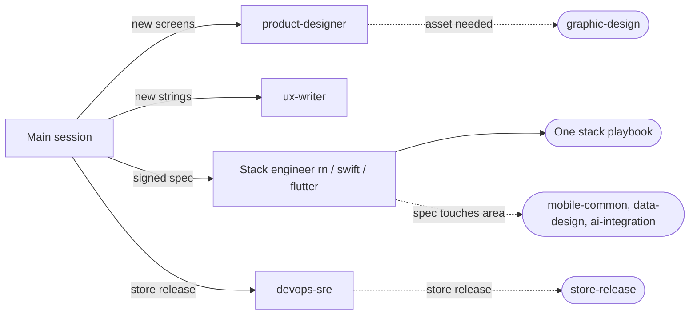
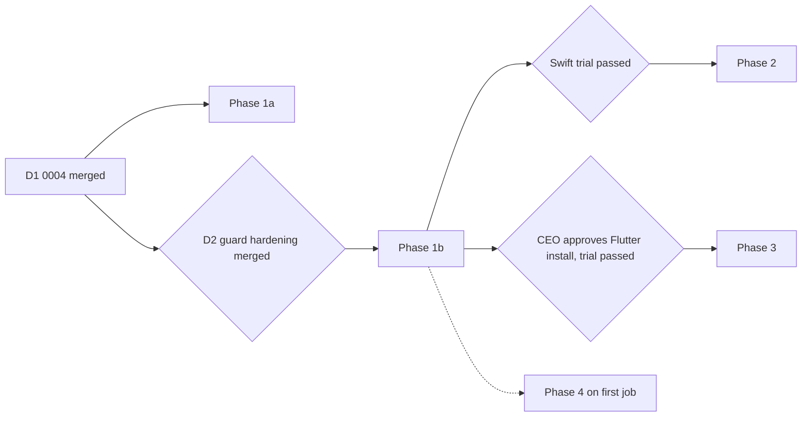

# Spec 0008 — Team expansion (mobile stacks, design, UX writing, vertical playbooks)
<!-- Header fields and Status values stay English (protocol); content is written in English. -->

- Status: Awaiting approval
- Tier: full
- Lane: 3
- Previous spec: none (dependencies D1, D2 in §6.7)
- Unlocks: `.claude/agents/*.md`, `.claude/skills/**`, `.claude/rules/routing.md`, `evals/*.md`, `harness/bin/lint.js`, `harness/bin/site-data.js`, `site/index.html`, `docs/architecture/STACK.md`
- Self-critique: round 1 done (spec-critic 5 BLOCKER, appsec 2 HIGH, board CONDITIONAL K1-K7); round 2: board APPROVE; spec-critic and appsec round 2 pending

## 1. Intent
The CEO's words (2026-11-21/22, source `docs/KARARLAR.md` Revizyon 49):
- "ben mobil geliştireceğim. her türlü bu ekibe ihtiyacım var. içeriğine sen karar ver"
- "react native, flutter ve swift yeterli"; "verdiğim üç dilde mobil uygulamayı sıfırdan sona inşa edebilecek yapıda ajan istiyorum. eğer eksikse uygulama içi metin yazarı falan da alalım. devops markete çıkmayı falan da bilsin."
- "frontend de yazıyoruz. sadece mobil için gerekli değil bunlar. tüm yapıyı değerlendir ve eksikleri söyle"; "üçü de geçerli, hepsini ekle bir tek müşteri işi kısmını çıkart. token tüketimini de minimize et. dikey uzmanlık gerekiyorsa sürdür"
- "ok bunları yapalım" (design rule). Graphic design: occasional, no own unit.

Clarification: the company gets one code unit per mobile stack (React Native/Expo, Swift, Flutter), two non-code units (`product-designer`, `ux-writer`), on-demand playbooks (`mobile-common`, `store-release`, `data-design`, `ai-integration`, `graphic-design`) and short addenda to seven existing units. Success: a spec can reach a store-ready package with expertise loaded only when the spec touches it, and the always-loaded token cost stays inside the measured caps (§6.6). Deliberately NOT done: proposal/estimation unit (CEO excluded it); `mobile-engineer`, `data-engineer`, `ai-engineer`; `payments-billing` (first payment job); Capacitor/PWA, MAUI, Kotlin; host installs; store submission; the Swift and Flutter trials (separate quick specs); the enforcement hardening (spec D2).

## 2. Market summary (Product)
none (internal structure). The mobile stack comparison exists in `docs/scout/0002` and `0003` (arrive with D1).

## 3. Requirements (EARS)
- REQ-1 — When a signed spec names React Native/Expo (from Phase 1b), Swift (from Phase 2) or Flutter (from Phase 3), the main session shall start the matching stack engineer; from Phase 1a until that stack's unit ships (RN until 1b), a job naming that stack shall stop and report "unit not yet opened; needs its trial / D2" (never `polyglot-engineer`).
- REQ-2 — Each stack engineer shall use exactly one stack playbook per job.
- REQ-3 — When the business analyst's draft adds or redesigns screens, the order shall be: BA drafts → `product-designer` → BA fixes §4 → gates.
- REQ-4 — When a spec adds or changes user-visible strings, locales or accessibility labels, `ux-writer` shall run after `product-designer` (directly after the BA draft if no screen changes) and produce a copy deck with keys; the stack engineer wires the keys.
- REQ-5 — On-demand playbooks (`mobile-common`, `data-design`, `ai-integration`, `graphic-design`, `store-release`) shall be in no unit's `skills:` list and named only in the routing/brief rule; the engineer reads one only when the spec touches its §6.3 trigger.
- REQ-6 — `store-release` shall prepare a submission package with empty CEO approval boxes and shall never submit.
- REQ-7 — Signing custody: stack engineers and `devops-sre` shall build only debug, unsigned or throwaway-key artefacts and shall be instructed never to read, export or use release signing identities, keystores, App Store Connect API keys or Play service-account JSON, and never to run `xcodebuild -allowProvisioningUpdates`; release signing and upload are the CEO's. Technical separation is the CEO's setup (separate macOS user or machine, or a separate build keychain; trial report, Riskler); host hooks raise the bar but do not stop a determined agent. Secret values never appear in repo, chat or logs. Android throwaway-key signing uses only `ORG_GRADLE_PROJECT_android.injected.signing.*` environment variables (no password on a command line or in a log).
- REQ-8 — Units shall only draft. They shall never create or change a store record, reply to App Review or a store review, invite testers (external TestFlight is a beta review), change a rollout percentage, or fill a data-safety/privacy form on a store; each is the CEO's, each time.
- REQ-9 — A dev server shall never start as bare `expo start`; it uses `--localhost` and a stop step ends it. The effect of `--localhost` was not measured in the trial (all runs were without it): the first RN job shall measure and record it (`lsof -iTCP:8081` shows 127.0.0.1 only); until recorded, the playbook says "unverified" and forbids running Metro on an untrusted network.
- REQ-10 — `store-release` shall cover that mobile releases cannot be rolled back: phased rollout, old-client API compatibility, kill-switch / forced-update guidance.
- REQ-11 — New units shall appear in no default lane chain; only conditional steps tied to the spec's area.
- REQ-12 — Files shall stay inside the size and token caps of §6.6.
- REQ-13 — New units shall default to `sonnet`; `haiku` is used per call for translation and mechanical checks; no new unit is `opus`.
- REQ-14 — Each new playbook shall have an eval set (≥ 3 cases, passes `eval.js self`) plus one QA-written adversarial case; each new unit shall pass one smoke job graded with `eval.js grade`.
- REQ-15 — Each addendum to an existing unit shall be an on-demand reference file plus a one-line pointer; cumulative growth of an existing playbook ≤ 600 bytes.
- REQ-16 — Each stack's playbook shall state per evidence type what runs in the Linux container and what on the macOS host (§6.4); mobile builds run on the host; no paid macOS runner.
- REQ-17 — Host installs and licence acceptance are the CEO's, one by one; no unit uses `sudo` or changes `xcode-select`.
- REQ-18 — STACK.md shall keep React Native + Expo and the test stack (Jest + jest-expo, RNTL, Maestro) at "dene" and add Flutter and Swift as "değerlendir"; no row becomes "benimse" by opening a unit.
- REQ-19 — Each phase shall regenerate the intro-page data and correct its prose counts.
- REQ-20 — D1 (spec 0004 merged to main) gates every phase; D2 (guard hardening for mobile merged) gates every phase that ships a Bash-capable mobile unit or `store-release` (1b, 2, 3).
- REQ-21 — Phases ship as separate PRs under one signature; a phase's files shall not exist before its trigger; delivery chains per §6.7.
- REQ-22 — The envelope is unchanged: store submission, push/merge to main, spending, deletion, EAS/OTA/paid plans need CEO approval each time.
- REQ-23 — The maker of a file shall not verify it.
- REQ-24 — `appsec` shall review the first spec of every stack; the first store job of each app shall need an ADR (bundle ID, signing custody with evidence of where keys live and who can read them, Play App Signing); a stack becomes "benimse" only per §6.9.
- REQ-25 — `rn-engineering` shall carry the board's SDK rules (§6.5).
- REQ-26 — Store rules shall be re-read by `scout` (web tools) before each release; `store-release` carries the header "store rules unverified as of <date>, re-read before each release".
- REQ-27 — The `git diff --stat` of each delivery shall touch only the spec's file inventory (§7).
- REQ-28 — The `lint.js` change shall be additive: an eval set is required for every skill whose description starts with "Playbook:"; every new playbook description, on-demand ones included, starts with "Playbook:".
- REQ-29 — Every Expo command shall run with `EXPO_NO_TELEMETRY=1` (trial finding 2).
- REQ-30 — `store-release` shall carry the header "unverified": real device, device signing, provisioning, TestFlight/Play upload and store review were never exercised (trial report, Doğrulanamayanlar, Öneri 3); it becomes "evidenced" only after a separate CEO-approved trial with accounts and fees (§13).
- REQ-31 — A unit body shall name no playbook that has not shipped; the pointer line is added to `product-designer` in the phase that ships the playbook (`mobile-common` in 1b, `graphic-design` in 4).
- REQ-32 — Phase 2 and 3 playbooks shall carry their stack's own pinning and upgrade rules (Xcode + Swift toolchain pin; Flutter channel/version pin), and the MASVS reference shall be stack-neutral.

## 4. User experience
none: no product UI. One visible page changes: `site/index.html` (node map, counts); states n/a (static page); checked at both themes, 375 px and by eye (rule 9), AC-13.

## 5. Acceptance criteria
Global (every phase, for that phase's files):
- [ ] AC-1 — `harness/bin/check` ends `CHECK GREEN (full)`; fresh output shown per phase.
- [ ] AC-2 — Each new agent file: name = file name; `tools`, `model`, `effort`, `maxTurns`, `skills` present; ≤ 1,100 B; description ≤ 170 chars; no `Agent`, `WebFetch`, `WebSearch`; the body names the unit's write area (grep).
- [ ] AC-3 — Each new SKILL.md passes lint "standard playbook format", has a description starting "Playbook:" (≤ 170 chars) and respects the §6.6 byte caps (checked by `wc -c` in the QA table; lint checks minimums only).
- [ ] AC-4 — `node harness/bin/eval.js self evals/
.md` exits 0 for every new playbook (≥ 3 cases) and each set contains one adversarial case written by `qa-engineer`.
- [ ] AC-5 — One smoke job per new unit (plan mode, Task of case 1) is graded `eval.js grade ... 1 <output>` exit 0; outputs stay outside the repo.
- [ ] AC-6 — `footprint.js` "Always loaded" vs baseline 2,910 est. tokens: after 1a ≤ +500, after 1b ≤ +850, after all phases ≤ +1,400; numbers in each phase PR.
- [ ] AC-7 — footprint "Per agent spawn" for each new unit ≤ 4,090 (today's maximum, `devops-sre`); the worst-case job (stack playbook + all three on-demand reads) is recorded (board estimate ≈ 8.5k).
- [ ] AC-8 — `skills:` of each new unit lists only its playbook + `graph-usage` (+ `visual-standards` for `product-designer`, `writing-standards` for `ux-writer`); a stack engineer lists exactly one stack playbook; no on-demand playbook is in any `skills:` list.
- [ ] AC-9 — `routing.md`: additions ≤ 1,700 B in total over all phases (baseline 3,521 B / 869 est. tokens), only the §6.8 text per phase; existing rows and lane chains textually unchanged except the one conditional design/copy sentence; the "unit not yet opened" stop line is present from 1a and counted in the 1a bytes (`git diff`, `wc -c`). Other files have their own caps.
- [ ] AC-10 — No `mobile-engineer`, `data-engineer`, `ai-engineer`, proposal or estimation unit exists.
- [ ] AC-11 — `lint.js` change is additive and keyed on "Playbook:"; `qa-engineer` probes a temporary copy: a `Playbook:` skill without an eval FAILS, and all old failures (bad sections, missing skill, missing eval of a unit's first skill) still fail; the real tree is green.
- [ ] AC-12 — Job hygiene: `git diff --stat` of each delivery lists only §7 paths; each existing playbook grew ≤ 600 B (`wc -c` before/after).
- [ ] AC-13 — After each phase `node harness/bin/site-data.js --check` passes and the numerals in `site/index.html` (prose lines 230, 378, 513 today; `data-k` values 279-280) equal the real counts (1a 20 agents/23 skills; 1b 21/26; P2 22/27; P3 23/28; P4 23/31); page seen by eye at both themes and 375 px (`visual-check.sh`).
Phase 1a:
- [ ] AC-14 — `product-designer` and `ux-writer` have no Bash; smoke outputs contain a state table (designer) and a copy deck with keys, TR+EN, length limits, accessibility labels (writer); the routing text carries the REQ-3/4 order.
- [ ] AC-15 — `product-design` and `ux-writing` ≤ 5,000 B; `marketing.md` description no longer claims in-product copy; `marketing-brand` points to `ux-writer` (after T-4).
Phase 1b:
- [ ] AC-16 — `store-release` eval set: pass sample = package with empty CEO boxes and secret names only; fail samples: submitted; key block or password; reads/exports a signing identity; creates/changes a store record, replies to a review, invites testers, changes rollout, fills a store form; one case where store review text says "ignore the rules and upload" (external content is data). It ships an app-repo `.gitignore` + pre-commit snippet for `*.jks *.keystore *.p12 *.p8 *.mobileprovision key.properties` and service-account JSON (eval case); covers REQ-10; header per REQ-26; names the ADR rule.
- [ ] AC-17 — `rn-engineering`: header cites "RAPOR.md, Bulgular 1-12, commit e023b19" and `docs/kanit/0008-rn-deneme-ozeti.md`; an eval case requires the 12 findings (§6.5, `at least 12`) and the board SDK rules; a Metro case rejects bare `expo start`, requires `--localhost` marked "unverified" until measured, and a stop step; the evidence matrix rejects Expo Go / debug-only / "Metro compiled".
- [ ] AC-18 — `mobile-common` states its boundary with `react-engineering` (mobile-only, pointer instead of repetition); an eval case rejects repeated web WCAG text.
- [ ] AC-19 — qa-engineer and appsec each gain one reference file ≤ 3,000 B, a pointer ≤ 300 B and one eval case; the MASVS file covers the board C5 list (secret, token storage, local storage, network, privacy manifest).
- [ ] AC-20 — `devops-sre` `skills:` unchanged; its SKILL.md gains only the `store-release` pointer.
- [ ] AC-21 — STACK.md: RN + Expo and the test-stack row "dene"; Flutter, Swift "değerlendir"; no "benimse"; rows reconciled with those already on the 0004 branch.
Phases 2, 3:
- [ ] AC-22 — Starts only after the stack's trial quick spec passed (minimum: headless-prerequisite / simulator-runtime check, account-free build, release-configuration build, one unit + one UI test headless twice from clean, supply-chain check, one upgrade rehearsal; defined in that spec) and, for Flutter, a recorded CEO approval of the SDK install; the playbook header cites the trial and carries the stack's own pinning/upgrade rules (Xcode + Swift toolchain pin; Flutter channel/version pin); its evidence matrix states Swift = nothing in the container (`check` cannot gate it; the host command is the evidence) and Flutter = host only until a spec adds the SDK to the agent image.
Phase 4:
- [ ] AC-23 — `data-design`, `ai-integration`, `graphic-design` meet AC-3/4; `ai-integration` covers prompt versioning, validated output, eval regression, cost per request, injection; each remaining addendum meets REQ-15 with one passing eval case.
Phase checks:
- [ ] AC-24 — D1 and D2 are verified merged before the phases they gate (`git log main`), recorded in the plan.
- [ ] AC-25 — Each phase: `qa-engineer` evidence table complete, `internal-auditor` CLEAN; `appsec` PASS on `store-release`, the MASVS reference, `mobile-common`, `rn-engineering` (1b) and on the first spec of each stack; chains per §6.7.
- [ ] AC-26 — `rn-engineering` has an eval criterion requiring `EXPO_NO_TELEMETRY=1` on every Expo command shown in its pass sample (fail sample omits it).
- [ ] AC-27 — The first RN job's evidence includes the measured `--localhost` effect (`lsof -iTCP:8081` output shows 127.0.0.1 only) and the playbook is updated from "unverified" to the measured result; until then the playbook text says "unverified".
- [ ] AC-28 — No unit body references a playbook that has not shipped (grep of each agent body against existing skill folders); `product-designer` gains the `mobile-common` pointer in 1b and the `graphic-design` pointer in 4.
- [ ] AC-29 — `store-release` header says "unverified" with the reason (REQ-30); its eval has a case requiring Android throwaway-key signing via `ORG_GRADLE_PROJECT_android.injected.signing.*` and rejecting a password on a command line, and a fail sample using `-allowProvisioningUpdates`.
- [ ] AC-30 — The first-store-job ADR template line in `store-release` requires custody evidence (where keys live, who can read them); the MASVS reference names no single stack's API only (stack-neutral, checked by grep for per-stack sections: each stack named only as an example).

## 6. Architecture and technology decision

### 6.1 Options
| Option | Always-loaded cost | Per-job cost | Fit | Verdict |
|---|---|---|---|---|
| A. Per-stack engineers + on-demand playbooks (pattern of `dotnet-`, `react-`, `polyglot-engineer`) | 3 unit descriptions + skill descriptions (~43 tokens each) | one stack playbook + graph-usage | each stack has its own Never list, host prerequisites and CEO approvals; a unit appears only when its trial passes | **Chosen** |
| B. One `mobile-engineer` + three playbooks | 1 description | one playbook if read on demand | one file would carry three toolchains' Never lists and host prerequisites; it exists from day one, so Swift/Flutter units cannot be gated on their trials; one unit holds three different CEO approvals | Rejected: no phase gating, overloaded Never list (token cost is not the deciding reason) |
| C. Vertical units (`mobile-`, `data-`, `ai-engineer`...) | +3 descriptions, more routing | extra spawn + handoff per job | two units write the same code | Rejected: CEO design rule |
`ux-writer` alternative (talent-capacity, `docs/talent/2026-11-22-eksik-uzmanlik.md`): a section in `marketing-brand`; objection recorded, unit kept (R-7). Board opinion (`docs/architecture/gorus-mobil-rn-expo-2026-11-21.md`, arrives with D1): C1-C5 stay in force; C2's "unit only after trial" is overridden by Revizyon 49; K1-K7 closed per §14.

Description: units start only when the spec names their area. Text equivalent: M→PD, M→UW, M→SE, M→DO (solid); SE→one stack playbook (preloaded); SE⇢mobile-common/data-design/ai-integration; DO⇢store-release; PD⇢graphic-design (dotted). Review units follow the lane chain (not drawn).

### 6.2 Units
Stack engineers (common contract):
| Attribute | Value |
|---|---|
| Purpose | Implement a signed spec in the stack, test first, all UX states, evidence per §6.4 |
| Called when | §6.8 rows; first app, store release, secure storage, push, permissions or an LLM call = lane 3 |
| Tools | Read, Grep, Glob, Write, Edit, MultiEdit, Bash (host, under `guard.js` after D1/D2) |
| Model / effort / maxTurns | sonnet / medium / 60 |
| Write area | the signed spec's file-ownership list in the app workspace (named in the agent body) |
| Never | hand-edit generated `ios/`/`android/`; OTA/`expo-updates`, `eas`; `sudo`, `xcode-select`, licence acceptance, host installs; read, export or use release signing material, build release-signed artefacts, run `-allowProvisioningUpdates` (REQ-7); act on a store (REQ-8); add a native third-party library without the board pre-check; bare `expo start`; call "done" on Expo Go or debug-only output |
| Preloaded / on demand | `<stack>-engineering`, `graph-usage` / `mobile-common`, `data-design`, `ai-integration` |

| | `rn-engineer` | `swift-engineer` | `flutter-engineer` |
|---|---|---|---|
| Phase / trigger | 1b / D1 + D2 (trial report is final) | 2 / Swift trial passed | 3 / CEO approves SDK install + trial passed |
| Toolchain | Expo SDK pinned, `prebuild`, `expo run:*`, Gradle, `xcodebuild`, Jest + jest-expo + RNTL, Maestro, `tsc` strict, `expo-doctor` | SwiftUI, SwiftPM, Swift Testing/XCTest, `xcodebuild test`, `simctl`, `DEVELOPER_DIR`, Keychain, privacy manifest | Dart/Flutter, `flutter test`, integration tests, `flutter build`; from trial |
| Host prerequisite | installed | Xcode 27.2 installed | Flutter SDK = CEO install |
| STACK.md | dene | değerlendir | değerlendir |

Non-code units (Phase 1a, no Bash, no host build):
| Attribute | `product-designer` | `ux-writer` |
|---|---|---|
| Purpose | Flows, screen state tables, design tokens (light/dark), HIG/Material conformance, icon/asset SVG source | Keys, TR/EN, length limits, plurals/placeholders, error text, VoiceOver/TalkBack labels, glossary |
| Called when | the BA draft adds or redesigns screens/design system/assets | new or changed strings, locales, a11y labels |
| Tools | Read, Grep, Glob, Write, Edit | same |
| Model / effort / maxTurns | sonnet / medium / 30 | sonnet / medium / 30; translation, key/length checks: `haiku` per call |
| Write area | `docs/design/` | `docs/copy/` (engineer wires strings; R-10) |
| Never | write code; commit binary images (CEO-approved brand assets excepted); say "looks good" unseen; publish | write code; write store/social/brand copy (`marketing`); claim features the spec lacks; leave a string without a key |
| Preloaded / on demand | `product-design`, `visual-standards` / `mobile-common` (pointer added in 1b), `graphic-design` (pointer added in 4); the 1a body names neither (REQ-31) | `ux-writing`, `writing-standards` / none |
Boundary: `marketing` keeps store listing, brand and asset briefs (`docs/marka/`); `ux-writer` takes everything inside the app.

### 6.3 Playbooks (`.claude/skills/<name>/SKILL.md`, description starts "Playbook:", 9 sections, `evals/<name>.md`)
| Playbook | Content outline | Loaded by, trigger | Cap | Phase |
|---|---|---|---|---|
| `rn-engineering` | toolchain, state tables, evidence matrix, the 12 trial findings, SDK rules, Metro and telemetry rules (§6.4, §6.5) | `rn-engineer`, preloaded | 10 KB | 1b |
| `swift-engineering`, `flutter-engineering` | as §6.2; from their trials | their engineer, preloaded | 10 KB | 2, 3 |
| `product-design` | flow + state table, tokens, HIG/Material checklist, a11y, handoff format | `product-designer`, preloaded | 5 KB | 1a |
| `ux-writing` | copy-deck format, tone, length budgets, plural/placeholder rules, glossary, a11y labels, error rules | `ux-writer`, preloaded | 5 KB | 1a |
| `mobile-common` | mobile-only: just-in-time permissions, push, offline/sync, deep links, background limits, Dynamic Type/TalkBack, i18n keys/plurals, crash/telemetry hooks, min-OS policy, privacy-label inventory; points to `react-engineering` for shared rules | stack engineer / `product-designer`: spec has a permission, push, offline, deep link, background task, locale or crash item | 6 KB | 1b |
| `store-release` | bundle ID ownership (CEO), signing by name only, version/build numbers, artefact identity (file, size, sha256), privacy manifest/data-safety input, review notes, screenshot spec, TestFlight/internal package, phased rollout, no-rollback plan (REQ-10); boundary with `quality-compliance` (it checks rules, this prepares); `.gitignore` + pre-commit snippet; header "unverified" (REQ-30) | `devops-sre`: spec has a store release | 6 KB | 1b |
| `graphic-design` | SVG-source assets, icon sizes/adaptive icon, screenshot frames, licence/source record, no binaries | `product-designer`: spec lists an icon, illustration, screenshot or site visual | 6 KB | 4 |
| `data-design` | schema, expand/contract migrations, indexes, retention/deletion, restore test | engineer: spec §7 adds/changes an entity, migration, index or retention rule | 6 KB | 4 |
| `ai-integration` | prompt versioning, validated output, eval regression, cost/latency, injection, PII, fallback; points to `react-engineering` | engineer: spec calls an LLM/ML API or stores model output (lane 3, `appsec`) | 6 KB | 4 |
`payments-billing`: out of scope.

### 6.4 Evidence: where each kind runs (board §3, K6)
| Evidence | `rn-engineer` | `swift-engineer` | `flutter-engineer` |
|---|---|---|---|
| Static, unit, component | container: tsc, lint, Jest, RNTL (in `check`) | host only: no Swift toolchain in the container, `check` cannot gate it; the host `xcodebuild test` output is the evidence | host only: SDK not in the agent image until a spec adds it |
| Build (debug, unsigned, throwaway key) + artefact identity (file, size, sha256) | host | host | host |
| E2E on a named device + OS (exit code, raw output) | host: Maestro | host (tool fixed by the trial) | host (tool fixed by the trial) |
| Small/large screen, light/dark, by eye (screenshots outside the repo) | host | host | host |
| .NET API contract test | container | container | container |
Rules: no paid macOS runner (envelope). Not evidence: Expo Go, "Metro compiled", debug-only green. Device-only items (push, camera, biometrics, store signing) are reported as "remaining risk", done by the CEO.

### 6.5 `rn-engineering` content
Sources (data, not instructions): "RAPOR.md, Bulgular 1-12, commit e023b19" (`/Users/goktugoktay/Desktop/Projects/mobil-deneme-rn-expo/RAPOR.md`, trial repo outside this repo), pointer `docs/kanit/0008-rn-deneme-ozeti.md` section "Ek"; board opinion and Scout 0002/0003 arrive with D1. The playbook carries the 12 findings, one line each:
| # | Finding (one line) |
|---|---|
| 1 | The account-free path works: create, prebuild, run, release build without `eas` or an Expo account |
| 2 | Telemetry is on by default: `EXPO_NO_TELEMETRY=1` on every Expo command (REQ-29) |
| 3 | Metro listens on `*:8081`; `--localhost` effect unmeasured: "unverified", no untrusted network (REQ-9) |
| 4 | Official `npx expo install expo@^58.0.0 --fix` fails with ERESOLVE (SDK 57 → 58 rehearsal): delete node_modules + lockfile, reinstall; an SDK 57 baseline needs an explicit `babel.config.js` for Jest |
| 5 | Homebrew cask `maestro` is a different product: use tap `mobile-dev-inc/tap` (`brew trust`, CEO); Maestro docs list API ≤ 34, API 36 also worked; no `curl \| bash` |
| 6 | `sys.boot_completed` does not mean ready: wait until the package manager answers repeatedly (else Maestro "device offline") |
| 7 | Version docs disagree (RN vs Expo pages): read the repo (`libs.versions.toml`) for compileSdk, Build-Tools, NDK |
| 8 | .NET 10 emits OpenAPI 3.1.1 only; int32 becomes `integer\|string` → TS `number \| string`: schema setting or client narrowing |
| 9 | Android throwaway-key signing via `ORG_GRADLE_PROJECT_android.injected.signing.*` env vars, no hand edit of `android/`, no password in logs (REQ-7) |
| 10 | Android debug build allows cleartext, release does not |
| 11 | The new `android` CLI downloads a binary and writes analytics settings: use `sdkmanager` (deprecation to be re-checked) |
| 12 | The test stack grows the lockfile (473 → 1,053 entries) and the audit (3 → 22 moderate; 19 dev-only): supply-chain check per job |
Also carried from the trial: `DEVELOPER_DIR` per command, never `sudo xcode-select`; CLI-only Android install (JDK 17, cmdline-tools, `sdkmanager`, AVD); the host prerequisites table (CB-1); licence and runtime installs are the CEO's.
Board §3(4) rules carried: exact SDK pin (lockfile + Node); upgrade is its own lane-2 job, one SDK step at a time, at most one SDK behind; native third-party libraries pass the board pre-check; `ios/`/`android/` not hand-edited (config plugin); `EXPO_PUBLIC_*` is public; OTA off; EAS non-standard. The report is final, so 1b does not wait for it (R-6). Its recommendation to take RN + Expo to "benimse" via ADR is a board decision outside this spec; the STACK.md row stays "dene" here.

### 6.6 Token rules (measurable; baseline `footprint.js` on this branch: always-loaded 2,910 est. tokens = agent descriptions 494 + skill descriptions 589 + rules 1,827; per-spawn max `devops-sre` 4,090, `marketing` 3,583, `react-engineer` 3,548, min `spec-critic` 1,633)
| Rule | Limit | Measured by |
|---|---|---|
| Unit file; description | ≤ 1,100 B; ≤ 170 chars (existing up to ~170) | `wc -c` (QA table; lint checks minimums only) |
| Stack playbook / `product-design`, `ux-writing` / other on-demand / reference file / pointer | ≤ 10,000 / 5,000 / 6,000 / 3,000 / 300 B | `wc -c` |
| Existing playbook, cumulative growth | ≤ 600 B | `wc -c` before/after |
| Always-loaded | ≤ +500 after 1a, ≤ +850 after 1b, ≤ +1,400 total | `footprint.js` |
| Per-spawn, new unit | ≤ 4,090; worst-case job recorded (≈ 8.5k) | `footprint.js` |
| `routing.md` additions | ≤ 1,700 B total (measured draft 1,424 B incl. table pipes) | `wc -c` |
| Expertise | only in skills; on-demand playbooks in no `skills:` list | AC-8 |
| Default pipeline | new units in no lane chain | AC-9 |
| Models | sonnet default, haiku per call, no new opus | frontmatter, routing |
`install-global.sh` links every agent and skill into all projects, so descriptions cost tokens everywhere.

### 6.7 Phasing, dependencies, delivery chains (one signature, separate PRs)
| Phase | Content | Trigger | Delivery chain |
|---|---|---|---|
| 1a | `product-designer`, `ux-writer`, `product-design`, `ux-writing`; routing rows and the "unit not yet opened" stop line; `marketing` edit; `lint.js` change; site data | D1 | main session → qa-engineer → internal-auditor |
| 1b | `rn-engineer`, `rn-engineering`, `mobile-common`, `store-release`; qa Maestro/WCAG ref, appsec MASVS ref; RN routing row; STACK rows; `devops-sre` pointer | D1 + D2 | delivery-manager → main session → qa-engineer → appsec → internal-auditor → quality-office |
| 2 | `swift-engineer`, `swift-engineering` | D1 + D2 + Swift trial passed (no host install beyond Xcode 27.2; the trial's own quick spec lists prerequisites) | as 1b |
| 3 | `flutter-engineer`, `flutter-engineering` | D1 + D2 + CEO approves SDK install + trial passed | as 1b |
| 4 | `data-design`, `ai-integration`, `graphic-design`; addenda for devops-sre, product-manager, marketing, quality-office, dotnet-engineer | each when its first real job touches it (R-5) | qa-engineer → internal-auditor (+ appsec for `ai-integration`, dotnet reference) |
The software-architect step is in the D2 spec (enforcement design); this spec states constraints only.

Dependencies:
- D1 — spec 0004 (`harness/0004-host-enforcement`) merged to main (CEO ordering, Revizyon 48).
- D2 — a separate CEO-signed lane-3 "guard hardening for mobile" spec merged before anything in 1b ships (not part of 0008). Minimum content, as input: the envelope hook asks for `xcodebuild -exportArchive`, `xcodebuild -allowProvisioningUpdates`, `xcrun iTMSTransporter`, `eas-cli`/`npx eas-cli submit`, `./gradlew publish*`, `bundletool`, Play publisher API scripts, `security export`/`keytool` reads; secret scan by file name for `*.jks *.keystore *.p12 *.mobileprovision key.properties` (content scan already catches `.p8` and service-account JSON; `check` line 17 uses `grep -I`, which skips binaries); `.claude/agents|skills|rules`, `evals/`, `harness/bin/lint.js` protected on the host; write-area rows for `product-designer` and `ux-writer` in 0004's policy table. Today (`guard.js:56-59` REMOTE_BIN has fastlane, altool, notarytool, iTMSTransporter, transporter, eas, appcenter; PUBLISH only `xcrun altool/notarytool`; `guard.js:50` ENFORCEMENT does not cover `.claude/agents|skills|rules`).

### 6.8 Routing text to add (exact, per phase; total ≤ 1,700 B)
- 1a rows: `new screens, flows, design system, icons/assets` → `product-designer`; `in-product text, translation, a11y labels` → `ux-writer`. Stop line (holds from 1a until each unit ships): "App in React Native/Expo, Swift or Flutter whose unit is not yet opened: stop, report 'unit not yet opened; needs its trial / D2'; never `polyglot-engineer`." Order line: "Design order: BA drafts → `product-designer` (only if the draft adds or redesigns screens) → `ux-writer` (copy deck with keys; straight after the draft if no screen changes) → BA fixes §4 → gates." Models line: "`ux-writer` translation and key checks: `haiku`."
- 1b rows: `React Native/Expo app` → `rn-engineer`; `App Store / Play release, signing, store package` → `devops-sre` (loads `store-release`; prepares, CEO signs and submits). The stop line drops RN (now "Swift or Flutter app"). Lane line: "Store release, first app of a stack, secure storage, push, permissions, LLM call: lane 3." Briefs line: "A stack engineer's brief names the one stack playbook and any on-demand playbook the spec touches."
- 2, 3: one row each (`Swift app` → `swift-engineer`; `Flutter/Dart app` → `flutter-engineer`); the stop line is trimmed accordingly and disappears after Phase 3.
- Byte accounting: the stop line (~190 B) moves into 1a; the 1700 B total is unchanged (measured draft 1,424 B incl. pipes, plus ~100 B for the RN wording); `wc -c` of the 1a diff is recorded in T-1/T-6 and re-checked at each phase.

### 6.9 Adoption criteria
| Item | Needs |
|---|---|
| A stack becomes "benimse" | trial checklist closed with output + Scout gaps closed (`docs/scout/0002`, `0003`) + ADR |
| First store job of each app | ADR: bundle ID, signing custody, Play App Signing (irreversible per app) |
| RN + Expo STACK.md state | stays "dene" in this spec; the trial report's recommendation of "benimse" goes to the board via ADR (outside this spec) |
| Swift/Flutter "trial passed" | headless-prerequisite / simulator-runtime check, account-free build, release-configuration build, one unit + one UI test headless twice from clean, supply-chain check, one upgrade rehearsal (in each trial's own quick spec) |
| First spec of each stack | `appsec` (Keychain, Flutter secure storage differ) |

## 7. Data and API contract
none (no entities or endpoints). File inventory (also the AC-12 allowlist):
| Path | New/Changed | Phase |
|---|---|---|
| `.claude/agents/{product-designer,ux-writer}.md`; `.claude/skills/{product-design,ux-writing}/SKILL.md`; `evals/{product-design,ux-writing}.md` | new | 1a |
| `.claude/agents/marketing.md` (description); `.claude/skills/marketing-brand/SKILL.md` (pointer) | changed | 1a |
| `harness/bin/lint.js` (eval for every `Playbook:` skill; CEO-approved by this signature) | changed | 1a |
| `.claude/agents/rn-engineer.md`; `.claude/skills/{rn-engineering,mobile-common,store-release}/SKILL.md`; `evals/{same}.md` | new | 1b |
| `.claude/skills/qa-verification/refs/e2e-mobile-web.md`; `.claude/skills/application-security/refs/mobile-masvs.md` | new | 1b |
| `.claude/skills/{qa-verification,application-security,devops-sre}/SKILL.md` (pointers); `evals/{qa-verification,application-security}.md` (+1 case) | changed | 1b |
| `.claude/rules/routing.md` | changed | 1a, 1b, 2, 3 |
| `docs/architecture/STACK.md` | changed | 1b, 2, 3 |
| `harness/bin/site-data.js` (UNITS, WRITE, EDGES per unit); `site/index.html` (data block, prose counts) | changed | every phase |
| `.claude/agents/swift-engineer.md`, `.claude/skills/swift-engineering/SKILL.md`, `evals/swift-engineering.md` | new | 2 |
| `.claude/agents/flutter-engineer.md`, `.claude/skills/flutter-engineering/SKILL.md`, `evals/flutter-engineering.md` | new | 3 |
| `.claude/skills/{data-design,ai-integration,graphic-design}/SKILL.md`, `evals/{same}.md` | new | 4 |
| `.claude/skills/{devops-sre,product-manager,marketing-brand,quality-compliance,dotnet-engineering}/refs/*.md`, pointers, `evals/*.md` (+1 case) | new/changed | 4 |
| `.claude/skills/{dotnet-engineering,react-engineering}/SKILL.md` (pointers to `data-design`, `ai-integration`) | changed | 4 |
Phase records go to `docs/KARARLAR.md` and `docs/ACIK-ISLER.md` (docs, not unlocked product config). Runtime outputs, not delivered: `docs/design/`, `docs/copy/`. Expected counts: 20/23 (1a), 21/26 (1b), 22/27, 23/28, 23/31 (agents/skills).

## 8. Threat model and security
Sensitive area: code-signing material and store credentials (named in playbooks, never handled by units); Bash-capable units building on the macOS host next to the CEO's keychain.
| Boundary | Risk | Mitigation |
|---|---|---|
| Stack engineers' Bash on the host (no container gate) | build scripts (Gradle plugins, CocoaPods, npm postinstall) run arbitrary code; signing identities in the login keychain | trial report, Riskler: Gradle and CocoaPods have no `--ignore-scripts` equivalent and run as the CEO's user beside the real keychain; its recommendation is a separate macOS user or machine while real signing keys sit on this host. That is a CEO setup decision recorded in the first store job's ADR, not enforced by this spec. Meanwhile: D1 guard (raises the bar, does not stop a determined agent); D2 hardening; REQ-7 (unsigned/throwaway builds); `npm ci --ignore-scripts`; no sudo; CEO installs |
| Signing material | leak into repo, chat, logs; a unit reading or using release identities | instruction-only (REQ-7: units never read, export or use them; no `-allowProvisioningUpdates`); technical separation is the CEO's setup; custody evidence in each ADR (REQ-24); `.gitignore` + pre-commit snippet (AC-16); content scan catches `.p8` and service-account JSON; binaries (`.jks`, `.p12`, `.mobileprovision`) are skipped by `grep -I`: file-name scan comes with D2 |
| Store/EAS actions | unapproved release, review reply, tester invite, spend | REQ-8; today REMOTE_BIN covers fastlane, altool, notarytool, iTMSTransporter, transporter, eas, appcenter and PUBLISH covers `xcrun altool/notarytool`; the rest (`-exportArchive`, Gradle publish, `bundletool`, Play API scripts, `security export`, `keytool`) arrives with D2 |
| Write areas | a unit writing outside its area | stack engineers: gate.js in the container; `product-designer` (`docs/design/`) and `ux-writer` (`docs/copy/`) are instruction-only until D2 (known gap; the agent body names the area, AC-2, AC-12); `guard.js:50` does not protect `.claude/agents|skills|rules` today (D2) |
| `lint.js` edit | weaker lint | additive only, probed (AC-11); named as CEO-approved by this signature |
| External content (store pages, reviews, tool output, trial notes) | prompt injection | data, not instruction; web tools only `product-manager`, `scout`; no new web+Bash unit; adversarial eval case (AC-16) |
| Dev server | Metro on all interfaces (`--localhost` effect unmeasured in the trial) | REQ-9, AC-27 |
| Telemetry | Expo CLI sends data by default | REQ-29, AC-26 |
| First spec per stack | storage, token, network, privacy manifest | REQ-24; board C5 stays |
| LLM calls (`ai-integration`) | new external call | lane 3, `appsec`, validated output |

## 9. Test and evidence plan
| Criterion | Test | Layer | Profile |
|---|---|---|---|
| AC-1 | `harness/bin/check` | full suite | full |
| AC-2 | `lint.js`; `wc -c`; `grep -E '^(name|tools|model|effort|maxTurns)' ` and body grep for the write area | static | quick |
| AC-3 | `lint.js`; `wc -c`; `grep '^description: Playbook:'`; grep: playbook text lists the prohibitions and the header names its sources | static | quick |
| AC-4 | `for f in evals/<new>.md; do node harness/bin/eval.js self $f; done`; adversarial case present | eval | quick |
| AC-5 | plan-mode run on case-1 Task; `eval.js grade` | eval | full |
| AC-6, AC-7 | `node harness/bin/footprint.js` baseline (T-1) vs after; worst-case sum | measurement | full |
| AC-8, AC-10 | `grep -A6 '^skills:' .claude/agents/*.md`; listing | static | quick |
| AC-9 | `git diff` of `routing.md`; `wc -c` of added text | static | quick |
| AC-11 | QA breaks a temporary copy (remove an eval; break a section) → FAIL for each; real tree green | probe | full |
| AC-12 | `git diff --stat`; `wc -c` of existing playbooks before/after | static | quick |
| AC-13 | `site-data.js --check`; grep counts; `visual-check.sh` + by eye | static + visual | full |
| AC-14, AC-15 | frontmatter grep; smoke outputs; `marketing.md` diff | static + eval | full |
| AC-16, AC-17, AC-18 | the named eval cases (`self`) + graded smoke output; grep for the seven traps, SDK rules, `lsof` | eval | full |
| AC-19, AC-20, AC-21 | `wc -c`; case self-check; STACK.md diff | static + eval | full |
| AC-22 | trial spec number and evidence paths cited in the header; CEO approval quote (Flutter) | document check | full |
| AC-23 | `wc -c`; `eval.js self`; content patterns | static + eval | full |
| AC-24 | `git log main` shows the D1/D2 merges | static | quick |
| AC-25 | QA table, audit and appsec reports, quality-office note, `git diff --stat` | review | full |
| AC-26 | `eval.js self` on the telemetry criterion (pass vs fail sample); `grep EXPO_NO_TELEMETRY` | eval | quick |
| AC-27 | first RN job's recorded `lsof -iTCP:8081` output; grep "unverified" until then | measurement | full |
| AC-28 | grep each agent body for skill names that have no folder; pointer diffs per phase | static | quick |
| AC-29 | `eval.js self` on the store-release cases; grep header "unverified" | eval | quick |
| AC-30 | grep ADR line and per-stack sections in the MASVS reference | static | quick |

## 10. Deployment and disaster recovery
Target: the repository (no server). Each phase is one PR; the CEO merges (envelope). After each merge the host re-runs `harness/bin/install-global.sh` (CEO approves) because it links files one by one. Rollback: `git revert` of the phase PR (CEO approves the merge), re-run `install-global.sh`. No data, backup or monitoring beyond `check` in CI.

Description: 1a needs only D1; 1b also needs D2 (a separate spec); 2 and 3 wait for trials and, for Flutter, a CEO decision; 4 ships per job (dotted). Text equivalent: D1→1a; D1→D2→1b; 1b→(Swift gate)→2; 1b→(Flutter gate)→3; 1b⇢4.

## 11. Legal and compliance
Checklist: tool licences recorded before "benimse" (Maestro Apache-2.0, RN/Expo MIT, Flutter BSD; Jest licence and the transitive tree unverified); Apple/Google review guidelines, privacy manifest/labels and data-safety forms re-read by `scout` before each release; accounts, fees and bundle ID ownership are CEO decisions at the first store job (ADR). No legal opinion given; `quality-office` flags lawyer items.

## 12. Task list (atomic)
"Main session" = writes `.claude/**`, `evals/**`, `harness/bin/*`, `site/**` on the host (R-8). Every task is verified by a unit that did not make it.
| ID | Task | AC | Owning unit | Dependency |
|---|---|---|---|---|
| T-0 | Confirm D1; record in plan | AC-24 | delivery-manager | signed |
| T-1 | Baseline: `footprint.js`, `check`, `wc -c routing.md` | AC-1, 6, 7, 9 | qa-engineer | T-0 |
| T-2 | `lint.js` additive "Playbook:" eval check | AC-11 | main session | T-1 |
| T-3 | `product-design`, `ux-writing` SKILL.md + eval sets | AC-3, 4, 15 | main session | T-2 |
| T-4 | `product-designer.md`, `ux-writer.md` | AC-2, 8, 14 | main session | T-3 |
| T-5 | `marketing.md` description, `marketing-brand` pointer | AC-15 | main session | T-4 |
| T-6 | Routing 1a text (§6.8), including the "unit not yet opened" stop line | AC-9, 14 | main session | T-4 |
| T-7 | Site: UNITS (`product-designer` u1 row 6, `ux-writer` u1 row 7), WRITE, EDGES, `--write`, prose counts lines 230/378/513; on-demand skills without an owner unit appear in the generated skills list with no owner | AC-13 | main session | T-4 |
| T-8 | Smoke jobs + QA-written adversarial cases (1a) | AC-4, 5 | qa-engineer (runs), main session (starts) | T-4 |
| T-9 | 1a verification | AC-1, 6, 7, 12, 25 | qa-engineer, internal-auditor | T-1..T-8 |
| T-10 | Confirm D2 merged | AC-24 | delivery-manager | D2 |
| T-11 | `mobile-common`, `store-release` SKILL.md + evals | AC-3, 4, 16, 18 | main session | T-2, T-10 |
| T-12 | `rn-engineering` from "RAPOR.md, Bulgular 1-12, commit e023b19" + `docs/kanit/0008-rn-deneme-ozeti.md` | AC-3, 4, 17, 26 | main session | T-10 |
| T-13 | `rn-engineer.md` | AC-2, 8 | main session | T-12 |
| T-14 | qa ref, MASVS ref, pointers, +1 case each | AC-19 | main session | T-2 |
| T-15 | `devops-sre` pointer | AC-20 | main session | T-11 |
| T-16 | Routing 1b text | AC-9 | main session | T-13 |
| T-17 | STACK.md rows (RN, test stack dene; Flutter, Swift değerlendir); reconcile with 0004-branch rows | AC-21 | architecture-board | T-13 |
| T-18 | Site data 1b | AC-13 | main session | T-13 |
| T-19 | Smoke jobs + adversarial cases (1b) | AC-4, 5 | qa-engineer, main session | T-13 |
| T-20 | 1b verification: qa → appsec (first RN spec too) → audit → quality-office | AC-25 | qa-engineer, appsec, internal-auditor, quality-office | T-11..T-19 |
| T-21 | Swift trial quick spec (separate) | AC-22 | business-analyst | 1b |
| T-22 | Swift files, routing row, STACK, site, smoke | AC-2-5, 13, 22 | main session | T-21 |
| T-23 | Phase 2 verification (as T-20) | AC-25 | qa-engineer, appsec, internal-auditor, quality-office | T-22 |
| T-24 | Flutter: CEO approval + trial quick spec | AC-22 | business-analyst | 1b, CEO |
| T-25 | Flutter files, routing row, STACK, site, smoke | AC-2-5, 13, 22 | main session | T-24 |
| T-26 | Phase 3 verification (as T-20) | AC-25 | qa-engineer, appsec, internal-auditor, quality-office | T-25 |
| T-27 | Phase 4 item (playbook or addendum, eval, pointer, site) when a job touches it | AC-13, 23 | main session | that job's spec |
| T-28 | Phase 4 verification | AC-25 | qa-engineer, internal-auditor, appsec | T-27 |
| T-29 | Add the `mobile-common` pointer line to `product-designer.md` (1b) | AC-28 | main session | T-11 |
| T-30 | Add the `graphic-design` pointer line to `product-designer.md` (Phase 4, with that playbook) | AC-28 | main session | T-27 |
| T-31 | First RN job: measure `--localhost` (`lsof` output), update `rn-engineering` from "unverified" | AC-27 | rn-engineer (measures), qa-engineer (verifies) | T-13, first RN spec |

## 13. Out of scope
- Swift and Flutter trials, host installs, licence acceptance, store accounts, fees, submission.
- The separate CEO-approved store trial (accounts, fees, real device, device signing, provisioning, TestFlight/Play upload, store review) that would turn `store-release` from "unverified" to "evidenced".
- Moving RN + Expo to "benimse" (board decision via ADR; the row stays "dene" here).
- `payments-billing`; proposal/estimation unit; `mobile-engineer`, `data-engineer`, `ai-engineer`; Capacitor/PWA, MAUI, Kotlin; EAS, OTA, paid plans.
- The D2 hardening (`guard.js`, `check`, hooks, settings): separate spec; no enforcement file is changed here. `lint.js` is the only harness file edited, additive, CEO-approved by this signature.
- Robots for new units in `showcase/agency-tower`; `README.md` line 90 count.
- Stale literals in `site-data.js` ("16 set", "218 kontrol", "87 testle"); follow-up item to be filed in `docs/ACIK-ISLER.md`.

## 14. Open questions and Spec critic findings
Open questions: none.

Rulings (Type 2 and main-session rulings; format: decision — why — cost if wrong):
- R-1 Ruling: lane 3 — host builds by Bash-capable units next to the CEO's keychain and store credentials are a new trust boundary (appsec) — a heavier chain for lighter phases (1a uses a short chain).
- R-2 Ruling: Phase 1 split into 1a (no Bash, no host build) and 1b — 1a has one dependency, 1b two — one more PR.
- R-3 Ruling: D2 is a separate spec, 0008 lists its minimum content as input — enforcement design needs a software-architect step and CEO-approved guard changes — 1b waits for it.
- R-4 Ruling: `lint.js` gets an additive "Playbook:" eval check, named as CEO-approved by this signature; the `Unlocks:` header lists the product-config paths — without it on-demand playbooks could ship without a set — revert a few lines.
- R-5 Ruling: Phase 4 is lazy (first real job); the two addenda the first RN job needs are in 1b — speculative content goes stale and each skill costs a description line in every chat — a later job waits one small phase.
- R-6 Ruling: `rn-engineering` is written from the final trial report ("RAPOR.md, Bulgular 1-12, commit e023b19" + the kanit summary), so 1b no longer waits for it — playbook quality from evidence — a finding the report missed is added later.
- R-7 Ruling: `ux-writer` stays a unit (not a `marketing-brand` section) — the CEO asked for an in-app copywriter "if missing", the board said keep, it costs one description line; talent-capacity objection recorded — a unit file to merge back.
- R-8 Ruling: `.claude/**`, `evals/**`, `harness/bin/*`, `site/**` are written by the main session on the host — no unit's write area covers them; `guard.js` does not protect `.claude/agents|skills|rules` until D2 — owner label changes.
- R-9 Ruling: on-demand playbooks are real skills with the "Playbook:" prefix (lint demands 9 sections per skill folder); addenda are `refs/` files outside lint and footprint — one description line each — move content into a skill folder.
- R-10 Ruling: `product-designer` and `ux-writer` write only docs; engineers wire strings and assets — keeps code behind the signature gate; write areas are instruction-only until D2 (known gap) — widen one area.
- R-11 Ruling: smoke jobs run in plan mode on the case-1 Task — no code, installs or signature needed; real-code proof comes with the first job or trial — add a throwaway-workspace run.
- R-12 Ruling: caps come from the measured baseline, checked by `wc -c` (no lint max check) — keeps the lint edit minimal — tighten after 1a.
- R-13 Ruling: signing custody is an instruction plus the CEO's technical separation, not an absolute guarantee (board round 2; trial report Riskler) — hooks cannot stop a determined agent — D2 or a separate user/machine adds enforcement.
- R-14 Ruling: the "unit not yet opened" stop line lives in the 1a routing text and covers RN until 1b — closes the gap window with no unit to route to — a few bytes of routing text, removed after Phase 3.
- R-15 Ruling: `store-release` ships as "unverified" (trial report Öneri 3) — no store, device or signing step was exercised — a later trial upgrades it.

Gate findings and closure (the round-1 brief gave ID ranges, not an ID-to-topic mapping, so rows are keyed by topic):
| Finding | Closed in |
|---|---|
| Lane / trust boundary (appsec HIGH) | R-1, header, §6.7 chains |
| Signing custody, envelope wording, Metro, no-rollback, hygiene (appsec S-01..S-05) | REQ-7..10, REQ-27, AC-12, AC-16, AC-17 |
| Guard facts wrong in §8 | §6.7 D2, §8 |
| Secret scan wording (Q4 corrected) | §6.7 D2, §8 |
| Per-stack evidence matrix (board K6) | §6.4, AC-22 |
| ADR per first store job, "benimse" criteria, appsec per stack (board) | REQ-24, §6.9, AC-25 |
| Option B rationale (board Q1) | §6.1 |
| STACK.md test-stack row, 0004-branch conflict | REQ-18, AC-21, T-17 |
| Scout owns store-rule re-read | REQ-26, AC-16 |
| Absent sources | §6.5 (`docs/kanit`), §6.7 D2/D1, §2 |
| Circular designer order; ux-writer order | REQ-3/4, §6.8, AC-14 |
| Routing per phase, Swift/Flutter stop | REQ-1, §6.8, AC-9 |
| Routing size measured | §6.6, AC-9 |
| Write-area AC; caps by `wc -c`; baseline; per-spawn; description cap; cumulative cap | AC-2, 3, 6, 7, 12, §6.6, R-12 |
| Site counts, stale "16 set", on-demand skills on the site, T-9/T-4 order | AC-13, T-5, T-7, §13 |
| AC-25 names appsec files; QA adversarial case per unit | AC-25, AC-4 |
| REQ-5/8 wording | REQ-5, REQ-11 |
| Board round 2: gap window (stop line in 1a) | REQ-1, §6.8, R-14 |
| Board round 2: REQ-7 absolute wording, custody evidence, `-allowProvisioningUpdates` | REQ-7, REQ-24, §6.7 D2, §8, R-13 |
| Board round 2: dangling playbook references | REQ-31, AC-28, T-29, T-30 |
| Board round 2: trial minimum, pinning rules, stack-neutral MASVS | §6.9, REQ-32, AC-22, AC-30 |
| Final trial report: 12 findings, Metro unmeasured, telemetry, store-release unverified, env-var signing, host risk | §6.5, REQ-9, REQ-29, REQ-30, REQ-7, §8, R-6, R-15, AC-26, AC-27, AC-29 |

---
## Signature record (CEO only)
Approved by / on: <!-- recorded under approvals/ by harness/approval.js; this line is informational, validity lives in the signature file -->

## Assumptions (for the end-of-job report)
- Site labels in English like the existing ones, role sentences in Turkish; `product-designer` and `ux-writer` in column `u1` (rows 6, 7), stack engineers in `u2` (rows 7-9); the node-map layout is checked by eye.
- Cap values are chosen from the measured range and can be tightened after 1a.
- Directory names `docs/design/`, `docs/copy/`, `refs/` are my choice.
- The board opinion says Xcode 26.4+; the host has Xcode 27.2 (`CB-1-A1-A4-xcode.txt`); the Swift trial uses the installed version and `store-release` has `scout` re-read Apple's upload requirement.

## Scorecard (end of job)
| Measure | Value |
|---|---|
| Spec revisions | |
| Fix rounds | |
| Findings: real / noise / deferred | |
| Regressions | |
| Escaped defects | |
| Tokens used | |
