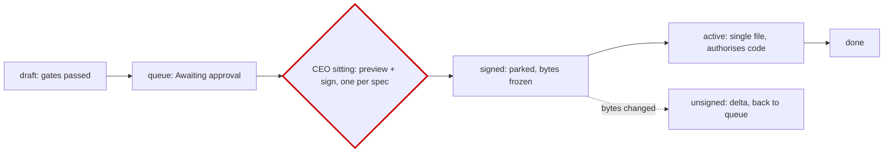
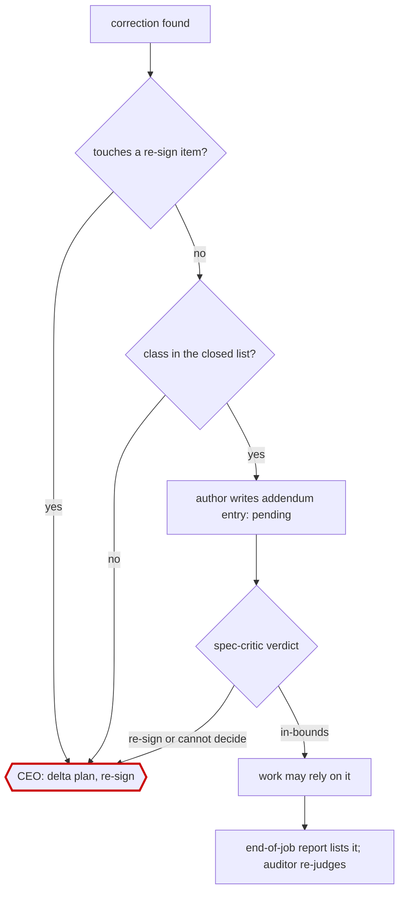

# Spec 0009 — Approval cadence: batched signature, addendum, Type 1 only, split envelope
<!-- Header fields and Status values stay English (protocol); content is written in English. -->

- Status: Draft
- Tier: full (four capabilities, more than 10 criteria) · Lane 2 + `appsec` (the job adds entries to the app's permission list and edits `harness/guard.js`; see §14 "Lane note")
- Source: `docs/KARARLAR.md`, entry "CEO 2026-11-22: onay sıklığı gevşetildi" (line 430)
- Previous spec: 0004 (`specs/active/0004-harness-enforcement-gaps.md`). 0004 is not edited here.
- Depends on: **spec 0004 merged to `main` and its `./harness/bin/check` green there.** Every requirement below is written against the guard, gate, policy module, lint rule ids, signing commands and `CLAUDE.md` rule 1 text that 0004 delivers (0004 §7.1-§7.8, T-6, T-9). No task of 0009 starts before that.
- Order: 0004 → **0009** → 0006 → 0005 → 0007. 0006, 0005 and 0007 also edit `routing.md`, `lint.js`, `check` and `harness/README.md`; they are rebased on 0009, never run in parallel with it.
- Self-critique: done (adversarial read, §14). `spec-critic` and `appsec`: pending.
- Unlocks: `.claude/rules/routing.md`, `.claude/skills/delivery-management/SKILL.md`, `.claude/skills/spec-criticism/SKILL.md`, `.claude/skills/internal-audit/SKILL.md`, `harness/bin/lint.js`, `harness/bin/check`, `harness/test/guard.sh`, `harness/test/lint-rules.sh`, `harness/test/cadence.sh`, `harness/README.md`, `templates/spec-ek.md`
- Enforcement files this spec changes (0004 §7.1 row 2: a CEO dialog on every edit, never covered by `Unlocks:`): `CLAUDE.md` (rules 1, 4, 5 and the Uncertainty section, exact texts in §7.6; the CEO's signature on this spec is the approval for those texts), `harness/guard.js` (new asks only, §7.4, §7.5), `.claude/settings.json` (three `permissions.allow` entries, §7.3).
- Code-class files this spec changes (signature covers them): `site/index.html` (restated envelope lines; regenerated by `node harness/bin/site-data.js --write` when `guard.sh` or the hook wiring changes, 0004 §12 rule 3).
- Free-class files: `docs/GEREKSINIM-ANALIZI.md`, `docs/kanit/0009-t1.md`, `specs/addenda/**`, `specs/signed/**`.

## 1. Intent
CEO's words (as recorded by the Chief of Staff, `docs/KARARLAR.md` 2026-11-22): "iş kendi kendine gelişir"; the CEO could not leave the computer. Four items: (1) the spec signature stays but is batched: sign-ready specs queue up and the CEO signs in one sitting; corrections that do not change scope (requirements, acceptance criteria, trust boundary) go to a companion file, not into the signed file, so the signature does not drop. (2) For enforcement files named in a signed spec's `Unlocks:` header, no per-edit dialog. (3) Type 2 and Type 3 uncertainties are not asked; they are listed in the end-of-job report; only Type 1 goes to the CEO, while independent work continues. (4) The envelope is split: push to a feature branch and opening a draft PR have standing permission; push/merge to `main`, prod deploy, store submission, public release, external message, spending money and permanent deletion stay per action, every time. Objection of the main session, accepted by the CEO: irreversible envelope actions are not loosened.

Interpretation, kept separate.
- Item 1 needs no change to the signing tools. A v1 signature record is keyed by the spec's relative path and content hash and stays on disk (`harness/approval.js:14`, `:37-40`, `:74`), so a spec signed while it is the single file in `specs/active/` is still validly signed when it is moved away byte-identical and moved back later. "Batched" is therefore a procedure: a queue, one sitting, one preview and one signature per spec (§7.1).
- Item 2: what 0004 delivers and what it does not is stated in §6.1. Read literally ("zorlama dosyaları" = 0004's enforcement class), the item contradicts the signed text of 0004. This is open question Q-1 (§14). The draft is written on the recommended reading: `Unlocks:` covers product-config files, enforcement files keep the per-edit dialog.
- Item 3 is already almost the text of the constitution's Uncertainty section; rule 5 and that section are made to say it without room for doubt, and the place where post-signature Rulings and Assumptions are written becomes the addendum.
- Item 4: today's guard already gives no opinion on a feature-branch push and on `gh pr create` (§6.2). The dialog the CEO sees for them today is the app's own Bash permission prompt, because no `permissions.allow` entry covers them. "Standing permission" is therefore two things: a constitution text (no question to the CEO), and three allow entries so the app does not prompt in `default` mode. Because an allow entry turns every form the guard cannot read into a silent pass, the guard gets new asks first (§7.4, §7.5). No guard rule becomes weaker.

Success: the CEO signs queued specs in one sitting, one click per spec; a typo or a Type 2/3 decision found after signature costs no re-sign and no question; a plain push of the current feature branch and a draft PR in the standing form produce no dialog in `default` mode; every action that asked before this spec still asks.

Deliberately NOT done: unlocking enforcement-class files by `Unlocks:` (Q-1); a command that signs several specs at once; any change to `approval.js`, `approve.sh`, `gate.js`, `policy.js`, signature format v1 or the `Unlocks:` grammar; standing permission for a non-draft PR, `gh pr ready`, PR comments, merges, tags, force or delete pushes, pushes to another remote; `install-project.sh` (other projects merge the entries by hand).

## 2. Market summary (Product)
None. Internal pipeline job. Claude Code behaviour used here (a `permissions.allow` entry suppresses the Bash prompt; a hook `permissionDecision: "ask"` still prompts when an allow entry matches; a compound command needs every part allowed) is taken from documentation and was **not observed** in this repository. T-1 records it on the host before any wiring.

## 3. Requirements (EARS)
Threat level for every requirement: as in 0004 §8. Host hooks raise the bar against accidents; they do not stop an agent with Bash that works around them.

Batched signature
- REQ-1 — The system shall keep the CEO's signature as the only way a spec becomes signed; batching changes when the CEO signs, never who signs, what is signed or what a signature covers.
- REQ-2 — When a spec has zero open questions and its lane's pre-signature gates have passed, the main session shall put it in the signing queue (§7.1) instead of asking the CEO to sign at once, and shall continue every job that does not depend on it.
- REQ-3 — While the signing queue is not empty, the system shall show the CEO one open "Beklenenler" item that lists the queued specs; it shall not open one item per spec.
- REQ-4 — When the CEO holds a signing sitting, each queued spec shall get its own preview and its own signature record through the signing commands of 0004 §7.5; no command shall sign more than one spec.
- REQ-5 — A signed spec that is not being worked on shall wait unchanged in the parking directory (§7.1) and shall authorise code only while it is the single file in `specs/active/` (0004 REQ-5, REQ-6).
- REQ-6 — While a signing sitting swaps the file in `specs/active/`, no engineer unit shall work; after the sitting the main session shall restore the spec that was active before it.
- REQ-7 — The CEO may sign a single spec at any time outside a sitting; the queue never blocks an urgent signature.

Addendum
- REQ-8 — When a correction to a signed spec belongs to a class of the closed list in §7.2 and touches no item of the re-sign list in §7.2, the author shall write it as an entry in that spec's addendum file and shall not edit the signed file.
- REQ-9 — If a correction touches an item of the re-sign list, or fits no class of the closed list, or the checker cannot decide, then work that depends on it shall stop and a delta plan shall go to the CEO for re-signing (constitution rule 1, unchanged).
- REQ-10 — Every addendum entry shall be ruled on by `spec-critic`, from the signed spec and the entry alone, before any work relies on it; the unit that wrote an entry shall never rule on it.
- REQ-11 — The gate, the guard, the policy module and the signing tools shall never read an addendum; nothing written in an addendum shall grant a write, an unlock, a waiver or a signature.
- REQ-12 — Lint shall fail an addendum that is misnamed or misplaced, that names no signed spec or another version of it than the one on disk, that carries an `Unlocks:` line, or that has an entry outside the format of §7.2.
- REQ-13 — If the signed spec and an addendum entry disagree, the signed spec shall win.
- REQ-14 — The end-of-job report shall list every addendum entry of the job (id, class, one line); when the CEO rejects an entry it shall be undone or turned into a delta plan.
- REQ-15 — At the end of the job `internal-auditor` shall check that every entry carries an in-bounds verdict from `spec-critic`, that no work relied on an entry before its verdict, and shall judge each entry again.

Uncertainty
- REQ-16 — When a unit meets a Type 2 or Type 3 uncertainty, it shall decide and record it (Ruling or Assumption) and shall not ask the CEO: before signature in the spec's own sections, after signature in the addendum.
- REQ-17 — When a unit meets a Type 1 uncertainty, the main session shall ask the CEO one question with one recommendation, and every task that does not depend on the answer shall continue.
- REQ-18 — The end-of-job report shall show all Rulings and all Assumptions of the job together.

Split envelope
- REQ-19 — The system shall let a plain push (§7.4) of the current, non-protected branch to `origin` proceed without a question to the CEO and, where the standing entries of §7.3 are installed, without a permission dialog in `default` mode.
- REQ-20 — The system shall let the opening of a draft pull request in the standing form (§7.5) proceed likewise.
- REQ-21 — The system shall keep asking the CEO, every time, for push or merge to a protected branch, force push, remote branch or tag deletion, tag and all-refs pushes, prod deploy, store submission, public release, external message, spending money and permanent deletion, exactly as the guard does after 0004 (0004 REQ-24, REQ-34, REQ-36, REQ-37).
- REQ-22 — When a `git push` names a remote and is not plain (§7.4), the guard shall ask the CEO.
- REQ-23 — When a git command changes where a remote points or which refs a push to it updates (§7.4, remote configuration), the guard shall ask the CEO.
- REQ-24 — When a draft pull request is opened with an option outside the standing form (§7.5), the guard shall ask the CEO.
- REQ-25 — When the command that opens a draft pull request carries a marker of a secret or of personal data (§7.5, closed list), the guard shall ask the CEO and shall name the marker class, never the matched text.
- REQ-26 — The guard shall keep every decision asserted by `harness/test/guard.sh` as it stands when 0004 is merged, shall never emit an allow decision (0004 §7.8), and shall not weaken any ask or deny.
- REQ-27 — Lint shall fail when `permissions.allow` in `.claude/settings.json` holds anything other than the standing entries of §7.3.
- REQ-28 — Every unit shall treat the repository as public when it writes a pull-request title or body: the text follows §7.5 and carries no secret, no personal data and no pasted command output.

Texts
- REQ-29 — `CLAUDE.md`, `.claude/rules/routing.md`, the delivery playbook and `harness/README.md` shall carry the texts of §7.6, and lint shall check each of them.

## 4. User experience
No screen. The CEO meets this job in three places: the "Beklenenler" page (one row for the signing queue), the permission dialog (one click per spec in a sitting; no dialog for a plain feature push or a standing draft PR), and the end-of-job report (Rulings, Assumptions and addendum entries listed together). UI states: none.

### How does a spec get from "ready" to "authorises code" when signatures are batched?

Description: only the diamond (red, thick border, labelled "CEO") needs the CEO; every other move is a file move in `specs/` by the main session. Text equivalent: `specs/draft/` (gates passed, `Status: Awaiting approval`) → sitting: moved alone into `specs/active/`, previewed, signed, moved to `specs/signed/` → later moved back into `specs/active/` when its job starts → `specs/done/`. A parked spec whose bytes changed fails verification at activation and goes back to the queue with a delta plan.

### Where does a correction to a signed spec go?

Description: two questions and one independent verdict stand between a correction and the addendum; every "no" or doubt leads to the CEO (red, thick border, hexagon). Text equivalent: re-sign item touched → delta; class not in the list → delta; otherwise entry written as pending → `spec-critic` rules → in-bounds: usable, listed at job end and re-judged by `internal-auditor`; anything else → delta.

## 5. Acceptance criteria
`(check)` = asserted by `./harness/bin/check`; `(manual)` = recorded by hand in `docs/kanit/0009-t1.md`.
- [ ] AC-1 — (check) Texts: `CLAUDE.md` rules 1, 4, 5 and the Uncertainty section equal §7.6; `.claude/rules/routing.md` contains the "Every lane" line of §7.6 and still contains the lane-0 and last-line texts of 0004 §7.6; `.claude/skills/delivery-management/SKILL.md`, `.claude/skills/spec-criticism/SKILL.md` and `.claude/skills/internal-audit/SKILL.md` each contain their sentence of §7.6; `templates/spec-ek.md` exists with the format of §7.2. `node harness/bin/lint.js` prints no `FAIL  texts-0009` and no `FAIL  texts-0004`.
- [ ] AC-2 — (check) `harness/test/cadence.sh`: a spec signed while it is the single file in `specs/active/`, moved to `specs/signed/` and moved back byte-identical verifies as `APPROVED`; the same spec with one byte changed while parked verifies as `NOT APPROVED: spec changed after approval`; with two files in `specs/active/` the signing command exits 1 (one spec per signature).
- [ ] AC-3 — (check) `cadence.sh`: with a validly signed active spec that has no `Unlocks:` line and an addendum in `specs/addenda/` containing the line `- Unlocks: harness/README.md`, a file-tool write to `harness/README.md` is decided "ask" by the host gate and refused by the container gate; with the addendum file placed inside `specs/active/`, a code write is not allowed (ask on the host, refusal in the container).
- [ ] AC-4 — (check) `harness/test/lint-rules.sh`: each fixture fails with its rule id: `addendum-name` (wrong name; file outside `specs/addenda/`; no spec with that stem in `specs/active/`, `specs/signed/` or `specs/done/`), `addendum-stale` (the `signed sha12` differs from the spec on disk), `addendum-authority` (a line with `Unlocks:`), `addendum-entry` (missing field; `Class` outside the closed list; `Checked` outside its three forms). An entry with `Checked: pending` prints `WARN  addendum-entry`, not FAIL.
- [ ] AC-5 — (manual, audit) For the job 0009 itself and from then on: the `internal-auditor` report names every addendum entry with its `spec-critic` verdict and states that no commit relying on an entry is older than its verdict date.
- [ ] AC-6 — (check) Every case of `harness/test/guard.sh` that exists when 0004 is merged passes with its expected value unchanged; `git diff <0004 merge commit> -- harness/test/guard.sh` shows added lines only. In particular `git push origin feat/0007-x` and bare `git push` on a feature branch, and `gh pr create --title x --body y`, still give no opinion (`guard.sh:30`, `:31`, `:52`).
- [ ] AC-7 — (check) `guard.sh` additions, repository on branch `feat/0007-x`: no opinion for `git push -u origin feat/0007-x`, `git push origin HEAD`, `git push -uv origin feat/0007-x`, `git push origin 'feat/0007-x'`; ask for `git push origin "main"`, `git push origin $B`, `git push origin feat/other`, `git push origin feat/0007-x feat/other`, `git push origin feat/0007-x:feat/0007-x`, `git push origin feat/0007-x:refs/tags/v1`, `git push origin v1.0`, `git push origin`, `git push origin feat/0007-x -o ci.skip`, `git push --receive-pack=x origin feat/0007-x`; in a repository whose `refs/remotes/origin/HEAD` points to `trunk`, on branch `trunk`: ask for `git push origin trunk`; on `main`: ask for `git push origin HEAD` and `git push origin main` (unchanged).
- [ ] AC-8 — (check) `guard.sh` additions: ask for `git remote set-url origin https://example.com/x.git`, `git remote add up https://example.com/x.git`, `git config remote.origin.push refs/heads/a:refs/heads/main`, `git config url.https://example.com/.insteadOf https://github.com/`, `git -c remote.origin.url=https://example.com/x.git push origin feat/0007-x`; no opinion for `git remote -v`, `git remote get-url origin`, `git config --get remote.origin.url`.
- [ ] AC-9 — (check) `guard.sh` additions: no opinion for `gh pr create --draft --title x --body y` and `gh pr create --draft --fill --base integration/0007-x`; ask for `--draft` together with each of `--repo o/r`, `--reviewer a`, `--assignee a`, `--body-file f.md`, `--web`, `--label x`; ask when the command text of a draft creation contains `a@b.co`, `/Users/x/proj`, `ghp_0123456789`, a PEM private-key header line (built in the test by string concatenation, never written literally in the repo); in each of the four marker cases the reason contains the class word and does not contain the marker text.
- [ ] AC-10 — (check) `lint-rules.sh`: a copy of the tree whose `.claude/settings.json` has a fourth allow entry (`Bash(git push *)`) fails with `standing-allow`; the real file passes.
- [ ] AC-11 — (manual, T-1) `docs/kanit/0009-t1.md` records, from a scratch repository with a local bare `origin` and a scratch settings file: with the three entries present, a hook "ask" still shows the dialog; a plain push shows none; each of `git push origin feat/x && git push origin main`, `git push origin feat/x; echo x`, `git push origin feat/x | cat`, a two-line command and `git push origin $(echo main)` shows a dialog; `gh` forms are probed with a stub `gh` on PATH.
- [ ] AC-12 — (manual, T-6) First run in `default` mode in this repository: the job's own branch is pushed in the plain form with no dialog; the job's draft PR is opened in the standing form with no dialog; `git push --dry-run origin main` shows the guard's dialog and the CEO declines it.
- [ ] AC-13 — (check) `harness/README.md` has the sections `## Toplu imza`, `## Ek dosya`, `## Kalıcı izinli eylemler` and lists G-23..G-28 of §8 under `## Bilinen boşluklar` next to G-1..G-22; lint checks the headings and ids (`texts-0009`).
- [ ] AC-14 — (manual) End-of-job report of 0009: one list of Rulings, one list of Assumptions, one list of addendum entries; the "Sorular" page shows no question of 0009 other than Type 1 questions and envelope approvals.

## 6. Architecture and technology decision
No new dependency, no new technology. Three decisions.

### 6.1 Item 2: what 0004 already delivers, and what is left
| The CEO's sentence, per file class | 0004 | Left for 0009 |
|---|---|---|
| Code under a validly signed single active spec: no dialog | Delivered: REQ-6, §7.1 row 6 | nothing |
| Product-config files (`harness/**` outside row 2, `.claude/agents|skills|rules/**`, `templates/**`, `evals/**`) named in the signed spec's `Unlocks:`: no dialog | Delivered: REQ-7, REQ-19, §7.1 row 4, §7.3; live with T-9. The decision is "allow", so the permission-mode rule (§7.7) does not apply to it | one sentence in rule 1 (§7.6) |
| Enforcement-class files (`CLAUDE.md`, `harness/{approval,gate,guard,loop,notify,policy,stop}.js`, `.claude/settings*.json`, keys, signing and installer scripts, workflows): no dialog when named in `Unlocks:` | **Not delivered, and excluded on purpose:** REQ-8 ("ask the CEO for every edit, whatever the signature and the `Unlocks:` header say"), REQ-20 (a glob is never authority over an enforcement path; lint fails such a spec), §7.1 row 2 ("never unlocked"), §7.3 change rule (loosening needs a new ADR and re-signing of every active spec) | nothing under the recommended answer to Q-1; a separate lane-3 spec under the other answer |

### 6.2 Item 4: what today's guard does (source read)
| Command | Today's guard | Evidence |
|---|---|---|
| `git push origin <feature>` | no opinion | `guard.js:115-124`, `guard.sh:30` |
| bare `git push` on a feature branch | no opinion | `guard.js:123`, `guard.sh:31` |
| `gh pr create ...` (draft or not) | no rule, no opinion | `guard.js:134-153`, `guard.sh:52` |
| push to `main`, `HEAD:main`, bare push on `main` | ask | `guard.js:122-123`, `guard.sh:25-26`, `:29` |
| force, `--delete`, `--mirror`, `--prune` | ask | `guard.js:116`, `:121`, `guard.sh:27-28` |
| `gh pr merge` | deny on red or missing CI, ask into `main` | `guard.js:136-146`, `guard.sh:40-48` |

So no guard rule "becomes allow": the guard has no allow output (`guard.js:3-5`; 0004 §7.8) and already says nothing for these two actions. The prompt comes from the app: `.claude/settings.json:2-8` has no `permissions.allow`, and `.claude/settings.local.json:3-12` allows `git add *`, `git commit *`, `git diff *` but no push and no `gh`.

Finding from the same read (not executed): `git push origin "main"` gets no opinion today, because `strip` empties every quoted word (`guard.js:43`) before the refspec test (`guard.js:117-119`). 0004 names the quoted command word as a gap (G-8), not the quoted refspec. Rule P-2 of §7.4 closes it.

| Option | What it is | Cost / risk | Choice |
|---|---|---|---|
| A | Constitution text + three allow entries + guard asks for every non-plain form (§7.3-§7.5) | three enforcement files edited (one dialog each edit); the guard's reading of a push becomes the only check for commands the entries match | **chosen**: the only option that removes the dialog in `default` mode without making guard gaps silent |
| B | Constitution text only | no enforcement edit besides `CLAUDE.md`; the CEO keeps clicking the app's prompt in `default` mode | fallback if T-1 fails (§12) |
| C | Allow entries without new guard asks | `"main"`, `$B`, tags by name, `remote.origin.push` pass silently | rejected |

### 6.3 Items 1 and 3
- Batching. (a) Procedure on today's tools: queue, one preview and signature per spec, parking directory (**chosen**; no change to the signing path). (b) A batch-signing command or a signature valid for a path the file is not at yet: rejected, it changes `approve.sh`/`approval.js` and what a signature binds, which is a trust-boundary change outside this job.
- Addendum checker. (a) `spec-critic`, read-only, fresh context, per entry; `internal-auditor` again at job end (**chosen**; both have no write tool, `lint.js:67-68`). (b) The author's own judgement: rejected (rule 3). (c) A hook that classifies entries: rejected, a hook cannot judge meaning; the hooks' part is to ignore the file (REQ-11).

## 7. Data and API contract

### 7.1 Signing queue and parking
| Directory | Meaning | Who moves a file in |
|---|---|---|
| `specs/draft/` | being written; `Status: Awaiting approval` = in the signing queue | author unit; main session sets the queue status |
| `specs/active/` | exactly one file: the spec whose job runs, or, during a sitting, the spec being signed | main session |
| `specs/signed/` | signed, bytes frozen, job not started or paused | main session |
| `specs/done/` | shipped | main session |

- Queue entry condition: zero open questions; the lane's pre-signature gates passed; `Status: Awaiting approval` written by the main session. "Beklenenler" carries one row `B-n` "İmza kuyruğu: <list of spec numbers>", rewritten as the queue changes.
- Sitting, per queued spec, in queue order: (1) the main session stops engineer work and moves the running spec, if any, from `specs/active/` to `specs/signed/`; (2) moves the queued spec alone into `specs/active/`; (3) runs `harness/bin/approve.sh <ws> --preview` (0004 §7.5) and shows the output; (4) the CEO signs with `--expect <sha12>` (dialog in a proven mode, or his own terminal, 0004 §7.5); (5) the main session moves the spec to `specs/signed/`. After the last spec the previously running spec returns to `specs/active/`.
- The `Status:` line is not edited after signature (it is inside the signed bytes). The live state of a signed spec is the directory it is in.
- Activation: a move from `specs/signed/` to `specs/active/`. The gate verifies the stored record against the bytes (0004 REQ-5, REQ-6); changed bytes → not signed → delta plan and back to the queue. Before activation the main session checks that every spec named in the header's `Depends on:` is merged.
- `specs/signed/` and `specs/addenda/` are free class (0004 §7.1 row 5, `specs/**`).

### 7.2 Addendum file
- Path: `specs/addenda/<stem>.addendum.md`, where `<stem>.md` is the file name of the signed spec. One file per spec. Never inside `specs/active/` (the gate, `approve.sh` and `company-run.sh` count `specs/active/*.md`: `gate.js:37`, `approve.sh:10`, `company-run.sh:24`, `policy.js:254`).
- Format (`templates/spec-ek.md`):
  ```
  # Addendum to spec NNNN — <short name>
  Spec: <stem>.md · signed sha12: <12 hex of the signed file>
  This file is not signed and grants nothing. Where it disagrees with the signed spec, the signed spec wins.

  ## A-<n> — <one line>
  - Class: typo | reference | ruling | assumption | tasks | evidence | test-added | gap-note
  - Spec place: <section, REQ or AC id; the signed sentence quoted when one is corrected>
  - Text: <the correction or record>
  - Why in bounds: <the re-sign items it leaves untouched>
  - Author: <unit> · <YYYY-MM-DD>
  - Checked: pending | spec-critic · <YYYY-MM-DD> · in-bounds | spec-critic · <YYYY-MM-DD> · re-sign
  ```
- Entries are append-only and numbered without gaps. The `Checked:` line is written by the main session, copying the verdict of `spec-critic` (which has no write tool); the author unit never writes it. An entry with the verdict `re-sign` stays as a record and is void.
- After a re-sign the `signed sha12` no longer matches: entries still needed are folded into the delta text, and the addendum restarts with the new sha12 (numbering continues).

Closed list of classes (what may go in):
| Class | Allowed | Never under this class |
|---|---|---|
| `typo` | spelling, grammar, formatting, numbering, a broken internal link | a number, threshold, path, command, flag, file name, "shall"/"shall not", any word of a text the spec fixes verbatim |
| `reference` | a `file:line` pointer or section number in explanatory prose that moved or was mistyped, when the thing meant is unambiguous | a path or glob in `Unlocks:`, in a list of files the spec changes, in a contract or in an acceptance command |
| `ruling` | a Type 2 decision in the constitution's form `Ruling: <decision> — <why> — <cost if wrong>` | anything a user, the CEO or data can observe |
| `assumption` | a Type 3 decision: visible, small, cheap to undo, with the undo cost stated | anything expensive to undo, or anything on the re-sign list |
| `tasks` | split, merge, reorder or re-own tasks while the files changed, the criteria covered and the gates stay the same | a file outside the spec's lists; a dropped gate; two parallel tasks owning one file |
| `evidence` | test output, criterion-to-evidence map, first-run notes, scorecard | a changed pass condition |
| `test-added` | a test or lint case added for an existing criterion | removing, loosening or replacing a test (rule 7) |
| `gap-note` | a newly found limitation or risk, written down | a change of required behaviour (that is a spec gap: stop and report) |

Re-sign list (any one item → delta plan and re-sign, never an addendum): a requirement or changed-behaviour line added, removed or altered, its numbers and modal verbs included; an acceptance criterion or its check; a preserved behaviour; a trust boundary, a threat-model control or a residual the CEO accepted; the `Unlocks:` line or any list of files the spec says it changes (that is: touching a file the spec does not name); a data or API contract, grammar, exit code or exact text; the out-of-scope list; deployment or rollback; a new dependency or technology; an envelope tier; a removed or weakened test; any Type 1 uncertainty. Doubt counts as re-sign.

### 7.3 Standing entries (`.claude/settings.json`, `permissions.allow`, exactly these three)
```
"Bash(git push origin *)",
"Bash(git push -u origin *)",
"Bash(gh pr create --draft *)"
```
Entry syntax as already used in `.claude/settings.local.json:6-7`. The existing `permissions.deny` list stays. Lint rule `standing-allow`: the array is absent or equals this list. Commands that do not start with one of the three prefixes (git global options, an environment assignment or a path before `git`, bare `git push`, another remote, a non-draft PR) match no entry and are decided by the app as today.

### 7.4 Plain push and remote configuration (guard, on top of 0004 §7.4)
A `git push` found by 0004's git-word and global-option rules is **plain** when all of P-1..P-5 hold:
- P-1 The words after `push` that are not flags are exactly two: a remote and one refspec.
- P-2 Both are literal. A wholly quoted word counts as its content; after that, neither word contains a quote, `$`, a backtick, `\`, `*`, `?`, `[`, `{`, `(`, `~`, `^`, `:`, `+` or white space, and the refspec does not start with `refs/` or `-`.
- P-3 The refspec is `HEAD`, `@` or exactly the short name of the current branch, and the branch lookup (0004 REQ-34: same `-C`, `--git-dir`, `--work-tree`) succeeded.
- P-4 The current branch is not protected (today's list, `guard.js:12`) and is not the remote's default branch as recorded locally in `refs/remotes/<remote>/HEAD` (no network call; when that ref is absent only the list counts).
- P-5 Every flag is one of `-u`, `--set-upstream`, `-v`, `--verbose`, `-q`, `--quiet`, `--progress`, `--no-progress`, `-n`, `--dry-run`, `--porcelain`, or a short cluster made only of the letters `u`, `v`, `q`, `n`.

Decision: a `git push` with at least one non-flag word after `push` that is not plain → ask, reason `kalıcı izin kapsamı dışında push (<P-n>)`. A push with no non-flag word (bare) keeps the decision it has after 0004. A plain push → no opinion. Every ask and deny of 0004 stays and is collected with the new one (0004 REQ-33); `--no-verify` stays a deny (`guard.js:92`). The rule is an envelope ask: emitted in every permission mode, like the existing ones (0004 §7.7, G-9).

Remote configuration (REQ-23) → ask, reason `push hedefi yapılandırması`:
- `git remote` followed by `add`, `set-url`, `rename`, `remove`, `rm`, `set-head` or `set-branches`;
- a `-c <key>=<value>` or `--config-env` key, or a `git config` argument, that matches `^(remote|url)\.` (case-insensitive), added to the key test of 0004 §7.4. A `git config` call whose arguments carry `--get`, `--get-all`, `--get-regexp`, `--get-urlmatch`, `--list` or `-l`, or whose first argument is `get` or `list`, is a read and gets no ask from this rule.
Why: with `remote.origin.push` set, `git push origin <branch>` updates the ref that setting names; `url.<x>.insteadOf` and `remote.origin.url` send a push to `origin` to another repository.

### 7.5 Standing draft PR (guard) and PR text
A `gh pr create` (gh word found as in 0004 REQ-37) is a **draft creation** when its arguments contain `--draft`, `-d` or a short cluster containing `d`.
- D-1 Standing form: besides the draft flag, only `--title`/`-t`, `--body`/`-b`, `--base`/`-B`, `--head`/`-H` (each with its value), `--fill`, `--fill-first`, `--fill-verbose`. Any other word that starts with `-` in a draft creation → ask, reason `taslak PR: kalıcı izin dışı seçenek (<flag>)`. This covers `--repo`/`-R` (another repository), `--reviewer`, `--assignee` (a message to a person), `--body-file`/`-F`, `--template`, `--recover`, `--editor`, `--web` (text the guard does not see), `--label`, `--milestone`, `--project`.
- D-2 Markers, tested on the whole raw command of a draft creation (heredoc body included): `key` = `-----BEGIN` followed by `PRIVATE KEY` on the same line; `token` = a word starting with `ghp_`, `gho_`, `ghu_`, `ghs_`, `github_pat_`, `sk-`, `AKIA`, `xoxa-`, `xoxb-`, `xoxp-`, or `Bearer` followed by 8 or more token characters; `email` = `<non-space>@<non-space>.<2+ letters>`; `home path` = `/Users/<name>/`, `/home/<name>/`, `<letter>:\Users\`. A match → ask, reason `taslak PR metninde işaret: <class>`; the matched text is never written to the reason.
- A `gh pr create` without a draft flag keeps today's decision (no opinion; it matches no standing entry).
- PR text (REQ-28), for every unit: title `<type>(<scope>): <subject> (spec NNNN)`; body: spec path, task ids, changed areas, and the check result as one line (`check: green, <n> cases`), evidence by repository path. Never: command output, logs, environment values, absolute paths, names, e-mail addresses, customer data. `--fill` is allowed because commit messages on the branch are already pushed.

### 7.6 Exact texts
- `CLAUDE.md` rule 1 (the text of 0004 §7.6, unchanged, followed by three sentences): "1. **No signature, no code.** Every job starts with a spec (large job: `templates/spec-tam.md`, small job/bug: `spec-hizli.md`). Only the CEO signs a spec (`harness/`); an agent does not sign and does not write to the signature directory. Where the hook set of spec 0004 is installed, the host hooks do not let an unsigned edit to code or product config through silently: it gets the CEO's permission dialog, or a refusal in a mode where the dialog is unproven; an exception for a whole job is a quick spec plus one signature. The host hooks stop accidents, not a determined agent, and have known gaps (`harness/README.md`). If a signed spec changes, the signature drops: stop, write a delta plan, get it re-signed. Sign-ready specs wait in a queue and the CEO signs them in one sitting, one signature per spec. A correction that changes no requirement, no acceptance criterion and no trust boundary goes into the spec's addendum (`specs/addenda/`), never into the signed file; `spec-critic`, not the author, rules on that boundary, and an addendum unlocks nothing. Product-config files a signed spec names in `Unlocks:` are edited without a dialog; enforcement files keep a dialog on every edit."
- `CLAUDE.md` rule 4: "4. **Envelope.** Two tiers. Standing permission, no question: pushing the current non-protected branch to `origin` and opening a draft pull request, in the plain forms of `harness/README.md`; the PR text carries no secret, no personal data and no pasted output. CEO approval, one by one, every time: push/merge to main, force push, deleting a remote branch or tag, prod deploy, store submission, public release, external message, spending money, permanent deletion. An irreversible action never gets standing permission; when unsure which tier applies, it is the second."
- `CLAUDE.md` rule 5: "5. **Only Type 1 is asked.** The CEO is asked for a Type 1 uncertainty, a signature or an envelope approval, nothing else. Every question comes with a recommendation; one decision per message; independent work continues while it waits. Type 2 and Type 3 are decided, never asked, and listed in the end-of-job report."
- `CLAUDE.md` Uncertainty section (the whole body under `## Uncertainty`, four list lines):
  ```
  - **Type 1:** user/data-visible behavior + not in the spec + expensive to undo → park the task, ask the CEO, continue independent work.
  - **Type 2:** invisible implementation detail → decide, never ask; write `Ruling: <decision> — <why> — <cost if wrong>`.
  - **Type 3:** visible but small and cheap to undo → decide, never ask; list under "Assumptions".
  - Rulings and Assumptions are shown together in the end-of-job report. After a spec is signed they are written to its addendum (rule 1), not into the signed file.
  ```
- `.claude/rules/routing.md` "Every lane" line: "**Every lane:** spec signed by the CEO before code (lane 0 excepted); sign-ready specs queue and are signed in one sitting; corrections that keep scope go to the addendum · the maker never verifies · done = fresh build/test output · only Type 1 questions go to the CEO; Type 2 and 3 are listed in the end-of-job report · standing permission: plain push of the current non-protected branch to `origin`, draft PR · CEO approval each time: push/merge to main, force push, remote deletion, prod deploy, store, public release, external message, money, permanent deletion."
- `.claude/skills/delivery-management/SKILL.md`, method step 5, last sentence replaced by: "Creating branches, pushing the current feature branch to `origin` and opening a draft PR are autonomous (constitution rule 4, standing permission; plain forms and PR text rules in `harness/README.md`); task PRs are opened as drafts."
- `.claude/skills/spec-criticism/SKILL.md`, one line appended to the Checklist: "- [ ] Addendum entry (when the brief is one): I judged it from the signed spec and the entry alone against the closed class list and the re-sign list (`harness/README.md`, Ek dosya); verdict `in-bounds` or `re-sign`; doubt is `re-sign`."
- `.claude/skills/internal-audit/SKILL.md`, one line appended to the Checklist: "- [ ] Every addendum entry has an `in-bounds` verdict from `spec-critic` dated before the work that relies on it, and I judged each entry again."
- `harness/README.md` (Turkish, human-facing): `## Toplu imza` (queue, sitting steps, parking, §7.1), `## Ek dosya` (path, format, closed list, re-sign list, who checks, "hiçbir şeyi açmaz", §7.2), `## Kalıcı izinli eylemler` (the three entries, P-1..P-5, D-1, D-2, PR text rule, the hand-merge note for other projects), and G-23..G-28 under `## Bilinen boşluklar`.
- Lint: rule id `texts-0009` checks the texts above except rule 1. The expected rule-1 text of 0004's `texts-0004` check (0004 AC-14) is replaced by the rule-1 text above; this is the only pre-approved change to an existing check, and the rule id stays `texts-0004`.
- Restatements in human-facing Turkish files (`docs/GEREKSINIM-ANALIZI.md`, `site/index.html`): every sentence that restates rule 4, rule 5 or the uncertainty types is brought in line; T-4 lists each hit of `grep -n "her seferinde\|Tip 2\|Tip 3\|tek tek" docs/GEREKSINIM-ANALIZI.md site/index.html` as changed or unchanged with a reason.
- Checked, no change needed: `.claude/skills/devops-sre/SKILL.md:9` (production stays per action), `.claude/skills/delivery-management/SKILL.md:54`, `.claude/rules/questions-bookstack.md` (approval questions keep their own page), `harness/container-settings.json` (the container has no network path to `origin`).

## 8. Threat model and security
Sensitive area: authorization (the permission list and the guard). No money, identity or personal data is processed; a PR text can leak personal data, which §7.5 addresses.

Trust boundaries: unchanged from 0004 §8 (agent → hooks → CEO dialog → signature records and key). This job moves two actions from "app prompt" to "no prompt" behind the guard, and adds one unsigned file type that must stay outside every boundary decision.

| Abuse / accident | Control | Residual |
|---|---|---|
| An agent widens scope through the addendum (a visible change filed as `ruling` or `typo`) | closed class list and re-sign list (§7.2); `spec-critic` rules on every entry before use, the author never does (REQ-10); `internal-auditor` re-judges (REQ-15); the CEO sees every entry at job end (REQ-14); the signed text wins (REQ-13) | the verdict is a unit's opinion; the CEO sees entries after the fact (G-27) |
| An addendum tries to grant access (`Unlocks:` line, "waiver") | no hook reads it (REQ-11); unlocks come only from verified bytes (0004 REQ-19, REQ-20); lint `addendum-authority` (AC-3, AC-4) | none known |
| An addendum placed in `specs/active/` to confuse the single-spec rule | the count becomes 2: code is not allowed (AC-3); lint `addendum-name` | none known |
| A "feature branch" that is really main: `refs/heads/main`, `HEAD:refs/heads/main`, `+main` | 0004 REQ-36; and P-2 (no `:`, no `+`, no `refs/` prefix) asks independently (AC-7) | none known |
| `HEAD` or `@` pushed while on main; detached HEAD | 0004 REQ-37; P-3 and P-4 (AC-7) | none known |
| Quoted or computed target: `"main"`, `$B`, `$(...)` | P-2 (AC-7) | forms the app's matcher and the guard both misread (G-23) |
| A default branch not named main or master | P-4 reads `refs/remotes/<remote>/HEAD` (AC-7) | that ref absent or stale: only the configured list counts (G-25) |
| A tag or another branch pushed by name (`v1.0`, `feat/other`) | P-3: only the current branch (AC-7) | none known |
| `origin` re-pointed, or `remote.origin.push` mapping a feature branch to main | remote-configuration ask (REQ-23, AC-8) | `.git/config` edited by an interpreter or outside the session (0004 G-3, G-6; G-25) |
| Server-side push options (`-o ci.skip`), `--receive-pack` | P-5 flag list (AC-7) | none known |
| A second command chained after a standing prefix | the guard evaluates every segment (0004 REQ-33); the app requires every part of a compound command to be allowed (not observed: AC-11) | G-23 |
| Draft PR as an outward-facing act in a public repository: secret or personal data in title or body | every repository treated as public (REQ-28); text template (§7.5); markers ask (REQ-25, AC-9); text-hiding options ask (D-1) | the marker list is a tripwire for a closed list, not a scan; commits and commit messages on the pushed branch are not scanned (G-24) |
| Draft PR aimed at another repository or notifying people | `--repo`, `--reviewer`, `--assignee` ask (D-1, AC-9); environment-prefixed forms match no entry | none known |
| The standing list grows quietly | `.claude/settings.json` is enforcement class (dialog on every edit, 0004 REQ-8); lint `standing-allow` (AC-10) | `settings.local.json` and user settings are not seen by lint (G-28) |
| A parked signed spec is activated early or out of order | only CEO-signed bytes validate; changed bytes fail (AC-2) | order of activation is instruction-only (G-26; same mechanism as 0004 G-21) |
| CEO signs many specs quickly and reads less | one preview, one sha12, one dialog per spec; the `Unlocks:` list shown each time (0004 §7.5) | attention is the CEO's |

New known gaps (Turkish in `harness/README.md`, numbering continues 0004's):
- G-23 The standing entries rely on the app's prefix matching and compound-command splitting, taken from documentation; a form both the matcher and the guard misread passes silently. T-1 probes the listed forms only.
- G-24 A plain push publishes every commit on the branch; commit content and messages are not checked by the guard. The PR markers of D-2 are a closed list.
- G-25 Remote configuration changed outside the recognised commands (an editor or interpreter on `.git/config`, a change made before the session) and a missing or stale `refs/remotes/origin/HEAD` are not seen.
- G-26 A signed spec parked in `specs/signed/` can be activated by anyone who moves the file; the order is instruction-only.
- G-27 The addendum boundary is judged by units, not hooks; the CEO sees entries at job end.
- G-28 Allow entries in `.claude/settings.local.json` or in user-level settings widen the standing list without lint seeing it (editing those files is an enforcement-class edit).
- Unchanged and still decisive: 0004 G-9. In a permission mode where the app accepts a hook "ask" silently, the guard's envelope asks give no CEO decision. This spec does not change that.

## 9. Test and evidence plan
| Criterion | Test | Layer | Profile |
|---|---|---|---|
| AC-1, AC-13 | `lint.js` string checks on the real files (`texts-0009`, `texts-0004`) | unit | quick |
| AC-2, AC-3 | `harness/test/cadence.sh` (temp workspace, throwaway key, as `guard.sh` and `host-gate.sh` do) | integration | quick |
| AC-4, AC-10 | `harness/test/lint-rules.sh` additions (fixture = tracked-tree copy + one change) | unit | quick |
| AC-5, AC-14 | audit report and end-of-job report | manual | manual |
| AC-6 | `harness/test/guard.sh` existing cases; `git diff` additions-only check in review | unit | quick |
| AC-7, AC-8, AC-9 | `harness/test/guard.sh` additions | unit | quick |
| AC-11 | host probe record `docs/kanit/0009-t1.md` | manual | manual |
| AC-12 | first run record, same file | manual | manual |

Mutation probes for `qa-engineer`: remove P-2 → the `"main"` case must fail; remove P-3 → `v1.0`; remove the marker rule → the four marker cases; add an entry to the fixture settings → `standing-allow`.

## 10. Deployment and disaster recovery
Target: this repository (no server). Order is fixed: the guard asks go live (T-2) before the allow entries exist (T-5). Rollback: `git revert` of the job's commits (merge to main is the CEO's). Fast partial rollback: delete the three entries from `.claude/settings.json` (one dialog); the app prompts again as today, and the new guard asks can stay because they only add asks. No data, no backup, no monitoring beyond `check`.

## 11. Legal and compliance
A pull-request title or body in a public repository is a publication. Personal data in it (names, e-mail addresses, home paths) is kept out by REQ-28 and tripped by REQ-25. No other item.

## 12. Task list (atomic)
Global rules: `./harness/bin/check` green after every task, output shown; no existing test is weakened, edited or deleted, additions only; if a task would flip an existing `guard.sh`, `lint-rules.sh`, `policy.sh`, `host-gate.sh` or `run.sh` case, stop and report (the only pre-approved change is the rule-1 expected text of `texts-0004`, §7.6); enforcement-class edits are a CEO dialog each; a task that changes `guard.sh` lines or the hook wiring regenerates `site/index.html` (0004 §12 rule 3).

| ID | Task | AC | Owning unit | Dependency |
|---|---|---|---|---|
| T-0 | Prerequisites: 0004 merged and green on main; Q-1 answered; `spec-critic` and `appsec` findings folded in; spec queued, signed, activated | all | main session + CEO | none |
| T-1 | Host probe with a scratch settings file (`claude --settings <scratch>`; no repository settings edit), a scratch repository with a local bare `origin`, a stub `gh`: the cases of AC-11; write `docs/kanit/0009-t1.md`. **Stop and write a delta** if a hook "ask" does not show a dialog when an allow entry matches, or an entry lets a compound command through as a whole: then T-5 leaves out the allow entries (option B, §6.2) | AC-11 | main session (host) with the CEO | T-0 |
| T-2 | `harness/guard.js`: plain-push rule, remote-configuration ask, draft-PR option and marker asks (§7.4, §7.5), through 0004's decision collector; `guard.sh` additions; site data. Live at the next Bash call (asks only) | AC-6, AC-7, AC-8, AC-9 | polyglot-engineer (CEO dialog for `guard.js`) | T-1 |
| T-3 | `lint.js` rules `standing-allow`, `addendum-name`, `addendum-stale`, `addendum-authority`, `addendum-entry` (each passes on the current tree); `lint-rules.sh` fixtures; `templates/spec-ek.md`; `harness/test/cadence.sh`; `check` list | AC-2, AC-3, AC-4, AC-10 | polyglot-engineer | T-2 |
| T-4 | `harness/README.md` sections and G-23..G-28; `docs/GEREKSINIM-ANALIZI.md` restatements with the hit list of §7.6; the three playbook lines of §7.6 (delivery, spec-criticism, internal-audit) | AC-13 (README) | tech-comms (README, docs), polyglot-engineer (playbooks) | T-3 |
| T-5 | Wiring and texts in one task: `.claude/settings.json` entries (only if T-1 passed), `CLAUDE.md` rules 1, 4, 5 and Uncertainty, `routing.md` line, `lint.js` `texts-0009` and the rule-1 expected text, `site/index.html` restatements and site data. **Standing permission live** | AC-1, AC-13 (lint) | polyglot-engineer (CEO dialog for `CLAUDE.md` and `.claude/settings.json`) | T-2, T-4, T-1 record |
| T-6 | First run (manual), results added to `docs/kanit/0009-t1.md` | AC-12 | main session + CEO | T-5 |
| T-7 | Verification: fresh `check`, mutation probes, criterion-to-evidence map; then audit | all, AC-5, AC-14 | qa-engineer → appsec → internal-auditor | T-6 |

File ownership (sequential): `guard.js`, `guard.sh` T-2; `lint.js` T-3 then T-5; `lint-rules.sh`, `cadence.sh`, `check`, `templates/spec-ek.md` T-3; `harness/README.md`, `docs/GEREKSINIM-ANALIZI.md`, the three playbooks T-4; `CLAUDE.md`, `.claude/settings.json`, `routing.md`, `site/index.html` T-5.

## 13. Out of scope
- Unlocking enforcement-class files through `Unlocks:` (Q-1); any change to 0004's path classes, grammar, signing commands or permission-mode rule.
- A batch-signing command; a cap or a schedule for the queue; retirement of approval records (spec 0005, 0004 G-21).
- Standing permission for: a non-draft PR, `gh pr ready`, `gh pr edit`/`comment`, bare `git push`, pushes to another remote, tags, merges. They keep today's decision.
- A secret scan of commits; a check of repository visibility.
- `install-project.sh` and other projects' settings (README gives the three lines to merge by hand).
- The copies under `.claude/worktrees/**` (they receive the change by merge).

## 14. Open questions and Spec critic findings
Open questions (the spec does not go to the queue until this is answered):
- **Q-1 (Type 1).** Item 2 of the decision says "enforcement files named in `Unlocks:`: no per-edit dialog" and expects 0004 T-9 to deliver it. 0004 delivers this for product-config files only and states the opposite for enforcement-class files (REQ-8, REQ-20, §7.1 row 2, header line 11; table in §6.1). Which is meant? **Recommendation: product-config only; enforcement files keep the dialog on every edit.** Why: a signed spec that unlocks `guard.js`, `gate.js`, `settings.json` or `CLAUDE.md` lets a session rewrite its own limits after one signature, which is the trust boundary 0004 was escalated to lane 3 to protect; a job touches few enforcement files (0004: nine, this spec: three), while the bulk of edits (tests, lint, README, templates, rules, playbooks) is already dialog-free through `Unlocks:`. If the CEO means the enforcement class: that is a new lane-3 spec with an ADR and re-signing of every active spec (0004 §7.3 change rule), not part of 0009; rule 1's last sentence in §7.6 and the row in §6.1 then change.

Lane note for the main session: the brief placed this job in lane 2 with no new trust boundary. The allow entries are a change to the app's permission list and the job edits `guard.js`; `appsec` is added to the pre-signature gate and to verification for that reason (routing: "+ `appsec` if auth, input, secrets, files or external calls"). If `appsec` finds a trust-boundary issue, routing says escalate.

Self-critique (adversarial read), folded in:
- "Standing permission" without new guard asks would have made today's quoted-refspec gap silent → P-2, AC-7.
- "Feature branch" defined by a name prefix can be imitated → defined as "the current branch, not protected, not the remote default" (P-3, P-4).
- An explicit refspec is still redirected by `remote.<name>.push` and URL rewriting → REQ-23.
- 0004's lint asserts rule 1 by equality (0004 AC-14), so any new rule-1 text fails it → the single pre-approved replacement in §7.6, id kept.
- An addendum in `specs/active/` would break the single-spec count → separate directory, AC-3.
- A signed file cannot take its own Scorecard, Assumptions or evidence after signature → classes `evidence`, `ruling`, `assumption`.
- A guard reason that quotes a matched secret would copy it into the dialog and the transcript → class name only (REQ-25).

Spec-critic findings: pending. Appsec findings: pending.

## Signature record (CEO only)
Approved by / on: <!-- recorded under approvals/ by harness/approval.js; this line is informational -->

## Rulings (Type 2)
- Ruling: addenda live in `specs/addenda/`, never in `specs/active/` — four places count `specs/active/*.md` (§7.2) — cost if wrong: a directory rename and one lint rule.
- Ruling: signed specs park in `specs/signed/`, relying on record persistence (`approval.js:14`, `:37-40`) — no signing-tool change — cost if wrong: spec 0005's record-retirement step must leave parked specs alone; G-26.
- Ruling: the `Status:` line is frozen at signature; the directory is the live state — the line is inside the signed bytes — cost if wrong: readers of a signed file see a stale status word.
- Ruling: the standing entries go into the checked-in `.claude/settings.json`, not `settings.local.json` — reviewed, the same for every session, lint can check them — cost if wrong: one more enforcement-class edit to move them.
- Ruling: the rule-1 check keeps the id `texts-0004` with a new expected text — no existing lint fixture has to change its expected id — cost if wrong: one fixture line.
- Ruling: a new test file `harness/test/cadence.sh` instead of additions to 0004's `host-gate.sh` — no file-ownership overlap with 0004 — cost if wrong: a second small test harness to maintain.
- Ruling: marker reasons name the class, not the text — a dialog reason is kept in the transcript — cost if wrong: the CEO opens the command to see what matched.

## Assumptions (Type 3, for the end-of-job report)
- A-1 "Standing permission" also means no app dialog in `default` mode (allow entries), not only "no question". Undo: delete three lines.
- A-2 The standing push is the current branch only; another branch or a tag by name asks. Undo: relax P-3 by a signed delta.
- A-3 Only `origin` is in the standing entries.
- A-4 A non-draft PR, `gh pr ready` and PR comments are neither standing nor newly restricted: today's behaviour.
- A-5 Other projects get the entries by hand merge; `install-project.sh` is not changed.
- A-6 The queue has no cap and no schedule; the CEO chooses when to sit; one "Beklenenler" row announces it.
- A-7 Item 2 is read as product-config only until Q-1 is answered.
- A-8 0004's rule-1 lint check is an equality check as its AC-14 says; T-9 of 0004 was not built when this was written.
- A-9 A hook "ask" outranks a matching allow entry, and a compound command needs every part allowed: from documentation, not observed; T-1 decides, option B is the fallback.
- A-10 `spec-critic` rules on addendum entries with its current tools (Read, Grep, Glob); its playbook and the auditor's get one checklist line each (§7.6), no other change.
- A-11 The texts of T-5 are checked by `texts-0009` from T-5 on; between T-4 and T-5 the three playbook lines and the README describe a mechanism whose constitution text is not live yet (same session, hours).

## Scorecard (end of job)
<!-- After signature this is written to the addendum (class `evidence`). -->
