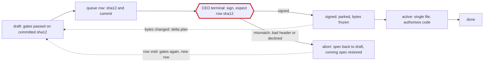
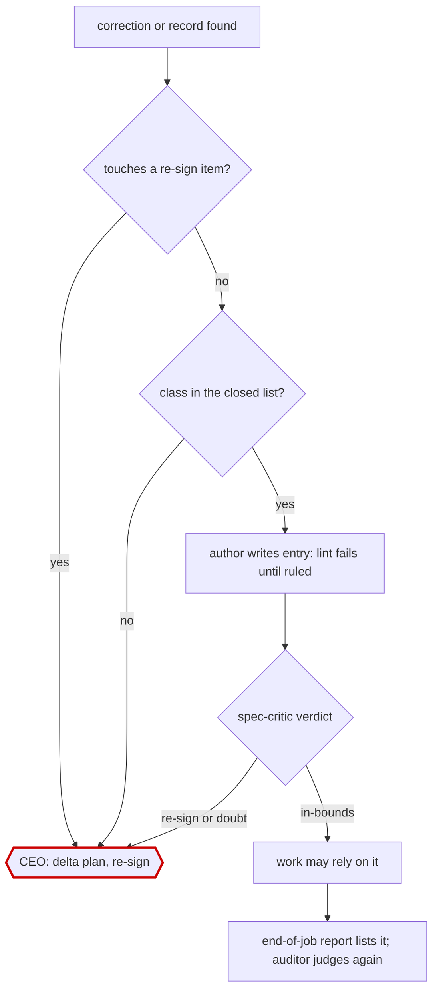

# Spec 0009 — Approval cadence: batched signature, addendum, Type 1 only, two unasked actions
<!-- Header fields and Status values stay English (protocol); content is written in English. -->

- Status: Draft
- Tier: full (four capabilities, 11 criteria) · Lane 2 + `appsec` at the pre-signature gate (no new trust boundary; see §14 "Lane note", answer to S-06)
- Source: `docs/KARARLAR.md`, three entries of 2026-11-22 (lines 430-432 when this was written; cited by title because the file moves): "CEO 2026-11-22: onay sıklığı gevşetildi" (the decision), "Düzeltme (2026-11-22, ana oturumun hatası)" (item 2 was recorded wrongly), "CEO 2026-11-22: oturumlar her zaman `auto` kipinde çalışır" (always `auto`; item 2 is delivered by a delta to spec 0004).
- Previous spec: 0004 (`specs/active/0004-harness-enforcement-gaps.md`). 0004 is not edited here.
- Depends on: **spec 0004 merged to `main` together with its always-`auto` delta, and `./harness/bin/check` green there.** This spec uses what that delta delivers (an enforcement-class file named as an exact literal path in a signed spec's `Unlocks:` is edited by file tools with no dialog) and the signing commands of 0004 (`approve.sh --preview`, `--expect`). No task of 0009 starts before that.
- Order: 0004 → **0009** → 0006 → 0005 → 0007. 0006, 0005 and 0007 also edit `routing.md`, `lint.js` and `harness/README.md`; they are rebased on 0009, never run in parallel with it.
- Gates: round 1 (`docs/kanit/0009-kapi-tur1.md`): `spec-critic` not signable, `appsec` FAIL. Round 2 (`docs/kanit/0009-kapi-tur2.md`, read on sha12 `951b5ad2b9d5`): `spec-critic` not yet signable (no Critical; 1 High, 7 Medium, 3 Low), `appsec` PASS WITH CONDITIONS (4 Medium, 4 Low). This text is revision 3: every finding of both rounds is fixed, dropped with a simplification or listed as an accepted residual (maps in §14), except one item outside this file: a tracker id for I-02 (main session). Round-3 gates: pending.
- Unlocks: `CLAUDE.md`, `.claude/rules/routing.md`, `.claude/skills/spec-criticism/SKILL.md`, `.claude/skills/internal-audit/SKILL.md`, `.claude/skills/business-analysis/SKILL.md`, `templates/spec-ek.md`, `templates/spec-tam.md`, `templates/spec-hizli.md`, `harness/bin/lint.js`, `harness/test/lint-rules.sh`, `harness/test/run.sh`, `harness/README.md`
- File classes (read in `harness/policy.js`): `CLAUDE.md` is enforcement class (`policy.js:22`), the only enforcement-class file this spec edits (rule 4 and the Uncertainty section, exact texts in §7.5); it is in the header above as an exact literal path, as the 0004 delta requires. The other eleven paths are product-config (`policy.js:120`, `:124`); each is named literally, no glob. Free class, no unlock needed (`policy.js:127`): `specs/signing-queue.md`, `specs/signed/**`, `specs/addenda/**`, `docs/kanit/0009-*.md`, `docs/GEREKSINIM-ANALIZI.md`. Code class, covered by the signature, edited only if a sentence in them becomes false (§7.5): `README.md`, `site/index.html`.
- Not touched, on purpose: every hook (`harness/guard.js`, `gate.js`, `policy.js`, `stop.js`, `loop.js`, `notify.js`), `harness/approval.js`, `harness/bin/approve.sh`, `harness/bin/company-run.sh`, `.claude/settings.json`, `.claude/settings.local.json`, `harness/container-settings.json`, keys, `approvals/`, `harness/test/guard.sh`, `harness/bin/check`.

## 1. Intent
CEO's words (as recorded by the Chief of Staff, `docs/KARARLAR.md` 2026-11-22): "iş kendi kendine gelişir"; the CEO could not leave the computer. Later the same day: "ben bu manuel geçişlerini istemiyorum her zaman auto". The decision as it stands after its correction:
1. The spec signature stays but is batched: sign-ready specs queue up and the CEO signs them in one sitting. Corrections that do not change scope (requirement, acceptance criterion, trust boundary) go to a companion file, not into the signed file, so the signature does not drop.
2. Enforcement-class files: **not this spec's work.** The first record of this item was wrong (0004 as signed asks on every enforcement edit). The CEO then decided that sessions always run in `auto`, where no dialog opens; a delta to 0004 lets a signed spec name an enforcement-class file as an exact literal path in `Unlocks:`, after which file-tool edits pass with no dialog; a glob never does this; the signature directory and the keys are never unlocked. 0009 only uses that rule, for its own edit of `CLAUDE.md`.
3. Type 2 and Type 3 uncertainties are not asked; they are listed in the end-of-job report. Only Type 1 goes to the CEO, while independent work continues.
4. Pushing a feature branch and opening a draft pull request are not asked in chat. Everything else in the envelope (push/merge to `main`, prod deploy, store submission, public release, external message, spending money, permanent deletion) stays per action, every time. Objection of the main session, accepted by the CEO: irreversible envelope actions are not loosened.

Interpretation, kept separate.
- Sessions run in `auto`; no permission dialog is part of any flow in this spec. The CEO's acts are: signing in his own terminal, in one sitting; answering a Type 1 question; approving an envelope action in chat.
- Channel: in this repository the CEO is told and asked in chat; `.claude/rules/questions-bookstack.md` is outside the agency by the CEO's decision (`docs/KARARLAR.md`, entry "`.claude/rules/questions-bookstack.md` ajansa ait değildi"; its removal belongs to spec 0005), so this spec neither edits it nor builds on it.
- Lane 1 stays outside the queue: a quick spec is signed when it is ready, as today. The queue is for lane 2 and lane 3.
- Item 1 needs no change to the signing tools. A signature record is keyed by the spec's relative path and content hash and stays on disk (`harness/approval.js:14`, `:42-45`, `:86`), so a spec signed while it is the single file in `specs/active/` is still validly signed when it is moved away byte-identical and moved back later. "Batched" is a procedure: a queue file, one sitting, one signature per spec, a parking directory (§7.1).
- Item 3 is almost the present text of the constitution's Uncertainty section. Two things differ and are changed: "do not ask" is said outright for Type 2 and 3, and after signature Rulings and Assumptions go to the addendum.
- Item 4 is a text change only. Round 1 of this spec gave the permission through `permissions.allow` entries and new guard rules; that design created a place where an irreversible push could pass with no judge (findings S-01..S-04, C-1, C-2, C-7). It is removed. No hook decision changes. What the `auto` classifier does is not observed (A-5); rule-4 text may be part of what it reads.

Success: the CEO signs every queued spec in one sitting, one command per spec, and each signature is bound to the bytes the gates read; a typo, a Type 2/3 decision or evidence found after signature costs no re-sign and no question; no unit asks in chat before a feature-branch push or a draft PR; every envelope action that needed the CEO before this spec still needs him.

Deliberately NOT done: any `permissions.allow` entry; any new guard rule; any change to hook code, `approval.js`, `approve.sh`, the signature format or the `Unlocks:` grammar; unlocking enforcement files (0004 delta); a command or script that signs several specs; edits to constitution rules 1 and 5; today's guard gaps (tracked as B32 in `docs/ACIK-ISLER.md`); any notification tool outside this repository.

## 2. Market summary (Product)
None. Internal pipeline job. No requirement below depends on app behaviour that was not observed in this repository (the one unobserved point is Assumption A-5).

## 3. Requirements (EARS)
Threat level for every requirement: as in 0004 §8. Host hooks and written procedure raise the bar against accidents; they do not stop an agent with Bash that works around them.

Batched signature
- REQ-1 — When a lane 2 or lane 3 spec has zero open questions and its lane's pre-signature gates have passed on its current, committed bytes, the main session shall add it to the signing queue with the sha12 of those bytes instead of asking the CEO to sign at once, and work that does not depend on it shall continue.
- REQ-2 — When the CEO holds a signing sitting, each queued spec shall be signed on its own with its queue row's sha12 as the expected value; if the spec's bytes no longer have that sha12, its header is invalid, an evidence file of its row does not state that sha12, or the CEO declines it, no signature shall be made for it and the sitting shall be aborted (§7.1): that spec goes back to `specs/draft/` and later rows wait for another sitting.
- REQ-3 — While a sitting has moved the running spec out of `specs/active/`, no unit shall write code, and the main session shall put that spec back and verify it when the sitting ends or is aborted, before any other work.
- REQ-4 — A signed spec that is not being worked on shall wait unchanged outside `specs/active/`; it shall authorise code only while it is the single file there, and only with the bytes that were signed.

Addendum
- REQ-5 — When a correction or record for a signed spec fits a class of the closed list (§7.2) and touches no item of the re-sign list, its author shall write it as an entry in that spec's addendum and shall leave the signed file unchanged.
- REQ-6 — If a correction touches a requirement, an acceptance criterion or its check, a trust boundary or any other item of the re-sign list, or fits no class, or is in doubt, then work that depends on it shall stop and a delta plan shall go to the CEO for re-signing.
- REQ-7 — Before any work relies on an addendum entry, `spec-critic` shall rule on it from the signed spec and the entry alone, and the entry shall carry that verdict bound to its text; the unit that wrote the entry shall not rule on it.
- REQ-8 — Lint shall fail an addendum that is misnamed or misplaced, that names no spec or other bytes than the spec on disk, or that has an entry without a field, with a class outside the closed list, without a verdict, or with a verdict that matches neither the entry's text nor a recorded ruling.
- REQ-9 — An addendum shall grant nothing: no write, no unlock, no waiver and no signature shall follow from anything written in it.
- REQ-10 — The end-of-job report shall show all Rulings, all Assumptions and every addendum entry of the job together.
- REQ-11 — At the end of the job `internal-auditor` shall judge every addendum entry again and shall check that no commit relying on an entry is older than the record of its verdict.

Uncertainty
- REQ-12 — When a unit meets a Type 2 or Type 3 uncertainty, it shall decide and record it (Ruling or Assumption) and shall not ask the CEO: before signature in the spec's own sections, after signature in the addendum.

Envelope
- REQ-13 — When a unit pushes a feature branch to this project's `origin` under the same branch name (never `main`, never forced, no deletion, no tag) or opens a draft pull request in that same repository, it shall not ask the CEO in chat first.
- REQ-14 — The system shall keep CEO approval, one by one and every time, for prod deploy, push/merge to `main`, store submission, public release, external message, spending money and permanent deletion, and shall change no hook decision, no permission entry and no guard rule.

Texts
- REQ-15 — `CLAUDE.md`, `.claude/rules/routing.md`, the three playbooks, the three templates and `harness/README.md` shall carry the texts of §7.5, and lint shall check each of them.

Preserved (unchanged, not restated as requirements): only the CEO signs; one signature covers one spec; a lane 1 quick spec is signed when it is ready, with no queue row and no gate round (the lane-1 line and the last line of `routing.md`, neither edited); rule 1 ("if a signed spec changes, the signature drops") and rule 5; Type 1 handling (park, one question with a recommendation, independent work continues); every decision of the gate and the guard.

## 4. User experience
No screen. UI states: none. The CEO meets this job in four places: one chat line when the queue changes ("N specs wait in `specs/signing-queue.md`"), his own terminal (one command per spec in a sitting), chat (Type 1 questions and envelope approvals only), and the end-of-job report (Rulings, Assumptions and addendum entries listed together).

### How does a spec get from "ready" to "authorises code" when signatures are batched?

Description: only the hexagon (red, thick border, labelled "CEO terminal") needs the CEO; every other move is a file move in `specs/` by the main session. Text equivalent: `specs/draft/` with a queue row → sitting: moved alone into `specs/active/`, previewed, signed with the row's sha12, moved to `specs/signed/` → moved back into `specs/active/` when its job starts → `specs/done/`. A sitting that cannot sign a row (bytes or evidence differ from the row, invalid header, exit 5, CEO declines) is aborted: the spec returns to `specs/draft/`, the running spec is restored and verified, later rows wait. A parked spec whose bytes changed fails verification at activation. A voided row and a changed parked spec both go back to the gates.

### Where does a correction to a signed spec go?

Description: two questions and one independent verdict stand between a correction and the addendum; every "no" or doubt leads to the CEO (red, thick border, hexagon). Text equivalent: re-sign item touched → delta; class not in the list → delta; otherwise the entry is written, `check` stays red until `spec-critic` has ruled and the verdict line is recorded; in-bounds → usable, listed at job end, judged again by `internal-auditor`; anything else → delta.

## 5. Acceptance criteria
`(check)` = asserted by `./harness/bin/check`; `(manual)` = recorded by hand in the named evidence file.
- [ ] AC-1 — (check) On the real tree `node harness/bin/lint.js` prints no `FAIL  texts-0009` and no `FAIL  texts-0004`: `CLAUDE.md` has the rule-4 line and the Uncertainty body of §7.5 and its rule-1 and rule-5 lines are unchanged; `.claude/rules/routing.md` has the "Every lane" line and the section `## Signing queue and addendum` of §7.5 and still has 0004's lane-0 and last lines; the two review playbooks have their checklist lines and the business-analysis playbook has its output-template line; `templates/spec-ek.md` has every non-empty line of the block in §7.2, in order; `templates/spec-tam.md` and `templates/spec-hizli.md` have the freeze comment and the `Status:` line of §7.5; `harness/README.md` has the heading `## Toplu imza ve ek dosya` and rows CG-1..CG-6 under `## Bilinen boşluklar`.
- [ ] AC-2 — (check) `harness/test/lint-rules.sh`: three fixtures (one word changed in the rule-4 line of `CLAUDE.md`; the "Every lane" line removed from `routing.md`; one class row removed from `templates/spec-ek.md`) each exit 1 with `FAIL  texts-0009` and no other failing rule.
- [ ] AC-3 — (check) `harness/test/run.sh`, block "spec 0009", temp git workspace and throwaway unencrypted key. "Gate" below is the container-mode call that file already uses (`gate.js` without `--host`, a `Write` event for `<ws>/src/app.cs` with no `permission_mode` field, the form of helper `gate2`, `run.sh:44`): rc 2 = blocked, rc 0 = allowed. "Verify" is `node harness/approval.js verify <path> <approvals dir> <pub>` run in the workspace. Host mode is not tested again here: it reaches the same signature check (`policy.js:254-271`, `:328-333`) and its ask/deny split by permission mode is 0004's (`host-gate.sh`). Cases, in this order:
  1. the running spec, signed in `specs/active/`, is moved to `specs/signed/`: verify of the new path prints `NOT APPROVED: no approval record` and exits 1; gate rc 2;
  2. a queued spec is moved alone into `specs/active/`: `approve.sh <ws> --preview` prints the line `sha12: <recorded>`; `approve.sh <ws> --expect <recorded>` exits 0; its record file exists under `approvals/`; verify prints `APPROVED` and exits 0;
  3. with two files in `specs/active/`: `approve.sh <ws> --expect <recorded>` exits 1 and prints `exactly one active spec is required (found 2)`;
  4. the running spec moved back alone, byte-identical: verify prints `APPROVED`, exit 0; gate rc 0;
  5. a parked spec with one byte appended, moved back alone: verify prints `NOT APPROVED: spec changed after approval`, exit 1; gate rc 2.
- [ ] AC-4 — (check) `run.sh`, same block, same calls. A queued spec whose sha12 was recorded and which then gets one byte appended is moved alone into `specs/active/`: `approve.sh <ws> --expect <recorded>` exits 5, prints a line starting `REFUSED: file changed since preview`, and no record for it exists. Abort: that spec is moved back to `specs/draft/` and the running spec back alone into `specs/active/`: verify prints `APPROVED`, exit 0; gate rc 0.
- [ ] AC-5 — (check) `lint-rules.sh`: each fixture exits 1 with `FAIL  addendum-file` and no other failing rule: a file in `specs/addenda/` not named `<stem>.addendum.md`; a `*.addendum.md` file in `specs/draft/`; an addendum whose stem matches no spec in `specs/active/`, `specs/signed/` or `specs/done/`; an addendum whose `signed sha12` differs from that spec's bytes (one byte appended to the spec: the first byte of a delta); an addendum without the fixed third line of §7.2; an addendum with a non-blank line between line 3 and the first `## ` heading. One fixture passes lint: the changed-spec tree above with that addendum moved to `specs/addenda/archive/<stem>.<old sha12>.addendum.md`.
- [ ] AC-6 — (check) `lint-rules.sh`: an otherwise valid addendum with the line `- Unlocks: harness/README.md` fails with `addendum-authority` only; a tree copy in which `harness/gate.js` contains the word `addenda` fails with `addendum-authority` only.
- [ ] AC-7 — (check) `lint-rules.sh`: an addendum with one `in-bounds` and one `re-sign` entry, each with its evidence line, passes. Each of these fails with `addendum-entry` only: an entry without `Why in bounds`; `Class: scope`; an entry with no `Checked:` line (the FAIL line prints the entry's sha12); an entry whose `Text` was changed after the verdict (sha12 differs); a `Checked:` line whose evidence file is missing; an evidence file without the line `A-<n> · <sha12> · <verdict>`; ids `A-1`, `A-3`; a first id `A-2`; a verdict replayed across a re-sign (the spec gets one byte appended and line 2 is set to its new sha12, entries and `Checked:` lines untouched: the entry sha12 differs).
- [ ] AC-8 — (manual, `docs/kanit/0009-is-sonu.md`) At the end of job 0009 `specs/signing-queue.md` exists in the format of §7.1 and has one `ready` row for every lane 2 or lane 3 spec that is sign-ready then; for each such row the record shows `shasum -a 256 <file> | cut -c1-12` and `git show <row commit>:<file> | shasum -a 256 | cut -c1-12`, both equal to the row's sha12, and quotes the `Reviewed bytes:` line with that sha12 from each gate evidence file the row names. Zero ready specs: the file exists with the header and no row, and the record says so.
- [ ] AC-9 — (manual, audit) The `internal-auditor` report of job 0009 names every entry of `specs/addenda/0009-approval-cadence.addendum.md` with the `spec-critic` verdict, the auditor's own judgement, and, for each `in-bounds` entry that a commit message cites as `A-<n>`, the commit that added its ruling to `docs/kanit/0009-ek.md` and the first citing commit, the first not newer than the second; for an entry made before T-1's lint existed (§12 Bootstrap) it also states that the text quoted in the ruling equals the entry. At least one cited entry is traced this way, or the report states that no commit of the job cited an entry.
- [ ] AC-10 — (manual, `docs/kanit/0009-is-sonu.md`) The end-of-job report of 0009 has one list of Rulings, one of Assumptions and one of addendum entries, and a tally of every question put to the CEO during the job, each tagged `Type 1` or `envelope`; no other tag appears, and no row is about a signature, a feature-branch push or a draft PR (sittings are listed apart: date and rows). The record names every feature-branch push and draft PR of the job that was made unasked, or says that none was made, and states what `auto` did with the job's first feature push and first draft PR.
- [ ] AC-11 — (check + review) Every case that exists in `harness/test/guard.sh`, `run.sh`, `lint-rules.sh`, `policy.sh` and `host-gate.sh` when 0004 is merged passes unchanged. In the evidence record: `git diff --stat <0004 merge commit>..HEAD -- harness/guard.js harness/gate.js harness/policy.js harness/stop.js harness/loop.js harness/notify.js harness/approval.js harness/keys harness/bin/approve.sh harness/bin/company-run.sh harness/bin/check harness/test/guard.sh .claude/settings.json harness/container-settings.json` prints nothing; `git diff <0004 merge commit>..HEAD -- harness/test/run.sh harness/test/lint-rules.sh` shows added lines only; `git diff <0004 merge commit>..HEAD -- CLAUDE.md` touches only the rule-4 line and the lines under `## Uncertainty`; the `permissions.allow` lists of `.claude/settings.json` and `.claude/settings.local.json` are written out at T-0 and at T-6, are equal, and hold no entry starting `Bash(git push` or `Bash(gh `.

### 5.1 Requirement → criterion map
| REQ | Criteria | Note |
|---|---|---|
| REQ-1 | AC-1, AC-8 | procedure text and the queue as it stands at job end; "independent work continues" is text only, no check (instruction, CG-3) |
| REQ-2 | AC-3, AC-4, AC-1 | the stop on mismatch is the signing tool's exit 5 (AC-4); the evidence-line and declined cases are procedure text (AC-1, CG-3) |
| REQ-3 | AC-1, AC-3, AC-4 | the restore verifies after a sitting (AC-3 case 4) and after an abort (AC-4); the first clause, that no unit wrote code meanwhile, is instruction-only (CG-3) |
| REQ-4 | AC-3 | |
| REQ-5 | AC-1, AC-7, AC-9 | |
| REQ-6 | AC-1, AC-9 | the re-sign list is text; the auditor judges each entry again |
| REQ-7 | AC-7, AC-9 | timing for job 0009 itself: Bootstrap rule of §12, traced by AC-9 |
| REQ-8 | AC-5, AC-6, AC-7 | |
| REQ-9 | AC-5, AC-6, AC-11 | no hook reads the file; AC-11 shows no hook changed |
| REQ-10 | AC-10 | |
| REQ-11 | AC-9, AC-1 | |
| REQ-12 | AC-1, AC-10 | |
| REQ-13 | AC-1, AC-10 | AC-10 names the unasked pushes and draft PRs of the job, or says none was made |
| REQ-14 | AC-1, AC-11 | |
| REQ-15 | AC-1, AC-2 | |

## 6. Architecture and technology decision
No new dependency, no new technology, no hook code.

| Decision | Options | Choice | Cost / risk |
|---|---|---|---|
| 6.1 How the two unasked actions are granted | (A) constitution and routing text only; (B) text plus `permissions.allow` entries plus new guard asks for every non-plain form (round 1); (C) no change | **A.** B made the guard's text parsing the only judge of a push in a mode where its "ask" opens no dialog (S-01, C-2), had to flip signed 0004 test values (C-1) and needed three more fixes (S-03, S-04, C-7); with sessions always in `auto` the entries would remove no dialog anyway. C leaves units asking in chat | nothing new is enforced: today's guard gaps stay as they are (B32), and a feature push or draft PR reaches a public repository with no human look (CG-4); what the `auto` classifier does with them is not observed (A-5, CG-6) |
| 6.2 Batching | (a) procedure on today's tools: queue file, one signature per spec, parking directory; (b) a command or script that signs several specs; (c) sign each spec when it is ready (today) | **a.** b is new code on the signing path, a trust-boundary change; c is what the CEO asked to end | parked signed specs are standing authority (CG-1); the sitting alternates between chat and terminal (A-4) |
| 6.3 Where the queue lives | (a) `specs/signing-queue.md`, free class, in git; (b) a section of `STATE.md`; (c) a page in a tool outside the repository | **a.** b is rewritten per session and has no history of rows; c is not owned by the agency | a free-class file: any unit can write it; what binds is the sha12 the CEO passes to `--expect` (CG-3) |
| 6.4 How a verdict on an addendum entry is made checkable | (a) the `Checked:` line carries date, verdict, the sha12 of the entry's lines and the path of the recorded ruling, and lint recomputes and looks the ruling up; (b) a free-text `Checked:` line (round 1); (c) verdicts enforced or signed by a hook | **a.** b cannot be checked (C-6) and does not bind the verdict to the text (S-07); c is hook code and a new record type | the ruling is recorded by the main session (`spec-critic` has no write tool, `.claude/agents/spec-critic.md:4`); no hook proves the run (CG-2). `internal-auditor`, which has Bash (`.claude/agents/internal-auditor.md:4`), judges again at job end |
| 6.5 Where the class list is defined | (a) `templates/spec-ek.md`, English, checked by lint as exact text; (b) `harness/README.md` (round 1) | **a.** b is Turkish, human-facing and edited by other specs (C-5) | one more template to keep; the README only points to it |

## 7. Data and API contract

### 7.1 Signing queue, sitting, parking
| Directory or file | Meaning | Who writes |
|---|---|---|
| `specs/draft/` | being written, or queued (a `ready` row names it) | author unit |
| `specs/signing-queue.md` | the queue and its history | main session |
| `specs/active/` | exactly one file: the spec whose job runs, or, during a sitting, the spec being signed | main session |
| `specs/signed/` | signed, bytes frozen, job not started; the running spec lies here only for the length of a sitting (its row stays `active`) | main session |
| `specs/addenda/` | addenda of signed specs (§7.2); `archive/` holds addenda of superseded signatures | author unit; `Checked:` lines by the main session |
| `specs/done/` | shipped | main session |

Queue file:
```
# Signing queue
A row is valid only while the spec's sha12 equals the row's. sha12 = first 12 hex of SHA-256 of the file.

| # | Spec | sha12 | Commit | Gates · evidence | Queued | State |
|---|---|---|---|---|---|---|
| 1 | 0006-harness-unit-areas-evidence.md | 0123456789ab | 1a2b3c4 | spec-critic, appsec · docs/kanit/0006-kapi-tur2.md | 2026-11-23 | ready |
```
`State` is one of `ready`, `void` (bytes, header or evidence do not match the row; a new row follows after the gates), `declined <date>` (the CEO refused to sign these bytes), `signed <date>`, `active <date>`, `done <date>`. Rows are appended and their `State` updated; no row is removed.

- Scope. Lane 2 and lane 3 specs. A lane 1 quick spec gets no row: it is signed when it is ready, as the lane-1 line and the last line of `routing.md` say today.
- Entry condition. Open questions are zero; the author has written `Status: Awaiting approval`; the reviewed bytes are committed and the row names the commit; the last round of each pre-signature gate of the lane returned "signable" on exactly these bytes. The main session hashes the file before each brief (`shasum -a 256 <file> | cut -c1-12`, the value `approve.sh --preview` prints, `approve.sh:42`) and again when the report returns; a gate with Bash hashes the file itself; unequal values void the round. The gate evidence file under `docs/kanit/` states `Reviewed bytes: <file> · sha12 <x>`. The row and that line may carry the full SHA-256 after the sha12; where both do, step 3 compares it too. Folding in anything after that round changes the bytes: the row becomes `void` and the gates read the difference.
- Where and when. The queue file, the sitting moves, parking and activation are made in the main worktree only (the checkout whose `approvals/` receives the records, `approve.sh:56-66`), never in a nested worktree: that has its own `specs/active/` (`policy.js:88-90`). Each move or row change is its own commit on the branch checked out there, made before the next step that depends on it; it reaches `main` only with that branch's merge, which is the CEO's. Concurrent branches: only the branch checked out in the main worktree edits the queue file or moves a spec file; another branch or worktree takes those commits by rebase or merge and makes no spec move of its own; a nested worktree is created from the commit that holds the activation.
- Announcement. One chat line when the number of `ready` rows changes. No question per spec.
- Sitting, per `ready` row, in row order (a sitting of one row is allowed at any time):
  1. The main session stops engineer work and moves the running spec, if any, from `specs/active/` to `specs/signed/`.
  2. It moves the queued spec alone into `specs/active/`, runs `harness/bin/approve.sh . --preview` and shows the output next to the row, together with the `Reviewed bytes:` line of each evidence file the row names.
  3. If the previewed sha12 differs from the row, `Header lint` is not `ok`, or an evidence file of the row lacks a `Reviewed bytes:` line with the row's sha12, the sitting is aborted.
  4. The main session writes the command from the row: `harness/bin/approve.sh . --expect <row sha12>`. The preview's `Sign with:` line is not copied (it carries the sha12 of the bytes on disk, `approve.sh:50`). The CEO runs the command in his own terminal. The tool refuses other bytes (exit 5, `approve.sh:53`, `approval.js:75`). Exit 5, or the CEO declining the row: the sitting is aborted.
  5. The main session runs `node harness/approval.js verify specs/active/<file> approvals harness/keys/ceo.pub.pem`, expects `APPROVED`, moves the spec to `specs/signed/` and sets the row to `signed <date>`. Steps 2 and 5 get no guard opinion in `auto` (`guard.sh:74` for verify; round-2 note I2-02 for `--preview`).
  6. After the last row the previously running spec returns alone to `specs/active/` and is verified the same way.
- Abort. The main session moves the unsigned spec back to `specs/draft/`, sets its row to `void` (mismatch, invalid header, missing evidence line, exit 5) or `declined <date>`, does step 6 at once and reports the reason in chat. Later rows stay `ready` and wait for another sitting. A `void` or `declined` spec gets a new row only after its gates have read the new bytes.
- The `Status:` line is not edited after signature (it is inside the signed bytes). The live state of a signed spec is its directory and its queue row.
- Activation. A move from `specs/signed/` into an empty `specs/active/`, by the main session, when the job starts and every spec named in `Depends on:` is merged; the row becomes `active <date>`. The gate verifies the stored record against the bytes; changed bytes are not signed → delta plan, gates, a new row.
- Bootstrap. This spec is signed before its own procedure exists: by the steps of `harness/README.md` ("CEO nerede ve nasıl imzalar"), in the CEO's terminal.

### 7.2 Addendum file (`templates/spec-ek.md`, whole file, English)
```
# Addendum to spec NNNN — <short name>
Spec: <stem>.md · signed sha12: <12 hex of the signed file>
This file is not signed and grants nothing. Where it disagrees with the signed spec, the signed spec wins.

<!-- HOW TO USE (keep the three lines above; delete this whole comment in the addendum file).
Path: specs/addenda/<stem>.addendum.md, one file per signed spec, never inside specs/active/.
Between line 3 and the first entry heading an addendum has blank lines only.
An entry may only fill a gap or fix a slip inside an existing section, REQ or AC of the signed spec, and names that place.
It never adds, removes or alters a requirement, an acceptance criterion or its check, or a trust boundary. Doubt is re-sign.
The CEO sees every entry in the end-of-job report and may reject any of them: it is then undone or becomes a delta plan.

Closed list of classes:
- typo: spelling, grammar, formatting, numbering, a broken internal link. Never: a number, threshold, path, command, flag, file name, "shall"/"shall not", or any word of a text the spec fixes verbatim.
- reference: a file:line pointer or section number in explanatory prose that moved or was mistyped, when the thing meant is unambiguous. Never: a path in Unlocks:, in a list of files the spec changes, in a contract or in an acceptance command.
- ruling: a Type 2 decision, written as "Ruling: <decision> — <why> — <cost if wrong>". Never: anything a user, the CEO or data can observe.
- assumption: a Type 3 decision that fills a gap inside one existing REQ or AC: the signed text is silent on the detail, the choice contradicts no signed sentence, and undoing it is one revert commit in files the spec already names, with no data migration and nobody outside the company involved. Never: a behaviour with no REQ or AC to sit under (that is a spec gap), a new capability, screen, field, endpoint or message, or anything a signed sentence already decides.
- tasks: split, merge, reorder or re-own tasks while the files changed, the criteria covered and the gates stay the same. Never: a file outside the spec's lists, a dropped gate, two parallel tasks owning one file, a verifying task owned by the unit that made the change.
- record: test output, the criterion-to-evidence map, first-run notes, the scorecard. Never: a changed pass condition, a change of required behaviour, or a limitation that leaves a REQ, an AC or a threat-model control unmet.

Re-sign list (any one item means delta plan and re-sign, never an addendum):
a requirement or changed-behaviour line added, removed or altered, its numbers and modal verbs included; an acceptance criterion or its check; a preserved behaviour; a trust boundary, a threat-model control or a residual the CEO accepted; a new residual or known limitation of a requirement, criterion or control; the Unlocks: line or any list of files the spec says it changes; a data or API contract, grammar, exit code or exact text; the out-of-scope list; deployment or rollback; a new dependency or technology; an envelope action; a removed or weakened test; any Type 1 uncertainty.

Entry format. Ids start at A-1 and ascend by one. A field may continue on following lines indented by two spaces. The author writes every line except Checked:. The main session writes Checked: after spec-critic has ruled; lint prints the entry sha12.
-->

## A-<n> — <one line>
- Class: typo | reference | ruling | assumption | tasks | record
- Spec place: <section, REQ or AC id; the signed sentence quoted when one is corrected>
- Text: <the correction or record>
- Why in bounds: <the re-sign items it leaves untouched; for assumption: the undo>
- Author: <unit> · <YYYY-MM-DD>
- Checked: spec-critic · <YYYY-MM-DD> · in-bounds | re-sign · <entry sha12> · docs/kanit/<NNNN>-ek.md
```
- Entry sha12: line 2 of the addendum (the `Spec: … · signed sha12: …` line) followed by the lines from the entry's `## A-<n>` heading up to, not including, its `- Checked:` line; line ends normalised to LF, trailing spaces and tabs removed from each line, trailing empty lines dropped, joined with LF plus one final LF, UTF-8; first 12 hex of SHA-256. A verdict is therefore valid only under the signature it was given for.
- Ruling flow, at decision time: the author writes the entry without `Checked:`; lint fails and prints the sha12; the main session briefs `spec-critic` with the signed spec's path, the entry text and the sha12; `spec-critic` ends its report with `A-<n> · <sha12> · in-bounds` or `A-<n> · <sha12> · re-sign`; the main session appends the report to `docs/kanit/<NNNN>-ek.md` and writes the `Checked:` line, both committed before the first commit that relies on the entry. A commit that relies on an entry cites `A-<n>` in its message. The "record of a verdict" (REQ-11) is the commit that added the ruling to `docs/kanit/<NNNN>-ek.md`.
- An entry with the verdict `re-sign` stays as a record and is void: the work stops and a delta plan is written (REQ-6).
- When a delta starts, the commit that changes the first byte of the signed spec also moves its addendum to `specs/addenda/archive/<stem>.<old sha12>.addendum.md`, so `check` stays green while the delta is written. The delta plan lists each old entry as folded into the new signed text or dropped. After the re-sign a new addendum starts with the new sha12 at `A-1`; old verdicts cannot match it (line 2 is part of the entry sha12).

### 7.3 Lint rules (`harness/bin/lint.js`; fixtures in `harness/test/lint-rules.sh`)
Each rule prints its id as the first word after `FAIL  `, as 0004's rules do.

| Rule id | Fails when |
|---|---|
| `addendum-file` | a file directly in `specs/addenda/` is not named `<stem>.addendum.md`; a file named `*.addendum.md` lies elsewhere under `specs/` (except `specs/addenda/archive/`); line 2 is not `Spec: <stem>.md · signed sha12: <12 hex>` with the file's own stem; not exactly one `<stem>.md` exists in `specs/active/`, `specs/signed/`, `specs/done/`; that file's sha12 differs from line 2; line 3 is not the fixed sentence; a non-blank line lies between line 3 and the first `## ` heading (or the end of the file) |
| `addendum-authority` | a line of an addendum matches `/^\s*(?:[-*]\s+)?Unlocks\s*:/i`; or one of `harness/approval.js`, `harness/gate.js`, `harness/guard.js`, `harness/policy.js`, `harness/bin/approve.sh`, `harness/bin/company-run.sh` contains the string `addenda` |
| `addendum-entry` | a `## ` heading is not `## A-<n> — <text>`; ids do not start at `A-1` or do not ascend by one; a field of §7.2 is missing, repeated or out of order; `Class` is not one of the six words; the `Checked:` line is missing (the message prints `entry sha12 <x>`), is not the entry's last line, or is not in the form of §7.2; its sha12 differs from the recomputed one; its path is not a file under `docs/kanit/` or that file has no line that, trimmed and without a leading `- `, equals `A-<n> · <sha12> · <verdict>` |
| `texts-0009` | a text of §7.5 is missing from its file (exact line, or exact section body where §7.5 says "whole body"); `templates/spec-ek.md` lacks a non-empty line of the block in §7.2 or has them in another order |

All four pass on a tree with no addendum. Files under `specs/addenda/archive/` are not read by the entry and file rules. An addendum carries no `HOW TO USE` comment (the rules live in the template): before the first `## ` heading it has lines 1-3 and blank lines only, so no text of an addendum lies outside an entry's hashed lines.

### 7.4 Tests added to `harness/test/run.sh`
One block, "spec 0009: sitting and parking", built like the block at `run.sh:50-57` (temp HOME, throwaway unencrypted key, temp workspace). Cases: those of AC-3 and AC-4, in the order of the sitting steps of §7.1. No existing case is edited.

### 7.5 Exact texts
- `CLAUDE.md` rule 4 (one line, replaces the current one): "4. **Envelope.** Only with CEO approval, one by one, every time: prod deploy, push/merge to main, store submission, public release, external message, spending money, permanent deletion. Not asked in chat: pushing a feature branch to this project's `origin` (never `main`, never forced, no deletion, no tag, destination = the same branch name) and opening a draft pull request in that same repository (the repository is public: no secret and no personal data in its text). Any other remote or repository is an external message. When unsure which applies, ask."
- `CLAUDE.md` Uncertainty section (whole body under `## Uncertainty`, four list lines):
  ```
  - **Type 1:** user/data-visible behavior + not in the spec + expensive to undo → park the task, ask the CEO, continue independent work.
  - **Type 2:** invisible implementation detail → decide, do not ask; write `Ruling: <decision> — <why> — <cost if wrong>`.
  - **Type 3:** visible but small and cheap to undo → decide, do not ask; list under "Assumptions".
  - Rulings and Assumptions are shown together in the end-of-job report. After signature they go to the spec's addendum (`templates/spec-ek.md`), never into the signed file.
  ```
- `CLAUDE.md` rules 1 and 5: not edited. Rule 1 stays true as written: an addendum does not change the signed file.
- `.claude/rules/routing.md` "Every lane" line (replaces the current one): "**Every lane:** spec signed by the CEO before code (lane 0 excepted); sign-ready lane 2 and lane 3 specs wait in `specs/signing-queue.md` and are signed in one sitting, a lane 1 spec is signed when it is ready · after signature the spec file is frozen: a correction that touches no requirement, criterion or trust boundary goes to its addendum, anything else is a delta plan and a re-sign · the maker never verifies · done = fresh build/test output · only a Type 1 uncertainty is asked; Rulings, Assumptions and addendum entries are listed in the end-of-job report · envelope actions (prod deploy, push/merge to main, store, public release, external message, money, permanent deletion) need CEO approval each time · not asked: pushing a feature branch to this project's `origin` under its own name (never a protected branch, `main` or `master`; never forced, no deletion, no tag) and opening a draft PR in that same repository; any other remote or repository is an external message; a non-draft PR, marking a PR ready and a merge into an integration branch stay as the delivery playbook has them."
- `.claude/rules/routing.md`, new section placed before `## Models` (heading and four list lines):
  ```
  ## Signing queue and addendum
  - **Queue.** Lane 2 and 3, where the harness is installed; lane 1, and a project without the harness, get approval as the lane-1 line and the last line of this file say. A spec is sign-ready when open questions are zero, its bytes are committed and the lane's pre-signature gates passed on exactly those bytes: hash the file before each gate brief and when the report returns, a gate with Bash hashes it itself, unequal = round void; the evidence file states `Reviewed bytes: <file> · sha12 <x>`. Add a row to `specs/signing-queue.md` (file, sha12, commit, gate evidence, date), tell the CEO in one chat line, go on with independent work. Any later byte change voids the row: gates again, new row.
  - **Sitting.** The CEO signs in his own terminal, one spec per signature. Per row: stop engineer work; park the running spec in `specs/signed/`; move the queued spec alone into `specs/active/`; show `harness/bin/approve.sh . --preview` and the `Reviewed bytes:` line of each evidence file of the row; if the previewed sha12 differs from the row, `Header lint` is not `ok` or an evidence file lacks that line with the row's sha12, abort; write the command from the row, `harness/bin/approve.sh . --expect <row sha12>`, for the CEO to run (the preview's `Sign with:` line is not copied); verify, move the spec to `specs/signed/`, update the row. Abort (also on exit 5 or when the CEO declines): spec back to `specs/draft/`, row `void` or `declined`, say why. In every case put the running spec back and verify it before other work. Spec moves and queue edits happen in the main worktree only, one commit each.
  - **Parked.** A spec in `specs/signed/` is frozen. Activate it by moving it alone into `specs/active/` when its job starts and every `Depends on:` spec is merged; record the activation in the queue file.
  - **Addendum.** Nobody edits a signed spec file. A correction or record that fits a class in `templates/spec-ek.md` goes to `specs/addenda/<stem>.addendum.md`; `spec-critic` rules on each entry before work relies on it and the main session records the verdict; a commit that relies on an entry cites its id. Anything else: stop, delta plan, re-sign. An addendum unlocks nothing.
  ```
- `.claude/skills/spec-criticism/SKILL.md`, one line appended to the Checklist: "- [ ] Addendum entry (when the brief is one): I judged it from the signed spec and the entry alone against the class list and the re-sign list in `templates/spec-ek.md`; my report ends with `A-<n> · <sha12 from the brief> · in-bounds` or `· re-sign`; doubt is `re-sign`."
- `.claude/skills/internal-audit/SKILL.md`, one line appended to the Checklist: "- [ ] Every addendum entry of the job: I judged it again against `templates/spec-ek.md`, its `Checked:` line matches a recorded `spec-critic` ruling, and no commit that cites the entry is older than the commit that recorded its verdict."
- `.claude/skills/business-analysis/SKILL.md`, the line under `## Output template` (replaces the current one, which names `specs/active/`): "`specs/draft/NNNN-<name>.md` (the main session moves a spec into `specs/active/`; the author never does), in the format of `templates/spec-tam.md` or `spec-hizli.md`, with all sections filled or marked "none" with a reason. Header fields and `Status:` values stay in English."
- `templates/spec-ek.md`: the file of §7.2.
- `templates/spec-tam.md` and `templates/spec-hizli.md`, the `- Status:` line (replaces the current one, whose last three values nobody can write into a frozen file): `- Status: Draft | Awaiting approval`
- `templates/spec-tam.md` and `templates/spec-hizli.md`, one comment line added as the last line before the first `## ` heading: `<!-- After signature this file is frozen: any edit voids the signature. Later Rulings, Assumptions, evidence and the scorecard go to the addendum (templates/spec-ek.md). The live state of a signed spec is its directory and its queue row, not the Status line. -->`
- `harness/README.md` (Turkish, human-facing): a section `## Toplu imza ve ek dosya` (the queue file, the two commands the CEO runs, parking and activation, where the addendum rules live: a pointer to `templates/spec-ek.md`, no copy of the lists), and rows CG-1..CG-6 of §8 in the table under `## Bilinen boşluklar`, each id opening its own row.
- Restatements in human-facing Turkish files (`docs/GEREKSINIM-ANALIZI.md`, `README.md`, `site/index.html`): the seven envelope actions and the Type 1 rule do not change, so a sentence is edited only where it has become false. T-3 lists every hit of `grep -n "her seferinde\|Tip 2\|Tip 3\|tek tek" docs/GEREKSINIM-ANALIZI.md README.md site/index.html` in `docs/kanit/0009-is-sonu.md` as changed or unchanged with a reason.
- Checked, no change needed: `.claude/skills/delivery-management/SKILL.md:21` (feature-branch pushes are already autonomous), `:22` and `:54` (the unit already opens PRs), `:50` (no secret or personal data in a PR body); `.claude/skills/business-analysis/SKILL.md:28` (the author sets `Status: Awaiting approval` only at zero open questions, as §7.1 needs; its line 31 is changed above).

## 8. Threat model and security
Sensitive area: authorization, as procedure and text only (when the CEO signs, what is asked). No hook, key, permission entry or signing code changes. No money, identity or personal data is processed.

Trust boundaries: unchanged from 0004 §8 with its delta (agent → hooks → CEO signature in his terminal → signature records and key). This job adds one unsigned file type (the addendum) that stays outside every hook decision, and one waiting state (a signed spec parked outside `specs/active/`).

| Abuse / accident | Control | Residual |
|---|---|---|
| The bytes signed are not the bytes the gates read | the reviewed bytes are committed and the row names sha12 and commit; the file is hashed before each gate brief and when the report returns; the sitting shows each evidence file's `Reviewed bytes:` line and aborts when one lacks the row's sha12; the signing command is written from the row, never copied from the preview's `Sign with:` line; the tool refuses other bytes (AC-3, AC-4, AC-8) | that the gates read those bytes is the main session's record (CG-3) |
| A parked signed spec is activated early, out of order or by another unit | only CEO-signed bytes validate; changed bytes fail (AC-3); activation is written to the queue row | CG-1, accepted by name |
| A unit writes code while a sitting has another spec in `specs/active/` | procedure step 1 (stop engineer work) | instruction-only (CG-3) |
| The CEO signs many specs quickly and reads less | one preview, one sha12, one command per spec; the preview shows the `Unlocks:` list, enforcement files marked (0004 delta) | attention is the CEO's |
| An agent widens scope through the addendum (a visible change filed as `ruling` or `typo`) | closed class list and re-sign list with the gap-inside-an-existing-REQ/AC bound (§7.2); class `record` cannot waive a REQ, an AC or a control, and a new residual or limitation is a re-sign item; no addendum text lies outside an entry (AC-5); `spec-critic` rules before use, the author never does; lint binds the verdict to the entry text (AC-7); the auditor judges again (AC-9); the CEO sees every entry at job end; the signed text wins | the verdict is a unit's opinion and its record is written by the main session (CG-2) |
| An entry is edited after its verdict, or an old verdict is reused after a re-sign | entry sha12 recomputed by lint; it covers line 2 of the addendum, so a verdict holds under one signature only (AC-7) | none known |
| An addendum tries to grant access (`Unlocks:` line, "waiver") | no hook reads `specs/addenda/` (no hook code changes, AC-11; tripwire and line rule `addendum-authority`, AC-6) | none known |
| An addendum placed in `specs/active/` | the active count becomes 2, so code is not allowed and signing exits 1 (`policy.js:257`, `approve.sh:30-31`); lint `addendum-file` (AC-5) | none known |
| A feature push or draft PR carries a secret or personal data to the public repository | rule 4 text; rule 7; delivery playbook prohibition; the secret-pattern step of `check` (`harness/bin/check:24`) run before the work is called done | no human look and no scan of commit content or PR text beyond that step (CG-4) |
| A push or PR goes to another remote, a fork or another repository | rule 4 text: only this project's `origin`, same branch name, same repository; anything else is an external message and is asked | text only; in `auto` the classifier judges the call (CG-6) |
| In `auto` the classifier blocks a feature push or draft PR, and the unit works around it | A-5: stop and report; no retry in another form, no `permissions.allow` entry, no mode switch; the allow lists are compared at T-0 and T-6 (AC-11) | instruction-only; observed once (AC-10, CG-6) |
| A push that is not a feature push passes unasked (quoted `main`, heredoc and `word=` forms, git state that redirects a push) | none added here; no entry or rule of this spec makes any form quieter than today | today's guard gaps, B32; in `auto` a guard "ask" opens no dialog (0004 G-9, finding B-1): unchanged and still decisive |

Accepted residuals (Turkish in `harness/README.md`; own prefix so that 0004's G numbering, which its delta may extend, is not disturbed):
- CG-1 A signed spec parked in `specs/signed/` is a standing authorisation. Anyone who can move a file (`specs/**` is free class) can put it alone into `specs/active/`; code authority and its `Unlocks:` list, enforcement files named there included, return at the next call with no hook asking. Same family as 0004 G-21. Activation order is instruction-only; the queue row records it and the auditor compares. Only committed moves are visible; the same holds for `specs/done/` (0004 G-21).
- CG-2 The addendum boundary is judged by units, not hooks. The `Checked:` line and the ruling record are written by the main session; lint proves that verdict and text belong together, not that `spec-critic` ran. The CEO sees entries at job end.
- CG-3 The queue is a free-class file and the sitting is a written procedure. Hooks do not check that the gates read the bytes of a row, that engineer work stopped during a sitting, that independent work went on while a spec waited, or that the previously running spec was put back.
- CG-4 A feature-branch push and a draft PR publish to a public repository with no CEO look. Commit content, commit messages and PR text are checked only by the secret-pattern step of `check` and by instruction. That step knows two patterns only: Anthropic key and PEM private key; no GitHub, cloud or connection-string pattern.
- CG-5 The guard gaps listed as B32 in `docs/ACIK-ISLER.md` (quoted protected branch, heredoc and `word=` forms, git state that redirects a push) are not closed here. This spec adds nothing that relies on the guard reading a push.
- CG-6 In `auto` the classifier, not the CEO, judges every push and `gh` call; observed once (AC-10), not tested.

## 9. Test and evidence plan
| Criterion | Test | Layer | Profile |
|---|---|---|---|
| AC-1 | `lint.js` on the real tree (`texts-0009`, `texts-0004`) | unit | quick |
| AC-2, AC-5, AC-6, AC-7 | `harness/test/lint-rules.sh` additions (fixture = tracked-tree copy plus one change) | unit | quick |
| AC-3, AC-4 | `harness/test/run.sh` block "spec 0009" | integration | quick |
| AC-8, AC-10 | `docs/kanit/0009-is-sonu.md` | manual | manual |
| AC-9 | `internal-auditor` report | manual | manual |
| AC-11 | existing suites in `check`; the three `git diff` outputs and the two `permissions.allow` listings in the evidence record | unit + review | quick |

Mutation probes for `qa-engineer`: remove the sha12 comparison of `addendum-entry` → the "changed after the verdict" case must go red; remove the line rule of `addendum-authority` → its case; change one word of the rule-4 text in a tree copy → `texts-0009`; drop `--expect` from the signing call in the `run.sh` block → the AC-4 case.

## 10. Deployment and disaster recovery
Target: this repository (no server). Order: template, lint rules and tests first (T-1); playbooks, templates and README (T-2, T-3); constitution and routing texts last (T-4), so the procedure is announced only when its checks exist. Rollback: `git revert` of the job's commits (merge to `main` is the CEO's). After a rollback, specs already parked in `specs/signed/` stay validly signed (the signing tools are untouched) and are moved by hand; existing addenda stay as plain files. No data, no backup, no monitoring beyond `check`.

## 11. Legal and compliance
A pull-request title or body and every pushed commit in a public repository are publications. Personal data in them (names, e-mail addresses, home paths) is kept out by rule 4's text, rule 7 and the delivery playbook; there is no automatic check beyond the secret-pattern step (CG-4). No other item.

## 12. Task list (atomic)
Global rules: `./harness/bin/check` green after every task, output shown; no existing test is weakened, edited or deleted, additions only; if a task would flip an existing case of `guard.sh`, `run.sh`, `lint-rules.sh`, `policy.sh` or `host-gate.sh`, stop and report; no file outside the header's lists is touched.

Bootstrap (this job's own decisions; REQ-7 holds for job 0009 too). Until T-1 is done neither the template nor the lint rules exist, and no addendum entry is written for any other spec. A Ruling or Assumption that job 0009 makes after its signature is written at decision time as an entry in the format of §7.2, without `Checked:`, in `specs/addenda/0009-approval-cadence.addendum.md`; `spec-critic` rules on it before any commit relies on it; the main session appends the report, with the entry text quoted in full and the date, to `docs/kanit/0009-ek.md` and commits it; the relying commit cites `A-<n>`. When T-1's lint first runs it prints each entry's sha12; the main session then adds the verdict line to the record and the `Checked:` line to the entry, and T-1 is done only with `check` green. From then on every entry of every spec follows the ruling flow of §7.2 at decision time: nothing is collected for the end of the job.

| ID | Task | AC | Owning unit | Dependency |
|---|---|---|---|---|
| T-0 | Prerequisites: 0004 and its delta merged and green on `main`; the last gate round passed on this spec's committed bytes; CEO signature in his terminal (§7.1 Bootstrap); spec activated; the `permissions.allow` lists of both settings files written into `docs/kanit/0009-is-sonu.md` (AC-11) | all | main session + CEO | none |
| T-1 | `templates/spec-ek.md`; `lint.js` rules `addendum-file`, `addendum-authority`, `addendum-entry`; their fixtures in `lint-rules.sh`; the `run.sh` block of §7.4 | AC-3, AC-4, AC-5, AC-6, AC-7 | polyglot-engineer | T-0 |
| T-2 | The two review-playbook checklist lines; the output-template line of the business-analysis playbook; the `Status:` line and the freeze comment in `templates/spec-tam.md` and `spec-hizli.md` | AC-1 (parts) | polyglot-engineer | T-1 |
| T-3 | `harness/README.md` section and CG-1..CG-6; restatement hit list of §7.5 with any needed edit in `docs/GEREKSINIM-ANALIZI.md`, `README.md`, `site/index.html` | AC-1 (README part) | tech-comms | T-1 |
| T-4 | Texts live: `CLAUDE.md` rule 4 and Uncertainty; `routing.md` line and section; `lint.js` rule `texts-0009` and its fixtures in `lint-rules.sh` | AC-1, AC-2 | polyglot-engineer | T-2, T-3 |
| T-5 | `specs/signing-queue.md` created with every sign-ready lane 2 or 3 spec; the scorecard written as a `record` entry of `specs/addenda/0009-approval-cadence.addendum.md` and ruled on (the job's Rulings and Assumptions are already there, each from its decision time); `docs/kanit/0009-is-sonu.md` with the lists and the tally of AC-10 | AC-8, AC-10 | main session | T-4 |
| T-6 | Verification: fresh `check`, mutation probes, the `git diff` outputs and the second `permissions.allow` listing of AC-11, criterion-to-evidence map; then audit | all, AC-9, AC-11 | qa-engineer → internal-auditor | T-5 |

File ownership (sequential): `templates/spec-ek.md`, `harness/test/run.sh` T-1; `harness/bin/lint.js`, `harness/test/lint-rules.sh` T-1 then T-4 (same unit); the three playbooks, `templates/spec-tam.md`, `templates/spec-hizli.md` T-2; `harness/README.md`, `docs/GEREKSINIM-ANALIZI.md`, `README.md`, `site/index.html` T-3; `CLAUDE.md`, `.claude/rules/routing.md` T-4; `specs/signing-queue.md` T-5; written throughout the job, not owned by a task: `specs/addenda/**` (entries by the deciding unit, `Checked:` lines by the main session) and `docs/kanit/0009-*.md` (main session).

## 13. Out of scope
- Unlocking enforcement-class files (the 0004 delta); any change to 0004's path classes, grammar, signing commands or permission-mode rule.
- `permissions.allow` entries, guard rules, hook code; the guard gaps of B32 and the GitHub ruleset on `main` recommended there (a CEO action).
- A batch-signing command or a sitting script; a cap or schedule for the queue; a lint rule for the queue file; lane 1 in the queue; a paused state for a running job (one job runs at a time, see Order in the header); retirement of approval records (spec 0005, which must leave `specs/signed/` records in place).
- A hook or a mover check on `specs/active/` (CG-1 is accepted, not closed).
- Constitution rules 1 and 5; the lane lines and the last line of `routing.md`; the delivery playbook; `install-project.sh` and other projects.
- A scan of commits or PR text; a check of repository visibility; any test of what the `auto` classifier does (CG-6).
- Any notification page or tool outside this repository; `.claude/rules/questions-bookstack.md` (not edited, not built on; §1 Channel).

## 14. Open questions and Spec critic findings
Open questions: none.

- **Q-1 (closed, 2026-11-22).** Round 1 asked whether item 2 meant enforcement-class files. Closed by the CEO's always-`auto` decision (`docs/KARARLAR.md`, entry "oturumlar her zaman `auto` kipinde çalışır"): the rule is written as a delta to 0004, not here. A signed spec may list an enforcement-class file as an exact literal path in `Unlocks:`, and file-tool edits of it then pass with no dialog; a glob never opens such a file; the signature directory and the keys are never opened. 0009 only uses the rule (header, `CLAUDE.md`).

**Lane note (answer to S-06): lane 2.** `appsec` asked for lane 3 on three grounds. (1) "The decision point for publishing moves from a human dialog to guard text parsing": no longer true; this revision adds no allow entry and no guard rule, so every push and `gh` command is judged exactly as today. (2) "Rules 1, 4, 5 change": rules 1 and 5 are not edited; rule 4 keeps its seven per-action items and gains one sentence; the edit of `CLAUDE.md` is covered by the CEO's signature on the exact text (§7.5) and by the literal `Unlocks:` entry. (3) "`spec-critic` gains authority over signature scope": bounded in §7.2 (an entry cannot touch a requirement, a criterion or a trust boundary; doubt is re-sign), the verdict is bound to the text by lint, the auditor judges again, the CEO sees every entry, and no hook reads the file. No new trust boundary, no new data model, auth code, external call or dependency: lane 2, with `appsec` kept at the pre-signature gate because the job edits an enforcement-class file and the signing procedure. Round 2 raised no trust-boundary finding (`appsec`: PASS WITH CONDITIONS, no Critical or High); if a later round does, routing says escalate.

Round-1 finding map (`docs/kanit/0009-kapi-tur1.md`):

| Finding | Outcome | Where |
|---|---|---|
| C-1 `guard.sh` cases of 0004 would flip | dropped with the simplification: no guard rule, `guard.sh` not edited | AC-11 |
| C-2 / S-01 allow entry leaves no judge for main, force, delete pushes in `auto` | source removed: no `permissions.allow` entry. The ruleset on `main` stays a CEO action under B32 | §6.1, §13 |
| C-3 Q-1 open; stale item 2; source line | fixed: Q-1 closed, item 2 restated as corrected, three entries cited | header, §1, §14 |
| C-4 class `assumption` unbounded | fixed: gap inside one existing REQ/AC, undo = one revert commit; common bound for all classes | §7.2 |
| C-5 lists lived in a Turkish README | fixed: `templates/spec-ek.md`, English, exact text checked by `texts-0009` | §6.5, §7.2, §7.3 |
| C-6 `Checked:` unverifiable; `pending` only warned | fixed: verdict line carries date, sha12 and ruling path; lint looks the ruling up; no `pending` state (an unruled entry fails lint); commits cite `A-<n>`; auditor compares commits | §7.2, §7.3, AC-7, AC-9; residual CG-2 |
| C-7 / S-04 draft-PR values with expansions, `--head` | source removed: no allow entry, no guard rule on `gh pr create`; PR text stays an instruction | §7.5 rule 4; residual CG-4 |
| S-02, I-01 today's guard gaps | out of scope: B32 (a), (b), (c) | CG-5 |
| S-03 git state redirects a plain push | source removed (nothing relies on "plain push"); the gap itself is B32 (d) | CG-5 |
| S-05 first half: previewed sha12 not tied to gate-reviewed bytes | fixed: row and gate evidence carry the sha12; signing uses the row value; mismatch stops the sitting | §7.1, AC-3, AC-4; residual CG-3 |
| S-05 second half, C-15: parked signed spec activated by `mv` | accepted residual by name; no text-only fix enforces it | CG-1 |
| S-06 lane | answered: lane 2 | lane note above |
| S-07 verdict not bound to entry text | fixed: entry sha12, recomputed by lint | §7.2, §7.3, AC-7 |
| S-08 a push publishes every commit unchecked | accepted residual | CG-4 |
| I-02 `internal-auditor` has Bash; `check` runs agent-editable scripts | not caused by this spec; wording fixed (no claim here that the auditor cannot write); not closed | §6.4; no tracker id yet: `docs/ACIK-ISLER.md` has no row for it and this spec does not edit that file; the main session files it before this spec is queued |

Medium and Low items of `spec-critic`. The evidence file lists them in one line as C-8..C-18 without a number per item (only C-15 is tied to its item, by the main session's brief), so they are mapped by their text, quoted as the record has it, in the file's order:

| Finding (text of the record, verbatim) | Outcome |
|---|---|
| "REQ-19 promises more than the two prefixes deliver" | dropped: REQ-19 and the entries are gone |
| "AC-12 probe matches no allow entry" | dropped: the round-1 host probes (AC-11, AC-12) are gone |
| "REQs 2, 3, 6, 7, 9, 13, 28 lack ACs and a REQ-AC map" | fixed: §5.1; 29 requirements became 15, each mapped |
| "rule 5 "nothing else" contradicts 0004 dialogs and Beklenenler" | fixed: rule 5 is not edited |
| "Beklenenler row rewrite vs `questions-bookstack.md`" | dropped: the queue is a file in this repository and no row of any page is rewritten; that rules file is outside the agency and not built on (§1 Channel) |
| "spec templates keep statuses and in-spec Assumptions that would drop a signature (add templates to scope)" | fixed: both templates in scope; `Status:` line reduced to the two values written before signature, freeze comment (§7.5); state = directory and queue row (§7.1) |
| "parked signed specs can be activated by `mv` (new authority path, G-21 family)" (C-15) | accepted residual CG-1 |
| "addendum numbering after re-sign undefined, `addendum-authority` regex undefined" | fixed: archive at delta start, a new addendum restarts at `A-1` (§7.2); regex (§7.3) |
| "rule-1 sentence makes absolute claims 0004 forbids" | dropped: rule 1 is not edited |
| "threat row cites AC-7 for detached HEAD with no such case" | dropped: the row and the criterion are gone |
| "small wording mismatches" | dropped with the rewritten sections |

Round 2 finding map (`docs/kanit/0009-kapi-tur2.md`). "As written" = the fix the record recommends, applied without change.

| Finding | Outcome | Where |
|---|---|---|
| K2-1 own Rulings/Assumptions written in bulk at T-5; AC-9 passes with nothing checked | fixed as written: Bootstrap rule (entry and verdict at decision time, relying commit cites it; sha12 and `Checked:` added when T-1's lint exists); T-5 no longer collects them; AC-9 needs one traced entry or a statement that none was cited | §12 Bootstrap, T-5, §7.2 ruling flow, AC-9 |
| K2-2 `addendum-file` red from the first delta byte until the re-sign | fixed as written: the addendum is archived by the commit that starts the delta; one passing fixture | §7.2, AC-5 |
| K2-3 chat as channel vs `questions-bookstack.md`; two map rows reworded the record | fixed as written: one-sentence exemption; the round-1 rows now quote the record | §1 Channel, §13, table above |
| K2-4 lane 1 and the queue | fixed by removal: lane 1 stays outside the queue and signs as today; the lane-1 and last lines of `routing.md` are not edited (0004 asserts the last line), the new lines point to them | REQ-1, Preserved, §7.1 Scope, §7.5 routing texts, AC-8, A-6 |
| K2-5 AC-3 names no mode | fixed as written: helper form, container-mode call, rc and output per case, text of the "no record" case | AC-3 |
| K2-6 aborted sitting undefined; no state for declined or paused; REQ-2, step 3 and diagram differ | fixed: Abort step, state `declined`; "paused" removed instead of defined (§13); REQ-2, REQ-3, steps 3-4, diagram aligned; abort case in AC-4 | REQ-2, REQ-3, §4, §7.1, AC-4 |
| K2-7 business-analysis playbook writes specs to `specs/active/` | fixed as written: playbook in scope and in `Unlocks:`, exact line | header, §7.5, AC-1, T-2 |
| K2-8 checkout and branch of queue, moves, parking, activation | fixed as written: main worktree only, one commit per move on the branch checked out there, rule for other branches and nested worktrees | §7.1 "Where and when", routing Sitting line |
| K2-9 templates' `Status:` values | fixed: `Status:` line of both templates replaced; map row corrected | §7.5, AC-1, table above, A-10 |
| K2-10 only `main` named; non-draft PR, ready, integration merge | fixed as written: one clause in the routing line (protected branches `main` and `master`; those three keep the delivery playbook's status) | §7.5 "Every lane" line, A-1, A-2 |
| K2-11 `signature` tag | fixed: tag removed, sittings listed apart | AC-10 |
| K2-11 AC-11 diff list | fixed: `loop.js`, `notify.js`, `company-run.sh` added | AC-11 |
| K2-11 "first id = last archived + 1" cannot be linted | fixed by removal: a new addendum restarts at `A-1`, lint checks the start | §7.2, §7.3, AC-7 |
| K2-11 I-02 has no tracker id | not fixed here: the tracker is `docs/ACIK-ISLER.md`, outside this spec's edit; named as an open item for the main session | round-1 map, row I-02 |
| K2-11 "three capabilities" vs four | fixed | header |
| REQ-7 timing, REQ-13, REQ-1, REQ-3 without a checkable AC | REQ-7: K2-1; REQ-13: AC-10 names the unasked pushes and PRs or says none; REQ-1 "work continues" and REQ-3 first clause: said to be instruction-only | AC-9, AC-10, §5.1, CG-3 |
| S2-01 gate-to-row link unchecked; `Sign with:` line signs current bytes | fixed as written | §7.1 entry condition and steps 2-4, routing Queue and Sitting lines, §8, AC-8 |
| S2-02 A-5 one-sided; overclaim in §1 | fixed as written: §1 sentence, A-5, AC-10 observation, CG-6 | §1, A-5, AC-10, CG-6, §6.1 |
| S2-03 rule-4 text binds no remote or repository | fixed as written | §7.5 rule 4 and routing line, REQ-13, A-1, §8 |
| S2-04 class `record` is a waiver path | fixed as written: `record`, `tasks`, re-sign list | §7.2 |
| S2-05 unruled text before the first heading | fixed, stricter than written: no non-blank line there at all and no comment block in an addendum (one check, no comparison with the template); fixture | §7.2, §7.3, AC-5 |
| S2-06 verdict replay across a re-sign | fixed as written: line 2 is part of the entry sha12; fixture | §7.2, AC-7 |
| S2-07 AC-11 proves less than claimed | fixed as written | AC-11, T-0, T-6 |
| S2-08 CG-4 and CG-1 wording | fixed as written (the key header is named in words) | CG-1, CG-4 |
| I2-01 full SHA-256 | fixed: row and `Reviewed bytes:` line may carry it, compared at step 3 when both do | §7.1 entry condition |
| I2-02 `--preview` and verify get no guard opinion in `auto` | noted at step 5 | §7.1 |

Self-critique of this revision (adversarial read), folded in:
- A queue row is only as good as the value the CEO types: the procedure makes him sign with the row's sha12, not with the fresh preview's, so the tool's exit 5 is the stop (§7.1 step 4).
- A "signable" verdict followed by folding in small items would queue bytes no gate read → the row is void on any byte change (§7.1 entry condition).
- A `pending` verdict state would let work run on an unruled entry → removed; an unruled entry keeps `check` red.
- The session cannot rehearse a signature in `auto` (the guard refuses the signing command there), so the sitting is proven by the test block, not by a manual run (AC-3, AC-4).
- With the 0004 delta a parked spec can carry enforcement unlocks; CG-1 says so in words.
- Revision 3: the entry sha12 now includes line 2, so restarting ids at `A-1` after a re-sign cannot revive an archived verdict; a commit message that cites `A-<n>` is read against the addendum that existed at the commit's date.
- Revision 3: I2-02's statement that `--preview` gets no guard opinion in `auto` is taken from the gate record, not re-run here; `guard.sh:74` covers verify only.

Round-3 `spec-critic` and `appsec` findings: pending.

## Signature record (CEO only)
Approved by / on: <!-- recorded under approvals/ by harness/approval.js; this line is informational -->

## Rulings (Type 2)
- Ruling: rule 1 and rule 5 of `CLAUDE.md` are not edited — rule 1 stays true (an addendum never changes the signed file) and 0004 asserts its text, which the 0004 delta may still change — cost if wrong: a reader of rule 1 alone does not learn of the addendum; the Uncertainty section and the routing line carry it.
- Ruling: addenda live in `specs/addenda/`, never in `specs/active/` — four places count the files there (`policy.js:257`, `guard.js:226`, `approve.sh:30`, `company-run.sh:24`) — cost if wrong: a directory rename and one lint rule.
- Ruling: signed specs park in `specs/signed/`, relying on record persistence (`approval.js:14`, `:42-45`, `:86`) — no signing-tool change — cost if wrong: spec 0005's record-retirement step must leave parked specs alone; CG-1.
- Ruling: the `Status:` line is frozen at signature; directory and queue row are the live state — the line is inside the signed bytes and no harness code reads it — cost if wrong: readers of a signed file see a stale status word.
- Ruling: no `pending` verdict state; an entry without a `Checked:` line fails lint — "done" needs a green `check`, so no task can end on an unruled entry — cost if wrong: `check` is red for the minutes a ruling takes.
- Ruling: lint prints the entry sha12 in its FAIL line; no new command — one less tool — cost if wrong: the main session reads a hash from a failure message.
- Ruling: rulings are recorded in `docs/kanit/<NNNN>-ek.md`, one file per spec — free class, next to the gate evidence — cost if wrong: one path in the `Checked:` form.
- Ruling: sitting and parking cases go into the existing `harness/test/run.sh`, not a new test file — no edit of `harness/bin/check` — cost if wrong: a file that 0004 created grows by one block.
- Ruling: residual ids use the prefix `CG-` — 0004's `G-` numbering is still moving with its delta — cost if wrong: two id series in one README table.
- Ruling: the delivery playbook is not edited — it already makes feature pushes and PR opening autonomous and forbids secrets in PR bodies — cost if wrong: one sentence later.
- Ruling: queue edits and spec moves are made only in the main worktree, one commit each, on the branch checked out there — the records live in that checkout's `approvals/` and a nested worktree has its own `specs/active/` — cost if wrong: a second place to move specs has to be defined, with a merge rule for the queue file.
- Ruling: the entry sha12 covers line 2 of the addendum, and a new addendum restarts at `A-1` — a verdict cannot outlive its signature and lint needs no knowledge of the archive — cost if wrong: an id is unique only together with the signed sha12.
- Ruling: an addendum carries no comment block and no text outside its entries — one lint condition instead of a comparison with the template — cost if wrong: the author reads the rules in `templates/spec-ek.md`, not in the addendum.
- Ruling: the "spec 0009" test block calls the gate in container mode only — that is the call `run.sh` already makes and its result does not depend on a permission mode — cost if wrong: the host split by mode stays covered by 0004's `host-gate.sh` alone.

## Assumptions (Type 3, for the end-of-job report)
- A-1 "Feature branch" in rule 4 means any branch that is not `main` or another protected branch (`master`; the guard's list, `guard.js:16`); the unasked push goes to this project's `origin` under the same branch name, is not forced, deletes nothing and pushes no tag; any other remote or repository is an external message. Undo: one sentence.
- A-2 A non-draft PR, marking a PR ready, PR comments and merges into the integration branch keep today's playbook status: neither newly unasked nor newly restricted. The routing line says so, so that "when unsure, ask" does not turn them into questions.
- A-3 The queue is `specs/signing-queue.md`, announced by one chat line; no cap, no schedule; the CEO chooses when to sit.
- A-4 The sitting alternates: the main session prepares each spec and shows the preview, the CEO runs one command per spec in his terminal. If that is a burden, a script he runs alone is a separate job.
- A-5 Not observed in this repository: what the `auto` mode's own classifier does with a feature-branch push or `gh pr create --draft`. If it blocks, the unit stops and reports: no retry in another form (script, `gh api`, `git -c`, other remote), no `permissions.allow` entry, no mode switch; an allow entry for `git push` or `gh` is a new spec with `appsec`. If a form outside rule 4 passes, that is a security finding: stop.
- A-6 Lane 1 stays outside the queue: the lane-1 line of `routing.md` ("CEO signs in chat") and its last line are left as they are, and a quick spec is signed when it is ready, with no row and no gate evidence. Undo: one clause in two routing lines.
- A-7 The 0004 delta lands as decided (exact literal path in `Unlocks:`). Until it is built, lint prints `WARN  unlocks-row2` for this draft because of `CLAUDE.md`; if the delta chooses another form for enforcement files, the header is adapted before the spec is queued.
- A-8 Addenda apply to every signed spec from the merge of this job on, also to specs signed earlier.
- A-9 Human-facing Turkish files are edited only where a sentence became false; the hit list is in the evidence record.
- A-10 The spec templates' `Status:` line keeps two values, `Draft` and `Awaiting approval`; `Approved`, `In progress` and `Shipped` are dropped because nobody can write them into a frozen file and no harness code reads the line. Undo: one line in two templates.
- A-11 There is no paused state: one job runs at a time, and the running spec leaves `specs/active/` only for the length of a sitting. Pausing a job for another one would be a new job.

## Scorecard (end of job)
<!-- After signature this is written to the addendum (class `record`). -->
