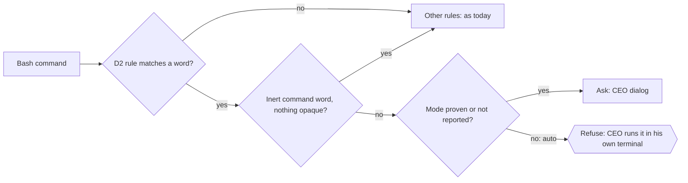
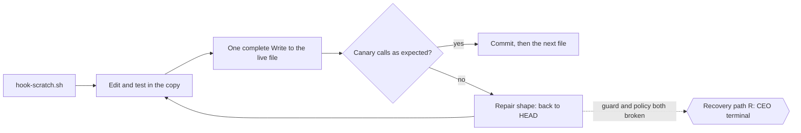

# Spec 0010 — Guard hardening for mobile (D2 of spec 0008): store, signing and key commands; scratch copy for hook work
<!-- Header fields and Status values stay English (protocol); content is written in English. -->

- Status: Draft
- Tier: full · Lane 3 (trust boundary: enforcement files, signing material)
- Previous spec: 0004 (`specs/active/0004-harness-enforcement-gaps.md`, describes today's behaviour). This spec IS dependency D2 of spec 0008 (§6.7, "guard hardening for mobile"); 0008 AC-24 checks the table of §7 item by item.
- Inputs: design `docs/architecture/tasarim/0010-guard-hardening.md`, cut by the main session to what blocks 0008 phase 1b plus what makes this job safe to run (where this spec and the design differ, this spec wins: R-1..R-5); `docs/ACIK-ISLER.md` B32-B34; `docs/KARARLAR.md` rev. 48 (always `auto`, last entries); ADR 0001.
- Self-critique: pending (BA adversarial read done, §14; `spec-critic`, `appsec`, `architecture-board` not yet run)
- Unlocks: `harness/bin/check`, `harness/bin/lint.js`, `harness/bin/secret-names.js`, `harness/bin/hook-scratch.sh`, `harness/test/guard.sh`, `harness/test/policy.sh`, `harness/test/policy-driver.js`, `harness/test/host-gate.sh`, `harness/test/lint-rules.sh`, `harness/test/secret-names.sh`, `harness/test/fixtures/commands-ordinary.txt`, `harness/README.md`, `harness/guard.js`, `harness/policy.js`
- Enforcement files this signature opens (class 2 by `harness/policy.js:209`; exact literal paths, file tools only): `harness/guard.js`, `harness/policy.js`, the last two entries. The twelve others are product-config (class 4, `policy.js:215`; none is in the anywhere list of `policy.js:26`). Not opened, because no task edits them: `harness/gate.js`, `.claude/settings.json`, `CLAUDE.md`, `.claude/rules/routing.md`, `harness/approval.js`, `harness/bin/approve.sh`, the installers; no `harness/shell.js` is created (R-1). Code class, covered by the signature: `site/index.html` (§12 rule 4). Free: `docs/**`, `specs/**`.

## 1. Intent
CEO's words (relayed by the main session): the mobile engineer comes first and works "with the fewest approvals"; "her zaman auto" (sessions always run in permission mode `auto`; the CEO signs in his own terminal). Interpretation, kept separate: spec 0008 cannot ship its Bash-capable mobile unit while store-upload, release-signing and signing-material commands pass the guard silently (appsec probe of 2026-11-22). Success: in `auto` every command of the D2 list is refused by the guard and stays the CEO's alone, a keystore or profile cannot sit in a repository unnoticed, and the engineer can develop and repair hook sources without locking the session (the lesson of 0004). Deliberately NOT done: every other open guard finding (§13, spec 0011); a shell parser; file identity.
IN (design numbering): M-1 D2 minimum list → REQ-1..5 · M-8 (B34 h) scratch copy, exemption, safe-edit rule, repair shape → REQ-7..9 · M-9 (B34 k) lint fixture → REQ-6. OUT: M-2..M-7, M-10..M-12 and decision Q-2, one line each in §13.

## 2. Market summary (Product)
None: internal harness job. No external content was used; the BA has no shell, so every behaviour claim not read from source is tested red-first in T-2 and T-3.

## 3. Requirements (EARS)
Threat level for every line: the guard reads command text and the policy compares path text; both stop accidents, honest mistakes and plainly spelled injected instructions, not an agent with Bash that works around them (§8). No absolute wording.
- REQ-1 — When a word of a command part names a tool of the S set, `xcodebuild` with an export, provisioning or authentication-key flag, a Gradle `publish*` or `promote*` task, or a store publishing API host (§7, D2-1..D2-10), at any word position, behind any wrapper and across continuation lines, the guard shall record a CEO decision; where the command word of that part is in the inert set K and the command holds no substitution, `eval`, `xargs` or `sh -c`, it shall give no opinion.
- REQ-2 — When a command runs `security` with a subcommand other than `find-identity` or `help`, `codesign` with a signing identity other than `-`, or `keytool` with a subcommand other than `-genkeypair`, `-genkey` or `-help` (D2-11..D2-13), the guard shall record a CEO decision.
- REQ-3 — When a word of a command (assignment and `-Pkey=value` values included, quoted or not) is a secret-file name (§7), the guard shall record a CEO decision, unless the literal path resolves to `<R>/android/app/debug.keystore` or under the temp set, or the command word is `ls`, `stat`, `test` or `[` (D2-14).
- REQ-4 — When a rule of REQ-1..3 records a CEO decision, the guard shall ask if no permission mode is reported or the mode is proven to show the dialog, and shall refuse in every other mode (`auto` included) with the text of §7; no signature, no `Unlocks:` entry and no caller shall change that decision.
- REQ-5 — The system shall provide a file-name scan that lists every tracked or not-ignored file under a given root whose name is a secret-file name, allows only the exact path `android/app/debug.keystore`, reads no file content, and exits 0 when clean, 1 on a finding, 2 on a usage error; `check` shall run it on this repository (D2-15).
- REQ-6 — The lint-rule tests shall build their own active spec, so that `check` is green on a copy of the repository whose `specs/active/` is empty.
- REQ-7 — The system shall provide a scratch script that copies the tracked tree into a new scratch root and prints its path.
- REQ-8 — Where a file-tool write targets a hook-source name inside a scratch root and the four conditions of §7 hold, the hooks shall give no opinion; if any condition fails, the path shall keep its class (loosening 1).
- REQ-9 — When the whole command equals the repair shape of §7, the guard shall give no opinion in every permission mode and for every caller, also when the policy module cannot be loaded; any other command shall keep today's decision in that state (loosening 2).
- REQ-10 — `harness/README.md` shall carry the gaps G-23..G-27 of §8, the safe-edit procedure of §10 and the place where the CEO runs CEO-only commands; lint shall fail on a hook command whose path is under the temp set.
- REQ-11 — Every existing test case shall keep its expected value and no existing test line shall change; every guard rule not named in REQ-1..4 and REQ-9 shall keep today's decision in every permission mode.
- REQ-12 — On the ordinary-command corpus (at least 60 lines: React Native, Xcode, Gradle and everyday session commands) in a signed workspace in mode `auto` the guard shall refuse nothing, and its p95 time per Bash call shall stay under 150 ms (200 calls, the CEO's Mac).

## 4. User experience
### No screen: which decision does a store, signing or key command get?

Description: a D2 command is the CEO's alone; in `auto` it is refused, and everything else is judged as today. The hexagon is the CEO step (shape and label carry the meaning, no colour). Text equivalent: (1) continuation lines joined, every word of every part tried; (2) no match, or an inert command word such as `ls` or `which` in a command without substitution: today's rules decide; (3) a match is a dialog in a proven mode or with no mode reported, a refusal otherwise. States: refused → AC-3; asked → AC-3; no opinion → AC-1, AC-2; policy cannot load → AC-6. Error-text owner: `guard.js`.

## 5. Acceptance criteria
Every case is a test line written red first. "Refused in `auto`": exit 2 and the text of §7 on stderr. "No opinion": exit 0, empty stdout.
- [ ] AC-1 — Each of D2-1..D2-10 (§7) has at least one command refused in `auto` and its neighbour with no opinion. Also refused: `bundle exec`, `npm exec … --`, `pnpm dlx`, `yarn dlx`, `bunx`, `xcrun`, `timeout 600` and an unknown wrapper word in front of an S-set tool; `xcodebuild` and `-exportArchive` on two lines joined by a backslash; `(fastlane deliver)`, `{ fastlane deliver; }`, `if true; then fastlane deliver; fi`, `echo x & fastlane deliver`, `"fastlane" deliver`, `bash -c "fastlane deliver"`, `echo "$(fastlane deliver)"`. No opinion: `which fastlane`, `ls fastlane`, `cat fastlane/Fastfile`, `brew info fastlane`, `grep -r eas .`, `git commit -m "run fastlane deliver later"`.
- [ ] AC-2 — Each of D2-11..D2-14 (§7) has at least one command refused in `auto` and its neighbour with no opinion, including `ORG_GRADLE_PROJECT_x=release.jks ./gradlew assembleRelease`, `./gradlew assembleRelease -Pstore=upload.p12`, `cat "release.jks"` and `codesign -s "Apple Distribution: X" A.app` refused, and `codesign -s "-" A.app`, `cat android/app/debug.keystore`, `ls android/app/release.jks`, a keystore under a literal temp path with no opinion.
- [ ] AC-3 — For one command each of REQ-1, REQ-2 and REQ-3: no mode, `default`, `plan`, `acceptEdits` ask; `auto`, `bypassPermissions`, `somethingNew` are refused and stderr equals the text of §7 byte for byte; the result is the same in a validly signed workspace whose `Unlocks:` names anything, and for `agent_type` `polyglot-engineer`. `git push origin main`, `gh release create v1`, `ssh host`, `rm -rf build`, `git rebase main` ask in all six modes, as today.
- [ ] AC-4 — D2-15: `secret-names.js <root>` exits 1 and prints one path per line for a tracked `x.jks`, an untracked not-ignored `a/b.keystore`, `c.p12`, `d.p8`, `e.mobileprovision`, `android/key.properties` and `ios/android/app/debug.keystore`; exits 0 when only `android/app/debug.keystore` or an ignored `x.jks` is present; exits 2 without an argument; a file with key content under another name is not reported (name scan only); `check` runs it, and a planted file turns `check` red.
- [ ] AC-5 — `sh harness/bin/hook-scratch.sh` prints a new directory that holds the tracked tree. A file-tool write to `<S>/harness/policy.js` and `<S>/harness/guard.js` there gets no opinion in `auto`. It keeps class 2 when: the directory is not named as §7 says; S lies under a workspace root; the path reaches the repository's `harness/policy.js` through a symlink; the name is `<S>/CLAUDE.md`, `<S>/.claude/settings.json`, `<S>/harness/keys/x` or `<S>/harness/bin/approve.sh`; `<cfg>` lies under S; the write is a Bash writer. The existing cases `policy-driver.js:76-83, 200-202, 448-449` are unchanged. Lint fails for a fixture whose hook command path is under `/tmp`.
- [ ] AC-6 — In a scratch tree whose `policy.js` cannot be loaded, in `auto`: `git restore --source=HEAD -- harness/policy.js` and the two-file form get no opinion, also from a subagent; `git status`, and the shape with `&& x`, `--source=HEAD~1`, `harness/bin/check`, `CLAUDE.md` or one more word, keep today's refusal. With a loadable policy the shape gets today's decision (no opinion).
- [ ] AC-7 — `check` is green in a scratch copy whose `specs/active/` is empty, and `lint-rules.sh` runs the same number of cases there as in the repository; `harness/test/lint-rules.sh:51` and `:64` are unchanged. Lint fails when `harness/README.md` lacks an entry G-23..G-27 or the heading of the safe-edit procedure.
- [ ] AC-8 — Fresh `./harness/bin/check` output is green; `git diff` of the existing test files shows added lines only; the corpus has 0 refusals; the bench shows p95 under 150 ms; `docs/kanit/0010-teslim.md` holds the canary results of each live step (§10) and, from a real `auto` session, one refused and one passing command per family (dummy input, nothing uploaded).

| REQ | 1 | 2 | 3 | 4 | 5 | 6 | 7 | 8 | 9 | 10 | 11 | 12 |
|---|---|---|---|---|---|---|---|---|---|---|---|---|
| AC | AC-1 | AC-2 | AC-2 | AC-3 | AC-4 | AC-7 | AC-5 | AC-5 | AC-6 | AC-5, AC-7 | AC-3, AC-8 | AC-8 |

## 6. Architecture and technology decision
No new dependency (Node built-ins, POSIX sh, `git`). Components: `guard.js` (D2 rules, repair shape) → `policy.js` (scratch exemption, temp set); `check` → `secret-names.js` (new); `hook-scratch.sh` (new); no cycle. Component diagram: design, "Component view" (link, not a copy; `shell.js` and the `gate.js` change drop out). Architecture board opinion: pending (ADR 0002 draft is the board's: scratch exemption, repair shape, mode rule for the D2 family).
| Decision | Options | Choice and reason | Cost of backing out |
|---|---|---|---|
| Where the D2 rules live | new pre-pass module `harness/shell.js` · **`guard.js` alone** | `guard.js` alone (R-1): it already has the word-level tools D2 needs; one enforcement file fewer to open | low: the module arrives with spec 0011 |
| Wrappers | add names to the wrapper set · **try the rule at every word + inert set K** | every word: an unknown wrapper fails closed; cost: a false refusal on names such as `node scripts/eas` | low |
| Keystore reads | list reader commands · **the secret-file name is the protected word** | name rule: no reader list to keep up (`xxd`, `openssl`, `cp`, `<`); a throwaway key lives in the temp set | low |
| Developing hook sources | **scratch copy + narrow exemption** · linked worktree (needs B29) · instruction only (failed in 0004) | scratch copy; a loosening, judged by the gates | low |
| Unlock in `auto` | recovery path R only · **narrow repair shape** | the shape returns only to committed content; R stays the fallback | low: one line |
- Ruling R-1: no `harness/shell.js` in this job. D2 is sound in `guard.js` at the stated threat level with four small steps on the view the D2 rules read (existing rules keep their own views): backslash-newline joined; a single `&` splits parts; `(`, `{`, `!` and `)`, `;` trimmed from word edges; each word read unquoted through the existing quote memory (`guard.js:87-101`). Substitution, `eval`, `xargs` and `sh -c` already get the raw second view (`guard.js:297-301`), where set K is off — cost if wrong: a spelling outside these steps passes silently until the general pre-pass and tripwire of spec 0011.
- Ruling R-2: the scratch exemption is narrower than the design's ("any temp path outside every root"): only `harness/<name>.js` inside a directory named `company-hook-scratch-<id>` — the wide form turns the existing cases `policy-driver.js:76-82, 200-201, 448-449` (0004 REQ-3) from enforcement to outside — cost if wrong: another protected name cannot be edited in the copy; stop and report.
- Ruling R-3: a D2 match is a CEO decision under the mode rule, not a hard refusal, and tools already in today's remote set (`fastlane`, `eas`, `altool`, …) keep their dialog reason — the cases `guard.sh:88-89` (no mode) keep "ask" — cost if wrong: a session started in a proven mode could pass a store command with one dialog click.
- Ruling R-4: the gate's parse pre-check of the design is not built; the safe-edit rule is an instruction plus canaries (§10), so `harness/gate.js` stays closed — cost if wrong: an unparseable `Write` locks one hook until the repair of §10 step 5.

## 7. Data and API contract
No persisted data, no entity model (constants only); signature format, `Unlocks:` grammar and decision values (refuse: exit 2 + stderr; ask: exit 0 + JSON; no opinion) are unchanged. S set (basename, trailing `@version` dropped): `fastlane`, `eas`, `eas-cli`, `altool`, `notarytool`, `iTMSTransporter`, `transporter`, `appcenter`, `bundletool`, `bundletool*.jar`. K (inert command words): `cd ls cat head tail grep rg find which type man echo printf mkdir rm cp mv touch chmod wc diff stat test [`, git subcommands that run nothing, `brew info|list|search`, `gem list`, `npm ls|view`. Secret-file names (no case): `*.jks`, `*.keystore`, `*.p12`, `*.p8`, `*.mobileprovision`, `key.properties` (one pattern, R-5). Temp set: `/tmp`, `/private/tmp`, `/var/folders`, `/private/var/folders`, the resolved `os.tmpdir()`.
| D2 item (0008 §6.7, in its order) | REQ · AC | Refused in `auto` (test case) | No-opinion neighbour |
|---|---|---|---|
| D2-1 `xcodebuild -exportArchive` | 1 · AC-1 | `xcodebuild -exportArchive -archivePath a -exportPath b` | `xcodebuild -scheme A build` |
| D2-2 `xcodebuild -allowProvisioningUpdates` | 1 · AC-1 | that flag, and `-allowProvisioningDeviceRegistration` | `xcodebuild -showBuildSettings` |
| D2-3 `-authenticationKey*` | 1 · AC-1 | `xcodebuild … -authenticationKeyPath k -authenticationKeyID i` | `xcodebuild test` |
| D2-4 `xcrun iTMSTransporter` | 1 · AC-1 | `xcrun iTMSTransporter -m upload`, `xcrun altool …`, `xcrun notarytool …` | `xcrun simctl list` |
| D2-5 `eas-cli`, `npx eas-cli submit` | 1 · AC-1 | `npx eas-cli submit`, `eas build --local` (A-2) | `npx expo prebuild`, `npx expo run:android` |
| D2-6 `./gradlew publish*` | 1 · AC-1 | `./gradlew publishReleaseBundle`, `./gradlew :app:publishBundle` | `./gradlew assembleRelease`, `publishToMavenLocal` |
| D2-7 `./gradlew promote*` (rollout change) | 1 · AC-1 | `./gradlew promoteArtifact --user-fraction 0.5` | `./gradlew bundleRelease`, `./gradlew test` |
| D2-8 `bundletool` | 1 · AC-1 | `bundletool build-apks …`, `java -jar bundletool-all.jar …` | none: every call (A-2) |
| D2-9 Play publisher API scripts | 1 · AC-1 | command text holding `androidpublisher.googleapis.com` or `api.appstoreconnect.apple.com` | `curl https://example.com/`; script content is not seen (G-24) |
| D2-10 wrappers `bundle exec`, `npm exec`, `pnpm dlx`/`dlx` | 1 · AC-1 | `bundle exec fastlane pilot upload`, `npm exec eas-cli -- submit`, `pnpm dlx eas-cli submit` | `bundle exec pod install` |
| D2-11 `security` read or export | 2 · AC-2 | `security find-generic-password -w -s x`, `security export -k k`, `security dump-keychain` | `security find-identity -v -p codesigning` |
| D2-12 non-adhoc `codesign -s` | 2 · AC-2 | `codesign -s "Apple Distribution: X" A.app`, `codesign --sign ID A.app` | `codesign -s - A.app`, `codesign -dv A.app` |
| D2-13 `keytool -list`, export | 2 · AC-2 | `keytool -list -keystore x.jks`, `keytool -exportcert …`, `keytool -importkeystore …` | `keytool -genkeypair -keystore /tmp/k/x.jks …` |
| D2-14 `base64`/`cat` of keystore files | 3 · AC-2 | `cat release.jks`, `base64 -i upload.keystore`, `cp a.p12 b`, `openssl pkcs12 -in a.p12` | `cat android/app/debug.keystore`, `ls android/app` |
| D2-15 secret scan by file name, `debug.keystore` allowlisted by exact path | 5 · AC-4 | `secret-names.js` exit 1 (`.p8` added, A-2) | only `android/app/debug.keystore`: exit 0 |
- Ruling R-5: the secret-file name pattern lives once, as an export of `harness/policy.js` (enforcement class, pure at load, already opened by this spec); `guard.js` and `secret-names.js` both read it from there (the scan takes its names from `git ls-files -co --exclude-standard`, a directory walk without git; app repositories and 0008's pre-commit part call the same script with their own root) — one copy, and no enforcement file depends on a product-config file — cost if wrong: one constant moves.
- Refusal text (exact; `<mode>` as today: ASCII, 40 characters; `<tool>` and `<pattern>` from the fixed sets only, never raw event text): `BLOCKED by company guard: <rule> is the CEO's alone, and permission mode '<mode>' is not proven to show his dialog. The CEO runs this command in his own terminal (no hook runs there); no spec opens it. Do not rewrite the command to get around this refusal.` with `<rule>` one of `store upload or release signing (<tool>)`, `signing material (<tool>)`, `secret file name (<pattern>)`. New dialog reasons (proven mode) follow the Turkish style of today's guard. Path text and path-less text: unchanged.
- Scratch exemption, all four conditions: (1) the path as written and its resolved form are both `<S>/harness/<name>.js`, `<name>` of `[A-Za-z0-9_-]+`, under the same scratch root S, a directory named `company-hook-scratch-<letters and digits>` directly under `/tmp`, `/private/tmp` or `os.tmpdir()` (written or resolved); (2) S is under no workspace root, nested root or main root, and none of them is under S; (3) the path is no `<cfg>` or `<home>` member; (4) the write comes from a file tool. Then the class is "outside". Bash writers keep today's decisions.
- Repair shape, verbatim, matched on the whole command before any other rule: `^git restore --source=HEAD -- harness/[A-Za-z0-9_-]+\.js( harness/[A-Za-z0-9_-]+\.js)*$`

## 8. Threat model and security
Sensitive area: enforcement layer (guard, policy) and signing material (file names only; no key content is read; no personal data). Stated plainly: an envelope ask is not a refusal in `auto` today (`guard.js:192`; `docs/kanit/0004-t1.md:24-33`: the app settles it without a dialog); this spec changes that for the D2 family only (A-1). The real boundary for store credentials is that they are not reachable by this user (0008 R-13); the hook is the sign in front of it.
| Boundary or asset | Abuse | Control | Residual |
|---|---|---|---|
| Store account, upload key | upload, rollout or signing by a tool call, also behind a wrapper | REQ-1, 2, 4 | words built at run time, spellings outside R-1 (G-23); script content, tools outside the S set (G-24) |
| Keystore and profile files | read, copy, commit | REQ-3, 5 | detection by name only (G-25) |
| **Loosening 1: scratch exemption** | a hook-named file written unasked in a scratch root; a settings file loads a hook from there; a symlink from S into the repository | four conditions on both path forms; only `harness/<name>.js`; lint fails on a hook command under the temp set | scratch copies are unprotected (G-26) |
| **Loosening 2: repair shape** | any caller discards uncommitted hook edits; with `HEAD` on another branch, that branch's version returns | whole-command match, `--source=HEAD`, `harness/<name>.js` only; committed content only; the command gets no opinion today already | G-27 |
| Live hook sources during this job | a half-written file locks the session | safe-edit rule, canaries, repair shape, recovery path R | two hook files broken at once: CEO terminal |
Known gaps added to `harness/README.md` after G-22: G-23 D2 rules see only visible words in the spellings of R-1 · G-24 script content (Fastfile lane, npm script, Gradle plugin, API script) and tools outside the S set · G-25 secret files are known by name only · G-26 hook copies in a scratch root are unprotected · G-27 the repair shape discards uncommitted hook edits for every caller. G-9 gains one sentence: the mode rule now covers the D2 family, not the other envelope rules.

## 9. Test and evidence plan
| Criterion | Test | Layer | Profile |
|---|---|---|---|
| AC-1, AC-2, AC-3, AC-6 | `harness/test/guard.sh`, new sections; D2 cases named `D2-n`; AC-6 in a tree with an unloadable `policy.js` | hook | quick |
| AC-4 | `harness/test/secret-names.sh` (temp repositories), `check` step | unit | quick |
| AC-5 | `policy.sh` + `policy-driver.js`, `host-gate.sh`, `lint-rules.sh` | unit + hook | quick |
| AC-7 | `lint-rules.sh`; `check` in an empty-active scratch copy | lint | full |
| AC-8 | `./harness/bin/check`; corpus loop and `--bench` in `guard.sh`; record `docs/kanit/0010-teslim.md` | all + manual | full |
Pre-approved changes to existing test lines: none; this job is additions only. Read against commit `10aa039`: `guard.sh:88-89` (`fastlane deliver`, `xcrun altool`, no mode) stay "ask" (R-3); `guard.sh:361, 384`, `host-gate.sh:230, 258`, `policy-driver.js:417` stay because the path text is not changed; `lint-rules.sh:51, 64` stay because the fixture spec is written before them. If any existing case would change value: stop and report (§12 rule 2).

## 10. Deployment and disaster recovery
No server. Hooks load from the working tree (`.claude/settings.json` unchanged); other projects call this harness by absolute path and get the rules with `git pull`; the container is not affected. Delivery: work branch → `check` green → verification chain → merge to `main` with the CEO's approval (envelope, today's flow). Rollback: `git revert` of the merge; the D2 family is then silent again. Live moment: the first tool call after `policy.js` (T-2) or `guard.js` (T-3) is written.
### How is a live hook source changed without locking the session?

Description: a hook source is developed in the scratch copy, goes live with one write and is probed at once; one broken file is repaired inside the session, two from the CEO's terminal (hexagon = CEO step). Text equivalent, the safe-edit procedure: (1) `sh harness/bin/hook-scratch.sh`; no hand `cp` of a hook source; (2) edit with file tools in the copy and run the copy's own tests (`sh <S>/harness/test/guard.sh`); (3) bring the finished file over with one complete `Write`, one hook source at a time, never a chain of `Edit`s on a live hook source; (4) load-check at once with three canary calls: Bash `git status --short` runs; Bash `echo git --no-verify` is blocked by the guard; a `Write` to `docs/kanit/0010-teslim.md` passes; (5) on any other result: broken `policy.js` → `git restore --source=HEAD -- harness/policy.js`; broken `guard.js` (Bash closed, file tools open) → `Read` the `HEAD` version in the copy and `Write` it back; both broken → recovery path R (`harness/README.md`, "Hook'lar kilitlenirse").

## 11. Legal and compliance
None new. Public repository: corpus and tests carry no real name, path, identity or key content; the scan reads names only. No unit uploads or signs, so store rules are untouched.

## 12. Task list (atomic)
Rules: (1) `./harness/bin/check` green after every task, output shown. (2) Tests are additions only; no existing line changes; a refusal or an unexpected flip is never worked around (no interpreter or script write): stop and report. (3) Safe-edit rule for live hook sources (§10): develop in the approved scratch copy, bring a live hook source over with one complete `Write`, load-check at once. Bootstrap exception, T-2 only: the copy's `policy.js` is class 2 until the exemption is live, so that one change is composed from the read file and written to the live `harness/policy.js` in one complete `Write`, with its red tests added first. (4) A task that changes `guard.sh` runs `node harness/bin/site-data.js --write` and commits `site/index.html`. (5) T-2 and T-3 go live at the write: one commit each, the diff shown to the CEO in chat before the commit. Chain (lane 3): delivery-manager → `polyglot-engineer` → qa-engineer → appsec → internal-auditor → quality-office.
| ID | Task | AC | Owning unit | Dependency |
|---|---|---|---|---|
| T-0 | Activation, one commit: `specs/active/0004-harness-enforcement-gaps.md` → `specs/done/` and this spec `specs/draft/` → `specs/active/` (the lint fixture needs exactly one active spec until T-2). Before the signature: the board files ADR 0002; the main session diffs 0008 §6.7 on `origin/spec/0008-team-expansion` against §7 (the BA read 0008 from the working copy `.claude/worktrees/team-expansion/`, having no shell for `git show`). The CEO signs in his own terminal (`--preview`: the enforcement block lists exactly `harness/guard.js` and `harness/policy.js`; then `--expect`) | all | main session + CEO | gates passed |
| T-1 | Plan with file ownership and the order below | all | delivery-manager | T-0 |
| T-2 | `lint-rules.sh`: the fixture empties its base `specs/active/` and writes its own spec (added lines only); `hook-scratch.sh`; LIVE, file tools: `policy.js` scratch exemption, temp set and secret-name pattern (R-5); lint rule for hook paths; cases in `policy.sh`, `policy-driver.js`, `host-gate.sh`, `lint-rules.sh` | AC-5, AC-7 | polyglot-engineer | T-1 |
| T-3 | Corpus fixture; red D2 cases; LIVE, Bash: `guard.js` (repair shape, D2 rules of REQ-1..4, refusal text), developed in the scratch copy | AC-1, 2, 3, 6 | polyglot-engineer | T-2 |
| T-4 | `secret-names.js`, its test and the `check` step; `harness/README.md` (gaps, safe-edit procedure, where the CEO runs CEO-only commands) and its lint text rule | AC-4, AC-7 | polyglot-engineer | T-3 |
| T-5 | Verification, fresh context each, in order: qa-engineer (mutation runs, corpus, bench), appsec (every D2 item against the installed hook with dummy input: the input of 0008 AC-31; both loosenings), internal-auditor, quality-office; live `auto` record; then the main session marks B34 (h), (k) in `docs/ACIK-ISLER.md` and files §13 as input for spec 0011 | AC-8 | as named | T-4 |
CEO actions outside this spec's ACs (the main session files them as "Beklenenler"): C-1 remove the allow entries `Bash(./harness/bin/check)` and the stale `approval.js verify …0004…` from `.claude/settings.local.json` in his own terminal (the file is locked). C-2 GitHub ruleset on `main`: pull request required, forced push and deletion blocked, `check` status required.

## 13. Out of scope
Later (spec 0011), one line each; the design holds the detail:
- B32 (a)-(c): quoted `"main"`, the rest of a here-doc line, `word=` tokens hide a push to `main`.
- B32 (d): git state redirects a plain push (`@{push}`; `pushurl`, `pushInsteadOf` stay with ruleset C-2).
- B34 (a): `CLAUDE.local.md` into the enforcement class and the locked set.
- B34 (b) beyond R-1: general plain-form pre-pass (`harness/shell.js`), tripwire "unmodelled construct + protected word = refuse", `cd` and same-command branch tracking.
- B34 (c): `git commit -n`, `+branch` refspec, `checkout main && merge && push`, tag push.
- B34 (e): regular-file and size check before the active spec is read.
- B34 (f): refusal texts name the whole locked set.
- B34 (g): `git restore` and `git checkout -- <file>` as writers; gate parse pre-check of hook sources (R-4).
- B34 (i): dotless-ı root folding, re-cased `.claude/WORKTREES`, hard links and other volumes (file identity).
- B34 (j): 0004 AC-13 leftovers (main-session fixture, `plan`/`bypassPermissions` observation).
- B33: Bash writers of `internal-auditor` and `appsec` refused; `internal-auditor.md` text; lint warning for `settings.local.json` allow entries.
- Envelope under the mode rule: push or merge to `main`, release, remote and the other existing rules refused in `auto` (the design recommends it because the app, not the CEO, settles an ask in `auto`; it changes the CEO's daily flow and needs C-2 first).
- Decision Q-2: recursive `rm` judged by target, branch clean-up on feature branches; today's behaviour is untouched here.
- Design L-1, L-7..L-11: root `package.json` module type; per-unit command allowlist; hook work in a linked worktree; the rest of the remote tool set at every word; `debug.keystore` pinned by SHA-256; `sh -n` pre-check and a merge helper.
Also out: per-unit write areas (draft 0006), approval cadence texts (draft 0009), an `Envelope:` header field (rejected in the design), the mobile units themselves (spec 0008).

## 14. Open questions and Spec critic findings
Open questions: none (design Q-1 and Q-2 were closed by the main session: A-1; Q-2 is out of scope). BA adversarial read: (a) the design's wide temp exemption contradicts existing cases (R-2); (b) the exemption cannot be developed in the copy it creates (bootstrap exception, §12 rule 3); (c) "main in `auto`" stays an ask the app settles, stated in §8, not hidden; (d) REQ-3 refuses harmless mentions such as `find . -name "*.jks"` or `echo "*.jks" >> .gitignore` (use `rg --files`, a file tool); the corpus (REQ-12) guards the common cases. To the gates: `architecture-board` on R-1, R-2, both loosenings and ADR 0002; `appsec` on the repair shape, the scratch conditions, set K and the two allowed keystore locations; `spec-critic` on the D2 trace.

---
## Signature record (CEO only)
Approved by / on: <!-- recorded under approvals/ by harness/approval.js; this line is informational, validity lives in the signature file -->

## Assumptions (for the end-of-job report)
- A-1 (decision Q-1, shown at signing) — Store-upload, release-signing and signing-material commands (D2-1..D2-14) are refused in `auto` and are the CEO's alone, in his own terminal; no spec opens them. Push or merge to `main` and every other existing envelope rule keep today's behaviour: the guard records its ask in every mode and the chat approval rule of the constitution governs. Stricter alternative, not taken: all envelope rules refused in `auto` (§13).
- A-2 — `bundletool` and every `eas`/`eas-cli` subcommand are refused (also `eas build --local`); the `.p8` name is added to the minimum list; `publishToMavenLocal` gets no opinion; the `debug.keystore` allowance is the one exact path; a throwaway signing key is created and used under the temp set; the corpus has at least 60 lines.
- A-3 — One pull request; D2 counts as met for spec 0008 when the commit holding T-4 is on `main`. Gradle `--scan` (a design extra, not in the minimum list) is not refused here; spec 0008 forbids it by instruction.

## Scorecard (end of job)
| Measure | Value |
|---|---|
| Spec revisions | |
| Fix rounds | |
| Findings: real / noise / deferred | |
| Regressions | |
| Escaped defects | |
| Tokens used | |
