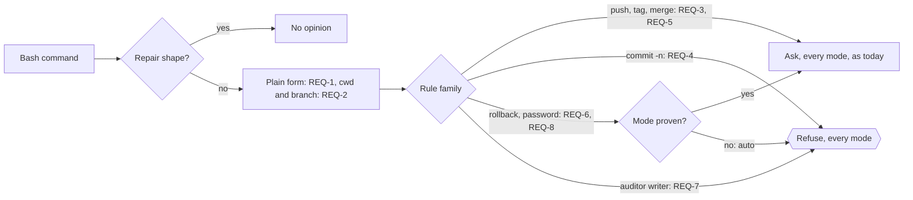
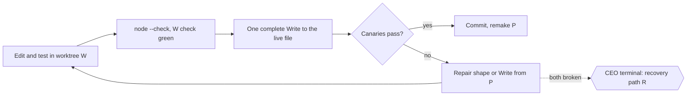

# Spec 0011 — Harness gaps after 0010: plain shell forms, push and commit gaps, git rollback of enforcement files, read-only callers, path identity, throwaway-key password, token cap re-baseline
<!-- Header fields and Status values stay English (protocol); content is written in English. -->

- Status: Draft
- Tier: full · Lane 3 (trust boundary: enforcement files, envelope, signing material)
- Previous spec: 0010 (`specs/done/0010-guard-hardening.md`, §13 is this spec's input list); 0004 (`specs/done/0004-harness-enforcement-gaps.md`, today's path policy); 0008 (`specs/done/0008-team-expansion.md`, REQ-7 and §6.6, read only, not edited).
- Inputs: `docs/ACIK-ISLER.md` B32, B33, B34 (a)-(g), (i), (j), B35, B36; appsec 0010 delivery info item (relayed by the main session: git rollback of `.claude/settings.json`, `CLAUDE.md`, `harness/keys`, `harness/bin/approve*` is outside the 0010 rollback rule, README G-26 last sentence); `docs/kanit/0009-kapi-tur1.md` (S-02, S-03, I-01, I-02); `docs/kanit/0010-kapi-tur1.md`; `docs/kanit/0008-appsec.md` (S-02); `docs/kanit/0008-qa.md:41`; design `docs/architecture/tasarim/0010-guard-hardening.md` (N-1..N-10, M-3..M-7, M-10..M-12, L-1; where this spec and the design differ, this spec wins). B34 (h) and (k) were closed by 0010 (T-6), and so were the hook-source slice of (g) and the D2 family; they are not reopened.
- Self-critique: BA adversarial read done (§14); gates pending (spec-critic, appsec, architecture-board in parallel).
- Unlocks: `harness/guard.js`, `harness/policy.js`, `harness/bin/lint.js`, `harness/package.json`, `harness/test/guard.sh`, `harness/test/policy.sh`, `harness/test/policy-driver.js`, `harness/test/lint-rules.sh`, `harness/test/run.sh`, `harness/test/fixtures/commands-ordinary.txt`, `harness/test/fixtures/pretooluse-main.json`, `harness/README.md`, `.claude/agents/internal-auditor.md`, `.claude/skills/rn-engineering/SKILL.md`, `.claude/skills/store-release/SKILL.md`
- Enforcement files this signature opens (class 2, exact literal paths, file tools only, in the main root and in a linked worktree holding the same signed spec, 0010 R-6): `harness/guard.js`, `harness/policy.js`. The thirteen others are product-config (class 4). Not opened, because no task edits them: `harness/gate.js`, `harness/approval.js`, `harness/bin/check`, `harness/bin/approve.sh`, `.claude/settings.json`, `.claude/settings.local.json` (locked), `CLAUDE.md`, `.claude/rules/routing.md`, `.claude/agents/appsec.md`, the installers, `evals/**`; no `harness/shell.js` is created. Code class, covered by the signature: `site/index.html` (§12 rule 4). Free: `docs/**`, `specs/**`.

## 1. Intent
CEO's words (`docs/KARARLAR.md`, 2026-11-26): "önce şu mobilcinin süreçlerini tamamla… işleri sırayla al"; B32-B34 "geri kalanı spec 0011'e kalır"; the accepted level is "kaza önler" (accidents and plainly spelled instructions, not a determined agent). Interpretation, kept separate: close the guard and policy findings that 0004, 0009 and 0010 reviews left open, at that level, with the smallest change each finding allows, and without a new module or dependency. Success: in `auto`, a push to `main` spelled `"main"`, after a here-doc, with a `word=` token, through a `checkout main &&` chain or through git push configuration gets the same decision as the plain spelling; `git commit -n` is refused like `--no-verify`; no plain git command silently returns any enforcement file to another version; read-only auditors cannot write through Bash; `CLAUDE.local.md` is an enforcement file; the throwaway Android key password has one allowed path that leaves no password in a command or log; the 0008 token cap figure matches what was shipped. Deliberately NOT done: the tripwire and the general `harness/shell.js` module (Q-3), the envelope under the mode rule, file identity beyond hard links, refusing branch switch, pull and merge over hook changes (Q-1).

## 2. Market summary (Product)
None: internal harness job. The BA has no shell: every behaviour claim not read from source is marked "not run" and is proven red first by a task (§9).

## 3. Requirements (EARS)
Threat level for every line: the guard reads command text and the policy compares path text; they stop accidents, honest mistakes and plainly spelled injected instructions, not an agent that works around them (§8). Unless a line says otherwise, a "CEO decision" follows today's rule of the family it joins: envelope asks stay asks in every mode (README G-9), path-class and rollback decisions follow the mode rule (refused in `auto`).

Guard, Bash view (`harness/guard.js`)
- REQ-1 — Before the envelope, writer, signing and installer rules judge a command, the guard shall read it in plain form (§7.1, N-1..N-7): continuation lines joined; here-doc bodies dropped while the rest of the here-doc's own line stays command text; single `&` and `|&` split parts; `(`, `)`, `{`, `}`, `!`, `if`, `then`, `elif`, `else`, `fi`, `while`, `until`, `do`, `done` dropped at part edges; `>&file`, `&>file`, `&>>file` and `>|file` read as redirect targets; a quoted or escaped word without space, `$` or backtick read unquoted; an assignment counted only before the command word.
- REQ-2 — When a part of a command changes directory with a literal `cd` or `pushd`, or switches branch with a literal `git checkout`, `git switch` (with or without `-b`, `-c`, `-B`, `-C`), the guard shall judge later parts of the same command against that directory and that branch; when the directory or branch word is not literal, later relative writer targets and later branch-dependent git rules shall be judged as "unknown" (§7.2).
- REQ-3 — When a push refspec starts with `+`, or its destination is under `refs/tags/` or names an existing tag, the guard shall record an envelope ask (force push; tag publication). [Q-2: the `+` half flips one 0004 case.]
- REQ-4 — When `git commit` carries `-n` alone or inside a short-option cluster before a value-taking letter, or a prefix of `--no-verify` that git accepts (`--no-veri`, `--no-verif`), the guard shall refuse in every mode with today's `--no-verify` text.
- REQ-5 — When a push names no destination of its own (no refspec, `HEAD`, `@`, or a refspec without `:` while `remote.<remote>.push` is set), the guard shall resolve the destination from git configuration by read-only lookups (§7.3) and record the protected-branch ask when the destination is protected, the configuration pushes several branches (`push.default=matching`), or a lookup fails.
- REQ-6 — When a git command of the rollback set (§7.4) would write a working-tree or index path that is in path class 1 or 2 (any enforcement file, `CLAUDE.md` and `CLAUDE.local.md` at any depth, `harness/keys/**`, `harness/bin/approve.sh`, `.claude/settings*.json`, `.github/workflows/**`), the guard shall record a CEO decision under the mode rule; the repair shape of 0010 stays the one exception.
- REQ-7 — When the caller is `internal-auditor` or `appsec`, the guard shall refuse in every mode every recognised Bash writer target and redirect target outside the temp set and the device paths, whatever the signature and `Unlocks:` say.
- REQ-8 — When a word assigns a literal value (no `$`, no backtick) to a name ending in `signing.store.password` or `signing.key.password` (env form, `-P` form, or `-D…project.` form), the guard shall record a CEO decision under the mode rule (refusal text: §7.6).
- REQ-9 — When the guard reads the active spec for the signing dialog, it shall read it only if it is a regular file of at most 1 MiB; otherwise it shall refuse with today's preview-first text.

Path policy (`harness/policy.js`)
- REQ-10 — The policy shall classify `CLAUDE.local.md` at any depth (no case) as class 2 and as locked; in the container it shall be refused.
- REQ-11 — The policy shall give signature authority only when the active spec is a regular file of at most 1 MiB; otherwise authority is "spec not readable".
- REQ-12 — Every refusal or dialog text that names the locked set shall name all its members: the signature directory, `harness/keys/`, `.claude/settings.local.json`, `harness/bin/ceo-keygen.sh`, `CLAUDE.local.md`, the home Claude configuration and `~/.company/`.
- REQ-13 — The policy shall not treat a root segment as equal to a disk name that differs only by U+0131 (dotless ı) against `i`/`I`; shall give class 1 to `.git` and `approvals` members of a nested root spelled in any letter case (`.claude/WORKTREES/<x>/.git`); and shall treat an existing target with more than one hard link as class 2 and locked.

Lint, packaging, fixtures, texts
- REQ-14 — Lint shall warn (`WARN  settings-local-allow`) for every `permissions.allow` entry of `.claude/settings.local.json` that names a script under the workspace root, and stay silent when the file is absent.
- REQ-15 — The hook sources shall run as CommonJS whatever module type a `package.json` above `harness/` declares.
- REQ-16 — The repository shall hold a sanitized main-session PreToolUse fixture `harness/test/fixtures/pretooluse-main.json`, and the record `docs/kanit/0011-gozlem.md` shall hold the 0004 AC-13 observations still missing: `plan` and `bypassPermissions` dialog behaviour, the host wrapper blocking, an empty `CLAUDE_PROJECT_DIR`.
- REQ-17 — The `rn-engineering` and `store-release` playbooks shall state one allowed path for the throwaway Android key password (§7.6), and `internal-auditor.md` shall state that its `Bash` reads and runs tests and that the guard refuses its writers.
- REQ-18 — `harness/README.md` shall carry gaps G-28..G-31 of §8, the updated G-5, G-8, G-9 and G-26 sentences of §8, and the B36 cap record of §7.7.

Invariants
- REQ-19 — Every existing test case shall keep its expected value, except the flips pre-approved in §9; every guard and policy rule not named above shall keep today's decision in every mode.
- REQ-20 — Every line of the ordinary-command corpus (0010's 85 lines plus at least 20 added lines in the forms of REQ-1 and REQ-2) shall get no opinion in a signed workspace in `auto`, and the guard's p95 per Bash call shall stay under 150 ms (200 calls, the CEO's Mac).

Token cap (B36)
- REQ-21 — For an existing unit, the per-spawn figure of 0008 §6.6 shall be read as its measurement after 0008 (`devops-sre` 4,132 est. tokens); the 4,090 cap applies to new units only, as 0008 AC-7 words it; a later spec that grows an existing unit's spawn names its new figure.

## 4. User experience
### No screen: which decision does a Bash command get after this spec?

Description: one plain reading feeds every rule; the hexagon is a refusal (shape and label carry the meaning, no colour). Text equivalent: (1) repair shape first, unchanged; (2) plain form and the cwd/branch of earlier parts; (3) envelope asks stay asks; (4) `commit -n` and auditor writers are refused in every mode; (5) rollback and literal-password words follow the mode rule. States: refused → AC-4, AC-6, AC-7, AC-8; asked → AC-1, AC-2, AC-3, AC-5; no opinion → AC-12. Error-text owner: `guard.js`, `policy.js`.

## 5. Acceptance criteria
Every case is a test line written red first. "Refused in `auto`": exit 2, text on stderr. "Asks": exit 0, JSON `ask`. "No opinion": exit 0, empty stdout.
- [ ] AC-1 — B32 (a)-(c), B34 (b) (REQ-1), no mode and `auto` each: ask for `git push origin "main"`, `git push origin 'main'`, `git push origin ma"in"`, `git push origin ma\in`, `"git" push origin main`, `\git push origin main`, `git push origin feat/x <<E +w:main --force` (here-doc with body `x` and `E`), `git push origin feat/x a=b:main`, `git push \` + newline + `origin main`, `(git push origin main)`, `{ git push origin main; }`, `if true; then git push origin main; fi`, `echo x & git push origin main`, `echo x |& git push origin main`; writer cases: `echo x >&harness/guard.js`, `echo x &>CLAUDE.md`, `echo x >|CLAUDE.md` get today's enforcement ask. No opinion: `git push origin feat/x`, `git commit -m "push to main later"`, `FOO=1 git push origin feat/x`.
- [ ] AC-2 — REQ-2: ask for `git checkout main && git merge feat/x`, `git switch main && git commit -m x`, `git checkout main && git push`, `cd /tmp/other && git push` where that repository is on `main`; `cd harness && rm guard.js` gets today's enforcement decision for `harness/guard.js`; `cd "$D" && rm x.cs` in a signed workspace in `auto` is refused (cwd unknown). No opinion: `git checkout feat/y && git commit -m x`, `cd docs && rm old.md`.
- [ ] AC-3 — REQ-3: ask for `git push origin +feat/x` [Q-2], `git push origin v1.0` with an existing tag `v1.0`, `git push origin refs/tags/v2`, `git push origin HEAD:refs/tags/v3`. No opinion: `git push origin feat/x`, `git push origin HEAD:refs/heads/feat/0007-x` (`guard.sh:276`, unchanged).
- [ ] AC-4 — REQ-4: refused in all six modes of 0010 AC-3: `git commit -n -m x`, `git commit -anm x`, `git commit -na`, `git commit --no-veri -m x`, `git commit --no-verif -m x`. No opinion: `git commit -m n`, `git commit -mn` (message `n`), `git commit --no-verbose -m x`, `git push -n origin feat/x`.
- [ ] AC-5 — REQ-5 (temp repositories): ask for a bare `git push` on `feat/x` whose upstream is `origin/main` with `push.default=upstream`; a bare push with `push.default=matching`; `git push origin feat/x` with `remote.origin.push=refs/heads/*:refs/heads/main`; a bare push in a directory where `git config` fails. No opinion: bare `git push` on `feat/x` with `push.default` unset or `simple` and upstream `origin/feat/x`.
- [ ] AC-6 — REQ-6, refused in `auto` (no mode: asks): `git checkout abc1234 -- CLAUDE.md`, `git checkout abc1234 -- docs/CLAUDE.md`, `git restore -s abc1234 .claude/settings.json`, `git restore -s abc1234 harness/keys`, `git checkout abc1234 -- harness/bin/approve.sh`, `git checkout abc1234 -- harness/container-settings.json`, `git restore -s abc1234 -- '*.md'` when a tracked `CLAUDE.md` matches, `cd harness && git checkout abc1234 -- guard.js`, `git checkout abc1234 -- :/CLAUDE.md`, `git restore --pathspec-from-file=list.txt -s abc1234`, `git stash pop` and `git stash apply stash@{0}` when the stash holds `harness/guard.js`, `git apply x.patch` when the patch touches `CLAUDE.md`, the same with `policy.js` not loadable for the textual forms; a lookup that fails gives the decision. No opinion: every no-opinion case of 0010 AC-5, `git restore src/a.cs`, `git stash pop` of a stash holding only `src/a.cs`, `git apply y.patch` touching only `src/`.
- [ ] AC-7 — REQ-7: with `agent_type` `internal-auditor` and with `appsec`, refused in all six modes and in a signed workspace whose `Unlocks:` names the target: `echo x > src/a.cs`, `touch docs/x.md`, `rm -f src/a.cs`, `cp a b`, `sed -i s/a/b/ src/a.cs`. No opinion for them: `echo x > /tmp/k/out.txt`, `cmd 2>/dev/null`, `git status`, `./harness/bin/check`. The same writer commands for `polyglot-engineer` keep today's decision.
- [ ] AC-8 — REQ-8: refused in `auto`: `env ORG_GRADLE_PROJECT_android.injected.signing.store.password=abc ./gradlew assembleRelease`, `./gradlew assembleRelease -Pandroid.injected.signing.key.password=abc`. No opinion: the allowed form of §7.6 with a literal temp path (not run by the BA: proven red first).
- [ ] AC-9 — REQ-9, REQ-11 (driver and guard cases): an active spec that is a FIFO, a directory named `x.md`, a symlink to a FIFO, or a regular file of 1 MiB + 1 byte gives no authority (`spec not readable`) and the signing dialog falls back to the preview-first refusal; a hook given a FIFO spec returns within 5 s. A regular file of exactly 1 MiB is read as today.
- [ ] AC-10 — REQ-10, REQ-12, REQ-13 (`policy.sh`, `policy-driver.js`, `run.sh`): `CLAUDE.local.md`, `sub/claude.LOCAL.md` are class 2 and locked (`unlockKinds` lists them under locked; a header naming one is refused by lint `unlocks-row2`); container gate refuses a `Write` of `CLAUDE.local.md`. A root `<T>/wi` does not own `<T>/wı/x` (darwin context). `.claude/WORKTREES/n/.git/config` and `.claude/Worktrees/n/approvals/x` are class 1. A file with two hard links under `src/` is class 2 and locked; with one link it is code. Every locked-path text names the members of REQ-12.
- [ ] AC-11 — REQ-14, REQ-15, REQ-16: lint on a fixture whose `.claude/settings.local.json` allows `Bash(./harness/bin/check)` prints `WARN  settings-local-allow` and stays green; no file: no line. A temp copy whose parent holds `package.json` `{"type":"module"}` runs `guard.js` and `gate.js` with today's results. `pretooluse-main.json` exists, lint `fixture-sanitized` prints `ok` and no `WARN` for it; `docs/kanit/0011-gozlem.md` holds the four observations with date and mode.
- [ ] AC-12 — REQ-17..REQ-21: lint rule `texts-0011` fails when the README lacks G-28..G-31 or the B36 record, when G-26 still holds the text `bu kuralın kapsamı dışındadır (spec 0011)`, when `rn-engineering/SKILL.md` or `store-release/SKILL.md` lacks the text `-storepass:file`, or `internal-auditor.md` holds `no write tool`. Fresh `./harness/bin/check` green; `git diff` of existing test files shows added lines only, except the flips of §9; the corpus all no opinion; bench p95 under 150 ms; `node harness/bin/footprint.js` shows `devops-sre` at most 4,132; `docs/kanit/0011-teslim.md` holds red-first counts, canaries per live write, and from a real `auto` session one refused and one passing command per REQ-1..REQ-8 family.

| REQ | 1 | 2 | 3 | 4 | 5 | 6 | 7 | 8 | 9 | 10 | 11 | 12 | 13 | 14 | 15 | 16 | 17 | 18 | 19 | 20 | 21 |
|---|---|---|---|---|---|---|---|---|---|---|---|---|---|---|---|---|---|---|---|---|---|
| AC | 1 | 2 | 3 | 4 | 5 | 6 | 7 | 8 | 9 | 10 | 9 | 10 | 10 | 11 | 11 | 11 | 12 | 12 | 12 | 12 | 12 |

## 6. Architecture and technology decision
No new dependency (Node built-ins, POSIX sh, `git`). No new module: the plain-form pass lives in `guard.js`, the identity and locked-set rules in `policy.js`. Component flow is unchanged from 0010 §6 (`guard.js` → `policy.js`; `lint.js` → `policy.js`). Architecture board: pending.
| Decision | Options | Choice and reason | Cost of backing out |
|---|---|---|---|
| Plain-form pass | new `harness/shell.js` + tripwire (design B) · **finite list N-1..N-7 inside `guard.js` (design A)** | A: closes every listed finding, one enforcement file fewer, no false refusal of unknown constructs; B is Q-3 | low: the function moves to a module later |
| Git rollback of enforcement files | widen 0010's text test · **pathspec expanded by read-only git lookups, each path classified by the policy; text test kept as fallback** | lookup: covers `CLAUDE.md` at any depth, `:/`, globs, a cwd inside `harness/`, without a name list to keep up | low |
| Git state redirect | read the remote URL too · **destination only (`@{push}`, `push.default`, `remote.<r>.push`)** | the branch is the envelope; `pushurl`/`pushInsteadOf` stay with the GitHub ruleset (CEO to-do C-2) | low |
| Read-only callers | instruction only · tool list without Bash · **policy constant + guard refusal** | they need Bash to run tests; the refusal is cheap and caller-scoped | none |
| Hard links | inode table of enforcement files · **`nlink > 1` → class 2, locked** | closed and cheap (one `lstat`); a product file with links goes to the CEO's terminal | low |
| Module type | rename to `.cjs` · **`harness/package.json` `{"type":"commonjs"}`** | no path changes in settings or installers | none |
- Ruling R-1: N-8 (`cd`) and N-9 (branch) are tracked only within one Bash call and only for literal words; anything else is "unknown", which asks for the branch rules and refuses relative writer targets in `auto` — cost if wrong: `cd "$(mktemp -d)" && touch x` is refused; use the literal path.
- Ruling R-2: REQ-6 lookups are `git -C <cwd> ls-files -z -- <pathspec…>`, `git ls-tree -r --name-only <source> -- <pathspec…>` when a source tree is given, `git stash show --name-only --include-untracked <stash>`, `git apply --numstat <patch>`; 5 s timeout each, as `currentBranch` (`guard.js:23-26`); without the policy only the text test of 0010 plus the names of REQ-6 apply — cost if wrong: one more git call per rollback-family command (bench guards it).
- Ruling R-3: the hook-source worktree method of 0010 §10 (W, P, one complete `Write`, canaries, repair shape, three writes per task) is reused unchanged with names `.claude/worktrees/0011-hooks` and `0011-head` — cost if wrong: the first write of T-2 is refused; stop and report.
- Ruling R-4: REQ-7 lives in `policy.js` as `READ_ONLY_CALLERS = ["internal-auditor", "appsec"]` and is applied in `decide` for `kind: "bash"` — cost if wrong: one constant moves.

## 7. Data and API contract
No persisted data; signature format, `Unlocks:` grammar and decision values unchanged.
### 7.1 Plain form (REQ-1)
N-1 `\`+newline joined · N-2 here-doc body is data, the rest of the delimiter line is command text, an unclosed here-doc leaves the text as written · N-3 `&` and `|&` split (not inside `&&`, `&>`, `>&`, `2>&1`) · N-4 grouping and keywords of REQ-1 dropped at part edges · N-5 `>&w`, `&>w`, `&>>w`, `>|w`: `w` is a redirect target unless it is a number or `-` · N-6 a quoted or escaped word with no space, `$` or backtick reads unquoted; a quoted string with a space stays one opaque word (commit messages) · N-7 `NAME=value` is an assignment only before the command word. The 0010 D2 view (`d2Scan`, `guard.js:218-346`) is untouched.
### 7.2 Effective cwd and branch (REQ-2)
Part order within one call; reset at the end of the call. `cd`/`pushd` with one literal word: new cwd (relative to the previous one); `popd`, `cd -`, `cd` alone, a non-literal word: cwd unknown. `git checkout|switch [-b|-c|-B|-C] <b>` literal: branch `<b>`; `git checkout -- …` or a word after `--`: no branch change; non-literal: unknown.
### 7.3 Push destination lookups (REQ-5)
`git config --get push.default`, `git config --get-all remote.<r>.push`, `git rev-parse --abbrev-ref --symbolic-full-name @{push}`; run from the effective cwd with the command's `-C`/`--git-dir`/`--work-tree`, from PATH, 5 s timeout.
### 7.4 Rollback set (REQ-6)
0010's subcommands `restore checkout reset stash apply am read-tree checkout-index` with their pathspec words, plus `stash pop|apply` and `apply`/`am` patch files by lookup (R-2). A pathspec word is resolved against the effective cwd. Not in the set (Q-1, G-26): `checkout|switch <commit-or-branch>` without paths, `merge`, `pull`, `cherry-pick`, `revert`, `rebase`, `reset` without paths, `stash` push.
### 7.5 Texts
REQ-6 uses 0010's rollback text with `<rule>` `enforcement file rollback (git <subcommand>)`. REQ-7: `BLOCKED by company guard: <unit> is a read-only unit; its Bash may read and run tests, not write <path>.` REQ-12 member list exactly as written in REQ-12 (Turkish dialog texts follow today's style).
### 7.6 Throwaway Android key password (B35; needs appsec agreement)
One allowed mechanism: per build, `mktemp -d` alone, literal path `<T>`; `umask 077; openssl rand -hex 24 > <T>/pw` (never printed); `keytool -genkeypair -keystore <T>/t.jks -storepass:file <T>/pw -keypass:file <T>/pw …`; build: `env "ORG_GRADLE_PROJECT_android.injected.signing.store.file=<T>/t.jks" "ORG_GRADLE_PROJECT_android.injected.signing.store.password=$(cat <T>/pw)" "ORG_GRADLE_PROJECT_android.injected.signing.key.alias=t" "ORG_GRADLE_PROJECT_android.injected.signing.key.password=$(cat <T>/pw)" ./gradlew assembleRelease`. The command text and log hold no password; the `$(cat <T>/pw)` substitution is the one allowed in step 7 of `rn-engineering`. Why `env`: a name with dots is not a shell assignment, so the prefix form in the playbook and in `evals/rn-engineering.md:96` may not set the variable at all (BA reading, not run; T-3 proves it on the host with a dummy key). Rejected: a fixed public password (habit of passwords in commands), `GRADLE_USER_HOME` properties (cache loss), an init script (code the agent writes).
### 7.7 Cap record (B36)
0008 §6.6 header "per-spawn max `devops-sre` 4,090" was the pre-0008 baseline; 0008 T-15 added the AC-20 pointer (168 B); measured 4,132 (`docs/kanit/0008-qa.md:41`). From this spec on: existing unit `devops-sre` figure 4,132; new-unit cap 4,090 unchanged. 0008 is not edited.

## 8. Threat model and security
Sensitive area: enforcement layer (guard, policy), envelope (push to `main`), signing material (throwaway key password; no real key is touched).
| Boundary or asset | Abuse | Control | Residual |
|---|---|---|---|
| `main` | push hidden by quoting, here-doc, `word=`, grouping, `&`, a branch switch earlier in the call, git config | REQ-1, 2, 3, 5 | words built at run time; a push in a script; envelope asks are settled by the app in `auto` (G-9); `pushurl` (C-2) |
| Hooks and CEO checks | `git commit -n` | REQ-4 | `git -c core.hooksPath` asks as today |
| Enforcement files | returned to another version by git | REQ-6 | no-path committed forms (Q-1, G-26) |
| Audit independence | auditor writes through Bash | REQ-7 | interpreters (G-3) |
| Session instructions | `CLAUDE.local.md` edited under a signed job | REQ-10 | none new |
| Hook availability | FIFO spec hangs a hook; module type | REQ-9, 11, 15 | none new |
| Path identity | `ı` root fold, re-cased worktree, hard link | REQ-13 | HFS+, exFAT, SMB untested; fold tables follow Node (G-29) |
| Throwaway password | password in command or log | REQ-8, §7.6 | `env` argv visible to the same user while it runs (G-31) |
| Live hook sources during this job | lock | R-3 | two broken at once: CEO terminal |
README after G-27: G-28 plain form covers only §7.1; unknown constructs pass as before (no tripwire) · G-29 fold tables follow Node; rescan after a Node or macOS update; HFS+, exFAT, SMB untested · G-30 rollback by branch switch, pull, merge, cherry-pick, revert or `reset` without paths is not judged · G-31 the throwaway password is visible in the `env` argument list during the build. G-5 and G-26 lose the path forms REQ-6 now judges; G-8 loses `cd` (literal) and the quoted command word; G-9 gains REQ-6 and REQ-8 under the mode rule.

## 9. Test and evidence plan
| Criterion | Test | Layer | Profile |
|---|---|---|---|
| AC-1..AC-8 | `harness/test/guard.sh`, new sections `0011-REQ-n`; temp git repositories for AC-3, AC-5, AC-6 | hook | quick |
| AC-9, AC-10 | `policy.sh` + `policy-driver.js`; `run.sh` (container `CLAUDE.local.md`); guard case for the FIFO dialog | unit | quick |
| AC-11 | `lint-rules.sh` (`settings-local-allow`, `fixture-sanitized`); module-type case in `guard.sh` | lint, hook | quick |
| AC-12 | `lint-rules.sh` (`texts-0011`); `./harness/bin/check`; corpus and `--bench`; `footprint.js`; `docs/kanit/0011-teslim.md` | all + manual | full |
Pre-approved expected-value changes: only if Q-2 is answered "ask": `harness/test/guard.sh:275` (`git push origin +feat/0007-x`, no opinion → ask), the line itself replaced by an added line with the new value and the old line deleted, shown in the T-3 diff. Any other existing case that would change value: stop and report.

## 10. Deployment and disaster recovery
No server. Hooks load from the main root's working tree; other projects get the change by `git pull`. Delivery: work branch → `check` green → verification chain → merge to `main` with the CEO's approval. Rollback: `git revert` of the merge. Live moments: first call after each `Write` of `harness/policy.js` (T-2) and `harness/guard.js` (T-3, T-4), handled by 0010 §10 steps 1-8 with the names of R-3.
### How does a hook source reach the live tree in this job?

Description: as 0010 §10; the hexagon is the CEO step. Text equivalent: W edit → checks → one Write → canaries (`git status --short` runs, `echo git --no-verify` blocked, a `docs/kanit/` write passes) → commit; on failure back to `HEAD`, three writes per task at most.

## 11. Legal and compliance
None new. Public repository: fixtures and records carry no home path, session id, key or password (lint `fixture-sanitized`, secret scan).

## 12. Task list (atomic)
Rules: (1) `./harness/bin/check` green after every task, output shown. (2) Tests are additions only except §9; a refusal or unexpected flip is never worked around: stop and report. (3) 0010 §10 procedure for every `harness/**` file (R-3). (4) A task that changes `guard.sh` regenerates site data (`node harness/bin/site-data.js --write`) and commits `site/index.html`. (5) T-2..T-4 go live at the write: one commit each, diff shown to the CEO in chat for information. (6) No task edits a file outside `Unlocks:`, `docs/**`, `specs/**`, `site/index.html`. Chain: delivery-manager → `polyglot-engineer` → qa-engineer → appsec → internal-auditor → quality-office.
| ID | Task | AC | Owning unit | Dependency |
|---|---|---|---|---|
| T-0 | Activation: spec to `specs/active/`; gates round 2; CEO signs in his own terminal (`--preview` lists exactly `harness/guard.js`, `harness/policy.js` as enforcement) | all | main session + CEO | gates passed, Q-1..Q-3 answered |
| T-1 | Plan with file ownership in this order | all | delivery-manager | T-0 |
| T-2 | `policy.js` + `policy.sh`/`policy-driver.js`/`run.sh` cases red first: REQ-10..13, `READ_ONLY_CALLERS` (R-4); LIVE write | AC-9, AC-10 | polyglot-engineer | T-1 |
| T-3 | `guard.js` part 1 + `guard.sh` red first: REQ-1..5, REQ-9; corpus lines; Q-2 flip if decided; host proof of §7.6 prefix vs `env` with a dummy key (record only); LIVE write | AC-1..AC-5, AC-9 | polyglot-engineer | T-2 |
| T-4 | `guard.js` part 2 + `guard.sh` red first: REQ-6, REQ-7, REQ-8; LIVE write | AC-6..AC-8 | polyglot-engineer | T-3 |
| T-5 | `lint.js` (`settings-local-allow`, `texts-0011`), `lint-rules.sh`, `harness/package.json`, README (REQ-18), `internal-auditor.md`, `rn-engineering`/`store-release` SKILL.md (§7.6) | AC-11, AC-12 | polyglot-engineer | T-4 |
| T-6 | Capture `pretooluse-main.json` from a scratch project outside the repo (CEO starts the session; main session sanitizes and writes it); CEO observes `plan`, `bypassPermissions`, wrapper blocking, empty `CLAUDE_PROJECT_DIR` with dummy input; record `docs/kanit/0011-gozlem.md` | AC-11 | main session + CEO | T-5 |
| T-7 | Verification, fresh context each: qa (mutation, corpus, bench, footprint), appsec (every REQ family against the installed hook; §7.6 mechanism), internal-auditor, quality-office; live `auto` record; worktree clean-up (0010 §10 step 8); main session marks B32, B33, B34, B35, B36 in `docs/ACIK-ISLER.md` | AC-12 | as named | T-6 |
CEO to-dos outside the ACs (Beklenenler): C-1 remove `Bash(./harness/bin/check)` from `.claude/settings.local.json` (locked file); C-2 GitHub ruleset on `main` (PR, `check`, no force push or deletion).

## 13. Out of scope
- Tripwire and `harness/shell.js` (design option B; Q-3) · envelope rules under the mode rule (0010 §13; needs C-2 and a CEO decision) · recursive `rm` by target (design Q-2) · no-path git forms of G-30 (Q-1) · gate parse pre-check of hook sources (0010 R-4) · design L-7..L-11 · file identity beyond `nlink` · `evals/rn-engineering.md:96` sample line (criteria still pass; a new case can come with the next playbook job) · draft specs 0005, 0006, 0009.

## 14. Open questions and Spec critic findings
Open questions (for the CEO through the main session; one at a time):
- Q-1 (Type 1) — Should a branch switch, pull, merge, cherry-pick, revert or path-less `reset` that changes an enforcement file be refused in `auto`? Recommendation: no; they bring committed, reviewed versions, and refusing them would stop every branch switch over a harness change. Kept as G-30.
- Q-2 (Type 1) — Should `git push origin +feat/x` (a force push spelled as a refspec) ask like `--force` does? 0004 REQ-36 made it no opinion. Recommendation: yes. Force-pushing a branch rewrites its history whichever way it is spelled; the cost is one changed test line (§9).
- Q-3 — Should the tripwire (an unmodelled construct plus a protected word = CEO decision) come in now? Recommendation: no. The listed findings are closed without it, it would add false refusals, and it needs its own corpus. It stays as G-28.
Gate condition: appsec must agree to the §7.6 mechanism before signing (B35).
BA adversarial read: (a) REQ-2 refuses `cd "$X" && <relative writer>` in `auto` (R-1); (b) REQ-6 adds git lookups, which can time out on a huge repository: they fail closed; (c) REQ-13's hard-link rule can lock a product file that a tool linked (pnpm stores live outside the repo; `node_modules` writes do not go through file tools); (d) REQ-7 refuses an auditor's `> report.txt` inside the repo, and that is intended; (e) REQ-8 does not see a password in a script (G-24).

---
## Signature record (CEO only)
Approved by / on: <!-- recorded under approvals/ by harness/approval.js; this line is informational, validity lives in the signature file -->

## Assumptions (for the end-of-job report)
- A-1 — REQ-8 (refuse literal signing passwords) is added beyond B35's text to make §7.6 enforceable; cheap to undo (Type 3).
- A-2 — `READ_ONLY_CALLERS` is `internal-auditor` and `appsec` only; `qa-engineer` and `quality-office` have file tools by design.
- A-3 — The 1 MiB limit for an active spec (0011 itself is about 30 KB).
- A-4 — B36 is closed by this record. The 0008 text stays as signed.
- A-5 — `appsec.md` text is not changed: the BA did not read it (the coordinator's stop). The appsec gate checks whether it also says "no write tool"; if it does, the spec gets a delta.

## Scorecard (end of job)
| Measure | Value |
|---|---|
| Spec revisions | |
| Fix rounds | |
| Findings: real / noise / deferred | |
| Regressions | |
| Escaped defects | |
| Tokens used | |
