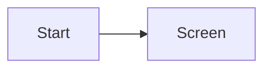
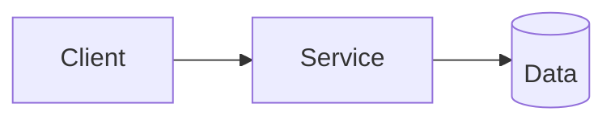
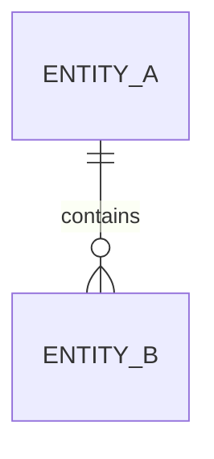
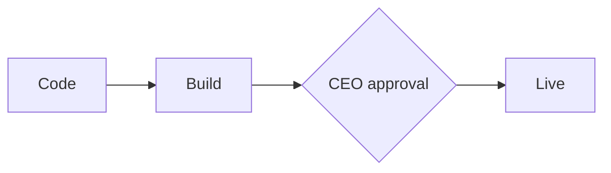

# Spec NNNN — <short name>
<!-- Header fields and Status values stay English (protocol); content is written in English. -->

- Status: Draft | Awaiting approval | Approved | In progress | Shipped
- Tier: full
- Previous spec: <!-- if any: NNNN/AC-x -->
- Self-critique: pending | done
- Budget ceiling: <!-- time and subscription quota share; stop if exceeded -->

## 1. Intent
<!-- Business language, 3-5 sentences: who, why, what success looks like, what is deliberately NOT done. Start with the CEO's own words, then clarify. -->

## 2. Market summary (Product)
<!-- Competitors/similar products, source URL and date. Decision: do / don't / do differently + rationale + risk. -->

## 3. Requirements (EARS)
<!-- Behavior in the form "the system shall ...". No technical solution. REQ-n on every line. -->
- REQ-1 —

## 4. User experience
<!-- The flow; every state of every screen: empty, loading, error, success, unauthorized. An acceptance criterion for each state. A link to the design (not a copy). Accessibility. If there is no UI: "none". -->

## 5. Acceptance criteria
<!-- Each line is independently testable. Happy path, boundaries, empty, invalid input, authorization. -->
- [ ] AC-1 —

## 6. Architecture and technology decision
<!-- Options (at least 2), the choice, rationale, cost/risk. For a new dependency: need, alternatives, maintenance status, license. Architecture board opinion: -->

## 7. Data and API contract
<!-- Entities, fields, types, constraints; endpoints, request/response, error codes. -->

## 8. Threat model and security
<!-- Trust boundaries, abuse cases, personal/sensitive data, authorization. Sensitive-area marker: Sensitive area: <name> | none -->

## 9. Test and evidence plan
<!-- Criterion ↔ test map: AC → which test, which layer (unit/integration/e2e), quick or full profile. -->
| Criterion | Test | Layer | Profile |
|---|---|---|---|
| AC-1 | | | |

## 10. Deployment and disaster recovery
<!-- Target (internal server / Plesk / Cloudflare), steps, rollback plan, backup, monitoring. Deploy with CEO approval. -->

## 11. Legal and compliance
<!-- Privacy law/GDPR, licenses, store rules. A checklist, not a legal opinion. -->

## 12. Task list (atomic)
<!-- Each task: id, acceptance-criterion reference, file/area ownership, dependency, estimated time. -->
| ID | Task | AC | Owning unit | Dependency |
|---|---|---|---|---|
| T-1 | | | | |

## 13. Out of scope
-

## 14. Open questions and Spec critic findings
<!-- If any question is unanswered, the spec does not go to signature. -->

---
## Signature record (CEO only)
Approved by / on: <!-- recorded under approvals/ by harness/approval.js; this line is informational, validity lives in the signature file -->

## Assumptions (for the end-of-job report)
<!-- Type 3 decisions: <what> — <why> -->

## Scorecard (end of job)
| Measure | Value |
|---|---|
| Spec revisions | |
| Fix rounds | |
| Findings: real / noise / deferred | |
| Regressions | |
| Escaped defects | |
| Estimated / actual time and quota | |
